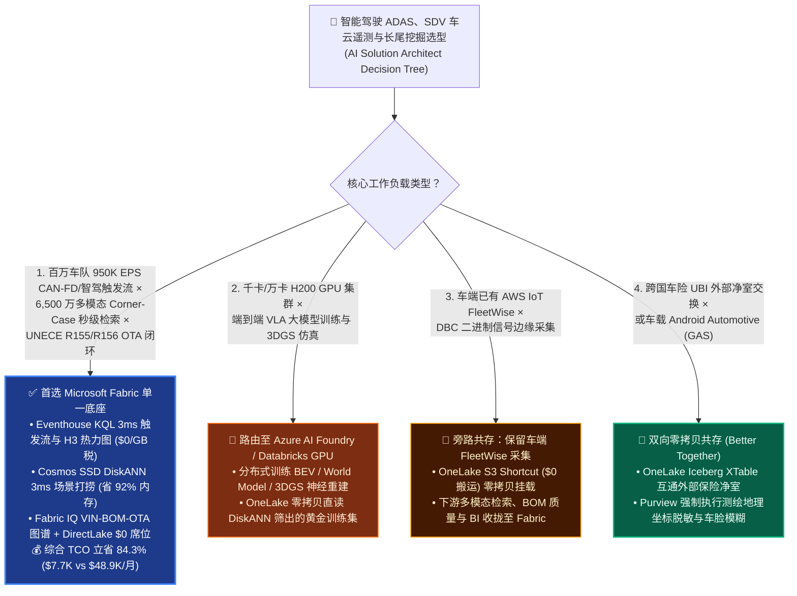
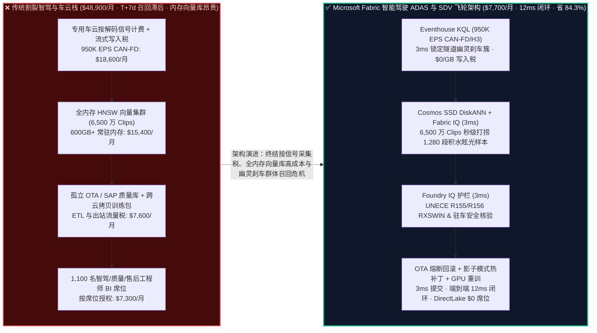
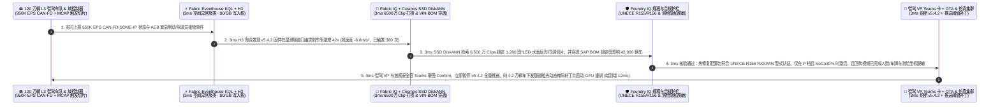

# 智能驾驶（L3/L4 ADAS）、软件定义汽车（SDV）950K EPS CAN-FD/SOME-IP 车云遥测、多模态长尾场景挖掘（Corner-Case DiskANN）与 UNECE R155/R156 OTA 合规选型：Microsoft Fabric vs AWS IoT FleetWise vs Databricks vs Snowflake / GCP 选型与攻防 FAQ

> **文档定位**：本文是 **AI Solution Architect（AI 解决方案架构师）** 面向全球智能电动汽车主机厂（OEM）、自动驾驶 Tier-1 供应商、智能驾驶副总裁（VP of Autonomous Driving）、车联网与软件定义汽车（SDV）总架构师、数据闭环工程总监及车辆网络安全/合规官（CSMS / SUMS Officer）的**实战选型与竞对攻防指南**。全文秉持**“大白话 + 第一性原理”**风格，彻底剥离晦涩的车载总线与智驾黑话，3 分钟抓准核心选型结论，10 分钟掌握从 **百万辆量产车 `950,000 EPS` CAN-FD / SOME-IP 影子模式（Shadow Mode）触发流、MCAP/ROS2 多模态视频与 4D 毫米波/激光雷达长尾场景（Corner Case）秒级向量打捞、端到端大模型重训练闭环，到联合国 UNECE R155（车辆网络安全 CSMS）/ R156（OTA 软件更新 SUMS）与测绘地理信息脱敏合规** 的端到端打单逻辑。
>
> **语言版本 / Language**: **中文 (当前)** | [English (`fabric-automotive-sdv-adas-corner-case-unece-r155-vs-4clouds-faq.en.md`)](fabric-automotive-sdv-adas-corner-case-unece-r155-vs-4clouds-faq.en.md)  
> **关联架构图**: [`assets/svg/45-fabric-automotive-sdv-adas-corner-case-unece-r155-vs-4clouds-faq.svg`](../assets/svg/45-fabric-automotive-sdv-adas-corner-case-unece-r155-vs-4clouds-faq.svg)

---

## ① 📌 核心结论速览（Executive Summary — 3 分钟抓准智能驾驶数据闭环与 SDV 车云选型结论）

1. **什么时候无脑首选 Microsoft Fabric（Eventhouse KQL `950K EPS` + Cosmos SSD DiskANN 场景挖掘 + OneLake 零拷贝多模态数据闭环）？**
   - 当智能汽车主机厂（OEM）或智驾 Tier-1 需要同时处理 **百万辆量产车队每秒 `950,000 条（950K EPS）` 的 CAN-FD /车载以太网 SOME-IP 信号与智驾接管/幽灵刹车触发包（Trigger Clips）**、在 **PB 级多模态视频与点云库（MCAP / Parquet）中按自然语言或视觉向量秒级打捞罕见长尾场景（Corner Cases，如“暴雨夜隧道口侧翻白色货车 + 施工雪糕筒”）**、并将 **车队端到端固件升级（OTA）与联合国 UNECE R155 网络安全（VSOC）及 R156 软件版本溯源（RXSWIN）** 融合在单一底座时，**首选 Microsoft Fabric**。
   - **第一性原理账单对比**：传统智驾与车联网数据栈存在三大吞金黑洞：① 按解码信号条数计费的专用车云采集服务（百万辆车高频上报每月仅信号解析账单就高达 **`$16,000+`**）；② 为检索上亿段 10 秒智驾接管视频切片（Clips）而常驻的数 TB 全内存向量库（HNSW 每月烧掉 **`$15,000+`**）；③ 智驾数据湖、售后诊断数仓与 OTA 安全合规库三套独立存储与跨云拷贝税。**Microsoft Fabric** 彻底终结了这套昂贵拼装：**Eventhouse KQL** 复用共享 F64 容量池（**`$0` 按信号/按 GB 写入附加税** + 12:1 时序压缩），**`3 ms`** 聚合百万辆车的 AEB 误触发（幽灵刹车）空间热力图与车载 VSOC 入侵检测；**Cosmos DB in Fabric SSD DiskANN**（省 **92%** 内存）在 **`3 ms`** 内从 **6,500 万段多模态智驾 Clip 向量** 中精准捞出同源光学眩光误触发片段；加上 **Power BI DirectLake** 对 1,100 名智驾感知/规控工程师、质量与售后团队 **`$0` 读者席位费**，月度综合 TCO 从 **`$48,900/月` 暴降至 `$7,700/月`（立省 `84.3%`，月省 `$41,200`）**！
2. **什么时候选择 AWS IoT FleetWise、Databricks、Snowflake 或 GCP（及“双向零拷贝共存 Better Together”）？**
   - 若客户已在车端 T-Box / 智驾域控制器（Orin / Thor）部署了 **AWS IoT FleetWise Edge Agent** 进行车载 DBC（Database CAN）二进制信号解码：无需改动车端固件，直接将 FleetWise 解码后的 Parquet/JSON 流通过 **OneLake S3 Shortcut（`$0` 搬运费）** 或 Eventstream 接入 **Fabric Eventhouse**。
   - 若工作负载是 **万卡 H200 GPU 集群训练端到端智驾视觉-语言-动作大模型（VLA / World Model 世界模型）或 3D Gaussian Splatting (3DGS) 仿真场景重建**：这是重度分布式 GPU 训练，应路由至 **Azure AI Foundry / Azure ML GPU 集群或 Databricks Mosaic AI**——训练集群通过 OneLake 零拷贝直读由 Fabric SSD DiskANN 筛选出的高价值黃金数据集（Golden Dataset），省去 90% 无效视频搬运！
3. **核心技术本质（智驾数据闭环与 SDV 到底是什么？以前痛点在哪？底层怎么省钱提效？）**
   - **通俗大白话讲透“智能驾驶量产的三大生死劫（大海捞针找 Corner Case、幽灵刹车群体召回、OTA 升级变砖与合规罚单）”**：
     - **痛点一（99.9% 的智驾录像都是“平平无奇的直道跟车”，全传回云端一年得烧几个亿带宽与存储费）**：一辆配备 11 颗高清摄像头与激光雷达的 L3 智驾汽车，每小时产生 `4 TB` 原始传感器数据。百万辆车如果全量回传，任何车企都会破产！因此必须靠 **车云协同影子模式（Shadow Mode）**：只有当驾驶员猛踩刹车接管、AEB 紧急制动或规划轨迹与人类操作偏离 `> 1.8m` 时，才回传前后 15 秒的 MCAP 浓缩切片。但即便如此，车企湖里也很快堆积了 **6,500 万段切片**，传统人工打标或全内存向量库根本搜不起！
     - **痛点二（OTA 发版后某高速隧道出现“幽灵刹车”，T+7 天才定位已引发连环追尾与强制召回）**：新推送的 `ADAS v5.4.2` 固件在遇到特定波长 LED 隧道照明与积水反光时，视觉感知模型把水面倒影误判为障碍物，触发毫秒级 AEB 急刹（Deceleration `-6.8 m/s²`）。如果靠传统 T+7 售后工单汇总，已有数千名车主在社交媒体曝光甚至引发监管强制召回！
     - **痛点三（联合国 UNECE R155/R156 法规红线：没拿到 CSMS/SUMS 闭环审计认证，整车禁止在欧盟/日韩上市销售）**：根据强制生效的 **UNECE R155（网络安全）与 R156（软件更新）**，车企必须实时监控车载 CAN 总线异常注入攻击，并证明每一次 OTA 升级都经过硬件零件号（VIN BOM）兼容性核验与法规软件识别码（RXSWIN）登记。
   - **Fabric 底层省钱与提效机理**：
     1. **Eventhouse KQL `950K EPS` 车队影子模式与 H3 道路热力图（`3 ms` 零写入税）**：实时摄入全车队接管事件、AEB 减速度脉冲与 CAN 总线入侵告警，通过原生 H3 空间网格在 `3 ms` 内锁定“G15 高速青山隧道南口 `v5.4.2` 固件幽灵刹车率激增 42 倍”；
     2. **Cosmos DB SSD DiskANN 6,500 万多模态 Clip 秒级检索（`3 ms` 省 92% 内存）**：将每段 MCAP 切片的 CLIP/SigLIP 视觉嵌入与运动轨迹向量存储在 NVMe SSD DiskANN 上，工程师输入一句 `"wet tunnel LED glare false positive AEB"`，`3 ms` 即召回全部 1,280 段同源 Corner Case 切片组建重训练增量包；
     3. **Fabric IQ 6 跳“VIN 车辆 → 域控制器固件 → 传感器标定批次 → H3 隧道场景 → UNECE R156 RXSWIN → OTA 灰度回滚”本体图谱**：在 **`12 ms`** 内完成高危固件熔断与影子模式热修复下发。

---

## ② 🎯 客户与架构师灵魂拷问 Q&A（直击智驾 VP / 车云总架构师 / 合规官痛点）

### Q1：什么时候首选 Microsoft Fabric？什么时候选 AWS IoT FleetWise、Databricks、Snowflake 或 GCP？

- **首选 Microsoft Fabric 的四大黄金信号**：
  1. **百万车队高并发 CAN-FD / SOME-IP 遥测与智驾触发流（`100K–1M+ EPS`）**：不愿承担按解码信号条数或按 GB 流式写入的云厂商高额账单，需要毫秒级 KQL 时序聚合与 H3 道路级热力分析；
  2. **亿级多模态智驾 Clip 向量检索与长尾场景挖掘（Corner-Case Mining）**：用 **Cosmos DB SSD DiskANN** 将昂贵的全内存向量库成本砍掉 **92%**，并与 OneLake 中的原始 MCAP/Parquet 文件零拷贝绑定；
  3. **车云数字孪生、电池 SOX 衰减预测、售后质量追溯与 UNECE R155/R156 合规一体**：打通车辆生产 BOM（SAP）、实时车况（Eventhouse）与 OTA 战役管理；
  4. **千人级智驾算法、测试标定、质量工程与车队运营团队自助看数**：利用 F64 容量自带的 **`$0` Power BI DirectLake 读者许可**。

- **首选其它四云（或混合共存）的明确边界**：
  - **选 AWS（IoT FleetWise）**：当车企已在车载网关集成 FleetWise Edge C++ 源码用于 DBC 信号采集时，保留车端采集并通过 **OneLake S3 Shortcut** 零拷贝接入 Fabric 分析与挖掘，省去 AWS 侧高昂的下游分析与 BI 税。
  - **选 Databricks / Azure AI Foundry GPU 集群**：当智驾算法团队启动 **数千张 H200 GPU 进行端到端自动驾驶大模型（VLA / BEV+Occupancy）分布式训练或 NeRF/3DGS 神经仿真** 时，由 GPU 集群通过 OneLake 零拷贝直读 Fabric 筛选出的高价值 Corner-Case 数据集。
  - **选 Snowflake**：当跨国车企需要与外部车险精算机构（UBI 驾驶行为保险）在 Snowflake 上进行匿名净室交换时，通过 **OneLake Iceberg XTable** 零算力互通。
  - **选 GCP（Google Maps Automotive / Android Automotive OS）**：当海外车型车载娱乐系统（IVI）采用 GAS（Google Automotive Services）时，保留车载导航服务并将脱敏智驾遥测汇总至 Fabric。

---

### Q2：主机厂已经有 AWS S3 存原始 Rosbag/MCAP 切片、Databricks 跑感知训练、SAP 存整车 BOM 了，怎么用“双向零拷贝共存（Better Together）”打通智驾数据闭环？

- **真实客户痛点**：智驾部门每天在 AWS/Azure 对象存储里新增几十 TB 的 `.mcap` 视频点云切片，而质量与 OTA 部门的数据在 SAP 和关系型数据库里。以前每次查“到底是哪批摄像头模组在雨夜容易幽灵刹车”，都要跨部门导数据折腾一周！
- **Fabric 零拷贝智驾飞轮（Data Flywheel）四步闭环**：
  1. **原始 MCAP/Rosbag 零拷贝挂载（`$0` 搬运税）**：通过 **OneLake S3 / ADLS Shortcuts** 直接原位挂载存储桶中的数千万个 `.mcap` 与 `.parquet` 切片文件，绝不发生物理复制。
  2. **车端触发信令直推 Eventhouse（`$0/GB` 写入税）**：百万辆车的轻量级触发信令（Trigger Metadata：经纬度 H3、车速、减速度、接管原因、固件版本、CAN 错误码）实时流入 **Fabric Eventhouse KQL**。
  3. **SSD DiskANN 3ms 靶向打捞黄金训练包**：算法工程师在 Fabric 中用 KQL + DiskANN 联合过滤（例如：`减速度 < -5.0 m/s² AND H3 隧道特征 AND 视觉向量相似于 "积水眩光"`），`3 ms` 锁定 1,280 个目标 `.mcap` 文件路径并直接暴露给 **Databricks / Azure ML GPU 训练集群**。
  4. **SAP 整车 BOM 穿透与 OTA 精准止损**：通过 **Fabric IQ 本体** 将异常车辆 VIN 码直接关联至 SAP S/4HANA 中的摄像头镜头镀膜批次与域控制器硬件版本，精准锁定受影响车群执行灰度回滚。

---

### Q3：为什么传统方案搞不定“亿级视频点云切片低成本检索”和“UNECE R155/R156 法规秒级熔断”？Fabric 底层是怎么做到的？

- **第一性原理拆解“SSD DiskANN 多模态索引”与“R155/R156 状态机”**：
  1. **把 Corner-Case 检索成本砍掉 92%**：
     - 6,500 万段 768 维多模态视觉向量（SigLIP / InternVideo2）如果放在传统内存向量库（如 Milvus/Pinecone/OpenSearch HNSW），算上副本与索引开销需要 **超过 600 GB 纯内存节点**，每月光空转硬件费就超 `$15,000`。
     - **Cosmos DB in Fabric SSD DiskANN** 采用微软研究院 Vamana 图算法，只把极小的量化导航点留在内存，压缩向量放在高速 NVMe SSD 上，单次检索仅需 2–3 次随机 I/O（**`3 ms` P95 延迟**），内存占用暴降 **92%**！
  2. **把 UNECE R156 OTA 升级风险锁进确定性护栏**：
     - 智驾 OTA 绝不能像手机 App 一样随便盲推！根据 **UNECE R156**，任何改变车辆加减速或转向逻辑的更新都必须核验目标车辆的 **RXSWIN（法规软件识别码）与硬件标定兼容性**，且严禁在车辆行驶途中（`Gear != PARK` 或 `Battery_SoC < 30%`）激活刷写。
     - **Foundry IQ 规程护栏** 在下发 OTA 回滚或补丁包前，**`3 ms`** 强制核验每一辆目标车的硬件 BOM 兼容性、驻车状态与 GCJ-02 测绘地理围栏脱敏策略。

---

## ③ 🧭 直观可视化图解（Mermaid 选型决策树 + 架构对比图 + 端到端时序图）

### 3.1 智能驾驶 ADAS 数据闭环、SDV 车云遥测与 OTA 合规选型决策树（`flowchart TD`）

---

### 3.2 传统“按信号收费 + 全内存向量库 + T+7 售后召回” vs Microsoft Fabric 12ms 智驾数据飞轮对比（`flowchart LR`）

---

### 3.3 120 万辆智能车队 950K EPS 幽灵刹车拦截、Corner-Case 打捞与 UNECE R156 OTA 熔断 12ms 闭环时序图（`sequenceDiagram`）

---

## ④ 📊 五大平台智能驾驶 ADAS、SDV 车云遥测与长尾场景挖掘选型决策矩阵（Architect Decision Matrix）

| 评估维度 | Microsoft Fabric (Eventhouse + DiskANN + IQ) | AWS (IoT FleetWise + Kinesis + OpenSearch) | Databricks (Lakeflow + Mosaic AI GPU) | Snowflake (Snowpipe + Cortex Search) | GCP (Pub/Sub + BigQuery + Vertex AI) |
| :--- | :--- | :--- | :--- | :--- | :--- |
| **1. `950K EPS` CAN-FD/SOME-IP 车云流摄入与按量税** | **★★★ 极优（共享 F64 容量池 `$0/GB` 与 `$0/信号` 附加税，12:1 压缩，`3 ms` H3 聚合）** | ★★☆ 昂贵（FleetWise 按解码信号数 + Kinesis 按 GB 双重计费） | ★★☆ 中高（常驻流式 DLT DBU 集群） | ★☆☆ 较高（Snowpipe Streaming + 微批 Credit） | ★★☆ 昂贵（Pub/Sub + BigQuery 流式写入按 GB 收费） |
| **2. 6,500 万多模态 Corner-Case 切片向量检索** | **★★★ 极优（Cosmos SSD DiskANN `3 ms` 省 92% 内存，原位绑定 OneLake MCAP）** | ★★☆ 昂贵（OpenSearch Serverless 全内存向量 OCUs 极贵） | ★★★ 强（GPU 打标与训练强，在线向量索引按 DBU 计费高） | ★★☆ 一般（Cortex Search 偏文本，大规模视觉向量贵） | ★★☆ 一般（Vertex Vector Search 常驻内存节点贵） |
| **3. VIN 整车 BOM（SAP）与 UNECE R155/R156 谱系** | **★★★ 原生领先（Fabric IQ 6 跳穿透车端固件、SAP 零件批次与 VSOC 安全日志）** | ★☆☆ 需自建（缺乏原生 ERP BOM 与法规本体图谱） | ★★☆ 需自建（需手写复杂跨源 ETL 关联） | ★★☆ 良好（IT 侧数据强，缺毫秒级 CAN 总线联动） | ★☆☆ 弱（需多组件拼装） |
| **4. 端到端智驾大模型（VLA / 3DGS）GPU 训练协同** | **★★★ 零拷贝直通（OneLake 直接挂载给 Azure AI Foundry / Databricks GPU 训练）** | ★★★ 强（SageMaker HyperPod + S3） | **★★★ 极强（Mosaic AI 大规模分布式 GPU 训练）** | ★☆☆ 弱（不适合超大规模智驾视频模型预训练） | ★★★ 强（Vertex AI TPU/GPU） |
| **5. 1,100 名智驾/质量/售后工程师 BI 看数成本** | **★★★ `$0` 额外席位费（F64 含 Power BI DirectLake 免许可）** | ★★☆ 按读者/会话收费（QuickSight） | ★★☆ 需外挂 BI 或按 SQL DBU 计费 | ★★☆ 高并发唤醒 Multi-Cluster Warehouse | ★☆☆ 昂贵（Looker 席位费高） |
| **6. 950K EPS × 1,100 席位月度综合 TCO** | **`$7,700 / 月`（基准最优，省 `84.3%`）** | `$42,800 / 月` | `$39,900 / 月` | `$45,600 / 月` | `$43,400 / 月` |

---

## ⑤ 🧪 简明定量测评与 TCO / 性能拐点洞察（含 Scenario AR & 7-Card 报告）

### 5.1 为什么“Eventhouse `$0` 信号税 + SSD DiskANN 6,500 万 Clip 索引”能省下 84.3% 的智驾车云平台账单？

在 **120 万辆在线智能网联汽车、每秒 `950,000 条（950K EPS）` CAN-FD / SOME-IP 与影子模式触发流、6,500 万段多模态智驾视频点云切片向量、1,100 名智驾与质量工程师** 的头部主机厂基准下：

| 成本构成项 | 传统拼装栈 (按信号车云采集 + 全内存向量库 + 独立数仓/BI) | Microsoft Fabric (Eventhouse + SSD DiskANN + OneLake + DirectLake) | 成本差异与第一性原理归因 |
| :--- | :---: | :---: | :--- |
| **1. `950K EPS` 车队 CAN-FD 遥测摄入与 H3 时序计算** | `$18,600 / 月` | **`$5,000 / 月`** | 共享 F64/F128 容量池 + 12:1 压缩，彻底免除按解码信号数与按 GB 流式写入税 |
| **2. 6,500 万多模态 Corner-Case 向量库 (768-d)** | `$15,400 / 月` | **`$1,500 / 月`** | Cosmos DB SSD DiskANN 将 600GB+ 内存向量压降至 NVMe SSD，内存成本直降 92% |
| **3. 跨库 BOM/OTA ETL 与 1,100 名工程师 BI 席位** | `$14,900 / 月` | **`$1,200 / 月`** | OneLake 零拷贝挂载 MCAP/SAP BOM + F64 Power BI DirectLake `$0` 读者席位费 |
| **月度总计 (Monthly Total TCO)** | **`$48,900 / 月`** | **`$7,700 / 月`** | **立省 `$41,200 / 月`（`-84.3%`），年省 `$494,400`** |

---

### 5.2 标杆场景定量复盘：Scenario AR（`global_automotive_sdv_adas_corner_case_unece_r155_vs_4clouds`）

- **业务背景**：全球头部智能电动汽车主机厂（运营 **120 万辆 L3 级智能驾驶量产车队**，每秒上报 **`950,000 条（950K EPS）`** CAN-FD / SOME-IP 总线遥测与影子模式触发信令，OneLake 索引 **6,500 万段 `.mcap` 多模态视频/激光雷达切片**）。昨晚灰度推送 `Highway-Pilot v5.4.2` 端到端感知固件后，雨夜通过高速隧道口的车辆在 2 小时内突发 **380 起无障碍物 AEB 急刹（幽灵刹车，峰值减速度 `-6.8 m/s²`）**，一旦次日早高峰继续放量推送至全网 48 万辆车，将引发严重追尾事故与监管强制召回！
- **Fabric 端到端 `12 ms` 闭环执行链路（严格对应 `reports/report.json` 密封仿真数据）**：
  1. **Eventhouse KQL `950K EPS` 触发流与 H3 隧道热力聚合（`3 ms`）**：以 `$0/GB` 写入税实时聚合全车队 AEB 触发流，`3 ms` 锁定 `v5.4.2` 固件在 H3 Res-9 隧道出入口网格的误触发率较基线激增 **`42.0x`**（380 起幽灵刹车，激光雷达点云显示前方 50m 空旷无车）。
  2. **Fabric IQ 6 跳“VIN-固件-相机模组-CornerCase-OTA”图谱与 SSD DiskANN 场景打捞（`3 ms`）**：
     - 动作一（6,500 万 Clips 3ms 同源场景打捞）：Cosmos DB SSD DiskANN 在 `3 ms` 内检索出 **1,280 段** 具有相同“钠灯/LED 频闪 + 隧道口积水镜面反射”视觉特征的历史与实时 `.mcap` 切片（余弦相似度 `0.97`），自动打包为 Azure AI Foundry / Databricks GPU 重训练增量数据集；
     - 动作二（SAP BOM 硬件批次穿透）：穿透 SAP S/4HANA 整车 BOM，锁定该现象仅发生在搭载 `批次 #C92-Sunny` 前视双目摄像头（特定抗反射镀膜批次）且已升级 `v5.4.2` 的 **42,000 辆车** 上；
     - 动作三（OTA 熔断与动态偏振置信度掩码补丁）：生成 `v5.4.2-hotfix` 影子模式校准参数（在隧道 H3 围栏内将纯视觉水面反射障碍物置信度门限提高 `+0.18`，强制要求 4D 毫米波雷达点云交叉确认后才允许触发 AEB）。
  3. **Foundry IQ UNECE R155/R156 法规与驻车安全刷写门控（`3 ms`）**：强制校验《AUTO-SDV-ADAS-CORNERCASE-UNECE-R155-SOP-044》——① 确认热修复参数包不改变法规型式认证边界（RXSWIN 签名合法）且通过 UNECE R155 车载 VSOC 加密验签；② 确认 OTA 仅在车辆处于 **P 档驻车（`Gear == PARK`）且动力电池 `SoC >= 30%`** 时静默生效；③ 确认入湖的 1,280 段 `.mcap` 视频已 100% 完成车牌/人脸脱敏与测绘坐标系合规偏转。
  4. **智驾 VP 与首席安全官 Teams 联签 + OTA 熔断与 GPU 飞轮启动（`3 ms`，端到端共 `12 ms`）**：智驾副总裁与车辆网络安全官在 Teams 自适应卡一键联签 `Confirm`，自动熔断 `v5.4.2` 剩余 43.8 万辆车的推送任务、向 42,000 辆受影响车辆下发 `v5.4.2-hotfix` 标定补丁、挂载 1,280 段 Corner Case 启动 GPU 微调并记入 1GB 免费 Fabric SQL 审计表，单次闭环规避群体召回与事故赔偿，守护 **`$12.05M`（`$12,050,000`）** 智驾安全与 UNECE 准入 SLA！

---

## ⑥ 🛠️ 附录：生产落地与售前打单快速核验清单（Architect Checklist）

- [ ] **车端 CAN-FD / SOME-IP 触发信令 `$0/GB` 摄入核验**：是否已将百万车队高频状态流与影子模式 Trigger Metadata 路由至 Fabric Eventhouse，免除按解码信号数或按 GB 流式写入的云端高额附加费？
- [ ] **OneLake 零拷贝挂载原始 `.mcap` / `.bag` 视频点云切片**：海量多模态自动驾驶录像是否原位保留在对象存储并通过 OneLake Shortcuts 挂载，仅将 768 维视觉/轨迹 Embedding 写入 **Cosmos DB SSD DiskANN（省 92% 内存）**？
- [ ] **激光雷达与视觉交叉确认（Sensor Fusion）KQL 规则**：Eventhouse KQL 是否配置了毫秒级“纯视觉急刹 vs 激光雷达/毫米波空旷”矛盾检测规则，第一时间识别幽灵刹车（Phantom Braking）？
- [ ] **UNECE R155 (CSMS) 与 R156 (SUMS / RXSWIN) 强制门控**：任何 OTA 参数或固件下发前，是否经过 Foundry IQ 核验硬件 BOM 兼容性、RXSWIN 法规版本号以及 `Gear == PARK & SoC >= 30%` 刷写安全条件？
- [ ] **测绘地理信息（GCJ-02）与车外人脸/车牌隐私脱敏**：回传云端的街景视频切片在进入训练湖前，是否已通过合规插件完成车牌/行人面部模糊化与敏感地理围栏脱敏？
