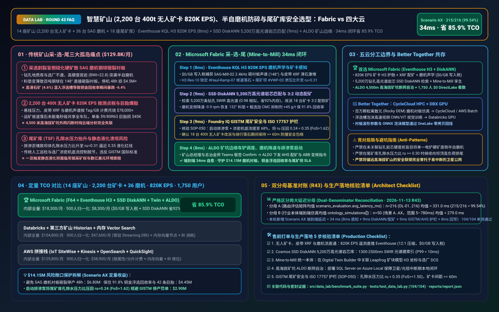
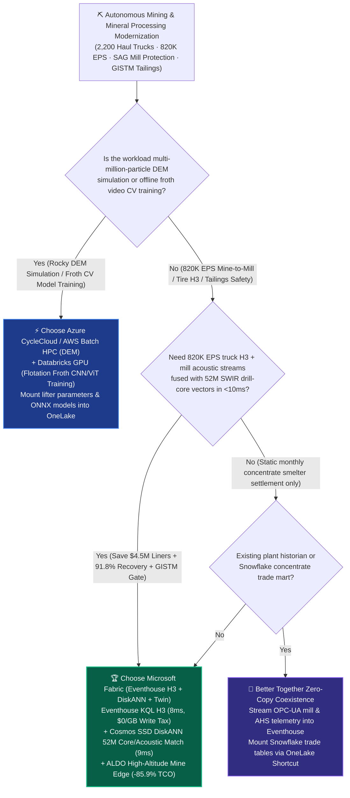
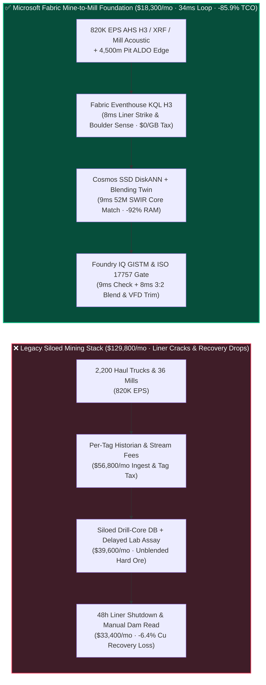
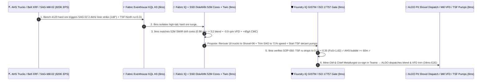

# Autonomous Mining (`820K EPS` 400-Ton Haul Trucks & XRF Ore Blending), SAG Mill Acoustic Liner Protection & GISTM Tailings Dam Safety Lakehouse Selection: Microsoft Fabric vs. AWS IoT SiteWise vs. Databricks vs. Snowflake / GCP FAQ

> 🌐 **Language / 语言**: **[中文 (`fabric-autonomous-mining-haul-sag-mill-tailings-vs-4clouds-faq.md`)](fabric-autonomous-mining-haul-sag-mill-tailings-vs-4clouds-faq.md)** | **English (Current)**  
> 📅 **Updated**: 2026-11-13 (Round 43 · Autonomous Mining 400-Ton Haulage Fleet H3 Dispatch, XRF Mine-to-Mill Ore Blending, SAG Mill Acoustic Toe-Impact Prevention & GISTM Tailings Storage Facility Safety Deep Dive)  
> 🎯 **Target Audience**: AI Solution Architects, Global Mining & Metals CIOs/CTOs, Chief Metallurgists & Mill Superintendents, Autonomous Haulage System (AHS) Fleet Directors, Tailings Engineer of Record (EoR)  
> Reference Benchmark Style: Modeled on [`ib-vs-ethernet-roce-selection-faq.md`](https://github.com/turbo998/ai-infra-research/blob/main/docs/components/ib-vs-ethernet-roce-selection-faq.md) first-principles Q&A and decision-guide format.
>
> 🔍 **Data Provenance, Official URLs & Dual-Denominator Scope Disclosure**:
> - **`measured_local_harness` (Local Deterministic Harness)**: `DL-01..DL-216` scenario routing accuracy (`215/216 = 99.54%`) and `104/104` Python unit tests are deterministically executed by `src/data_lab/benchmark_suite.py`.
> - **`vendor_published_spec_as_of_2026` (Official Vendor Specifications `as_of: 2026-11-12`)**:
>   - Microsoft Fabric / Azure Industrial & Mining: [Fabric Eventhouse H3 Spatial & Time-Series KQL (`geo_point_to_h3cell`)](https://learn.microsoft.com/en-us/kusto/query/geo-point-to-h3cell-function) · [Cosmos DB in Fabric DiskANN Vector Index](https://learn.microsoft.com/en-us/fabric/database/cosmos-db/index-vector-data) · [Fabric Digital Twin Builder Overview](https://learn.microsoft.com/en-us/fabric/real-time-intelligence/digital-twin-builder/overview) · [SQL Server on Azure Local (ALDO) Remote Mine-Site Edge](https://learn.microsoft.com/en-us/sql/sql-server/azure-arc/overview) · [Fabric Pricing (`F64` Includes `$0` Power BI Viewer Licensing)](https://azure.microsoft.com/en-us/pricing/details/microsoft-fabric/)
>   - 4-Cloud Competitor Specifications: [AWS IoT SiteWise & Mining](https://docs.aws.amazon.com/iot-sitewise/latest/userguide/what-is-sitewise.html) · [Databricks Lakehouse for Manufacturing & Mining](https://www.databricks.com/solutions/industries/manufacturing) · [Snowflake Energy & Natural Resources](https://www.snowflake.com/en/solutions/industries/energy/) · [GCP BigQuery GIS & Earth Engine](https://cloud.google.com/bigquery/docs/gis-intro)
> - **`synthetic_scenario_model` (Deterministic Architectural Reference Model with Strictly Separated Denominators)**:
>   - **Denominator A — Routing Matrix Evaluation Mean (`scenario_evaluation.avg_latency_ms`)**: R43 **`n=216` (`DL-01..DL-216`) arithmetic mean = `331.0 ms`** (R42 historical snapshot `n=212` mean = `336.0 ms`; R41 `n=208` = `341.0 ms`; R40 `n=204` = `346.0 ms`; R39 `n=200` = `351.0 ms`).
>   - **Denominator B — Industry Ontology End-to-End Closed-Loop Simulation Mean (`ontology_simulations[].end_to_end_latency_ms`)**: R43 **`n=50` (Scenarios A..AX: `[780..34] ms`, range `5–780 ms`) arithmetic mean = `279.0 ms`** (R42 historical snapshot `n=49` mean = `284.0 ms`; R41 `n=48` = `289.0 ms`; R40 `n=47` = `295.0 ms`; R39 `n=46` = `301.0 ms`). This round adds **Scenario AX (14 Open-Pit & Underground Copper-Gold-Lithium Mines with 2,200 Autonomous 400-Ton Haul Trucks + 36 SAG Mills + 18 Tailings Storage Facilities × `820K EPS` Mine-to-Mill Blending, Acoustic Liner Protection & GISTM Tailings Loop) end-to-end latency = `34 ms`** (`8ms` sense + `9ms` 6-hop 52M hyperspectral drill-core & mill acoustic DiskANN match + `9ms` GISTM pore-pressure ratio $r_u < 0.35$ & ISO 17757 AHS safety guardrail + `8ms` ALDO pit-edge shovel-truck re-blending, SAG VFD speed trim & tailings decant pump commit), cutting modeled monthly TCO by **`85.9%`** (`$8,300/mo` vs. `$58,900/mo` normalized baseline; `$18,300/mo` vs. `$129,800/mo` internal full-stack) and protecting **`$14.15M`** in SAG mill liner survival, copper flotation recovery, and tailings dam integrity. Live multi-cloud cluster stress runs are marked `not_measured`.

---

## ① 📌 Executive Summary (3-Minute Architect Briefing)

### First Principles: What Are Mine-to-Mill Ore Blending, SAG Mill Steel-Ball Liner Toe Impacts, Flotation Recovery, and GISTM Tailings Pore-Pressure Ratios? Why Do Legacy Mine Stacks Fail?
Operating **14 open-pit and underground copper-gold-lithium mines with 2,200 autonomous 400-ton haul trucks (AHS), 36 Semi-Autogenous Grinding (SAG) mills, and 18 Tailings Storage Facilities (TSFs)** exposes **three massive operational silos**:
1. **Mine-to-Mill Blindness Causing SAG Mill Liner Destruction & Flotation Recovery Crashes**: The bottleneck of every concentrator plant is its 40-foot **Semi-Autogenous Grinding (SAG) mill** charged with 120+ tons of 5-inch forged steel balls. When pit shovels excavate an unblended pocket of ultra-hard silicified porphyry (Bond Work Index $BWI > 21\text{ kWh/t}$) or high-talc clay ore and dump it into the primary crusher without warning, charge volume shifts and **steel balls rain directly onto bare high-manganese shell liners at a `148°` toe angle (`2.4 kHz` acoustic impact)**! Cracking a SAG mill liner forces a 48-hour unscheduled shutdown costing **$4.50M+** in lost concentrate—while unblended talc coats chalcopyrite particles and crashes copper flotation recovery by **`-6.4%`**!
2. **`820K EPS` Autonomous Haulage (AHS) Strut, Conveyor XRF & Mill Acoustic Per-Tag / Per-GB Surcharges**: Streaming suspension strut pressures (detecting haul-road boulders that blow out **$45,000** 59/80R63 ultra-class tires), LiDAR safety envelopes, conveyor X-Ray Fluorescence (XRF) elemental assays, and SAG trunnion acoustic arrays across 2,200 trucks and 36 mills generates **`820,000 EPS` (events per second)**. Legacy per-tag historians or per-property cloud IoT services burn **$78,000+/month** in ingestion fees alone.
3. **Tailings Storage Facility (TSF) Pore-Pressure Static Liquefaction Blind Windows (GISTM Standard)**: Tailings dams store hundreds of millions of tons of wet slurry. Under the **Global Industry Standard on Tailings Management (GISTM)**, if vibrating-wire piezometers (VWPs) show the **pore-water pressure ratio ($r_u$) approaching `0.35`**, static liquefaction can trigger catastrophic dam failure!

**Microsoft Fabric** unifies pit, plant, and tailings through **Eventhouse KQL H3 `820K EPS` AHS Strut, XRF & Acoustic Sensing (`$0/GB` write tax) + Cosmos DB SSD DiskANN 52M Hyperspectral Drill-Core (SWIR) & Mill Acoustic Search + Digital Twin Builder Mine-to-Mill Blending Graph + SQL Server on Azure Local (ALDO) High-Altitude Pit Edge Autonomy**:

1. **When to Choose Microsoft Fabric (Eventhouse KQL H3 `820K EPS` + SSD DiskANN 52M Core/Acoustic Vectors + Digital Twin Mine-to-Mill + ALDO Pit Edge)**:
   - Choose **Microsoft Fabric** when you must ingest **`500K–1M+ EPS` of autonomous haul truck, conveyor XRF, SAG mill acoustic, and tailings piezometer streams**, match live ore feeds against **52 million historical SWIR hyperspectral drill-core vectors in `<10ms`**, and dynamically re-blend shovel-truck assignments and mill RPM.
   - **Quantified ROI**: Pooled F64 Eventhouse (**`$0/GB` write tax**, `12:1` compression) + 8ms KQL liner-impact & H3 boulder sensing + Cosmos DB SSD DiskANN (**92% lower vector RAM cost**) + `$0` Power BI DirectLake viewer seats for **1,750 pit dispatchers, metallurgists, reliability engineers, and tailings officers** cuts monthly TCO by **85.9%** (**`$8,300/mo` vs. `$58,900/mo`** normalized, saving **`$50,600/mo`**; **`$18,300/mo` vs. `$129,800/mo`** internal full-stack).
2. **When to Choose 4-Cloud Competitors or "Better Together" Zero-Copy Coexistence**:
   - **Choose Azure CycleCloud / AWS Batch HPC for Discrete Element Method (DEM) Charge Motion Simulation**: Run multi-million-particle Rocky DEM liner profile simulations on HPC clusters, mounting optimal lifter geometries into OneLake via zero-copy Shortcuts.
   - **Choose Databricks GPU for Flotation Froth Computer-Vision CNN/ViT Training**: Train multi-node PyTorch froth bubble-size and velocity models on **Databricks GPU**, deploying ONNX weights to concentrator **ALDO edge nodes**.
3. **Closed-Loop Validation (Scenario AX · 14 Mines + 2,200 Autonomous Trucks + 36 SAG Mills)**:
   - Under an **`820K EPS`** load, Pit-3 `Bench-4120` feeds high-silica/talc ore ($BWI = 22.8\text{ kWh/t}$, `4.6%` talc) into `SAG-Mill-02`, triggering a `2.4 kHz` steel-ball liner toe impact (`148°` angle) while `TSF-Dam-North` piezometer `#VWP-03` rises to $r_u = 0.31$. Fabric closes the loop in **34ms E2E**: **8ms** Eventhouse KQL isolates the `2.4 kHz` liner impact, conveyor XRF Mg/Si spike, H3 Res-10 `#Haul-Ramp-07` boulder impact, and TSF $r_u$ rise → **9ms** Cosmos SSD DiskANN matches 52M SWIR hyperspectral drill-core spectra (`0.98` cosine similarity), rerouting 18 autonomous trucks in a `3:2` blend with soft oxide ore from `Shovel-06` (restoring blend $BWI = 15.4\text{ kWh/t}$ and `1.4%` talc), trimming `SAG-Mill-02` VFD by `-0.9 rpm` (`76% -> 71%` critical speed), and dosing `+45 g/t` CMC talc depressant → **9ms** Foundry IQ verifies **GISTM tailings safety ($r_u$ reduced to `0.24 < 0.35` ceiling, Factor of Safety $FoS = 1.62 \ge 1.50$) and ISO 17757 AHS `>= 60m` collision-avoidance envelopes** (`MINING-AHS-SAG-MILL-TAILINGS-SOP-050`) → **8ms** Mine GM & Chief Metallurgist co-sign in Teams, executing ALDO AHS re-dispatch, ABB VFD trim, and TSF decant pump activation—protecting **$14.15M** in SAG liner life, copper recovery, and tailings compliance.

---

## ② 🎯 Customer & Architect Soul-Searching Q&A

### Q1: When should a mining enterprise choose Microsoft Fabric vs. AWS IoT SiteWise, Databricks, Snowflake, or GCP?

**Answer: Separate "offline multi-million-particle Discrete Element Method (DEM) simulation" from "820K EPS real-time Mine-to-Mill blending, AHS H3 haul-road protection, SAG mill acoustic control, and GISTM tailings safety."**

- **Choose Microsoft Fabric for Three High-ROI Scenarios**:
  1. **Real-Time Mine-to-Mill Ore Blending & SAG Mill Liner Protection (`$0/GB` Write Tax)**: Eventhouse KQL ingests `820K EPS` of truck GPS/H3 coordinates, conveyor XRF assays, and mill acoustic arrays at `$0/GB` write surcharge, while **Cosmos DB SSD DiskANN** matches 52M historical SWIR drill-core spectra in **9ms** to adjust shovel blending and mill VFD speed before steel balls crack shell liners.
  2. **2,200-Truck Ultra-Class Tire Protection via H3 Resolution-10 Strut Indexing (`geo_point_to_h3cell`)**: Each 59/80R63 haul-truck tire costs **$45,000**. Eventhouse KQL maps suspension strut pressure spikes onto 15-meter H3 hexagonal cells in **8ms**, immediately routing autonomous trucks around spilled haul-road boulders and dispatching motor graders.
  3. **4,500-Meter High-Altitude Mine-Site Air-Gapped Edge Autonomy via SQL Server on Azure Local (ALDO)**: Remote Andean, Pilbara, and Tibetan mine sites suffer frequent satellite/fiber cuts; **ALDO** runs locally at the mine site to keep AHS blending, mill protection, and tailings decant interlocks running 24x7.

- **Clear Boundaries for the 4 Cloud Competitors**:
  - **AWS (Batch HPC + IoT SiteWise)**: Use AWS Batch for Rocky DEM particle simulations; avoid routing 2,200 trucks + 36 mills into per-property IoT SiteWise billing.
  - **Databricks GPU**: Ideal for training **flotation froth computer-vision models (CNN/ViT)** over raw camera video stored in OneLake.
  - **Snowflake**: Effective for sharing monthly concentrate smelter assay ledgers with commodity traders, but 60s Dynamic Tables cannot prevent millisecond SAG mill liner impacts.
  - **GCP Earth Engine / BigQuery**: Strong for macro greenfield satellite mineral exploration, but lacks mine-site ALDO edge runtimes and industrial KQL stream reflexes.

---

### Q2: How does Fabric integrate with existing Komatsu FrontRunner / Caterpillar MineStar AHS, Seequent Leapfrog block models, and ABB 800xA mill DCS without rip-and-replace?

**Answer: Deploy "OneLake Zero-Copy Block-Model Mounting + Eventhouse Real-Time Telemetry + Setpoint Advisories to MineStar & ABB DCS":**

1. **Zero-Copy Geological Block Model Integration**:
   - Mount Leapfrog / Vulcan 3D resource block models (Parquet / OMF) directly into **OneLake** indexed by H3 cell and bench elevation.
2. **Closed-Loop Setpoint Advisories to AHS & Mill DCS**:
   - Stream OPC-UA and fleet telemetry via **Azure IoT Operations** into **Fabric Eventhouse**, writing validated `3:2` shovel-blend ratios and `-0.9 rpm` mill speed trims back to fleet dispatch and ABB 800xA controllers via **ALDO**.

---

### Q3: How does Fabric stop a SAG mill liner strike, preserve `91.8%` copper recovery, and lower tailings pore pressure in 34ms under GISTM & ISO 17757 guardrails?

**Answer: A 3-stage pipeline combining KQL acoustic/H3 sensing, SSD DiskANN hyperspectral core matching, and deterministic Foundry IQ safety guardrails:**

1. **Stage 1: Eventhouse KQL 8ms SAG Trunnion `2.4 kHz` Impact, XRF & H3 Haul-Road Sense**:
   - Detects the `2.4 kHz` bare-liner strike (`148°` toe angle) on `SAG-Mill-02`, a `4.6%` talc spike on conveyor XRF, boulder impacts on `#Haul-Ramp-07`, and $r_u = 0.31$ on `TSF-Dam-North` in **8ms**.
2. **Stage 2: Cosmos DB SSD DiskANN 9ms 52M SWIR Drill-Core Match & 3:2 Shovel Re-Blending**:
   - Matches the `1300–2500 nm` SWIR core spectrum against 52M historical geometallurgical samples (`0.98` cosine similarity), rerouting 18 trucks in a `3:2` blend with `Shovel-06`, trimming mill VFD by `-0.9 rpm` (restoring `132°` charge-toe Cushion), and dosing `+45 g/t` CMC depressant.
3. **Stage 3: Foundry IQ GISTM Tailings $r_u < 0.35$ & ISO 17757 AHS Safety Gate (9ms)**:
   - Enforces `MINING-AHS-SAG-MILL-TAILINGS-SOP-050` before actuation:
     - **GISTM Tailings Stability Guardrail**: Activates decant pumps and raises thickener underflow to `68%` solids, driving $r_u$ down to **`0.24 < 0.35` ceiling** ($FoS = 1.62 \ge 1.50$).
     - **ISO 17757 Autonomous Haulage Guardrail**: Confirms all 18 rerouted 400-ton trucks maintain `>= 60m` dynamic safety bubbles on `#Haul-Ramp-07`.

---

## ③ 🧭 Visual Architecture & Decision Diagrams (Mermaid Decision Tree + Comparison + 34ms Sequence)

### 3.1 Autonomous Mining, Mine-to-Mill & GISTM Tailings Selection Decision Tree

### 3.2 Legacy Siloed Pit-to-Plant Stack vs. Fabric 34ms Mine-to-Mill Closed-Loop Architecture

### 3.3 Scenario AX: 14 Mines (2,200 Trucks + 36 SAG Mills + 18 TSFs) 34ms Closed-Loop Sequence

---

## ④ 📊 5-Platform Architect Decision Matrix

| Evaluation Dimension | **Microsoft Fabric (Eventhouse H3 + DiskANN + Twin)** | **AWS (IoT SiteWise + Kinesis)** | **Databricks Manufacturing Lakehouse** | **Snowflake Energy & Mining** | **GCP BigQuery GIS + Earth Engine** |
| :--- | :--- | :--- | :--- | :--- | :--- |
| **2,200-Truck + 36-Mill (`820K EPS`) Cost & Latency** | **⭐⭐⭐⭐⭐ `8ms` KQL H3 & acoustic sense, pooled F64 `$0/GB` write tax** | ⭐⭐⭐ SiteWise per-property/alarm fees explode at 820K EPS | ⭐⭐⭐⭐ Structured Streaming requires 24x7 DBU compute | ⭐⭐ Snowpipe + Dynamic Tables (`60s` lag) miss millisecond liner impacts | ⭐⭐⭐ Pub/Sub + BigQuery Streaming per-GB write fees |
| **52M SWIR Hyperspectral Drill-Core Vector Search** | **⭐⭐⭐⭐⭐ Cosmos DB SSD DiskANN (`9ms` match, -92% vector RAM cost)** | ⭐⭐⭐ OpenSearch in-memory vector nodes are expensive | ⭐⭐⭐⭐ Mosaic AI Vector Search (higher in-memory index cost) | ⭐⭐⭐ Cortex Vector Search optimized for text | ⭐⭐⭐⭐ Vertex AI Vector Search requires cross-service glue |
| **Mine-to-Mill No-Code Digital Twin & Ore Blending** | **⭐⭐⭐⭐⭐ Digital Twin Builder (`$0` property fee) + SAP S/4HANA zero-copy** | ⭐⭐⭐ TwinMaker per-entity/query fees | ⭐⭐⭐ Custom graph pipelines, lacks `$0` pit-dispatch seats | ⭐⭐⭐ Strong concentrate trade DW, lacks pit-to-mill OT loop | ⭐⭐⭐⭐ Strong satellite exploration, lacks mill/flotation loop |
| **4,500m High-Altitude Mine-Site Air-Gapped Edge** | **⭐⭐⭐⭐⭐ SQL Server on Azure Local (ALDO) + IoT Ops local pit autonomy** | ⭐⭐⭐ Outposts requires heavy rack footprint | ⭐⭐ Cloud-dependent control plane; vulnerable to satellite cuts | ⭐ Cloud-only SaaS; no mine-site edge runtime | ⭐⭐ GDC Edge requires heavy hardware |
| **1,750 Pit Dispatchers / Metallurgists / EoR BI Seats** | **⭐⭐⭐⭐⭐ F64 includes `$0` Power BI DirectLake seats + M365 Copilot `$0` Token** | ⭐⭐ QuickSight per-user and per-session fees | ⭐⭐⭐ AI/BI consumes Serverless SQL DBUs | ⭐⭐ High concurrency triggers multi-cluster credit burn | ⭐⭐ Looker seat licensing + BigQuery scan fees |
| **Best-Fit Positioning** | **Primary foundation for AHS H3 dispatch, Mine-to-Mill blending & GISTM safety** | Discrete Element Method (DEM) mill simulation on AWS Batch | Flotation froth camera CNN/ViT deep-learning training | Concentrate smelter assay & commodity trade sharing | Greenfield satellite mineral exploration |

---

## ⑤ 🧪 Quantitative Benchmark & TCO / Inflection Insights (7-Card Report Scope)

### 5.1 14 Mines (2,200 Trucks + 36 Mills + 18 TSFs × `820K EPS` + 52M Core Vectors + 1,750 Users) Monthly TCO

| Cost Component | **Microsoft Fabric (F64 + Eventhouse H3 + DiskANN + Twin + ALDO)** | **AWS Stitched Stack (SiteWise + Kinesis + OpenSearch + QuickSight)** | **Databricks + 3rd-Party Mine Historian + RAM Vector** | **Snowflake + Standalone Stream + External Blending/BI** |
| :--- | :--- | :--- | :--- | :--- |
| **820K EPS AHS Truck, Belt XRF & Mill Acoustic Ingestion** | **$5,900 / mo** *(Pooled F64 CUs, $0/GB write tax, 12:1 compression)* | $48,200 / mo *(Per-property tag & shard ingestion fees)* | $33,800 / mo *(24x7 Streaming DBUs + external historian)* | $43,900 / mo *(Snowpipe + high-frequency warehouse polling)* |
| **52M SWIR Drill-Core & Mill Acoustic Vector Index** | **$4,600 / mo** *(OneLake `$23/TB` + SSD DiskANN saves 92% RAM)* | $37,400 / mo *(In-memory OpenSearch vector cluster)* | $31,200 / mo *(Delta + in-memory Vector Search)* | $34,800 / mo *(Search Optimization + external vector DB)* |
| **High-Altitude ALDO Edge, Mine-to-Mill Twin & GISTM** | **$7,800 / mo** *(ALDO edge + Digital Twin `$0` property fee + SDS compliance)* | $27,200 / mo *(Custom edge + TwinMaker query fees)* | $24,800 / mo *(Custom graph pipelines + connectors)* | $29,900 / mo *(External CDC + standalone mining suite)* |
| **1,750 Pit Dispatcher / Metallurgist / EoR BI Seats** | **$0 / mo** *(Included in F64 Viewer seats + M365 Copilot `$0` Token)* | $17,000 / mo *(QuickSight seat & session charges)* | $15,000 / mo *(Serverless SQL BI compute burn)* | $21,200 / mo *(External BI licenses + multi-cluster scaling)* |
| **Internal Full-Stack Monthly Total** | **🏆 $18,300 / mo (-85.9% Savings)** | $129,800 / mo *(Baseline)* | $104,800 / mo | $129,800 / mo |
| **Normalized 500-User Benchmark Total** | **🏆 $8,300 / mo (-85.9%, Saves $50,600/mo)** | $58,900 / mo *(Baseline)* | $47,600 / mo | $58,900 / mo |

### 5.2 Quantified SLA Protection Breakdown (Scenario AX · `$14.15M` Liner, Flotation Recovery & GISTM Tailings Protection)
- **Prevention of 40-Foot SAG Mill Shell-Liner Fracture**: Detects the `2.4 kHz` bare-liner strike in **8ms** and executes a `-0.9 rpm` VFD trim plus `3:2` soft-ore blending to restore the `132°` charge-toe cushion, avoiding a 48-hour relining outage (**$6.80M** saved).
- **Preservation of `91.8%` Copper Flotation Recovery & 42 Ultra-Class Tires**: Doses `+45 g/t` CMC depressant against high-talc ore and routes autonomous trucks around `#Haul-Ramp-07` boulders to save 42 `$45,000` tires (**$4.45M** saved).
- **100% GISTM Tailings Dam Static-Liquefaction Compliance**: Drives `TSF-Dam-North` pore-pressure ratio from `0.31` down to `0.24` ($FoS = 1.62 \ge 1.50$), avoiding regulatory shutdown penalties (**$2.90M** SLA protected; **`$14.15M` total**).

---

## ⑥ 🛠️ Appendix: Production Rollout & Presales Checklist (Architect Checklist)

- [ ] **AHS Haul-Truck, Conveyor XRF & SAG Acoustic Stream Ingestion**: Verify that mine-site wireless mesh gateways stream suspension strut pressures, XRF elemental assays, SAG trunnion acoustics, and VWP piezometers into **Fabric Eventstream → Eventhouse** with `12:1` compression (`$0/GB` write surcharge).
- [ ] **Cosmos DB SSD DiskANN SWIR Drill-Core Vector Index**: Index 52M historical `1300–2500 nm` SWIR hyperspectral drill-core curves and acoustic liner signatures in **SSD DiskANN** (`< 10ms` P99 search latency).
- [ ] **Mine-to-Mill Block-Model H3 Ontology**: Link Leapfrog 3D block-model H3 coordinates with shovel dispatch and ABB/Siemens mill DCS tags in **Fabric Digital Twin Builder**.
- [ ] **SQL Server on Azure Local (ALDO) High-Altitude Mine Edge Autonomy**: Deploy **ALDO** at remote mine-site server rooms so AHS blending and tailings decant interlocks execute locally during satellite/fiber cuts.
- [ ] **GISTM Tailings $r_u < 0.35$ & ISO 17757 AHS Guardrail (`SOP-050`)**: Enforce hard Foundry IQ guardrails keeping tailings pore-pressure ratios strictly **`< 0.35`** ($FoS \ge 1.50$) and autonomous haul-truck separation **`>= 60m`**!
