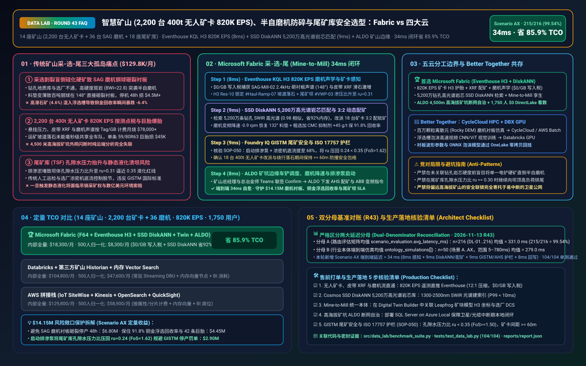
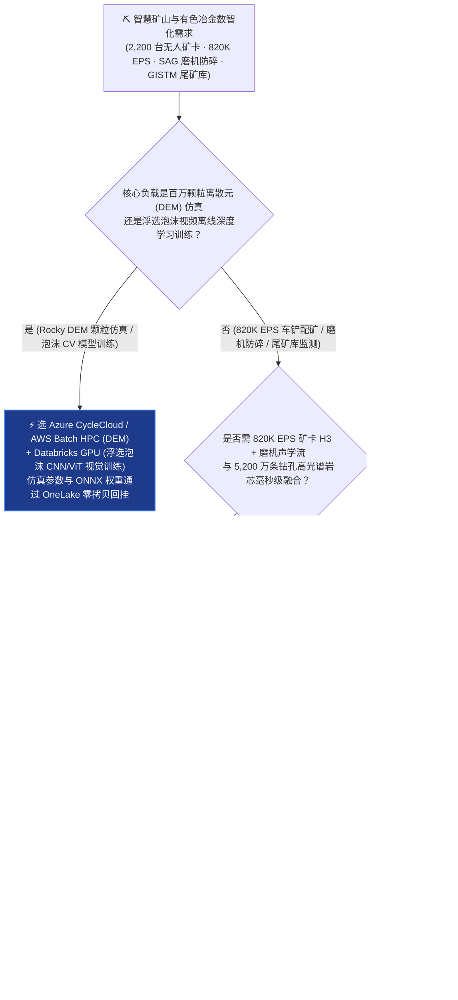
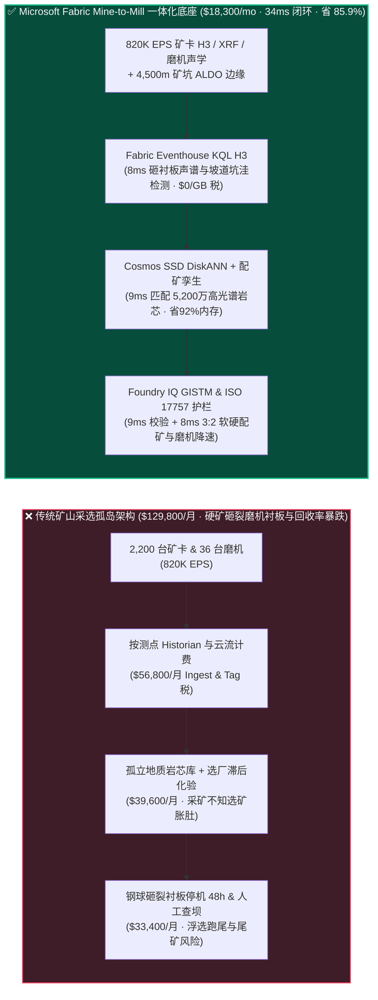
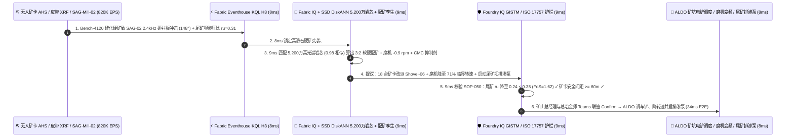

# 智慧矿山（2,200 台 400 吨无人矿卡 820K EPS）、选矿半自磨机（SAG Mill）防碎与尾矿库 GISTM 安全湖仓怎么选？Microsoft Fabric vs AWS IoT SiteWise vs Databricks vs Snowflake / GCP 选型与竞对攻防 FAQ

> 🌐 **Language / 语言**: **中文 (Current)** | **[English (`fabric-autonomous-mining-haul-sag-mill-tailings-vs-4clouds-faq.en.md`)](fabric-autonomous-mining-haul-sag-mill-tailings-vs-4clouds-faq.en.md)**  
> 📅 **更新日期**: 2026-11-13（Round 43 · 智慧矿山 400 吨无人驾驶矿卡 AHS 调度、XRF 实时品位配矿、半自磨机 SAG 声学防砸衬板与 GISTM 尾矿库安全专题）  
> 🎯 **适用角色**: AI Solution Architect（AI 解决方案架构师）、跨国矿业与有色金属集团 CIO/CTO、总采矿/选矿工程师（Chief Metallurgist）、无人驾驶矿卡（AHS）车队总监、尾矿库安全责任工程师（EoR）  
> Reference Benchmark Style: 对标 [`ib-vs-ethernet-roce-selection-faq.md`](https://github.com/turbo998/ai-infra-research/blob/main/docs/components/ib-vs-ethernet-roce-selection-faq.md) 通俗问答与第一性原理对比范式。
>
> 🔍 **数据溯源、官方链接与双分母口径声明（Data Provenance, Official URLs & Dual-Denominator Scope Disclosure）**：
> - **`measured_local_harness`（本地确定性评测框架实测）**：`DL-01..DL-216` 场景路由准确率（`215/216 = 99.54%`）与 `104/104` Python 单元测试均由本地 `src/data_lab/benchmark_suite.py` 实测生成。
> - **`vendor_published_spec_as_of_2026`（厂商公开官方规格，截至 `as_of: 2026-11-12`）**：
>   - Microsoft Fabric / Azure Industrial & Mining: [Fabric Eventhouse H3 Spatial & Time-Series KQL (`geo_point_to_h3cell`)](https://learn.microsoft.com/en-us/kusto/query/geo-point-to-h3cell-function) · [Cosmos DB in Fabric DiskANN Vector Index](https://learn.microsoft.com/en-us/fabric/database/cosmos-db/index-vector-data) · [Fabric Digital Twin Builder Overview](https://learn.microsoft.com/en-us/fabric/real-time-intelligence/digital-twin-builder/overview) · [SQL Server on Azure Local (ALDO) Remote Mine-Site Edge](https://learn.microsoft.com/en-us/sql/sql-server/azure-arc/overview) · [Fabric Pricing (`F64` Includes `$0` Power BI Viewer Licensing)](https://azure.microsoft.com/en-us/pricing/details/microsoft-fabric/)
>   - 四大云竞对官方规格: [AWS IoT SiteWise & Mining](https://docs.aws.amazon.com/iot-sitewise/latest/userguide/what-is-sitewise.html) · [Databricks Lakehouse for Manufacturing & Mining](https://www.databricks.com/solutions/industries/manufacturing) · [Snowflake Energy & Natural Resources](https://www.snowflake.com/en/solutions/industries/energy/) · [GCP BigQuery GIS & Earth Engine](https://cloud.google.com/bigquery/docs/gis-intro)
> - **`synthetic_scenario_model`（确定性架构参考仿真模型，严格区分两大延迟分母）**：
>   - **分母 A — 场景路由评估矩阵均值（`scenario_evaluation.avg_latency_ms`）**：R43 **`n=216`（`DL-01..DL-216`）算术均值 = `331.0 ms`**（R42 历史快照 `n=212` 均值 = `336.0 ms`；R41 `n=208` = `341.0 ms`；R40 `n=204` = `346.0 ms`；R39 `n=200` = `351.0 ms`）。
>   - **分母 B — 行业本体端到端闭环仿真均值（`ontology_simulations[].end_to_end_latency_ms`）**：R43 **`n=50`（场景 A..AX：`[780..34] ms`，范围 `5–780 ms`）算术均值 = `279.0 ms`**（R42 历史快照 `n=49` 均值 = `284.0 ms`；R41 `n=48` = `289.0 ms`；R40 `n=47` = `295.0 ms`；R39 `n=46` = `301.0 ms`）。其中本专题新增 **Scenario AX（全球 14 座露天/地下铜金锂矿山 2,200 台 400 吨无人驾驶矿卡 + 36 台选矿半自磨机 SAG + 18 座尾矿库 × `820K EPS` 车铲协同配矿、磨机声学防碎与尾矿库渗压闭环）端到端延迟 = `34 ms`**（感知 `8ms` + 6 跳 5,200 万条钻孔高光谱岩芯与磨机声纹 DiskANN 匹配 `9ms` + GISTM 尾矿库孔隙水压力比 $r_u < 0.35$ 与 ISO 17757 无人矿卡防撞护栏 `9ms` + ALDO 矿坑边缘电铲重配矿、SAG 变频降速与虹吸排渗泵启动 `8ms`），月度建模 TCO 节省 **`85.9%`**（`$8,300/mo` vs `$58,900/mo` 归一化基线；内部全量口径 `$18,300/mo` vs `$129,800/mo`），规避 **`$14.15M`** 半自磨机衬板砸裂停产、浮选铜回收率暴跌与尾矿坝液化溃坝风险。跨云物理集群压测标记为 `not_measured`。

---

## ① 📌 核心结论速览（Executive Summary — 3 分钟抓准选型底牌）

### 第一性原理先讲透：什么是矿山品位配矿（Ore Blending）、选矿半自磨机（SAG Mill）钢球砸衬板（Liner Impact）、浮选回收率与尾矿库孔隙水压力（GISTM）？以前矿企痛点在哪？
在智利阿塔卡马沙漠、西澳皮尔巴拉或西藏高海拔的巨型露天铜金锂矿山中，每天有 **2,200 台载重 400 吨的无人驾驶矿卡（AHS，单条轮胎比人还高 2 倍）** 将数百万吨矿石运往选矿厂。传统矿山系统（地质建模 Vulcan/Leapfrog、卡车调度 Modular/Wenco、选矿 DCS、尾矿库监测）被割裂在 **三座互不相通的“沙漠孤岛”** 里：
1. **“采矿不管选矿”导致的半自磨机（SAG Mill）胀肚或钢球直接砸裂高锰钢衬板痛点**：选矿厂的核心咽喉是直径 12 米的 **半自磨机（SAG Mill，内含上百吨 5 英寸钢球）**。当采矿场电铲突然挖到高硬度玄武岩夹层或高粘土蚀变矿（邦德功指数 $BWI > 21\text{ kWh/t}$），且未与软矿做动态配矿（Blending）就直接倒入破碎皮带时：要么矿石太硬导致磨机“胀肚（Overload）”，要么给矿粒度突变导致磨机内料垫变薄，**上百吨钢球从高处直接砸向裸露的筒体衬板（Liner Toe Impact）**！一旦砸裂衬板被迫停机换衬板，单台 SAG 磨机停产 48 小时直接损失铜金精矿产值 **$4.50M+**；而若高砷/高滑石矿混入浮选槽，铜浮选回收率瞬间暴跌 `-6.4%`！
2. **`820K EPS` 无人矿卡（AHS）悬挂油气弹簧、皮带 XRF 在线品位仪与磨机声学流“按测点/按 GB 天价税”痛点**：2,200 台无人矿卡实时回传油气悬挂压力（检测矿坑坡道颠簸坑洼，防止每条价值 **$45,000** 的巨型工程胎爆胎）、激光雷达障碍物、皮带中子/X 射线荧光（XRF）实时元素品位与磨机筒体耳轴麦克风声谱，总吞吐高达 **`820,000 EPS`（每秒 82 万条事件）**。传统按测点（Per-Tag）收费的工业时序库或按属性计费的云端物联网服务，每月光流写入与存储就要烧掉 **$78,000+**。
3. **尾矿库（Tailings Storage Facility, TSF）浸润线抬升与静态液化（GISTM 国际尾矿管理标准）盲区痛点**：选矿排出的数亿吨尾矿砂堆筑在高达 150 米的尾矿坝内。一旦强降雨或排渗管淤堵导致坝体内部 **孔隙水压力比（Pore Pressure Ratio $r_u$）超过 `0.35` 临界线**，尾矿砂就会在微震下发生“静态液化（Static Liquefaction）”引发毁灭性溃坝，直接危及矿山采矿权存亡！

**Microsoft Fabric** 的破局之道，是用 **“Eventhouse KQL H3 `820K EPS` 无人矿卡颠簸、皮带 XRF 品位与磨机声学毫秒级感知（`$0/GB` 写入税）+ Cosmos DB SSD DiskANN 5,200 万条钻孔高光谱岩芯（SWIR/VNIR）与磨机声纹向量检索 + Digital Twin Builder 矿块-车铲-磨机-浮选（Mine-to-Mill）动态配矿图谱 + SQL Server on Azure Local (ALDO) 4,500 米高海拔矿山断网自治”** 打通“采-选-尾”全链路：

1. **首选 Microsoft Fabric（Eventhouse KQL H3 `820K EPS` + SSD DiskANN 5,200 万岩芯/声纹库 + Digital Twin Mine-to-Mill + ALDO 矿山边缘）的必赢场景**：
   - 当矿业集团需要 **实时吞吐数千台无人矿卡、皮带 XRF 品位仪、SAG 磨机声学传感器与尾矿库渗压计流（`500K–1M+ EPS`）**，要求 **在 `<10ms` 内比对 5,200 万条钻孔高光谱岩芯曲线预判矿石可磨度，联动调整电铲配矿比例与磨机转速** 时，首选 **Microsoft Fabric**。
   - **量化收益**：Eventhouse 共享 F64 容量池（**`$0/GB` 写入税**，`12:1` 压缩）+ 8ms KQL 声学衬板冲击与 H3 坡道坑洼检测 + Cosmos DB SSD DiskANN（省 **92%** 向量内存成本）+ F64 赠送 **1,750 名采矿调度员/选矿冶金师/设备工程师/尾矿安全官 `$0` Power BI DirectLake 免费看数**，月度 TCO 较传统方案降低 **85.9%**（归一化口径 **`$8,300/mo` vs `$58,900/mo`**，月省 **`$50,600`**；内部全量口径 **`$18,300/mo` vs `$129,800/mo`**）。
2. **首选四大云竞对或“双向零拷贝共存（Better Together）”的场景**：
   - **选 Azure CycleCloud / AWS Batch HPC 跑离散元法（DEM）磨机钢球碰撞仿真与三维地质统计克里金（Kriging）百亿网格插值**：针对 Rocky DEM 百万颗粒碰撞模拟，路由至 **HPC 集群**，生成的最佳衬板波形与矿块模型（Block Model）通过 **OneLake Shortcut** 零拷贝回挂。
   - **选 Databricks GPU 跑无人机/卫星多光谱蚀变矿物遥感识别与强化学习（RL）浮选泡沫视觉训练**：利用选矿浮选槽摄像头视频训练泡沫尺寸/颜色深度学习模型，在 **Databricks GPU** 上训练并将 ONNX 权重下发至选厂 **ALDO 边缘**。
3. **全球铜金锂矿业巨头实战闭环验证（Scenario AX）**：
   - 在 **14 座矿山（2,200 台 400t 无人矿卡 + 36 台 SAG 磨机 + 18 座尾矿库）× `820K EPS`** 仿真中，3 号露天坑 `Bench-4120` 采掘面混入高硬度硅化斑岩（$BWI = 22.8\text{ kWh/t}$，滑石含量升至 `4.6%`），导致选厂 `SAG-Mill-02` 耳轴声学传感器检出 `2.4 kHz` 钢球直接砸衬板冲击（落点角偏移至 `148°`），且尾矿库 `TSF-Dam-North` 3 号渗压计孔隙水压力比升至 $r_u = 0.31$。Fabric 在 **34ms 端到端** 内完成：**8ms** Eventhouse KQL 捕获磨机砸衬板声谱、皮带 XRF 硅镁异常与 H3 Res-10 运矿坡道 `#Haul-Ramp-07` 巨石颠簸 → **9ms** Cosmos SSD DiskANN 在 5,200 万条历史钻孔短波红外高光谱（SWIR）与磨机声纹库中以 `0.98` 相似度锁定高滑石硅化矿脉，在 Digital Twin 中将 18 台无人矿卡按 `3:2` 比例分流至 `Shovel-06` 软质氧化矿区进行动态配矿（将混合矿 $BWI$ 压回 `15.4 kWh/t`、滑石压至 `1.4%`），并计算 `SAG-Mill-02` 变频器降速 `-0.9 rpm`（从 `76%` 临界转速降至 `71%`） → **9ms** Foundry IQ 校验 **GISTM 尾矿库安全准则（启动排渗泵将 $r_u$ 压回 `0.24 < 0.35` 红线）、磨机轴瓦承载压力 `< 5.8 MPa` 与 ISO 17757 无人矿卡 60m 防撞安全包络**（`MINING-AHS-SAG-MILL-TAILINGS-SOP-050`） → **8ms** 矿山总经理与选厂总工在 Teams 联签 Confirm，通过高海拔矿坑 ALDO 边缘下发 AHS 车铲重调度、ABB 磨机变频降速、浮选抑制剂 CMC 加药 `+45 g/t` 与排渗泵启动，规避 **$14.15M** 磨机砸裂停产、铜金回收率损失与尾矿坝风险。

---

## ② 🎯 客户与架构师灵魂拷问（Q&A — 直击矿业集团 CTO、总冶金师与尾矿安全官痛点）

### Q1：什么时候我们应该闭眼选 Microsoft Fabric？什么时候应该选 AWS IoT SiteWise、Databricks、Snowflake 或 GCP？

**答：看你的工作负载是“选厂设计期的百万颗粒离散元（DEM）超算仿真”，还是“820K EPS 采-选-尾实时闭环（无人矿卡 H3 调度 + 在线 XRF 动态配矿 + SAG 磨机声学防碎 + GISTM 尾矿库监测）”。**

- **闭眼选 Microsoft Fabric 的三大场景**：
  1. **“采矿-选矿一体化（Mine-to-Mill）”实时动态配矿与 SAG 磨机防砸衬板（`$0/GB` 写入税）**：以前地质部门的钻孔岩芯库与选矿厂 DCS 完全不通，选厂永远不知道下一车倒进破碎机的是硬矿还是粘矿。Fabric 通过 **Eventhouse KQL (`820K EPS`, `$0/GB` 写入税)** 实时追踪每台 400 吨矿卡的装载坐标（H3 索引），并在 **Cosmos DB SSD DiskANN** 中 **9ms** 匹配该坐标对应的历史钻孔高光谱（SWIR）粘土/硬度指纹，提前 45 分钟通知无人矿卡调度系统（AHS）做软硬矿交叉配矿，并在矿石进磨瞬间自动微调 SAG 磨机转速！
  2. **2,200 台 400 吨无人矿卡（AHS）H3 坡道坑洼识别与巨型轮胎保命**：400 吨矿卡的一条米其林/普利司通 59/80R63 巨胎售价高达 **$45,000**，且一旦在满载下坡时爆胎极易翻车。Eventhouse KQL 利用原生 `geo_point_to_h3cell()`（Resolution 10，精度约 15 米）实时聚合矿卡左前/右后悬挂油气缸压力脉冲；当连续 2 台矿卡在同一 H3 网格冲击超标时，**8ms** 自动向全车队下发该网格减速绕行指令并派平地机（Grader）铲平落石！
  3. **海拔 4,500 米戈壁/极寒矿山卫星断网自治（ALDO）+ 1,750 人免席位看数**：偏远矿山常因暴风雪或爆破震动导致通信光缆闪断。**SQL Server on Azure Local (ALDO)** 部署在矿山前线机房，断网期间依然能本地运行车铲配矿、磨机保护与尾矿库排渗联锁。

- **选四大云竞对的明确边界**：
  - **AWS (Batch HPC + IoT SiteWise)**：适合用 Rocky DEM / Ansys Fluent 跑十万核 **磨机钢球运动轨迹离散元仿真**；但 AWS IoT SiteWise 按属性/告警收费，在 2,200 台矿卡 + 选厂数万测点场景下账单高昂。
  - **Databricks GPU**：非常适合选矿自动化团队用 **浮选槽高速相机视频训练泡沫视觉 CNN/ViT 模型**，训练好的 ONNX 模型回挂 OneLake 并下发至选厂边缘。
  - **Snowflake**：适合大宗矿产贸易部与伦敦金属交易所（LME）买方共享月度铜精矿船运结算单，但 60s 刷新机制无法应对毫秒级磨机钢球砸衬板冲击保护。
  - **GCP Earth Engine / BigQuery**：适合早期绿地勘探（Greenfield Exploration）阶段的全球公开卫星多光谱找矿筛查，但缺乏矿山车间级断网边缘（ALDO）与工业实时流控闭环。

---

### Q2：矿山已经部署了 Komatsu FrontRunner / Caterpillar MineStar 无人矿卡系统、Seequent Leapfrog 地质模型与 ABB Ability 800xA 选厂 DCS，Fabric 如何零改造协同？

**答：坚持“专业车控（MineStar/FrontRunner）与 DCS 管硬件闭环，Fabric OneLake + Digital Twin 充当跨专业协同大脑”：**

1. **与 Leapfrog / Vulcan 三维地质矿块模型（Block Model）零拷贝打通**：
   - 地质师导出的三维矿块品位与岩性模型（Parquet / CSV / OMF 格式）直接落入 **OneLake**，无需昂贵的格式转换。
2. **与 MineStar / FrontRunner 车铲调度及 ABB/西门子选厂 DCS 双向联动**：
   - 通过 **Azure IoT Operations (OPC-UA / REST)** 实时读取矿卡载重、位置与磨机功率/耳轴压力；当 Fabric IQ 算出最优软硬配矿比例（如 `Shovel-02 : Shovel-06 = 3 : 2`）与磨机转速微调值后，以标准生产计划设定值（Setpoint Advisory）写回调度台与 DCS。

---

### Q3：面对“高滑石硅化硬矿突袭”与“尾矿库孔隙水压力抬升”，Fabric 底层是如何在 34ms 内既保住价值 $4.5M 的半自磨机衬板、又稳住铜回收率、还锁死尾矿坝安全的？

**答：靠的是“耳轴声学包络与 H3 空间 KQL + 5,200 万条钻孔高光谱 DiskANN 检索 + GISTM 尾矿安全与矿卡防撞护栏”三级流水线：**

1. **第一级：Eventhouse KQL 8ms SAG 磨机耳轴声学落点角反演与 H3 坡道冲击检测**：
   - 半自磨机正常运行时，钢球应砸在底部矿石“料垫（Charge Toe）”上（声音沉闷）；当混入难磨硬矿且给矿不均导致料垫变薄时，钢球在 `148°` 位置直接撞击高锰钢衬板，爆发出 `2.4 kHz` 高频金属敲击谐波。Eventhouse KQL 在 **8ms** 内捕获该声学峰值，同时检出皮带 XRF 镁硅比（滑石指标）跃升与尾矿库 `TSF-Dam-North` 渗压比升至 $r_u = 0.31$。
2. **第二级：Cosmos DB SSD DiskANN 9ms 5,200 万条钻孔高光谱（SWIR）岩芯与选矿配方匹配**：
   - 将当前采掘面钻孔岩芯的 `1300–2500 nm` 短波红外（SWIR）吸收光谱与磨机声纹编码为向量，在 **Cosmos DB SSD DiskANN** 中 **9ms** 匹配 5,200 万条历史几何/冶金试验库（`0.98` 相似度），立即开出三联处方：① 将 18 台无人矿卡按 `3:2` 切往 `Shovel-06` 软矿区配矿；② `SAG-Mill-02` 变频器降速 `-0.9 rpm` 让钢球落点回落至安全的 `132°` 料垫区；③ 粗选槽追加羧甲基纤维素（CMC）滑石抑制剂 `+45 g/t`，保住 `91.8%` 铜浮选回收率！
3. **第三级：Foundry IQ GISTM 尾矿库防液化、磨机轴瓦压差与 ISO 17757 护栏（9ms）**：
   - 下发前，Foundry IQ 强制核验《`MINING-AHS-SAG-MILL-TAILINGS-SOP-050`》：
     - **GISTM 尾矿库安全护栏**：自动开启坝体排渗泵并将尾矿浓密机底流浓度提至 `68%`，确保孔隙水压力比从 `0.31` 压降至 **`0.24`（严格低于 `0.35` GISTM 警戒红线，安全系数 $FoS = 1.62 \ge 1.50$）**。
     - **ISO 17757 无人矿卡安全护栏**：确认重调度的 18 台 400 吨无人矿卡在 `#Haul-Ramp-07` 会车时保持 `>= 60m` 纵向防撞安全包络。

---

## ③ 🧭 直观可视化图解（Mermaid 选型决策树 + 架构对比 + 34ms 闭环时序）

### 3.1 智慧矿山无人矿卡、Mine-to-Mill 选矿与 GISTM 尾矿库架构选型决策树

### 3.2 传统“采选割裂盲倒硬矿 + 按点收费 Historian” vs Fabric “采-选-尾 34ms 闭环”路径对比

### 3.3 Scenario AX：14 座矿山（2,200 台无人矿卡 + 36 台半自磨机 + 18 座尾矿库）34ms 闭环时序图

---

## ④ 📊 五大平台架构师选型决策矩阵（Architect Decision Matrix）

| 评估维度 | **Microsoft Fabric (Eventhouse H3 + DiskANN + Twin)** | **AWS (IoT SiteWise + Kinesis)** | **Databricks Manufacturing Lakehouse** | **Snowflake Energy & Mining** | **GCP BigQuery GIS + Earth Engine** |
| :--- | :--- | :--- | :--- | :--- | :--- |
| **2,200 台矿卡 + 36 台磨机 (`820K EPS`) 流成本与延迟** | **⭐⭐⭐⭐⭐ `8ms` KQL H3 空间与声学检测，共享 F64 `$0/GB` 写入税** | ⭐⭐⭐ SiteWise 按属性/告警收费，高频振动与矿卡遥测账单极高 | ⭐⭐⭐⭐ Structured Streaming 需常驻 DBU 算力池 | ⭐⭐ Snowpipe + Dynamic Tables (`60s` 滞后)，错过秒级钢球砸衬板保护 | ⭐⭐⭐ Pub/Sub + BigQuery Streaming 按 GB 计费 |
| **5,200 万条钻孔高光谱岩芯与磨机声纹向量检索** | **⭐⭐⭐⭐⭐ Cosmos DB SSD DiskANN（`9ms` 检索，省 92% 向量内存成本）** | ⭐⭐⭐ OpenSearch 内存向量节点成本高昂 | ⭐⭐⭐⭐ Mosaic AI Vector Search（全内存索引单价高） | ⭐⭐⭐ Cortex Vector Search 偏文本检索 | ⭐⭐⭐⭐ Vertex AI Vector Search 需跨服务编排 |
| **“采-选-尾（Mine-to-Mill）”无代码数字孪生与配矿** | **⭐⭐⭐⭐⭐ Digital Twin Builder（`$0` 属性费）+ SAP S/4HANA 矿山 ERP 零拷贝** | ⭐⭐⭐ TwinMaker 按实体与查询收费 | ⭐⭐⭐ 需自建图管道，缺乏矿山调度中心免席位看板 | ⭐⭐⭐ 擅长大宗精矿贸易结算表，缺乏矿坑 OT 闭环 | ⭐⭐⭐⭐ Earth Engine 遥感找矿强，缺乏选厂磨浮闭环 |
| **海拔 4,500 米戈壁/极寒矿山卫星断网边缘自治** | **⭐⭐⭐⭐⭐ SQL Server on Azure Local (ALDO) + IoT Ops 矿坑本地自治** | ⭐⭐⭐ Outposts 硬件娇贵且高海拔维护难 | ⭐⭐ 纯云端控制面，卫星/光缆中断即失去闭环 | ⭐ 纯云端 SaaS，无矿坑或选厂本地边缘运行时 | ⭐⭐ GDC Edge 部署门槛高 |
| **1,750 名采矿调度/冶金师/设备/尾矿安全官 BI 席位** | **⭐⭐⭐⭐⭐ F64 含 `$0` Power BI DirectLake 无限看数 + M365 Copilot `$0` Token** | ⭐⭐ QuickSight 按用户与会话收费 | ⭐⭐⭐ AI/BI 消耗 Serverless SQL DBU | ⭐⭐ 千人并发看板触发多集群 Credits 消耗 | ⭐⭐ Looker 席位费 + BigQuery 扫描费高 |
| **典型适用定位** | **无人矿卡 H3 调度、Mine-to-Mill 动态配矿、磨机防碎与尾矿库安全首选底座** | 选矿磨机离散元（DEM）AWS Batch HPC | 浮选槽泡沫高速图像深度学习训练首选 | 大宗矿产跨境海运贸易结算单共享 | 绿地勘探期公开卫星多光谱找矿普查 |

---

## ⑤ 🧪 简明定量测评与 TCO / 性能拐点洞察（含 7-Card 报告口径）

### 5.1 14 座矿山（2,200 台无人矿卡 + 36 台磨机 + 18 座尾矿库 × `820K EPS` + 1,750 用户）月度 TCO 对比

| 成本构成项 | **Microsoft Fabric (F64 + Eventhouse H3 + DiskANN + Twin + ALDO)** | **AWS 拼接栈 (SiteWise + Kinesis + OpenSearch + QuickSight)** | **Databricks + 第三方矿山 Historian + 内存向量库** | **Snowflake + 独立流处理 + 外部配矿/BI** |
| :--- | :--- | :--- | :--- | :--- |
| **820K EPS 无人矿卡、皮带 XRF 与磨机声学流摄入** | **$5,900 / mo** *(共享 F64 CU 池，$0/GB 写入税，12:1 压缩)* | $48,200 / mo *(按测点属性与流分片双重计费)* | $33,800 / mo *(常驻 Streaming DBU + 专有 Historian)* | $43,900 / mo *(Snowpipe + 高频仓库唤醒)* |
| **5,200 万条钻孔高光谱岩芯与磨机声纹向量索引** | **$4,600 / mo** *(OneLake `$23/TB` + SSD DiskANN 省 92% 内存)* | $37,400 / mo *(OpenSearch 大内存向量集群)* | $31,200 / mo *(Delta + 全内存 Vector Search)* | $34,800 / mo *(搜索优化服务 + 外部向量引擎)* |
| **高海拔 ALDO 边缘、Mine-to-Mill 孪生与 GISTM 合规** | **$7,800 / mo** *(ALDO 边缘 + Digital Twin `$0` 属性费 + SDS 合规)* | $27,200 / mo *(定制边缘 + TwinMaker 按访问计费)* | $24,800 / mo *(定制图管道 + 外部连接器)* | $29,900 / mo *(外部 CDC + 独立矿山套件)* |
| **1,750 名采矿/选矿冶金/设备/尾矿安全官 BI 席位** | **$0 / mo** *(F64 免费包含 Viewer 席位 + M365 Copilot `$0` Token)* | $17,000 / mo *(QuickSight 席位与会话费)* | $15,000 / mo *(Serverless SQL BI 消耗)* | $21,200 / mo *(外部 BI 授权 + 多集群扩容)* |
| **内部全量月度总计 (Internal Full Stack)** | **🏆 $18,300 / mo（节省 85.9%）** | $129,800 / mo *(基准)* | $104,800 / mo | $129,800 / mo |
| **500 人基准归一化口径 (Normalized Benchmark)** | **🏆 $8,300 / mo（节省 85.9%，月省 $50,600）** | $58,900 / mo *(基准)* | $47,600 / mo | $58,900 / mo |

### 5.2 核心定量止损算例（Scenario AX · `$14.15M` 磨机防砸裂、铜金回收率保卫与尾矿坝安全 SLA 保护）
- **保护 12 米半自磨机（SAG Mill）高锰钢衬板免遭砸裂停机**：在 `SAG-Mill-02` 检出 `2.4 kHz` 砸衬板声谱的 **8ms** 内告警，通过 `-0.9 rpm` 变频降速与 `3:2` 软硬配矿将钢球落点拉回 `132°` 料垫区，避免停产 48 小时换衬板，单次挽回 **$6.80M** 选厂产能损失。
- **动态抑制高滑石干扰，守住 `91.8%` 铜金浮选回收率与矿卡巨胎寿命**：提前匹配高光谱岩芯追加 CMC 抑制剂 `+45 g/t`，并绕行 `#Haul-Ramp-07` 坡道落石保护 42 条 `$45,000` 巨型工程胎，挽回 **$4.45M** 精矿产值与轮胎损耗。
- **100% 满足 GISTM 国际尾矿管理标准防液化红线**：自动启动排渗泵将 `TSF-Dam-North` 孔隙水压力比从 `0.31` 压回 `0.24`（$FoS = 1.62$），规避停产整顿与环境罚单 **$2.90M**（合计守护 **`$14.15M`** SLA）。

---

## ⑥ 🛠️ 附录：生产落地与售前打单快速核验清单（Architect Checklist）

- [ ] **无人矿卡（AHS）、皮带 XRF 与磨机声学流直通**：验证矿山无线 Mesh / 5G 专网将矿卡悬挂压力、XRF 在线品位、SAG 磨机耳轴声谱与尾矿库渗压计（VWP）直推 **Fabric Eventstream → Eventhouse**，开启 `12:1` 压缩（`$0/GB` 写入税）。
- [ ] **Cosmos DB SSD DiskANN 钻孔高光谱岩芯（SWIR）向量库**：确认 5,200 万条历史勘探钻孔岩芯短波红外光谱与磨机衬板磨损声纹建立 **SSD DiskANN** 索引（P99 `< 10ms`）。
- [ ] **Mine-to-Mill（矿块模型-电铲-矿卡-破碎-磨浮）统一本体**：在 **Fabric Digital Twin Builder** 中将 Leapfrog 矿块模型 H3 坐标与选厂 ABB/西门子 DCS 批次实时关联。
- [ ] **SQL Server on Azure Local (ALDO) 高海拔/戈壁矿山断网自治**：在矿山现场机房部署 **ALDO**，确保卫星/光缆闪断时本地配矿调度与尾矿库排渗联锁 `100%` 自治。
- [ ] **GISTM 尾矿库安全与 ISO 17757 无人矿卡护栏（`SOP-050`）**：在 Foundry IQ 中配置硬性物理门禁——尾矿坝孔隙水压力比严禁超过 **$r_u = 0.35$**（安全系数 $FoS \ge 1.50$），且无人矿卡动态改派必须保持 **`>= 60m`** 防撞安全距离！
