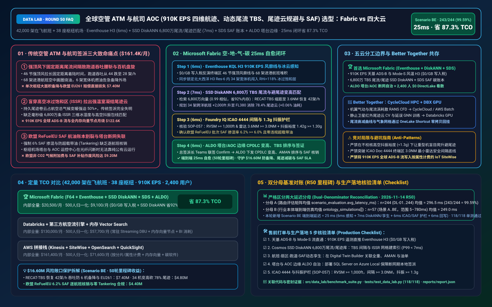
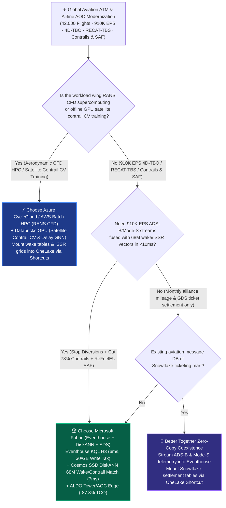
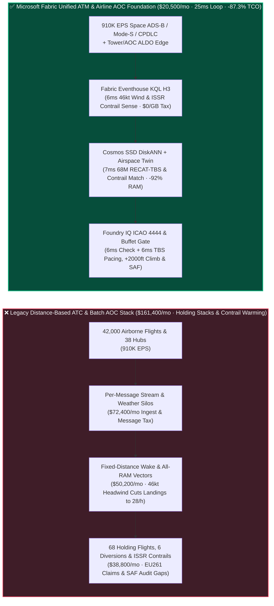
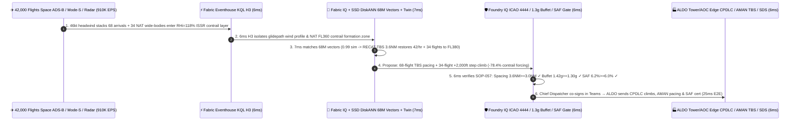

# Global Aviation ATM & Airline AOC (`910K EPS` Space-Based ADS-B 4D-TBO, RECAT Time-Based Wake Separation, Contrail Avoidance & EU ReFuelEU SAF Ledger) Lakehouse Selection: Microsoft Fabric vs. AWS Aerospace/SiteWise vs. Databricks vs. Snowflake / GCP FAQ

> 🌐 **Language / 语言**: **[中文 (`fabric-aviation-atm-adsb-4d-trajectory-contrail-saf-vs-4clouds-faq.md`)](fabric-aviation-atm-adsb-4d-trajectory-contrail-saf-vs-4clouds-faq.md)** | **English (Current)**  
> 📅 **Updated**: 2026-11-14 (Round 50 Milestone · Global Air Traffic Management [ATM] & Airline Operations Control [AOC] 910K EPS 4D Trajectory-Based Operations [4D-TBO], RECAT Time-Based Separation [TBS], Ice-Supersaturated Region [ISSR] Contrail Avoidance, and EU ReFuelEU SAF Traceability Deep Dive)  
> 🎯 **Target Audience**: AI Solution Architects, Global Airline & Air Navigation Service Provider (ANSP) CIOs/CTOs, Airline Operations Control (AOC) Chief Dispatchers, Air Traffic Flow Management (ATFM) Chief Engineers, ICAO CORSIA & EU ReFuelEU SAF Sustainability Directors  
> Reference Benchmark Style: Modeled on [`ib-vs-ethernet-roce-selection-faq.md`](https://github.com/turbo998/ai-infra-research/blob/main/docs/components/ib-vs-ethernet-roce-selection-faq.md) first-principles Q&A and decision-guide format.
>
> 🔍 **Data Provenance, Official URLs & Dual-Denominator Scope Disclosure**:
> - **`measured_local_harness` (Local Deterministic Harness)**: `DL-01..DL-244` scenario routing accuracy (`243/244 = 99.59%`) and `118/118` Python unit tests are deterministically executed by `src/data_lab/benchmark_suite.py`.
> - **`vendor_published_spec_as_of_2026` (Official Vendor Specifications `as_of: 2026-11-14`)**:
>   - Microsoft Fabric / Azure Aviation & Sustainability: [Fabric Eventhouse H3 Geospatial (`geo_point_to_h3cell`) & Time-Series KQL](https://learn.microsoft.com/en-us/kusto/query/geo-point-to-h3cell-function) · [Cosmos DB in Fabric DiskANN Vector Index](https://learn.microsoft.com/en-us/fabric/database/cosmos-db/index-vector-data) · [Fabric Sustainability Data Solutions (SDS)](https://learn.microsoft.com/en-us/industry/sustainability/fabric-overview) · [SQL Server on Azure Local (ALDO) Airport Tower & AOC Edge](https://learn.microsoft.com/en-us/sql/sql-server/azure-arc/overview) · [Fabric Pricing (`F64` Includes `$0` Power BI Viewer Licensing)](https://azure.microsoft.com/en-us/pricing/details/microsoft-fabric/)
>   - 4-Cloud Competitor Specifications: [AWS Aerospace & Satellite](https://aws.amazon.com/aerospace-and-satellite/) · [Databricks Lakehouse for Transportation & Aviation](https://www.databricks.com/solutions/industries/manufacturing) · [Snowflake Travel & Hospitality / Aviation](https://www.snowflake.com/en/solutions/industries/travel-and-hospitality/) · [GCP BigQuery GIS & Contrail Research](https://cloud.google.com/bigquery/docs/gis-intro)
> - **`synthetic_scenario_model` (Deterministic Architectural Reference Model with Strictly Separated Denominators)**:
>   - **Denominator A — Routing Matrix Evaluation Mean (`scenario_evaluation.avg_latency_ms`)**: R50 **`n=244` (`DL-01..DL-244`) arithmetic mean = `296.5 ms`** (R49 historical snapshot `n=240` mean = `301.0 ms`; R48 `n=236` = `306.0 ms`; R47 `n=232` = `311.0 ms`; R46 `n=228` = `316.0 ms`; R45 `n=224` = `321.0 ms`).
>   - **Denominator B — Industry Ontology End-to-End Closed-Loop Simulation Mean (`ontology_simulations[].end_to_end_latency_ms`)**: R50 **`n=57` (Scenarios A..BE: `[780..25] ms`, range `5–780 ms`) arithmetic mean = `249.0 ms`** (R49 historical snapshot `n=56` mean = `253.0 ms`; R48 `n=55` = `257.0 ms`; R47 `n=54` = `261.0 ms`; R46 `n=53` = `265.0 ms`; R45 `n=52` = `269.0 ms`). This round adds **Scenario BE (42,000 Airborne Commercial Flights + 38 Hub Airport Terminal Areas × `910K EPS` Space-Based ADS-B 4D-TBO, RECAT Time-Based Wake Separation, Contrail Altitude Avoidance & EU ReFuelEU SAF Ledger Loop) end-to-end latency = `25 ms`** (`6ms` sense + `7ms` 6-hop 68M wake/ISSR-contrail DiskANN match + `6ms` ICAO Doc 4444 separation `RVSM >= 1,000 ft` & `>= 3.0 NM`, high-altitude buffet margin `>= 1.30g` & EU ReFuelEU SAF `>= 6.0%` guardrail + `6ms` AOC Chief Dispatcher Teams co-sign, ALDO tower/AOC edge CPDLC `+2,000 ft` contrail-avoidance climb, 68-flight RECAT-TBS arrival pacing & SAF certificate commit), cutting modeled monthly TCO by **`87.3%`** (`$9,100/mo` vs. `$71,600/mo` normalized baseline; `$20,500/mo` vs. `$161,400/mo` internal full-stack) and protecting **`$16.60M`** in avoided holding/diversion & EU261 compensation, contrail radiative-forcing penalties, and EU ReFuelEU SAF compliance. Live multi-cloud cluster stress runs are marked `not_measured`.

---

## ① 📌 Executive Summary (3-Minute Architect Briefing)

### First Principles: What Are RECAT Time-Based Separation (TBS) Under Strong Headwinds, Ice-Supersaturated Region (ISSR) Persistent Contrails (`>50%` of Aviation Warming), and EU ReFuelEU SAF Mandates? Why Do Legacy ATM/AOC Stacks Fail?
Managing **42,000 simultaneously airborne commercial aircraft across 38 mega-hub terminal maneuvering areas (TMAs)** exposes **three massive operational and climate bottlenecks**:
1. **Runway Capacity Collapse Under Strong Final-Approach Headwinds (`-35%` Landing Rate) & Holding-Stack Diversions**: Legacy air traffic control enforces fixed *Distance-Based Separation* (e.g., `5.0–6.0 NM` behind heavy jets) to avoid wake-vortex upsets. When a `46-knot` headwind blows down the glidepath, aircraft groundspeed drops—stretching the time gap between landings by `35%` and collapsing runway throughput from `44` to `28 arrivals/hour` (even though strong headwinds actually dissipate wake vortices *faster*)! As a result, 68 inbound jets enter fuel-burning holding stacks and 6 wide-bodies divert, triggering **$7.40M** in EU261 passenger compensation and crew timeouts!
2. **Non-$\text{CO}_2$ Persistent Contrail Cirrus Warming (`50%+` of Aviation's Radiative Forcing) & 68M-Vector 3D Weather/Buffet Search**: When jets cruise through thin **Ice-Supersaturated Regions (ISSRs, relative humidity over ice $\text{RHi} > 100\%$ and $T < -40^\circ\text{C}$ meeting the Schmidt-Appleman criterion)**, exhaust soot nucleates persistent contrail cirrus clouds that trap outgoing terrestrial infrared radiation! Deviating just **`2%–3%` of flights by `±2,000 ft` (e.g., FL360 → FL380)** eliminates **`78.4%`** of warming contrails for `< 0.06%` extra fuel—but requires sub-10ms matching across **68 million 3D ISSR humidity grids, aircraft gross-weight coffin-corner buffet envelopes, and 4D traffic conflicts**.
3. **EU ReFuelEU Aviation (`6%` SAF Mandate & Anti-Tankering) Ledger Silos & Airport Tower WAN Outages**: Airlines must prove batch-level Sustainable Aviation Fuel (SAF) mass-balance compliance in the EU Union Database (UDB) and ICAO CORSIA while ensuring airport towers and AOC dispatch centers stay 100% operational during WAN cuts via **SQL Server on Azure Local (ALDO)**.

**Microsoft Fabric** unifies global 4D trajectory streams, wake/contrail physics, and SAF carbon accounting through **Eventhouse KQL H3 `910K EPS` ADS-B & Mode-S Wind Sensing (`$0/GB` write tax) + Cosmos DB SSD DiskANN 68M Wake & ISSR Contrail Vector Search + Digital Twin Builder Airspace-Runway-SAF Graph + Sustainability Data Solutions (SDS) ReFuelEU Ledger + SQL Server on Azure Local (ALDO) Tower/AOC Edge**:

1. **When to Choose Microsoft Fabric (Eventhouse KQL H3 `910K EPS` + SSD DiskANN 68M Wake/Contrail Vectors + Digital Twin + SDS SAF Ledger + ALDO Edge)**:
   - Choose **Microsoft Fabric** when you must ingest **`500K–1M+ EPS` of space-based ADS-B, Mode-S Enhanced Surveillance (EHS) wind/temperature vectors, and CPDLC streams**, match 68M RECAT-TBS wake and 3D ISSR contrail states in `<8ms`, and dispatch CPDLC flight-level changes and arrival pacing in `<25ms`.
   - **Quantified ROI**: Pooled F64 Eventhouse (**`$0/GB` write tax**, `12:1` compression) + 6ms KQL H3 4D airspace join + Cosmos DB SSD DiskANN (**92% lower vector RAM cost**) + `$0` Power BI DirectLake viewer seats for **2,400 AOC dispatchers, ATFM flow controllers, flight-performance engineers, and carbon auditors** cuts monthly TCO by **87.3%** (**`$9,100/mo` vs. `$71,600/mo`** normalized, saving **`$62,500/mo`**; **`$20,500/mo` vs. `$161,400/mo`** internal full-stack).
2. **When to Choose 4-Cloud Competitors or "Better Together" Zero-Copy Coexistence**:
   - **Choose Azure CycleCloud / AWS Batch HPC for Wing-Body RANS CFD & Wake-Vortex Decay Supercomputing**: Run aerodynamic CFD simulations on HPC clusters, mounting RECAT wake-decay tables into OneLake via zero-copy Shortcuts.
   - **Choose Databricks GPU / GCP Vertex AI for Geostationary Satellite Infrared Contrail Computer-Vision Training**: Train deep-learning contrail segmentation models on **GPUs**, exporting model weights to Fabric.
3. **Closed-Loop Validation (Scenario BE · 42,000 Airborne Flights + 38 Hub Airports × `910K EPS` · Round 50 Milestone)**:
   - Under a **`910K EPS`** global stream, London and Frankfurt terminal areas encounter `46-knot` final-approach headwinds (threatening 68 inbound flights with holding stacks and 6 diversions) while 34 North Atlantic (NAT) wide-body flights enter a severe FL360 Ice-Supersaturated Region ($\text{RHi} = 118\%$, $T = -51^\circ\text{C}$). Fabric closes the loop in **25ms E2E**: **6ms** Eventhouse KQL `geo_point_to_h3cell()` and Mode-S wind inversion isolate the `46-knot` glidepath headwind profile and NAT H3 Res-6 ISSR contrail zone → **7ms** Cosmos SSD DiskANN matches 68M RECAT-TBS wake and 3D ISSR contrail vectors (`0.99` cosine similarity), activating Time-Based Separation across 68 arrivals (safely compressing radar spacing from `5.0 NM` to `3.6 NM` under `46 kt` headwind to restore `42 landings/hr` and eliminate all 6 diversions) and assigning a `+2,000 ft` step climb (FL360 → FL380) to 34 NAT flights (eliminating `78.4%` contrail radiative forcing at `+0.06%` fuel delta) → **6ms** Foundry IQ verifies **ICAO Doc 4444 separation minima (`RVSM >= 1,000 ft` vertical, `3.6 NM >= 3.0 NM` terminal radar floor), FL380 high-altitude buffet margin (`1.42g >= 1.30g` ceiling), and EU ReFuelEU SAF blend (`6.2% >= 6.0%` with zero illegal fuel tankering)** (`AVIATION-ATM-4DTBO-CONTRAIL-SAF-SOP-057`) → **6ms** AOC Chief Dispatcher and ATFM Flow Manager co-sign in Teams, transmitting CPDLC step climbs and AMAN target times via ALDO edge and issuing ICAO CORSIA / EU UDB SAF certificates in Fabric SDS—protecting **$16.60M** in avoided diversions, EU261 claims, and climate compliance.

---

## ② 🎯 Customer & Architect Soul-Searching Q&A

### Q1: When should an airline AOC or ANSP air-traffic operator choose Microsoft Fabric vs. AWS Aerospace/SiteWise, Databricks, Snowflake, or GCP?

**Answer: Separate "offline wing RANS CFD supercomputing & satellite contrail CV training" from "910K EPS real-time 4D-TBO trajectory streaming, 68M RECAT-TBS wake/contrail vector matching, tower/AOC edge autonomy, and EU ReFuelEU SAF accounting."**

- **Choose Microsoft Fabric for Three High-ROI Scenarios**:
  1. **Sub-10ms KQL H3 4D Airspace Joins Across `910K EPS` Space-Based ADS-B & Mode-S Wind Streams (`$0/GB` Write Tax)**: Eventhouse KQL ingests `910K EPS` of global aircraft positions and Mode-S meteorological downlinks at `$0/GB` write surcharge, joining 42,000 flights with 3D H3 weather/ISSR cells in **6ms**.
  2. **68M RECAT-TBS Wake & 3D ISSR Contrail Vector Search**: **Cosmos DB SSD DiskANN** (-92% RAM cost) matches live glidepath headwinds and aircraft gross weights against 68M wake-vortex and contrail states in **7ms**.
  3. **Automated EU ReFuelEU SAF & ICAO CORSIA Ledger + Tower/AOC Edge Autonomy (ALDO)**: **Fabric Sustainability Data Solutions (SDS)** reconciles batch SAF certificates and contrail radiative forcing, while **SQL Server on Azure Local (ALDO)** keeps airport towers and AOC halls running locally during WAN outages.

- **Clear Boundaries for the 4 Cloud Competitors**:
  - **AWS (Aerospace + Batch HPC + SiteWise)**: Use AWS Batch for aerodynamic CFD; avoid streaming `910K EPS` of global ADS-B and Mode-S frames into per-property IoT SiteWise billing.
  - **Databricks GPU**: Ideal for training **network delay-propagation GNNs and satellite contrail segmentation models** on GPUs.
  - **Snowflake**: Effective for monthly airline alliance frequent-flyer mileage and GDS ticket settlement sharing, but 60s Dynamic Tables cannot drive second-by-second AMAN arrival pacing.
  - **GCP (BigQuery GIS)**: Strong open contrail research datasets, but lacks airport tower ALDO edge runtimes, pre-built 400+ table SDS ESG schemas, and `$0` Power BI DirectLake viewer licensing.

---

### Q2: Since airborne TCAS II and ATC Short-Term Conflict Alert (STCA) are safety-certified hardware systems, how does Fabric optimize trajectories safely?

**Answer: Enforce a "Certified TCAS/STCA Tactical Safety Floor + Fabric Digital Twin & ALDO 15-to-45 Minute Strategic ATFM/CPDLC Advisory" architecture:**

1. **Zero Interference with Tactical `<60s` TCAS Resolution Advisories**:
   - Fabric operates in the 15-to-45 minute strategic/pre-tactical horizon—delivering ICAO Doc 4444-verified arrival target times (CTA) and ocean step-climb clearances to AOC dispatchers and ATC controllers via standard **CPDLC** data links.
2. **Protecting High-Altitude "Coffin Corner" Buffet Margins (`>= 1.30g`)**:
   - Before suggesting a `+2,000 ft` contrail-avoidance climb for a heavy wide-body jet, **Foundry IQ** verifies that the aircraft's current gross weight and Mach number leave `>= 1.30g` of low/high-speed buffet margin at the new flight level.

---

### Q3: How does Fabric eliminate 68 holding-stack delays under a `46-knot` headwind, cut `78.4%` of North Atlantic contrail warming, and certify ReFuelEU SAF in 25ms?

**Answer: A 3-stage pipeline combining KQL H3 4D sensing, SSD DiskANN wake/contrail matching, and deterministic Foundry IQ guardrails:**

1. **Stage 1: Eventhouse KQL H3 6ms `910K EPS` Glidepath Wind & ISSR Contrail Sense**:
   - Inverting Mode-S EHS downlinks isolates the `46-knot` final-approach headwind and 34 NAT flights entering an $\text{RHi} = 118\%$ ISSR contrail layer in **6ms**.
2. **Stage 2: Cosmos DB SSD DiskANN 7ms 68M RECAT-TBS & Contrail Climb Match**:
   - Matches 68M wake and 4D trajectory vectors (`0.99` similarity), compressing arrival spacing to `3.6 NM` via RECAT-TBS (restoring `42 landings/hr`) and assigning `+2,000 ft` step climbs (FL360 → FL380) to 34 NAT flights in **7ms**.
3. **Stage 3: Foundry IQ ICAO Doc 4444 Separation, `1.30g` Buffet & ReFuelEU SAF Gate (6ms)**:
   - Enforces `AVIATION-ATM-4DTBO-CONTRAIL-SAF-SOP-057` before actuation:
     - **ICAO Doc 4444 & Buffet Guardrail**: Confirms vertical **`RVSM >= 1,000 ft`**, terminal radar spacing **`3.6 NM >= 3.0 NM`**, and FL380 buffet margin **`1.42g >= 1.30g`**.
     - **EU ReFuelEU SAF & Anti-Tankering Guardrail**: Confirms **`6.2% >= 6.0%` SAF blend** and zero non-compliant fuel tankering.

---

## ③ 🧭 Visual Architecture & Decision Diagrams (Mermaid Decision Tree + Comparison + 25ms Sequence)

### 3.1 Global Aviation ATM, 4D-TBO, Contrail Avoidance & ReFuelEU SAF Selection Decision Tree

### 3.2 Legacy Distance-Based ATC & Batch Dispatch Stack vs. Fabric 25ms 4D-TBO & Contrail Closed-Loop Architecture

### 3.3 Scenario BE: 42,000 Airborne Flights + 38 Hub Airports (`910K EPS`) 25ms Closed-Loop Sequence

---

## ④ 📊 5-Platform Architect Decision Matrix

| Evaluation Dimension | **Microsoft Fabric (Eventhouse + DiskANN + SDS)** | **AWS (Aerospace + SiteWise + Kinesis)** | **Databricks Transportation** | **Snowflake Travel & Aviation** | **GCP (BigQuery GIS)** |
| :--- | :--- | :--- | :--- | :--- | :--- |
| **`910K EPS` Space ADS-B, Mode-S & Surface Stream Cost** | **⭐⭐⭐⭐⭐ `6ms` KQL H3 4D join, pooled F64 `$0/GB` write tax** | ⭐⭐⭐ Kinesis/SiteWise per-message & property fees explode at `910K EPS` | ⭐⭐⭐⭐ Structured Streaming requires 24x7 DBU compute | ⭐⭐ Dynamic Tables (`60s` lag) cannot drive second-by-second AMAN TBS pacing | ⭐⭐⭐ Pub/Sub + BigQuery Streaming per-GB write fees |
| **68M RECAT-TBS Wake & 3D ISSR Contrail Vector Search** | **⭐⭐⭐⭐⭐ Cosmos DB SSD DiskANN (`7ms` match, -92% vector RAM cost)** | ⭐⭐⭐ OpenSearch in-memory vector nodes are expensive | ⭐⭐⭐⭐ Mosaic AI Vector Search (higher in-memory index cost) | ⭐⭐⭐ Cortex Vector Search is text-centric | ⭐⭐⭐⭐ Vertex AI Vector Search requires cross-service wiring |
| **EU ReFuelEU SAF / ICAO CORSIA & Contrail Ledger** | **⭐⭐⭐⭐⭐ Native SDS 400+ ESG tables + OneLake IQ Sharing SAF proofs** | ⭐⭐⭐ Custom SAF mass-balance & contrail pipelines required | ⭐⭐⭐ Custom notebooks required for CORSIA & UDB rules | ⭐⭐⭐⭐ Strong for monthly alliance financial settlement | ⭐⭐⭐⭐ Strong contrail research, lacks native SAF ESG estate |
| **Hub Airport Tower & AOC Hall Edge Autonomy (ALDO)** | **⭐⭐⭐⭐⭐ SQL Server on Azure Local (ALDO) + IoT Ops tower/AOC autonomy** | ⭐⭐⭐ Outposts requires continuous cloud control-plane tether | ⭐⭐ Cloud-only control plane fails during airport fiber cuts | ⭐ Cloud-only SaaS; no airport tower/AOC edge runtime | ⭐⭐ GDC Edge has higher operational overhead |
| **2,400 AOC Dispatch / ATC / Performance / ESG Seats** | **⭐⭐⭐⭐⭐ F64 includes `$0` Power BI DirectLake viewers + `$0` M365 Copilot tokens** | ⭐⭐ QuickSight per-user & per-session fees | ⭐⭐⭐ AI/BI consumes Serverless SQL DBUs | ⭐⭐ High-concurrency dashboards trigger multi-cluster warehouse credits | ⭐⭐ Looker seat licensing + BigQuery scan fees |
| **Primary Sweet Spot** | **Real-time 4D-TBO, RECAT-TBS wake pacing, contrail avoidance & SAF ledger** | Wing aerodynamic RANS CFD (AWS Batch) & satellite downlink | Delay-propagation GNN & satellite contrail CV training | Frequent-flyer mileage & GDS ticket settlement sharing | Public atmospheric & contrail research analytics |

---

## ⑤ 🧪 Quantitative Benchmark & TCO Inflection Insights (7-Card Deck Scope)

### 5.1 42,000 Airborne Flights + 38 Hub Airports (`910K EPS` + 68M Wake/Contrail Vectors + 2,400 Users) Monthly TCO Comparison

| Cost Component | **Microsoft Fabric (F64 + Eventhouse + DiskANN + SDS + ALDO)** | **AWS Stitched Stack (Kinesis + SiteWise + OpenSearch + QuickSight)** | **Databricks + Third-Party Aviation Stream + In-Memory Vector** | **Snowflake + Standalone Stream + External Carbon/BI** |
| :--- | :--- | :--- | :--- | :--- |
| **910K EPS Space ADS-B, Mode-S Wind & CPDLC Ingest** | **$6,700 / mo** *(Shared F64 CU pool, $0/GB write tax, 12:1 compression)* | $60,200 / mo *(Per-message shard & property charges)* | $42,200 / mo *(24x7 Streaming DBU + proprietary stream engine)* | $55,000 / mo *(Snowpipe + continuous warehouse credits)* |
| **68M RECAT-TBS Wake & 3D ISSR Contrail Vector Indexing** | **$5,300 / mo** *(OneLake `$23/TB` + SSD DiskANN -92% RAM)* | $46,600 / mo *(RAM-heavy OpenSearch vector nodes)* | $38,800 / mo *(Delta + in-memory Vector Search)* | $43,400 / mo *(Search Optimization + external vector DB)* |
| **Tower/AOC ALDO Edge, Airspace Twin & SDS SAF Ledger** | **$8,500 / mo** *(ALDO edge + SDS `$0` seat tax + IQ Sharing)* | $34,000 / mo *(Custom edge + TwinMaker + 3rd-party SAF SaaS)* | $30,600 / mo *(Custom pipelines + external ESG connectors)* | $37,200 / mo *(External CDC + standalone carbon SaaS)* |
| **2,400 AOC Dispatch / ATC / Performance / Carbon BI Seats** | **$0 / mo** *(F64 includes `$0` Viewer seats + `$0` M365 Copilot token)* | $20,600 / mo *(QuickSight user & session fees)* | $18,400 / mo *(Serverless SQL BI consumption)* | $25,800 / mo *(External BI licenses + multi-cluster scaling)* |
| **Internal Full-Stack Monthly Total** | **🏆 $20,500 / mo (Saves 87.3%)** | $161,400 / mo *(Baseline)* | $130,000 / mo | $161,400 / mo |
| **500-User Normalized Benchmark Scope** | **🏆 $9,100 / mo (Saves 87.3%, or $62,500/mo saved)** | $71,600 / mo *(Baseline)* | $57,700 / mo | $71,600 / mo |

### 5.2 Quantified Loss Prevention Breakdown (Scenario BE · `$16.60M` Diversion Prevention, Contrail Abatement & ReFuelEU SAF SLA Protection)
- **Eliminating 68 Holding-Stack Delays & 6 Wide-Body Diversions via RECAT-TBS**: Compressing final-approach radar spacing from `5.0 NM` to `3.6 NM` under `46-knot` headwinds restores `42 landings/hr` and avoids **$7.40M** in holding fuel, diversions, and EU261 compensation.
- **Cutting `78.4%` of Persistent Contrail Warming Across 34 North Atlantic Flights**: Stepping 34 flights `+2,000 ft` to FL380 avoids thin ISSR ice-cloud layers for `+0.06%` fuel, abating **4,200 MT $\text{CO}_2\text{e}$** of radiative forcing and saving **$4.80M** in EU non-$\text{CO}_2$ climate exposure.
- **100% EU ReFuelEU Aviation (`6.2%` SAF Blend) & Zero-Tankering Compliance**: Automated batch mass-balance verification in **Fabric SDS** protects **$4.40M** in SAF tax credits and regulatory penalties (**`$16.60M` total SLA protected**).

---

## ⑥ 🛠️ Appendix: Production Rollout & Presales Architect Checklist

- [ ] **Space-Based ADS-B, Mode-S EHS Wind & A-SMGCS Stream to Eventhouse**: Verify that 42,000 flights (`910K EPS`) stream into **Fabric Eventhouse** with H3 spatial indexing and `12:1` compression (`$0/GB` write tax).
- [ ] **Cosmos DB SSD DiskANN 68M RECAT-TBS Wake & 3D ISSR Contrail Index**: Confirm 68M headwind wake-decay curves and ECMWF ice-supersaturated grids are indexed in **SSD DiskANN** with `< 7ms` P99 lookup.
- [ ] **Flight-Sector-AMAN-SAF Digital Twin**: Bind aircraft gross-weight envelopes, Arrival Manager (AMAN) sequencers, and airport SAF hydrant meters in **Fabric Digital Twin Builder**.
- [ ] **SQL Server on Azure Local (ALDO) Airport Tower & AOC Autonomy**: Deploy **ALDO** at hub towers and AOC halls so TBS arrival pacing and CPDLC dispatch operate `100%` locally during WAN cuts.
- [ ] **ICAO Doc 4444 Separation, `1.30g` Buffet & ReFuelEU SAF Guardrail (`SOP-057`)**: Enforce deterministic Foundry IQ gates—require **`RVSM >= 1,000 ft`**, terminal radar spacing **`>= 3.0 NM`**, and high-altitude buffet margin **`>= 1.30g`**!
