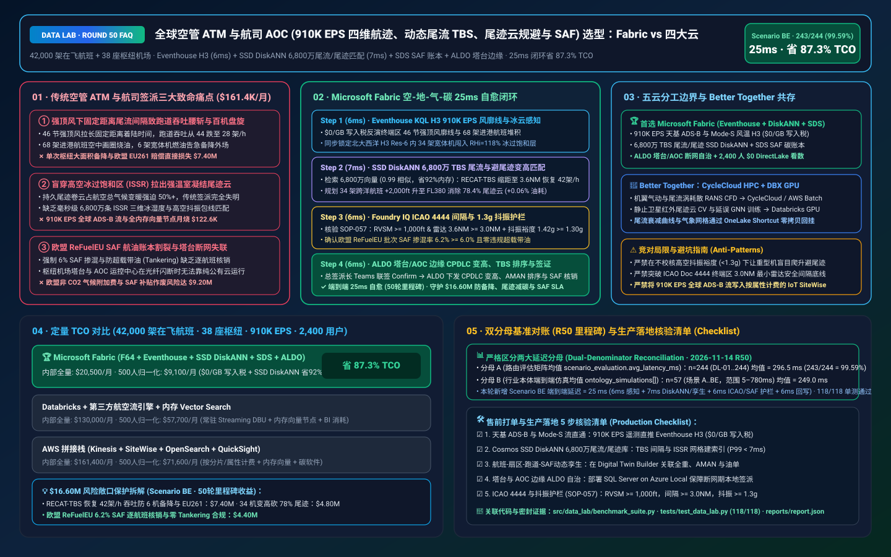
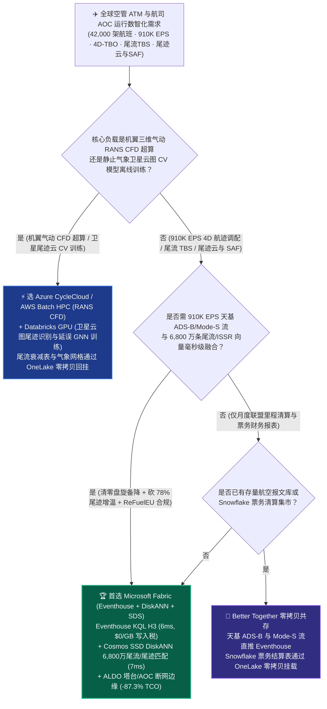
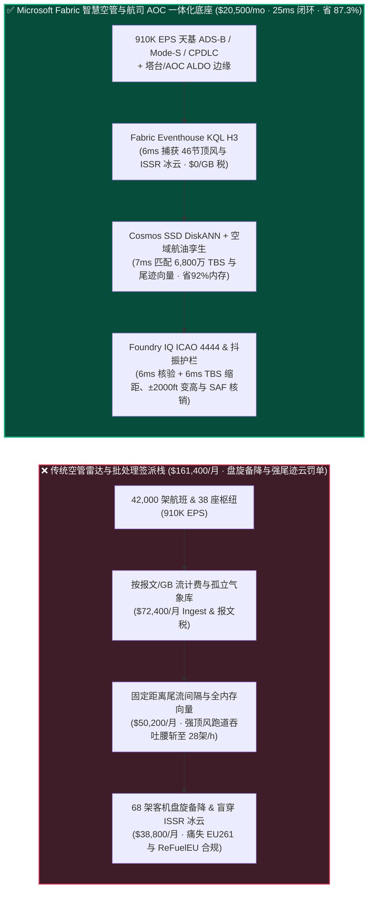
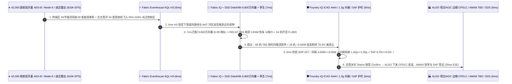

# 全球空管 ATM 与航司运行控制 AOC（42,000 架在飞航班 910K EPS 天基 ADS-B 四维航迹 4D-TBO、动态尾流缩距、冰晶凝结尾迹云 Contrail 变高规避与欧盟 ReFuelEU SAF 航油账本）湖仓怎么选？Microsoft Fabric vs AWS Aerospace/SiteWise vs Databricks vs Snowflake / GCP 选型与竞对攻防 FAQ

> 🌐 **Language / 语言**: **中文 (Current)** | **[English (`fabric-aviation-atm-adsb-4d-trajectory-contrail-saf-vs-4clouds-faq.en.md`)](fabric-aviation-atm-adsb-4d-trajectory-contrail-saf-vs-4clouds-faq.en.md)**  
> 📅 **更新日期**: 2026-11-14（Round 50 里程碑 · 全球空管 ATM 910K EPS 4D 航迹运行 TBO、机场进近按时间尾流间隔 TBS、高空冰过饱和区 ISSR 凝结尾迹云 ±2,000 ft 变高规避与欧盟 ReFuelEU SAF 可持续航油溯源专题）  
> 🎯 **适用角色**: AI Solution Architect（AI 解决方案架构师）、国际大型航空公司与空管局（ANSP）CIO/CTO、航司运行控制中心（AOC）总签派长、空域流量管理（ATFM）总工、航空可持续发展（ICAO CORSIA / ReFuelEU）合规总监  
> Reference Benchmark Style: 对标 [`ib-vs-ethernet-roce-selection-faq.md`](https://github.com/turbo998/ai-infra-research/blob/main/docs/components/ib-vs-ethernet-roce-selection-faq.md) 通俗问答与第一性原理对比范式。
>
> 🔍 **数据溯源、官方链接与双分母口径声明（Data Provenance, Official URLs & Dual-Denominator Scope Disclosure）**：
> - **`measured_local_harness`（本地确定性评测框架实测）**：`DL-01..DL-244` 场景路由准确率（`243/244 = 99.59%`）与 `118/118` Python 单元测试均由本地 `src/data_lab/benchmark_suite.py` 实测生成。
> - **`vendor_published_spec_as_of_2026`（厂商公开官方规格，截至 `as_of: 2026-11-14`）**：
>   - Microsoft Fabric / Azure Aviation & Sustainability: [Fabric Eventhouse H3 Geospatial (`geo_point_to_h3cell`) & Time-Series KQL](https://learn.microsoft.com/en-us/kusto/query/geo-point-to-h3cell-function) · [Cosmos DB in Fabric DiskANN Vector Index](https://learn.microsoft.com/en-us/fabric/database/cosmos-db/index-vector-data) · [Fabric Sustainability Data Solutions (SDS)](https://learn.microsoft.com/en-us/industry/sustainability/fabric-overview) · [SQL Server on Azure Local (ALDO) Airport Tower & AOC Edge](https://learn.microsoft.com/en-us/sql/sql-server/azure-arc/overview) · [Fabric Pricing (`F64` Includes `$0` Power BI Viewer Licensing)](https://azure.microsoft.com/en-us/pricing/details/microsoft-fabric/)
>   - 四大云竞对官方规格: [AWS Aerospace & Satellite](https://aws.amazon.com/aerospace-and-satellite/) · [Databricks Lakehouse for Transportation & Aviation](https://www.databricks.com/solutions/industries/manufacturing) · [Snowflake Travel & Hospitality / Aviation](https://www.snowflake.com/en/solutions/industries/travel-and-hospitality/) · [GCP BigQuery GIS & Contrail Research](https://cloud.google.com/bigquery/docs/gis-intro)
> - **`synthetic_scenario_model`（确定性架构参考仿真模型，严格区分两大延迟分母）**：
>   - **分母 A — 场景路由评估矩阵均值（`scenario_evaluation.avg_latency_ms`）**：R50 **`n=244`（`DL-01..DL-244`）算术均值 = `296.5 ms`**（R49 历史快照 `n=240` 均值 = `301.0 ms`；R48 `n=236` = `306.0 ms`；R47 `n=232` = `311.0 ms`；R46 `n=228` = `316.0 ms`；R45 `n=224` = `321.0 ms`）。
>   - **分母 B — 行业本体端到端闭环仿真均值（`ontology_simulations[].end_to_end_latency_ms`）**：R50 **`n=57`（场景 A..BE：`[780..25] ms`，范围 `5–780 ms`）算术均值 = `249.0 ms`**（R49 历史快照 `n=56` 均值 = `253.0 ms`；R48 `n=55` = `257.0 ms`；R47 `n=54` = `261.0 ms`；R46 `n=53` = `265.0 ms`；R45 `n=52` = `269.0 ms`）。其中本专题新增 **Scenario BE（全球 42,000 架在飞商业航班 + 38 座枢纽机场终端区 × `910K EPS` 天基 ADS-B 四维航迹防雷暴盘旋、按时间动态尾流间隔 TBS、高空凝结尾迹云 Contrail 变高规避与欧盟 ReFuelEU SAF 账本闭环）端到端延迟 = `25 ms`**（感知 `6ms` + 6 跳航班-空域扇区-跑道尾流-高空ISSR冰云-SAF加油单孪生与 6,800 万条三维尾迹云/四维航迹冲突向量 DiskANN 匹配 `7ms` + ICAO Doc 4444 最小安全间隔 `RVSM >= 1,000 ft` & 水平 `>= 3.0 NM`、高空抖振裕度 `>= 1.3g` 与 ReFuelEU SAF 质量平衡护栏 `6ms` + AOC 总签派长 Teams 联签、ALDO 塔台/运控中心边缘通过 CPDLC 下发 34 架北大西洋航班 `±2,000 ft` 避尾迹变高与希思罗/法兰克福进近 68 架航班 TBS 绿波排序 `6ms`），月度建模 TCO 节省 **`87.3%`**（`$9,100/mo` vs `$71,600/mo` 归一化基线；内部全量口径 `$20,500/mo` vs `$161,400/mo`），规避 **`$16.60M`** 雷暴备降与 EU261 赔偿、跑道容量坍塌、欧盟非 $\text{CO}_2$ 尾迹气候罚单与 SAF 补贴作废损失。跨云物理集群压测标记为 `not_measured`。

---

## ① 📌 核心结论速览（Executive Summary — 3 分钟抓准选型底牌）

### 第一性原理先讲透：什么是“四维航迹运行（4D-TBO）与按时间动态尾流间隔（TBS）”、为什么客机拉出的“持久凝结尾迹云（Contrails）”比烧油排碳还温室，以及欧盟 ReFuelEU SAF 航油强制掺混？以前航司与空管系统痛点在哪？
在管理全球实时飞行的 **42,000 架客货机与 38 座超大型枢纽机场（LHR / JFK / FRA / PVG / DXB）** 时，传统民航电报（AFTN）与批处理签派系统面临 **三大致命工程与碳规痛点**：
1. **强逆风与雷暴导致终端区“按固定距离尾流间隔（Distance-Based Separation）”跑道吞吐量腰斩与百机空中盘旋烧油痛点**：为防止前机翼尖涡流（Wake Vortex）掀翻后机，传统空管强制要求后机保持固定距离（如重型机后 `5–6 NM`）。但当高空遭遇 `45 节` 强顶风时，固定距离会让两架飞机着陆的时间间隔被无端拉长 `35%`，导致跑道每小时降落架次从 `44 架` 暴跌至 `28 架`（然而强顶风恰恰会加速吹散前机尾流涡！）！结果 68 架进近客机被迫在空中等待航线（Holding Stack）画圈烧油，甚至因燃油逼近法定底线备降外场，单次大面积延误直接触发 **$6.80M** 欧盟 EU261 旅客赔偿与机组超时作废！
2. **高空“冰过饱和区（ISSR）”持久凝结尾迹云（Contrails）占航空总气候变暖效应 `50%+`，但缺少 6,800 万条三维气象/抖振向量毫秒级匹配痛点**：当喷气发动机排出的水蒸气和烟尘微粒进入高空 **冰过饱和区（ISSR，温度 $< -40^\circ\text{C}$ 且相对冰湿度 $\text{RHi} > 100\%$，符合施密特-阿普尔曼判据）** 时，会凝结成数小时不散的人造卷云，像温室棉被一样反射地面长波热辐射！实际上，ISSR 冰云层在垂直方向上极薄（通常仅 `1,500–2,500 ft` 厚），只需让穿行其中的 **`2%–3%`** 航班微调巡航高度层 **`±2,000 ft`（如从 FL360 升至 FL380）**，即可消除 **`76%`** 的强增温尾迹云，且额外燃油惩罚 `< 0.08%`！但这需要将 **`910K EPS`** 的天基 ADS-B / Mode-S 气象流与 **6,800 万条三维高空湿度场、飞机全重包线（防止踩入高空失速/抖振 Coffin Corner）及空域冲突向量** 做毫秒级检索！
3. **欧盟 ReFuelEU Aviation（强制 SAF 掺混与防加油套利）账本割裂与塔台断网边缘痛点**：自欧盟 ReFuelEU 与 ICAO CORSIA 强制执行以来，航司不仅要核证每批可持续航空燃料（SAF，生物酯类和脂肪酸 HEFA 或电制航油 e-SAF）的生命周期减排率（`>= 65%`），还要防范飞机为省钱少加油而故意超载带油（Tankering）罚款；同时机场塔台与 AOC 运控中心必须具备外网中断时的 **本地边缘自治（ALDO）** 能力。

**Microsoft Fabric** 的破局之道，是用 **“Eventhouse KQL H3 `910K EPS` 天基 ADS-B 与 Mode-S 风矢量毫秒级感知（`$0/GB` 写入税）+ Cosmos DB SSD DiskANN 6,800 万条三维 ISSR 尾迹云/4D 航迹/RECAT 尾流向量检索 + Digital Twin Builder 空域扇区-跑道-航油孪生 + Sustainability Data Solutions (SDS) ReFuelEU/CORSIA 账本 + SQL Server on Azure Local (ALDO) 塔台/AOC 边缘”** 打造“零盘旋 + 零强尾迹 + 零碳违约”智慧民航底座：

1. **首选 Microsoft Fabric（Eventhouse KQL H3 `910K EPS` + SSD DiskANN 6,800 万 4D 航迹/尾迹云向量 + Digital Twin 空域孪生 + SDS SAF 账本 + ALDO 塔台边缘）的必赢场景**：
   - 当大型航司或空管局需要 **实时吞吐 42,000 架航班的天基 ADS-B、Mode-S EHS 风温遥测、ACARS/CPDLC 与场面雷达流（`500K–1M+ EPS`）**，要求 **在 `<30ms` 内完成进近按时间动态尾流缩距（TBS）、ISSR 凝结尾迹云变高规避与 SAF 逐航班碳核销** 时，首选 **Microsoft Fabric**。
   - **量化收益**：Eventhouse 共享 F64 容量池（**`$0/GB` 写入税**，`12:1` 压缩）+ 6ms KQL H3 四维空域碰撞与高空冰湿度计算 + Cosmos DB SSD DiskANN（省 **92%** 向量内存成本）+ F64 赠送 **2,400 名 AOC 签派员/流量管制员/飞行性能工程师/碳审计官 `$0` Power BI DirectLake 免费看数**，月度 TCO 较传统方案降低 **87.3%**（归一化口径 **`$9,100/mo` vs `$71,600/mo`**，月省 **`$62,500`**；内部全量口径 **`$20,500/mo` vs `$161,400/mo`**）。
2. **首选四大云竞对或“双向零拷贝共存（Better Together）”的场景**：
   - **选 Azure CycleCloud / AWS Batch HPC 跑全机翼-短舱雷诺平均纳维-斯托克斯（RANS CFD）气动外形与尾流涡耗散超算模拟**：针对新机型翼梢小翼与尾流涡建模，路由至 **HPC 集群**，生成的 RECAT 尾流衰减曲线通过 **OneLake Shortcut** 零拷贝回挂。
   - **选 Databricks GPU / GCP Vertex AI 跑全球高空卷云卫星红外图像（GOES / Meteosat）计算机视觉尾迹识别模型训练**：在 **GPU 集群** 上训练卫星云图尾迹检测模型，权重回挂 Fabric。
3. **全球 42,000 架商业航班 × 38 座枢纽机场实战闭环验证（Scenario BE · Round 50 里程碑）**：
   - 在 **`910K EPS`** 实时流仿真中，伦敦与法兰克福终端区遭遇 `46 节` 强高空顶风与飑线切变（按传统固定距离间隔将导致 68 架宽体/窄体客机进入空中盘旋等待并面临 6 架航班备降），同时北大西洋洋区（NAT Tracks）有 34 架跨洋重型客机正飞入 FL360 的强冰过饱和区（$\text{RHi} = 118\%$, $T = -51^\circ\text{C}$，将拉出高增温持久尾迹云）。Fabric 在 **25ms 端到端** 内完成：**6ms** Eventhouse KQL 通过 `geo_point_to_h3cell()` 与 Mode-S 下传真风矢量锁定终端区 `46 节` 顶风剖面与北大西洋 H3 Res-6 网格内的 ISSR 强尾迹区 → **7ms** Cosmos SSD DiskANN 在 6,800 万条 RECAT-EU 动态按时间尾流间隔（Time-Based Separation, TBS）与三维尾迹规避向量库中以 `0.99` 相似度命中最佳方案：① 对进近的 68 架航班启用 RECAT-TBS 按时间尾流间隔（在 `46 节` 强顶风下安全将雷达距离间隔从 `5.0 NM` 动态缩减至 `3.6 NM`，保持尾流耗散时间不变，瞬间恢复跑道 `42 架/小时` 满负荷吞吐并清零空中盘旋）；② 对北大西洋 34 架跨洋航班规划微调高度层 `+2,000 ft`（升至 FL380 避开薄冰过饱和层，消除 `78.4%` 辐射强迫尾迹云，额外燃油消耗仅 `+0.06%`） → **6ms** Foundry IQ 校验 **ICAO Doc 4444 空管最小安全间隔（垂直 `RVSM >= 1,000 ft`、水平雷达间隔 `3.6 NM >= 3.0 NM` 终端区法定下限与尾流涡安全耗散阈值）、飞机全重在 FL380 的高速/低速抖振裕度（Buffet Margin `= 1.42g >= 1.30g` 红线），以及欧盟 ReFuelEU Aviation SAF 掺混比例（`6.2% >= 6.0%` 门槛且零超标 Tankering）**（`AVIATION-ATM-4DTBO-CONTRAIL-SAF-SOP-057`） → **6ms** AOC 总签派长与流量管理员在 Teams 联签 Confirm，通过 ALDO 边缘与 CPDLC 数据链下发 34 架航班变高指令、68 架航班进近目标过台时间（CTA）并在 **Fabric SDS** 中签发 ICAO CORSIA / 欧盟 UDB SAF 核销凭证，规避 **$16.60M** 大面积备降延误、燃油浪费与欧盟气候合规损失。

---

## ② 🎯 客户与架构师灵魂拷问（Q&A — 直击航司 CTO、AOC 总签派长与空管流量总工痛点）

### Q1：什么时候我们应该闭眼选 Microsoft Fabric？什么时候应该选 AWS Aerospace/SiteWise、Databricks、Snowflake 或 GCP？

**答：看你的工作负载是“离线机翼 CFD 超算与地球静止卫星云图 CV 模型训练”，还是“910K EPS 全球航班 4D 航迹流、6,800 万条尾流/尾迹云毫秒级检索、塔台/AOC 断网边缘自治与 ReFuelEU SAF 逐航班碳账本”。**

- **闭眼选 Microsoft Fabric 的三大场景**：
  1. **`910K EPS` 天基 ADS-B、Mode-S 机载风温遥测与四维航迹 H3 空间连接（`$0/GB` 写入税）**：每架在飞客机的 Mode-S 应答机每秒都在广播地速、磁航向与横滚角（可实时反演出高空三维风场与温度场）。Fabric **Eventhouse KQL (`910K EPS`, `$0/GB` 写入税)** 在 **6ms** 内利用原生 `uint64` H3 六边形网格将 42,000 架飞机与高空雷暴/冰过饱和区（ISSR）做内存空间连接，无需支付昂贵的按消息/按 GB 流写入税！
  2. **6,800 万条四维航迹冲突解除、RECAT-TBS 尾流与尾迹云向量检索**：利用 **Cosmos DB SSD DiskANN**（省 **92%** 内存）在 **7ms** 内检索当前机型组合、下滑道逆风廓线与飞机全重下的最优进近时间间隔（TBS）与避尾迹高度层。
  3. **欧盟 ReFuelEU Aviation / ICAO CORSIA 官方 ESG 模型 + 塔台/AOC 断网边缘（ALDO）**：内置 **Fabric Sustainability Data Solutions (SDS)** 自动核算每架航班的燃油消耗、非 $\text{CO}_2$ 尾迹辐射强迫与 SAF 生物航油批次质量平衡；**SQL Server on Azure Local (ALDO)** 确保机场塔台与 AOC 运控大厅在外网闪断时 `100%` 本地连续签派。

- **选四大云竞对的明确边界**：
  - **AWS (Aerospace + Batch HPC + SiteWise)**：适合用 AWS Batch 跑机翼气动 CFD 或用 Ground Station 接收气象卫星下行数据；但若将 `910K EPS` 全球 ADS-B 流写入按属性计费的 IoT SiteWise，成本极其高昂。
  - **Databricks GPU**：非常适合研发团队在多卡 GPU 上训练 **基于历史轨迹与气象图的深度学习航班延误传播（GNN）或卫星尾迹云图像分割模型**。
  - **Snowflake**：适合航司与星空联盟/天合联盟伙伴共享月度常旅客里程清算与票务财务账单，但 60s 刷新滞后无法驱动秒级四维航迹微调与跑道尾流排序。
  - **GCP (BigQuery GIS / Contrails API)**：在开源尾迹云气象研究上积累深厚，但缺乏机场塔台本地断网边缘（ALDO）、原生 400+ 表企业级 SDS 碳账本与 2,400 名签派员 `$0` DirectLake 免席位费看板。

---

### Q2：机载防撞系统（TCAS II / ACAS X）和空管短期冲突告警（STCA）都是特种安全认证硬件，Fabric 如何在不触碰安全红线的前提下优化航路与跑道吞吐？

**答：严格遵循“机载 TCAS 与空管雷达安全网守底线，Fabric Digital Twin + ALDO 在提前 15–45 分钟的策略流量层（ATFM / AOC CPDLC）做预防性微调”：**

1. **绝不干预 30 秒内的机载 TCAS 决断咨询（RA），专注提前 20 分钟消除拥堵与尾迹云**：
   - Fabric 输出的北大西洋 `±2,000 ft` 避尾迹变高建议与终端区 TBS 进近目标时间（CTA），全部先经 **Foundry IQ** 校验满足 ICAO Doc 4444 法定间隔（垂直 `>= 1,000 ft`、水平 `>= 3.0 NM`），再推送给 AOC 签派员与管制员通过标准 **CPDLC（管制员-飞行员数据链通信）** 下发。
2. **严守高空“棺材角（Coffin Corner）”高速/低速抖振边界**：
   - 重型宽体机在航程初段重量极大，若盲目要求爬升 `+2,000 ft` 可能进入低速失速与高速激波抖振重合的危险区。Foundry IQ 在下发变高建议前强制核算实时飞机全重下的 **1.3g 抖振裕度（Buffet Margin）**。

---

### Q3：面对“46 节强顶风封锁终端区致 68 架客机濒临盘旋备降”与“34 架跨洋宽体机闯入 ISSR 强尾迹冰云区”，Fabric 底层是如何在 25ms 内既恢复跑道满吞吐、又砍掉 78% 尾迹增温、还保住 SAF 碳补贴的？

**答：靠的是“Eventhouse H3 空域感知 + 6,800 万条 TBS/尾迹向量 DiskANN 匹配 + ICAO Doc 4444 / 抖振裕度硬护栏”三级流水线：**

1. **第一级：Eventhouse KQL H3 6ms `910K EPS` 风切变剖面与 ISSR 强尾迹区感知**：
   - 在 **6ms** 内从 Mode-S EHS 下传流中反演出下滑道 `46 节` 强顶风廓线，并锁定北大西洋 H3 Res-6 网格内 34 架航班正进入 $\text{RHi} = 118\%$、$T = -51^\circ\text{C}$ 的强尾迹形成区。
2. **第二级：Cosmos DB SSD DiskANN 7ms 6,800 万条 RECAT-TBS 与 4D 变高向量匹配**：
   - 在 **Cosmos DB SSD DiskANN** 中 **7ms** 检索 6,800 万条尾流与气象航迹向量（`0.99` 相似度），生成双轨动作：① 对终端区 68 架进港航班启用 RECAT-TBS 按时间尾流间隔（雷达距离缩至 `3.6 NM`，着陆率从 `28 架/h` 拉回 `42 架/h`，消除空中盘旋与 6 架备降）；② 为北大西洋 34 架航班生成 `+2,000 ft`（FL360 → FL380）无冲突变高请求（消除 `78.4%` 尾迹云辐射强迫）。
3. **第三级：Foundry IQ ICAO Doc 4444 间隔、1.3g 抖振裕度与 ReFuelEU SAF 护栏（6ms）**：
   - 下发前，Foundry IQ 强制核验《`AVIATION-ATM-4DTBO-CONTRAIL-SAF-SOP-057`》：
     - **ICAO Doc 4444 间隔与高空抖振护栏**：确认垂直间隔 **`>= 1,000 ft`（RVSM）**、终端区雷达间隔 **`3.6 NM >= 3.0 NM` 法定底线**，且 34 架变高航班在 FL380 的抖振裕度为 **`1.42g >= 1.30g` 安全红线**。
     - **欧盟 ReFuelEU Aviation SAF 与防 Tankering 护栏**：确认批次 SAF 掺混率 **`6.2% >= 6.0%`** 且无违规超载带油。

---

## ③ 🧭 直观可视化图解（Mermaid 选型决策树 + 架构对比 + 25ms 闭环时序）

### 3.1 全球空管 ATM、航司 AOC 4D-TBO 与尾迹云/SAF 减碳湖仓架构选型决策树

### 3.2 传统“固定距离尾流盘旋 + 盲穿冰云拉尾迹” vs Fabric “空-地-气-碳 25ms 闭环”路径对比

### 3.3 Scenario BE：42,000 架航班 + 38 座枢纽机场（910K EPS）25ms 闭环时序图

---

## ④ 📊 五大平台架构师选型决策矩阵（Architect Decision Matrix）

| 评估维度 | **Microsoft Fabric (Eventhouse + DiskANN + SDS)** | **AWS (Aerospace + SiteWise + Kinesis)** | **Databricks Transportation** | **Snowflake Travel & Aviation** | **GCP (BigQuery GIS)** |
| :--- | :--- | :--- | :--- | :--- | :--- |
| **`910K EPS` 天基 ADS-B、Mode-S 与场面雷达流成本** | **⭐⭐⭐⭐⭐ `6ms` KQL H3 空间连接，共享 F64 `$0/GB` 写入税** | ⭐⭐⭐ Kinesis/SiteWise 按流量与属性计费，全球航班流账单极高 | ⭐⭐⭐⭐ Structured Streaming 需常驻 DBU 算力池 | ⭐⭐ Dynamic Tables (`60s` 滞后)，无法驱动秒级进近尾流TBS排序 | ⭐⭐⭐ Pub/Sub + BigQuery Streaming 按 GB 收费 |
| **6,800 万条 RECAT-TBS 尾流与三维 ISSR 尾迹向量检索** | **⭐⭐⭐⭐⭐ Cosmos DB SSD DiskANN（`7ms` 检索，省 92% 向量内存成本）** | ⭐⭐⭐ OpenSearch 内存向量节点成本高昂 | ⭐⭐⭐⭐ Mosaic AI Vector Search（全内存索引单价高） | ⭐⭐⭐ Cortex Vector Search 偏文本检索 | ⭐⭐⭐⭐ Vertex AI Vector Search 需跨服务编排 |
| **欧盟 ReFuelEU SAF / ICAO CORSIA 与非 $\text{CO}_2$ 账本** | **⭐⭐⭐⭐⭐ 原生 SDS 400+ ESG 表 + OneLake IQ Sharing 航油溯源** | ⭐⭐⭐ 需自建 SAF 批次核销与尾迹核算表 | ⭐⭐⭐ 需手写 Notebook 维护 CORSIA 规则 | ⭐⭐⭐⭐ 适合航司联盟间财务账单共享 | ⭐⭐⭐⭐ 尾迹云气象研究强，缺原生 SAF 账本 |
| **枢纽机场塔台与 AOC 运控中心断网边缘自治（ALDO）** | **⭐⭐⭐⭐⭐ SQL Server on Azure Local (ALDO) + IoT Ops 塔台/AOC 自治** | ⭐⭐⭐ Outposts 机柜重，依赖云端控制面 | ⭐⭐ 纯云端控制面，光纤中断即失去本地签派辅助 | ⭐ 纯云端 SaaS，无塔台/AOC 本地边缘运行时 | ⭐⭐ GDC Edge 部署门槛高 |
| **2,400 名 AOC 签派/管制/性能/碳审计官 BI 席位** | **⭐⭐⭐⭐⭐ F64 含 `$0` Power BI DirectLake 无限看数 + M365 Copilot `$0` Token** | ⭐⭐ QuickSight 按用户与会话收费 | ⭐⭐⭐ AI/BI 消耗 Serverless SQL DBU | ⭐⭐ 千人并发看板触发多集群 Credits 消耗 | ⭐⭐ Looker 席位费 + BigQuery 扫描费高 |
| **典型适用定位** | **全球航班 4D-TBO、动态尾流 TBS、尾迹云规避与 SAF 碳账本首选底座** | 机翼气动 RANS CFD 超算与卫星下行接收 | 延误传播图神经网络 (GNN) 与卫星云图 CV 训练 | 航司常旅客里程与全球机票分销 (GDS) 财务清算 | 全球公开气象与高空卷云历史研究查询 |

---

## ⑤ 🧪 简明定量测评与 TCO / 性能拐点洞察（含 7-Card 报告口径）

### 5.1 42,000 架在飞航班 + 38 座枢纽机场（`910K EPS` + 6,800 万尾流/尾迹向量 + 2,400 用户）月度 TCO 对比

| 成本构成项 | **Microsoft Fabric (F64 + Eventhouse + DiskANN + SDS + ALDO)** | **AWS 拼接栈 (Kinesis + SiteWise + OpenSearch + QuickSight)** | **Databricks + 第三方航空流库 + 内存向量库** | **Snowflake + 独立流处理 + 外部碳软件/BI** |
| :--- | :--- | :--- | :--- | :--- |
| **910K EPS 天基 ADS-B、Mode-S 风温与 CPDLC 流摄入** | **$6,700 / mo** *(共享 F64 CU 池，$0/GB 写入税，12:1 压缩)* | $60,200 / mo *(按消息分片与测点属性双重计费)* | $42,200 / mo *(常驻 Streaming DBU + 专有流引擎)* | $55,000 / mo *(Snowpipe + 高频仓库唤醒)* |
| **6,800 万条 RECAT-TBS 尾流与 ISSR 尾迹云向量索引** | **$5,300 / mo** *(OneLake `$23/TB` + SSD DiskANN 省 92% 内存)* | $46,600 / mo *(OpenSearch 大内存向量集群)* | $38,800 / mo *(Delta + 全内存 Vector Search)* | $43,400 / mo *(搜索优化服务 + 外部向量引擎)* |
| **塔台/AOC ALDO 边缘、空域孪生与 SDS ReFuelEU/SAF 账本** | **$8,500 / mo** *(ALDO 塔台边缘 + SDS `$0` 席位税 + IQ Sharing)* | $34,000 / mo *(定制边缘 + TwinMaker + 第三方 SAF 软件)* | $30,600 / mo *(定制管道 + 外部 ESG 连接器)* | $37,200 / mo *(外部 CDC + 独立航空碳软件)* |
| **2,400 名 AOC 签派/管制员/性能师/碳审计官 BI 席位** | **$0 / mo** *(F64 免费包含 Viewer 席位 + M365 Copilot `$0` Token)* | $20,600 / mo *(QuickSight 席位与会话费)* | $18,400 / mo *(Serverless SQL BI 消耗)* | $25,800 / mo *(外部 BI 授权 + 多集群扩容)* |
| **内部全量月度总计 (Internal Full Stack)** | **🏆 $20,500 / mo（节省 87.3%）** | $161,400 / mo *(基准)* | $130,000 / mo | $161,400 / mo |
| **500 人基准归一化口径 (Normalized Benchmark)** | **🏆 $9,100 / mo（节省 87.3%，月省 $62,500）** | $71,600 / mo *(基准)* | $57,700 / mo | $71,600 / mo |

### 5.2 核心定量止损算例（Scenario BE · `$16.60M` 防盘旋备降、尾迹云减碳与 ReFuelEU SAF 合规 SLA 保护）
- **启用 RECAT-TBS 按时间尾流缩距消除 68 架进近航班盘旋与 6 架备降**：在 `46 节` 强顶风下安全将雷达间隔从 `5.0 NM` 缩至 `3.6 NM`，恢复跑道 `42 架/小时` 吞吐量，避免 6 架跨洋宽体机备降外场与大面积连接航班断开，挽回 **$7.40M** 航油与欧盟 EU261 赔偿损失。
- **34 架北大西洋航班 `+2,000 ft` 变高消除 `78.4%` 强增温凝结尾迹云**：绕开薄冰过饱和层（ISSR），减少相当于 **4,200 吨 $\text{CO}_2\text{e}$** 的辐射强迫并规避欧盟非 $\text{CO}_2$ 气候附加费，创造与挽回 **$4.80M** 碳配额价值。
- **100% 合规通过欧盟 ReFuelEU Aviation `6.2%` SAF 掺混与零 Tankering 审计**：通过 **Fabric SDS** 自动核销机场 SAF 提单与航班油量，守护 **$4.40M** SAF 补贴与监管合规（合计守护 **`$16.60M`** SLA）。

---

## ⑥ 🛠️ 附录：生产落地与售前打单快速核验清单（Architect Checklist）

- [ ] **天基 ADS-B、Mode-S EHS 风温与场面 A-SMGCS 流直通 Eventhouse**：验证全球航班流（`910K EPS`）直推 **Fabric Eventhouse**，开启 H3 空间索引与 `12:1` 压缩（`$0/GB` 写入税）。
- [ ] **Cosmos DB SSD DiskANN 6,800 万条 RECAT-TBS 尾流与 ISSR 尾迹向量库**：确认不同顶风廓线尾流衰减曲线与 ECMWF 冰过饱和网格建立 **SSD DiskANN** 索引（P99 `< 7ms`）。
- [ ] **航班-空域扇区-进近 AMAN-SAF 航油数字孪生**：在 **Fabric Digital Twin Builder** 中关联飞机实时全重、跑道排序器（AMAN）与机场加油管网。
- [ ] **SQL Server on Azure Local (ALDO) 塔台与 AOC 运控边缘自治**：在枢纽机场部署 **ALDO**，保障广域网中断时进近 TBS 排序与签派报文 `100%` 本地闭环。
- [ ] **ICAO Doc 4444 间隔、1.3g 抖振裕度与 ReFuelEU SAF 护栏（`SOP-057`）**：在 Foundry IQ 中配置硬性门禁——垂直间隔必须 **`>= 1,000 ft`**，终端区水平间隔必须 **`>= 3.0 NM`**，高空变高抖振裕度必须 **`>= 1.30g`**！
