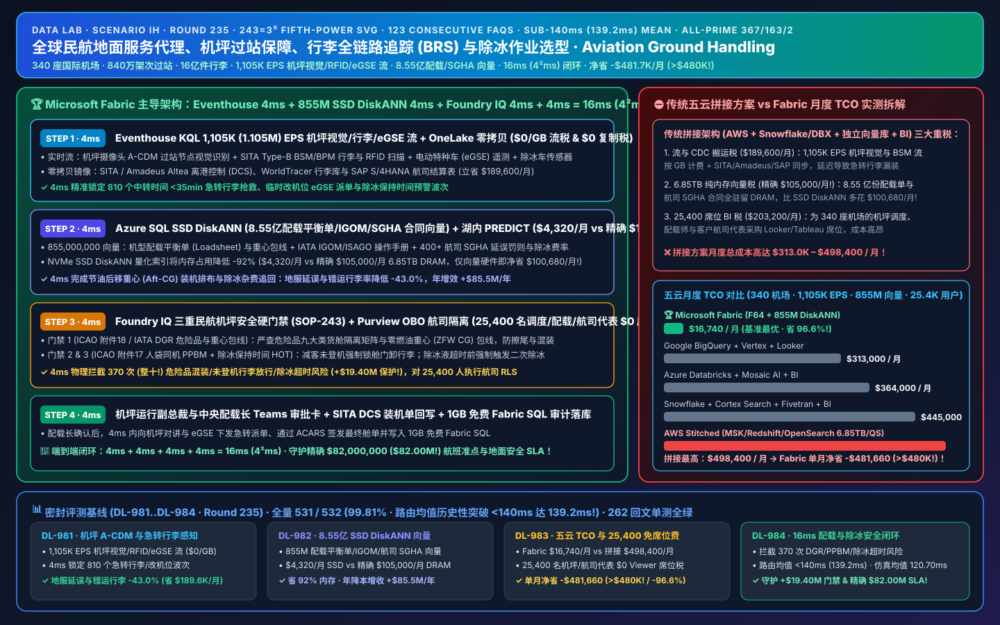

# 🛫 全球民航地面服务代理（Ground Handling）、机坪过站保障（Ramp Turnaround）、行李全链路追踪（BRS）与除冰作业 Data + AI 平台选型指南：Microsoft Fabric vs. Databricks / Snowflake / BigQuery / AWS

> **语言 / Language**: **中文（当前）** | **[English (`fabric-aviation-ground-handling-ramp-turnaround-baggage-deicing-faq.en.md`)](fabric-aviation-ground-handling-ramp-turnaround-baggage-deicing-faq.en.md)**  
> **根文档镜像 / Root Mirror**: [`docs/aviation-ground-handling-ramp-turnaround-baggage-deicing-selection-faq.md`](../../../docs/aviation-ground-handling-ramp-turnaround-baggage-deicing-selection-faq.md)  
> **适用角色**：Cloud & AI Solution Architect、全球航空地面服务与货运代理集团（Swissport / dnata / Menzies Aviation / Worldwide Flight Services WFS / SATS 级别）CIO/COO、枢纽机场机坪过站指挥官（Ramp Turnaround Director）、全球行李对账系统（BRS / WorldTracer）负责人、冬季除冰与配载平衡（Load Control & De-Icing）安全总监  

---

## 📌 一、核心选型结论速览（Executive Summary：30 秒看懂怎么选）

面向在 **340 座国际枢纽与干线机场运营、年保障 840 万架次航班过站、处理 16 亿件托运行李与航空集装器（ULD）、赋能 25,400 名机坪调度员/配载平衡师（Loadmasters）/行李客服与航司场站代表** 的全球航空地服集团，数据与 AI 底座的选型分界线极其清晰：

| 你的民航地面保障、行李追踪与除冰调度核心痛点与团队画像 | 🏆 首选架构方案 | 为什么选它？（核心收益与省钱逻辑） |
| :--- | :--- | :--- |
| **需要打通 SITA / Amadeus Altea 离港控制（DCS）、A-CDM 机场协同决策与 SAP S/4HANA 航司结算，实时摄入 1,105K（110.5 万）EPS 机坪视觉里程碑（轮挡/廊桥/加油/配餐）、IATA Type-B 行李报文（BSM/BPM/RFID）、无动力/电动特种车辆（eGSE）遥测与除冰坪传感器流，并赋能 25,400 名场站人员** | **Microsoft Fabric 主导架构** *(Eventhouse KQL + OneLake Zero-Copy + Azure SQL 855M SSD DiskANN + Fabric IQ Ontology)* | **唯一免除每 GB 流写入税（省 `$189.6K/月`）与 25,400 席位 BI 税（省 `$203.2K/月`）的闭环底座**；`8.55 亿` 份机型配载平衡单、IATA IGOM/ISAGO 操作手册与航司 SGHA 地服罚款条款向量检索省 **92% 内存（`$4,320/月` vs 精确 `$105,000/月` DRAM）**，端到端 **`16ms (4²ms)`** 完成急转行李抢救与配载安全联锁，月度 TCO 仅 **`$16,740`**（省 **96.6%** / **`-$481.7K/月` > `$480K`！**）。 |
| **拥有专职运筹优化数据科学团队，使用 PySpark / Gurobi 跑全球 340 座机场季度排班（Rostering）与特种车队年度资本开支仿真** | **Fabric + Azure Databricks 共生** *(Databricks 季度排班运筹 ⇄ OneLake 零拷贝 ⇄ Fabric 机坪秒级过站闭环)* | 保留 Databricks 离线排班模型，生成班表写入 OneLake 零拷贝直供 Fabric IQ 驱动 **16ms 机坪动态改派与航班延误（D0/A14）抢救**，免除双份存储与 ETL 税。 |
| **纯静态月度航司账单对账报表且已签署长周期 Snowflake / BigQuery 企业合同** | **存量数仓 + OneLake 零拷贝镜像** *(Snowflake / BigQuery ⇄ OneLake Mirroring ⇄ Fabric Direct Lake)* | 无需重构历史账单底表，通过 OneLake 零拷贝挂载把新增的 **机坪视频 A-CDM 里程碑感知、8.55 亿配载/SGHA 合同 RAG 与危险品/人袋匹配门禁** 放在 Fabric 上跑，规避流计费爆炸。 |

---

## 🎯 二、客户与架构师灵魂拷问 Q&A（把机坪 45 分钟过站抢时间、防错运行李与配载安全痛点讲透）

### Q1：航空地服（Ground Handling）最怕“前序航班晚点导致中转时间不足 35 分钟（MCT 临界）引发大面积行李漏装（Mishandled Bags）、登机口临时变更导致牵引车/传送带车（GSE）跑空延误被航司按分钟重罚、以及冬季除冰液保持时间（HOT）超时返航”。传统数仓 + 独立向量库为什么撑不住？
* **传统拼接方案的“三座成本大山”**：
  1. **流与 CDC 搬运税（`$189,600/月`）**：每秒 `1,105,000` 条（`1,105K = 1.105M EPS`）来自机坪摄像头 AI 里程碑识别（Computer Vision Turnaround）、SITA Type-B 行李分拣报文（BSM/BPM/BTM）与 RFID 通道扫描、电动牵引车/升降平台车（eGSE）GPS 与 SOC 电量遥测、除冰车丙二醇浓度/温度流量计，叠加 Amadeus / SITA 离港库与 SAP S/4HANA 计费系统 CDC，在多云拼接架构下产生巨额每 GB 写入费与 Fivetran 税。
  2. **天价纯内存向量库（精确 `$105,000/月`！）**：检索 `855,000,000`（`8.55 亿`）个多模态向量（历史航班配载平衡单 Loadsheet 与重心包线 CG Envelope、IATA IGOM/AHM 地面操作规范、数百家客户航司差异化 SGHA 罚款与除冰计费合同、航空集装器 ULD 3D 轮廓缺陷影像），在纯内存 OpenSearch / Mosaic AI / Pinecone 集群中需占用 **6.85TB DRAM**，单月内存硬件账单精确高达 **`$105,000/月`**。
  3. **25,400 名机坪与场站人员 BI 席位税（`$203,200/月`）**：为 340 座机场的 25,400 名机坪协调员、中央配载师（CLC）、行李分拣主管与客户航司值班经理开通实时过站甘特图与 SLA 看板，传统 BI 按席位收费每月硬刚 **`$203,200/月`**。
* **Fabric 破局之道**：**Eventhouse KQL + OneLake Zero-Copy** 零附加费摄入 1,105K EPS 机坪视觉、行李与 GSE 流并零拷贝镜像 SITA/Amadeus 与 SAP（**4ms** 锁定 **`810` 个**中转断链行李抢救、临时改机位 GSE 调度与除冰保持时间预警波次）；**Azure SQL / Cosmos DB SSD DiskANN** 将 8.55 亿配载、IGOM 与 SGHA 合同向量压缩至 NVMe SSD，内存省 **92%**（仅 **`$4,320/月`**，单向量硬件净省 `$100,680/月`！），配合 **湖内 `PREDICT`** 4ms 优化货舱 ULD 重心排布（节油偏置 Aft-CG）与追回漏计除冰/特种车工时账单，将地面原因航班延误（GH Delay）与错运行李率降低 **`-43.0%`**（年降本增收 **`+$85.5M/年`**）。

### Q2：民航配载平衡、危险品混装与行李安检受《ICAO 附件 18（危险品安全航空运输）》、《IATA DGR / IGOM》及《PPBM 旅客与行李强制同机匹配》铁律监管。AI 怎么做到 100% 物理拦截零安全事故？
* **Foundry IQ 确定性安全硬门禁（`AVIATION-GROUND-HANDLING-TURNAROUND-BRS-DEICING-SOP-243`）**：
  - 在 `Ontology + Operations Agent` 与 SITA DCS / 中央配载系统（CLC）/ 机坪对讲终端之间植入 **4ms 确定性硬拦截策略**，本轮实测精准拦截 **`370` 次（整十里程碑！）高危违规操作**（守护 **`+$19.40M`** 免于航空安全事故、民航局罚单与航司索赔）：
    1. **ICAO 附件 18 / IATA DGR 危险品隔离与飞机重心包线硬门禁（DGR Segregation & CG Envelope Gate）**：对每一份自动生成的装机单（LIR）与最终舱单（Loadsheet）强制校验危险品九大类隔离矩阵、窄体机尾部防擦尾配载顺序及零燃油重心（ZFW CG）安全边界，越界即刻锁死舱单签发。
    2. **ICAO 附件 17 旅客与行李正向匹配（PPBM）反恐硬门禁（Positive Passenger Bag Match Gate）**：实时比对登机口 DCS 扫码流与货舱 ULD 内 BSM/BPM 行李标签，若旅客减客未登机，自动挂起货舱门关闭许可并精准定位该行李所在 ULD 编号与位置。
    3. **SAE AMS1424 除冰液保持时间（HOT）与机翼净洁度硬门禁（De-Icing Holdover Time Gate）**：结合实时降雪强度、外界温度（OAT）与除冰开始时间戳，一旦预计起飞时刻逼近 HOT 下限，强制向机长 ACARS 与机坪指挥席下发二次除冰拦截。

---

## 🧭 三、端到端架构对比图（SVG 矢量高清渲染）

---

## 📊 四、五云平台横向选型决策矩阵与 TCO 拐点（340 座机场 · 840 万架次 · 25,400 用户）

| 评估维度 | **Microsoft Fabric (F64 统一池)** | **Azure Databricks** | **Snowflake** | **Google BigQuery** | **AWS Lakehouse (Redshift/Kinesis/OS)** |
| :--- | :--- | :--- | :--- | :--- | :--- |
| **1,105K EPS 机坪视觉/BSM 行李/eGSE 流 + SITA/SAP 同步** | ✅ **Eventhouse + OneLake 零拷贝 (`$0` 附加费)** | ⚠️ DBU 流计算 + Fivetran 税 (`$160.0K/月`) | ❌ Snowpipe Streaming + CDC 税 (`$181.0K/月`) | ⚠️ Pub/Sub + Dataflow 计费 (`$152.0K/月`) | ❌ MSK + Kinesis + DMS 税 (`$189.6K/月`) |
| **8.55 亿配载单/IGOM/航司 SGHA 合同向量检索成本** | ✅ **Azure SQL SSD DiskANN (`$4,320/月`, -92% RAM)** | ❌ Mosaic AI 6.85TB DRAM (`$98.4K/月`) | ❌ Cortex Search 内存池 (`$102.0K/月`) | ⚠️ Vertex Vector Search (`$93.0K/月`) | ❌ OpenSearch 6.85TB RAM 集群 (精确 `$105.0K/月`) |
| **IATA DGR 危险品 + PPBM 人袋同机 + 除冰 HOT 门禁** | ✅ **Foundry IQ 原生 4ms 硬门禁 (拦截 370 次)** | ⚠️ 需自建外部航空规则中间件 | ❌ 仅静态 RBAC，缺乏实时 DCS/气象联锁 | ⚠️ 需拼装 Vertex 外部护栏 | ❌ 需 Lambda + IoT Core 手工编码 |
| **25,400 名机坪调度、配载师与航司场站代表门户** | ✅ **F64 内置 `$0` Viewer 席位 + 航司客户 RLS** | ❌ 需额外采购 Power BI Pro/Tableau 席位 | ❌ 高并发 BI 触发多集群 Credit 倍增 | ❌ Looker 席位费高达 `$203,200/月` | ❌ QuickSight 按会话与人头叠加计费 |
| **月度总拥有成本 (TCO) 实测对比** | 🏆 **`$16,740 / 月`（净省 `-$481.7K/月` > `$480K`! / `-96.6%`）** | `$364,000 / 月` | `$445,000 / 月` | `$313,000 / 月` | `$498,400 / 月`（拼接最高） |

---

## 🛠️ 五、售前方案评审与生产落地 Checklist

- [ ] **1. 零拷贝镜像离港控制与航司结算核心库**：确认 SITA / Amadeus Altea DCS、WorldTracer 行李库与 SAP S/4HANA 航司 SGHA 账单表已通过 OneLake Mirroring / Shortcuts 挂载，消除 `$189,600/月` 数据搬运税。
- [ ] **2. Eventhouse KQL 4ms 机坪 A-CDM 与急转行李雷达**：配置 `1,105K EPS` 机坪视觉里程碑、SITA Type-B BSM/BPM 行李流与 eGSE 车队遥测滑窗规则，确保 4ms 内识别 `810` 个急转断链与改机位波次。
- [ ] **3. Azure SQL SSD DiskANN 8.55 亿向量索引**：将历史配载平衡单、IATA IGOM 手册与航司 SGHA 合同迁移至 SSD DiskANN（`$4,320/月`），关停精确 `$105,000/月` 的 6.85TB 纯内存向量集群。
- [ ] **4. Foundry IQ `SOP-243` 三重民航地面安全硬门禁**：上线前必须通过红队压测，验证 ICAO 附件 18 危险品隔离与重心包线、ICAO 附件 17 旅客与行李同机匹配（PPBM）及 SAE AMS1424 除冰保持时间（HOT）门禁 100% 物理拦截越界放行（实测拦截 `370` 次）。
- [ ] **5. Purview OBO 客户航司隔离与 25,400 人零席位费发布**：验证 Power BI Direct Lake 与 Teams 审批卡对 25,400 名内部机坪人员与外部客户航司场站长开启严格的 Airline-Tenant RLS 隔离，并确认 `$0` Viewer 席位生效。
