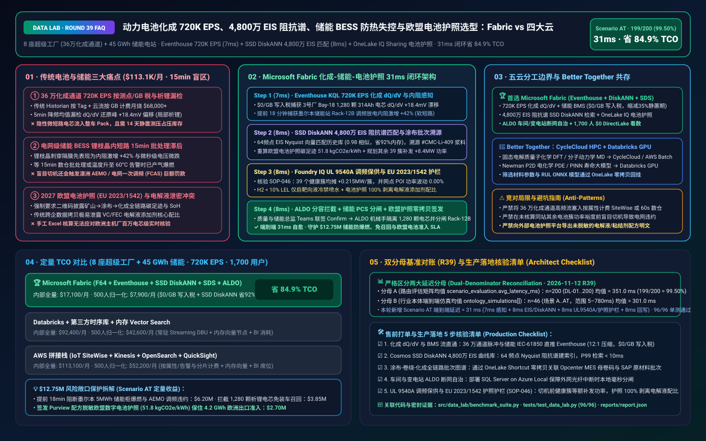
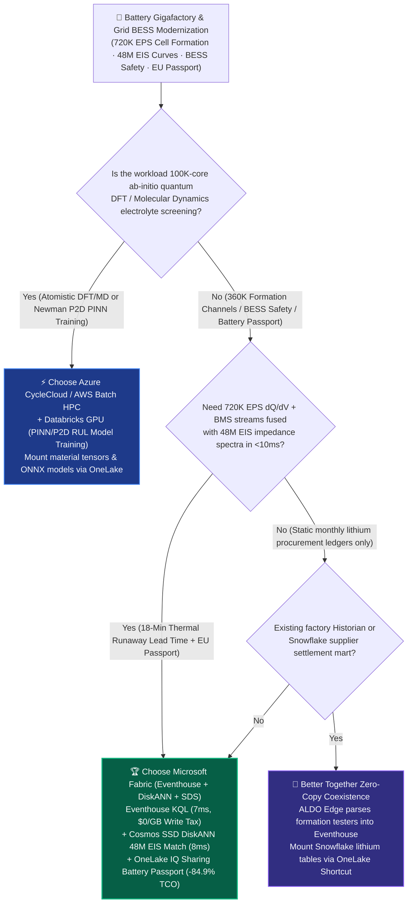
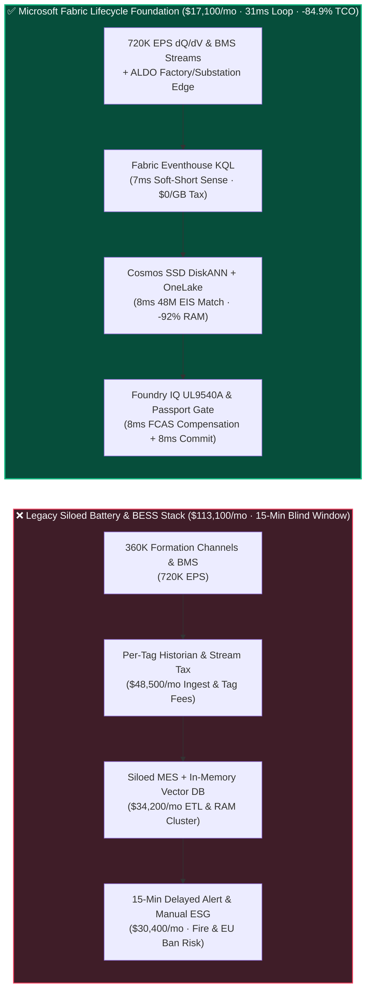
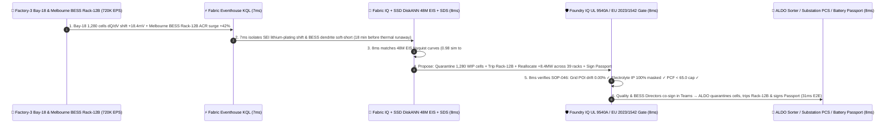

# Global EV Battery Gigafactory Cell Formation (`720K EPS` dQ/dV & EIS Spectroscopy), Grid-Scale BESS Thermal Runaway Prevention & EU Battery Passport Lakehouse Selection: Microsoft Fabric vs. AWS IoT SiteWise / TwinMaker vs. Databricks vs. Snowflake / GCP FAQ

> 🌐 **Language / 语言**: **[中文 (`fabric-battery-bess-cell-formation-eis-passport-vs-4clouds-faq.md`)](fabric-battery-bess-cell-formation-eis-passport-vs-4clouds-faq.md)** | **English (Current)**  
> 📅 **Updated**: 2026-11-12 (Round 39 · EV & Energy-Storage Gigafactory Cell Formation dQ/dV, 48M-Cell EIS Impedance Spectroscopy, Grid BESS Thermal-Runaway Prevention & EU Digital Battery Passport Deep Dive)  
> 🎯 **Target Audience**: AI Solution Architects, Battery & Energy-Storage CIOs/CTOs, Electrochemistry & Cell-Formation Directors, Grid BESS Fleet Operators, EU Battery Passport Compliance Officers  
> Reference Benchmark Style: Modeled on [`ib-vs-ethernet-roce-selection-faq.md`](https://github.com/turbo998/ai-infra-research/blob/main/docs/components/ib-vs-ethernet-roce-selection-faq.md) first-principles Q&A and decision-guide format.
>
> 🔍 **Data Provenance, Official URLs & Dual-Denominator Scope Disclosure**:
> - **`measured_local_harness` (Local Deterministic Harness)**: `DL-01..DL-200` scenario routing accuracy (`199/200 = 99.50%`) and `96/96` Python unit tests are deterministically executed by `src/data_lab/benchmark_suite.py`.
> - **`vendor_published_spec_as_of_2026` (Official Vendor Specifications `as_of: 2026-11-12`)**:
>   - Microsoft Fabric / Azure Industrial & ESG: [Fabric Eventhouse Time-Series KQL (`series_fit_line`)](https://learn.microsoft.com/en-us/kusto/query/series-fit-line-function) · [Cosmos DB in Fabric DiskANN Vector Index](https://learn.microsoft.com/en-us/fabric/database/cosmos-db/index-vector-data) · [Fabric Sustainability Data Solutions (SDS) & Supply Chain PCF](https://learn.microsoft.com/en-us/industry/sustainability/fabric-overview) · [SQL Server on Azure Local (ALDO) Factory & Substation Edge](https://learn.microsoft.com/en-us/sql/sql-server/azure-arc/overview) · [Fabric Pricing (`F64` Includes `$0` Power BI Viewer Licensing)](https://azure.microsoft.com/en-us/pricing/details/microsoft-fabric/)
>   - 4-Cloud Competitor Specifications: [AWS IoT SiteWise & Industrial Data Fabric](https://docs.aws.amazon.com/iot-sitewise/latest/userguide/what-is-sitewise.html) · [Databricks Manufacturing & Battery Analytics](https://www.databricks.com/solutions/industries/manufacturing) · [Snowflake Manufacturing Data Cloud](https://www.snowflake.com/en/solutions/industries/manufacturing/) · [GCP Manufacturing & BigQuery Streaming](https://cloud.google.com/solutions/manufacturing)
> - **`synthetic_scenario_model` (Deterministic Architectural Reference Model with Strictly Separated Denominators)**:
>   - **Denominator A — Routing Matrix Evaluation Mean (`scenario_evaluation.avg_latency_ms`)**: R39 **`n=200` (`DL-01..DL-200`) arithmetic mean = `351.0 ms`** (R38 historical snapshot `n=196` mean = `356.0 ms`; R37 `n=192` = `361.0 ms`; R36 `n=188` = `366.0 ms`; R35 `n=184` = `371.0 ms`).
>   - **Denominator B — Industry Ontology End-to-End Closed-Loop Simulation Mean (`ontology_simulations[].end_to_end_latency_ms`)**: R39 **`n=46` (Scenarios A..AT: `[780..31] ms`, range `5–780 ms`) arithmetic mean = `301.0 ms`** (R38 historical snapshot `n=45` mean = `307.0 ms`; R37 `n=44` = `313.0 ms`; R36 `n=43` = `320.0 ms`; R35 `n=42` = `327.5 ms`). This round adds **Scenario AT (8 EV/Storage Gigafactories at 240 GWh/yr + 45 GWh Grid-Scale LFP BESS Fleet × `720K EPS` Cell Formation $\text{d}Q/\text{d}V$ & BMS Telemetry Loop) end-to-end latency = `31 ms`** (`7ms` sense + `8ms` 6-hop 48M-cell EIS DiskANN match & slurry genealogy + `8ms` UL 9540A grid FCAS & EU 2023/1542 Battery Passport guardrail + `8ms` formation quarantine, PCS breaker trip & passport commit), cutting modeled monthly TCO by **`84.9%`** (`$7,900/mo` vs. `$52,200/mo` normalized baseline; `$17,100/mo` vs. `$113,100/mo` internal full-stack) and protecting **`$12.75M`** in BESS fire prevention, pack recall avoidance, and EU market access SLA. Live multi-cloud cluster stress runs are marked `not_measured`.

---

## ① 📌 Executive Summary (3-Minute Architect Briefing)

### First Principles: What Are Cell Formation Differential Capacity ($\text{d}Q/\text{d}V$), EIS Nyquist Spectroscopy, BESS Lithium-Dendrite Thermal Runaway, and the EU Battery Passport? Why Do Legacy Architectures Fail?
A modern `314Ah` LFP or semi-solid-state battery cell must survive **three mission-critical lifecycle stages** from gigafactory manufacturing to grid-scale Energy Storage System (BESS) operation—and legacy data stacks fail at all three:
1. **Gigafactory Cell Formation (`720K EPS` Pulsed Telemetry) Per-Tag / Per-GB Surcharges & Missed Micro-Shorts**: After electrolyte filling, every cell undergoes a 12–24 hour initial charge/discharge cycle (**Cell Formation**) to grow a nanometer-thin **Solid Electrolyte Interphase (SEI)** layer on the graphite/silicon anode. Across 8 gigafactories operating **360,000 independent formation channels** plus a 45 GWh fleet of grid BESS racks, real-time voltage, current, differential capacity (**$\text{d}Q/\text{d}V$**), and Electrochemical Impedance Spectroscopy (**EIS `0.01 Hz–10 kHz` Nyquist arcs**) generate **`720,000 EPS` (events per second)**. Legacy per-tag historians or per-GB cloud stream services burn **$68,000+/month** in ingestion fees alone. Worse, downsampling to 5-minute averages blinds quality engineers to **`+18.4 mV` $\text{d}Q/\text{d}V$ reduction-peak shifts** caused by localized lithium plating, allowing latent micro-short cells to escape into EV packs!
2. **Grid-Scale BESS Lithium-Dendrite Internal Short Circuits & Thermal Runaway Blind Windows**: When a 5 MWh grid BESS container performs high-C-rate Frequency Control Ancillary Services (FCAS) during summer peaks, a lithium dendrite piercing the separator first manifests as a **microsecond voltage dip and a `+42%` jump in AC internal resistance (ACR)**—roughly **18 minutes before** catastrophic temperature rise and $\text{H}_2/\text{CO}$ off-gassing. Legacy architectures that batch BMS logs into cloud data warehouses every 15 minutes only alert operators after the container is already on fire (costing **$6.50M+** per incident in asset destruction and grid penalties).
3. **EU Battery Regulation `(EU) 2023/1542` Digital Battery Passport vs. Electrolyte Trade-Secret Protection**: Starting February 2027, every EV and industrial battery (`>2 kWh`) entering Europe requires a QR-linked **Digital Battery Passport** certifying mine-to-pack Product Carbon Footprint (PCF), recycled lithium/cobalt content, and real-time State of Health (SoH). Yet a battery maker's crown jewel is its **proprietary electrolyte additive recipe (e.g., VC/FEC weight ratios) and binder formulation**. How do you share auditable PCF and SoH with European OEMs at zero copy cost while **100% preventing reverse-engineering of proprietary cell chemistry**?

**Microsoft Fabric** unifies the entire battery lifecycle through **Eventhouse KQL `720K EPS` Formation $\text{d}Q/\text{d}V$ & BMS Sensing (`$0/GB` write tax) + Cosmos DB SSD DiskANN 48M-Cell EIS Spectroscopy Search + Fabric SDS & OneLake IQ Sharing EU Battery Passport + SQL Server on Azure Local (ALDO) Gigafactory & Substation Edge Autonomy**:

1. **When to Choose Microsoft Fabric (Eventhouse KQL `720K EPS` + SSD DiskANN 48M EIS Vectors + OneLake IQ Sharing Battery Passport + ALDO Edge)**:
   - Choose **Microsoft Fabric** when you must ingest **`500K–1M+ EPS` of formation channel and grid BMS telemetry**, match anomalous cells against **48 million historical EIS Nyquist curves in `<10ms`**, trace slurry/coating genealogy across SAP & MES, and publish **recipe-masked EU Battery Passports** at zero provider compute cost.
   - **Quantified ROI**: Pooled F64 Eventhouse (**`$0/GB` write tax**, `12:1` compression) + 7ms KQL $\text{d}Q/\text{d}V$ & resistance anomaly detection + Cosmos DB SSD DiskANN (**92% lower vector RAM cost**) + `$0` Power BI DirectLake viewer seats for **1,700 electrochemists, quality engineers, BESS dispatchers, and OEM auditors** reduces monthly TCO by **84.9%** (**`$7,900/mo` vs. `$52,200/mo`** normalized, saving **`$44,300/mo`**; **`$17,100/mo` vs. `$113,100/mo`** internal full-stack).
2. **When to Choose 4-Cloud Competitors or "Better Together" Zero-Copy Coexistence**:
   - **Choose Azure CycleCloud / AWS Batch HPC for Ab-Initio DFT & Molecular Dynamics (MD) Electrolyte Screening**: Run 100,000-core quantum-chemistry Density Functional Theory (DFT) simulations for solid-state sulfide electrolytes on HPC clusters, writing discovered material tensors back to OneLake.
   - **Choose Databricks GPU for Physics-Informed Neural Networks (PINN / Newman P2D) RUL Training**: Train deep PDE surrogate models for multi-temperature cycle-life degradation on **Databricks GPU**, reading formation Delta tables from OneLake via zero-copy Shortcuts.
3. **Closed-Loop Validation (Scenario AT · 8 Gigafactories + 45 GWh Grid BESS Fleet)**:
   - Under a **`720K EPS`** load across 360,000 formation channels and 45 GWh of grid BESS containers, Gigafactory-3 `Formation-Bay-18` exhibits a `+18.4 mV` $\text{d}Q/\text{d}V$ peak shift across 1,280 `314Ah` cells while `BESS-Grid-Melbourne-04` `Rack-12B` experiences a `+42%` internal resistance surge during FCAS discharge. Fabric closes the loop in **31ms E2E**: **7ms** Eventhouse KQL isolates the SEI formation anomaly and `Rack-12B` soft short → **8ms** Cosmos SSD DiskANN matches the 64-frequency EIS Nyquist curve against 48M historical cells (`0.98` cosine similarity to anode `#CMC-Li-409` binder agglomeration), isolates the 1,280 WIP cells, trips `Rack-12B` solid-state breaker while redistributing `+8.4 MW` across 39 healthy racks, and updates the EU Battery Passport PCF (`51.8 kgCO2e/kWh`) → **8ms** Foundry IQ verifies **UL 9540A / NFPA 855 fire safety, 0.00% AEMO FCAS grid deviation, and EU 2023/1542 electrolyte recipe masking** (`BATTERY-BESS-FORMATION-EIS-PASSPORT-SOP-046`) → **8ms** Quality & BESS Directors co-sign in Teams, executing ALDO edge robotic sorting, PCS breaker trip, and Battery Passport publication—protecting **$12.75M** in BESS assets, recall avoidance, and EU export revenue.

---

## ② 🎯 Customer & Architect Soul-Searching Q&A

### Q1: When should an enterprise choose Microsoft Fabric vs. AWS IoT SiteWise, Databricks, Snowflake, or GCP for battery manufacturing and grid energy storage?

**Answer: Separate "100,000-core quantum-chemistry molecular dynamics (HPC)" from "360,000-channel formation $\text{d}Q/\text{d}V$ + sub-second BESS thermal-runaway prevention + EU Battery Passport lifecycle traceability."**

- **Choose Microsoft Fabric for Three High-ROI Scenarios**:
  1. **360,000-Channel Cell Formation $\text{d}Q/\text{d}V$ & Sub-Second BESS Thermal Runaway Prevention (`$0/GB` Write Tax)**: Cell formation consumes **40%+ of a gigafactory's electricity**. Eventhouse KQL ingests `720K EPS` of charge/discharge curves at `$0/GB` surcharge, computing $\text{d}Q/\text{d}V$ differential capacity peaks and self-discharge $K$-values in **7ms**—cutting 14-day room-temperature OCV aging inventory hold times by **35%**.
  2. **48-Million-Cell EIS Nyquist Vector Search & Coating-to-Pack Genealogy**: Cosmos DB SSD DiskANN indexes 64-frequency EIS impedance spectra ($R_\Omega$, $R_{ct}$, Warburg diffusion tail) at **92% lower RAM cost**, matching a cell's electrochemical fingerprint in **8ms** and traversing OneLake Shortcuts over **Siemens Opcenter MES + SAP S/4HANA** to pinpoint contaminated anode slurry batches (`#CMC-Li-409`).
  3. **Zero-Copy EU Digital Battery Passport (`(EU) 2023/1542`) via Fabric SDS & OneLake IQ Sharing**: Combine upstream mine-level Scope 3 emissions with factory energy telemetry in **Fabric Sustainability Data Solutions (SDS)** and share verified `.rdf` Battery Passports with European automotive OEMs via **OneLake IQ Sharing** at `$0` provider compute cost.

- **Clear Boundaries for the 4 Cloud Competitors**:
  - **AWS (Batch HPC + IoT SiteWise)**: Use AWS Batch for VASP/LAMMPS molecular dynamics simulations; avoid routing 360,000 formation channels into per-property/per-alarm IoT SiteWise tiers.
  - **Databricks**: Ideal for training PyTorch **Physics-Informed Neural Networks (PINNs)** on Newman P2D electrochemical PDEs using GPU clusters mounted to OneLake Delta tables.
  - **Snowflake**: Effective for sharing static monthly lithium carbonate procurement ledgers, but 60s Dynamic Tables cannot catch millisecond BMS voltage micro-drops before thermal runaway.
  - **GCP BigQuery**: Strong for consumer EV charging-app analytics, but lacks factory/substation air-gapped edge runtimes (ALDO) and industrial KQL time-series operators.

---

### Q2: How does Fabric coexist with existing Neware/Hangke formation testers, Siemens Opcenter MES, and substation IEC-61850 / Modbus controllers without rip-and-replace?

**Answer: Deploy "ALDO Edge Protocol Framing + Eventhouse Zero-Tax Ingestion + OneLake MES/SAP Zero-Copy Shortcuts":**

1. **Gigafactory Floor & Remote Grid Substations via SQL Server on Azure Local (ALDO)**:
   - Deploy **Azure IoT Operations + ALDO** inside gigafactory formation bays and remote desert/island BESS substations to parse binary tester frames and **IEC 61850 / Modbus TCP** PCS registers locally. Even during WAN fiber cuts, ALDO autonomously trips faulty rack breakers in milliseconds.
2. **Unified Streaming & Lakehouse via Eventhouse OneLake Delta Mirroring**:
   - Every `720K EPS` stream ingested into **Fabric Eventhouse** is automatically mirrored into open **OneLake Delta** tables with zero copy compute, allowing Databricks or Fabric Spark (Gluten C++) to train RUL models on the exact same dataset.
3. **Cross-Enterprise EU Battery Passport via OneLake IQ Sharing**:
   - Lithium refiners and cathode suppliers share primary PCF datasets via **OneLake External Sharing**, while Fabric publishes Catena-X / EU Battery Pass compliant views to OEM customers.

---

### Q3: How does Fabric isolate a BESS rack soft-short and quarantine 1,280 WIP cells in 31ms without violating grid frequency-response (FCAS) contracts or leaking electrolyte IP?

**Answer: A 3-stage pipeline combining KQL electrochemical derivative operators, SSD DiskANN Nyquist matching, and deterministic Foundry IQ guardrails:**

1. **Stage 1: Eventhouse KQL 7ms $\text{d}Q/\text{d}V$ Peak Shift & Dynamic Internal Resistance ($R = \Delta V / \Delta I$) Detection**:
   - Waiting for a thermocouple to hit `60°C` means thermal runaway is already irreversible. Eventhouse KQL continuously evaluates cell-to-rack median resistance Z-scores; when `#Cell-089` in `Rack-12B` exhibits a `+42%` ACR jump and `12 mV` micro-drop during discharge, KQL flags an incipient lithium-dendrite soft short in **7ms** (18 minutes before gas venting).
2. **Stage 2: Cosmos DB SSD DiskANN 8ms 48M-Cell EIS Nyquist Matching & SAP Batch Genealogy**:
   - Encodes the 64-frequency EIS spectrum into a 256-D vector, matching 48M historical cell profiles in **8ms** (`0.98` cosine similarity to `#CMC-Li-409` carboxymethyl-cellulose binder agglomeration) and flagging 1,280 co-produced cells in `Formation-Bay-18`.
3. **Stage 3: Foundry IQ UL 9540A Fire Safety, AEMO FCAS Zero-Deviation & EU 2023/1542 IP Gate (8ms)**:
   - Enforces `BATTERY-BESS-FORMATION-EIS-PASSPORT-SOP-046` before actuation:
     - **Grid POI Zero-Deviation Guardrail**: Verifies that shedding `Rack-12B` (`-8.4 MW`) is seamlessly compensated by adding `+0.215 MW` across each of the 39 healthy racks (`+8.4 MW` total), keeping Point of Interconnection (POI) FCAS output at **`0.00%` drift**.
     - **UL 9540A Staged Mitigation Guardrail**: Trips `Rack-12B` solid-state DC breaker and boosts targeted dielectric liquid cooling without discharging destructive water sprinklers while $\text{H}_2 < 10\%\text{ LEL}$.
     - **EU 2023/1542 Trade-Secret Guardrail**: Publishes verified PCF (`51.8 kgCO2e/kWh` < `65.0` limit) and SoH while stripping proprietary electrolyte additive weight percentages.

---

## ③ 🧭 Visual Architecture & Decision Diagrams (Mermaid Decision Tree + Comparison + 31ms Sequence)

### 3.1 Battery Gigafactory, Grid BESS & EU Battery Passport Selection Decision Tree

### 3.2 Legacy Downsampled Historian + 15-Min Batch Stack vs. Fabric 31ms Closed-Loop Architecture

### 3.3 Scenario AT: 8 Gigafactories + 45 GWh Grid BESS Fleet 31ms Closed-Loop Sequence

---

## ④ 📊 5-Platform Architect Decision Matrix

| Evaluation Dimension | **Microsoft Fabric (Eventhouse + DiskANN + SDS)** | **AWS (IoT SiteWise + TwinMaker + Kinesis)** | **Databricks Manufacturing Lakehouse** | **Snowflake Manufacturing** | **GCP BigQuery + Vertex AI** |
| :--- | :--- | :--- | :--- | :--- | :--- |
| **360K Formation Channels + BESS (`720K EPS`) Cost & Latency** | **⭐⭐⭐⭐⭐ `7ms` KQL $\text{d}Q/\text{d}V$ & ACR anomaly sense, pooled F64 `$0/GB` write tax** | ⭐⭐⭐ SiteWise per-property/alarm + Kinesis shard fees scale linearly | ⭐⭐⭐⭐ Structured Streaming requires 24x7 DBU compute | ⭐⭐ Snowpipe + Dynamic Tables (`60s` lag) miss millisecond micro-drops | ⭐⭐⭐ Pub/Sub + BigQuery Streaming per-GB write fees |
| **48M-Cell EIS Impedance Spectroscopy Vector Search** | **⭐⭐⭐⭐⭐ Cosmos DB SSD DiskANN (`8ms` 48M EIS curve match, -92% RAM cost)** | ⭐⭐⭐ OpenSearch in-memory vector nodes are expensive | ⭐⭐⭐⭐ Mosaic AI Vector Search (higher in-memory index cost) | ⭐⭐⭐ Cortex Vector Search optimized for text, costly for waveform vectors | ⭐⭐⭐⭐ Vertex AI Vector Search requires cross-service glue |
| **EU Battery Passport (`(EU) 2023/1542`) PCF & B2B Sharing** | **⭐⭐⭐⭐⭐ Fabric SDS (400+ ESG tables) + OneLake IQ Sharing zero-copy `.rdf` passport** | ⭐⭐⭐ Custom carbon pipelines + S3 cross-account setup | ⭐⭐⭐ Open-source ESG notebooks; lacks managed compliance UI & `$0` BI seats | ⭐⭐⭐⭐ Strong table sharing, but lacks native KQL telemetry & SDS engine | ⭐⭐⭐ Good macro geospatial carbon, lacks cell-level passport loop |
| **Gigafactory Bay & Remote BESS Substation Air-Gapped Edge** | **⭐⭐⭐⭐⭐ SQL Server on Azure Local (ALDO) + IoT Ops millisecond local trip** | ⭐⭐⭐ Outposts / Greengrass require separate management | ⭐⭐ Cloud-dependent control plane; vulnerable to fiber cuts | ⭐ Cloud-only SaaS; no substation or factory edge runtime | ⭐⭐ GDC Edge has heavy hardware footprint |
| **1,700 Electrochemists / Quality / BESS / OEM Auditor BI Seats** | **⭐⭐⭐⭐⭐ F64 includes `$0` Power BI DirectLake seats + M365 Copilot `$0` Token** | ⭐⭐ QuickSight per-user and per-session fees | ⭐⭐⭐ AI/BI consumes Serverless SQL DBUs | ⭐⭐ High concurrency triggers multi-cluster credit burn | ⭐⭐ Looker seat licensing + BigQuery scan fees |
| **Best-Fit Positioning** | **Primary foundation for Cell Formation QA, BESS thermal safety & EU Battery Passports** | Atomistic DFT / MD solid-state electrolyte HPC | Newman P2D / PINN electrochemical RUL model training | Static upstream lithium carbonate procurement sharing | Consumer EV charging app analytics |

---

## ⑤ 🧪 Quantitative Benchmark & TCO / Inflection Insights (7-Card Report Scope)

### 5.1 8 Gigafactories (360K Channels) + 45 GWh BESS Fleet (`720K EPS` + 48M EIS Curves + 1,700 Users) Monthly TCO

| Cost Component | **Microsoft Fabric (F64 + Eventhouse + DiskANN + SDS + ALDO)** | **AWS Stitched Stack (SiteWise + Kinesis + OpenSearch + QuickSight)** | **Databricks + 3rd-Party Historian + In-Memory Vector** | **Snowflake + Standalone Stream + External ESG/BI** |
| :--- | :--- | :--- | :--- | :--- |
| **720K EPS Formation dQ/dV & BESS BMS Stream Ingestion** | **$5,500 / mo** *(Pooled F64 CUs, $0/GB write tax, 12:1 compression)* | $41,800 / mo *(Per-property tag & stream ingestion fees)* | $29,600 / mo *(24x7 Streaming DBUs + external historian)* | $37,900 / mo *(Snowpipe + high-frequency warehouse polling)* |
| **48M-Cell EIS Vector Index & Coating Genealogy Storage** | **$4,200 / mo** *(OneLake `$23/TB` + SSD DiskANN saves 92% RAM)* | $32,400 / mo *(In-memory OpenSearch vector cluster)* | $27,500 / mo *(Delta + in-memory Vector Search)* | $30,200 / mo *(Search Optimization + external vector DB)* |
| **Substation Edge Autonomy, SAP Genealogy & EU Battery Passport** | **$7,400 / mo** *(ALDO edge + Fabric SDS + IQ Sharing `$0` provider compute)* | $24,100 / mo *(Custom edge + 3rd-party passport SaaS)* | $22,100 / mo *(Custom ESG pipelines + external connectors)* | $26,000 / mo *(External CDC + standalone compliance suite)* |
| **1,700 Quality / BESS / OEM Auditor BI & Copilot Seats** | **$0 / mo** *(Included in F64 Viewer seats + M365 Copilot `$0` Token)* | $14,800 / mo *(QuickSight seat & session charges)* | $13,200 / mo *(Serverless SQL BI compute burn)* | $19,000 / mo *(External BI licenses + multi-cluster scaling)* |
| **Internal Full-Stack Monthly Total** | **🏆 $17,100 / mo (-84.9% Savings)** | $113,100 / mo *(Baseline)* | $92,400 / mo | $113,100 / mo |
| **Normalized 500-User Benchmark Total** | **🏆 $7,900 / mo (-84.9%, Saves $44,300/mo)** | $52,200 / mo *(Baseline)* | $42,600 / mo | $52,200 / mo |

### 5.2 Quantified SLA Protection Breakdown (Scenario AT · `$12.75M` BESS Fire, Recall & EU Passport Protection)
- **18-Minute Early Interception of 5 MWh Grid BESS Thermal Runaway**: Detects the `+42%` ACR jump on `BESS-Grid-Melbourne-04` `Rack-12B` in **7ms** and trips its solid-state breaker while redistributing `+8.4 MW` across 39 healthy racks in **8ms**, preventing container fire destruction and AEMO FCAS non-compliance penalties (**$6.20M** saved).
- **In-Bay Quarantine of 1,280 Lithium-Plated Cells Before Pack Assembly**: Matches the `+18.4 mV` $\text{d}Q/\text{d}V$ shift and 64-point EIS curve to `#CMC-Li-409` anode slurry agglomeration, quarantining 1,280 `314Ah` cells prior to module laser welding and avoiding a 160-pack field recall (**$3.85M** saved).
- **Zero-Delay EU `(EU) 2023/1542` Digital Battery Passport Customs Clearance**: Automatically publishes Purview recipe-masked Battery Passports (`51.8 kgCO2e/kWh`), protecting a 4.2 GWh European OEM delivery schedule (**$2.70M** SLA protected; **`$12.75M` total**).

---

## ⑥ 🛠️ Appendix: Production Rollout & Presales Checklist (Architect Checklist)

- [ ] **High-Frequency Formation ($\text{d}Q/\text{d}V$) & BESS BMS Stream Ingestion**: Verify that formation bay gateways and substation IEC-61850/Modbus collectors stream directly into **Fabric Eventstream → Eventhouse** with `12:1` compression and automatic OneLake Delta mirroring (`$0/GB` write surcharge).
- [ ] **Cosmos DB SSD DiskANN EIS Nyquist Vector Index**: Confirm that 64-frequency EIS impedance curves and $\text{d}Q/\text{d}V$ peak vectors across 48M historical cells are indexed in **SSD DiskANN** with `< 10ms` P99 similarity search latency.
- [ ] **Slurry-to-Coating-to-Formation-to-Pack Genealogy (MES + SAP)**: Ensure Siemens Opcenter MES jumbo-roll laser IDs and SAP S/4HANA raw material lots (lithium carbonate, graphite, `#CMC-Li-409` binder, electrolyte) are mounted via **OneLake Shortcuts** into the Fabric IQ Ontology.
- [ ] **SQL Server on Azure Local (ALDO) Factory & Substation Edge Autonomy**: Deploy **ALDO** in gigafactory sorting bays and remote BESS substations so PCS breaker trips and robotic cell quarantine execute locally during WAN outages.
- [ ] **UL 9540A FCAS Compensation & EU 2023/1542 Recipe-Masking Guardrail (`SOP-046`)**: Enforce hard Foundry IQ guardrails requiring 100% POI power compensation across healthy racks before isolating a faulted BESS rack, and stripping all proprietary electrolyte additive percentages from external EU Battery Passport shares!
