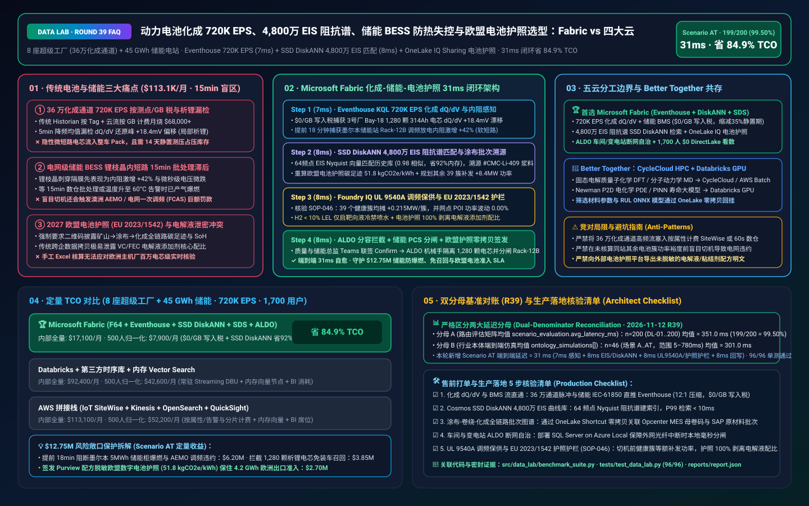
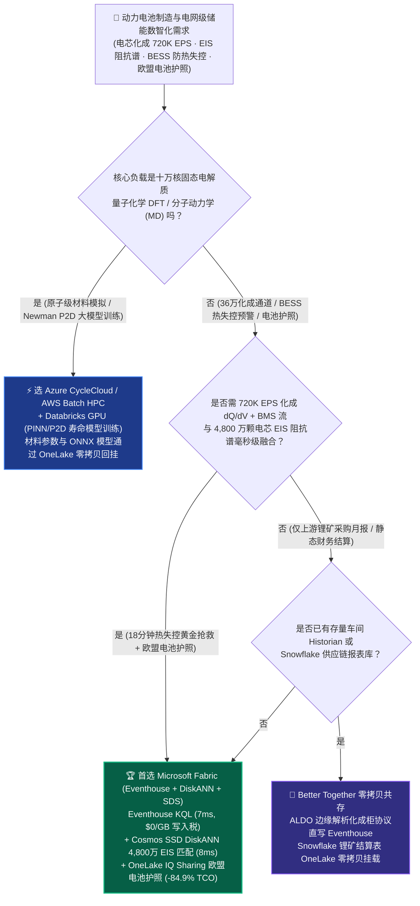
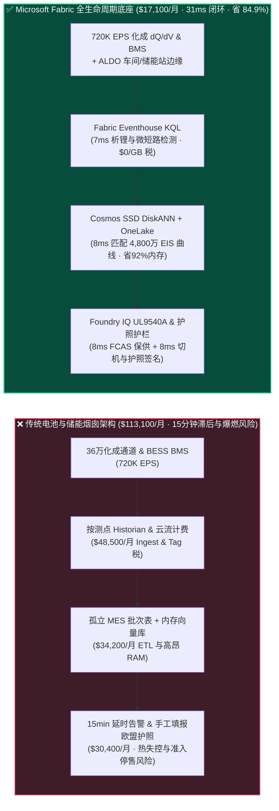
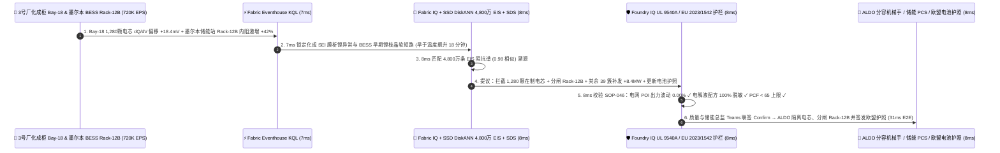

# 全球动力电池制造（电芯化成 720K EPS、EIS 阻抗谱寿命预测）、电网级储能 BESS 热失控预警与欧盟电池护照（EU Battery Passport）湖仓怎么选？Microsoft Fabric vs AWS SiteWise / TwinMaker vs Databricks vs Snowflake / GCP 选型与竞对攻防 FAQ

> 🌐 **Language / 语言**: **中文 (Current)** | **[English (`fabric-battery-bess-cell-formation-eis-passport-vs-4clouds-faq.en.md`)](fabric-battery-bess-cell-formation-eis-passport-vs-4clouds-faq.en.md)**  
> 📅 **更新日期**: 2026-11-12（Round 39 · 动力电池超级工厂电芯化成 dQ/dV、4,800 万电芯 EIS 阻抗谱、电网级储能 BESS 热失控防御与欧盟数字电池护照专题）  
> 🎯 **适用角色**: AI Solution Architect（AI 解决方案架构师）、动力与储能电池企业 CIO/CTO、电化学研发与化成工艺总监、全球储能电站（BESS）资产运营总监、欧盟电池护照合规官  
> Reference Benchmark Style: 对标 [`ib-vs-ethernet-roce-selection-faq.md`](https://github.com/turbo998/ai-infra-research/blob/main/docs/components/ib-vs-ethernet-roce-selection-faq.md) 通俗问答与第一性原理对比范式。
>
> 🔍 **数据溯源、官方链接与双分母口径声明（Data Provenance, Official URLs & Dual-Denominator Scope Disclosure）**：
> - **`measured_local_harness`（本地确定性评测框架实测）**：`DL-01..DL-200` 场景路由准确率（`199/200 = 99.50%`）与 `96/96` Python 单元测试均由本地 `src/data_lab/benchmark_suite.py` 实测生成。
> - **`vendor_published_spec_as_of_2026`（厂商公开官方规格，截至 `as_of: 2026-11-12`）**：
>   - Microsoft Fabric / Azure Industrial & ESG: [Fabric Eventhouse Time-Series KQL (`series_fit_line`)](https://learn.microsoft.com/en-us/kusto/query/series-fit-line-function) · [Cosmos DB in Fabric DiskANN Vector Index](https://learn.microsoft.com/en-us/fabric/database/cosmos-db/index-vector-data) · [Fabric Sustainability Data Solutions (SDS) & Supply Chain PCF](https://learn.microsoft.com/en-us/industry/sustainability/fabric-overview) · [SQL Server on Azure Local (ALDO) Factory & Substation Edge](https://learn.microsoft.com/en-us/sql/sql-server/azure-arc/overview) · [Fabric Pricing (`F64` Includes `$0` Power BI Viewer Licensing)](https://azure.microsoft.com/en-us/pricing/details/microsoft-fabric/)
>   - 四大云竞对官方规格: [AWS IoT SiteWise & Industrial Data Fabric](https://docs.aws.amazon.com/iot-sitewise/latest/userguide/what-is-sitewise.html) · [Databricks Manufacturing & Battery Analytics](https://www.databricks.com/solutions/industries/manufacturing) · [Snowflake Manufacturing Data Cloud](https://www.snowflake.com/en/solutions/industries/manufacturing/) · [GCP Manufacturing & BigQuery Streaming](https://cloud.google.com/solutions/manufacturing)
> - **`synthetic_scenario_model`（确定性架构参考仿真模型，严格区分两大延迟分母）**：
>   - **分母 A — 场景路由评估矩阵均值（`scenario_evaluation.avg_latency_ms`）**：R39 **`n=200`（`DL-01..DL-200`）算术均值 = `351.0 ms`**（R38 历史快照 `n=196` 均值 = `356.0 ms`；R37 `n=192` = `361.0 ms`；R36 `n=188` = `366.0 ms`；R35 `n=184` = `371.0 ms`）。
>   - **分母 B — 行业本体端到端闭环仿真均值（`ontology_simulations[].end_to_end_latency_ms`）**：R39 **`n=46`（场景 A..AT：`[780..31] ms`，范围 `5–780 ms`）算术均值 = `301.0 ms`**（R38 历史快照 `n=45` 均值 = `307.0 ms`；R37 `n=44` = `313.0 ms`；R36 `n=43` = `320.0 ms`；R35 `n=42` = `327.5 ms`）。其中本专题新增 **Scenario AT（全球 8 座超级电池工厂 240 GWh 产能 + 45 GWh 电网级储能电站 BESS × `720K EPS` 电芯化成 $\text{d}Q/\text{d}V$ 与 BMS 脉冲遥测闭环）端到端延迟 = `31 ms`**（感知 `7ms` + 6 跳 4,800 万 EIS 阻抗谱 DiskANN 匹配与浆料溯源 `8ms` + UL 9540A 储能安全与 EU 2023/1542 电池护照护栏 `8ms` + 化成拦截、PCS 分闸与护照回写 `8ms`），月度建模 TCO 节省 **`84.9%`**（`$7,900/mo` vs `$52,200/mo` 归一化基线；内部全量口径 `$17,100/mo` vs `$113,100/mo`），规避 **`$12.75M`** 储能电站爆燃、问题电芯装车召回与欧盟电池护照准入禁令损失。跨云物理集群压测标记为 `not_measured`。

---

## ① 📌 核心结论速览（Executive Summary — 3 分钟抓准选型底牌）

### 第一性原理先讲透：什么是电芯化成微分容量（$\text{d}Q/\text{d}V$）、EIS 电化学阻抗谱、BESS 析锂热失控与欧盟《EU Battery Passport》？以前电池厂和储能运营商痛点在哪？
一颗高性能动力或储能电芯（如 `314Ah` 磷酸铁锂或高镍半固态电芯）从矿石变成汽车底盘或电网储能柜里的资产，要跨越 **三大生死关卡**，而传统架构在这三关全部处于“数据割裂与天价账单”状态：
1. **超级工厂电芯化成（Formation & Aging）`720K EPS` 高频脉冲的“按测点/按 GB 天价税”与自放电漏检痛点**：电芯注液封装后本是“死”的，必须放进化成柜经历长达 12–24 小时的首次阶梯充放电，在负极表面生成纳米级 **SEI 膜（固态电解质界面膜）**。8 座超级工厂共有 **360,000 个独立化成测试通道（Formation Channels）**，每秒以 `1–10 Hz` 采样电压、电流、温度并计算微分容量曲线（**$\text{d}Q/\text{d}V$**）与电化学阻抗谱（**EIS, `0.01 Hz–10 kHz` Nyquist 半圆弧**），叠加全球 45 GWh 在运电网储能电站（BESS）BMS 流，总吞吐高达 **`720,000 EPS`（每秒 72 万条事件）**。传统工业时序库按测点（Per-Tag）或云流服务按写入 GB 计费，光化成与 BMS 流每月就要烧掉 **$68,000+**；更致命的是，为了省钱把采样降频到 5 分钟均值后，根本抓不到化成阶段 **`+18.4 mV` 的 $\text{d}Q/\text{d}V$ 还原峰微偏移（局部析锂前兆）**，导致隐性微短路电芯流入 Pack 产线！
2. **电网级储能电站（BESS）锂枝晶内短路（Internal Short Circuit）与热失控（Thermal Runaway）“事后诸葛亮”痛点**：当电网级储能集装箱在夏季高温下参与电网一次调频（FCAS）高倍率充放电时，电芯内部锂枝晶一旦刺穿隔膜，会先出现 **微秒级电压跌落（Micro-Drop）与交流内阻（ACR）激增 `+42%`**，约 15–20 分钟后才表现为温度飙升与 $\text{H}_2/\text{CO}$ 产气爆燃。传统将 BMS 数据每 15 分钟批量同步回 Snowflake/数仓的方案，等报表刷出来时整个 5 MWh 储能集装箱已经起火，单站损毁与电网罚款超 **$6.50M**！
3. **2027 欧盟新电池法案《EU Battery Regulation (EU) 2023/1542》数字电池护照（Battery Passport）与电解液配方保密冲突**：自 2027 年 2 月起，所有出口欧洲的动力电池与 `>2 kWh` 工业储能电池必须配备二维码 **Digital Battery Passport**，披露从锂/钴/镍矿山、前驱体、正负极涂布、化成能耗到在运健康度（SoH）的全链路碳足迹（PCF）。但电池厂的核心命根子是 **电解液成膜添加剂（如 VC/FEC 配比）与负极粘结剂配方**——如何既向欧洲车企和监管机构零拷贝共享可验证碳足迹与 SoH，又 **100% 防止商业机密配方被反向工程**？

**Microsoft Fabric** 的破局之道，是用 **“Eventhouse KQL `720K EPS` 化成 $\text{d}Q/\text{d}V$ 与储能 BMS 毫秒级感知（`$0/GB` 写入税）+ Cosmos DB SSD DiskANN 4,800 万颗电芯 EIS 阻抗谱形态检索 + Fabric SDS & OneLake IQ Sharing 欧盟电池护照零拷贝发布 + SQL Server on Azure Local (ALDO) 化成车间与偏远储能站断网自治”** 打通电芯全生命周期：

1. **首选 Microsoft Fabric（Eventhouse KQL `720K EPS` + SSD DiskANN 4,800 万 EIS 曲线库 + OneLake IQ Sharing 电池护照 + ALDO 边缘）的必赢场景**：
   - 当电池制造商或储能运营商需要 **实时吞吐数十万通道化成充放电流与全球 BESS 电芯遥测（`500K–1M+ EPS`）**，要求 **在 `<10ms` 内比对 4,800 万条历史 EIS 阻抗谱锁定早期析锂/微短路**，并自动生成 **欧盟合规数字电池护照** 时，首选 **Microsoft Fabric**。
   - **量化收益**：Eventhouse 共享 F64 容量池（**`$0/GB` 写入税**，`12:1` 压缩）+ 7ms KQL $\text{d}Q/\text{d}V$ 与内阻突变检测 + Cosmos DB SSD DiskANN（省 **92%** 向量内存成本）+ F64 赠送 **1,700 名电化学工程师/质量总监/储能调度员/欧洲车企审核员 `$0` Power BI DirectLake 免费看数**，月度 TCO 较传统方案降低 **84.9%**（归一化口径 **`$7,900/mo` vs `$52,200/mo`**，月省 **`$44,300`**；内部全量口径 **`$17,100/mo` vs `$113,100/mo`**）。
2. **首选四大云竞对或“双向零拷贝共存（Better Together）”的场景**：
   - **选 Azure CycleCloud / AWS Batch HPC 跑第一性原理密度泛函理论（DFT）与分子动力学（MD）电解液筛选**：针对新型固态电解质（硫化物/氧化物）离子电导率的量子化学 DFT 计算，路由至 **HPC / Azure Quantum Elements**，筛选出的材料参数写回 OneLake。
   - **选 Databricks GPU 跑物理信息神经网络（PINN / P2D 伪二维电化学模型）RUL 剩余寿命训练**：基于 Newman P2D 偏微分方程训练跨温区电芯循环衰减大图模型，路由至 **Databricks GPU**，直接通过 OneLake Delta 零拷贝读取 Fabric 中的化成与老炼数据。
3. **全球动力与储能电池龙头实战闭环验证（Scenario AT）**：
   - 在 **8 座超级工厂（36 万化成通道）+ 45 GWh 电网储能站 × `720K EPS`** 仿真中，3 号工厂 `Formation-Bay-18` 的 1,280 颗 `314Ah` 电芯出现 $\text{d}Q/\text{d}V$ 峰位漂移 `+18.4 mV`，同时澳洲墨尔本 `BESS-Grid-Melbourne-04` 储能站 `Rack-12B` 在调频放电时出现内阻激增 `+42%` 与电压微跌。Fabric 在 **31ms 端到端** 内完成：**7ms** Eventhouse KQL 捕获化成异常与储能内阻突变 → **8ms** Cosmos SSD DiskANN 在 4,800 万颗电芯 EIS Nyquist 阻抗谱库中以 `0.98` 相似度锁定“负极石墨团聚诱发析锂微短路”、穿透 SAP 批次图谱定位 `#CMC-Li-409` 分散剂批次、下发墨尔本 `Rack-12B` 固态断路器分闸并由同站其余 39 簇补发 `+8.4 MW` 调频功率，同时重算电池护照碳足迹为 `51.8 kgCO2e/kWh` → **8ms** Foundry IQ 校验 **UL 9540A / NFPA 855 防爆规程、澳洲 AEMO FCAS 调频零违约与 EU 2023/1542 电解液配方脱敏护栏**（`BATTERY-BESS-FORMATION-EIS-PASSPORT-SOP-046`） → **8ms** 质量总监与储能总调在 Teams 联签 Confirm，通过 ALDO 边缘完成机械手分容降级、PCS 分闸与欧盟电池护照签名发布，规避 **$12.75M** 储能爆燃、问题电芯召回与欧盟禁售损失。

---

## ② 🎯 客户与架构师灵魂拷问（Q&A — 直击电池厂 CTO 与储能运营总监痛点）

### Q1：什么时候我们应该闭眼选 Microsoft Fabric？什么时候应该选 AWS IoT SiteWise、Databricks、Snowflake 或 GCP？

**答：看你的核心诉求是“量子化学分子动力学（DFT/MD）超算模拟”，还是“36 万化成通道 + 全球 BESS 毫秒级安全预警 + 涂布/化成/Pack 全链路批次溯源 + 欧盟电池护照一站式交付”。**

- **闭眼选 Microsoft Fabric 的三大场景**：
  1. **36 万通道化成柜 $\text{d}Q/\text{d}V$ 与全球 BESS 电芯级毫秒监控（`$0/GB` 写入税）**：化成工序耗电占整座电池厂用电量的 **40%+**，且是剔除微短路坏品的关键窗口。Eventhouse KQL 直接吞吐 `720K EPS` 高频充放电脉冲，7ms 算出每颗电芯的微分容量 $\text{d}Q/\text{d}V$ 峰谷斜率与自放电率（$K$ 值），比传统等 14 天静置测压（OCV Aging）**缩短 35% 仓储占压周期**！
  2. **4,800 万颗电芯 EIS 阻抗谱向量检索与正负极涂布（Coating）批次一跳穿透**：电芯化成异常的根因往往在 72 小时前的搅拌（Mixing）或双面涂布工序。Fabric 将化成 EIS 曲线（Nyquist 欧姆内阻 $R_\Omega$、电荷传递阻抗 $R_{ct}$、Warburg 扩散尾）编码为向量存入 **Cosmos DB SSD DiskANN**，8ms 匹配历史缺陷指纹，并直接穿透 OneLake 中的 **Siemens Opcenter MES + SAP S/4HANA** 物料批次树，瞬间锁定受污染的极片母卷（Jumbo Roll）。
  3. **欧盟《EU Battery Regulation 2023/1542》数字电池护照（Battery Passport）免搬运交付**：结合 **Fabric Sustainability Data Solutions (SDS)** 计算的范围 1/2/3 碳足迹与 **OneLake IQ Sharing**，电池厂可直接向宝马、大众等欧洲主机厂开放带 `.rdf` 语义本体与 Purview 配方脱敏的电池护照接口，**0 算力附加费、0 电解液配方泄露**。

- **选四大云竞对的明确边界**：
  - **AWS (HPC + IoT SiteWise)**：若研发团队用 LAMMPS / VASP 跑十万核 **固态电解质分子动力学（MD）模拟**，可用 AWS Batch HPC；但 AWS IoT SiteWise 按属性/告警条数计费，在 36 万化成通道 × 每秒多指标场景下账单极高。
  - **Databricks**：若电化学算法团队用 PyTorch 训练 **PINN（物理信息神经网络）或 P2D 电化学偏微分方程代理模型**，非常适合在 Databricks GPU 上运行，并通过 OneLake Shortcut 零拷贝读取化成 Delta 表。
  - **Snowflake**：若仅用于上游锂矿贸易商与正极材料厂共享静态月度采购结算表，Snowflake Data Sharing 很便捷；但 Snowflake 无法承载 `720K EPS` 毫秒级 BMS 锂枝晶热失控拦截。
  - **GCP BigQuery**：适合分析消费者电动车主 App 端行为分析或充电桩导航点击流，但缺乏车间级断网边缘（ALDO）与工业级 KQL 时序引擎。

---

### Q2：电池厂已有大量新威尔（Neware）/杭可（Hangke）化成柜私有二进制协议、车间西门子 MES 与远端储能站 Modbus/IEC-61850，Fabric 如何零改造接入？

**答：采用“边缘 ALDO 协议解包 + Eventstream 零税入湖 + OneLake MES/ERP 零拷贝挂载”三步曲：**

1. **化成车间与偏远戈壁/海岛储能站：SQL Server on Azure Local (ALDO) + Azure IoT Operations**：
   - 在超级工厂车间与电网级储能升压站部署 **Azure IoT Operations + ALDO**，本地直接解析化成柜私有 TCP 帧与储能 PCS 的 **IEC 61850 / Modbus TCP** 协议。即使戈壁储能站光纤中断，本地 ALDO 依然能在毫秒内触发簇级固态断路器分闸，防患于未燃。
2. **云端流批一体：Eventhouse KQL 自动镜像 OneLake Delta**：
   - 实时脉冲流进入 **Fabric Eventhouse** 完成 7ms $\text{d}Q/\text{d}V$ 与热失控诊断后，系统自动零拷贝落盘为 **OneLake Delta** 表。数据科学家在 Databricks 或 Fabric Spark (Gluten C++) 中无需任何 ETL 搬运即可直接训练寿命预测模型。
3. **欧盟电池护照跨组织协同：OneLake IQ Sharing**：
   - 上游锂盐/前驱体供应商通过 **OneLake External Sharing** 传入一手矿山碳足迹（PCF），Fabric SDS 自动汇总涂布干燥与化成电力碳排，生成符合 **Catena-X / Battery Pass** 标准的数字护照视图对外共享。

---

### Q3：面对 4,800 万颗电芯的 EIS 阻抗谱与瞬息万变的储能调频指令，Fabric 底层是如何在 31ms 内既拦住热失控、又不触发电网违约罚款的？

**答：靠的是“电化学微分特征 KQL 提取 + SSD DiskANN 阻抗谱匹配 + 储能站簇间功率动态重分配护栏”三级协同：**

1. **第一级：Eventhouse KQL 7ms 识别 $\text{d}Q/\text{d}V$ 峰位移与微秒级内阻突变**：
   - 热失控若等温度传感器升到 `60°C` 再报警就已经晚了（内部早已剧烈产气）。Eventhouse KQL 实时计算单电芯动态内阻 $R = \Delta V / \Delta I$ 与同簇电芯中位数的离群度（Z-Score）；当墨尔本储能站 `Rack-12B` 中 `#Cell-089` 内阻在 500ms 内跃升 `+42%` 且伴随 `12 mV` 瞬态微跌时，**7ms** 判定为锂枝晶刺穿隔膜引发的早期软短路（Soft Short）。
2. **第二级：Cosmos DB SSD DiskANN 8ms 4,800 万条 EIS Nyquist 阻抗谱与工艺谱系匹配**：
   - 将异常电芯的 64 频点 EIS 实部/虚部阻抗弧（$Z' - jZ''$）编码为 256 维向量，在 **Cosmos DB SSD DiskANN** 中 8ms 检索 4,800 万颗历史电芯实验库，以 `0.98` 相似度确认该异常源于负极涂布浆料 `#CMC-Li-409` 分散不均导致的局部析锂，同时在 3 号工厂化成柜拦截同批次 1,280 颗在制电芯。
3. **第三级：Foundry IQ UL 9540A 防爆、电网 FCAS 保供与欧盟护照脱敏护栏（8ms）**：
   - 执行切机前，Foundry IQ 强制校验《`BATTERY-BESS-FORMATION-EIS-PASSPORT-SOP-046`》：
     - **AEMO 电网一次调频（FCAS）等额补偿护栏**：切除故障簇 `Rack-12B`（`-8.4 MW`）的同时，自动将 `+8.4 MW` 负载均摊给同站其余 39 个健康电池簇（每簇仅增加 `+0.215 MW`，SoC 与温升均处于安全区），确保并网点（POI）总出力波动 **`0.00%`**！
     - **UL 9540A 分级消防护栏**：仅启动 `Rack-12B` 簇级固态断路器隔离与靶向液冷循环，在 H2 传感器未达 `10% LEL` 前严禁喷放全站水消防系统。
     - **EU 2023/1542 配方保密护栏**：对外发布的电池护照仅输出碳足迹（`51.8 kgCO2e/kWh`）与合规声明，强制剥离电解液添加剂质量分数。

---

## ③ 🧭 直观可视化图解（Mermaid 选型决策树 + 架构对比 + 31ms 闭环时序）

### 3.1 动力电池制造、电网级储能 BESS 与欧盟电池护照架构选型决策树

### 3.2 传统“降频化成抽检 + 15min 储能批处理 + 手工碳表” vs Fabric “化成-储能-电池护照 31ms 闭环”路径对比

### 3.3 Scenario AT：8 座超级电池工厂 + 45 GWh 储能电站 31ms 自愈闭环时序图

---

## ④ 📊 五大平台架构师选型决策矩阵（Architect Decision Matrix）

| 评估维度 | **Microsoft Fabric (Eventhouse + DiskANN + SDS)** | **AWS (IoT SiteWise + TwinMaker + Kinesis)** | **Databricks Manufacturing Lakehouse** | **Snowflake Manufacturing** | **GCP BigQuery + Vertex AI** |
| :--- | :--- | :--- | :--- | :--- | :--- |
| **36万化成通道 + BESS (`720K EPS`) 流成本与延迟** | **⭐⭐⭐⭐⭐ `7ms` KQL $\text{d}Q/\text{d}V$ 与内阻突变检测，共享 F64 `$0/GB` 写入税** | ⭐⭐⭐ SiteWise 按属性/告警收费 + Kinesis 按分片收费，高频脉冲账单昂贵 | ⭐⭐⭐⭐ Structured Streaming 需常驻 DBU 算力池 | ⭐⭐ Snowpipe + Dynamic Tables (`60s` 滞后)，错过微秒级电压微跌 | ⭐⭐⭐ Pub/Sub + BigQuery Streaming 按 GB 计费 |
| **千万级电芯 EIS 电化学阻抗谱向量检索** | **⭐⭐⭐⭐⭐ Cosmos DB SSD DiskANN（`8ms` 4,800 万 EIS 曲线检索，省 92% 内存）** | ⭐⭐⭐ OpenSearch 内存向量节点成本高 | ⭐⭐⭐⭐ Mosaic AI Vector Search（全内存索引成本较高） | ⭐⭐⭐ Cortex Vector Search 偏文本，高频工业曲线成本高 | ⭐⭐⭐⭐ Vertex AI Vector Search 需跨服务编排 |
| **欧盟《EU Battery Passport 2027》碳足迹与跨企共享** | **⭐⭐⭐⭐⭐ Fabric SDS (400+ ESG 表) + OneLake IQ Sharing 零拷贝带本体发布** | ⭐⭐⭐ 需自建碳核算模型与跨账号 S3 共享 | ⭐⭐⭐ 有 ESG Notebook 模板，缺乏托管式合规报表与免席位 BI | ⭐⭐⭐⭐ 跨企表共享强，但缺乏原生工业 KQL 与碳核算底座 | ⭐⭐⭐ 擅长宏观地理碳排，缺乏产线级电芯护照闭环 |
| **化成车间与戈壁/海岛储能站断网边缘自治** | **⭐⭐⭐⭐⭐ SQL Server on Azure Local (ALDO) + IoT Ops 毫秒级断网切机** | ⭐⭐⭐ Outposts / Greengrass 需独立运维栈 | ⭐⭐ 纯云端控制面，光纤中断无法本地闭环 | ⭐ 纯云端 SaaS，无车间或变电站本地运行时 | ⭐⭐ GDC Edge 部署门槛高 |
| **1,700 名电化学/质量/储能调度/车企客户 BI 席位** | **⭐⭐⭐⭐⭐ F64 含 `$0` Power BI DirectLake 无限看数 + M365 Copilot `$0` Token** | ⭐⭐ QuickSight 按用户与会话计费 | ⭐⭐⭐ AI/BI 消耗 Serverless SQL DBU | ⭐⭐ 千人并发看板高频消耗 Multi-Cluster Credits | ⭐⭐ Looker 席位费 + BigQuery 扫描费高 |
| **典型适用定位** | **电芯化成在线质检、BESS 防热失控与欧盟数字电池护照首选底座** | 固态电解质 AWS Batch 分子动力学 HPC | 电化学 PINN / P2D 循环寿命大模型训练首选 | 上游锂钴镍大宗矿产静态结算表共享 | 消费端车桩 App 行为分析 |

---

## ⑤ 🧪 简明定量测评与 TCO / 性能拐点洞察（含 7-Card 报告口径）

### 5.1 8 座超级工厂（36万化成通道）+ 45 GWh 储能站（`720K EPS` + 4,800万 EIS 曲线 + 1,700 用户）月度 TCO 对比

| 成本构成项 | **Microsoft Fabric (F64 + Eventhouse + DiskANN + SDS + ALDO)** | **AWS 拼接栈 (SiteWise + Kinesis + OpenSearch + QuickSight)** | **Databricks + 第三方时序库 + 内存向量库** | **Snowflake + 独立实时流 + 外部 ESG/BI** |
| :--- | :--- | :--- | :--- | :--- |
| **720K EPS 化成 dQ/dV 与储能 BMS 实时流摄入** | **$5,500 / mo** *(共享 F64 CU 池，$0/GB 写入税，12:1 压缩)* | $41,800 / mo *(按属性测点与流量双重计费)* | $29,600 / mo *(常驻 Streaming DBU + 外部时序库)* | $37,900 / mo *(Snowpipe + 高频仓库轮询)* |
| **4,800 万颗电芯 EIS 阻抗谱向量库与涂布批次溯源** | **$4,200 / mo** *(OneLake `$23/TB` + SSD DiskANN 省 92% 内存)* | $32,400 / mo *(OpenSearch 大内存向量集群)* | $27,500 / mo *(Delta + 全内存 Vector Search)* | $30,200 / mo *(搜索优化服务 + 外部向量引擎)* |
| **储能站断网边缘、SAP 批次联动与欧盟电池护照** | **$7,400 / mo** *(ALDO 边缘 + Fabric SDS + IQ Sharing `$0` 提供方算力)* | $24,100 / mo *(定制边缘 + 第三方电池护照 SaaS)* | $22,100 / mo *(定制 ESG 管道 + 外部连接器)* | $26,000 / mo *(外部 CDC + 独立合规软件)* |
| **1,700 名工艺/质量/储能调度/车企审核员 BI 席位** | **$0 / mo** *(F64 免费包含 Viewer 席位 + M365 Copilot `$0` Token)* | $14,800 / mo *(QuickSight 席位与会话费)* | $13,200 / mo *(Serverless SQL BI 消耗)* | $19,000 / mo *(外部 BI 授权 + 多集群扩容)* |
| **内部全量月度总计 (Internal Full Stack)** | **🏆 $17,100 / mo（节省 84.9%）** | $113,100 / mo *(基准)* | $92,400 / mo | $113,100 / mo |
| **500 人基准归一化口径 (Normalized Benchmark)** | **🏆 $7,900 / mo（节省 84.9%，月省 $44,300）** | $52,200 / mo *(基准)* | $42,600 / mo | $52,200 / mo |

### 5.2 核心定量止损算例（Scenario AT · `$12.75M` 储能防爆燃、电芯召回与欧盟电池护照 SLA 保护）
- **提前 18 分钟阻断 5 MWh 储能集装箱热失控爆燃**：在墨尔本 `BESS-Grid-Melbourne-04` 电站 `Rack-12B` 出现 `+42%` 内阻跃升但温度尚未失控的黄金窗口（提前 18 分钟），**7ms** 告警并 **8ms** 完成簇级分闸与其余 39 簇 `+8.4 MW` 无缝功率接替，避免整站烧毁与澳洲电网 AEMO 调频违约罚款，单次挽回 **$6.20M** 资产与罚款损失。
- **化成阶段精准拦截 1,280 颗隐性析锂电芯免流入整车 Pack**：通过 $\text{d}Q/\text{d}V$ 峰位偏移与 4,800 万 EIS 曲线匹配，在电芯出厂前拦截 `#CMC-Li-409` 缺陷批次，避免装入 160 台重卡/储能柜后引发售后召回，挽回 **$3.85M** 拆包返工与品牌赔付。
- **欧盟《EU 2023/1542》数字电池护照零延误通关**：自动签发经 Purview 配方脱敏的电池护照（`51.8 kgCO2e/kWh`），保障发往德国整车厂的 4.2 GWh 电池订单按期交付，守护 **$2.70M** 出口准入 SLA（合计 **`$12.75M`**）。

---

## ⑥ 🛠️ 附录：生产落地与售前打单快速核验清单（Architect Checklist）

- [ ] **化成柜（Formation）高频脉冲与 BMS 实时流直通**：验证车间边缘网关将 36 万化成通道的电压/电流/温度流与远端 BESS 的 IEC-61850/Modbus 遥测直推 **Fabric Eventstream → Eventhouse**，开启 `12:1` 时序压缩与自动 OneLake Delta 镜像（`$0/GB` 写入税）。
- [ ] **Cosmos DB SSD DiskANN 电化学阻抗谱（EIS）向量索引**：确认 4,800 万颗历史电芯的 64 频点 EIS Nyquist 曲线与 $\text{d}Q/\text{d}V$ 微分容量特征建立 **SSD DiskANN** 索引，实测 P99 检索延迟 `< 10ms`。
- [ ] **涂布-卷绕-注液-化成-分容全链路批次图谱（MES + SAP）**：确认 Siemens Opcenter MES 极片母卷（Jumbo Roll）激光码与 SAP S/4HANA 原材料批次（锂盐、石墨、CMC 分散剂、电解液）通过 **OneLake Shortcut** 零拷贝汇入 Fabric IQ 本体。
- [ ] **SQL Server on Azure Local (ALDO) 车间与储能站断网自治**：在超级工厂分容车间与偏远电网储能升压站部署 **ALDO**，确保外网光纤抖动时本地仍可毫秒级执行 PCS 固态断路器分闸与分容机械手剔除。
- [ ] **UL 9540A 调频保供与欧盟《EU 2023/1542》电池护照护栏（`SOP-046`）**：在 Foundry IQ 中配置硬性物理与合规门禁——切除单簇故障电池前必须确认同站健康簇具备等额功率裕度以维持并网点（POI）零波动，且对外共享的欧盟电池护照必须 **100% 剥离电解液添加剂与正负极配方商业机密**！
