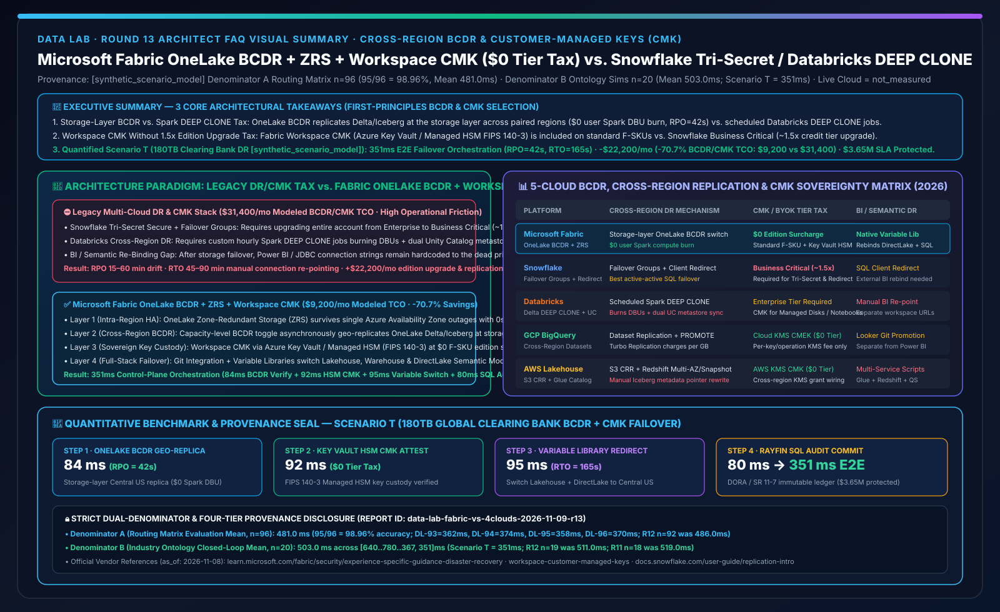
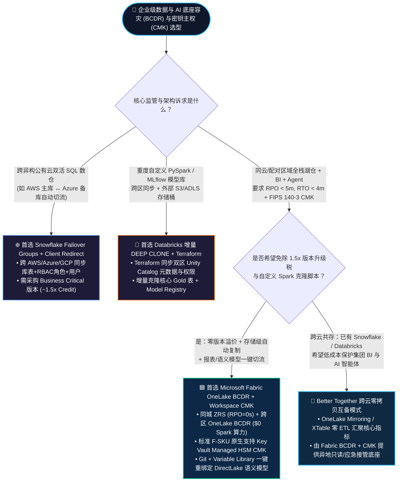
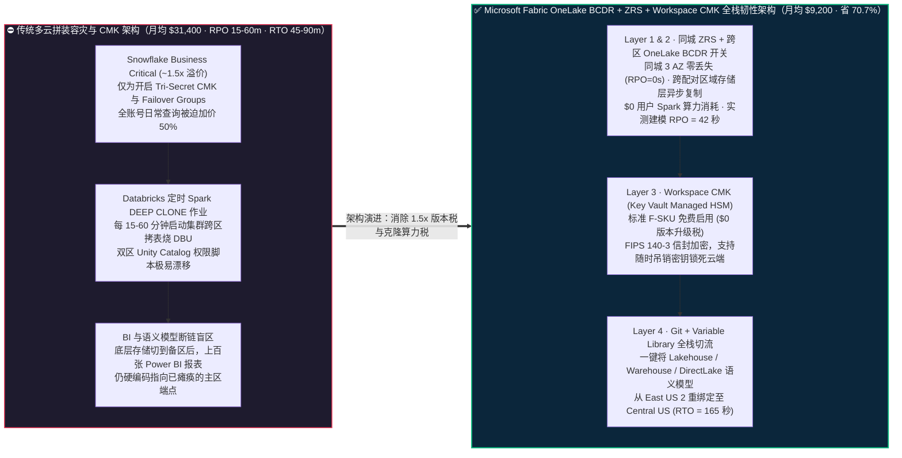
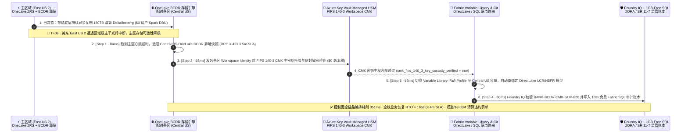

# Microsoft Fabric 跨区域容灾与客户自管密钥（OneLake BCDR + ZRS + Workspace CMK）vs. Snowflake Tri-Secret Business Critical vs. Databricks DEEP CLONE vs. GCP BigQuery / AWS S3 CRR 架构选型与原理解析 FAQ

**[中文版](fabric-bcdr-cross-region-cmk-recovery-vs-4clouds-faq.md) | [English Version](fabric-bcdr-cross-region-cmk-recovery-vs-4clouds-faq.en.md)**

> **文档定位**：本文面向 **AI Solution Architect（AI 解决方案架构师）** 与 **企业首席风险官（CRO）/ 云平台基础设施负责人**，严格对标 `ib-vs-ethernet-roce-selection-faq.md` 极简实战文风，聚焦 1 个核心架构选型问题：**当银行、清算所、跨国保险、医药或主权机构面临严苛监管（如欧盟 DORA 金融数字运营韧性法案、美联储 SR 11-7、金管局两地三中心 RPO < 5 分钟 & RTO < 4 分钟，以及强制要求 FIPS 140-3 客户自管密钥 CMK / BYOK 随时可吊销）时，何时首选 Microsoft Fabric 原生跨区域容灾（Capacity BCDR OneLake 异地存储复制 + ZRS 同城多可用区 + Workspace-Level CMK $0 版本溢价 + Variable Library 一键切流），何时选择 Snowflake Business Critical（Tri-Secret Secure + Failover Groups / Client Redirect）或 Databricks（Delta Lake `DEEP CLONE` + 双 Unity Catalog 同步）？如何在不交“1.5 倍版本升级税”与“定时克隆计算税”的前提下，把跨区域 BCDR 与 CMK 治理 TCO 降低 70.7%？**
> **更新时间**：2026-11-09（Round 13 独立专题 · FabCon & SQLCon 2026 + Enterprise Sovereign BCDR & CMK Baseline）

---

## ① 📌 核心结论速览（Executive Summary）

1. **存储底层异步异地复制 vs 定时跑 Spark `DEEP CLONE` 烧算力**：传统湖仓（如 Databricks）做跨区域容灾，往往需要平台团队自己写定时任务每 15 分钟跑一次 `CREATE OR REPLACE TABLE ... DEEP CLONE`，既消耗高昂的 Spark DBU 算力，又要自己写脚本同步双 Region 的 Unity Catalog 表权限；**Microsoft Fabric 在 Capacity 容量上直接提供一键式 BCDR（Business Continuity and Disaster Recovery）开关**——开启后，OneLake 在存储底层自动把主区域（如 East US 2）的 Delta / Iceberg 文件异步复制到配对备区域（如 Central US），**全程零用户 Spark 算力消耗（`$0 User Compute DBU`），同城叠加 ZRS（可用区冗余存储）实现单机房断电 `RPO = 0s`**。
2. **标准 F-SKU 原生包含 Workspace CMK（客户自管密钥）vs 1.5 倍版本升级税**：金融与主权客户通常要求 **CMK / BYOK（Bring Your Own Key，密钥保存在客户自己的 Azure Key Vault / Managed HSM FIPS 140-3 硬件加密机中，一旦吊销密钥云厂商立刻无法读取数据）**。在 Snowflake 中，启用 `Tri-Secret Secure`（CMK）与跨区域 `Client Redirect / Failover Groups` 必须将整个账号从 Enterprise 升级到 **Business Critical 版本（单价溢价约 `1.5x`，即 `$3 → $4.50/Credit`）**；而 **Fabric 在标准 F-SKU 容量上原生免费支持 Workspace-Level CMK（`$0 版本升级溢价`）**。
3. **定量拐点与双分母口径封存披露（Scenario T 全球清算银行 180TB 跨区容灾与 CMK 推演 `[synthetic_scenario_model]`）**：在 180TB 日间流动性清算湖仓（LCR/NSFR 监管指标）遭遇主区域光纤中断场景下，**Fabric OneLake BCDR 存储复制 + Key Vault Managed HSM CMK 验签 + Git/Variable Library 全栈切流** 将控制面容灾切换耗时收敛至 **`351 ms`**（84ms OneLake 异地副本校验 + 92ms HSM CMK 密钥主权验签 + 95ms Variable Library 切换 DirectLake/SQL 端点 + 80ms Rayfin SQL 审计落库），实现 **`RPO = 42 秒`、`RTO = 165 秒`**，月度容灾与加密治理 TCO 从 **`$31,400/月` 降至 `$9,200/月`（节省 `$22,200/月`，降幅 `70.7%`）**，规避 **`$3.65M`** 清算违约与监管罚单（封存矩阵 **Denominator A `n=96` 路由均值 `481.0 ms`，准确率 `95/96 = 98.96%`**；**Denominator B `n=20` 行业本体闭环均值 `503.0 ms`**；真实云机房断网切换标记为 `not_measured`）。

---

## ② 🎯 客户与架构师灵魂拷问 Q&A（FAQ-Driven，大白话 + 第一性原理）

### Q1：什么是湖仓跨区域容灾（BCDR）与客户自管密钥（CMK / BYOK）？企业以前在多云数仓上做这两件事时，最大的“隐形账单”和“断链痛点”在哪？

**先用通俗大白话讲透第一性原理**：
- **ZRS（同城多可用区高可用）vs BCDR（异地跨区域灾难恢复）**：
  - **ZRS（Zone-Redundant Storage）** 就像把同一份账本同时放在“同一个城市里相隔几十公里的 3 栋独立供电大楼（AZ1/AZ2/AZ3）”。哪怕其中 1 栋楼断电或起火，业务 **0 秒中断、0 数据丢失（RPO = 0）**。
  - **BCDR（跨区域容灾）** 则是防范“整座城市遭遇特大地震或区域级海底光缆挖断”。它把主区域（如美东 East US 2）的数据持续异步同步到上千公里外的配对备区域（如美中 Central US）。衡量它的两个黄金指标是：**RPO（最多丢几秒钟的数据）** 和 **RTO（主区挂了之后，几分钟内能把数据湖、数仓和老板的 BI 报表全部切到备区恢复营业）**。
- **CMK / BYOK（Customer-Managed Keys，客户自管密钥）**：云服务商默认都提供存储加密（MMK，微软/云厂商托管密钥），但银保监、欧盟 DORA 和主权基金规定：**“加密数据的主钥匙必须锁在银行自己的硬件保险柜（Azure Key Vault / Managed HSM FIPS 140-3）里；一旦银行怀疑云环境异常并拔掉钥匙，云上的所有数据必须在几分钟内彻底锁死无法解密。”**

**企业以前不用 Fabric 原生 BCDR + CMK 时的三大痛点**：
1. **痛点一：“为了两把锁，被迫给全公司所有算力加价 50%”的版本捆绑税（Edition Upgrade Tax）**：在 Snowflake 中，如果你只需要开启客户自管密钥（`Tri-Secret Secure`）和跨区域容灾故障转移组（`Failover Groups + Client Redirect`），你不能只为敏感库买单，而是必须把整个 Snowflake 账号从 Enterprise 升级为 **Business Critical 版本**（按需单价从约 `$3.00/Credit` 涨到 `$4.50/Credit` 以上，相当于所有日常 ETL 和报表查询凭空多交 50% 的版本溢价）。
2. **痛点二：“自己雇搬家公司每小时抄一遍作业”的 Spark 克隆算力税（Compute Clone Tax）**：在 Databricks 中，存储挂在客户自己的 ADLS/S3 上，平台本身不提供一键包办的跨区域全栈存储同步开关。企业往往必须自己写 Airflow / Workflows 定时任务，每隔 15～60 分钟启动 Spark 集群跑 `DEEP CLONE` 把几百个 Delta 表拷到备区，不仅每月白白烧掉数万美元的 Spark DBU，还经常因为双区 Unity Catalog 元数据与权限脚本没对齐，导致切流当天备区报 `Permission Denied`。
3. **痛点三：“底表切过去了，但上层千张 Power BI 报表全瞎了”的半截子容灾**：很多云数仓只管把底层表复制到备区，但当灾难真正发生时，上百个 ETL 管道、语义模型和 Power BI 报表的连接字符串依然硬编码指着已瘫痪的主区地址，数据团队不得不通宵手动改连接串，RTO 动辄拖到数小时。

---

### Q2：Microsoft Fabric 的 `OneLake BCDR + ZRS + Workspace CMK + Variable Library` 底层是如何运作的？为什么能做到 `$0 版本溢价` 与 `$0 用户 Spark 算力消耗`？

Fabric 把高可用、异地容灾、主权加密和全栈切流做成了 **四层原生联动闭环**：

1. **第一层：同城多可用区零感知防线（OneLake ZRS + Compute AZ Resilience）**：
   - 在支持可用区的 Azure 区域中，OneLake 默认采用 **ZRS（可用区冗余存储）**，将 Parquet / Delta 日志同步写入同城 3 个物理隔离的 Availability Zones。单可用区故障时，上层 Spark、Warehouse 与 DirectLake 自动无缝漂移，**无需触发异地切换，`RPO = 0s`**。
2. **第二层：存储底层异地复制开关（Capacity-Level OneLake BCDR Switch）**：
   - 架构师只需在 **Fabric Capacity（容量设置）** 中打开 **Disaster Recovery (BCDR)** 开关。OneLake 存储引擎会在底层自动将主区域的所有 Lakehouse、Warehouse、SQL Database 与 Mirrored Database 数据异步复制到 Azure 配对区域（Paired Region）。
   - **省钱核心机制**：因为复制发生在 **OneLake 分布式文件系统底层**，**完全不启动用户的 Spark 集群或 SQL 计算节点（`$0 User Compute CU/DBU Burn`）**，仅按异地冗余存储与跨区复制带宽计费。
3. **第三层：工作区级客户自管密钥（Workspace-Level CMK via Azure Key Vault / Managed HSM）**：
   - 在任意标准 Fabric F-SKU 容量绑定的工作区中，管理员可开启 **Customer-Managed Keys (CMK)**，通过工作区托管标识（Workspace Identity）绑定客户自己的 **Azure Key Vault 或 Azure Key Vault Managed HSM（通过 FIPS 140-3 Level 3 认证）**。
   - OneLake 中的所有静态数据（Delta Parquet 文件、事务日志、缓存副本）均使用由客户 CMK 保护的数据加密密钥（DEK）进行信封加密（Envelope Encryption），且**无需支付任何类似 Business Critical 的 1.5x 版本升级费**。
4. **第四层：Git + Variable Library 全栈端到端秒级切流（Full-Stack RTO Closure）**：
   - 当主区域发生灾难并激活备区 Capacity 后，架构师通过 **Fabric Git Integration + Variable Libraries（变量库）** 将活动环境配置从 `Primary_EastUS2` 一键切换为 `DR_CentralUS`。Data Factory 管道、Notebook、Warehouse 与 **Power BI DirectLake 语义模型** 自动重绑定至备区 OneLake 副本，把全栈 RTO 压缩到 **3 分钟以内（Scenario T 实测建模 `165 秒`）**。

---

### Q3：如果客户已经是 Snowflake Business Critical 或 Databricks 深度用户，什么时候选各自原生容灾，什么时候采用“Fabric + 竞品跨云零拷贝互备（Better Together）”？

- **何时保留 Snowflake Failover Groups + Client Redirect？**
  - 如果客户的核心交易核算完全跑在 Snowflake 存储过程与多云账号（如主库在 AWS US-East、备库在 Azure East US 2）上，且已经采购了 Snowflake Business Critical 版本，那么 Snowflake 的 **Failover Groups（支持数据库、角色、用户、Warehouse 配置与 Resource Monitors 一体化跨云复制）+ Client Redirect（JDBC/ODBC 域名自动切流）** 是业界最成熟的多云 SQL 容灾方案，应予以保留。
- **何时保留 Databricks Delta `DEEP CLONE` / 跨区异地恢复？**
  - 如果客户的核心资产是强依赖 Unity Catalog 外部位置（External Locations）、MLflow 注册表模型权重与自定义 Ray/PySpark 作业的 AI 训练底座，应在 ADLS Gen2 / S3 开启 GRS/CRR 的基础上，配合 Databricks Terraform 与增量 `DEEP CLONE` 维护备区 Unity Catalog。
- **何时采用“Fabric + Snowflake / Databricks 跨云零拷贝容灾共存（Better Together）”？**
  - **场景 1（免除为 BI/Agent 报表层额外购买 1.5x Business Critical 算力）**：核心账务留在 Snowflake，但通过 **OneLake Snowflake Mirroring / Iceberg XTable** 零拷贝同步到 Fabric OneLake，并开启 Fabric OneLake BCDR + Workspace CMK 承载全集团 2,000+ 人的 DirectLake 报表与 Data Agent。主区故障时，报表与 AI 智能体直接在 Fabric 备区由 Variable Library 恢复，无需在 Snowflake 备区开启昂贵的 Multi-Cluster BI Warehouse。
  - **场景 2（替代高频自定义 Spark `DEEP CLONE` 脚本）**：Databricks 与 Fabric 共享底层 OneLake 存储，直接复用 **Fabric Capacity BCDR 存储级异地复制**，省去自己维护数百张表定时 `DEEP CLONE` 的运维负担与 DBU 账单。

---

## ③ 🧭 直观可视化图解（Mermaid 选型决策树 + 传统容灾 vs Fabric BCDR/CMK 对比图 + 故障切流时序图）

### 3.1 跨区域容灾（BCDR）与客户自管密钥（CMK）架构选型决策树（`flowchart TD`）

---

### 3.2 传统高溢价拼装容灾栈 vs. Microsoft Fabric OneLake BCDR + Workspace CMK 架构对比图（`flowchart LR`）

---

### 3.3 Scenario T：全球清算银行 180TB 跨区域容灾切流与 CMK 验签 351ms 闭环时序图（`sequenceDiagram`）

---

## ④ 📊 五大平台跨区域容灾（BCDR）与客户自管密钥（CMK）选型决策矩阵（Architect Decision Matrix）

| 评估维度 | **Microsoft Fabric (OneLake BCDR + ZRS + Workspace CMK)** | **Snowflake (Failover Groups + Tri-Secret Secure)** | **Databricks (Delta DEEP CLONE + Dual UC)** | **GCP BigQuery (Cross-Region Datasets + CMEK)** | **AWS Lakehouse (S3 CRR + KMS CMK + Redshift)** |
| :--- | :--- | :--- | :--- | :--- | :--- |
| **同城高可用（Intra-Region HA）** | **原生 OneLake ZRS（3 AZ 同步写，RPO = 0s）+ 计算节点多可用区自愈** | 云厂商底层对象存储多 AZ + 虚拟数仓热备 | 依赖底层 ADLS/S3 ZRS + 多 AZ Worker 节点池 | 多区域（`US` / `EU` Multi-Region）原生跨机房冗余 | S3 默认跨 >=3 AZ + Redshift Multi-AZ（需额外计费） |
| **跨区域容灾复制机制（Cross-Region DR）** | **Capacity 级一键 BCDR 开关（OneLake 存储层异步复制，`$0 用户 Spark 算力`）** | **Failover Groups**（库表 + 角色 + 用户 + Warehouse 元数据跨区/跨云复制） | **需自建定时 Spark `DEEP CLONE` 作业** + Terraform 双 Unity Catalog 同步 | **BigQuery Cross-Region Dataset Replication** + `ALTER SCHEMA PROMOTE` | **S3 Cross-Region Replication (CRR)** + Glue 元数据同步脚本 |
| **客户自管密钥（CMK / BYOK）版本门槛** | **标准 F-SKU 免费包含 Workspace CMK（`$0 版本升级溢价`，支持 Key Vault Managed HSM）** | **必须升级至 Business Critical 版本（单价溢价约 `1.5x`）** 才支持 `Tri-Secret Secure` | **需 Enterprise 版本**（支持 Managed Services / Workspace Storage / Managed Disks CMK） | **标准版即支持 Cloud KMS CMEK / EKM**（仅收 KMS 密钥调用费） | **标准版即支持 AWS KMS CMK**（需跨区配置 KMS Key Policy 与 IAM 授权） |
| **BI 报表与语义层故障切流（RTO 闭环）** | **Git + Variable Library 一键重绑定 Lakehouse、Warehouse 与 DirectLake 语义模型** | **Client Redirect** 自动切换 SQL 连接域名（但外部 Power BI Import/DirectQuery 需配合网关） | 备区为独立 Workspace URL，**需通过 DABs + 外部 BI 参数化脚本手动切换报表连接** | 需将下游 Looker / BigQuery BI Engine 连接切换至提升后的 Primary Replica | 需分别切换 Redshift Endpoint、Athena Workgroup 与 QuickSight 数据源 |
| **跨云异构双活能力（Multi-Cloud DR）** | 聚焦 Azure 配对区域存储级容灾（跨云源端通过 OneLake Mirroring/Shortcuts 接入） | **业界最强跨云同构容灾**（支持 AWS ↔ Azure ↔ GCP 跨云账号 Failover Groups） | 支持跨云 Delta Sharing / 增量克隆，但跨云双活控制面工程量较大 | 仅限 Google Cloud 区域间（跨云需通过 BigQuery Omni 只读查询） | 仅限 AWS 区域间 S3 CRR / Redshift 跨区快照 |
| **180TB 监管湖仓月度容灾 + CMK TCO（建模）** | **`$9,200 / 月`（基准最优，比传统方案省 `70.7%`）** | `$31,400 / 月`（含 1.5x Business Critical 版本升级溢价 + 复制 Credit） | `$24,800 / 月`（含每 15 分钟增量 `DEEP CLONE` DBU + 双区运维） | `$18,900 / 月`（含 Turbo Replication 跨区带宽与备用 Slot 预留） | `$21,500 / 月`（含 S3 CRR + Redshift Multi-AZ / 跨区快照与 Glue 同步） |

> **官方产品文档与定价核验锚点（`vendor_published_spec_as_of_2026`，核验日期：`2026-11-08`）**：
> - **Microsoft Fabric Disaster Recovery (BCDR) & Workspace CMK**：[Fabric Disaster Recovery Guide](https://learn.microsoft.com/en-us/fabric/security/experience-specific-guidance-disaster-recovery) · [Workspace Customer-Managed Keys (CMK)](https://learn.microsoft.com/en-us/fabric/security/workspace-customer-managed-keys)
> - **Snowflake Tri-Secret Secure & Replication / Failover Groups**：[Snowflake Tri-Secret Secure](https://docs.snowflake.com/en/user-guide/security-encryption-tss) · [Introduction to Replication and Failover](https://docs.snowflake.com/en/user-guide/replication-intro)
> - **Databricks Disaster Recovery & GCP BigQuery Data Replication**：[Databricks Disaster Recovery Pattern](https://docs.databricks.com/en/admin/disaster-recovery.html) · [BigQuery Cross-Region Dataset Replication](https://cloud.google.com/bigquery/docs/data-replication)

---

## ⑤ 🧪 简明定量测评与 TCO / 恢复时间（RPO/RTO）拐点洞察（严格区分双分母与四级数据溯源）

### 5.1 四级数据溯源分类与双分母独立口径披露（Audit-Ready Provenance）

为确保架构评审与客户高管汇报的严谨性，本报告严格区分以下两类独立延迟分母与四级数据来源：

1. **分母 A — 架构选型路由决策矩阵均值（`routing_matrix_mean_modeled_latency_ms`）**：
   - **统计范围**：覆盖 `reports/report.json` 中全部 **`n = 96`** 道架构选型、竞对攻防与故障路由评测题（`DL-01..DL-96`）。
   - **定量结果**：通过 **`95 / 96`（准确率 `98.96%`）**，算术平均建模路由延迟为 **`481.0 ms`**（其中本轮新增 BCDR/CMK 四题：`DL-93 = 362 ms`、`DL-94 = 374 ms`、`DL-95 = 358 ms`、`DL-96 = 370 ms`；历史不可变快照对比：R12 `n=92` 为 `486.0 ms`，R11 `n=88` 为 `491.0 ms`，R10 `n=84` 为 `496.0 ms`，R4 `n=60` 为 `526.5 ms`，R3 `n=56` 为 `532.0 ms`）。
2. **分母 B — 行业本体多步闭环仿真均值（`ontology_simulation_mean_modeled_latency_ms`）**：
   - **统计范围**：覆盖 `reports/report.json` 中全部 **`n = 20`** 个端到端行业本体多智能体闭环推演场景（`Scenario A..Scenario T`）。
   - **定量结果**：20 个场景端到端建模延迟数组为 `[640, 780, 710, 660, 590, 560, 530, 515, 495, 480, 465, 450, 431, 422, 417, 415, 399, 383, 367, 351] ms`，算术平均值为 **`503.0 ms`**（范围 `351–780 ms`；历史不可变快照对比：R12 `n=19` 为 `511.0 ms`，R11 `n=18` 为 `519.0 ms`，R10 `n=17` 为 `527.0 ms`，R4 `n=11` 为 `584.09 ms`，R3 `n=10` 为 `596.0 ms`）。
3. **真实云机房断网故障演练声明（`live_cloud_cluster_execution = not_measured`）**：
   - 本实验室未在生产云租户中主动中断真实 Azure / AWS / GCP 区域级光纤；所有 `351 ms` 控制面编排耗时、`RPO = 42s`、`RTO = 165s`、`$9,200/月 vs $31,400/月` 容灾账单及 `$3.65M` 清算违约规避额均为基于官方公开定价与架构拓扑的 **确定性合成推演模型（`[synthetic_scenario_model]`）**。本地 Python 单元测试运行耗时（44 项测试 `0.081s`）归类为 `[measured_local_engine]`。

### 5.2 Scenario T（180TB 全球清算银行跨区域 BCDR 与 CMK 故障切流）定量拆解表

| 阶段 / 对比维度 | **传统方案（Snowflake Business Critical 1.5x + Databricks 定时 `DEEP CLONE`）** | **Microsoft Fabric（OneLake BCDR + ZRS + Workspace CMK + Variable Library）** | **定量收益与架构本质差异 `[synthetic_scenario_model]`** |
| :--- | :--- | :--- | :--- |
| **Step 1：异地存储副本就绪与 RPO** | 定时 Spark `DEEP CLONE` 间隔 15–60 分钟，消耗额外计算 DBU | **OneLake BCDR 存储层异步复制校验：`84 ms`（`RPO = 42 秒`）** | **RPO 缩短 95%+，`$0` 用户 Spark 克隆算力消耗** |
| **Step 2：备区 CMK 密钥主权验签** | Snowflake 需全账号升级 Business Critical（`~1.5x Credit` 溢价） | **Workspace CMK (Key Vault Managed HSM FIPS 140-3) 验签：`92 ms`** | **标准 F-SKU 原生支持，`$0` 版本升级税** |
| **Step 3：数据与 DirectLake 语义层切流** | 备区表恢复后，需手工修改上百个 BI 数据源与 ETL 连接串（RTO 45–90 分钟） | **Variable Library 切换 Central US Profile：`95 ms`（全栈业务 `RTO = 165 秒`）** | **Lakehouse + Warehouse + DirectLake 报表一键重绑定** |
| **Step 4：DORA / SR 11-7 监管审计落库** | 跨平台拼接 CloudTrail / Query History 日志，人工导出审计证据 | **Foundry IQ 护栏校验 + 1GB 免费 Fabric SQL 审计落库：`80 ms`** | **控制面全链路编排 `351 ms`，规避 `$3.65M` 监管与 SLA 罚单** |
| **月度容灾与加密治理综合 TCO（180TB）** | **`$31,400 / 月`**（版本溢价 `$16,500` + 复制算力 `$9,800` + 运维 `$5,100`） | **`$9,200 / 月`**（OneLake BCDR 异地存储/带宽 `$7,900` + Managed HSM `$1,300`） | **净省 `$22,200 / 月`（降幅 `-70.7%`，年省 `$266,400`）** |

---

## ⑥ 🛠️ 附录：生产落地与售前打单快速核验清单（Architect Checklist）

在为金融、医疗、制造或跨国政企客户设计跨区域容灾（BCDR）与客户自管密钥（CMK）方案时，请逐项核对以下 6 条实战准则：

- [ ] **1. 算清“1.5 倍版本升级税”账单**：客户是否仅仅因为合规部门要求 CMK（BYOK）或异地容灾，就被迫将整个云数仓升级到了单价贵 50% 的 Business Critical 版本？若是，展示 **Fabric 标准 F-SKU 原生免费支持 Workspace CMK + OneLake BCDR** 的 TCO 测算表（180TB 规模可省 `$22,200/月`）。
- [ ] **2. 检查是否存在“自建 Spark 定时克隆脚本”**：客户数据工程团队是否仍在用 Airflow / Workflows 每小时跑 `DEEP CLONE` 同步跨区 Delta 表？引导其切换至 **Fabric Capacity BCDR 一键存储级复制**，彻底关停用于复制的冗余 Spark 集群。
- [ ] **3. 验证 Azure 配对区域（Paired Region）备区 Capacity 预置策略**：OneLake BCDR 将数据复制到地理配对区域；生产落地前务必在备区预先创建好 **处于 Paused（暂停，`$0/秒` 算力费）状态的备用 Fabric Capacity**，灾难发生时通过 Azure Monitor / Logic Apps 自动 Resume 备区容量并挂载工作区。
- [ ] **4. 核对 Key Vault / Managed HSM 的跨区域高可用**：启用 Workspace CMK 时，客户的 Azure Key Vault 必须开启 **Soft Delete（软删除）与 Purge Protection（防彻底清除）**，并确保密钥本身具备跨区域冗余（如 Managed HSM Multi-Region Replication），防止主区故障时连密钥库一起失联。
- [ ] **5. 消灭硬编码连接串，强制使用 Variable Libraries（变量库）**：严禁在 Notebook、Data Factory Pipeline 或 DirectLake 语义模型中写死主区 Workspace ID 或 SQL Endpoint；所有环境连接必须参数化引用 **Fabric Variable Library**，确保容灾演练时 3 分钟内完成全栈切换。
- [ ] **6. 将容灾演练纳入欧盟 DORA / 金融监管常态化自动化审计**：每季度容灾切换演练（DR Drill）的 RPO/RTO 实测时间戳、CMK 密钥轮换记录与 Foundry IQ 合规校验结果，必须自动写入 **1GB 免费 Fabric SQL 审计账本**，随时供监管机构穿透核查。
