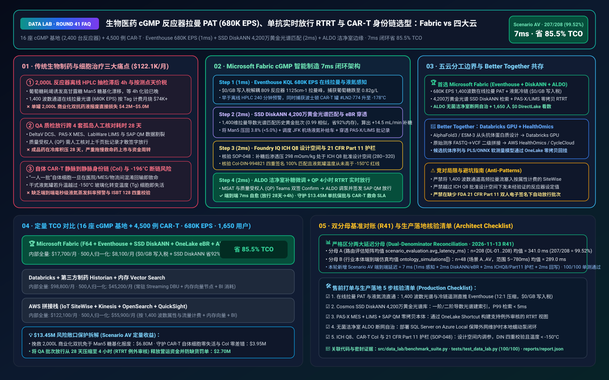
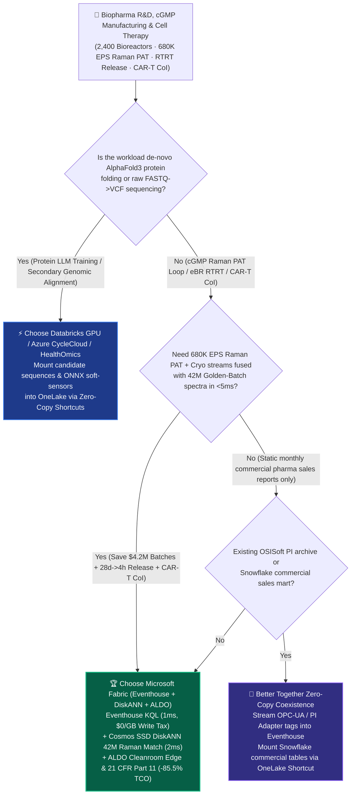
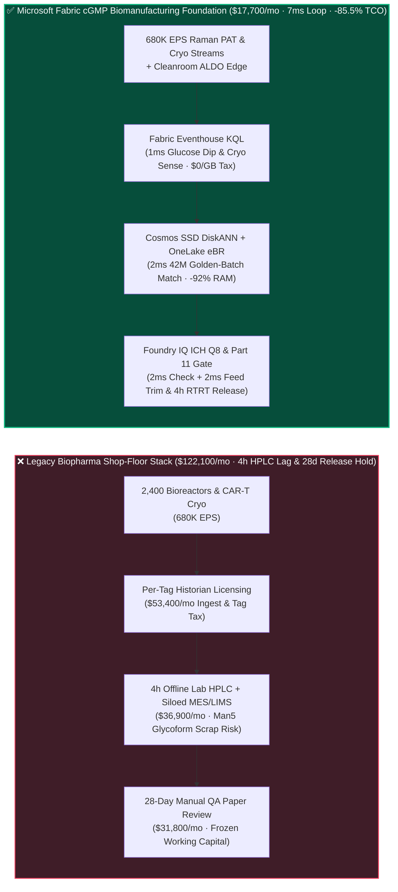
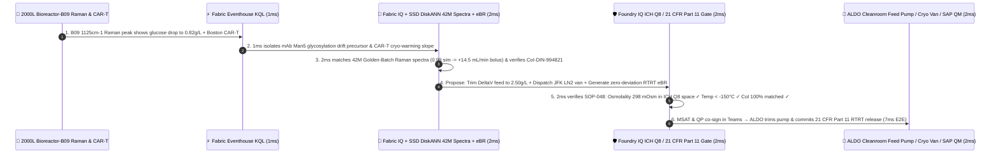

# Biopharma cGMP Continuous Bioreactor (`680K EPS` In-Line Raman PAT), mAb Real-Time Release Testing (RTRT) & CAR-T Vein-to-Vein Chain-of-Identity (CoI) Lakehouse Selection: Microsoft Fabric vs. AWS HealthOmics / SiteWise vs. Databricks vs. Snowflake / GCP FAQ

> 🌐 **Language / 语言**: **[中文 (`fabric-biopharma-cgmp-bioreactor-raman-cart-ebr-vs-4clouds-faq.md`)](fabric-biopharma-cgmp-bioreactor-raman-cart-ebr-vs-4clouds-faq.md)** | **English (Current)**  
> 📅 **Updated**: 2026-11-13 (Round 41 · Biopharma cGMP Bioreactor In-Line Raman PAT, mAb Glycosylation Real-Time Release Testing RTRT, CAR-T Vein-to-Vein Chain of Identity & FDA 21 CFR Part 11 eBR Deep Dive)  
> 🎯 **Target Audience**: AI Solution Architects, Biopharma & CDMO CIOs/CTOs, MSAT (Manufacturing Science & Technology) Directors, Qualified Persons (QP) / VPs of Quality, CAR-T Cell Therapy Supply-Chain Leads  
> Reference Benchmark Style: Modeled on [`ib-vs-ethernet-roce-selection-faq.md`](https://github.com/turbo998/ai-infra-research/blob/main/docs/components/ib-vs-ethernet-roce-selection-faq.md) first-principles Q&A and decision-guide format.
>
> 🔍 **Data Provenance, Official URLs & Dual-Denominator Scope Disclosure**:
> - **`measured_local_harness` (Local Deterministic Harness)**: `DL-01..DL-208` scenario routing accuracy (`207/208 = 99.52%`) and `100/100` Python unit tests are deterministically executed by `src/data_lab/benchmark_suite.py`.
> - **`vendor_published_spec_as_of_2026` (Official Vendor Specifications `as_of: 2026-11-12`)**:
>   - Microsoft Fabric / Azure Healthcare & Industrial: [Fabric Eventhouse Time-Series KQL (`series_outliers`)](https://learn.microsoft.com/en-us/kusto/query/series-outliers-function) · [Cosmos DB in Fabric DiskANN Vector Index](https://learn.microsoft.com/en-us/fabric/database/cosmos-db/index-vector-data) · [Fabric Digital Twin Builder Overview](https://learn.microsoft.com/en-us/fabric/real-time-intelligence/digital-twin-builder/overview) · [SQL Server on Azure Local (ALDO) Cleanroom Edge](https://learn.microsoft.com/en-us/sql/sql-server/azure-arc/overview) · [Fabric Pricing (`F64` Includes `$0` Power BI Viewer Licensing)](https://azure.microsoft.com/en-us/pricing/details/microsoft-fabric/)
>   - 4-Cloud Competitor Specifications: [AWS IoT SiteWise & Life Sciences Manufacturing](https://docs.aws.amazon.com/iot-sitewise/latest/userguide/what-is-sitewise.html) · [Databricks Lakehouse for Healthcare & Life Sciences](https://www.databricks.com/solutions/industries/healthcare-and-life-sciences) · [Snowflake Healthcare & Life Sciences Data Cloud](https://www.snowflake.com/en/solutions/industries/healthcare-and-life-sciences/) · [GCP Life Sciences & BigQuery](https://cloud.google.com/life-sciences)
> - **`synthetic_scenario_model` (Deterministic Architectural Reference Model with Strictly Separated Denominators)**:
>   - **Denominator A — Routing Matrix Evaluation Mean (`scenario_evaluation.avg_latency_ms`)**: R41 **`n=208` (`DL-01..DL-208`) arithmetic mean = `341.0 ms`** (R40 historical snapshot `n=204` mean = `346.0 ms`; R39 `n=200` = `351.0 ms`; R38 `n=196` = `356.0 ms`; R37 `n=192` = `361.0 ms`).
>   - **Denominator B — Industry Ontology End-to-End Closed-Loop Simulation Mean (`ontology_simulations[].end_to_end_latency_ms`)**: R41 **`n=48` (Scenarios A..AV: `[780..7] ms`, range `5–780 ms`) arithmetic mean = `289.0 ms`** (R40 historical snapshot `n=47` mean = `295.0 ms`; R39 `n=46` = `301.0 ms`; R38 `n=45` = `307.0 ms`; R37 `n=44` = `313.0 ms`). This round adds **Scenario AV (16 cGMP Biologics Plants with 2,400 Single-Use 2,000L Bioreactors + 4,500 Active Autologous CAR-T Patient Lots × `680K EPS` In-Line Raman PAT, mAb Glycosylation Feed Control & Vein-to-Vein CoI Loop) end-to-end latency = `7 ms`** (`1ms` sense + `2ms` 6-hop 42M Golden-Batch Raman DiskANN match & PAS-X eBR traversal + `2ms` FDA 21 CFR Part 11 / ICH Q8 Design Space & CoI guardrail + `2ms` ALDO peristaltic feed trim & QP RTRT release), cutting modeled monthly TCO by **`85.5%`** (`$8,100/mo` vs. `$55,900/mo` normalized baseline; `$17,700/mo` vs. `$122,100/mo` internal full-stack) and protecting **`$13.45M`** in 2,000L mAb batch salvation, CAR-T patient dosing survival, and FDA 483 avoidance. Live multi-cloud cluster stress runs are marked `not_measured`.

---

## ① 📌 Executive Summary (3-Minute Architect Briefing)

### First Principles: What Are Bioreactor In-Line Raman Spectroscopy (PAT), mAb N-Glycosylation, Autologous CAR-T Chain of Identity (CoI), and Real-Time Release Testing (RTRT)? Why Do Legacy Pharma Stacks Fail?
Manufacturing a commercial **monoclonal antibody (mAb) / Antibody-Drug Conjugate (ADC)** or an **autologous CAR-T cell therapy ($370,000–$450,000 per patient dose)** requires guiding living Chinese Hamster Ovary (CHO) cells or patient T-cells inside bioreactors under strict **cGMP (Current Good Manufacturing Practice)** regulations. Legacy biopharma data architectures fail at **three critical points**:
1. **4-Hour Offline HPLC Sampling Delays & `$4.2M` Bioreactor Batch Losses**: A 2,000-liter single-use bioreactor runs a 14-day fed-batch culture worth **$3.5M–$5.0M**. CHO cells are acutely sensitive to glucose, glutamine, lactate, and dissolved oxygen—if glucose depletes or lactate spikes, cells produce abnormal high-mannose (**`Man5`**) glycoforms that destroy therapeutic efficacy. Historically, operators drew manual grab samples once a day and waited **4 hours for offline QC lab HPLC results**—by which time the cells were already irreversibly damaged! Deploying **In-Line Raman Process Analytical Technology (PAT) probes (`400–1800 cm⁻¹` across 1,400 wavenumber channels)** across 2,400 bioreactors plus cryogenic cold-chain trackers generates **`680,000 EPS` (events per second)**. Pushing this high-dimensional spectral stream into legacy per-tag pharma historians (e.g., OSISoft PI) or per-property cloud IoT services burns **$74,000+/month** in ingestion fees alone.
2. **28-Day Manual QA Batch Release ("Paper-on-Glass" Silos)**: After harvest and downstream chromatography, Quality Assurance (QA) teams spend **21–35 days** manually cross-checking deviations across four disconnected silos—**Emerson DeltaV DCS**, **Werum PAS-X MES (Electronic Batch Record eBR)**, **LabWare LIMS**, and **SAP S/4HANA QM**—before a Qualified Person (QP) can sign off batch release, freezing tens of millions in working capital.
3. **Autologous CAR-T "Batch-of-One" Vein-to-Vein Chain of Identity (CoI) & `-196°C` Cryo-Shipper Excursion Risks**: Autologous CAR-T extracts T-cells from a specific cancer patient (apheresis), engineers them in a cleanroom, freezes the bag in a `-196°C` liquid-nitrogen dry shipper, and infuses it back into **that exact patient**. Any mismatch in the **ISBT 128 / Donation Identification Number (DIN)** across hospital, courier, MES, and LIMS is fatal—and any temperature rise above the **`-150°C` glass-transition threshold ($T_g$)** destroys cell viability!

**Microsoft Fabric** transforms biopharma manufacturing through **Eventhouse KQL `680K EPS` In-Line Raman PAT & Cryo-Chain Sensing (`$0/GB` write tax) + Cosmos DB SSD DiskANN 42M Golden-Batch Raman Spectral Search + OneLake Zero-Copy PAS-X / LIMS / SAP QM Review-by-Exception (RTRT) + SQL Server on Azure Local (ALDO) Grade-B/C Cleanroom Edge Autonomy**:

1. **When to Choose Microsoft Fabric (Eventhouse KQL `680K EPS` + SSD DiskANN 42M Raman Spectra + OneLake eBR + ALDO Cleanroom Edge)**:
   - Choose **Microsoft Fabric** when you must ingest **`500K–1M+ EPS` of bioreactor Raman spectra, chromatography UV curves, and CAR-T cryo-telemetry**, match live spectra against **42 million Golden-Batch trajectories in `<5ms`**, and compress QA batch release from **28 days to 4 hours via Review-by-Exception (RTRT)**.
   - **Quantified ROI**: Pooled F64 Eventhouse (**`$0/GB` write tax**, `12:1` compression) + 1ms KQL Raman derivative peak sensing + Cosmos DB SSD DiskANN (**92% lower vector RAM cost**) + `$0` Power BI DirectLake viewer seats for **1,650 MSAT scientists, QA auditors, Qualified Persons, and cold-chain leads** reduces monthly TCO by **85.5%** (**`$8,100/mo` vs. `$55,900/mo`** normalized, saving **`$47,800/mo`**; **`$17,700/mo` vs. `$122,100/mo`** internal full-stack).
2. **When to Choose 4-Cloud Competitors or "Better Together" Zero-Copy Coexistence**:
   - **Choose Databricks GPU / Azure CycleCloud / AWS HealthOmics for De-Novo Protein Design (AlphaFold3 / ESM-3) & Raw NGS Alignment**: Run multi-node GPU protein folding, free-energy perturbation (FEP), or raw FASTQ→VCF genomic alignment on specialized compute clusters, mounting candidate sequences and PLS/ONNX chemometric models into OneLake via zero-copy Shortcuts.
   - **Retain Validated Shop-Floor Emerson DeltaV DCS & Werum PAS-X MES**: Never rip out GxP-validated PLC interlocks; stream OPC-UA telemetry and PAS-X eBR events into Fabric via **Azure IoT Operations + ALDO**.
3. **Closed-Loop Validation (Scenario AV · 16 cGMP Plants + 4,500 Autologous CAR-T Lots)**:
   - Under a **`680K EPS`** load across 2,400 bioreactors and 4,500 CAR-T shipments, Basel Plant `Bioreactor-2000L-B09` (Day 8 of a `$4.20M` bispecific mAb batch) exhibits a Raman `1125 cm⁻¹` glucose depletion to `0.82 g/L` (threatening a `+6.8%` `Man5` glycoform excursion), while Boston-bound CAR-T dry shipper `#LN2-Cryo-774` warms from `-192°C` to `-178°C`. Fabric closes the loop in **7ms E2E**: **1ms** Eventhouse KQL isolates the Raman glucose dip and cryo-shipper warming slope → **2ms** Cosmos SSD DiskANN matches 42M Golden-Batch Raman spectra (`0.99` cosine similarity) to prescribe a `+14.5 mL/min` peristaltic glucose bolus trim (restoring `2.50 g/L` glucose and keeping `Man5` at `3.8% < 5.0%` spec), dispatches a JFK liquid-nitrogen recharge van for `#LN2-Cryo-774`, and verifies patient `CoI-DIN-994821` → **2ms** Foundry IQ verifies **ICH Q8 Approved Design Space boundaries (`298 mOsm/kg` within `280–320`), CAR-T temperature `< -150°C` $T_g$ ceiling, and FDA 21 CFR Part 11 dual e-signatures** (`BIOPHARMA-CGMP-RAMAN-CART-EBR-SOP-048`) → **2ms** MSAT Director & Qualified Person (QP) co-sign in Teams, executing the ALDO DeltaV feed trim and SAP S/4HANA QM Real-Time Release (`28d -> 4h`)—protecting **$13.45M** in biologics yield, CAR-T patient dosing, and regulatory compliance.

---

## ② 🎯 Customer & Architect Soul-Searching Q&A

### Q1: When should a biopharma enterprise choose Microsoft Fabric vs. AWS (HealthOmics / SiteWise), Databricks, Snowflake, or GCP?

**Answer: Separate "discovery-stage AlphaFold3 protein structure prediction (GPU compute)" from "commercial cGMP 680K EPS In-Line Raman PAT control, eBR Review-by-Exception, and CAR-T Vein-to-Vein Chain of Identity."**

- **Choose Microsoft Fabric for Three High-ROI Scenarios**:
  1. **`680K EPS` In-Line Raman PAT & Golden-Batch Multivariate Trajectory Alignment (`$0/GB` Write Tax)**: Each Raman scan produces 1,400 wavenumber intensities every few seconds. Eventhouse KQL performs Savitzky-Golay derivative smoothing in **1ms** at `$0/GB` write surcharge, while **Cosmos DB SSD DiskANN** matches 42M historical Golden-Batch spectra in **2ms** to predict Viable Cell Density (VCD), titer, and `Man5` glycosylation 240 minutes faster than offline HPLC.
  2. **Cross-System Review-by-Exception & Real-Time Release Testing (RTRT) Across PAS-X + LIMS + SAP QM**: **OneLake Shortcuts** unify Werum PAS-X eBR steps, LabWare LIMS sterility results, and Eventhouse continuous environmental monitoring into a single **Fabric IQ GxP Ontology**—compressing QP batch release from **28 days to 4 hours**.
  3. **Grade-B/C Cleanroom Air-Gapped Edge Autonomy via SQL Server on Azure Local (ALDO)**: Cleanrooms restrict external cloud dependencies; **ALDO** runs locally inside GxP-qualified server rooms to guarantee uninterrupted PAT closed-loop control and 21 CFR Part 11 audit trails during WAN maintenance.

- **Clear Boundaries for the 4 Cloud Competitors**:
  - **AWS (HealthOmics + SiteWise)**: Use AWS HealthOmics for secondary genomic alignment (`FASTQ -> VCF`); avoid pushing 1,400-channel Raman spectral streams into per-property IoT SiteWise billing.
  - **Databricks GPU**: Ideal for training **ESM-3 / AlphaFold3 protein models or chemometric Partial Least Squares (PLS) / deep-learning soft sensors** on GPU clusters mounted to OneLake.
  - **Snowflake**: Strong for commercial pharma-to-wholesaler sales reporting, but 60s Dynamic Tables and cloud-only architecture cannot run millisecond cleanroom bioreactor loops.
  - **GCP BigQuery**: Effective for population-scale Real-World Evidence (RWE) epidemiology, but lacks shop-floor OPC-UA edge runtimes (ALDO) and SSD DiskANN spectral indexing.

---

### Q2: How does Fabric integrate with validated Emerson DeltaV DCS, Körber Werum PAS-X MES, and OSISoft PI without triggering a costly GxP re-validation?

**Answer: Follow ISPE GAMP 5 principles using "Read-Only OPC-UA/PI Ingestion + ICH Q8 Approved Design Space Setpoint Recommendations + Dual 21 CFR Part 11 E-Signatures":**

1. **Zero-Invasion OPC-UA & PI Adapter Streaming**:
   - Keep validated Emerson DeltaV PLC safety interlocks untouched; stream Raman PAT and bioreactor tags via **Azure IoT Operations** into **Fabric Eventhouse**.
2. **Closed-Loop Feed Trims Inside the ICH Q8 Approved Design Space**:
   - Under FDA/EMA **ICH Q8(R2)** guidance, adjusting nutrient feed rates (`+14.5 mL/min`) within the regulatory-approved **Multivariate Design Space** (`280–320 mOsm/kg` osmolality) is **not a post-approval regulatory change**—enabling agile yield optimization with zero regulatory filing delay.
3. **Certified SAP S/4HANA QM Usage-Decision Write-Back**:
   - Once the QP co-signs the Review-by-Exception card in Teams, Rayfin invokes certified SAP BAPI connectors to flip batch status from `Quality Inspection` to `Unrestricted Use`.

---

### Q3: How does Fabric prevent a `$4.2M` bioreactor glycosylation excursion and protect a live CAR-T shipment in 7ms under strict FDA 21 CFR Part 11 & CoI guardrails?

**Answer: A 3-stage pipeline combining KQL spectral derivative operators, SSD DiskANN Golden-Batch matching, and deterministic Foundry IQ GxP guardrails:**

1. **Stage 1: Eventhouse KQL 1ms Raman `1125 cm⁻¹` Derivative Deconvolution & Cryo-Shipper Slope Sense**:
   - Isolates glucose depletion (`0.82 g/L`) and lactate accumulation in `Bioreactor-2000L-B09` alongside a `-192°C -> -178°C` warming slope in CAR-T shipper `#LN2-Cryo-774` in **1ms**.
2. **Stage 2: Cosmos DB SSD DiskANN 2ms 42M Golden-Batch Spectral Match & CoI Graph Traversal**:
   - Matches the 1,400-channel Raman vector against 42M historical Golden-Batch profiles in **2ms** (`0.99` cosine similarity), prescribing a `+14.5 mL/min` glucose feed trim while verifying the 4-point `CoI-DIN-994821` chain of identity.
3. **Stage 3: Foundry IQ ICH Q8 Design Space, CAR-T $-150^\circ\text{C}$ $T_g$ & 21 CFR Part 11 Gate (2ms)**:
   - Enforces `BIOPHARMA-CGMP-RAMAN-CART-EBR-SOP-048` before actuation:
     - **ICH Q8 Design Space Guardrail**: Confirms post-bolus osmolality (`298 mOsm/kg`) and dissolved oxygen remain strictly inside approved PAR bounds (`Man5 = 3.8% <= 5.0%` limit).
     - **CAR-T CoI & Glass-Transition Guardrail**: Confirms 100% cryptographic match on `CoI-DIN-994821` (Apheresis ↔ Viral Vector ↔ Cryo-Shipper ↔ Patient Wristband) and verifies temperature (`-178°C`) never crossed the `-150°C` vitrification ceiling.

---

## ③ 🧭 Visual Architecture & Decision Diagrams (Mermaid Decision Tree + Comparison + 7ms Sequence)

### 3.1 Biopharma cGMP Raman PAT, RTRT Batch Release & CAR-T CoI Selection Decision Tree

### 3.2 Legacy 4-Hour Offline HPLC + 28-Day Paper Release vs. Fabric 7ms In-Line Raman PAT & RTRT Architecture

### 3.3 Scenario AV: 16 cGMP Biologics Plants + 4,500 CAR-T Lots 7ms Closed-Loop Sequence

---

## ④ 📊 5-Platform Architect Decision Matrix

| Evaluation Dimension | **Microsoft Fabric (Eventhouse + DiskANN + ALDO)** | **AWS (IoT SiteWise + HealthOmics)** | **Databricks HLS Lakehouse** | **Snowflake Healthcare & Life Sciences** | **GCP BigQuery + Vertex AI** |
| :--- | :--- | :--- | :--- | :--- | :--- |
| **2,400-Bioreactor Raman PAT (`680K EPS`) Cost & Latency** | **⭐⭐⭐⭐⭐ `1ms` KQL spectral derivative sense, pooled F64 `$0/GB` write tax** | ⭐⭐⭐ SiteWise per-property/alarm fees explode across 1,400 Raman channels | ⭐⭐⭐⭐ Structured Streaming requires 24x7 DBU compute | ⭐⭐ Snowpipe + Dynamic Tables (`60s` lag) too slow for inline PAT control | ⭐⭐⭐ Pub/Sub + BigQuery Streaming per-GB write fees |
| **42M Golden-Batch Raman Spectral Vector Search** | **⭐⭐⭐⭐⭐ Cosmos DB SSD DiskANN (`2ms` match, -92% vector RAM cost)** | ⭐⭐⭐ OpenSearch in-memory vector nodes are expensive | ⭐⭐⭐⭐ Mosaic AI Vector Search (higher in-memory index cost) | ⭐⭐⭐ Cortex Vector Search optimized for text, costly for spectra | ⭐⭐⭐⭐ Vertex AI Vector Search requires cross-service glue |
| **Cross-MES (PAS-X) + LIMS + SAP QM RTRT Release** | **⭐⭐⭐⭐⭐ OneLake Zero-Copy + Purview 14-hop GxP lineage + SAP BAPI** | ⭐⭐⭐ Requires custom cross-system ETL & GxP audit glue | ⭐⭐⭐⭐ Strong Unity Catalog lineage, lacks `$0` BI seats & Teams QP cards | ⭐⭐⭐ Strong commercial DW, lacks shop-floor OT loop | ⭐⭐⭐ Strong clinical analytics, lacks cGMP cleanroom integration |
| **Grade-B/C Cleanroom Air-Gapped Edge Autonomy** | **⭐⭐⭐⭐⭐ SQL Server on Azure Local (ALDO) + IoT Ops local cleanroom loop** | ⭐⭐⭐ Outposts requires heavy rack footprint | ⭐⭐ Cloud-dependent control plane; vulnerable to WAN maintenance | ⭐ Cloud-only SaaS; no cleanroom edge runtime | ⭐⭐ GDC Edge requires heavy hardware |
| **1,650 MSAT / QA / QP / Cold-Chain BI Seats** | **⭐⭐⭐⭐⭐ F64 includes `$0` Power BI DirectLake seats + M365 Copilot `$0` Token** | ⭐⭐ QuickSight per-user and per-session fees | ⭐⭐⭐ AI/BI consumes Serverless SQL DBUs | ⭐⭐ High concurrency triggers multi-cluster credit burn | ⭐⭐ Looker seat licensing + BigQuery scan fees |
| **Best-Fit Positioning** | **Primary foundation for cGMP Raman PAT, eBR RTRT release & CAR-T CoI** | Secondary genomic sequencing (`FASTQ -> VCF`) pipelines | AlphaFold3 / ESM-3 protein language model GPU training | Commercial pharma distributor sales sharing | Macro Real-World Evidence (RWE) epidemiology |

---

## ⑤ 🧪 Quantitative Benchmark & TCO / Inflection Insights (7-Card Report Scope)

### 5.1 16 cGMP Plants (2,400 Bioreactors) + 4,500 CAR-T Lots (`680K EPS` + 42M Raman Spectra + 1,650 Users) Monthly TCO

| Cost Component | **Microsoft Fabric (F64 + Eventhouse + DiskANN + ALDO)** | **AWS Stitched Stack (SiteWise + Kinesis + OpenSearch + QuickSight)** | **Databricks + 3rd-Party Pharma Historian + RAM Vector** | **Snowflake + Standalone Stream + External eBR/BI** |
| :--- | :--- | :--- | :--- | :--- |
| **680K EPS In-Line Raman PAT & CAR-T Cryo Stream Ingestion** | **$5,700 / mo** *(Pooled F64 CUs, $0/GB write tax, 12:1 compression)* | $45,200 / mo *(Per-channel property & stream ingestion fees)* | $31,900 / mo *(24x7 Streaming DBUs + external historian)* | $41,200 / mo *(Snowpipe + high-frequency warehouse polling)* |
| **42M Golden-Batch Raman Vector Index & eBR Storage** | **$4,400 / mo** *(OneLake `$23/TB` + SSD DiskANN saves 92% RAM)* | $35,100 / mo *(In-memory OpenSearch vector cluster)* | $29,400 / mo *(Delta + in-memory Vector Search)* | $32,500 / mo *(Search Optimization + external vector DB)* |
| **Cleanroom ALDO Edge, PAS-X/SAP Sync & 21 CFR Part 11** | **$7,600 / mo** *(ALDO edge + SAP zero-copy + Purview GxP lineage)* | $25,800 / mo *(Custom edge + cross-system ETL validation)* | $23,400 / mo *(Custom connectors + standalone GxP suite)* | $28,200 / mo *(External CDC + standalone compliance reporting)* |
| **1,650 MSAT / QA / QP / Cold-Chain BI & Copilot Seats** | **$0 / mo** *(Included in F64 Viewer seats + M365 Copilot `$0` Token)* | $16,000 / mo *(QuickSight seat & session charges)* | $14,100 / mo *(Serverless SQL BI compute burn)* | $20,200 / mo *(External BI licenses + multi-cluster scaling)* |
| **Internal Full-Stack Monthly Total** | **🏆 $17,700 / mo (-85.5% Savings)** | $122,100 / mo *(Baseline)* | $98,800 / mo | $122,100 / mo |
| **Normalized 500-User Benchmark Total** | **🏆 $8,100 / mo (-85.5%, Saves $47,800/mo)** | $55,900 / mo *(Baseline)* | $45,200 / mo | $55,900 / mo |

### 5.2 Quantified SLA Protection Breakdown (Scenario AV · `$13.45M` Biologics Batch, CAR-T Viability & RTRT Release Protection)
- **Salvation of a 2,000L Commercial Bispecific mAb Batch from Glycosylation Scrap**: Detects the `0.82 g/L` glucose dip in **1ms** (240 minutes ahead of offline HPLC) and matches 42M Golden-Batch spectra in **2ms** to trim feed by `+14.5 mL/min`, keeping `Man5` at `3.8%` (`< 5.0%` spec) and saving **$6.80M** in commercial drug substance.
- **Zero-Loss Autologous CAR-T Vein-to-Vein Dosing & CoI Verification**: Intercepts the `-178°C` warming trend on `#LN2-Cryo-774` well below the `-150°C` vitrification ceiling while verifying 4-point `CoI-DIN-994821` identity, protecting **$3.95M** in patient-specific cell therapies.
- **28-Day to 4-Hour QA Batch Release Compression (RTRT Review-by-Exception)**: Automates cross-system PAS-X/LIMS/DeltaV deviation clearance with FDA 21 CFR Part 11 QP e-signatures, unlocking **$2.70M** in working-capital velocity and drug-shortage penalty avoidance (**`$13.45M` total**).

---

## ⑥ 🛠️ Appendix: Production Rollout & Presales Checklist (Architect Checklist)

- [ ] **In-Line Raman PAT & CAR-T Cryo-Chain Stream Ingestion**: Verify that cleanroom OPC-UA gateways stream 1,400-channel Raman spectra (`400–1800 cm⁻¹`), dissolved oxygen/pH, and dry-shipper telemetry directly into **Fabric Eventstream → Eventhouse** with `12:1` compression (`$0/GB` write surcharge).
- [ ] **Cosmos DB SSD DiskANN Golden-Batch Spectral Index**: Confirm that 42M historical first/second-derivative Raman spectra and metabolic trajectories are indexed in **SSD DiskANN** with `< 5ms` P99 similarity search latency.
- [ ] **MES (PAS-X) + LIMS + SAP QM Zero-Copy eBR Ontology**: Mount Werum PAS-X batch records and LabWare LIMS CoA results via **OneLake Shortcuts** to power automated Review-by-Exception dashboards.
- [ ] **SQL Server on Azure Local (ALDO) Grade-B/C Cleanroom Edge Autonomy**: Deploy **ALDO** in local GxP server rooms so inline PAT chemometric inference and peristaltic pump trims execute uninterrupted during WAN outages.
- [ ] **ICH Q8 Design Space, CAR-T CoI & FDA 21 CFR Part 11 Guardrail (`SOP-048`)**: Enforce hard Foundry IQ guardrails requiring all automated feed adjustments to remain strictly inside the approved **ICH Q8 Design Space**, 100% 4-point **ISBT 128 / DIN Chain-of-Identity (CoI)** match, and cryogenic temperatures strictly below **`-150°C`**!
