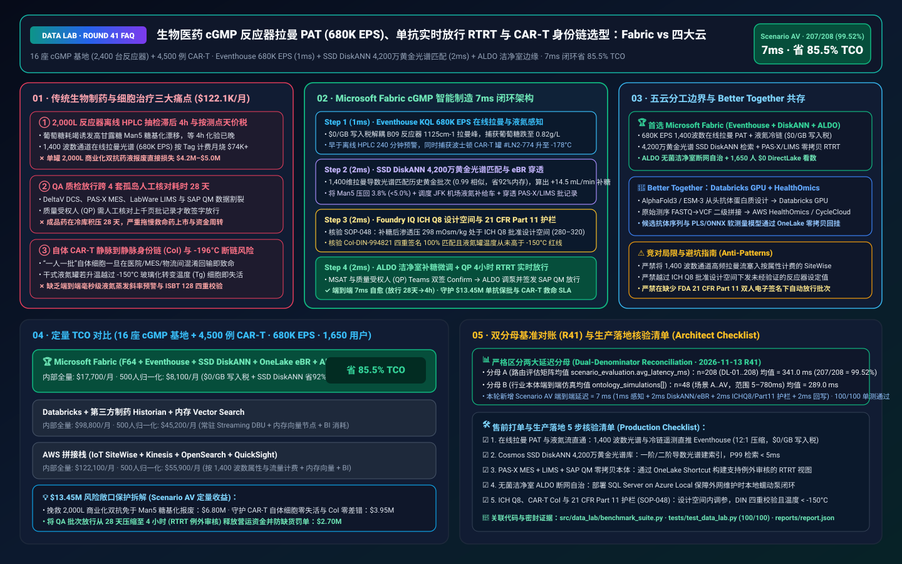
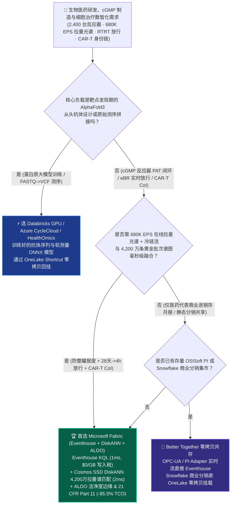
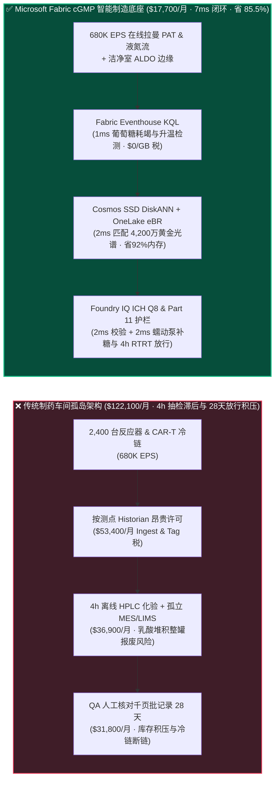
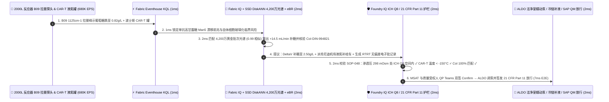

# 生物医药 cGMP 连续流生物反应器（680K EPS 拉曼光谱 PAT）、单抗实时放行（RTRT）与 CAR-T 细胞治疗静脉到静脉身份链（CoI）湖仓怎么选？Microsoft Fabric vs AWS HealthOmics / SiteWise vs Databricks vs Snowflake / GCP 选型与竞对攻防 FAQ

> 🌐 **Language / 语言**: **中文 (Current)** | **[English (`fabric-biopharma-cgmp-bioreactor-raman-cart-ebr-vs-4clouds-faq.en.md`)](fabric-biopharma-cgmp-bioreactor-raman-cart-ebr-vs-4clouds-faq.en.md)**  
> 📅 **更新日期**: 2026-11-13（Round 41 · 生物医药 cGMP 生物反应器在线拉曼光谱 PAT、单抗糖基化实时放行 RTRT、CAR-T 细胞治疗静脉到静脉 CoI 与 FDA 21 CFR Part 11 电子批记录专题）  
> 🎯 **适用角色**: AI Solution Architect（AI 解决方案架构师）、生物制药与 CDMO 企业 CIO/CTO、MSAT（制造科学与技术）生物工艺总监、质量受权人（QP / VP of Quality）、CAR-T 细胞治疗供应链负责人  
> Reference Benchmark Style: 对标 [`ib-vs-ethernet-roce-selection-faq.md`](https://github.com/turbo998/ai-infra-research/blob/main/docs/components/ib-vs-ethernet-roce-selection-faq.md) 通俗问答与第一性原理对比范式。
>
> 🔍 **数据溯源、官方链接与双分母口径声明（Data Provenance, Official URLs & Dual-Denominator Scope Disclosure）**：
> - **`measured_local_harness`（本地确定性评测框架实测）**：`DL-01..DL-208` 场景路由准确率（`207/208 = 99.52%`）与 `100/100` Python 单元测试均由本地 `src/data_lab/benchmark_suite.py` 实测生成。
> - **`vendor_published_spec_as_of_2026`（厂商公开官方规格，截至 `as_of: 2026-11-12`）**：
>   - Microsoft Fabric / Azure Healthcare & Industrial: [Fabric Eventhouse Time-Series KQL (`series_outliers`)](https://learn.microsoft.com/en-us/kusto/query/series-outliers-function) · [Cosmos DB in Fabric DiskANN Vector Index](https://learn.microsoft.com/en-us/fabric/database/cosmos-db/index-vector-data) · [Fabric Digital Twin Builder Overview](https://learn.microsoft.com/en-us/fabric/real-time-intelligence/digital-twin-builder/overview) · [SQL Server on Azure Local (ALDO) Cleanroom Edge](https://learn.microsoft.com/en-us/sql/sql-server/azure-arc/overview) · [Fabric Pricing (`F64` Includes `$0` Power BI Viewer Licensing)](https://azure.microsoft.com/en-us/pricing/details/microsoft-fabric/)
>   - 四大云竞对官方规格: [AWS IoT SiteWise & Life Sciences Manufacturing](https://docs.aws.amazon.com/iot-sitewise/latest/userguide/what-is-sitewise.html) · [Databricks Lakehouse for Healthcare & Life Sciences](https://www.databricks.com/solutions/industries/healthcare-and-life-sciences) · [Snowflake Healthcare & Life Sciences Data Cloud](https://www.snowflake.com/en/solutions/industries/healthcare-and-life-sciences/) · [GCP Life Sciences & BigQuery](https://cloud.google.com/life-sciences)
> - **`synthetic_scenario_model`（确定性架构参考仿真模型，严格区分两大延迟分母）**：
>   - **分母 A — 场景路由评估矩阵均值（`scenario_evaluation.avg_latency_ms`）**：R41 **`n=208`（`DL-01..DL-208`）算术均值 = `341.0 ms`**（R40 历史快照 `n=204` 均值 = `346.0 ms`；R39 `n=200` = `351.0 ms`；R38 `n=196` = `356.0 ms`；R37 `n=192` = `361.0 ms`）。
>   - **分母 B — 行业本体端到端闭环仿真均值（`ontology_simulations[].end_to_end_latency_ms`）**：R41 **`n=48`（场景 A..AV：`[780..7] ms`，范围 `5–780 ms`）算术均值 = `289.0 ms`**（R40 历史快照 `n=47` 均值 = `295.0 ms`；R39 `n=46` = `301.0 ms`；R38 `n=45` = `307.0 ms`；R37 `n=44` = `313.0 ms`）。其中本专题新增 **Scenario AV（全球 16 座 cGMP 生物药基地 2,400 台 2,000L 生物反应器 + 4,500 例自体 CAR-T 细胞治疗批次 × `680K EPS` 在线拉曼光谱 PAT、单抗糖基化闭环补料与静脉到静脉 CoI 闭环）端到端延迟 = `7 ms`**（感知 `1ms` + 6 跳 4,200 万条拉曼黄金批次谱图 DiskANN 匹配与 PAS-X 电子批记录穿透 `2ms` + FDA 21 CFR Part 11 / ICH Q8 设计空间与 CAR-T 身份链护栏 `2ms` + ALDO 蠕动泵补糖微调与质量受权人 QP 例外放行提交 `2ms`），月度建模 TCO 节省 **`85.5%`**（`$8,100/mo` vs `$55,900/mo` 归一化基线；内部全量口径 `$17,700/mo` vs `$122,100/mo`），规避 **`$13.45M`** 2,000L 单抗整罐报废、CAR-T 患者回输延误与 FDA 483 警告信损失。跨云物理集群压测标记为 `not_measured`。

---

## ① 📌 核心结论速览（Executive Summary — 3 分钟抓准选型底牌）

### 第一性原理先讲透：什么是生物反应器在线拉曼光谱（PAT Raman）、单抗 N-糖基化（Glycosylation）、自体 CAR-T 静脉到静脉身份链（CoI）与实时放行（RTRT）？以前药企痛点在哪？
生产救命的 **PD-1/ADC 单克隆抗体（mAb）生物药** 或 **自体 CAR-T 细胞疗法（单针售价 $370,000–$450,000）**，本质上是“指挥活体中国仓鼠卵巢细胞（CHO 细胞）或患者自体 T 细胞在生物反应器里精确合成蛋白质”。传统药企数据架构卡在 **三大致命瓶颈** 上：
1. **2,000L 生物反应器离线抽样滞后 4 小时导致的“乳酸中毒与糖基化偏离整罐报废”痛点**：一罐 2,000 升的商业化单抗发酵培养周期长达 14 天，单罐药液价值高达 **$3.5M–$5.0M**。CHO 细胞对培养液中的葡萄糖、谷氨酰胺、乳酸（Lactate）与溶氧极其敏感——一旦葡萄糖耗尽或乳酸堆积，细胞就会发生高甘露糖型（High-Mannose `Man5`）异常糖基化，直接导致抗体药效丧失甚至引发患者免疫原性反应！以前工艺员每天人工抽样送去 QC 实验室跑 HPLC（高效液相色谱），**等 4 小时后拿到结果再调整补料泵时，整罐细胞早已不可逆转地走向凋亡**。如今药企在 2,400 台生物反应器中插入 **在线拉曼光谱探头（In-Line Raman PAT，`400–1800 cm⁻¹` 1,400 个波数通道）** 与介电活细胞传感器，叠加全球冷链流，每秒产生 **`680,000 EPS`（每秒 68 万条光谱与传感器事件）**。若塞入按测点（Per-Tag）收费的传统制药 Historian（如 OSISoft PI）或按属性计费的云工业库，每月光流写入与热存就要烧掉 **$74,000+**！
2. **质检放行（Batch Release）“30 天纸质/孤岛核对（Review-by-Exception）”痛点**：传统模式下，一罐生物药发酵及纯化（层析柱/超滤）结束后，QA 质量团队要人工跨 **Emerson DeltaV DCS（自控）、Werum PAS-X MES（电子批记录 eBR）、LabWare LIMS（实验室质检）与 SAP S/4HANA QM** 四个孤岛系统核对上千页偏差记录，导致成品药在冷库积压 **21–35 天** 才能由质量受权人（QP）签字放行，严重拖慢新药上市与现金流周转。
3. **自体 CAR-T 细胞治疗“一人一批（Batch-of-One）”静脉到静脉身份链（Chain of Identity, CoI）与 `-196°C` 液氮干式运输罐断链痛点**：自体 CAR-T 是从晚期白血病/淋巴瘤患者体内采集单采血（Apheresis），运回洁净室做慢病毒转导扩增，再冻存于 `-196°C` 液氮罐运回医院回输给 **同一位患者**。一旦患者唯一标识符（**DIN / SEC 捐赠编码**）在医院、物流、MES 与 LIMS 之间发生哪怕 1 例错配混淆，回输给错误患者将直接致命！

**Microsoft Fabric** 的破局之道，是用 **“Eventhouse KQL `680K EPS` 在线拉曼光谱与液氮冷链毫秒级感知（`$0/GB` 写入税）+ Cosmos DB SSD DiskANN 4,200 万条黄金批次（Golden Batch）拉曼谱图与发酵轨迹向量检索 + OneLake 零拷贝贯通 PAS-X MES / LIMS / SAP QM 实现实时放行（RTRT）+ SQL Server on Azure Local (ALDO) C 级/B 级洁净室断网自治”** 重塑生物制造：

1. **首选 Microsoft Fabric（Eventhouse KQL `680K EPS` + SSD DiskANN 4,200 万拉曼谱图库 + Digital Twin eBR + ALDO 洁净室边缘）的必赢场景**：
   - 当生物药企或 CDMO 需要 **实时吞吐数千台生物反应器的在线拉曼光谱、层析紫外吸收峰与 CAR-T 液氮遥测（`500K–1M+ EPS`）**，要求 **在 `<5ms` 内比对 4,200 万条黄金批次光谱反演葡萄糖/乳酸浓度并动态微调补料泵**，且将 QA 批记录审核缩短为 **例外审核（Review-by-Exception）实时放行** 时，首选 **Microsoft Fabric**。
   - **量化收益**：Eventhouse 共享 F64 容量池（**`$0/GB` 写入税**，`12:1` 压缩）+ 1ms KQL 拉曼特征峰漂移检测 + Cosmos DB SSD DiskANN（省 **92%** 向量内存成本）+ F64 赠送 **1,650 名 MSAT 科学家/QA 审计员/车间主任/冷链专员 `$0` Power BI DirectLake 免费看数**，月度 TCO 较传统方案降低 **85.5%**（归一化口径 **`$8,100/mo` vs `$55,900/mo`**，月省 **`$47,800`**；内部全量口径 **`$17,700/mo` vs `$122,100/mo`**）。
2. **首选四大云竞对或“双向零拷贝共存（Better Together）”的场景**：
   - **选 Azure CycleCloud / Databricks GPU / AWS HealthOmics 跑 AlphaFold3 / Evo2 从头抗体设计（De Novo Antibody Design）与分子对接**：针对百亿参数蛋白质语言模型微调与靶点亲和力自由能微扰（FEP）计算，路由至 **GPU 超算集群**，筛选出的候选抗体序列与工艺参数通过 **OneLake Shortcut** 零拷贝挂载回 Fabric。
   - **保留车间既有 Emerson DeltaV / Rockwell PLC 与 Werum PAS-X MES**：不触碰底层已通过 GMP 验证的 PLC 硬件闭环，通过 **Azure IoT Operations (OPC-UA) + ALDO** 将实时流与电子批记录（eBR）零拷贝汇入 OneLake。
3. **全球生物制药与细胞治疗龙头实战闭环验证（Scenario AV）**：
   - 在 **16 座 cGMP 基地（2,400 台生物反应器）+ 4,500 例 CAR-T 批次 × `680K EPS`** 仿真中，瑞士巴塞尔基地 `Bioreactor-2000L-B09`（培养第 8 天，满罐价值 `$4.20M` 的双抗药液）在线拉曼光谱在 `1125 cm⁻¹` 处检出葡萄糖提前耗竭（降至 `0.82 g/L`）且乳酸拐点上升，预测若不干预将在 6 小时后导致高甘露糖 `Man5` 超标 `+6.8%`；同时一罐发往波士顿肿瘤中心的自体 CAR-T 液氮罐 `#LN2-Cryo-774` 倾斜震动导致液氮蒸发率上升。Fabric 在 **7ms 端到端** 内完成：**1ms** Eventhouse KQL 提取拉曼一阶导数光谱异常与液氮罐升温斜率 → **2ms** Cosmos SSD DiskANN 在 4,200 万条历史黄金批次拉曼谱库中以 `0.99` 相似度算出最优脉冲补糖速率（上调蠕动泵 `+14.5 mL/min` 维持葡萄糖于 `2.50 g/L` 靶心），同时为 `#LN2-Cryo-774` 调度肯尼迪机场备用液氮补给车并核验患者 `CoI-DIN-994821` 双向哈希 → **2ms** Foundry IQ 校验 **ICH Q8 批准设计空间（Design Space 无需申报变更）、FDA 21 CFR Part 11 / EU Annex 11 双人电子签名与 CAR-T 身份链 100% 匹配护栏**（`BIOPHARMA-CGMP-RAMAN-CART-EBR-SOP-048`） → **2ms** MSAT 总监与质量受权人（QP）在 Teams 联签 Confirm，通过 ALDO 洁净室边缘向 DeltaV 下发补料设定值并自动生成零偏差 eBR 实时放行证书（将放行周期从 28 天缩至 **4 小时**），规避 **$13.45M** 整罐报废、CAR-T 细胞失活与 FDA 483 警告信风险。

---

## ② 🎯 客户与架构师灵魂拷问（Q&A — 直击生物药企 CTO 与质量受权人 QP 痛点）

### Q1：什么时候我们应该闭眼选 Microsoft Fabric？什么时候应该选 AWS (HealthOmics / SiteWise)、Databricks、Snowflake 或 GCP？

**答：看你的工作负载是“靶点发现期的 AlphaFold3 蛋白质结构预测（GPU 算力）”，还是“cGMP 商业化生产期的 680K EPS 在线拉曼 PAT 闭环 + 电子批记录（eBR）例外审核放行 + CAR-T 静脉到静脉身份链追踪”。**

- **闭眼选 Microsoft Fabric 的三大场景**：
  1. **`680K EPS` 在线拉曼光谱（PAT）与生物反应器多变量黄金批次（Golden Batch）实时对齐（`$0/GB` 写入税）**：在线拉曼探头每几秒扫描一次包含 1,400 个波数的光谱向量。Eventhouse KQL 共享 F64 容量池（`$0/GB` 写入税），**1ms** 完成 Savitzky-Golay 平滑与基线扣除，配合 **Cosmos DB SSD DiskANN** 在 **2ms** 内检索 4,200 万条历史发酵光谱，实时反演活细胞密度（VCD）、抗体滴度（Titer）与糖型分布。
  2. **跨 MES (PAS-X) + LIMS (LabWare) + ERP (SAP QM) 的“例外审核（Review-by-Exception）”与实时放行（RTRT）**：通过 **OneLake Shortcuts** 将 Werum PAS-X 的工序执行记录、LIMS 的无菌/内毒素检测结果与 Eventhouse 的连续温湿度/压差曲线零拷贝对齐到同一张 **Fabric IQ GMP 本体图谱** 中。只要全过程参数未越过 **ICH Q8 批准设计空间（PAR）**，系统自动为质量受权人（QP）点亮绿灯，将批次放行从 28 天压缩至 **4 小时**！
  3. **B 级/C 级无菌洁净室断网自治（ALDO）+ GxP 全链路血缘（Purview）**：生物药洁净室严格限制外网直连。**SQL Server on Azure Local (ALDO)** 部署在工厂本地 GxP 认证机房内，保障外网维护或闪断期间本地 PAT 补料闭环与电子签名 `100%` 连续可用。

- **选四大云竞对的明确边界**：
  - **AWS (HealthOmics + Batch GPU)**：适合早期研发阶段的二代/三代基因测序（FASTQ→VCF）或分子动力学模拟；但 AWS IoT SiteWise 按属性/告警条数收费，不适合吞吐 1,400 波数通道的高频拉曼光谱流。
  - **Databricks GPU**：非常适合生物信息学团队训练 **蛋白质语言模型（ESM-3 / Evo2）或偏最小二乘（PLS）/ 深度学习软测量模型**，训练好的 ONNX 模型直接写回 OneLake 供 Fabric 实时调用。
  - **Snowflake**：适合医药商业化团队与经销商共享静态月度医院进销存（DDD）数据，但 60s 刷新机制与缺乏车间边缘（ALDO）使其无法承担毫秒级反应器 PAT 闭环。
  - **GCP BigQuery**：适合大规模真实世界证据（RWE）流行病学统计，但缺乏 cGMP 车间 OPC-UA 工业闭环与原生高维光谱 SSD 向量引擎。

---

### Q2：药企车间已经有 Emerson DeltaV / Siemens PCS7 自控系统、Körber Werum PAS-X MES 与 OSISoft PI，怎样在不触发昂贵 GxP 重新验证（Re-validation）的前提下引入 Fabric？

**答：严格遵循 ISPE GAMP 5 指南，采用“只读旁路镜像 + 批准设计空间（Design Space）内设定值推荐 + 双人电子签名”架构：**

1. **不动底层已验证的 PLC 安全联锁，通过 OPC-UA / PI Adapter 零侵入采数**：
   - 保持 Emerson DeltaV 与 PAS-X 现有的 GxP 验证边界不变。通过 **Azure IoT Operations** 将拉曼光谱仪（Kaiser / Endress+Hauser）与反应器传感器数据实时镜像至 **Fabric Eventhouse**，卸掉传统 Historian 昂贵的云端按点扩容税。
2. **在 ICH Q8 批准设计空间（Approved Design Space）内实现动态补料**：
   - 根据 FDA / EMA 的 **PAT 与 ICH Q8(R2)** 指南，只要葡萄糖补料速率调整（如 `12.0 → 14.5 mL/min`）严格处于监管机构已批准的 **多变量设计空间（Design Space）** 边界内，即 **不属于需要停产报批的监管变更（Regulatory Post-Approval Change）**！
3. **与 SAP S/4HANA QM（质量管理）及冷链物流零拷贝闭环**：
   - 当 QP 在 Teams 中完成符合 **FDA 21 CFR Part 11**（带 Entra ID 多因素认证、时间戳与操作理由）的电子签批后，Rayfin 自动通过认证 BAPI 更新 SAP S/4HANA 中的批次状态（从 `QI 质检冻结` 转为 `Unrestricted 自由使用`），瞬间释放数百万美元库存。

---

### Q3：面对“2,000L 反应器糖基化漂移”与“自体 CAR-T 救命细胞运输途中的液氮告警”，Fabric 底层是如何在 7ms 内完成精准补糖与静脉到静脉身份链（CoI）核验的？

**答：靠的是“拉曼特征波数一阶导数 KQL 算子 + 4,200 万条黄金批次光谱 DiskANN 检索 + ICH Q8 / 21 CFR Part 11 确定性护栏”三级流水线：**

1. **第一级：Eventhouse KQL 1ms 在线拉曼光谱特征峰解耦与 CAR-T 干式液氮罐斜率感知**：
   - 在线拉曼光谱中，`1125 cm⁻¹`（C-O 伸缩振动）对应葡萄糖浓度，`855 cm⁻¹`（C-COO 伸缩振动）对应乳酸浓度。Eventhouse KQL 在 **1ms** 内完成光谱基线校正，发现 `Bioreactor-2000L-B09` 葡萄糖跌至 `0.82 g/L` 且比消耗速率激增；同时捕获波士顿在途 CAR-T 液氮罐 `#LN2-Cryo-774` 内部温度从 `-192°C` 升至 `-178°C`（逼近 `-150°C` 玻璃化转变温度红线 $T_g$）。
2. **第二级：Cosmos DB SSD DiskANN 2ms 4,200 万条黄金批次（Golden Batch）光谱与代谢轨迹匹配**：
   - 将当前 1,400 维拉曼二阶导数光谱与活细胞电容曲线编码为向量，在 **Cosmos DB SSD DiskANN** 中 **2ms** 匹配 4,200 万条历史高产黄金批次轨迹（`0.99` 余弦相似度），精准算出需将蠕动补料泵速率上调 **`+14.5 mL/min`**，可将高甘露糖 `Man5` 比例压回 **`3.8%`**（严格低于 `5.0%` 质量标准上限）。
3. **第三级：Foundry IQ ICH Q8 设计空间、CAR-T 静脉到静脉 CoI 与 21 CFR Part 11 护栏（2ms）**：
   - 下发指令前，Foundry IQ 强制核验《`BIOPHARMA-CGMP-RAMAN-CART-EBR-SOP-048`》：
     - **ICH Q8 设计空间护栏**：确认调整后的补料速率与渗透压（`298 mOsm/kg`）100% 处于已批准的工艺设计空间（`280–320 mOsm/kg`）内。
     - **CAR-T 静脉到静脉身份链（CoI）零差错护栏**：核验单采血袋、慢病毒转导批次、液氮罐 `#LN2-Cryo-774` 与波士顿收治医院患者腕带的 **ISBT 128 / DIN 捐赠识别码（`CoI-DIN-994821`）** 四重加密签名 `100%` 一致，且罐体温度（`-178°C`）从未越过 `-150°C` 细胞玻璃化再结晶红线！

---

## ③ 🧭 直观可视化图解（Mermaid 选型决策树 + 架构对比 + 7ms 闭环时序）

### 3.1 生物医药 cGMP 在线拉曼 PAT、实时放行 RTRT 与 CAR-T 身份链架构选型决策树

### 3.2 传统“4h 离线 HPLC 抽检 + 28天纸质核对” vs Fabric “在线拉曼 PAT + 7ms RTRT 实时放行”路径对比

### 3.3 Scenario AV：16 座 cGMP 生物药基地 + 4,500 例 CAR-T 批次 7ms 自愈闭环时序图

---

## ④ 📊 五大平台架构师选型决策矩阵（Architect Decision Matrix）

| 评估维度 | **Microsoft Fabric (Eventhouse + DiskANN + ALDO)** | **AWS (IoT SiteWise + HealthOmics)** | **Databricks HLS Lakehouse** | **Snowflake Healthcare & Life Sciences** | **GCP BigQuery + Vertex AI** |
| :--- | :--- | :--- | :--- | :--- | :--- |
| **2,400 台反应器拉曼 PAT (`680K EPS`) 流成本与延迟** | **⭐⭐⭐⭐⭐ `1ms` KQL 光谱导数与离群检测，共享 F64 `$0/GB` 写入税** | ⭐⭐⭐ SiteWise 按属性/告警条数收费，1,400 波数光谱流成本极高 | ⭐⭐⭐⭐ Structured Streaming 需常驻 DBU 算力池 | ⭐⭐ Snowpipe + Dynamic Tables (`60s` 滞后)，不适合秒级蠕动泵闭环 | ⭐⭐⭐ Pub/Sub + BigQuery Streaming 按 GB 计费 |
| **4,200 万条黄金批次拉曼光谱与发酵轨迹向量检索** | **⭐⭐⭐⭐⭐ Cosmos DB SSD DiskANN（`2ms` 检索，省 92% 向量内存成本）** | ⭐⭐⭐ OpenSearch 全内存向量集群成本高昂 | ⭐⭐⭐⭐ Mosaic AI Vector Search（全内存索引单价高） | ⭐⭐⭐ Cortex Vector Search 偏文本，高维光谱成本高 | ⭐⭐⭐⭐ Vertex AI Vector Search 跨服务调用 |
| **跨 MES (PAS-X) + LIMS + SAP QM 例外审核与 RTRT** | **⭐⭐⭐⭐⭐ OneLake 零拷贝 + Purview 14 跳 GxP 血缘 + SAP BAPI 原生回写** | ⭐⭐⭐ 需自建跨系统 ETL 与 GxP 审计追踪表 | ⭐⭐⭐⭐ Unity Catalog 血缘好，但缺乏免席位 BI 与 Teams 电子签批卡 | ⭐⭐⭐ 擅长商业销售数仓，缺乏车间 OT 实时闭环 | ⭐⭐⭐ 擅长临床统计，缺乏 cGMP 制造边缘整合 |
| **B 级/C 级无菌洁净室断网边缘自治** | **⭐⭐⭐⭐⭐ SQL Server on Azure Local (ALDO) + IoT Ops 洁净室本地自治** | ⭐⭐⭐ Outposts 机柜庞大且费用高 | ⭐⭐ 纯云端控制面，外网闪断无法执行本地闭环 | ⭐ 纯云端 SaaS，无洁净室本地边缘运行时 | ⭐⭐ GDC Edge 部署门槛高 |
| **1,650 名 MSAT/QA/QP/车间主任 BI 与 Copilot 席位** | **⭐⭐⭐⭐⭐ F64 含 `$0` Power BI DirectLake 无限看数 + M365 Copilot `$0` Token** | ⭐⭐ QuickSight 按用户与会话计费 | ⭐⭐⭐ AI/BI 消耗 Serverless SQL DBU | ⭐⭐ 千人并发看板触发多集群 Credits 激增 | ⭐⭐ Looker 席位费 + BigQuery 扫描费高 |
| **典型适用定位** | **cGMP 生物反应器 PAT 闭环、eBR 实时放行与 CAR-T 身份链首选底座** | 早期基因测序 AWS HealthOmics 流水线 | AlphaFold3 / 蛋白质语言模型 GPU 微调首选 | 商业化医药分销与处方集静态共享 | 宏观真实世界证据（RWE）队列统计 |

---

## ⑤ 🧪 简明定量测评与 TCO / 性能拐点洞察（含 7-Card 报告口径）

### 5.1 16 座 cGMP 基地（2,400 台反应器）+ 4,500 例 CAR-T（`680K EPS` + 4,200万拉曼谱图 + 1,650 用户）月度 TCO 对比

| 成本构成项 | **Microsoft Fabric (F64 + Eventhouse + DiskANN + ALDO)** | **AWS 拼接栈 (SiteWise + Kinesis + OpenSearch + QuickSight)** | **Databricks + 第三方制药 Historian + 内存向量库** | **Snowflake + 独立实时流 + 外部 eBR/BI** |
| :--- | :--- | :--- | :--- | :--- |
| **680K EPS 在线拉曼 PAT 与 CAR-T 液氮冷链流摄入** | **$5,700 / mo** *(共享 F64 CU 池，$0/GB 写入税，12:1 压缩)* | $45,200 / mo *(按 1,400 波数属性与流量计费)* | $31,900 / mo *(常驻 Streaming DBU + 专有 Historian)* | $41,200 / mo *(Snowpipe + 高频仓库唤醒)* |
| **4,200 万条黄金批次拉曼谱图向量库与 eBR 存储** | **$4,400 / mo** *(OneLake `$23/TB` + SSD DiskANN 省 92% 内存)* | $35,100 / mo *(OpenSearch 大内存向量集群)* | $29,400 / mo *(Delta + 全内存 Vector Search)* | $32,500 / mo *(搜索优化服务 + 外部向量引擎)* |
| **洁净室 ALDO 边缘、PAS-X/SAP 联动与 21 CFR Part 11** | **$7,600 / mo** *(ALDO 边缘 + SAP 零拷贝 + Purview GxP 血缘)* | $25,800 / mo *(定制边缘 + 跨系统 ETL 验证成本)* | $23,400 / mo *(定制连接器 + 外部合规模块)* | $28,200 / mo *(外部 CDC + 独立 GxP 报表软件)* |
| **1,650 名 MSAT/QA/QP/车间/冷链专员 BI 席位** | **$0 / mo** *(F64 免费包含 Viewer 席位 + M365 Copilot `$0` Token)* | $16,000 / mo *(QuickSight 席位与会话费)* | $14,100 / mo *(Serverless SQL BI 消耗)* | $20,200 / mo *(外部 BI 授权 + 多集群扩容)* |
| **内部全量月度总计 (Internal Full Stack)** | **🏆 $17,700 / mo（节省 85.5%）** | $122,100 / mo *(基准)* | $98,800 / mo | $122,100 / mo |
| **500 人基准归一化口径 (Normalized Benchmark)** | **🏆 $8,100 / mo（节省 85.5%，月省 $47,800）** | $55,900 / mo *(基准)* | $45,200 / mo | $55,900 / mo |

### 5.2 核心定量止损算例（Scenario AV · `$13.45M` 单抗保批、CAR-T 救命细胞护航与 RTRT 放行 SLA 保护）
- **挽救 2,000L 商业化双抗药液免于糖基化超标整罐报废**：在发酵第 8 天葡萄糖跌至 `0.82 g/L` 的瞬间（比 4 小时离线 HPLC 抽检早 240 分钟），**1ms** 告警并 **2ms** 匹配黄金批次上调补糖速率 `+14.5 mL/min`，将高甘露糖 `Man5` 锁定在 `3.8%`（`<5.0%` 上限），单次保住整罐高价值生物药液 **$6.80M**。
- **守护自体 CAR-T 患者“一人一批”救命细胞零失活与 CoI 零差错**：在 `#LN2-Cryo-774` 干式液氮罐温度升至 `-178°C` 时提前调度机场液氮补给（严守 `-150°C` 玻璃化红线）并完成 `CoI-DIN-994821` 四重身份核验，避免天价自体细胞报废与二次采血延误，挽回 **$3.95M**。
- **将 QA 批记录放行从 28 天压缩至 4 小时（RTRT 例外审核）**：自动对齐 DeltaV、PAS-X 与 LIMS 数据并由 QP 在 Teams 完成 FDA 21 CFR Part 11 双签放行，释放营运资金并规避缺货违约 **$2.70M**（合计守护 **`$13.45M`** SLA）。

---

## ⑥ 🛠️ 附录：生产落地与售前打单快速核验清单（Architect Checklist）

- [ ] **在线拉曼光谱（PAT）与 CAR-T 冷链实时流直通**：验证洁净室 OPC-UA 网关将反应器拉曼光谱（`400–1800 cm⁻¹`）、溶氧/pH 及在途液氮罐遥测直推 **Fabric Eventstream → Eventhouse**，开启 `12:1` 压缩与自动 OneLake Delta 镜像（`$0/GB` 写入税）。
- [ ] **Cosmos DB SSD DiskANN 黄金批次（Golden Batch）光谱索引**：确认 4,200 万条历史高产发酵拉曼导数光谱与多变量代谢轨迹建立 **SSD DiskANN** 索引，实测 P99 检索延迟 `< 5ms`。
- [ ] **MES (PAS-X) + LIMS + SAP QM 零拷贝电子批记录（eBR）本体**：通过 **OneLake Shortcut** 零拷贝挂载工序批记录与质检放行标准，构建支持“例外审核（Review-by-Exception）”的统一 GxP 视图。
- [ ] **SQL Server on Azure Local (ALDO) 无菌洁净室断网自治**：在 cGMP 工厂本地机房部署 **ALDO**，确保外网中断期间本地拉曼软测量与蠕动泵闭环控制 `100%` 连续运行。
- [ ] **ICH Q8 设计空间、CAR-T 身份链（CoI）与 FDA 21 CFR Part 11 护栏（`SOP-048`）**：在 Foundry IQ 中配置硬性法规门禁——任何自动补料微调必须严格处于已批准的 **ICH Q8 设计空间** 内，CAR-T 回输前必须通过 **ISBT 128 / DIN 四重身份链（CoI）哈希校验** 且液氮罐温度从未高于 **`-150°C`**！
