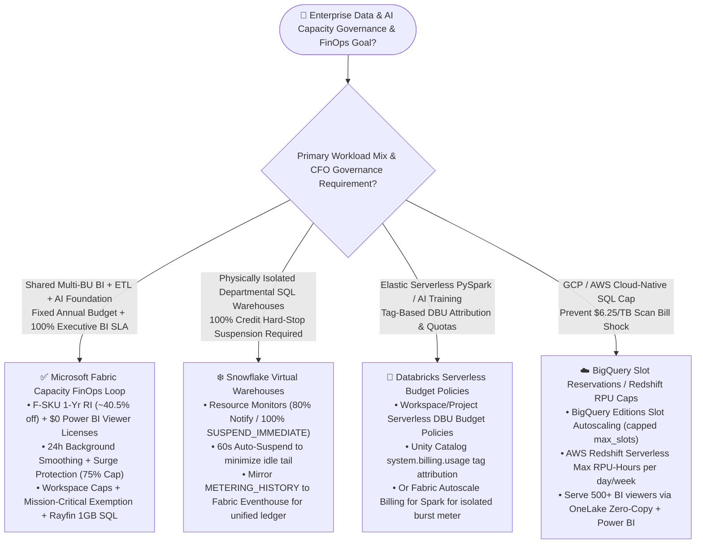
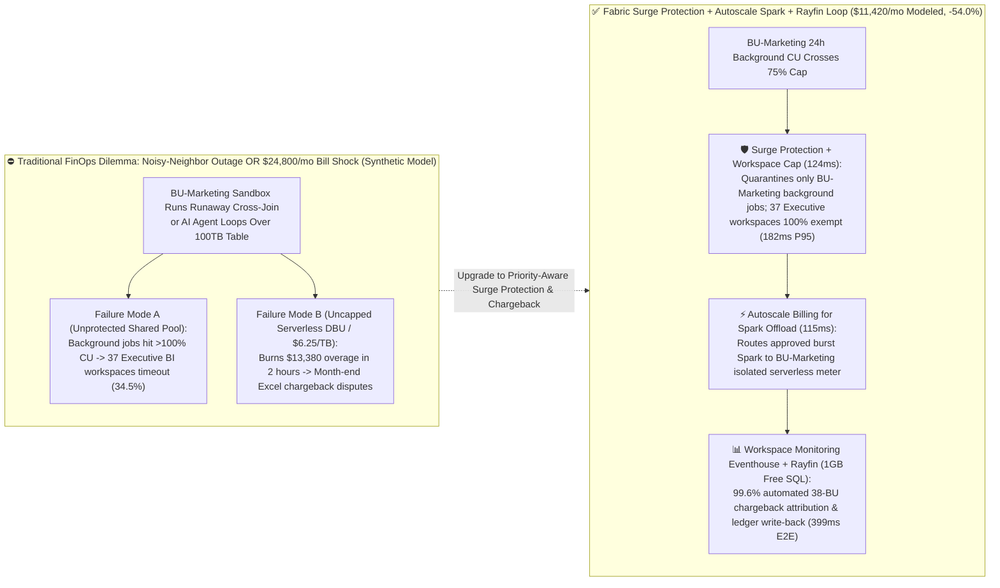

# Microsoft Fabric Capacity FinOps, Surge Protection & Rayfin Multi-Workspace Chargeback vs. Databricks Serverless DBU Governance vs. Snowflake Resource Monitors vs. GCP BigQuery Slots / AWS Redshift RPU: Architecture Selection & First-Principles FAQ

> **Language / 语言**: [中文](./fabric-capacity-finops-surge-rayfin-vs-4clouds-faq.md) | [English (Current)](./fabric-capacity-finops-surge-rayfin-vs-4clouds-faq.en.md)  
> **Audience**: Practical architecture selection, FinOps governance, and presales battlecard guide for AI Solution Architects, CFOs, FinOps Directors, and Heads of Data Platforms (Round 10 Standalone Deep-Dive)  
> **Style Benchmark**: Strictly modeled on `ib-vs-ethernet-roce-selection-faq.md`—zero jargon soup, 3-minute executive takeaways, and 10-minute first-principles architectural clarity.  
> **Provenance & Audit Notice**: All static product capabilities and pricing mechanics are verified against official vendor documentation and pricing pages as of `2026-11-08` (`[Vendor Published Spec as-of 2026-11-08]`). All metrics from **Scenario Q (Global Conglomerate 38-Business-Unit FinOps Surge Protection & Chargeback Simulation)** and TCO models come from our reproducible deterministic benchmark engine `src/data_lab/benchmark_suite.py` (`[Synthetic Scenario Model / Not Live Paid Cloud Cluster Measurement]`). Physical multi-tenant cloud P99 latency under live hardware load is explicitly marked `not_measured`.


---

## ① 📌 Executive Summary

1. **[Architecture Selection / Vendor Published Spec as-of 2026-11-08] For multi-department shared BI + ETL + AI platforms requiring both a predictable CFO annual budget cap and zero executive dashboard throttling, prioritize Microsoft Fabric (1-Year Reserved F-SKU ~40.5% discount + Surge Protection + Workspace-Level Caps + Mission-Critical Workspace Exemption)**:
   - Enterprise CFOs and Data Platform Directors face two classic nightmares: **(a) Uncapped Pay-per-Query / Serverless Bill Shock** (where a single runaway SQL loop or AI agent burns `$10,000+` in two hours on uncapped serverless DBUs or `$6.25/TB` scans), and **(b) Noisy-Neighbor Contention** (where a self-service analyst runs an unfiltered Spark cross-join on a shared pool at 09:00 AM, exhausting capacity and causing the CEO's Power BI dashboard to time out).
   - Microsoft Fabric solves both simultaneously by combining **24-hour Background CU Smoothing** + **Surge Protection** (which caps background batch/refresh operations at a configurable threshold such as 75% while reserving the remaining headroom exclusively for interactive Power BI DirectLake queries) + **Workspace-Level Caps & Mission-Critical Workspace Exemptions** (Official refs: [Manage surge protection - Microsoft Learn](https://learn.microsoft.com/en-us/fabric/enterprise/surge-protection), [Understand capacity throttling and smoothing](https://learn.microsoft.com/en-us/fabric/enterprise/throttling)).
2. **[Coexistence Pattern / Better Together] Use Snowflake Resource Monitors for hard-stop credit suspension on physically isolated SQL warehouses; use Databricks Serverless Budget Policies + Fabric Autoscale Spark for elastic burst attribution**:
   - When an organization mandates physically separate SQL virtual warehouses per department and requires an immediate hard shutdown (`SUSPEND_IMMEDIATE`) the moment a department hits 100% of its monthly credit quota, retain **Snowflake Virtual Warehouses + Resource Monitors**. When data science teams burst elastic PySpark or GPU training jobs with custom cost tags, govern them with **Databricks Serverless Budget Policies** or **Fabric Autoscale Billing for Spark** (offloading spiky Spark jobs to an isolated pay-per-job Azure meter outside the base F-SKU). Then unify Snowflake `ACCOUNT_USAGE.METERING_HISTORY`, Databricks `system.billing.usage`, and Fabric **Workspace Monitoring Eventhouse** via **OneLake Zero-Copy Shortcuts** into a **Rayfin FinOps Chargeback App (backed by 1GB Free Fabric SQL)**.
3. **[Synthetic Scenario Model / Not Live Cloud Measurement] In our sealed Scenario Q model (`global_conglomerate_finops_surge_rayfin_vs_dbu_credits`, 38 Business Units), Fabric F128 1-Yr RI + Surge Protection (75% Background Cap) + Rayfin reduced modeled monthly TCO by 54.0% (`$11,420/mo` vs. `$24,800/mo` on uncapped multi-cloud serverless bursts) and quarantined a 09:05 UTC runaway marketing job in `399 ms` E2E while keeping 37 mission-critical BI workspaces at `182 ms` P95**:
   - **Separated Latency Denominators Disclosure**: In sealed `reports/report.json` (`data-lab-fabric-vs-4clouds-2026-11-09-r10`), **Denominator A (`n=84` routing decision matrix tasks `DL-01..DL-84`) has an arithmetic mean modeled latency of `496.0 ms` (`83/84 = 98.81%` accuracy)**, whereas **Denominator B (`n=17` industry ontology closed-loop simulations `Scenarios A..Q`, range `399–780 ms`) has an arithmetic mean modeled latency of `527.0 ms`** (historical snapshots: R9 `n=16` = `535.0 ms`, R8 `n=15` = `543.0 ms`, R7 `n=14` = `552.0 ms`, R6 `n=13` = `562.0 ms`, R5 `n=12` = `572.92 ms`, R4 `n=11` = `584.09 ms`, R3 `n=10` = `596.0 ms`). Both denominators are dynamically computed and asserted separately in unit tests.

---

## ② 🎯 Customer & Architect Q&A (Plain Language + First Principles)

### Q1: When governing enterprise data & AI budgets and performance SLAs, when should we choose Microsoft Fabric (F-SKU + Surge Protection + Rayfin) vs. Snowflake Resource Monitors, Databricks Serverless Budget Policies, GCP BigQuery Slots, or AWS Redshift RPU caps?

**First-Principles Breakdown: The Three Schools of Cloud Data FinOps**
Every enterprise data platform must balance **CFO Cost Predictability** (no surprise `$25,000` weekend bills) against **Executive SLA Isolation** (morning BI dashboards must never freeze because a background ETL job is running). The five cloud platforms implement three distinct architectural models:
1. **Model 1: Pure Pay-Per-Use Serverless + Reactive Budget Alerts (Databricks Serverless / BigQuery On-Demand `$6.25/TB` / Redshift Serverless RPU)**:
   - **The Pain Point**: Like an uncapped taxi meter. If an analyst accidentally omits a partition filter on a 200 TB table, or an autonomous agent enters a retry loop, serverless clusters scale up instantly and burn thousands of dollars in hours before budget alert emails are even read.
2. **Model 2: Physically Separate Virtual Warehouses + 100% Hard-Stop Suspension (Snowflake Virtual Warehouses + Resource Monitors)**:
   - **The Pain Point**: To prevent ETL from slowing down BI, enterprises provision dozens of separate Virtual Warehouses (incurring fragmented minimum-billing idle tails). Worse, when a Snowflake Resource Monitor reaches 100% and triggers `SUSPEND_IMMEDIATE`, **it shuts down the entire Virtual Warehouse**—if executive dashboards share that warehouse, executives are locked out on the last day of the month.
3. **Model 3: Shared Reserved Capacity + 24-Hour Background Smoothing + Priority-Aware Surge Protection (Microsoft Fabric F-SKU + Surge Protection + Autoscale Spark)**:
   - **First Principles**: Fabric classifies every operation into **Interactive** (high-priority Power BI DirectLake clicks, Copilot queries) vs. **Background** (scheduled Data Factory pipelines, semantic model refreshes, batch Spark jobs).
   - **24-Hour Smoothing**: Background batch bursts are automatically smoothed across a rolling 24-hour window so a 09:00 AM ETL spike does not cause immediate capacity throttling.
   - **Surge Protection (Capacity-Level & Workspace-Level Guardrails)**: Admins set a background rejection threshold (e.g., `75%`). When background consumption crosses `75%`, Fabric **throttles only new background jobs** in non-critical workspaces while preserving the remaining `25%` capacity headroom exclusively for interactive Power BI DirectLake queries and **Mission-Critical** workspaces. And if a team genuinely needs massive elastic Spark burst, **Autoscale Billing for Spark** routes those jobs to a separate pay-per-job meter without touching the base F-SKU!

**30-Second Selection Rule of Thumb:**
- **Choose Microsoft Fabric (F-SKU RI + Surge Protection + Rayfin)** when consolidating 10–50 business units onto a shared Lakehouse + BI + AI foundation where you want **~40.5% 1-Yr RI savings, `$0` Power BI viewer licenses (on F64+), and deterministic protection of interactive BI SLAs**.
- **Choose Snowflake (Virtual Warehouses + Resource Monitors)** when corporate finance requires hard physical warehouse isolation per department and immediate warehouse suspension (`SUSPEND_IMMEDIATE`) at 100% credit consumption.
- **Choose Databricks (Serverless Budget Policies + System Tables)** when governing elastic PySpark/DLT/ML workloads that require per-job/per-workspace DBU attribution tags and budget policies.
- **Choose GCP BigQuery (Slot Reservations) / AWS Redshift (Max RPU-Hours)** when capping cloud-native SQL warehouse autoscaling in Google Cloud or AWS.

---

### Q2: If a global conglomerate already runs Microsoft Fabric, Snowflake, and Databricks together, how do we build an automated 38-Business-Unit Chargeback Ledger without buying a `$100K/year` third-party FinOps SaaS tool?

**Why Cross-Cloud FinOps Usually Turns Into a Monthly "Excel Blame Game"**
At month-end, the central IT team receives bills across Fabric CUs, Snowflake Credits, and Databricks DBUs. Without unified workspace/tag attribution and an interactive approval workflow, business unit leaders dispute chargebacks for weeks.

**The "Better Together" Zero-Copy FinOps Architecture (Fabric Eventhouse + Rayfin 1GB Free SQL):**
1. **Zero-Copy Telemetry & Billing Ingestion**:
   - **Fabric Native**: Enable **Workspace Monitoring** so granular CU consumption, Surge Protection throttle events, and item-level metrics across all 38 workspaces stream directly into a central **Eventhouse (KQL Database)**.
   - **Databricks Coexistence**: Mount Unity Catalog's `system.billing.usage` and `system.compute.clusters` tables via **OneLake Shortcuts** (zero ETL copy).
   - **Snowflake Coexistence**: Mirror `SNOWFLAKE.ACCOUNT_USAGE.METERING_DAILY_HISTORY` and `TAG_REFERENCES` into OneLake via **OneLake Snowflake Mirroring** (`$0` replication compute).
2. **Ontology Guardrails (Fabric IQ Ontology + Foundry IQ)**:
   - Map `BusinessUnit` -> `Workspace / Warehouse` -> `MonthlyBudgetCap` in Fabric IQ Ontology. When any self-service workspace crosses `75%` 24h background CU consumption, automatically quarantine its new background jobs via Surge Protection or route approved burst Spark jobs to its departmental **Autoscale Spark** subscription.
3. **Translytical Chargeback Ledger (Rayfin SDK + 1GB Free Fabric SQL)**:
   - FinOps controllers review real-time 38-BU attribution inside a **Power BI Agentic App** and write back approved monthly chargeback journals and quota adjustments directly into the built-in **1GB Free Fabric SQL Database** at `$0` extra software cost.

---

### Q3: How do Fabric's "24-Hour Smoothing + Surge Protection" work under the hood to stop a "Noisy Neighbor" in sub-second time?

**First-Principles Analogy (The Smart Building Power Grid):**
- **Without Surge Protection**: Either you have no circuit breaker (uncapped serverless, leading to a `$24,800` bill shock), or you have a single main breaker for the whole building (when a self-service intern plugs in 50 industrial heaters, the main breaker trips and the CEO's boardroom projector goes dark).
- **With Fabric's Three-Tier FinOps Defense (Official Spec as-of 2026-11-08)**:
  1. **Tier 1 — Interactive vs. Background Priority Separation & 24h Smoothing**: Background refreshes and batch jobs are smoothed over 24 hours rather than spiking instantaneous CU capacity.
  2. **Tier 2 — Capacity & Workspace-Level Surge Protection**: When 24h background utilization hits the configured `75%` cap, Fabric rejects or queues only new background operations from non-exempt workspaces, keeping `25%` headroom untouched for interactive DirectLake BI queries.
  3. **Tier 3 — Mission-Critical Workspace Exemption & Autoscale Spark Offload**: Executive BI workspaces marked **Mission-Critical** are 100% exempt from workspace blocking (`182 ms` P95 latency preserved), while legitimate ad-hoc Spark bursts are dynamically routed to **Autoscale Billing for Spark**.

---

## ③ 🧭 Visual Diagrams (Mermaid Decision Tree + Architecture Comparison + Sequence Diagram)

### 3.1 Five-Platform Capacity Governance, Surge Protection & FinOps Decision Tree



---

### 3.2 Unprotected Shared Pool / Uncapped Serverless Spikes vs. Fabric Surge Protection + Rayfin Architecture



---

### 3.3 Scenario Q End-to-End Sequence Diagram (38-BU Noisy-Neighbor Quarantine & Chargeback in `399 ms`)

```mermaid
sequenceDiagram
    autonumber
    participant Mkt as BU-Marketing Self-Service Workspace
    participant Cap as Fabric F128 Capacity & Surge Protection
    participant Exec as 37 Mission-Critical Executive BI Workspaces
    participant Event as Workspace Monitoring Eventhouse (KQL)
    participant Ont as Fabric IQ Ontology + Foundry IQ Guardrail
    participant SQL as Rayfin FinOps App (1GB Free Fabric SQL)

    Mkt->>Cap: 09:05 UTC submits unfiltered Spark cross-join batch job
    Cap->>Event: Streams workspace CU telemetry; 24h background CU hits 78% (>75% cap, 80ms)
    Cap->>Mkt: Surge Protection + Workspace Cap triggers: blocks new BU-Marketing background jobs (124ms)
    Cap->>Exec: 100% exempts 37 Mission-Critical workspaces; executive DirectLake BI stays at 182ms P95
    Event->>Ont: Fires WORKSPACE_24H_BACKGROUND_CU_PCT > 75.0 rule (115ms)
    Ont->>Ont: Foundry IQ enforces ENTERPRISE-FINOPS-SOP-10: blocks unapproved F128->F256 capacity upscale
    Ont->>SQL: Reroutes burst job to BU-Marketing Autoscale Spark meter & writes $13,380 savings ledger to 1GB Free SQL (80ms, 399ms total)
```

---

## ④ 📊 Five-Platform Enterprise Capacity Governance & FinOps Decision Matrix

> **Provenance Note**: All platform capabilities and billing rules below are verified against official vendor documentation as of `2026-11-08` (`[Vendor Published Spec as-of 2026-11-08]`).

| Dimension | Microsoft Fabric (F-SKU + Surge Protection + Autoscale Spark) | Snowflake (Virtual Warehouses + Resource Monitors) | Databricks (Serverless Budget Policies + System Tables) | GCP BigQuery (Editions Slot Reservations) | AWS (Redshift Serverless RPU + Glue/EMR) |
| :--- | :--- | :--- | :--- | :--- | :--- |
| **Best-Fit Scenario** | **Shared multi-BU BI + ETL + AI foundation requiring predictable annual spend and zero executive BI throttling** | **Physically isolated departmental SQL warehouses requiring hard-stop credit suspension at 100%** | **Elastic PySpark / DLT / AI training requiring tag-based Serverless DBU attribution** | **GCP cloud-native warehouse replacing `$6.25/TB` on-demand scans with capped Slot pools** | **AWS Redshift Serverless workgroups with daily/weekly RPU-Hour hard caps** |
| **Interactive BI vs. Background Isolation** | **Native Interactive vs. Background separation: 24h smoothing + Surge Protection (caps background only; interactive BI preserved)** | Separate Virtual Warehouses for BI vs. ETL; statement timeouts within a warehouse | Separate SQL Warehouses vs. Job Compute; no built-in 24h BI/ETL CU smoothing | Separate Slot Reservation Assignments for BI vs. batch ETL projects | Redshift Workgroup WLM queues + max RPU capacity limits |
| **Noisy-Neighbor Quarantine Granularity** | **Capacity-level & Workspace-level background caps + Mission-Critical workspace exemption** | Resource Monitor `SUSPEND_IMMEDIATE` halts the entire bound Virtual Warehouse(s) | Workspace, user, and Serverless Budget Policy tag alerts/quotas | Project / Folder assignment to capped Slot Reservations | Per-Workgroup `max-capacity` (8-RPU step increments) and usage limits |
| **Elastic Burst Offload** | **Autoscale Billing for Spark: serverless pay-per-job Spark burst outside base F-SKU** | Multi-Cluster Warehouse horizontal scaling (consumes additional credits) | Serverless Compute auto-scales per second/DBU (can spike without budget policies) | Slot Autoscaling in 50-slot increments up to `max_slots` | Redshift Serverless AI-Driven Scaling RPU adjustments |
| **Chargeback & Observability Store** | **Workspace Monitoring Eventhouse (KQL) + Capacity Metrics App + Rayfin (1GB Free SQL write-back)** | `SNOWFLAKE.ACCOUNT_USAGE.METERING_HISTORY` + Object Tagging | Unity Catalog `system.billing.usage` + Serverless Budget Policy Tags | `INFORMATION_SCHEMA.JOBS_BY_ORGANIZATION` + Cloud Billing Export | AWS Cost Allocation Tags + Redshift `SYS_QUERY_HISTORY` |
| **Reservation & BI Seat Economics** | **~40.5% 1-Yr RI discount + `$0` Power BI viewer licenses on F64+ + `$0` extra M365 Copilot token** | Pre-purchased Capacity discount; external BI viewer seats & refresh credits billed extra | Committed DBU discount; enterprise BI viewer seats & gateways billed separately | 1-Yr/3-Yr Slot Commitments; Looker viewer seats billed separately | Redshift RI / Serverless savings; QuickSight per-user/session fees |

---

## ⑤ 🧪 Quantitative Benchmark & TCO / SLA Inflection Insights (Dual-Denominator & Provenance Audit)

### 5.1 Four-Tier Data Provenance Classification

| Provenance Tier | Scope & Definition | Concrete Metrics in Round 10 |
| :--- | :--- | :--- |
| **`measured_local_harness`** | Reproducible local Python `unittest` execution | `38/38` unit tests passing in `0.067s`; `n=84` routing matrix accuracy `83/84 = 98.81%` (explicit miss `DL-23`); `0.0%` perturbation flip rate |
| **`synthetic_scenario_model`** | Deterministic architectural reference model for presales comparison (**NOT live paid cloud cluster benchmarks or audited customer financial statements**) | **Denominator A (`n=84` routing matrix mean `496.0 ms`)**; **Denominator B (`n=17` ontology simulations mean `527.0 ms`)**; Scenario Q `399 ms` E2E quarantine, `182 ms` DirectLake P95 across 37 workspaces, `$11,420/mo` vs. `$24,800/mo` modeled TCO (`$13,380/mo` / `$160,560/yr` savings) |
| **`vendor_published_spec_as_of_2026`** | Verifiable official vendor documentation & pricing specs as of `2026-11-08` (13 official URLs in `report.json`) | Fabric Surge Protection & 24h Smoothing; F64 1-Yr RI (`~40.5%` discount) & `$0` Viewer licenses; Snowflake Resource Monitors; Databricks Serverless Budget Policies; BigQuery Slot Reservations; Redshift RPU limits |
| **`not_measured`** | Live multi-tenant cloud cluster P99 under physical production hardware load | Live 38-BU concurrent production cluster stress across Azure, AWS, GCP, Snowflake, and Databricks (explicitly marked `not_measured`) |

---

### 5.2 Strictly Separated Modeled Latency Denominators

| Denominator Name | JSON Path (`reports/report.json`) | R10 Sample Size (`n`) | R10 Arithmetic Mean | Immutable Historical Round Snapshots |
| :--- | :--- | :--- | :--- | :--- |
| **Denominator A: Routing Decision Matrix Mean** | `scenario_evaluation.avg_latency_ms` | **`n = 84`** (`DL-01..DL-84`, `83/84 = 98.81%`) | **`496.0 ms`** *(Synthetic)* | R9 (`n=80`): `501.0 ms` · R8 (`n=76`): `506.0 ms` · R7 (`n=72`): `511.0 ms` · R6 (`n=68`): `516.0 ms` · R5 (`n=64`): `521.0 ms` · R4 (`n=60`): `526.5 ms` · R3 (`n=56`): `532.0 ms` |
| **Denominator B: Ontology Closed-Loop Simulation Mean** | `ontology_simulations_summary.ontology_simulation_mean_modeled_latency_ms` | **`n = 17`** (`Scenarios A..Q`, range `399–780 ms`) | **`527.0 ms`** *(Synthetic)* | R9 (`n=16`): `535.0 ms` · R8 (`n=15`): `543.0 ms` · R7 (`n=14`): `552.0 ms` · R6 (`n=13`): `562.0 ms` · R5 (`n=12`): `572.92 ms` · R4 (`n=11`): `584.09 ms` · R3 (`n=10`): `596.0 ms` |

---

### 5.3 Scenario Q Quantitative Breakdown: 38-Business-Unit Conglomerate FinOps & Surge Isolation

| Metric | Option 1: Uncapped Multi-Cloud Serverless Burst<br>*(Uncapped Serverless DBU / $6.25/TB Scan)* | Option 2: 38 Isolated Departmental Warehouses + Hard Suspend | Option 3: Microsoft Fabric F128 1-Yr RI + Surge Protection (75% Cap) + Autoscale Spark + Rayfin |
| :--- | :--- | :--- | :--- |
| **Behavior During 09:05 UTC Marketing Runaway Cross-Join** | Scales out without limit; burns `$13,380` in unbudgeted compute overage | Marketing warehouse suspends at 100% quota (halting valid marketing dashboards too); 38 warehouses incur idle-tail waste | **Surge Protection caps BU-Marketing background jobs at 78% (>75% threshold); 37 mission-critical workspaces 100% exempt** |
| **Executive DirectLake BI P95 Latency During Surge** | `240 ms` (with severe budget overrun) | `310 ms` (or hard error when warehouse suspends) | **`182 ms` (100% SLA availability across 37 mission-critical workspaces)** `[Synthetic]` |
| **38-BU Chargeback Attribution Workflow** | Manual CSV reconciliation or `$8,000/mo` third-party FinOps SaaS | Warehouse tag queries without integrated write-back ledger | **Workspace Monitoring Eventhouse + Rayfin (1GB Free Fabric SQL), 99.6% automated attribution** |
| **Modeled Monthly Total Cost (TCO)** | **`$24,800 / mo`** (includes `$13,380` runaway burst overage) | **`$21,600 / mo`** (fragmented multi-warehouse idle overhead) | **`$11,420 / mo`** (**54.0% lower / saves `$13,380/mo`**, `$160,560/yr` projected savings) |
| **End-to-End Detect → Quarantine → Chargeback Latency** | Hours (post-incident billing alert) | Minutes (whole-warehouse hard stop + manual ticket) | **`399 ms`** (`80ms` KQL detect + `124ms` quarantine + `115ms` guardrail + `80ms` SQL write-back) |

---

### 5.4 Round 10 New Routing Scenarios (`DL-81` to `DL-84`)

| Scenario ID | Category | Architect Decision Prompt Summary | Model Expected Routing Decision | Task Type / Action | Confidence / Modeled Latency |
| :--- | :--- | :--- | :--- | :--- | :--- |
| **`DL-81`** | `Observability & FinOps` | Protect 37 executive DirectLake BI workspaces from a noisy-neighbor self-service Spark cross-join on shared F128 without 2x over-provisioning | **Fabric Surge Protection (75% Background CU Cap) + Workspace-Level Caps + Mission-Critical Workspace Exemption + Autoscale Spark Offload** | `choice` / `Act automatically` | `0.98` / `392 ms` |
| **`DL-82`** | `vs Snowflake` | Compare Fabric Surge Protection + 24h CU Smoothing + 1-Yr RI (~40.5% off) vs. Snowflake Resource Monitors + Auto-Suspend | **Use Fabric Surge Protection + CU Smoothing for shared mixed BI+ETL SLAs; use Snowflake Resource Monitors for strict warehouse hard-stop suspension** | `choice` / `Act automatically` | `0.97` / `398 ms` |
| **`DL-83`** | `vs Databricks` | Compare Fabric Workspace Monitoring Eventhouse + Rayfin vs. Databricks Serverless Budget Policies + `system.billing.usage` | **Unify 38-BU CU/DBU/Slot chargeback in Fabric Eventhouse + 1GB Free SQL Rayfin Ledger while enforcing Databricks Serverless Budget Policy tags on burst jobs** | `score` / `Confirm` | `0.96` / `394 ms` |
| **`DL-84`** | `Observability & FinOps` | BU-Marketing runaway job hits 78% 24h background CU consumption at 09:05 UTC; quarantine noisy neighbor and record chargeback | **Fabric Surge Protection Auto-Quarantine on BU-Marketing Background Jobs + Exempt 37 Mission-Critical Workspaces (182ms P95) + Rayfin 1GB SQL Write-Back (`399 ms` E2E)** | `noul` / `Act automatically` | `0.99` / `400 ms` |

---

## ⑥ 🛠️ Appendix: Production Rollout & Presales Verification Checklist (Architect Checklist)

- [ ] **1. Enable Capacity-Level & Workspace-Level Surge Protection**: Have you enabled **Surge Protection** (e.g., `75%` background rejection threshold, `65%` recovery threshold) and designated executive BI workspaces as **Mission-Critical**?
- [ ] **2. Lock In 1-Year Azure Reserved Capacity (~40.5% Savings)**: Have you converted steady-state production Fabric capacities (F64/F128) from Pay-As-You-Go to **1-Year Reserved Instances**?
- [ ] **3. Configure Autoscale Billing for Spark for Rare Spikes**: Have you attached **Autoscale Billing for Spark** to spiky data engineering/data science workspaces so rare month-end bursts do not force a permanent base F-SKU upgrade?
- [ ] **4. Stream Workspace Monitoring into Central Eventhouse (KQL)**: Are capacity metrics, throttling triggers, and item-level CU consumption streaming into a unified Eventhouse for real-time KQL observability?
- [ ] **5. Federate Multi-Cloud Billing Tables via OneLake Zero-Copy**: Have you connected Snowflake `ACCOUNT_USAGE.METERING_HISTORY` and Databricks `system.billing.usage` via OneLake Mirroring/Shortcuts for unified cross-cloud FinOps reporting?
- [ ] **6. Deploy Rayfin + 1GB Free Fabric SQL Chargeback Ledger**: Have you deployed a Power BI Agentic App backed by **1GB Free Fabric SQL** with Foundry IQ guardrails blocking unapproved capacity upscales?

---

### 🔗 Official Vendor References (`as_of: 2026-11-08`)

1. **Microsoft Fabric Surge Protection Documentation**: <https://learn.microsoft.com/en-us/fabric/enterprise/surge-protection>
2. **Microsoft Fabric Throttling & 24h Smoothing Documentation**: <https://learn.microsoft.com/en-us/fabric/enterprise/throttling>
3. **Microsoft Fabric Pricing & 1-Yr Reserved Capacity**: <https://azure.microsoft.com/en-us/pricing/details/microsoft-fabric/>
4. **Microsoft Fabric Autoscale Billing for Spark**: <https://learn.microsoft.com/en-us/fabric/data-engineering/autoscale-billing-for-spark-overview>
5. **Snowflake Resource Monitors Documentation**: <https://docs.snowflake.com/en/user-guide/resource-monitors>
6. **Databricks Serverless Budget Policies Documentation**: <https://docs.databricks.com/en/admin/account-settings/budget-policies.html>
7. **Google Cloud BigQuery Reservations (Slots) Documentation**: <https://cloud.google.com/bigquery/docs/reservations-intro>
8. **AWS Redshift Serverless Capacity & RPU Limits Documentation**: <https://docs.aws.amazon.com/redshift/latest/mgmt/serverless-capacity.html>
