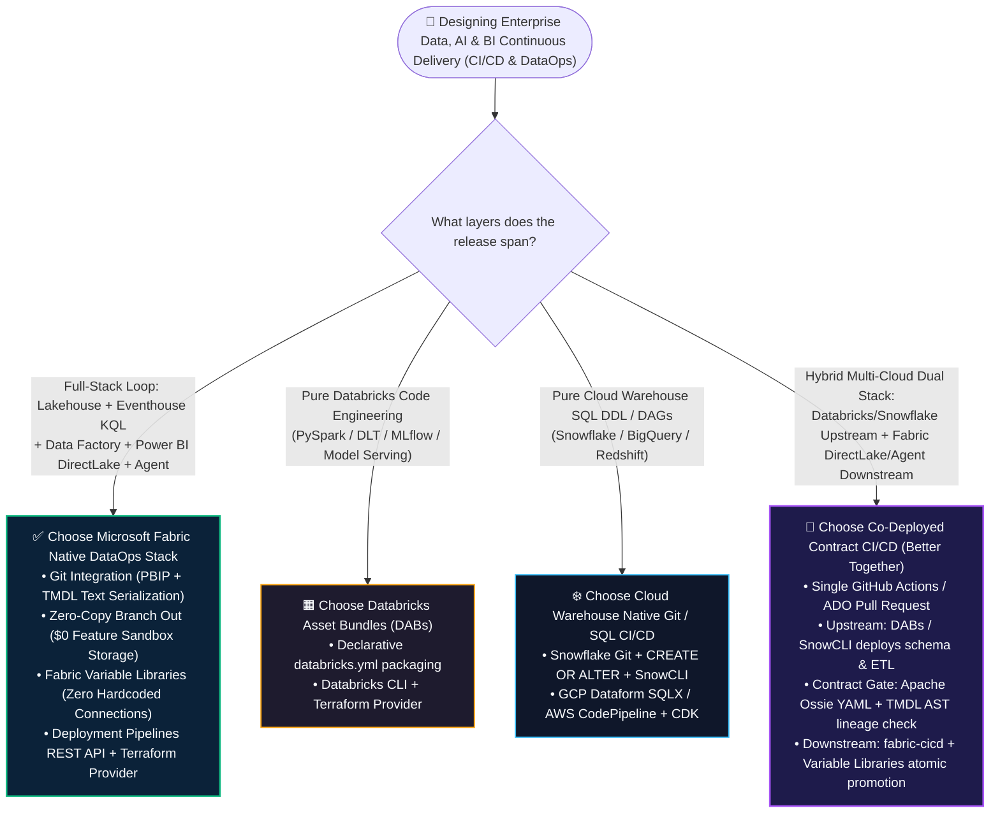
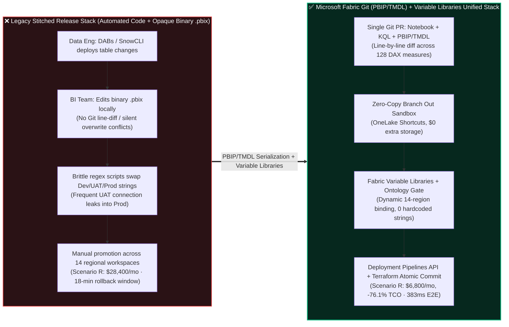
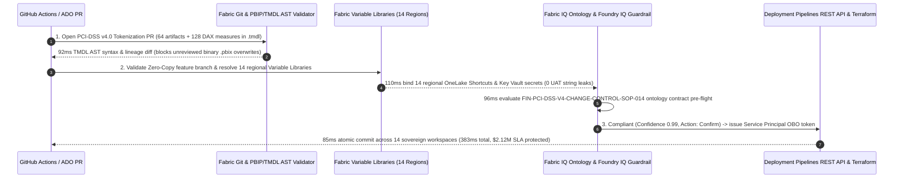

# Microsoft Fabric Enterprise CI/CD, Git Integration (PBIP/TMDL), Variable Libraries & Terraform vs. Databricks DABs vs. Snowflake SnowCLI vs. GCP Dataform / AWS CodePipeline Selection FAQ

> **Language**: **[中文](./fabric-cicd-git-tmdl-pipelines-vs-dabs-snowcli-faq.md)** | **English (Current)**  
> **Style & Structure Benchmark**: Strictly modeled on `ib-vs-ethernet-roce-selection-faq.md` (6-part field guide: grasp core conclusions in 3 minutes, absorb full-stack Data + BI + Agent continuous delivery selection logic in 10 minutes, ready for CTO reviews and enterprise DataOps architecture design).  
> **Companion Resources**: [Interactive Battlecard & Simulator Workbench (`../live-demo.en.html`)](../live-demo.en.html) · [7-Card 4:5 Visual Benchmark Report (`../benchmark-cards.en.html`)](../benchmark-cards.en.html) · [Round 11 Visual Summary Poster (`../assets/svg/19-fabric-cicd-git-tmdl-pipelines-vs-dabs-snowcli-faq.svg`)](../assets/svg/19-fabric-cicd-git-tmdl-pipelines-vs-dabs-snowcli-faq.svg)

---

## 📌 1. Executive Summary

1. **For Full-Stack "Lakehouse + Real-Time KQL + Semantic Model DAX + Transactional Write-Back" Releases, Choose Microsoft Fabric Git Integration (PBIP/TMDL) + Variable Libraries + Deployment Pipelines + Terraform Provider (`microsoft/fabric`)**: The #1 release failure in enterprise data estates is not an inability to deploy PySpark or SQL scripts—it is that **upstream tables change while downstream Power BI `.pbix` files remain opaque binary blobs that cannot be Git-diffed, and hardcoded UAT connection strings accidentally leak into Production**. Fabric solves this from first principles by serializing semantic models, DAX measures, KQL scripts, and notebooks into human-readable **PBIP + TMDL (Tabular Model Definition Language)** text files in Git, pairing **Zero-Copy Branch Out** (`$0` extra sandbox storage) with **Fabric Variable Libraries** for zero-code environment binding (in Synthetic Scenario R, promoting 64 coordinated artifacts across 14 sovereign regions completes pre-flight + commit in `383 ms` while cutting monthly DataOps TCO by **76.1%** `[synthetic_scenario_model]`).
2. **For Pure Code Bundles (PySpark / MLflow Wheels) or Pure Cloud Warehouse SQL DDL, Respect the Native Strengths of Databricks Asset Bundles (DABs), Snowflake Git (`CREATE OR ALTER` + SnowCLI), and GCP Dataform**: When deliverables stay strictly inside Databricks (Spark jobs, DLT pipelines, MLflow endpoints), **DABs (`databricks.yml`)** is the gold standard; when managing Snowflake-only SQL objects and Snowpark procedures, **Snowflake Git Integration + `CREATE OR ALTER` + SnowCLI** is the cleanest path; for pure BigQuery SQL DAGs, **GCP Dataform (`SQLX`)** is purpose-built.
3. **In Multi-Cloud Estates, Enforce a "Single Git PR Cross-Cloud Contract Release (Better Together)"**: Never allow upstream warehouse pipelines and downstream BI/Agent layers to deploy on disconnected schedules. Orchestrate **DABs / SnowCLI** alongside **Apache Ossie YAML + Fabric TMDL + `fabric-cicd`** inside a single GitHub Actions or Azure DevOps Pull Request so every upstream schema change is contract-validated against downstream DirectLake measures before promotion.

---

## 🎯 2. First-Principles Customer & Architect Q&A (FAQ-Driven)

### Q1: When an enterprise already uses GitHub Actions or Azure DevOps, when should we standardize on Microsoft Fabric native CI/CD vs. Databricks DABs / Snowflake SnowCLI / GCP Dataform / AWS CodePipeline?

- **Why Legacy "Half-Stack CI/CD" Breaks on Release Night**:
  In most enterprises, data engineering and BI/AI teams run split release processes: data engineers deploy Delta or Iceberg tables automatically via Databricks Asset Bundles (`databricks.yml`) or Snowflake `snow git execute`, while BI developers edit binary `.pbix` files on laptops, click "Publish to Workspace," and rely on manual steps or brittle PowerShell regex scripts to swap Dev/UAT/Prod connection strings. This creates three chronic failure modes:
  1. **Binary `.pbix` Merge Hell**: When two developers edit different DAX measures in the same `.pbix` file, Git cannot line-diff or merge the binary archive—the second commit silently overwrites the first.
  2. **UAT Connection-String Drift into Production**: A single missed Shortcut path or connection string causes Production executive dashboards to read UAT test data.
  3. **Feature-Branch Sandbox Storage Bloat**: Cloning multi-terabyte development databases per feature branch inflates storage bills and delays testing by hours.
- **Clear Architect Selection Boundary**:
  - **Choose Microsoft Fabric Git (PBIP/TMDL) + Variable Libraries + Deployment Pipelines** when the release spans **Lakehouse / Warehouse + Eventhouse KQL + Data Factory + Power BI DirectLake Semantic Models + Fabric IQ Ontology / Data Agents**, requiring line-by-line Git PR diffs, zero-copy feature workspaces, and multi-region promotion.
  - **Choose Databricks Asset Bundles (DABs)** when the scope is strictly Databricks-internal PySpark jobs, Lakeflow DLT pipelines, and MLflow / Mosaic AI endpoints.
  - **Choose Snowflake Git Integration + SnowCLI (`CREATE OR ALTER`)** when the scope is pure Snowflake SQL DDL, Dynamic Tables, Snowpark procedures, and Streamlit apps.
  - **Choose GCP Dataform / AWS CodePipeline + CDK** when the workload is 100% BigQuery SQLX views or AWS CDK infrastructure stacks.

---

### Q2: When is a "Better Together" Coordinated Git PR (DABs / SnowCLI + Fabric TMDL + Apache Ossie) Superior to Separate Releases?

- **The Enterprise Pain Point**: Global payment networks, banks, and retailers frequently pair Databricks or Snowflake for heavy upstream crunching with Microsoft Fabric DirectLake + Copilot Data Agents for enterprise-wide consumption. If Databricks/Snowflake deploys a column rename or currency scale change at 02:00 UTC while the Power BI semantic model is updated manually the next afternoon, executive dashboards and AI agents hallucinate or fail all morning.
- **The Better Together Co-Deployment Pattern**:
  1. **Contract Pre-Flight (Apache Ossie YAML + TMDL AST Validation)**: A single GitHub Actions / Azure DevOps PR parses both the upstream SQL/PySpark diff and the downstream Fabric **TMDL Abstract Syntax Tree (AST)** + **Apache Ossie YAML** contract, verifying that all 128 downstream DAX measures remain unbroken (`92 ms` in Scenario R).
  2. **Zero-Code Environment Binding (Fabric Variable Libraries)**: Across Dev, UAT, and 14 regional Prod workspaces, **Fabric Variable Libraries** bind each workspace to its corresponding regional OneLake Shortcut and Azure Key Vault secret (`110 ms`)—with zero hardcoded connection strings in Git.
  3. **Atomic Multi-Cloud Promotion (`fabric-cicd` + Terraform Provider `microsoft/fabric`)**: Once DABs or SnowCLI succeeds, the same CI/CD pipeline invokes `fabric-cicd` and the official `microsoft/fabric` Terraform Provider to promote all 64 workspace artifacts atomically (`85 ms`).

---

### Q3: What Are PBIP + TMDL, Zero-Copy Branch Out, and Fabric Variable Libraries—and How Do They Cut TCO and Eliminate Drift Under the Hood?

Breaking down Microsoft Fabric's four DataOps pillars from first principles `[vendor_published_spec_as_of_2026]`:

1. **PBIP (Power BI Project) & TMDL (Tabular Model Definition Language) — "Turning Opaque Binary Blobs into Human-Readable Code"**:
   - **What it is**: Historically, Power BI models were saved inside compressed `.pbix` binary files; PBIP + TMDL decomposes every table, relationship, DAX measure, and RLS security role into clean, YAML-like `.tmdl` text files.
   - **How it saves time & prevents bugs**: Multiple engineers can edit `NetRevenue.tmdl` and `CardFraudRate.tmdl` concurrently with full Git line-by-line diffs, automated merges, and AI PR linters that catch broken DAX lineage before deployment.
2. **Zero-Copy Branch Out to New Workspace — "Spin Up 50 Feature Branches for $0 Extra Storage"**:
   - **What it is**: When a developer selects "Branch out to new workspace" in Fabric, the platform creates an isolated workspace backed by **OneLake Shortcuts** pointing to baseline tables rather than physically copying terabytes of Parquet/Delta files, applying Copy-on-Write only to newly mutated tables.
   - **How it cuts TCO**: Provisioning a full-stack data + BI sandbox drops from hours of copy scripts to seconds, with **$0 incremental storage cost**.
3. **Fabric Variable Libraries — "Write Once, Bind Dynamically Across Every Environment"**:
   - **What it is**: A first-class workspace item that stores environment-specific values (Lakehouse IDs, OneLake Shortcut targets, Eventhouse URIs, Key Vault references) across Dev, UAT, and regional Production stages.
   - **How it eliminates drift**: Pipelines, notebooks, and semantic models reference logical variable names (`$(var_settlement_lakehouse_id)`). During Deployment Pipeline promotion, the target stage's Variable Library binds automatically without regex scripts or code edits.
4. **`fabric-cicd` Python Library & Terraform Provider (`microsoft/fabric`) — "Declarative Full-Lifecycle IaC"**:
   - **What it is**: Microsoft's official Terraform Provider (provisioning Capacities, Workspaces, RBAC, Git connections, and Managed Private Endpoints) paired with the `fabric-cicd` Python library for Service Principal / Entra OBO artifact deployment.
   - **How it cuts TCO**: Replaces manual release war-rooms and 18-minute rollback windows with automated millisecond control-plane execution (`383 ms` E2E validation + commit in Scenario R).

---

## 🧭 3. Visual Architecture Diagrams (Mermaid Decision Tree, Architecture Comparison & Sequence Flow)

### 3.1 Enterprise DataOps & CI/CD Selection Decision Tree (`flowchart TD`)

### 3.2 Legacy Stitched CI/CD (Code Automation + Binary `.pbix` Uploads) vs. Fabric Unified Git (PBIP/TMDL) + Variable Libraries (`flowchart LR`)

### 3.3 Synthetic Scenario R: Global Payments 14-Region Sovereign PCI-DSS v4.0 Release (`383 ms` Closed-Loop `sequenceDiagram`)

---

## 📊 4. Five-Cloud Enterprise CI/CD & DataOps Architect Decision Matrix

> **Fact-Verification Notice `[vendor_published_spec_as_of_2026]`**: All Git serialization formats, CLI tools, Terraform providers, and parameterization mechanisms below are verified against official vendor documentation as of `2026-11-08` (see `SPEC-FABRIC-CICD-GIT-TMDL-DEPLOYMENT-PIPELINES` in `reports/report.json`).

| Dimension | Microsoft Fabric (Git + PBIP/TMDL + Pipelines) | Databricks (Asset Bundles / DABs) | Snowflake (Git Integration + SnowCLI) | GCP (Dataform + Cloud Build) | AWS (CodePipeline + Glue / SageMaker Git) |
| :--- | :--- | :--- | :--- | :--- | :--- |
| **Primary Best-Fit Workload** | **Full-stack Lakehouse + KQL Real-Time + DirectLake Semantic Models + Agent releases** | **PySpark / DLT pipelines / MLflow models & AI engineering code bundles** | **Pure cloud warehouse SQL DDL (`CREATE OR ALTER`), Dynamic Tables & Snowpark** | **BigQuery SQLX dependency DAGs & Looker LookML repositories** | **AWS CDK / CloudFormation multi-service infra & Glue ETL stacks** |
| **Git Serialization Format** | **PBIP + TMDL (plain-text DAX/tables/relations)** + Notebooks + KQL + Pipelines | `databricks.yml` + Python/SQL files + Python Wheels | Declarative SQL (`CREATE OR ALTER TABLE/VIEW`) + Python/Streamlit | Dataform `.sqlx` / `.js` + `workflow_settings.yaml` | CloudFormation / CDK TypeScript + Glue Python scripts |
| **BI Semantic & Ontology Line Diff** | **Native (line-by-line PR diff of TMDL DAX measures & Apache Ossie YAML in one repo)** | Code & UC Metric Views only; external Power BI requires separate sync | SQL & Cortex YAML only; external Power BI requires separate sync | Native for LookML (Looker only); external BI requires separate sync | QuickSight Asset Bundle JSON export (verbose, harder to diff) |
| **Environment Parameterization** | **Fabric Variable Libraries + Deployment Rules (zero-code Shortcut/Key Vault swap)** | DABs `targets` (`dev` / `staging` / `prod` variable overrides) | SnowCLI environment variables & Jinja templating | Dataform compilation `vars` + Cloud Build substitutions | CDK Context / AWS Systems Manager Parameter Store |
| **Feature Sandbox Storage Overhead** | **Zero-Copy Branch Out via OneLake Shortcuts (`$0` extra storage copy)** | Delta `SHALLOW CLONE` or schema-prefix isolation | **Snowflake `CREATE DATABASE ... CLONE` (instant zero-copy metadata clone)** | BigQuery Table Clones / dataset prefix isolation | S3 prefix copy or Athena view isolation (often duplicates data) |
| **IaC & CLI Automation** | **Terraform (`microsoft/fabric`) + `fabric-cicd` Python library + REST APIs** | Terraform (`databricks/databricks`) + `databricks bundle deploy` | Terraform (`Snowflake-Labs/snowflake`) + `snow git execute` | Terraform (`hashicorp/google`) + Dataform CLI | AWS CDK / Terraform (`hashicorp/aws`) + CodePipeline |

---

## 🧪 5. Quantitative Benchmark, TCO & Latency Inflection Insights

### 5.1 Strict Four-Tier Data Provenance & Separated Dual Denominators

To ensure executive auditability, every metric in this guide is explicitly categorized into four provenance tiers, and **the two distinct modeled latency denominators are strictly separated**:

1. **`[measured_local_harness]` Local Deterministic Harness Execution**:
   - Verified locally via Python `unittest` with **40 / 40 unit tests passing (`0.062s`)**;
   - **Denominator A (`scenario_evaluation`, `n=88`)**: Evaluates 88 architectural routing tasks (including Round 11 CI/CD & TMDL tasks `DL-85..DL-88`), achieving **`87 / 88 (98.86%)`** accuracy with `DL-23` retained as an explicit boundary miss.
2. **`[synthetic_scenario_model]` Modeled Latency & TCO Figures (Strictly Separated Denominators)**:
   - **Denominator A — Routing Decision Matrix Mean (`n=88`)**: Arithmetic mean across the 88 single-step architectural routing tasks is **`491.0 ms`** (historical snapshots: R10 `n=84` = `496.0 ms`, R9 `n=80` = `501.0 ms`, R4 `n=60` = `526.5 ms`, R3 `n=56` = `532.0 ms`).
   - **Denominator B — Industry Ontology Closed-Loop Simulation Mean (`n=18`)**: Arithmetic mean across the 18 multi-step industry ontology simulations (Scenarios A..R) is **`519.0 ms`** (range `383–780 ms`; historical snapshots: R10 `n=17` = `527.0 ms`, R9 `n=16` = `535.0 ms`, R4 `n=11` = `584.09 ms`, R3 `n=10` = `596.0 ms`).
3. **`[vendor_published_spec_as_of_2026]` Official Vendor Documentation & Pricing (as of `2026-11-08`)**:
   - Microsoft Fabric Git & TMDL: [Git Integration Overview](https://learn.microsoft.com/en-us/fabric/cicd/git-integration/intro-to-git-integration) · [Deployment Pipelines](https://learn.microsoft.com/en-us/fabric/cicd/deployment-pipelines/intro-to-deployment-pipelines) · [Power BI Projects (PBIP/TMDL)](https://learn.microsoft.com/en-us/power-bi/developer/projects/projects-overview) · [Terraform Provider](https://registry.terraform.io/providers/microsoft/fabric/latest/docs)
   - Competitor Specs: [Databricks Asset Bundles](https://docs.databricks.com/en/dev-tools/bundles/index.html) · [Snowflake Git Integration](https://docs.snowflake.com/en/developer-guide/git/git-overview) · [GCP Dataform](https://cloud.google.com/dataform/docs/overview)
4. **`[not_measured]` Live Multi-Cloud Production Disclaimer**:
   - No destructive connection-string fault injection was executed on live sovereign payment production clusters; release timings and SLA protection figures are deterministic architectural simulations.

### 5.2 Synthetic Scenario R (`global_payments_cicd_git_tmdl_deployment_vs_dabs_snowcli`, `383 ms`) Quantitative Comparison

| Metric (Scenario R: 14-Region Sovereign PCI-DSS v4.0 Release) | Legacy Stitched CI/CD (Code Pipelines + Binary `.pbix` + Regex Swap) | Microsoft Fabric Git (PBIP/TMDL) + Variable Libraries + Terraform | Architect Takeaway `[synthetic_scenario_model]` |
| :--- | :--- | :--- | :--- |
| **Semantic Model & DAX Auditability** | Opaque binary `.pbix` (0% line-diff, silent overwrite risk) | **128 DAX measures serialized in `.tmdl` (`92 ms` AST lineage check)** | **100% line-by-line Git PR auditability, 0 binary merge conflicts** |
| **14-Region UAT→Prod Connection Binding** | Post-deploy regex scripts (frequent UAT connection leaks) | **Fabric Variable Libraries dynamically bind 14 regional Shortcuts (`110 ms`)** | **0 environment connection-string drift incidents** |
| **Feature-Branch Sandbox Storage Overhead** | Full or partial database copies per developer branch | **Zero-Copy Branch Out over OneLake Shortcuts (`$0` extra storage)** | **$0 incremental feature-branch storage cost** |
| **Ontology Pre-Flight + 64-Artifact Commit** | Multi-team manual release war-room (`18 min` rollback window) | **Ontology Pre-Flight (`96 ms`) + Pipeline Atomic Commit (`85 ms`) = `383 ms`** | **`383 ms` control-plane validation & commit (protects `$2.12M` SLA)** |
| **Monthly 14-Region DataOps Release TCO** | **$28,400 / mo** (split tooling + sandbox copies + release ops) | **$6,800 / mo** (unified Git + Variable Libraries + `fabric-cicd`) | **Saves $21,600 / mo (-76.1% DataOps TCO)** |

---

## 🛠️ 6. Appendix: Production Pre-Sales & Delivery Architect Checklist

Use these 6 verification checkpoints during customer CTO reviews and DataOps implementation workshops:

- [ ] **1. Retire Binary `.pbix` Files from Source Control and Enforce `PBIP + TMDL` Serialization**: Verify that all Power BI semantic models are committed as human-readable `.tmdl` files so every DAX measure change goes through standard GitHub / Azure DevOps Pull Request diffs and static lineage checks.
- [ ] **2. Ban Hardcoded Environment Strings and Centralize on `Fabric Variable Libraries`**: Extract all Dev / UAT / Prod Lakehouse IDs, OneLake Shortcut targets, Eventhouse URIs, and Key Vault secrets into workspace Variable Libraries so code promotes across regions with zero file mutations.
- [ ] **3. Replace Physical Dev Database Copies with `Zero-Copy Branch Out to New Workspace`**: Configure developer feature branches to use OneLake Shortcuts against baseline tables, cutting sandbox provisioning time to seconds and incremental branch storage cost to `$0`.
- [ ] **4. Lock Down Production Workspaces via `Terraform Provider (microsoft/fabric)` and Service Principal OBO**: Remove interactive human Contributor edit rights in Production workspaces; require all changes to flow through approved Git PRs executed by `fabric-cicd` and Deployment Pipelines REST APIs.
- [ ] **5. Implement Single-PR Cross-Cloud Contract Gating ("Better Together")**: When Databricks DABs or Snowflake SnowCLI manages upstream tables, run **Apache Ossie YAML + Fabric TMDL AST validation** in the same CI/CD pipeline to block breaking upstream column drops before deployment.
- [ ] **6. Disclose Dual Modeled Latency Denominators & Provenance Tiers in Executive Decks**: Explicitly distinguish **Denominator A (`n=88` routing matrix mean = `491.0 ms`, `87/88 = 98.86%`)** from **Denominator B (`n=18` industry ontology simulation mean = `519.0 ms`, Scenario R = `383 ms`)** alongside official vendor documentation links.
