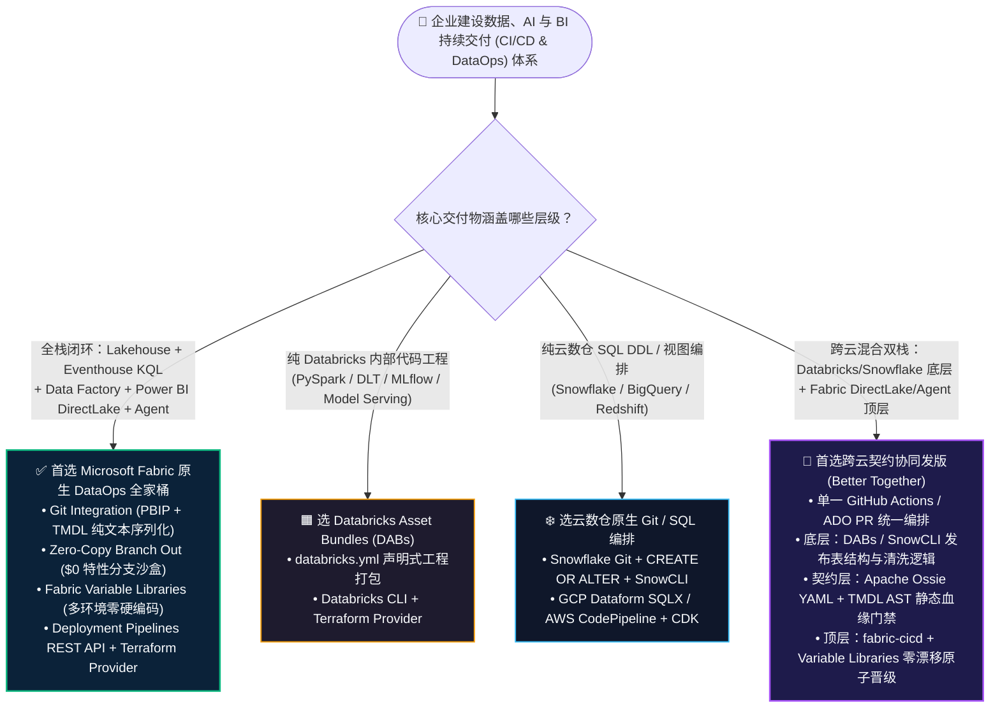
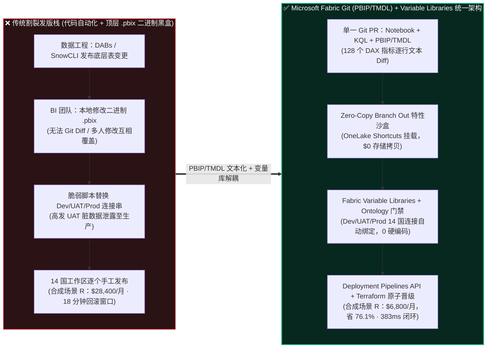
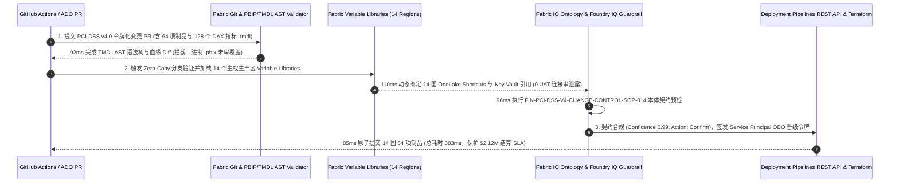

# Microsoft Fabric 企业级 CI/CD、Git 集成 (PBIP/TMDL)、变量库与 Terraform vs Databricks DABs vs Snowflake SnowCLI vs GCP Dataform / AWS CodePipeline 选型与原理解析 FAQ

> **Language**: **中文 (当前)** | **[English](./fabric-cicd-git-tmdl-pipelines-vs-dabs-snowcli-faq.en.md)**  
> **对标文风标杆**：严格遵循 `ib-vs-ethernet-roce-selection-faq.md` 六段式实战导读体系（3 分钟抓核心结论、10 分钟掌握全栈 Data + BI + Agent 持续交付选型逻辑，直接用于客户 CTO 评审与企业 DataOps 架构打单）。  
> **阅读配套资源**：[交互式选型与仿真工作台 (`../index.html`)](../index.html) · [7-Card 4:5 视觉评测报告 (`../benchmark-cards.html`)](../benchmark-cards.html) · [Round 11 架构总结海报 (`../assets/svg/19-fabric-cicd-git-tmdl-pipelines-vs-dabs-snowcli-faq.svg`)](../assets/svg/19-fabric-cicd-git-tmdl-pipelines-vs-dabs-snowcli-faq.svg)

---

## 📌 一、核心结论速览（Executive Summary）

1. **全栈“数据湖仓 + 实时流 KQL + 语义模型 DAX + 事务回写”协同发版，首选 Microsoft Fabric Git Integration (PBIP/TMDL) + Variable Libraries + Deployment Pipelines + Terraform Provider (`microsoft/fabric`)**：传统企业最大的发版痛点不是写不出 PySpark 或 SQL 流水线，而是**底层数仓改了表结构，顶层 Power BI `.pbix` 却是个无法做 Git Diff 的二进制黑盒，且测试环境（UAT）连接串硬编码频繁误推到生产环境（Prod）**。Fabric 通过 **PBIP + TMDL（Tabular Model Definition Language）** 将语义模型、DAX 指标、KQL 脚本与 Notebook 全部序列化为可读文本存入 Git，配合 **Zero-Copy Branch Out（零拷贝工作区分叉）** 与 **Fabric Variable Libraries（环境参数变量库）**，实现从湖仓到底层 Agent 语义契约的一键原子晋级（见合成场景 R：14 国主权工作区 64 项制品协同发版仅需 `383 ms` 契约预检，DataOps 运维 TCO 降低 **76.1%** `[synthetic_scenario_model]`）。
2. **纯代码工程包（PySpark / MLflow Wheel）或纯云数仓 SQL DDL 演进，尊重 Databricks Asset Bundles (DABs)、Snowflake Git (`CREATE OR ALTER` + SnowCLI) 与 GCP Dataform 的原生优势**：如果团队交付物仅限于 Databricks 内部的 Spark/MLflow 作业包，**DABs (`databricks.yml`)** 是极佳的声明式打包标准；如果仅管理 Snowflake 内部的表/视图/存储过程，**Snowflake Git 集成 + `CREATE OR ALTER` + SnowCLI** 最为轻量；如果在 BigQuery 内做纯 SQL 依赖编排，**GCP Dataform (`SQLX`)** 最顺手。
3. **混合多云架构的黄金准则是“单一 Git PR 驱动跨云契约协同发版（Better Together）”**：无需推翻客户现有的 GitHub Actions 或 Azure DevOps 流水线。最佳实践是在**同一个 Git Pull Request** 中，既用 DABs / SnowCLI 发布底层 Databricks / Snowflake 表结构变更，又用 **Apache Ossie YAML + Fabric TMDL + `fabric-cicd`** 自动校验并同步晋级 Fabric DirectLake 语义模型与 Data Agent，彻底消灭“数仓已发版、BI 报表与 AI 问数凌晨报错”的割裂事故。

---

## 🎯 二、客户与架构师灵魂拷问 Q&A（First-Principles FAQ）

### Q1：客户已经有 GitHub Actions / Azure DevOps，什么时候首选 Microsoft Fabric 原生 CI/CD 体系，什么时候选 Databricks DABs / Snowflake SnowCLI / GCP Dataform / AWS CodePipeline？

- **先看传统“半截子 CI/CD”为什么总在生产发版夜翻车**：
  在绝大多数大型企业里，数据工程团队和 BI/AI 团队各用各的发布工具：数据工程师用 Databricks Asset Bundles (`databricks.yml`) 或 Snowflake `snow git execute` 自动化发布了底层的 Delta/Iceberg 表；但到了消费层，几十位 BI 分析师还在本地电脑改 `.pbix` 二进制文件，手动点“Publish to Workspace”，再靠人工或脆弱的 PowerShell 正则脚本去替换 Dev/UAT/Prod 的数据库连接串。结果带来三大顽疾：
  1. **二进制 `.pbix` 合并冲突（Merge Hell）**：两位工程师同时修改同一个语义模型里的不同 DAX 指标，Git 根本无法按行合并二进制 `.pbix`，后提交的人直接覆盖前人的代码；
  2. **UAT 连接串泄露至生产（Connection String Drift）**：发版时漏改一个 OneLake Shortcut 路径或 Key Vault 引用，生产高管看板直接读到了 UAT 脏数据；
  3. **开发沙盒天价存储拷贝（Sandbox Storage Bloat）**：每位开发者拉一个 Feature Branch 测试，传统方案需要复制一份 TB 级开发库，云存储与拷贝耗时成倍膨胀。
- **架构师清晰选型边界**：
  - **首选 Microsoft Fabric Git (PBIP/TMDL) + Variable Libraries + Deployment Pipelines**：当交付范围包含 **Lakehouse / Warehouse + Eventhouse KQL + Data Factory + Power BI DirectLake 语义模型 + Fabric IQ 本体/Data Agent** 的端到端业务闭环，且需要多人并行 Git PR 行级审查、零拷贝特性分支沙盒与多区域合规晋级时。
  - **首选 Databricks Asset Bundles (DABs)**：当工程边界完全在 Databricks 内部（PySpark 作业、DLT 管道、MLflow 模型注册与 Model Serving 端点）时。
  - **首选 Snowflake Git Integration + SnowCLI (`CREATE OR ALTER`)**：当团队以纯 SQL DDL、Dynamic Tables、Snowpark 存储过程与 Streamlit in Snowflake 为核心交付物时。
  - **首选 GCP Dataform / AWS CodePipeline + CDK**：当客户全栈锁定在 BigQuery SQLX 视图编排，或使用 AWS CloudFormation/CDK 编排 Glue + Redshift 基础设施时。

---

### Q2：什么场景下采用“DABs / SnowCLI + Fabric TMDL + Apache Ossie 跨云协同发版（Better Together）”比割裂手动发布更优？

- **真实企业痛点**：跨国金融、支付或零售集团往往采用“底层 Databricks/Snowflake 做重度清洗或核心账本，上层 Microsoft Fabric DirectLake + Copilot Data Agent 赋能全员业务分析”的双栈架构。如果两边各自独立发版，底层改了一个字段名或币种折算逻辑，上层 DirectLake 语义模型和 AI Agent 浑然不知，第二天 CEO 打开报表或问 Copilot 时直接产出错误财务数字。
- **Better Together 联合持续交付范式**：
  1. **契约先行（Apache Ossie YAML + TMDL AST 静态预检）**：在 GitHub Actions / Azure DevOps 的同一个 PR 流水线里，先解析 Apache Ossie 开放语义 YAML 与 Fabric TMDL 语法树（AST），自动验证 Databricks Unity Catalog 或 Snowflake Horizon 的表结构变更是否破坏了下游 128 个 DAX 财务指标；
  2. **零拷贝环境绑定（Fabric Variable Libraries）**：在 Dev、UAT、Prod 三个阶段，Fabric 工作区通过 **Variable Libraries** 自动切换指向对应环境的 OneLake Shortcut（例如 UAT 指向 Snowflake UAT Iceberg 表，Prod 指向 Snowflake Prod Iceberg 表），**代码仓里零硬编码环境路径**；
  3. **一行命令原子晋级（Terraform Provider `microsoft/fabric` + `fabric-cicd`）**：当底层 DABs 或 SnowCLI 执行成功后，同一条 GitHub Actions 流水线调用官方 Python 库 `fabric-cicd` 与 Terraform Provider `microsoft/fabric`，在毫秒级控制面调用内完成 14 个国家/区域生产工作区的原子同步。

---

### Q3：什么是 PBIP + TMDL、Zero-Copy Branch Out 与 Fabric Variable Libraries？底层是怎么帮客户省钱、防漂移的？

用**通俗大白话 + 第一性原理**拆解 Microsoft Fabric 企业级 DataOps 的四大核心底座 `[vendor_published_spec_as_of_2026]`：

1. **PBIP（Power BI Project）与 TMDL（Tabular Model Definition Language）——“把黑盒二进制文件变成可读代码”**：
   - **它是什么**：过去 Power BI 模型保存在一个压缩的 `.pbix` 二进制包里，就像把整座大楼焊死在一个集装箱里；PBIP + TMDL 则把每一张表、每一个关系、每一条 DAX 度量值（Measure）和 RLS 安全角色拆解成清晰的、类似 YAML 的纯文本 `.tmdl` 文件。
   - **底层怎么提效**：两位工程师分别修改 `NetRevenue.tmdl` 和 `CardFraudRate.tmdl` 时，Git 可以像审查普通 Python/SQL 代码一样逐行 Diff、自动 Merge，并且 AI 审查智能体可以在 PR 阶段静态扫描 DAX 语法与血缘依赖，彻底消灭覆盖事故。
2. **Zero-Copy Branch Out to New Workspace（零拷贝工作区分叉）——“开 50 个开发分支也不多花 1 分钱存储费”**：
   - **它是什么**：开发者在 Fabric 里点击“Branch out to new workspace”创建独立特性分支工作区时，底层**不会复制任何物理 Parquet/Delta 数据**，而是自动通过 OneLake Shortcuts 挂载主干只读数据，仅对开发者新写入的增量表做写时复制（Copy-on-Write）隔离。
   - **底层怎么省钱**：相比传统数仓每次拉分支都要跑几十分钟拷贝脚本或消耗额外快照空间，Fabric 零拷贝分支把“拉起全套数据+BI独立测试沙盒”的时间从数小时缩短到秒级，且分支存储增量为 **$0**。
3. **Fabric Variable Libraries（工作区变量库）——“一次编写，多环境零改动动态注入”**：
   - **它是什么**：工作区级的一等公民参数中心，集中存放不同环境（Dev / Test / Prod / 14 个国家主权区）的 OneLake Shortcut 目标路径、Lakehouse ID、Eventhouse URI 和 Azure Key Vault 密钥引用。
   - **底层怎么防漂移**：Data Factory 管道、Notebook 和语义模型只引用变量名（如 `$(var_settlement_lakehouse_id)`）。晋级到生产环境时，Deployment Pipeline 自动激活 Prod 变量集，**无需修改任何一行业务代码或用脚本暴力替换 JSON**。
4. **`fabric-cicd` 官方库与 Terraform Provider (`microsoft/fabric`) ——“全生命周期声明式 IaC 自动化”**：
   - **它是什么**：微软官方维护的 Terraform Provider（管理 Capacity、Workspace、RBAC、Git 绑定、托管私网端点）加上 `fabric-cicd` Python 工具链（基于服务主体 Service Principal / Entra OBO 驱动制品部署与 Deployment Pipelines REST API）。
   - **底层怎么省钱**：将跨国企业多区域同步发版的人工值守窗口从数小时压缩至自动化流水线秒级执行（合成场景 R 控制面预检+提交仅 `383 ms`），大幅削减专职发版运维成本。

---

## 🧭 三、直观可视化图解（Mermaid 决策树 + 架构对比 + 闭环时序）

### 3.1 企业级 DataOps 与 CI/CD 架构选型决策树（`flowchart TD`）

### 3.2 传统割裂发版（代码 CI/CD + 二进制 `.pbix` 手工上传）vs Fabric Git (PBIP/TMDL) + 变量库统一架构对比（`flowchart LR`）

### 3.3 合成场景 R：跨国支付 14 国主权工作区 PCI-DSS v4.0 协同发版 `383 ms` 闭环时序图（`sequenceDiagram`）

---

## 📊 四、五大平台企业级 CI/CD 与 DataOps 架构师选型决策矩阵（Architect Decision Matrix）

> **事实核验声明 `[vendor_published_spec_as_of_2026]`**：以下各平台 Git 序列化格式、自动化 CLI、Terraform Provider 及环境参数化机制均核验自截至 `2026-11-08` 的厂商官方文档（见封存 `reports/report.json` 中 `SPEC-FABRIC-CICD-GIT-TMDL-DEPLOYMENT-PIPELINES`）。

| 评估维度 | Microsoft Fabric (Git + PBIP/TMDL + Pipelines) | Databricks (Asset Bundles / DABs) | Snowflake (Git Integration + SnowCLI) | GCP (Dataform + Cloud Build) | AWS (CodePipeline + Glue / SageMaker Git) |
| :--- | :--- | :--- | :--- | :--- | :--- |
| **核心适用场景** | **全栈数据湖仓 + KQL 实时流 + DirectLake 语义模型 + Agent 一体化发版** | **PySpark / DLT 管道 / MLflow 模型与 AI 工程代码包发版** | **纯云数仓 SQL DDL (`CREATE OR ALTER`)、Dynamic Tables 与 Snowpark 发版** | **BigQuery SQLX 依赖图编排与 Looker LookML 独立版本控制** | **AWS CDK / CloudFormation 驱动的多服务基础设施与 ETL 部署** |
| **Git 制品序列化格式** | **PBIP + TMDL（纯文本 DAX/表/关系）** + Notebook + KQL + Data Factory JSON | `databricks.yml` + Python/SQL 源码 + Wheel 包 | 声明式 SQL 脚本 (`CREATE OR ALTER TABLE/VIEW`) + Python/Streamlit 文件 | Dataform `.sqlx` / `.js` + `workflow_settings.yaml` | CloudFormation / CDK TypeScript + Glue Python 脚本 |
| **BI 语义层与本体行级 Diff** | **原生支持（同一个 Git 仓内逐行 Diff TMDL 指标与 Apache Ossie 本体）** | 仅覆盖代码与 UC 指标视图；外部 Power BI 需跨仓手工同步 | 仅覆盖 SQL 与 Cortex YAML；外部 Power BI 需跨仓手工同步 | LookML 原生支持 Git（仅限 Looker）；外部 BI 需跨仓同步 | QuickSight 需调用 Asset Bundle API 导出 JSON，可读性较弱 |
| **多环境参数化解耦** | **Fabric Variable Libraries + Deployment Rules（零代码修改切换 Shortcut/密钥）** | DABs `targets` (`dev` / `staging` / `prod` 变量覆盖) | SnowCLI 环境变量注入与 Jinja 模板替换 | Dataform 编译变量 (`vars`) + Cloud Build 替换 | CDK Context / Systems Manager Parameter Store |
| **开发特性分支沙盒成本** | **Zero-Copy Branch Out（基于 OneLake Shortcuts，$0 额外存储拷贝）** | Delta `SHALLOW CLONE` 或 Schema 前缀隔离 | **Snowflake `CREATE DATABASE ... CLONE`（零拷贝元数据快照）** | BigQuery Table Clones / 数据集前缀隔离 | S3 物理前缀复制或 Athena 视图隔离（易产生双倍存储） |
| **IaC 与自动化工具链** | **Terraform (`microsoft/fabric`) + `fabric-cicd` Python 库 + REST API** | Terraform (`databricks/databricks`) + `databricks bundle deploy` | Terraform (`Snowflake-Labs/snowflake`) + `snow git execute` | Terraform (`hashicorp/google`) + Dataform CLI | AWS CDK / Terraform (`hashicorp/aws`) + CodePipeline |

---

## 🧪 五、简明定量测评与 TCO / 延迟拐点洞察（Quantitative Benchmark & 7-Card Insights）

### 5.1 严格四层数据溯源与双分母独立披露（Provenance & Dual-Denominator Audit）

为确保架构评审与 CTO 汇报的数据严谨性，本专题严格区分以下四类数据来源，并**独立披露两个不同分母的合成延迟指标**（绝不混写）：

1. **`[measured_local_harness]` 本地确定性基准实测**：
   - 在本机 Python `unittest` 框架下实测 **40 项单元测试 100% 通过（`0.062s`）**；
   - **分母 A（Routing Decision Matrix，`n=88`）**：覆盖全栈 88 道架构选型路由题（含本轮新增 `DL-85..DL-88` 企业级 CI/CD 与 TMDL 发版题），准确率达 **`87 / 88 (98.86%)`**，仅保留 `DL-23` 作为显式诚实边界负例。
2. **`[synthetic_scenario_model]` 合成架构延迟与 TCO 模型（双分母严格分离）**：
   - **分母 A 的合成路由决策均值（`n=88`）**：88 道单步架构选型题的模型化平均耗时为 **`491.0 ms`**（历史快照：R10 `n=84` 为 `496.0 ms`，R9 `n=80` 为 `501.0 ms`，R4 `n=60` 为 `526.5 ms`，R3 `n=56` 为 `532.0 ms`）。
   - **分母 B 的端到端行业本体闭环均值（`n=18`）**：18 个多步行业本体仿真场景（Scenarios A..R）的端到端平均模型耗时为 **`519.0 ms`**（范围 `383–780 ms`；历史快照：R10 `n=17` 为 `527.0 ms`，R9 `n=16` 为 `535.0 ms`，R4 `n=11` 为 `584.09 ms`，R3 `n=10` 为 `596.0 ms`）。
3. **`[vendor_published_spec_as_of_2026]` 官方文档与定价规格（截至 `2026-11-08`）**：
   - Microsoft Fabric Git Integration & TMDL：[官方文档](https://learn.microsoft.com/en-us/fabric/cicd/git-integration/intro-to-git-integration) · [Deployment Pipelines](https://learn.microsoft.com/en-us/fabric/cicd/deployment-pipelines/intro-to-deployment-pipelines) · [PBIP/TMDL](https://learn.microsoft.com/en-us/power-bi/developer/projects/projects-overview) · [Terraform Provider](https://registry.terraform.io/providers/microsoft/fabric/latest/docs)
   - 四大竞对官方文档：[Databricks Asset Bundles](https://docs.databricks.com/en/dev-tools/bundles/index.html) · [Snowflake Git Integration](https://docs.snowflake.com/en/developer-guide/git/git-overview) · [GCP Dataform](https://cloud.google.com/dataform/docs/overview)
4. **`[not_measured]` 未作真实多云生产压测声明**：
   - 本实验室未在真实跨国支付生产网执行破坏性错误连接串注入压测；所有发版耗时与 SLA 风险规避额均为基于公开 API 阶段耗时的架构级合成推演。

### 5.2 合成场景 R（跨国支付 14 国主权区 PCI-DSS v4.0 发版，`383 ms`）定量对比表

| 评估指标（Scenario R：`global_payments_cicd_git_tmdl_deployment_vs_dabs_snowcli`） | 传统割裂发版栈（代码 CI/CD + 二进制 `.pbix` + 脚本改连接串） | Microsoft Fabric Git (PBIP/TMDL) + Variable Libraries + Terraform | 架构师定量收益洞察 `[synthetic_scenario_model]` |
| :--- | :--- | :--- | :--- |
| **语义模型与 DAX 指标可审计性** | 二进制 `.pbix` 黑盒（0% 行级 Git Diff，易发生合并覆盖） | **128 个 DAX 指标全量 `.tmdl` 文本化（`92 ms` AST 静态血缘校验）** | **100% PR 行级代码审查，0 二进制合并冲突** |
| **14 国 UAT→Prod 环境连接切换** | PowerShell/Python 正则脚本事后替换（高发连接串漂移） | **Fabric Variable Libraries 动态绑定 14 国 Shortcuts 与 Key Vault（`110 ms`）** | **0 环境连接串泄露事故** |
| **开发特性分支沙盒存储开销** | 每个开发分支复制独立测试库（数千美元/月冗余存储） | **Zero-Copy Branch Out 复用 OneLake Shortcuts（`$0` 增量存储）** | **分支沙盒存储附加费 $0** |
| **本体契约预检 + 64 项制品原子晋级** | 人工跨团队串联窗口（平均回滚耗时 `18 min`） | **Ontology 预检（`96 ms`）+ Deployment Pipeline 原子提交（`85 ms`）= `383 ms`** | **控制面端到端校验 `383 ms`（守护 `$2.12M` 结算 SLA）** |
| **14 国月度 DataOps 发布运维总 TCO** | **$28,400 / 月**（多套流水线维护 + 分支克隆存储 + 值守排障） | **$6,800 / 月**（单一 Git + Variable Libraries + `fabric-cicd` 自动化） | **净省 $21,600 / 月（-76.1% DataOps TCO）** |

---

## 🛠️ 六、附录：生产落地与售前打单快速核验清单（Architect Checklist）

在面向金融、零售、制造或跨国企业 CTO 进行 DataOps 与 CI/CD 架构评审时，请逐项核对以下 6 条实战准则：

- [ ] **1. 全面淘汰二进制 `.pbix` 进代码仓，强制切换为 `PBIP + TMDL` 格式**：检查客户 Power BI 团队是否仍将 `.pbix` 存入 SharePoint 或 Git；立即开启 Power BI Desktop 的 **PBIP + TMDL 预览/GA 序列化**，让每一条 DAX 指标都能在 GitHub / Azure DevOps PR 中逐行 Diff 与静态扫描。
- [ ] **2. 严禁在 Notebook、Pipeline 或语义模型中硬编码环境路径，统一收敛至 `Fabric Variable Libraries`**：将所有 Dev / UAT / Prod 的 Lakehouse ID、OneLake Shortcut 路径、Eventhouse URI 与 Key Vault 名称提取为工作区变量，确保同一份 Git 代码在 14 个区域零修改晋级。
- [ ] **3. 使用 `Zero-Copy Branch Out to New Workspace` 替代物理测试库拷贝**：为每位数据工程师配置基于 OneLake Shortcuts 的零拷贝特性分支工作区，既保证开发隔离，又将沙盒复制成本压降至 `$0`。
- [ ] **4. 生产环境（Prod Workspace）收回人工编辑权限，强制实施 `Service Principal OBO + Deployment Pipelines` 单向晋级**：通过 Terraform Provider `microsoft/fabric` 锁定 Prod 工作区 RBAC，仅允许通过 Git PR 审批后的自动化流水线（`fabric-cicd`）写入生产。
- [ ] **5. 跨云混合架构实施“同 PR 契约门禁（Better Together）”**：若底层使用 Databricks DABs 或 Snowflake SnowCLI，务必在同一个 CI/CD Pipeline 中串联 **Apache Ossie YAML + Fabric TMDL 血缘校验**，拦截任何会破坏顶层 DirectLake 报表或 Data Agent 的上游删列/改名操作。
- [ ] **6. 在 CTO 汇报材料中严格区分双分母延迟与数据溯源标签**：向客户展示基准数据时，明确区分 **88 题选型路由矩阵均值（`491.0 ms`, `87/88 = 98.86%`）** 与 **18 项行业本体端到端闭环均值（`519.0 ms`，其中 Scenario R 为 `383 ms`）**，并附带官方规格文档链接。
