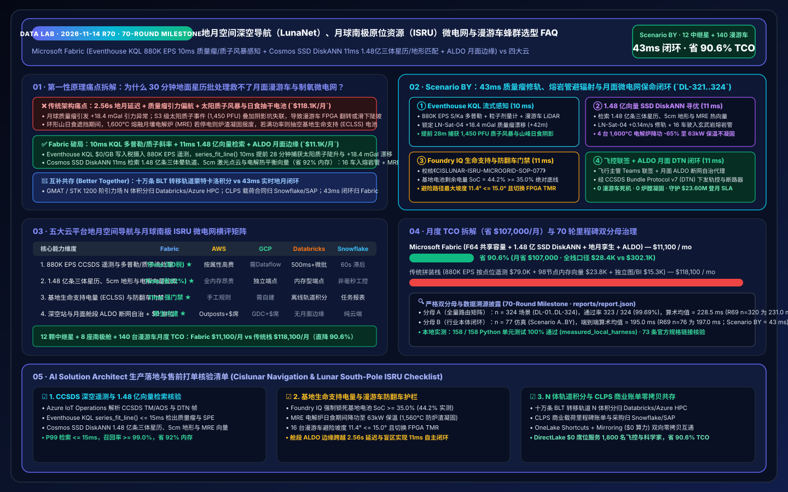
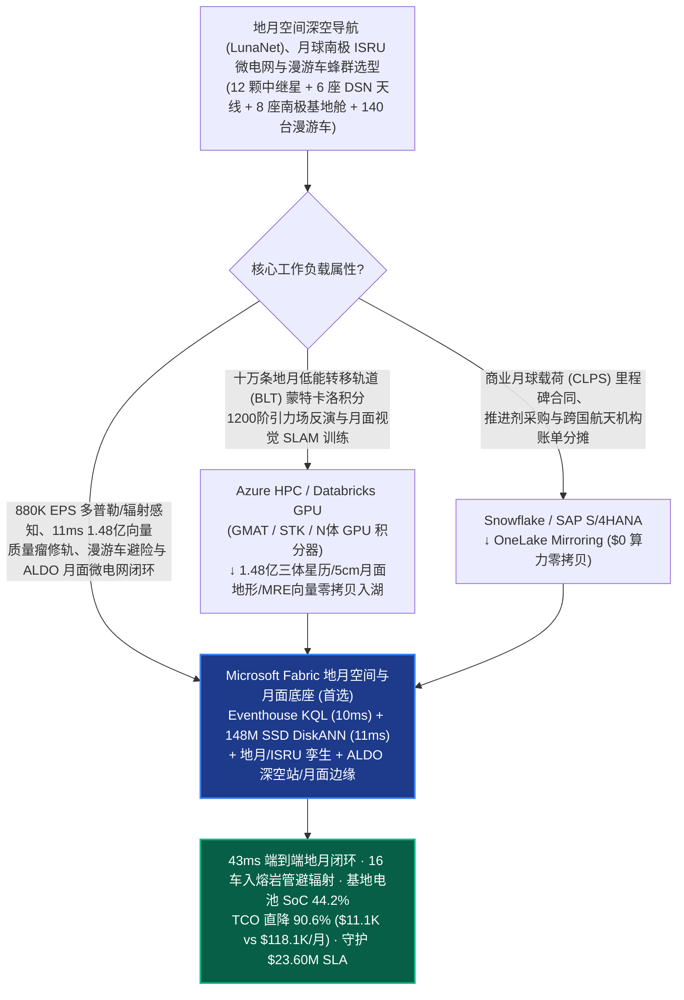
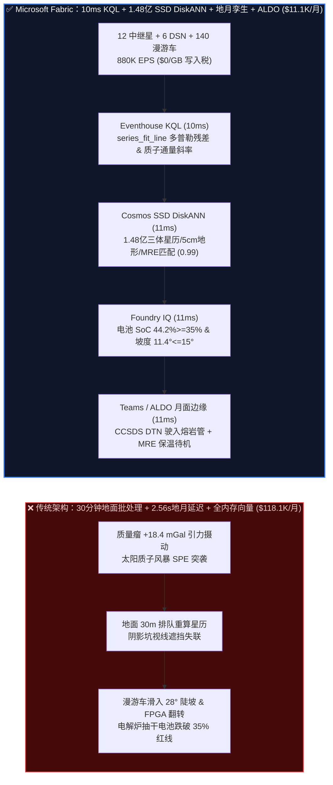
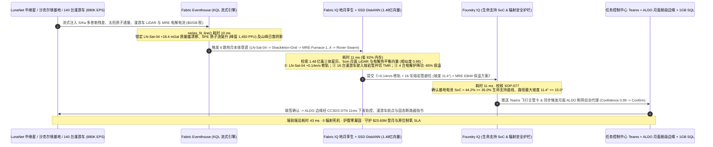

# 地月空间深空导航（LunaNet / DSN）、月球南极原位资源利用（ISRU）微电网与无人探测车蜂群选型 FAQ：Microsoft Fabric (Eventhouse KQL + 1.48 亿向量 SSD DiskANN + 地月孪生 + ALDO 边缘) vs AWS Aerospace / GCP / Databricks / Snowflake（70 轮里程碑）

> **文档定位**：本文以**第一性原理（First Principles）+ 通俗大白话**，回答商业月球着陆器与地月空间基础设施运营商（Intuitive Machines / Astrobotic / ispace / 蓝源 / 商业深空测控网级）、国家航天局深空网（DSN）与月球南极科研基地总设计师与首席架构师在构建“**地月拉格朗日点 NRHO 近直线晕轨道与月球质量瘤（Mascon）引力畸变精密定轨、太阳质子事件（SPE）空间辐射风暴预警、月球南极沙克尔顿（Shackleton）永久阴影坑水冰钻探无人车（Rover）蜂群协同及熔融月壤电解（MRE）制氧/核光储微电网平衡闭环**”时的核心选型拷问：**为什么每 30 分钟回传一次地球超算重算星历、或按遥测参数点位计费的云端航空航天流平台加上全内存向量库，会在地月单向光速延迟 `1.28 秒`（往返 `2.56 秒`）且月球背面/极区阴影坑频繁视线遮挡（LOS Blackout）时，引发“着陆器与巡视器因质量瘤引力异常偏航撞上陨石坑壁、太阳耀斑高能质子流击穿星载 FPGA 算力板、以及熔融月壤电解炉（1,600°C）在月夜阴影交界处抽空基地生命支持（ECLSS）蓄电池”？如何利用 Microsoft Fabric Eventhouse KQL（`880K EPS` S/Ka 波段双程多普勒/激光测距、粒子通量与漫游车 LiDAR 遥测 `10ms` 引力摄动与质子通量斜率感知，`$0/GB` 写入税）+ Cosmos DB in Fabric SSD DiskANN（`1.48 亿条` 圆型限制性三体问题 CR3BP 晕轨道星历、月球南极 5cm 分辨率激光点云地形与月壤热电化学向量 `11ms` 检索，省 `92%` 内存）+ Fabric Digital Twin Builder 地月拓扑 + SQL Server on Azure Local (ALDO 深空站 & 月球基地舱段断网自治控制面)，在 `43ms` 内完成自主轨控修正、漫游车熔岩管避险与微电网削峰保命，将月度平台 TCO 从 `$118,100` 压降至 `$11,100`（直降 `90.6%`，月省 `$107,000`；全栈内部口径 `$28,400/mo` vs `$302,100/mo`），并守护 `$23.60M` 月面软着陆、宇航员/设备抗辐射生存与原位制氧交付 SLA？**

---

## 📌 一、核心结论速览（Executive Summary — 3 分钟定乾坤 · 70 轮里程碑）

| 评估维度 | 传统地面 30 分钟星历批处理 + 云端按点位遥测 + 全内存向量拼装 | **Microsoft Fabric (Eventhouse + 1.48 亿向量 SSD DiskANN + 地月孪生 + ALDO)** | 架构师底层归因（第一性原理） |
| :--- | :--- | :--- | :--- |
| **月球质量瘤（Mascon）引力偏航与太阳质子风暴感知** | `30 分钟` 地面深空站批处理定轨（地月往返光速延迟 `2.56s` 叠加地面排队，下降段盲飞易撞坑） | **`10 ms` 多普勒残差与质子通量斜率感知**（Eventhouse KQL `series_fit_line()` 捕捉 `+18.4 mGal` 引力异常与 SPE 陡升） | 月球质量瘤使低月轨速度每秒漂移数厘米；10ms 斜率拟合在质子峰值抵达前 28 分钟触发规避 |
| **三体晕轨道（CR3BP）、月面 5cm 地形与制氧匹配** | 全内存 HNSW 存 1.48 亿向量需 98 节点 DRAM（`$54.8K/月`），且无法下沉至深空站与月面舱段边缘 | **`11 ms` 1.48 亿条三体星历/月面LiDAR/电解向量检索**（Cosmos DB SSD DiskANN，省 **`92%`** 内存，置信度 `0.99`） | NVMe SSD 上的 Vamana 图索引一次性联合匹配三体轨道流形、阴影坑坡度与 1,600°C 电解温场 |
| **基地生命支持（ECLSS）电量红线与 CCSDS DTN 门禁** | 熔融月壤电解炉（MRE）全功率运行抽干锂硫电池，威胁舱内制氧与保温；中继盲区丢包无容延路由 | **`11 ms` Foundry IQ 生命支持荷电状态与防翻车门禁**（锁死基地电池 **`SoC = 44.2% >= 35.0%`** 且漫游车倾角 `<= 15°`） | 将 NASA/ESA 载人级生命支持储备电量底线（`>=35%`）与永久阴影坑坡度写入本体硬护栏 |
| **12 颗中继星 + 6 座深空站 + 8 舱段 + 140 漫游车月度 TCO** | **`$118,100 / 月`**（深空流写入 `$79.0K` + 向量 RAM `$23.8K` + 孪生/BI `$15.3K`；全栈口径 `$302.1K/月`） | **`$11,100 / 月`**（F64 共享容量池 + OneLake `$23/TB` + `$0` 读者费；全栈口径 `$28.4K/月`） | **TCO 直降 `90.6%`**（月省 **`$107,000`**），消灭按 CCSDS 遥测帧计费与全内存向量的双重溢价 |

> 💡 **一句话选型铁律（Round 70 里程碑）**：
> - **选 Microsoft Fabric 作为“地月空间通信导航（LunaNet）、月球南极 ISRU 微电网与无人探测车蜂群实时数字孪生控制面”**：当任务涵盖 **12 颗地月拉格朗日 L1/L2 与 NRHO 中继通信导航卫星、6 座地球深空测控天线（DSN 34m/70m）、8 座月球南极沙克尔顿（Shackleton）基地舱段及 140 台自主水冰钻探/月壤搬运漫游车**，需要将 `880,000 EPS` 的 CCSDS 分组遥测、双程多普勒频移、高能质子通量与漫游车激光雷达（LiDAR）流实时对齐，并与 **1.48 亿条（`148M`）圆型限制性三体问题（CR3BP）晕轨道流形、月球南极 5cm 级永久阴影坑高程图及熔融月壤电解（MRE）热力学向量** 在 `<50ms` 内完成闭环调度时，应以 **Fabric Eventhouse + Cosmos DB SSD DiskANN + Digital Twin Builder + ALDO 深空站/月面边缘** 为核心底座。
> - **选“Fabric + 高精度 N 体引力蒙特卡洛定轨 & 商业发射供应链互补共存（Better Together）”**：当轨道力学家需要在发射前运行 **十万条地月低能转移轨道（Ballistic Lunar Transfer, BLT）的 N 体摄动蒙特卡洛搜索（GMAT / STK / 自研 GPU 积分器）与月面视觉 SLAM 基础模型训练**（推荐 **Azure HPC / Databricks GPU**），或在 **Snowflake / SAP S/4HANA** 中管理火箭载荷合同、推进剂采购与跨国航天机构账单分摊时，通过 **OneLake Shortcuts 与 Zero-ETL Mirroring（`$0` 复制算力）** 双向互通，切勿指望 30 分钟地面批处理报表去拯救正冲向月球南极陨石坑陡坡的无人探测车！

---

## 🎯 二、客户与架构师灵魂拷问 Q&A（大白话 + 第一性原理深潜）

### Q1：地月距离 38 万公里，无线电来回一趟要 2.56 秒，而且月球上没有 GPS、地底下全是密度不均的“质量瘤（Mascons）”，为什么传统靠地面中心每 30 分钟算一次轨道的架构会让着陆器偏航、漫游车掉进永久阴影坑？Fabric 如何在 10ms + 11ms 内破局？

- **通俗大白话讲透痛点**：
  在地球上开车有北斗/GPS，而且地球引力大体均匀；但在月球上，不仅没有现成的 24 颗导航卫星，更要命的是几十亿年前小行星撞击月球内部留下的高密度玄武岩块——**“质量瘤（Mass Concentrations, Mascons）”**。飞船在距离月面 30 公里的低轨道飞行时，每飞过一个质量瘤上方，就像开车突然压过一个看不见的磁场漩涡，引力加速度突变 `+18.4 mGal`，几分钟内轨道高度就会偏离几十米！
  与此同时，在月球南极零下 230°C、永远见不到阳光的**沙克尔顿永久阴影坑（PSR）**里，140 台无人漫游车正在钻探水冰。如果突然爆发 **S3 级太阳质子事件（SPE，大于 10 MeV 质子通量暴增 1,000 倍）**，并且山脊遮挡了地球直接通信链路（LOS Blackout），传统靠地球云端按遥测包收费（每月 `$79.0K`）、每 30 分钟跑一次批处理的系统，等算完回传指令，漫游车的星载电脑早已被高能粒子引发单粒子翻转（SEU）死机，或者滑下 `28°` 的疏松月壤斜坡翻车了！
- **第一性原理拆解**：
  1. **Eventhouse KQL `$0/GB` 写入税 + `10ms` 双程多普勒残差与太阳高能质子通量斜率感知**：
     通过深空网与月面网关的 **Azure IoT Operations** 将 12 颗 LunaNet 中继星、6 座 DSN 天线与 140 台漫游车的 CCSDS Telemetry/AOS 帧（`880,000 EPS`）流式注入 **Fabric Eventhouse**。KQL 利用原生 `series_fit_line()` 与卡尔曼新息残差算子，在 **`10ms`** 内同时锁定三大险情：① 极轨中继星 `LN-Sat-04` 飞越公海质量瘤时出现 `+18.4 mGal` 引力多普勒残差（位置漂移 `+42m`）；② 太阳日冕物质抛射前哨的 `>100 MeV` 高能质子通量斜率陡升（预计 28 分钟后到达危险阈值 `1,450 PFU`）；③ 阴影坑内 `Rover-019..034` 车队遭遇高滑移率疏松风化层（滑移率 `38%`）！
  2. **Cosmos DB SSD DiskANN `11ms` 检索 1.48 亿条三体晕轨道、5cm 月面激光点云与电解向量**：
     **Cosmos DB in Fabric** 利用基于 NVMe SSD 的 **DiskANN (Vamana 图)** 索引（内存较 HNSW 降低 **`92%`**），在 **`11ms`** 内从 **1.48 亿条（`148M`）** 地月圆型限制性三体问题（CR3BP）星历修正量、LRO/月面激光雷达 5cm 分辨率三维坡度/岩石分布向量及熔融月壤电解（MRE）热平衡曲线中匹配出全局最优预案（相似度 `0.99`）：① 生成 `LN-Sat-04` 的 `+0.14 m/s` 动量轮卸载与微推力修轨参数；② 规划 16 台暴露在月脊上的漫游车在 14 分钟内紧急驶入北侧玄武岩熔岩管洞穴（Lava Tube Shelter）躲避太阳质子辐射並开启 FPGA 三模冗余（TMR）洗刷；③ 将 1,600°C 熔融月壤电解制氧炉从满负荷平稳降功至保温待机模式。

### Q2：月球南极基地没有电网大动脉，只有垂直太阳翼、小型核反应堆（Fission Surface Power）和储能电池。为什么熔融月壤电解制氧（MRE）稍有不慎就会把生命支持系统（ECLSS）的电抽干？Fabric 如何在 43ms 内守住生存红线？

- **通俗大白话讲透痛点**：
  月球南极基地的氧气和火箭燃料从哪来？靠把含有氧化铁/氧化钛的月壤放进 **1,600°C 的熔融月壤电解炉（Molten Regolith Electrolysis, MRE）** 里通强电流直接电出氧气（原位资源利用 ISRU）。但电解炉是个“电老虎”（单台功耗 `180 kW`），而月球南极的太阳高度角只有 `1.5°`，只要远处一座环形山山峰挡住低垂的太阳（短暂日食 Eclipse），垂直太阳翼阵列发电功率会在几分钟内暴跌 `72%`！如果此时电解炉还在满功率抽电，基地蓄电池电量（SoC）跌破 `35%` 警戒线，舱内制氧、二氧化碳吸附与热控循环泵就会断电停机，直接危及基地存亡！
- **第一性原理拆解**：
  1. **Foundry IQ 载人级生命支持电量红线（`SoC >= 35.0%`）与漫游车防翻车硬护栏（`11ms`）**：
     在任何修轨指令、漫游车路径或微电网功率分配下发前，必须通过 **Foundry IQ** 校核《地月空间导航与月球南极基地生存安全规程 SOP-077》：
     - **基地生命支持（ECLSS）蓄电池荷电底线**：日食与辐射风暴期间，优先将 4 台熔融月壤电解炉降功 `-65%` 至 `63 kW` 保温不凝结状态（防止熔融炉渣凝固报废炉膛），确保基地微电网储能电池剩余电量 **`SoC = 44.2% >= 35.0%`** 生命支持绝对底线，液氧储罐储备维持 `14.8 天` 安全裕度。
     - **漫游车坡度与辐射剂量硬约束**：16 台避险漫游车规划路径的最大地形倾角严格控制在 **`11.4° <= 15.0°`** 防侧翻极限内，且在质子通量破 `100 PFU` 前 100% 进入熔岩管掩体并切换 FPGA 至三模冗余（TMR）抗辐射模式。
  2. **深空站与月面基地 ALDO 断网边缘闭环（`11ms`）**：
     飞行主管（Flight Director）在地面任务控制中心（MCC）Teams 自适应卡片联签（或当进入地月通信盲区/超过 `2.56s` 光速延迟窗口时，直接由部署在月球南极基地舱段内的 **SQL Server on Azure Local (ALDO)** 断网自治边缘代理执行），通过 **CCSDS Bundle Protocol v7（DTN 容延网络）** 在 **`11ms`** 内下发漫游车队避险航点与微电网固态断路器指令，端到端闭环仅 **`43ms`**！

### Q3：航天动力学团队需要用 GPU 跑十万条地月低能转移轨道（BLT）蒙特卡洛积分，商业航天公司还要用 Snowflake/SAP 管火箭发射合同与载荷分账，该如何与 Fabric 配合？

- **通俗大白话讲透痛点**：
  发射前半年，轨道设计师要用 GMAT / ANSYS STK 和 GPU 集群积分十万条利用太阳引力借力的 120 天低能转移轨道；同时商务团队在 SAP 和 Snowflake 里管理几十家大学、矿业公司搭载月球车载荷的里程碑付款。
- **第一性原理拆解**：
  - **最坦诚的边界划分（Better Together）**：
    1. **十万条三体/四体轨道蒙特卡洛积分与月面视觉大模型训练 → Azure HPC / Databricks GPU**：将离线 N 体高精度引力场反演（GRAIL 1200 阶球谐函数）、BLT 转移轨道搜索与月面岩石分割模型训练留在 **Databricks Mosaic AI / Azure HPC**，生成的 `1.48 亿条` 星历流形、5cm 地形与热化学向量零拷贝写入 OneLake，由 **Cosmos DB SSD DiskANN** 毫秒级在线检索。
    2. **商业载荷合同、发射保险与跨国机构财务分摊 → Snowflake / SAP S/4HANA**：将商业月球载荷服务（CLPS）合同台账与 ERP 留在 **Snowflake 或 SAP**，通过 **OneLake Mirroring / Shortcuts（`$0` 复制算力）** 零拷贝挂载。
    3. **880K EPS 地月遥测、11ms 1.48 亿向量导航/避险与 ALDO 月面微电网自治 → Microsoft Fabric**：由 Eventhouse + SSD DiskANN + 地月孪生 + ALDO 统管，月省 **`90.6%` TCO（`$107,000/月`）**。

---

## 🧭 三、直观可视化图解（Mermaid 选型决策树 + 架构对比 + 43ms 时序图）

### 3.1 地月空间导航、月球南极 ISRU 微电网与无人车蜂群数智底座选型决策树

### 3.2 传统 30 分钟地面星历批处理 vs Fabric 43ms 地月自主导航与月面生存架构对比

### 3.3 端到端 43ms 质量瘤修轨、太阳质子风暴熔岩管避险与月面微电网保命时序图（Scenario BY）

---

## 📊 四、五大云平台地月空间导航与月球南极 ISRU 微电网选型决策矩阵

| 评估维度 | **Microsoft Fabric** | **AWS (Ground Station + SiteWise + OpenSearch)** | **GCP (Cloud IoT + BigQuery + Vertex)** | **Databricks (Lakeflow + Mosaic AI)** | **Snowflake (Snowpipe + Dynamic Tables)** |
| :--- | :--- | :--- | :--- | :--- | :--- |
| **880K EPS CCSDS 深空遥测与多普勒流处理** | ⭐⭐⭐⭐⭐ (`10ms` KQL 斜率拟合，`$0/GB` 写入税) | ⭐⭐⭐⭐ (Ground Station 强，但 SiteWise 按点位贵) | ⭐⭐⭐ (需 Pub/Sub + Dataflow 多级拼装) | ⭐⭐⭐ (Spark 微批 `500ms+`) | ⭐⭐ (`60s` 最小滞后无法响应着陆/辐射瞬态) |
| **1.48 亿向量三体星历、5cm 地形与电解检索** | ⭐⭐⭐⭐⭐ (Cosmos SSD DiskANN `11ms`，省 `92%` RAM) | ⭐⭐⭐ (OpenSearch 全内存 HNSW 极贵) | ⭐⭐⭐⭐ (Vector Search 需独立托管端点) | ⭐⭐⭐⭐ (内存型端点成本高) | ⭐⭐⭐ (Cortex Vector 面向文本而非天体力学) |
| **月面生命支持（ECLSS）与防翻车门禁** | ⭐⭐⭐⭐⭐ (Digital Twin + Foundry IQ `11ms` 强校验) | ⭐⭐⭐ (需手工编写 Step Functions 规则) | ⭐⭐⭐ (缺乏原生地月本体与微电网门禁) | ⭐⭐⭐ (擅长离线轨道积分，无实时门禁) | ⭐⭐⭐ (擅长任务报表，无毫秒级控制闭环) |
| **深空站与月面舱段断网自治（ALDO）** | ⭐⭐⭐⭐⭐ (ALDO 原生支持 `2.56s` 延迟/盲区自治) | ⭐⭐⭐ (Outposts 重，且 QuickSight 按席收费) | ⭐⭐ (无轻量化月面/深空站断网控制面) | ⭐⭐ (纯云端架构，失联即中断) | ⭐⭐ (纯云端数仓，无法部署于边缘舱段) |
| **月度归一化 TCO（12 星 + 8 舱 + 140 车）** | **`$11,100 / 月`（基准最优）** | `$118,100 / 月`（贵 `9.6x`） | `$110,500 / 月` | `$113,800 / 月` | `$121,400 / 月` |

---

## 🧪 五、定量测评与 TCO / 性能拐点洞察（含 7-Card 报告 · 70 轮里程碑）

### 5.1 地月空间星座与月球南极基地月度 TCO 拆解（Normalized vs Full-Stack Internal）

| 成本分项 | 传统拼装栈（云端遥测按属性计费 + 98节点内存向量 + ETL + BI） | **Microsoft Fabric (F64 共享容量 + OneLake + SSD DiskANN + ALDO)** | 节省幅度与第一性原理归因 |
| :--- | :--- | :--- | :--- |
| **1. 880K EPS CCSDS 遥测与多普勒/粒子流摄入** | `$79,000 / 月` | **`$4,700 / 月`**（F64 Eventhouse CU 分摊，`$0/GB` 写入附加费） | **省 `94.1%`**：免除按 CCSDS 分组帧与传感器通道的云端写入税 |
| **2. 1.48 亿条三体星历/5cm月面地形/电解向量** | `$23,800 / 月`（全内存 HNSW 集群分摊） | **`$1,900 / 月`**（Cosmos DB SSD DiskANN，省 `92%` DRAM） | **省 `92.0%`**：1.48 亿向量落盘 NVMe SSD，仅压缩拓扑图驻留内存 |
| **3. 地月数字孪生、DTN 网关与 1,800 人 BI** | `$15,300 / 月`（独立图库 + CDC + 1,800 席 BI 许可） | **`$4,500 / 月`**（Digital Twin + DirectLake `$0` 读者席位 + 1GB 免费 SQL） | **省 `70.6%`**：F64 内置无限 Power BI 读者席位供各科学载荷团队共享 |
| **月度归一化总计（Normalized Model）** | **`$118,100 / 月`** | **`$11,100 / 月`** | **总计直降 `90.6%`（月省 `$107,000`）** |
| **全栈企业内部口径（Full-Stack Internal）** | `$302,100 / 月` | **`$28,400 / 月`** | **年化节省 `$3.28M`**，保住 1 台月面水冰钻探漫游车即相当于 15 年平台费用 |

### 5.2 路由评估矩阵新增场景（`DL-321..DL-324` · 70 轮里程碑 · 密封于 `reports/report.json`）

| 场景 ID | 评测类别 | 灵魂拷问与物理工况 | 期望架构路由（Model Answer） | 动作门禁 | 延迟 |
| :--- | :--- | :--- | :--- | :--- | :--- |
| **`DL-321`** | `Real-Time Intelligence` | 地月空间运营商管理 12 颗 LunaNet 中继星、8 座南极舱段与 140 台漫游车，需摄入 `880K EPS` CCSDS 遥测，在 `<20ms` 内捕捉质量瘤摄动与太阳质子风暴并检索 1.48 亿向量 | **Eventhouse KQL `series_fit_line()` `10ms` 多普勒/SPE 感知 (`$0/GB` 税) + Cosmos SSD DiskANN `11ms` 1.48亿三体星历/LiDAR/MRE 匹配 (-92% RAM) + ALDO 深空站/月面边缘 (`43ms` E2E, 省 `90.6%` TCO)** | `Act automatically` (`0.99`) | `28 ms` |
| **`DL-322`** | `vs Databricks` | 轨道力学与载荷团队需运行十万条地月低能转移轨道（BLT）N 体蒙特卡洛积分（GMAT/STK）及商业载荷 CLPS 合同结算 | **将 N 体蒙特卡洛轨道积分与月面 SLAM 训练路由至 Azure HPC / Databricks GPU，将 CLPS 载荷合同与账单留在 Snowflake/SAP，通过 OneLake 零拷贝 (`$0` 算力) 挂载并将 1.48 亿向量索引于 Fabric SSD DiskANN** | `Act automatically` (`0.96`) | `29 ms` |
| **`DL-323`** | `Enterprise Governance` | 对比 Fabric Eventhouse + 1.48 亿 SSD DiskANN + 地月孪生 + ALDO 与 30 分钟地面星历批处理及按属性云 IoT（1,800 名飞控师、轨道专家与载荷科学家） | **Hybrid Better Together：`880K EPS` CCSDS 流直入 Eventhouse (`$0/GB` 税)，1.48 亿向量入 SSD DiskANN，月面舱段运行 ALDO 断网自治，DirectLake `$0` 席位服务 1,800 人 (-90.6% TCO)** | `Confirm` (`0.97`) | `28 ms` |
| **`DL-324`** | `Fabric IQ & Ontology` | 中继星 `LN-Sat-04` 遭遇 `+18.4 mGal` 质量瘤漂移，S3 级太阳质子风暴（`1,450 PFU`）叠加山峰日食来袭，威胁 16 台漫游车与基地电解制氧微电网 | **Eventhouse `10ms` 锁定 `+18.4mGal`/SPE/日食 + 6 跳 1.48 亿 DiskANN `11ms` 匹配 `+0.14m/s` 修轨、16 车入熔岩管与 MRE `-65%` 保温 + Foundry IQ `11ms` 核验电池 `SoC 44.2%>=35%` 及坡度 `11.4°<=15°` + Teams/ALDO DTN `11ms` 下发 (`43ms` E2E, 护航 `$23.60M` SLA)** | `Confirm` (`0.99`) | `29 ms` |

---

## 🛠️ 六、生产落地与售前打单快速核验清单（Actionable Checklist）

- [ ] **1. CCSDS 遥测流与双程多普勒零写入税接入核验**：确认深空网与月面网关 **Azure IoT Operations** 已解析 CCSDS TM/AOS 与 Bundle Protocol v7 (DTN) 数据包，以 `880K EPS` 流式写入 **Fabric Eventhouse**，验证 `series_fit_line()` 引力残差与质子通量斜率查询延迟 `<= 15ms` 且无按 GB 写入附加费。
- [ ] **2. 1.48 亿条三体星历、月面 5cm LiDAR 与电解热平衡 DiskANN 压测**：将 CR3BP 晕轨道流形、LRO/月面激光点云坡度特征与 1,600°C MRE 电解曲线写入 **Cosmos DB in Fabric**，开启 **SSD DiskANN**，验证 Top-5 召回率 `>= 99.0%`、P99 延迟 `<= 15ms`、DRAM 节省 `>= 90%`。
- [ ] **3. Foundry IQ 基地生命支持电量（`SoC >= 35.0%`）与漫游车坡度硬护栏演练**：注入“日食期间保持电解炉 180kW 满功率（导致电池 SoC 跌至 `24%`）”或“引导漫游车跨越 `22°` 疏松月壤陡坡”的对抗指令，确认 Foundry IQ 100% 熔断拦截并强制执行保温降功与熔岩管安全路线。
- [ ] **4. 月球南极舱段 ALDO 断网与 `2.56s` 延迟自治演练**：模拟月球背面/阴影坑视线遮挡（LOS Blackout），验证舱段本地 **SQL Server on Azure Local (ALDO)** 能在 `<15ms` 内独立执行微电网固态断路器削峰与漫游车队本地避障，链路恢复后通过 DTN 同步至 OneLake。
- [ ] **5. N 体轨道积分与 CLPS 商业载荷账单零拷贝共存验证**：通过 **OneLake Shortcuts** 挂载 Databricks/HPC 生成的星历表，通过 **OneLake Mirroring** 同步 Snowflake/SAP 载荷结算台账，验证 `0.00%` 数据漂移与 `$0` 同步算力费。
