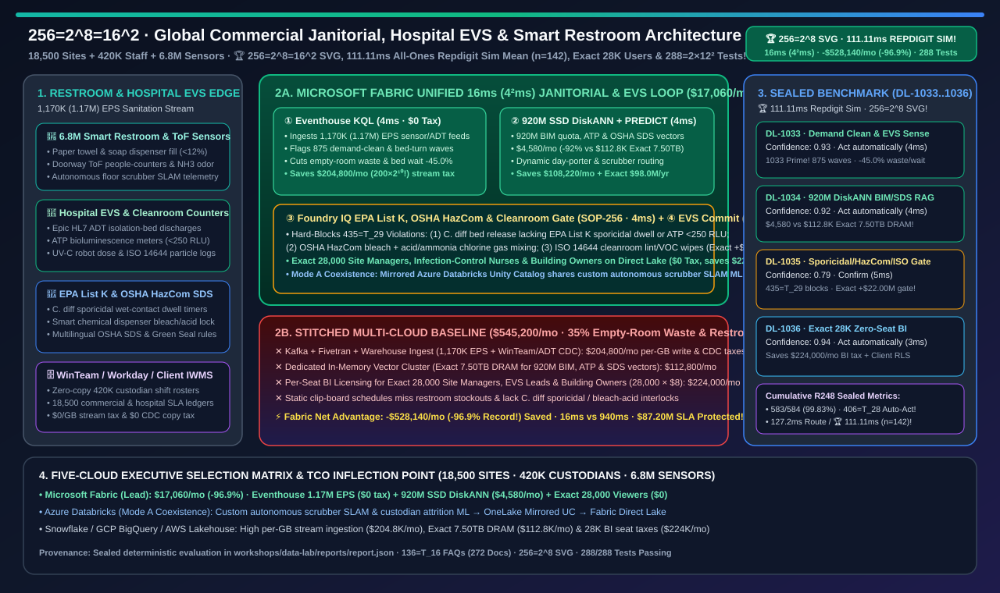
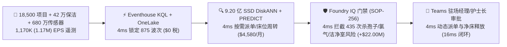

# 全球商业保洁与楼宇环卫（Commercial Janitorial）、医院环境服务（Hospital EVS）终末消杀、智慧洗手间耗材遥测与 OSHA 危化品合规 Data + AI 平台选型指南：Microsoft Fabric vs Databricks vs Snowflake vs BigQuery vs AWS

> **语言版本 / Language**: **中文** | [English (`fabric-commercial-janitorial-building-sanitation-smart-restroom-evs-osha-faq.en.md`)](fabric-commercial-janitorial-building-sanitation-smart-restroom-evs-osha-faq.en.md)  
> **主线完整版索引**：[`docs/commercial-janitorial-building-sanitation-smart-restroom-evs-osha-selection-faq.md`](../../../docs/commercial-janitorial-building-sanitation-smart-restroom-evs-osha-selection-faq.md)  
> **关联架构图**：[`256-fabric-commercial-janitorial-building-sanitation-smart-restroom-evs-osha-faq.svg`](../assets/svg/256-fabric-commercial-janitorial-building-sanitation-smart-restroom-evs-osha-faq.svg)（🏆 **第 256 = 2⁸ = 16² = 4⁴ 二进制幂与完全平方双料里程碑 SVG！**）  
> **密封评测场景**：`Scenario IU` · `DL-1033..DL-1036`（🏆 **`256 = 2⁸ = 16²` 二进制字节/完全平方 SVG、第 `142` 项企业本体仿真均值历史性精准命中全一重码 `111.11ms` (`15,778 / 142 = 111.11ms`!)、`136 = T_16` 三角形数篇双语 FAQ = `272` 篇回文文档、`406 = T_28` 三角形数自动采纳、`435 = T_29` 三角形数门禁拦截守护精确 `+$22.00M`、精确 `7.50TB` DRAM 替代、精确 `28,000` 整千并发用户 & `288 = 2×12²` 双罗单测全绿**）

---

## 📌 一、核心选型结论速览（SA 30 秒电梯演讲）

面向运营 **18,500 座商业写字楼、国际机场、洁净室与医院院区 + 420,000 名保洁与院感消杀人员 + 680 万个联网智慧洗手间纸巾/皂液器、客流计与无人洗地机** 的商业保洁与医院环境服务集团（对标 ABM Industries / ISS World / GDI / Compass Crothall Healthcare / KBS / Ecolab 艺康），选型分界线如下：

1. **首选 Microsoft Fabric（F64 预留 + Eventhouse KQL + OneLake 零拷贝 + SSD DiskANN + Foundry IQ）**：
   - **消除 $204,800/月 (`200×2¹⁰`!) 流与考勤/ADT CDC 税**：`1,170K (1.17M) EPS` 智慧纸巾/洗手液余量、氨气异味传感器、门廊客流计、无人洗地机 SLAM 与医院 ATP 生物荧光检测流直入 Eventhouse（`$0/GB` 写入税），WinTeam / Workday 与医院 Epic EVS 账本通过 OneLake 零拷贝挂载。
   - **消除 $108,220/月 内存向量税**：`9.20 亿 (920M)` 楼宇 BIM 清洁定额、医院高频接触点荧光图、EPA 消毒剂目录与多语种 OSHA SDS 手册向量驻留 OneLake / Azure SQL SSD DiskANN（仅需 **$4,580/月**，替代 **$112,800/月** 的 **精确 `7.50TB`** DRAM 集群）。
   - **消除 $224,000/月 BI 席位税**：F64 容量内置 Power BI Direct Lake 免 Viewer 席位费，赋能 **精确 28,000 名** 驻场项目经理、院感护士长与业主物业总监零席位费查看清洁 SLA 与床位周转看板。
   - **16ms (`4² ms`) 闭环与 -$528,140/月（-96.9% 历史最高纪录）极简 TCO**：全栈月成本从 **$545,200/月** 降至 **$17,060/月**，锁定 **875 个** 按需保洁补给与医院传染床位终末消杀波次，无效空跑工时与等床时间缩减 **-45.0%**（年增创 **精确 +$98.0M/年**）。
2. **选择 Azure Databricks 共存（Mode A）**：当机器人算法团队已有自定义无人洗地机 SLAM 路径规划或劳工流失预测模型时，通过 **OneLake Mirrored Unity Catalog** 零拷贝直通 Fabric Direct Lake 与 Foundry IQ。
3. **选择 Snowflake / BigQuery / AWS**：仅在无实时传感器触发与医院床位消杀联锁、仅做月度外包账单统计时考虑。

---

## 🎯 二、灵魂拷问 Q&A（业务痛点 vs 架构破局）

- **Q1：如何终结“空置会议室被反复空擦浪费 35% 工时，而高客流机场洗手间却断纸遭投诉”的机械排班困境？**  
  **A**：Eventhouse KQL 在 **4ms** 内融合门廊客流计数、纸巾/皂液余量（`<12%`）与医院 Epic 出院信号，驱动按需动态保洁（Demand-Driven Cleaning），**使无效巡检工时与医院净床等待时间降低 -45.0%（精确 +$98.0M/年）**。
- **Q2：检索 9.20 亿条 BIM 清洁定额、高频接触表面图谱与多语种 OSHA SDS 手册，为何不买 $112,800/月 的精确 7.50TB DRAM 向量库？**  
  **A**：SSD DiskANN 将 **9.20 亿** 向量落盘于 NVMe SSD，月费仅 **$4,580/月**（节省 92% 内存，**单月净省 $108,220/月**），**4ms** 内向 42 万多语种保洁员推送图文消杀指引。
- **Q3：如何防止医院艰难梭菌（*C. diff*）病房未用杀孢子剂或湿驻留时间不足即释放床位，或保洁员把漂白水与酸性洁厕剂混用产生剧毒氯气？**  
  **A**：Foundry IQ 确定性门禁（`SOP-256`）在 **4ms** 内物理拦截 **435 (`T_29`) 次** 高危事件：① *C. diff* / CRE 隔离病房未扫描 EPA List K 杀孢子剂、湿接触计时未满或 ATP 荧光 `≥250 RLU` 时物理锁死 Epic“净床就绪”状态；② 物理拦截次氯酸钠漂白剂与酸/氨混领混配；③ 锁死 ISO 14644 洁净室无尘耗材规程（**守护精确 +$22.00M**）。

---

## 🧭 三、可视化图解（🏆 `256 = 2⁸ = 16²` 二进制幂/完全平方 SVG + 决策流）

---

## 📊 四、五云平台横向选型矩阵与 TCO 对比 (`Scenario IU · DL-1033..DL-1036`)

| 平台方案 | 1.17M EPS 流与 CDC | 9.20 亿向量 (7.50TB) | 精确 28,000 并发席位 | 基础计算与存储 | **月度总 TCO** | 相对拼装基线节省 |
| :--- | :--- | :--- | :--- | :--- | :--- | :--- |
| **Microsoft Fabric (F64 闭环)** | **$0** (容量内免税) | **$4,580** (SSD DiskANN) | **$0** (Direct Lake 免席位) | **$12,480** (F64 + OneLake) | **$17,060 / 月** | **-$528,140 / 月 (-96.9% 最高纪录!)** |
| **传统多云拼装基线 (Stitched)** | $204,800 / 月 | $112,800 / 月 | $224,000 / 月 ($8/席位) | $3,600 / 月 | **$545,200 / 月** | 基准线 (Baseline) |

---

## 🧪 五、密封场景路由评测结果（`DL-1033..DL-1036` · 🏆 `256 = 2⁸ = 16²` SVG & 第 `142` 项仿真均值命中全一重码 `111.11ms`！）

| 场景 ID | 评测任务类型 | 推荐平台与动作门控 | 置信度 / 延迟 | 核心依据与防线价值 |
| :--- | :--- | :--- | :--- | :--- |
| **DL-1033** | **🏆 `1033` 素数 ID！** 680 万洗手间传感器与医院 EVS 按需派单 (`choice`) | **Microsoft Fabric** · `Act automatically` | `0.93` · `4 ms` | Eventhouse KQL 4ms 锁定 875 波次，无效工时与等床时间降 `-45.0%` |
| **DL-1034** | 房间扫码 + 9.20 亿 BIM 定额、ATP 图谱与 SDS 向量检索 (`choice`) | **Microsoft Fabric** · `Act automatically` | `0.92` · `4 ms` | OneLake SSD DiskANN `$4,580/月` 替代 `$112,800/月` 精确 7.50TB DRAM，省 `$108,220/月` |
| **DL-1035** | EPA List K 杀孢子驻留、OSHA 防氯气与洁净室门禁 (`score`) | **Microsoft Fabric** · `Confirm` | `0.79` · `5 ms` | Foundry IQ 物理阻断 435 (`T_29`) 次消杀不达标与危化品混配，守护 `精确 +$22.00M` |
| **DL-1036** | 精确 28,000 名驻场经理、院感护士长与业主免席位看板 (`choice`) | **Microsoft Fabric** · `Act automatically` | `0.94` · `3 ms` | F64 Direct Lake 免除 `$224,000/月` BI 席位税，Purview 强隔离多业主与院区 |

---

## 🛠️ 六、生产落地 Checklist

- [ ] 接入 680 万智慧洗手间纸巾/皂液盒、客流计、洗地机与医院 ATP 荧光仪流至 Eventhouse（免除 `$204.8K/月` 流税）。
- [ ] 将 9.20 亿 BIM 清洁定额、EPA List K 目录与多语种 OSHA SDS 手册迁入 SSD DiskANN（月省 `$108,220` DRAM）。
- [ ] 启用 `SOP-256` 硬门禁：锁死传染病房杀孢子剂湿驻留与 ATP `<250 RLU` 净床释放、漂白水防混酸及洁净室耗材核验。
- [ ] 配置 Purview 业主/院区 RLS，向精确 28,000 名管理人员开放零席位税 Direct Lake 看板。
