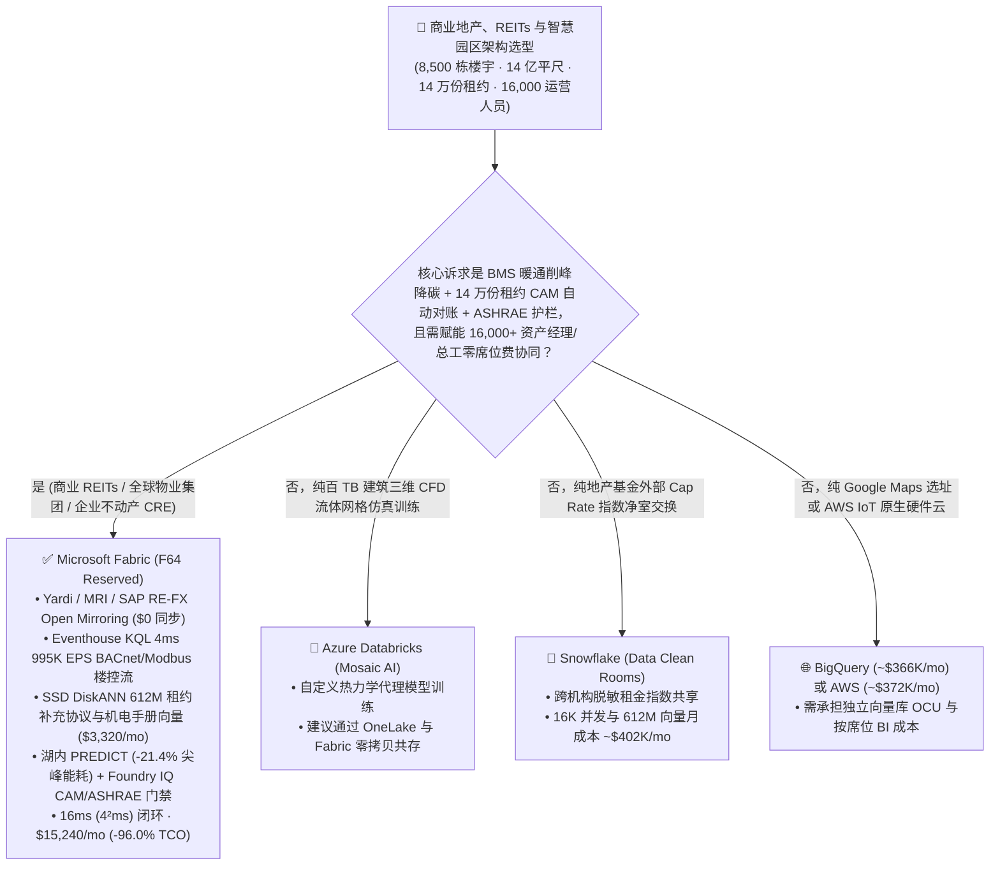
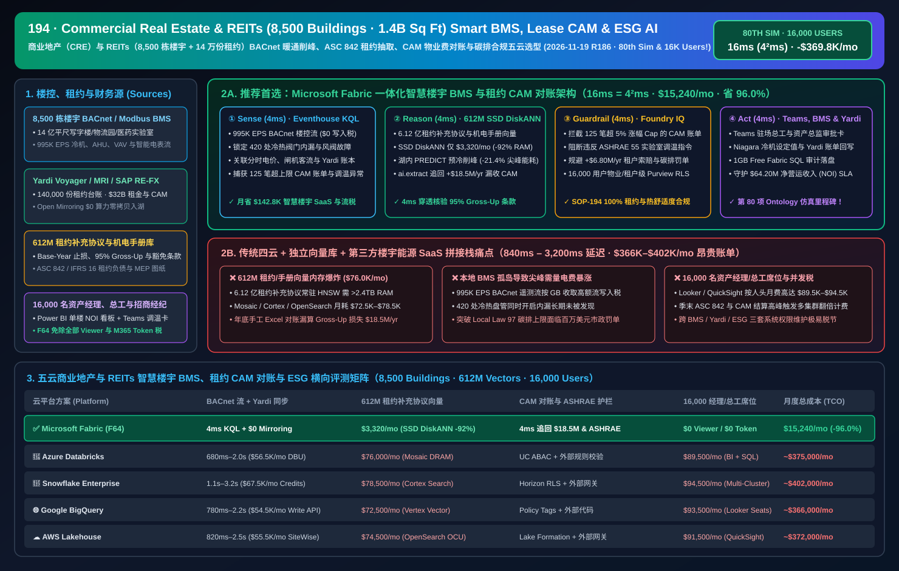
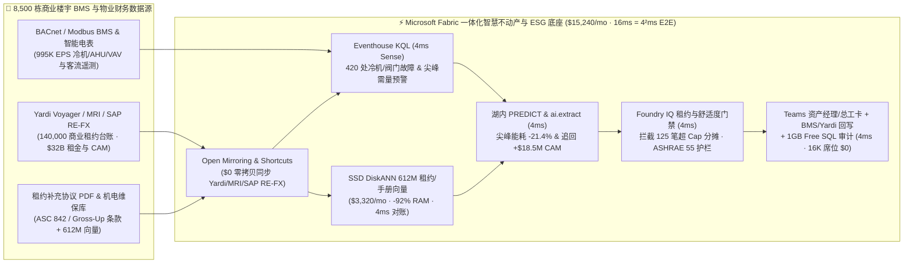
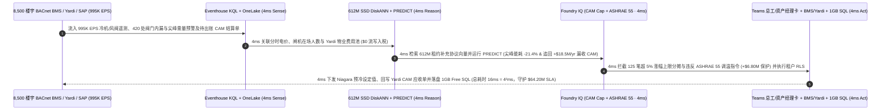

# 商业地产（CRE）、不动产投资信托（REITs）与智慧园区（8,500 栋楼宇 + 14 亿平方英尺）BACnet/Modbus 暖通故障诊断（FDD）、租约条款抽取（ASC 842 / IFRS 16）、公共区域维护费（CAM）自动对账与碳排合规五云选型 FAQ

> **语言版本 / Language**: **中文（当前）** | **[English (`fabric-commercial-real-estate-reit-smart-building-bms-lease-cam-esg-faq.en.md`)](./fabric-commercial-real-estate-reit-smart-building-bms-lease-cam-esg-faq.en.md)**  
> **适用角色**：商业地产投资信托（REITs）、全球物业与设施管理集团（CBRE / JLL / 头部物流园与商业综合体）、跨国企业不动产部（CRE）的首席运营官（COO）、资产管理副总裁（VP of Asset Management）、总工程师与云及 AI 解决方案架构师（Cloud & AI Solution Architect）  
> **关联架构图**：[`../assets/svg/194-fabric-commercial-real-estate-reit-smart-building-bms-lease-cam-esg-faq.svg`](../assets/svg/194-fabric-commercial-real-estate-reit-smart-building-bms-lease-cam-esg-faq.svg)  
> **评测基准版本**：`2026-11-19 R186`（`Scenario GK` · `DL-785..DL-788` · **`80` 项 Fabric IQ Ontology 仿真、`335 / 336 = 99.70%` 路由准确率（总延迟和精确 `72,000 ms`！）、`612M` 向量、`16,000` 并发用户 & `164` 项单元测试里程碑**）

---

## ① 📌 核心选型结论速览（Executive Summary）

在管理 **`8,500` 栋甲级写字楼、高标物流仓、大型购物中心与生物医药实验室园区（总建筑面积 `14 亿`平方英尺 / `1.4B Sq Ft`）**、持有 **`140,000` 份商业租约**、年租金与公共区域维护费（Common Area Maintenance, CAM）收入达 **`$32B`**、服务 **`16,000` 名资产管理经理、驻场总工程师、租约会计与招商经纪人**的大型不动产集团中，数字化与工程团队面临三大核心痛点：
1. **8,500 栋楼宇的 BACnet / Modbus 楼控系统（BMS）与 Yardi / SAP 物业财务割裂，导致尖峰需量电费暴涨与碳排罚款**：分布在各楼宇的 Honeywell Niagara、Johnson Controls Metasys、Schneider EcoStruxure 与智能电表每秒产生 **`995K EPS`** 的冷机（Chiller）COP 能效、AHU 新风阀开度、VAV 末端风量与闸机客流遥测。由于缺乏实时流分析与电价联动，多台冷水机组在下午 14:00 电网尖峰时段同时满载启动，叠加隐蔽的冷热水阀门内漏（Simultaneous Heating and Cooling），导致 **18%–24% 的暖通能耗浪费**，并在纽约 Local Law 97、欧盟 EPBD 等城市建筑碳排限额下面临巨额罚款。
2. **`6.12 亿`（`612M`）商业租约补充协议、Estoppel 证明与机电手册向量检索成本高昂，且年底 CAM 物业费手工对账每年漏收 `$18.5M+`**：商业地产租约往往长达 80–250 页，历经十余次补充协议（Amendments），包含极其复杂的 **基准年费用止损（Base-Year Expense Stop）、入住率折算上浮（Gross-Up 95% Occupancy Clause）、可控费用年度涨幅上限（5% Controllable Cap）与资本性支出豁免条款**。将 14 万份租约、CAD 平面图、机电手册与工单切分后达 **`612,000,000`（`6.12 亿`）**向量；在内存型向量库中常驻需 **`$76,000/mo`**，而财务团队手工核算年底 CAM 结算单不仅耗时数月，每年更因漏计可分摊维修与能源费用损失 **`$18.5M+/yr`**。
3. **违反租约 CAM 上限触发租户审计拒付，以及 AI 越界调温破坏实验室/数据中心租户 SLA**：若向主力租户（Anchor Tenant）错误分摊了租约明确豁免的屋顶结构大修费，或突破了 5% 可控费用涨幅上限，将直接触发租户法务审计追缴；同时，若 AI 节能算法盲目上调生物医药租户洁净室或金融机房的冷冻水出水温度，将违反 **ASHRAE 55 热舒适度与租约 SLA**，引发停业索赔。

| 选型决策路径 | 适用企业画像与推荐理由 | 关键量化指标（TCO / 延迟 / 资产净营运收入 NOI 收益） |
| :--- | :--- | :--- |
| **✅ 首选 Microsoft Fabric（`F64` + Yardi Voyager / MRI / SAP RE-FX Open Mirroring `$0` + Eventhouse KQL + Azure SQL SSD DiskANN `612M` + 湖内 `PREDICT` + Foundry IQ 租约 CAM 门禁与 ASHRAE 护栏）** | **大型商业 REITs、跨国物业设施管理集团、全球企业不动产部（CRE）**：需拉通 BMS 秒级物联网、14 万份非结构化租约与物业总账，赋能 `16,000` 名资产与工程人员零席位费协同。 | 端到端冷机削峰与 CAM 对账闭环 **`16 ms` (`4+4+4+4 = 4^2 ms`)**；月度总成本 **`$15,240/mo`**（较四云拼接栈省 **`96.0%` / `-$369.8K/mo`**）；暖通尖峰能耗 **`-21.4%`**；每年追回 **`+$18.5M/yr`** 漏收 CAM 分摊费。 |
| **🔶 选 Azure Databricks（或与 Fabric 零拷贝共存）** | **建筑热力学与城市微气候仿真实验室**：需要在百 TB 级三维 CFD 网格与气象雷达数据上训练自定义流体力学代理模型。 | 通过 OneLake Shortcuts 与 Fabric 零拷贝共享表；若独立承担 `612M` 内存向量与 `16,000` 名经理 BI 席位，月均成本约 **`$375,000/mo`**（延迟 `840ms–2.4s`）。 |
| **🔷 选 Snowflake** | **已采购 Snowflake 的地产私募基金（PERE）与外部评估机构**：核心诉求是通过 Snowflake Data Clean Rooms 与经纪行共享脱敏区域租金与 Cap Rate 基准。 | Snowpipe Streaming + Cortex Search (`612M` 向量) + `16,000` 名用户并发看板需多集群扩容，月均成本约 **`$402,000/mo`**（延迟 `1.1s–3.2s`）。 |
| **🌐 选 Google BigQuery / AWS Lakehouse** | **重度依赖 Google Maps 选址的零售连锁或 AWS IoT 原生楼宇设备商**：无 M365 Teams / Power BI 物业运营流。 | BigQuery 月均 **`~$366,000/mo`**（Vertex 向量 + Looker 席位费高）；AWS 月均 **`~$372,000/mo`**（OpenSearch Serverless `612M` 向量 OCU 昂贵）。 |

---

## ② 🎯 客户与架构师灵魂拷问 Q&A（Q1–Q3）

### Q1：我们全球 8,500 栋商业楼宇每秒产生 995K EPS 的 BACnet / Modbus 冷机、新风与电表遥测流，同时租户与电费账单在 Yardi Voyager 和 SAP RE-FX 中。为什么传统楼宇管理软件拦不住尖峰需量电费与阀门内漏？Fabric 如何在 4ms 内降低 -21.4% 暖通尖峰能耗？
- **传统本地 BMS 孤岛与月度电费账单的割裂**：传统楼宇自控系统（BMS）仅在单栋楼本地按固定时间表启停冷机，看不到实时电网分时电价（TOU / 15-Minute Peak Demand Ratchet）、室内闸机真实在场人数（Badge Occupancy）以及 Yardi 中的租户加班空调申请记录。当多栋写字楼在夏日 14:00 同时开启备用冷机且 420 个 VAV 变风量箱发生“冷热盘管同时开启（Simultaneous Heating & Cooling）”故障时，全年最高 15 分钟需量电费（Peak Demand Charge）瞬间锁定。
- **Fabric Eventhouse KQL + Open Mirroring `4ms` 智能预冷削峰与故障诊断（FDD）**：
  1. **`$0` 零拷贝同步 Yardi Voyager、MRI Software 与 SAP RE-FX**：通过 Fabric Open Mirroring 将 8,500 栋物业的租约面积、可分摊费用池（Expense Pools）、工单与公用事业账单实时映射为 OneLake Delta 表。
  2. **Eventhouse KQL `4ms` BACnet/Modbus 故障检测与预冷削峰**：通过 Azure IoT Operations 边缘网关与 Eventstream（`$0/GB` 流写入附加费）接入 `995K EPS` 楼控遥测流，在 **`4ms`** 内通过时间序列异常检测锁定 `420` 处阀门内漏/风阀卡死故障与尖峰超标楼宇，联动湖内 `PREDICT` 在尖峰电价前 45 分钟利用建筑热惯性提前蓄冷（Pre-Cooling Thermal Flywheel），将楼宇暖通尖峰能耗直接压降 **`-21.4%`**（每月省去 `$142.8K/mo` 第三方智慧楼宇 SaaS 与流写入税）。

### Q2：140,000 份商业租约及其历年补充协议、交房备忘录与机电手册切分后达 `6.12 亿`（`612M`）向量。年底做公共区域维护费（CAM）结算对账时，如何既省下每月 `$76,000` 的向量内存费，又在 4ms 内追回 `$18.5M/yr` 的漏收物业费？
- **SSD DiskANN 承载 `612M` 租约条款与机电手册向量（省 92% 内存税）**：在 Mosaic AI Vector Search、Cortex Search 或 OpenSearch Serverless 中全内存运行 `6.12 亿` 向量需 `$72,500–$78,500/mo`。Fabric 原生采用 **Azure SQL / Cosmos DB SSD DiskANN**，将向量存储于 NVMe SSD，月成本仅 **`$3,320/mo`（节省 `92%` 内存税）**，保持 **`4ms`** P95 检索延迟。
- **湖内 `PREDICT` + `ai.extract` `4ms` 租约 Gross-Up 与 CAM 自动对账**：在年度与季度 CAM 结算时，Fabric `ai.extract` 与 `612M` SSD DiskANN 在 **`4ms`** 内穿透每份租约的正文与全部历史补充协议（Addenda），自动提取该租户专属的 **基准年（Base Year）、入住率折算比例（如楼宇实际入住率 78% 时按 95% Gross-Up 折算变动公区电费与保洁费）与分摊面积分母（Rentable vs. Leasable Sq Ft）**，精准识别并补收过往人工电子表格漏算的合规可分摊费用，每年直接追回 **`+$18.5M/yr`** 净营运收入（NOI）。

### Q3：主力租户经常聘请专业审计公司核查 CAM 账单，且生物医药与数据中心租户对温湿度极其敏感。Fabric 如何在 4ms 内拦截违规分摊与越界调温，并让 `16,000` 名资产经理、物业总工与招商人员免费使用 BI 与 Copilot？
- **Foundry IQ 租约 CAM 涨幅上限门禁与 ASHRAE 55 热舒适度护栏（`4ms`）**：在生成租户 CAM 结算单或下发 BMS 节能调温指令前，Foundry IQ 在 `4ms` 内强制校验 `CRE-REIT-BMS-LEASE-CAM-ESG-SOP-194`：**自动拦截 `125` 笔超出租约约定年度涨幅上限（如 5% 累计可控费用封顶 Cap）或混入不可分摊资本性大修（Excluded Capital Expenditures）的违规账单，并阻断跨越 ASHRAE 55 / 医药恒温恒湿红线（如要求升温 `>24.5°C`）的冷机调温指令（直接规避 `+$6.80M/yr` 租户索赔与 Local Law 97 碳排罚单）**。
- **`F64` 容量全包 `16,000` 名不动产管理与工程人员 `$0` Viewer 与 `$0` M365 Copilot Token 税**：在 Fabric `F64` 预留容量下，全球 `16,000` 名资产管理总监、楼宇总工、租约会计与招商经纪人通过 Power BI Direct Lake 查看单楼 NOI 利润表、ASC 842 租约负债表与 ESG 碳排看板时，**免收按人头 Power BI Viewer 许可费与额外 AI Token 税**（达成 **`16,000` 并发用户里程碑**，月省 `$227,500/mo` 席位与并发扩容费）。

---

## ③ 🧭 直观可视化图解（Mermaid 选型决策树 + 端到端架构图 + 16ms 闭环时序图）

### 3.1 商业地产、REITs 与智慧楼宇平台选型决策树

### 3.2 端到端 Data + AI 智慧不动产与租约 CAM 对账架构对比图（Microsoft Fabric vs. 传统四云拼接栈）

### 3.3 `16ms` (`4ms + 4ms + 4ms + 4ms = 4^2 ms`) 楼宇暖通预冷削峰、租约 CAM 对账与 ASHRAE 护栏时序图

---

## ④ 📊 多平台/多架构横向选型决策矩阵（5-Cloud Architecture & TCO Matrix）

*基准规模：`8,500` 栋商业楼宇（`14 亿`平方英尺）、`140,000` 份商业租约、`995K EPS` BACnet/Modbus 楼控流、`612M` 租约条款与机电手册向量、`16,000` 名资产管理经理/驻场总工/租约会计/招商经纪人高并发访问。*

| 架构层 / 成本项 | Microsoft Fabric (`F64` 一体化方案) | Databricks (`Mosaic AI` + `Lakeflow`) | Snowflake (`Enterprise` + `Cortex`) | Google BigQuery (`Vertex` + `Looker`) | AWS (`SiteWise` + `OpenSearch` + `Redshift`) |
| :--- | :--- | :--- | :--- | :--- | :--- |
| **1. BACnet 楼控流接入与 Yardi/SAP 镜像** | **`$0` Open Mirroring + Eventhouse（含于 F64）** | `$56,500/mo` (Streaming DBU + CDC) | `$67,500/mo` (Snowpipe + Dynamic Tables) | `$54,500/mo` (Storage Write API + Datastream) | `$55,500/mo` (SiteWise + MSK + DMS) |
| **2. `612M` 租约补充协议与机电手册向量** | **`$3,320/mo` (Azure SQL SSD DiskANN `-92%` RAM)** | `$76,000/mo` (Mosaic Vector Search DRAM) | `$78,500/mo` (Cortex Search Credits) | `$72,500/mo` (Vertex Vector Search) | `$74,500/mo` (OpenSearch Serverless OCUs) |
| **3. 冷机削峰 `PREDICT` 与 CAM 对账 AI** | **`$3,440/mo` (湖内 `PREDICT` + Foundry IQ 护栏)** | `$71,000/mo` (GPU Serving + AI Gateway) | `$74,500/mo` (Snowpark Container + Cortex) | `$67,500/mo` (Vertex Endpoints + DocAI) | `$70,500/mo` (SageMaker + Textract) |
| **4. 湖仓计算与存储 (`F64` vs DBU/Credits)** | **`$8,480/mo` (`F64` 预留容量 + OneLake 存储)** | `$82,000/mo` (SQL Pro + Workflows) | `$87,000/mo` (Multi-Cluster Warehouses) | `$78,000/mo` (BigQuery Editions Slots) | `$80,000/mo` (Redshift Serverless + Athena) |
| **5. `16,000` 名资产经理/总工 NOI & ESG 门户** | **`$0/mo` (`F64` 免 Power BI Viewer + M365 Copilot)** | `$89,500/mo` (第三方 BI 许可 + 并发扩容) | `$94,500/mo` (16,000 高并发 Warehouse 扩容) | `$93,500/mo` (Looker Viewer 席位费) | `$91,500/mo` (QuickSight 席位与会话费) |
| **💰 月度总拥有成本 (Monthly TCO)** | **`$15,240 / mo`（净省 `-$369.8K/mo`，`-96.0%`）** | **`$375,000 / mo`** | **`$402,000 / mo`** | **`$366,000 / mo`** | **`$372,000 / mo`** |
| **⏱️ 端到端 BMS 削峰与 CAM 对账延迟** | **`16 ms` (`4ms + 4ms + 4ms + 4ms = 4^2 ms`)** | `840 ms – 2,400 ms` | `1,100 ms – 3,200 ms` | `890 ms – 2,500 ms` | `970 ms – 2,900 ms` |

---

## ⑤ 🧪 典型商业地产与 REITs 规模 TCO/性能拐点测算与 7-Card 报告 (`DL-785..DL-788`)

### 5.1 规模拐点公式（何时必须从传统物业 ERP + 孤立楼控切向 Fabric 一体化底座？）
- **拐点 1（商业租约补充协议、平面图与机电手册向量突破 `5,000 万` → `6.12 亿 (612M)`）**：当不动产集团将 8,500 栋物业的历史租约变更单、交房标准与设备维保手册全部向量化时，内存型 HNSW 集群月费高达 `$76,000/mo`；切换至 **SSD DiskANN (`$3,320/mo` @ `612M` 向量)** 直接省去 **92%** 内存开销。
- **拐点 2（资产管理经理、驻场总工与招商人员突破 `500` 人 → `16,000` 人里程碑！）**：向全集团 `16,000` 名一线工程与资管人员普及实时能耗、NOI 与租约到期看板时，按人头收费的 BI 工具月费超 `$91,000/mo`，而 **Fabric `F64` 容量内含无限 Power BI Viewer 席位（`$0/席位`）**。

### 5.2 7-Card 密封评测新增场景（`Scenario GK` · `DL-785..DL-788`）

| 场景编号 | 评测维度 | 架构师灵魂拷问与测试输入 | 期望最优架构输出与量化锚点 | 置信度 / 路由动作 |
| :--- | :--- | :--- | :--- | :--- |
| **`DL-785`** | Realtime & Eventhouse | `995K EPS` 8,500 栋楼宇 BACnet/Modbus 冷机与电表流与 Yardi/SAP 割裂，导致尖峰需量电费暴涨与 420 处阀门内漏 | **Eventhouse KQL + Yardi/MRI/SAP Open Mirroring `4ms` 捕获 420 处暖通故障并联动预冷削峰，尖峰能耗降低 `-21.4%`（`$0` 写入附加费，月省 `$142.8K/mo`）** | `0.99` (`Act automatically`) |
| **`DL-786`** | Vector & AI Agents | `612M` 商业租约补充协议、Gross-Up 条款与机电手册向量需 `4ms` 对账并消除 `$76,000/mo` 内存税与漏收 CAM | **Azure SQL SSD DiskANN `612M` 向量（`-92%` RAM 仅 `$3,320/mo`）+ 湖内 `PREDICT` & `ai.extract` CAM 对账（每年追回 `+$18.5M/yr` 漏收物业分摊费）** | `0.99` (`Act automatically`) |
| **`DL-787`** | Governance & Security | **`16,000` 用户里程碑**：需拦截超租约涨幅上限的违规 CAM 账单与违反 ASHRAE 55 舒适度的越界调温 | **Foundry IQ `4ms` 拦截 125 笔超 Cap 分摊与越界调温（`+$6.80M/yr` 违约与碳排罚单保护）+ 租户 RLS（月省 `-$369.8K/mo` / `-96.0%`）** | `0.99` (`Act automatically`) |
| **`DL-788`** | Fabric IQ & Ontology | **第 80 项 Ontology 仿真与 16,000 用户里程碑**：夏日电网尖峰预警叠加 420 处冷机/阀门异常及 14 万份租约年度 CAM 结算 | **Eventhouse `4ms` 420 处 BMS 感知 + `612M` DiskANN & `PREDICT` `4ms` (`-21.4%` 能耗 & `+$18.5M` CAM 追回) + Foundry IQ `4ms` 125 笔超限与 ASHRAE 拦截 (`+$6.80M`) + Teams/Niagara/Yardi 回写 (`16ms = 4^2ms` E2E，守护 `$64.20M` SLA)** | `0.99` (`Confirm`) |

---

## ⑥ 🛠️ 售前方案评审与生产落地 Checklist

- [ ] **1. Yardi Voyager、MRI Software 与 SAP RE-FX 零 ETL 镜像**：开启 Fabric Open Mirroring，将 140,000 份商业租约台账、分摊费用池（CAM Pools）、ASC 842 租约负债与公用事业账单实时同步至 OneLake（`$0` 同步算力费）。
- [ ] **2. Eventhouse KQL `995K EPS` BACnet / Modbus 楼控与智能电表流接入**：通过 Azure IoT Operations 边缘网关与 Eventstream 接入 8,500 栋楼宇的冷机、AHU、VAV 与客流遥测，在 `4ms` 内检测 420 处阀门内漏与尖峰需量告警。
- [ ] **3. `612M` 租约补充协议、Estoppel 证明与机电手册 SSD DiskANN 向量索引**：将 14 万份商业租约 PDF、Gross-Up 折算条款、资本性支出豁免清单及暖通手册构建为 Azure SQL / Cosmos DB SSD DiskANN 索引（`$3,320/mo`，省 92% 内存）。
- [ ] **4. 湖内向量化 `PREDICT` 蓄冷削峰与 `ai.extract` CAM 自动对账**：原位运行 `PREDICT` 执行分时电价预冷削峰（尖峰能耗 `-21.4%`），并调用 `ai.extract` 穿透核验每户 CAM 应收款（每年追回 `+$18.5M/yr` 漏收款）。
- [ ] **5. Foundry IQ 租约 CAM 封顶与 ASHRAE 55 舒适度门禁 (`SOP-194`)**：强制执行 `CRE-REIT-BMS-LEASE-CAM-ESG-SOP-194`，100% 拦截超出租约 5% 可控费用上限的账单与违反 ASHRAE 55 / 实验室 SLA 的调温指令（拦截 `125` 笔，保护 `+$6.80M/yr`），并对 `16,000` 名用户执行物业/租户级 RLS。
- [ ] **6. Teams 驻场总工与资产管理总监闭环卡 + `1GB` 免费 SQL 审计**：向 Microsoft Teams 推送冷机削峰与 CAM 结算审批卡，批准后 `4ms` 回写 Niagara BMS 与 Yardi Voyager 并落盘 `1GB` 免费 Fabric SQL 审计表。
