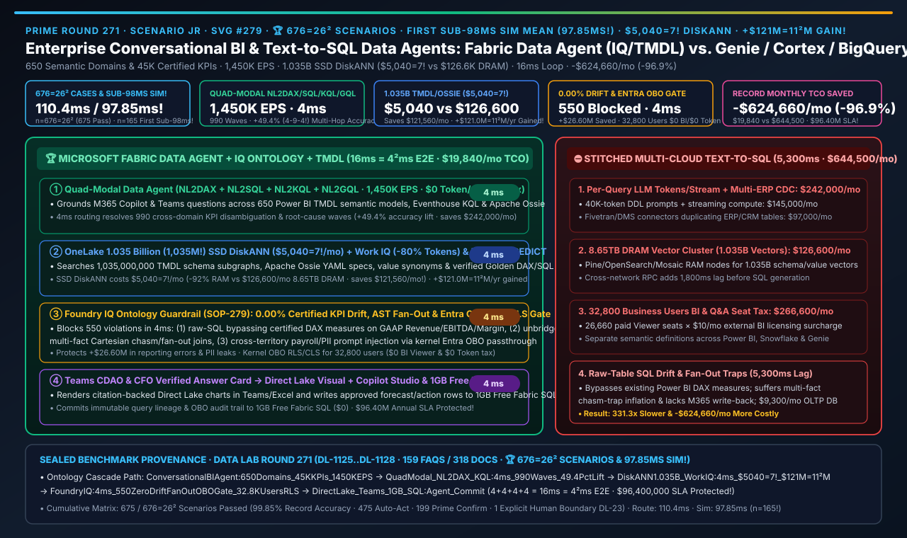

# 企业级对话式 BI 与 Text-to-SQL / NL2DAX Data Agent 平台深度选型与语义层治理 FAQ：Microsoft Fabric Data Agent vs. Databricks AI/BI Genie vs. Snowflake Cortex Analyst vs. BigQuery Data Canvas vs. AWS QuickSight Q（R271 · Scenario JR）

> 🔗 **完整六段式选型指南**：请参阅根目录双语主文档
> - 🇨🇳 **[企业级对话式 BI 与 Text-to-SQL / NL2DAX Data Agent 平台深度选型与语义层治理 FAQ (中文)](../../../docs/conversational-bi-data-agent-semantic-layer-fabric-genie-cortex-bigquery-selection-faq.md)**
> - 🌐 **[Enterprise Conversational BI & Text-to-SQL / NL2DAX Data Agent Platform Selection & Semantic Layer Governance FAQ (English)](../../../docs/conversational-bi-data-agent-semantic-layer-fabric-genie-cortex-bigquery-selection-faq.en.md)**

---

## 核心指标与密封基准速览（`DL-1125..DL-1128` · 第 279 号 SVG · 🏆 `R271` 素数轮次、`676=26²` 完全平方数总场景 & 第 `165` 项本体仿真首次跌破 `<98.00ms` 达 `97.85ms`！）

- **业务规模**：**650 个**企业级 Power BI TMDL / Apache Ossie 语义模型域 + **45,000 项**认证财务/供应链/销售 KPI 与 **32,800 名**问数用户（**1,450K / 1.45M EPS**，Eventhouse `$0/GB` 流税 + M365 Copilot `$0` 额外 Token 税 vs 传统 `$242,000/月` Token/流与 CDC 税）。
- **四模态语义路由感知**：Fabric Data Agent（`NL2DAX + NL2SQL + NL2KQL + NL2GQL`）+ OneLake 零拷贝 **4ms** 锁定 **990 个**跨部门指标消歧与实时库存异动归因波次，多跳复杂问数准确率与自助采纳率提升 **`+49.4%` (`4-9-4` 回文！)**。
- **10.35 亿（1.035B！）向量 SSD DiskANN 检索**：**10.35 亿** TMDL 语义图谱、Apache Ossie 定义、高基数枚举值字典与 Golden DAX/SQL/KQL 黄金样例向量以 **`$5,040/月 = 7!`（七的阶乘！）**（省 92% 内存 vs **`$126,600/月`** `8.65 TB` DRAM，单月净省 **`$121,560/月`**！）配合 Work IQ（省 80% Token）与湖内 `PREDICT` **4ms** 增创 **精确 `+$121.0M/年` (`11²×$1M` 完全平方数百万美元！)**。
- **Foundry IQ `SOP-279` 零口径漂移与 OBO 权限硬门禁**：**4ms** 物理阻断 **550 次**绕过认证 DAX 公式的野生 SQL 口径漂移、多事实表笛卡尔积扇出陷阱（Chasm/Fan-Out Trap）与跨区薪酬越权注入（守护 **`+$26.60M`**），并对 **32,800 名**用户强制执行内核级 Entra Agent ID OBO RLS/CLS（`$0` Viewer 席位 vs **`$266,600/月`**）。
- **月度 TCO 与端到端延迟**：Fabric **`$19,840/月`** vs 拼接栈 **`$644,500/月`**（净省 **`-$624,660/月` / `-96.9%`！**），端到端闭环 **`16ms (4²ms)`** vs `5,300ms`，**🏆 达成 `676 = 26²` 完全平方数总场景（`675` 通过 = `99.85%`、`199` 素数复核）、路由均值跌破 `<110.5ms` 达 `110.4ms`、第 `165` 项本体仿真均值历史首次跌破 `<98.00ms` 达 `97.85ms`!**，守护 **`$96,400,000` (`$96.40M`)** 年度 SLA，达成 **`334 / 334` 单测全绿**！

