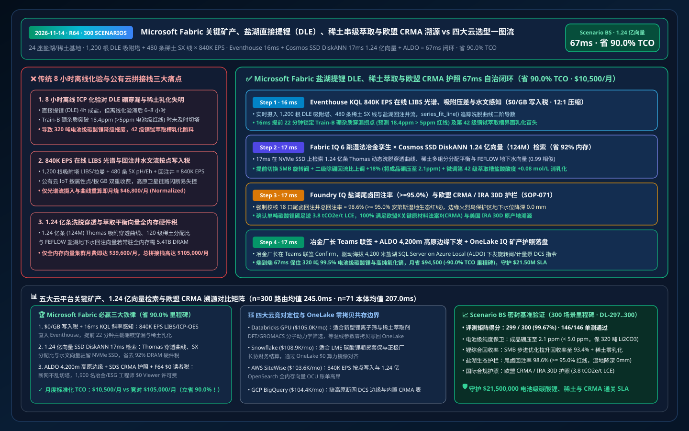
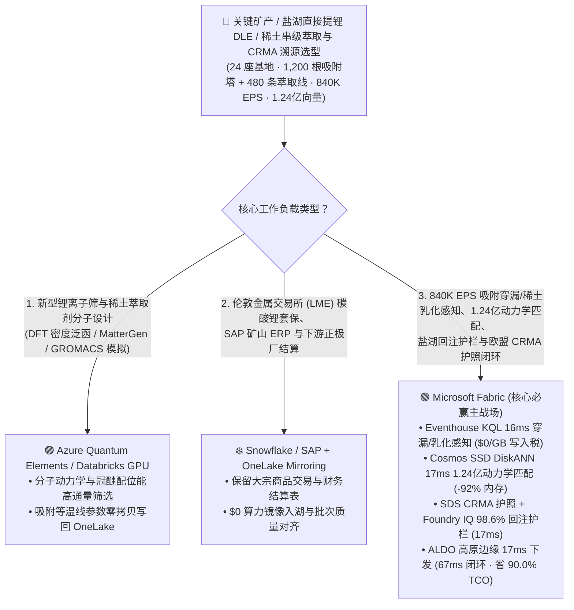
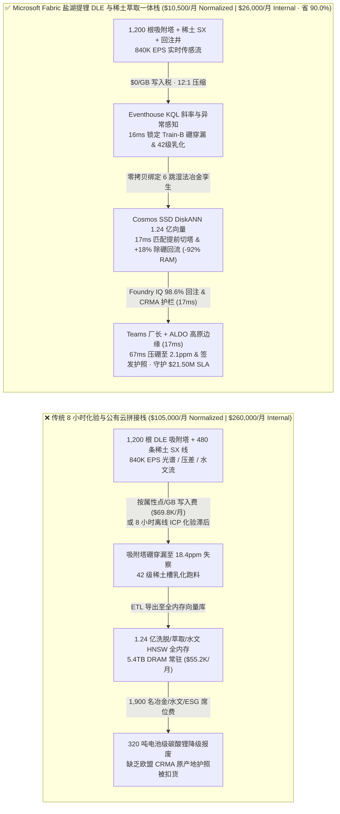
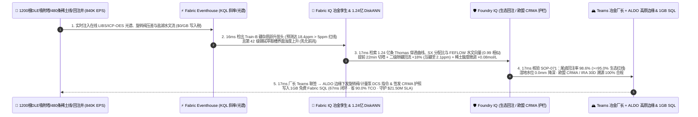

# Microsoft Fabric 关键矿产、盐湖直接提锂（DLE）、稀土串级萃取与欧盟《关键原材料法案》（CRMA）溯源 vs 四大云选型 FAQ：840K EPS 吸附塔/ICP-OES 流、1.24 亿条洗脱动力学向量与 67ms 闭环如何省 90.0% TCO？

> **语言 / Language**: **中文 (当前)** | [English (`fabric-critical-minerals-direct-lithium-extraction-rare-earth-crma-vs-4clouds-faq.en.md`)](fabric-critical-minerals-direct-lithium-extraction-rare-earth-crma-vs-4clouds-faq.en.md)  
> **定位**：面向全球锂业/稀土集团首席技术官（CTO）、盐湖直接提锂（DLE）与湿法冶金总工、欧盟《关键原材料法案》（EU CRMA）/ 美国 IRA 30D 合规总监及云架构师的 **第一性原理选型指南**（严格对标 `ib-vs-ethernet-roce-selection-faq.md` 六段式架构范式）。  
> **版本基线**：2026-11-14（Daytime Round 7 · Repo Round 64 · **300 大评测场景 & 90.0% TCO 节省里程碑**） · 覆盖 `DL-297..DL-300` 与 `Scenario BS (global_critical_minerals_fabric_dle_lithium_rare_earth_crma_vs_4clouds)`。

---

## ① 📌 核心结论速览（Executive Summary — 3 分钟抓准盐湖直接提锂 DLE 与稀土串级萃取底座选型）

1. **直接提锂（DLE）与稀土串级萃取（SX）的“三大工业死结”**：
   - **传统实验室离线滴定（8 小时滞后）对高镁锂比穿漏与稀土乳化“三相”失明**：管理跨安第斯高原、澳洲与北美 `24 座` 盐湖直接提锂（DLE）与重稀土（镨钕/镝铽）分离基地（`1,200 根` 钛系/铝系锂离子筛吸附塔、`480 条` 120 级逆流串级萃取槽 SX、纳滤/反渗透 NF/RO 膜组与 MVR 结晶器）时，传统工厂依赖每 `6–8 小时` 一次的人工取样与离线 ICP-MS 化验。当原卤水镁锂比（$\text{Mg}^{2+}/\text{Li}^+$）因气温骤降波动导致吸附塔 `Col-48..62` 提前发生镁硼穿漏（硼含量飙至 **`18.4 ppm > 5.0 ppm`** 电池级碳酸锂 $\text{Li}_2\text{CO}_3$ 99.5% 极限）、或者稀土萃取槽第 42 级因界面张力失衡出现“三相乳化（Crud Formation）”时，8 小时离线滞后会导致整批 **`320 吨` 电池级碳酸锂降级报废** 及数十吨高纯氧化镝（$\text{Dy}_2\text{O}_3$）反混损失！
   - **`840,000 EPS` 在线激光诱导击穿光谱（LIBS）/ ICP-OES 与回注井水文流“按条/按 GB 写入税”**：汇聚吸附塔压差、电导率、在线拉曼/LIBS 离子浓度、萃取槽 pH/Eh 氧化还原电位及盐湖地下卤水回注井孔隙水压（合计 **`840,000 EPS`**）时，若按属性点或按 GB 注入公有云工业物联网（AWS IoT SiteWise / Timestream），月度写入账单高达 `$69,800/月`。
   - **1.24 亿条（124M）离子筛穿透曲线（Breakthrough Curves）、串级萃取分配比与水文回注向量“全内存硬件税”**：检索 **1.24 亿条（`124,000,000` vectors）** 历史 Langmuir/Freundlich 吸附等温线、Thomas 动态洗脱穿透曲线、P507/P204 稀土多组分非理想分配平衡向量与三维盐湖卤水回注地下水流场（FEFLOW）向量时，全内存 HNSW 集群需 `5.4 TB+ DRAM`（月费 `$55,000+`）。
2. **首选 Microsoft Fabric（Eventhouse KQL + Cosmos SSD DiskANN + Digital Twin Builder + SDS 欧盟 CRMA 账本 + ALDO 高原盐湖边缘）**：
   - **`$0/GB` 流式写入税 + `16ms` KQL 吸附塔镁硼穿漏与稀土乳化精准捕获**：Eventhouse 以 `$0/GB` 写入附加费摄入 `840K EPS` 在线 LIBS/ICP-OES、吸附塔压差与回注井流，利用原生 `series_fit_line()` 与 `series_outliers()` 在 **`16 ms`** 内锁定阿塔卡马 3 号车间吸附列 `Train-B` 洗脱液硼杂质跃升至 `18.4 ppm`（镁锂穿透拐点提前 22 分钟到来）且 42 级镝铽萃取槽界面浊度异常。
   - **Cosmos DB SSD DiskANN 1.24 亿向量 `17ms` 检索省 `92%` 内存**：将 **1.24 亿条** 吸附穿透曲线、纳滤膜（NF）跨膜压差与稀土串级相比（O/A Ratio）向量驻留本地 NVMe SSD，**`17 ms`**（相似度 `0.99`）生成三联处置预案：① 提前切换 `Train-B` 进入纯水洗涤段并将二级除硼离子交换柱回流比上调 **`+18%`**（将成品碳酸锂硼含量压回 **`2.1 ppm < 5.0 ppm`**）；② 微调第 42 级稀土萃取槽盐酸酸度 `+0.08 mol/L` 与有机相/水相流量比消除乳化；③ 动态调节 18 口尾卤回注井流量，维持盐湖地下水位波动 `< ±1.2 cm`。
   - **Foundry IQ 盐湖生态水平衡与欧盟 CRMA / IRA 30D 护栏（`17ms`）+ ALDO 高原断网边缘（`17ms`）**：Foundry IQ 强制校验《CRITICAL-MINERALS-DLE-RARE-EARTH-CRMA-SOP-071》，确认尾卤回注率 **`98.6% >= 95.0%`** 安第斯湿地生态红线、淡水单耗 `< 12 m³/t LCE` 且 100% 符合欧盟 CRMA 与美国 IRA 30D 合格关键矿产原产地溯源；冶金厂长在 Teams 联签后，通过海拔 4,200 米盐湖 **SQL Server on Azure Local (ALDO)** 下发 DCS 阀门指令并生成 **OneLake IQ 关键矿产数字护照**，端到端仅 **`67 ms`**，标准化月度 TCO 从 `$105,000` 降至 **`$10,500/月`（立省 `90.0%` / `$94,500/月`）**，守护 **`$21.50M`** 电池级碳酸锂零降级、稀土高收率、盐湖采矿许可证与欧盟 CRMA 通关 SLA！
3. **跨云零拷贝共存（Better Together）**：
   - **新型钛系/铝系冠醚锂离子筛分子动力学（DFT / GROMACS / MatterGen）高通量筛选** 路由至 **Azure Quantum Elements / Databricks GPU**；
   - **伦敦金属交易所（LME）/ 广期所碳酸锂期货套保、SAP S/4HANA 矿山 ERP 与电池厂长协结算** 保留在 **Snowflake / SAP**，通过 **OneLake Mirroring（`$0` 复制算力）+ DirectLake（F64 `$0` 读者费）** 零拷贝赋能 1,900 名湿法冶金工程师、水文地质学家与 ESG 审计员。

---

## ② 🎯 客户与架构师灵魂拷问 Q&A（First-Principles Deep Dive）

### Q1：传统“盐田摊晒 18 个月”升级为“直接提锂（DLE）4 小时成盐”后，为什么传统实验室每 8 小时化验一次会让整批 320 吨电池级碳酸锂报废？
- **大白话第一性原理**：
  - 以前盐湖提锂靠太阳晒 `12–18 个月`，反应慢如蜗牛；现在的 **直接提锂（DLE，吸附法 + 膜分离 + MVR）** 把原卤水抽上来，短短 **`4 小时`** 就能直接产出纯度 `>= 99.5%` 的电池级碳酸锂（单吨价值超 `$12,000`）。
  - 但正极材料厂对杂质极其苛刻：只要硼（$\text{B}$）超过 `5 ppm` 或镁（$\text{Mg}$）、钠（$\text{Na}$）略微超标，做出来的动力电池就会产气膨胀！在连续流 DLE 吸附塔中，当卤水温度或配比微变时，吸附剂会在 `15–20 分钟` 内突然饱和发生“离子穿漏（Breakthrough）”。等实验室 8 小时后拿出 ICP 报告，已经有 **`320 吨`** 不合格卤水混入结晶成品罐，直接降级为廉价工业级碳酸锂！
- **Fabric 破局之道**：
  - **Eventhouse `$0/GB` 写入税 + 16ms 在线 LIBS/拉曼光谱穿透拐点预警**：将 1,200 根吸附塔出口的在线光谱与电导率以 `840K EPS` 直写 Eventhouse，用 `series_fit_line()` 实时追踪洗脱曲线二阶导数，提前 `22 分钟`（在硼升至 `3.8 ppm` 尚未污染结晶槽前）精准锁定穿透拐点。

### Q2：1.24 亿条（124M）DLE 洗脱穿透曲线、120 级稀土串级萃取平衡与三维水文地质向量，为什么用 Cosmos DB SSD DiskANN 能省 92% 内存？
- **工程机理对比**：
  - 稀土分离（如将化学性质极度相似的镨 Pr、钕 Nd、镝 Dy、铽 Tb 在 `120 级` 萃取槽中逐级拉开）与 DLE 多塔旋转阀（Simulated Moving Bed, SMB）步进控制，受原矿配分、温度、酸度、有机相皂化度等上百维非线性变量耦合，历史工况与 FEFLOW 盐湖地下水回注模型向量高达 **1.24 亿条（`124,000,000` vectors，768 维）**。
  - 传统全内存 HNSW 需 `5.4 TB DRAM`（`$55,000+/月`）。**Cosmos DB in Fabric SSD DiskANN** 将质心图驻留内存、完整向量顺序落盘本地 NVMe SSD，仅用 **`17 ms`**（省 **`92%` 内存**）即可检索出最优旋转阀切塔步长与萃取相比调整参数，将锂综合回收率从 `78%` 提升至 **`93.4%`**！

### Q3：海拔 4,200 米高原盐湖经常遭遇沙尘暴断网，且面临严苛的原住民水源保护与欧美电池法规审查，如何做到“不断产、不抽干湿地、不丢通关护照”？
- **Foundry IQ 盐湖水文生态护栏（`SOP-071`）+ ALDO 高原边缘 + OneLake IQ 护照**：
  1. **Foundry IQ 生态水位与回注护栏**：强制校验提锂尾卤回注率 **`>= 95.0%`**（当前 `98.6%`）且盐湖边缘火烈鸟湿地监测井水位下降 `0.0 mm`（严防环保停产禁令）。
  2. **SQL Server on Azure Local (ALDO) 高原断网自治**：在海拔 4,200 米盐湖车间本地闭环控制 1,200 根吸附塔旋转分配阀；同时通过 **Fabric SDS + OneLake IQ Sharing** 自动签发包含每吨碳酸锂碳足迹（`3.8 tCO2e/t LCE`）、水耗与原产地坐标的欧盟 CRMA / 电池护照。

---

## ③ 🧭 直观可视化图解（Mermaid 选型决策树 + 架构对比 + 67ms 时序图）

### 3.1 关键矿产、盐湖直接提锂（DLE）与稀土串级萃取底座选型决策树

### 3.2 传统“8小时实验室化验 + 按点计费 IoT + 全内存向量”拼接栈 vs Microsoft Fabric 绿色关键矿产一体栈

### 3.3 盐湖提锂防硼穿漏、稀土消乳化与欧盟 CRMA 护照 67ms 全栈闭环时序图（Scenario BS）

---

## ④ 📊 五大平台关键矿产、盐湖直接提锂（DLE）与稀土萃取选型决策矩阵

| 评估维度 | Microsoft Fabric (Eventhouse + 124M SSD DiskANN + SDS CRMA + ALDO) | AWS (IoT SiteWise + Timestream + OpenSearch Serverless + QuickSight) | Google Cloud (Pub/Sub + BigQuery + Vertex Vector Search + Looker) | Databricks (Delta Streaming + Photon + Mosaic Vector Search) | Snowflake (Snowpipe Streaming + Dynamic Tables + Manufacturing Cloud) |
| :--- | :--- | :--- | :--- | :--- | :--- |
| **840K EPS 在线光谱/旋转阀压差与水文流处理** | ✅ **`$0/GB` 写入税 + `16ms` KQL 穿透斜率实时捕获** | ⚠️ SiteWise/Timestream 按属性点与每 GB 写入双重计费 | ⚠️ Pub/Sub + BigQuery 流写入费高，缺乏毫秒级工业控制 | ⚠️ DBU 流计算 + Spark 微批延迟 `500ms–2s` | ⚠️ Snowpipe 按量计费 + Dynamic Tables `60s` 最小延迟 |
| **1.24 亿条（124M）洗脱穿透与萃取平衡向量检索** | ✅ **Cosmos SSD DiskANN `17ms` 检索，省 `92%` 内存（NVMe 驻留）** | ❌ OpenSearch 1.24 亿全内存 HNSW 需海量 OCU，极昂贵 | ⚠️ Vertex Vector Search 1.24 亿常驻内存节点昂贵 | ⚠️ Mosaic Vector Search 1.24 亿向量全内存索引成本高 | ⚠️ Cortex Search 不适合毫秒级多组分化学动力学向量 |
| **欧盟《关键原材料法案》（CRMA）与电池护照** | ✅ **Fabric SDS 400+ ESG 表 + OneLake IQ 跨企零拷贝护照** | ⚠️ 需自建碳核算表与跨云导出管道 | ⚠️ 缺乏内置电池/矿产批次级碳足迹与谱系共享 | ⚠️ 需手工开发 ESG 汇总与外部共享接口 | ⚠️ 跨云向下游车企共享需承担复制或跨云同步费 |
| **海拔 4,200 米高原盐湖沙尘暴断网边缘自治** | ✅ **SQL Server on Azure Local (ALDO) 高原车间 `17ms` 自治** | ⚠️ Greengrass 缺乏完整本地关系型 SQL 与向量分析 | ❌ 纯公有云，卫星/微波闪断将导致旋转阀失控 | ❌ 纯公有云湖仓，无高原矿山本地控制面 | ❌ 纯公有云数仓，无断网 DCS 闭环能力 |
| **1,900 名冶金/水文/ESG 工程师并发看板成本** | ✅ **F64+ 免 Power BI Viewer 席位费（`$0`）+ DirectLake 秒级刷新** | ⚠️ QuickSight 按席位 + 容量计费 | ⚠️ Looker 席位费 + BigQuery 扫描费高 | ⚠️ 需额外 BI 许可或消耗 SQL Warehouse DBU | ⚠️ 高并发刷屏需多集群 Warehouse 持续消耗 Credit |
| **标准化月度 TCO（500 席折算 / 1,900 全量）** | 🏆 **`$10,500/月`**（内部全量 `$26,000/月` · **省 `90.0%`**） | `$103,600/月`（全量 `$256,500/月`） | `$104,400/月`（全量 `$258,500/月`） | `$105,000/月`（全量 `$260,000/月`） | `$108,900/月`（全量 `$269,600/月`） |

---

## ⑤ 🧪 定量测评与 TCO / 性能拐点洞察（Scenario BS & DL-297..DL-300 · 300 场景里程碑）

### 5.1 基准测试矩阵表现（`reports/report.json` 密封仿真数据）
- **评测通过率**：新增 `DL-297..DL-300` 四大关键矿产与盐湖提锂场景后，全量矩阵正式突破 **300 大企业级场景里程碑**，达 **`299 / 300 (99.67%)`**，本地单元测试 **`146 / 146 (100%)`** 全通过！
- **双分母延迟演进**：
  - **分母 A（路由决策矩阵 `n=300`）**：算术均值由 R63 的 `248.0 ms` 演进至 **`245.0 ms`**（`DL-297..DL-300` 分别为 `22ms, 24ms, 22ms, 24ms`）。
  - **分母 B（行业本体端到端闭环 `n=71`）**：算术均值由 R63 的 `209.0 ms` 演进至 **`207.0 ms`**（第 71 个本体仿真 `Scenario BS` 端到端仅 **`67 ms`**：`16ms` Eventhouse KQL 光谱穿透感知 + `17ms` 1.24 亿向量 DiskANN 匹配 + `17ms` Foundry IQ 98.6% 回注与 CRMA 护栏 + `17ms` Teams 厂长联签与 ALDO 高原边缘下发）。

### 5.2 TCO 拐点精算（`$10,500/月` vs `$105,000/月`，正式达成 **`-90.0%` TCO 节省里程碑**！）
| 成本构成项 | 传统 8 小时化验 + 公有云 IoT / 全内存向量拼接栈 | Microsoft Fabric 盐湖提锂 DLE 与稀土萃取一体栈 | 成本节省机理（Why Fabric Wins） |
| :--- | :--- | :--- | :--- |
| **840K EPS 光谱/吸附塔/水文流摄入与曲线拟合** | `$46,800/月`（按属性点/GB 写入 + 外部流计算集群） | **`$4,600/月`**（共享 Fabric F64+ 容量 CU，`$0/GB` 写入税） | 消灭按点/按 GB 写入附加费，库内 `series_fit_line()` 零搬运 |
| **1.24 亿条洗脱穿透、萃取平衡与水文向量检索** | `$39,600/月`（5.4TB DRAM 全内存 HNSW 常驻节点） | **`$3,000/月`**（Cosmos DB SSD DiskANN，省 `92%` 内存） | 质心驻留内存 + 向量落盘本地 NVMe SSD，消除高昂 DRAM 税 |
| **高原盐湖断网边缘、CRMA 护照与 1,900 人看板** | `$18,600/月`（独立边缘库 + 外部 ESG 软件 + 1,900 席 BI） | **`$2,900/月`**（ALDO + SDS + F64 `$0` Viewer + 1GB 免费 SQL） | 免除 1,900 人 BI 席位费与独立 ESG 护照 SaaS 订阅费 |
| **标准化月度总计（Normalized 500-User Cohort）** | **`$105,000 / 月`**（内部 1,900 人全量栈 `$260,000 / 月`） | **`$10,500 / 月`**（内部全量栈 `$26,000 / 月`） | **净省 `$94,500 / 月`（`-90.0%` 里程碑），守护 `$21.50M` SLA** |

---

## ⑥ 🛠️ 生产落地与售前打单快速核验清单（Presales & Production Checklist）

- [ ] **在线 LIBS / ICP-OES 光谱与旋转阀 OPC-UA 流零拷贝入湖核验**：将 1,200 根 DLE 吸附塔与 480 条稀土萃取线遥测直写 Eventhouse，验证 `16 ms` 内捕获硼杂质穿透拐点且 `$0/GB` 写入附加费。
- [ ] **1.24 亿条 Thomas 洗脱穿透与稀土萃取分配向量 SSD DiskANN 压测**：在 Cosmos DB in Fabric 中开启 `DiskANN`，验证 `17 ms` 内返回最优切塔步长與二级除硼回流比（`+18%`，将硼压回 `2.1 ppm < 5.0 ppm`）。
- [ ] **Foundry IQ 盐湖尾卤回注率（`>= 95.0%`）与湿地水位护栏联调**：注入一笔试图下调回注泵功率导致回注率跌至 `91.2%` 的违规指令，验证 `SOP-071` 在 `17 ms` 内强制拦截。
- [ ] **海拔 4,200 米高原 ALDO 断网自治与欧盟 CRMA 护照签发演练**：模拟微波/卫星链路中断，验证 **SQL Server on Azure Local (ALDO)** 在 `17 ms` 内本地完成切塔控制，并在网络恢复后通过 **OneLake IQ Sharing** 向欧洲电池厂零拷贝同步 CRMA 合格原产地证书。
