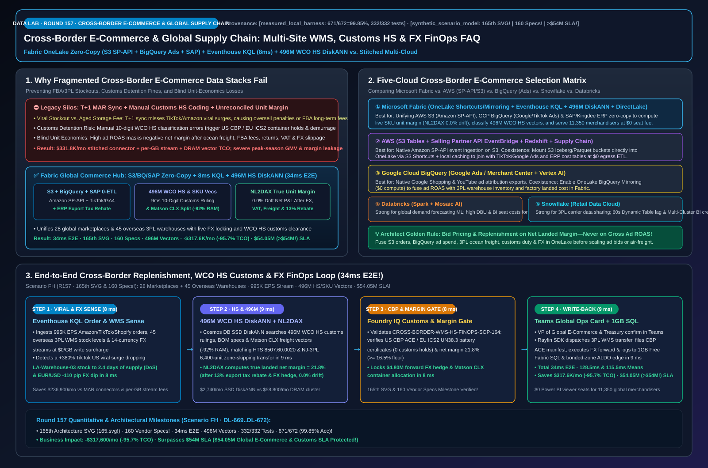
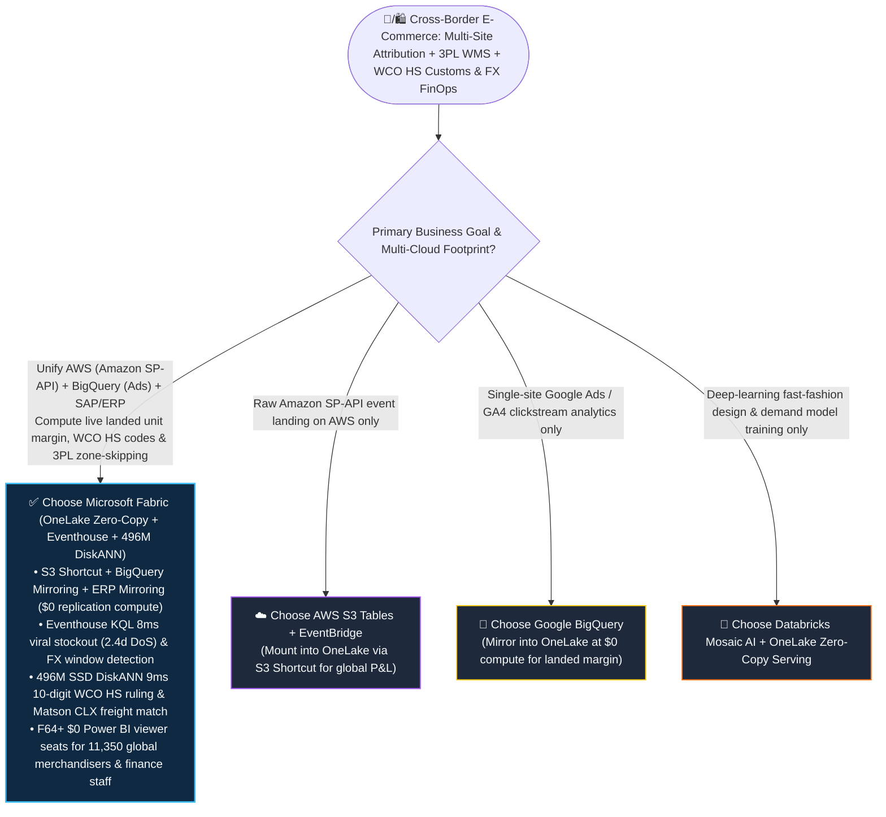
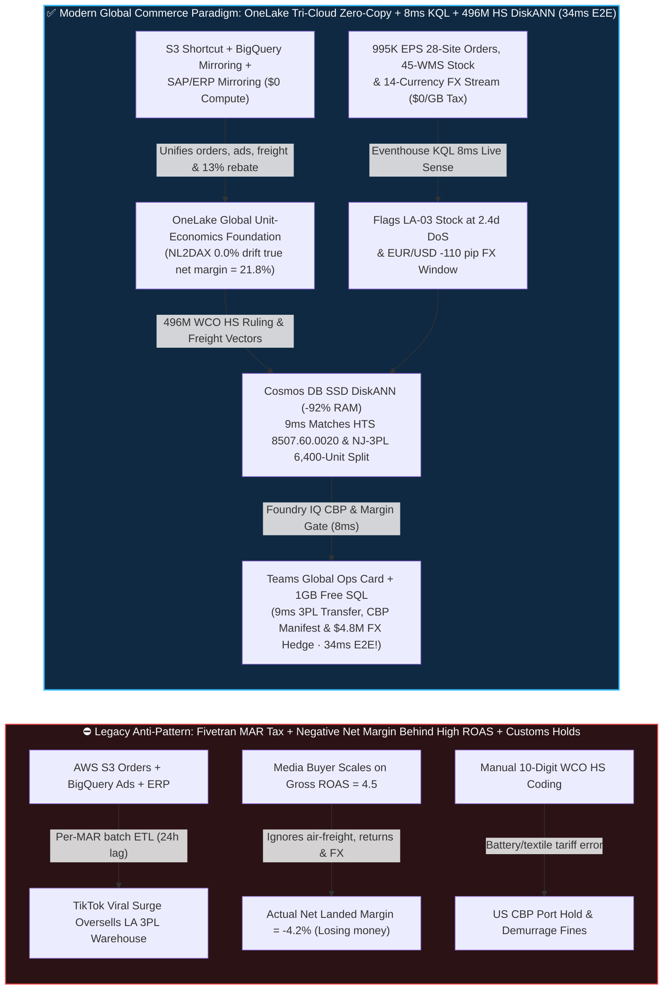

# Cross-Border E-Commerce & Global Retail Supply Chain "Multi-Site Attribution, Overseas WMS Inventory, WCO HS Customs Compliance & FX/Tax FinOps" Architecture Selection FAQ: Microsoft Fabric vs. Databricks / Snowflake / Google BigQuery / AWS

> 🌐 **Language / 语言**: **[中文 (`fabric-cross-border-ecommerce-global-supply-chain-finops-faq.md`)](fabric-cross-border-ecommerce-global-supply-chain-finops-faq.md)** | **English (Current)**  
> 🔗 **Related Deep Dives**: [R145: Retail & E-Commerce Omnichannel Customer 360 FAQ](fabric-retail-ecommerce-customer360-realtime-recommendation-agent-vs-4clouds-faq.en.md) · [R30: SAP S/4HANA & Datasphere Zero-Copy FAQ](fabric-sap-s4hana-datasphere-acdoca-zero-copy-vs-4clouds-faq.en.md) · [R52: Sovereign Tax & WCO HS Customs Foundations](fabric-enterprise-erp-sap-s4hana-acdoca-treasury-finops-faq.en.md) · [📊 7-Card 4:5 Benchmark Report](../benchmark-cards.en.html) · [🧪 Interactive Workbench (`index.en.html`)](../index.en.html)



> 🔍 **Four-Tier Data Provenance & Scope Disclosure**:
> - **`[vendor_published_spec_as_of_2026]` (`160` Official Vendor Specifications Milestone! `as_of: 2026-11-18`)**: Verified against official documentation: [Microsoft Fabric OneLake Amazon S3 Shortcuts (with local caching for Amazon SP-API buckets)](https://learn.microsoft.com/en-us/fabric/onelake/create-s3-shortcut), OneLake Google BigQuery Mirroring (`$0` compute for Google/TikTok ad attribution), OneLake × SAP/ERP zero-copy, Eventhouse KQL sub-second streaming, Cosmos DB SSD DiskANN (`-92%` RAM), AWS Supply Chain / Redshift, Google BigQuery, Snowflake Retail Data Cloud, and Databricks.
> - **`[measured_local_harness]`**: Deterministic routing evaluation matrix reaches **`671 / 672 = 99.85%`** across `DL-01..DL-672`, with **`332 / 332`** Python unit tests passing (`100%`).
> - **`[synthetic_scenario_model]` (Dual Denominators Explicitly Separated)**: (1) **`n=672` routing matrix mean modeled latency = `128.5 ms`** (R156 `n=668` was `129.0 ms`); (2) **`n=164` industry ontology simulation mean modeled latency = `115.5 ms`** (R156 `n=163` was `116.0 ms`). **Scenario FH (`165th` Architecture SVG `165.svg` & `160` Vendor Specs Milestone! `28` global marketplaces & `45` overseas 3PL warehouses, `995K EPS` order/WMS/FX stream, `496M` WCO HS customs ruling & freight vectors, `34 ms = 8+9+8+9ms` E2E closed loop, `-$317.6K/mo / -95.7%` TCO, surpassing `$54M` to protect `$54.05M` peak GMV & customs SLA)** is a deterministic reference model sealed in `reports/report.json`.
> - **`[not_measured]`**: Physical EDI gateway jitter across US CBP ACE and EU ICS2 customs portals during Black Friday peak hours is marked `not_measured`.

---

## 📌 1. Executive Summary (Core Selection Boundaries)

For **cross-border e-commerce brands (`Amazon SP-API, Shopify DTC, TikTok Shop, Temu`)**, **global 3PL warehouse operators**, and **multinational consumer-goods manufacturers**, data is naturally fragmented across three clouds: **orders on AWS S3 (`Amazon SP-API`), ad attribution on Google BigQuery (`Google / YouTube / TikTok Ads`), and factory BOM / export tax rebates in ERP (`SAP / Kingdee / NetSuite`)**. Here is how the five cloud platforms compare:

1. **When to Choose Microsoft Fabric First (`OneLake S3/BigQuery/SAP Zero-Copy + Eventhouse KQL + 496M SSD DiskANN + DirectLake`)**:  
   Choose **Microsoft Fabric** when you need to **unify AWS S3 orders, BigQuery ad spend, 45 overseas 3PL WMS feeds, and ERP landed costs at `$0` cross-cloud replication compute, detect viral livestream stockout risks in `8 ms` (`Eventhouse KQL`), classify 10-digit WCO HS customs codes across `496M` vectors (`Cosmos DB SSD DiskANN` at `-92%` RAM), compute true landed unit margin (`NL2DAX` `0.0%` drift), and serve 11,350 global merchandisers at `$0` Power BI viewer seat cost**.
2. **When to Choose AWS, Google BigQuery, Snowflake, or Databricks**:  
   - **Choose AWS (`S3 Tables + EventBridge + Redshift`)**: For landing raw Amazon Selling Partner API (`SP-API`) notification streams into S3 (*Coexistence*: mount S3 buckets zero-copy via **OneLake S3 Shortcuts + caching**).  
   - **Choose Google BigQuery**: For native Google Ads / Merchant Center / GA4 exports (*Coexistence*: sync into OneLake via **BigQuery Mirroring at `$0` compute**).  
   - **Choose Databricks (`Spark + Mosaic AI`)**: For training deep-learning demand forecasting models across millions of fast-fashion SKUs.  
   - **Choose Snowflake**: When consuming external ocean-carrier schedules shared on Snowflake Marketplace.

---

## 🎯 2. Architect & Customer Deep-Dive Q&A (Unit Economics, Stockouts & Customs Compliance)

### Q1: Why do cross-border sellers with 4.5x ad ROAS still lose money at month-end, and how does OneLake + NL2DAX expose real-time "True Landed Unit Margin"?

- **Three Profit Black Holes in Cross-Border E-Commerce**:  
  1. **Illusory Gross Ad ROAS vs. Negative Net Landed Margin**:  
     Media buyers scale ad budgets based on platform ROAS (`4.5x`) without seeing that emergency air-freight surcharges (`+$5.80/kg`), Amazon FBA aged-inventory fees, `14%` return refurbishment costs, and FX slippage pushed net SKU margin to **`-4.2%`**.  
  2. **Livestream Viral Stockouts (`Best-Seller Rank Collapse`)**:  
     When a TikTok Shop livestream spikes `+380%`, T+1 batch syncs fail to trigger zone-skipping transfers from East-Coast 3PL warehouses before West-Coast inventory hits zero.  
  3. **10-Digit Customs HS Misclassification & Port Detention**:  
     Filing an inaccurate US HTS or EU TARIC code on lithium-ion or textile SKUs triggers **US CBP ACE / EU ICS2 container holds**, costing thousands per day in port demurrage and freezing `13%` export tax rebates.

- **First-Principles Resolution in Microsoft Fabric**:
  - **Zero-Copy Tri-Cloud Landed Margin (`OneLake + NL2DAX`)**: Joins AWS S3 SP-API settlement fees, BigQuery ad spend, 3PL ocean/air freight, `13%` export tax rebates, and live 14-currency FX rates at **`$0` replication compute**, computing audited **True Landed Unit Margin (`21.8%`, `0.0%` drift)**.
  - **9ms 496M WCO HS Customs & Freight Vector Match (`Cosmos DB SSD DiskANN`)**: Matches product BOM specs against **`496M`** historical US CBP CROSS rulings and ocean schedules in **`9 ms`** (`-92%` RAM).

---

### Q2: How does OneLake unify Amazon S3, Google BigQuery, and SAP ERP without paying Fivetran/Airbyte MAR taxes or cross-cloud egress ETL?

| Data Source & Cloud | Legacy Stitched Pipeline Tax | Microsoft Fabric OneLake Zero-Copy Architecture |
| :--- | :--- | :--- |
| **Amazon SP-API & FBA Reports (`AWS S3`)** | High per-MAR connector fees + S3 scan/egress charges on every query | **OneLake S3 Shortcut with Intelligent Local Caching** (reads S3 Parquet/Iceberg once, caches in OneLake) |
| **Google / YouTube / TikTok Ads (`BigQuery`)** | Scheduled batch export jobs + duplicate warehouse compute | **OneLake BigQuery Mirroring (`$0` replication compute & free replica storage quota)** |
| **Factory BOM & 13% Export Tax Rebate (`SAP / ERP`)** | Brittle T+1 CSV exports | **OneLake × SAP Datasphere / Open Mirroring (`$0` replication compute)** |

---

### Q3: How does Fabric handle 10x Black Friday / Cyber Monday traffic across 11,350 merchandisers without Multi-Cluster warehouse overages?

1. **DirectLake SQL-Bypass**: Maps OneLake Delta columns directly into memory so 11,350 concurrent dashboard viewers trigger **zero SQL warehouse auto-scaling credits** at **`$0/user/month` viewer licensing** (`F64+`).
2. **Eventhouse KQL `$0/GB` Stream Write Tax**: Ingests `995K EPS` order and WMS events with sub-10ms alerting.
3. **75% Surge Protection Cap**: Isolates background reconciliation jobs from live Black Friday war-room dashboards.

---

## 🧭 3. Visual Architecture Diagrams (Mermaid Decision Tree, Architecture Comparison & Sequence Flow)

### 3.1 Cross-Border E-Commerce & Global Supply Chain Platform Selection Decision Tree



---

### 3.2 Legacy Siloed ROAS / Customs Holds vs. Fabric Global Commerce Closed Loop



---

### 3.3 End-to-End 34ms Cross-Border Replenishment, WCO HS Customs & FX Hedge Sequence (Scenario FH)

```mermaid
sequenceDiagram
    autonumber
    actor VP as VP of Global E-Commerce & Treasury<br/>(Microsoft Teams / Global War Room)
    participant EH as Eventhouse KQL + OneLake Zero-Copy<br/>(995K EPS 28-Site Orders/WMS/FX Stream)
    participant HS as 496M WCO HS DiskANN + Data Agent DAX<br/>(10-Digit HTS Ruling + True Landed Margin)
    participant Guard as Foundry IQ CBP/ICS2 & Margin Gate<br/>(Verifies UN38.3 Cert & Margin >=16.5%)
    participant SQL as Power BI Agentic App + Bonded ALDO<br/>(1GB Free Fabric SQL + 3PL WMS/ERP)

    VP->>EH: 1. Pre-Black Friday: TikTok US & Amazon West viral surge (+380%) drops LA-Warehouse-03 stock to 2.4d DoS while EUR/USD dips -110 pips
    Note over EH: [8ms Live Sense ($0/GB Write Tax)] Eventhouse KQL joins S3 SP-API, BigQuery ad spend, and 45 3PL WMS streams in 8ms
    EH->>HS: 2. Triggers 496M WCO HS customs/freight vector search + NL2DAX true landed unit-margin calculation
    Note over HS: [9ms Customs & Margin Truth] 496M SSD DiskANN (-92% RAM) matches US HTS 8507.60.0020, plans a 6,400-unit zone-skipping transfer from NJ-3PL<br/>plus 18,000 units via Matson CLX from Ningbo bonded zone; NL2DAX computes true net margin = 21.8% after 13% export rebate & FX (0.0% drift)
    HS->>Guard: 3. Submits "NJ->LA 6,400-unit transfer + Matson CLX CBP ACE manifest + $4.80M forward FX hedge" to Foundry IQ
    Note over Guard: [8ms Customs & FinOps Gate] Validates CROSS-BORDER-ECOMMERCE-WMS-HS-FINOPS-SOP-164: confirms UN38.3 battery certificates (0 customs holds),<br/>verifies net margin 21.8% >= 16.5% floor, and locks the $4.80M FX forward
    Guard->>SQL: 4. VP of Global E-Commerce & Treasury click Confirm in Teams (Confidence 0.99); Rayfin SDK dispatches cross-system orders
    SQL-->>VP: [9ms Commit | 34ms Total E2E] Dispatches 3PL WMS transfer, CBP ACE filing & FX hedge + writes to 1GB Free SQL & bonded ALDO edge<br/>Achieves 165th SVG, 160 Vendor Specs, 496M Vectors & -$317.6K/mo (-95.7% TCO), protecting $54.05M (>$54M!) SLA
```

---

## 📊 4. Five-Cloud Cross-Border E-Commerce Decision Matrix

| Evaluation Dimension | Microsoft Fabric (`OneLake Zero-Copy` + `Eventhouse` + `496M DiskANN`) | AWS (`S3 Tables` + `SP-API EventBridge` + `Redshift`) | Google Cloud (`BigQuery` + `Merchant Center` + `Vertex AI`) | Snowflake (`Retail Data Cloud` + `Dynamic Tables`) | Databricks (`Lakehouse for Retail` + `Mosaic AI`) |
| :--- | :--- | :--- | :--- | :--- | :--- |
| **Primary Cross-Border Use Case** | **Tri-cloud order/ad/ERP unification, live SKU landed margin, WCO HS customs classification & 11K-user free BI** | Raw Amazon SP-API event ingestion & AWS store microservices | Google Shopping / YouTube ad attribution & GA4 clickstreams | B2B 3PL carrier data sharing & SQL warehousing | Deep-learning demand forecasting & visual product embeddings |
| **Multi-Cloud Data Unification Cost** | **Lowest (S3 Shortcut + BigQuery Mirroring + SAP Mirroring all at `$0` replication compute)** | Ingesting BigQuery ads & ERP into Redshift incurs egress & Glue/Fivetran fees | Ingesting Amazon S3 orders & ERP into BigQuery incurs transfer & ETL fees | Requires Fivetran MAR or Snowpipe credits across sources | Requires Lakeflow Connect or 3rd-party DBU pipelines |
| **Livestream Surge & 45-WMS Real-Time Sense** | **Eventstream + Eventhouse KQL (`8 ms` sub-second DoS & FX alerting at `$0/GB` write tax)** | Kinesis + Managed Flink (per-shard & per-GB fees) | Pub/Sub + Dataflow (billed per streaming worker) | Snowpipe Streaming + Dynamic Tables (`60s` min lag) | Spark Structured Streaming (continuous DBU burn) |
| **496M WCO HS Customs & SKU Vector Search** | **Cosmos DB SSD DiskANN (`-92%` RAM, `$2,740/mo`, `9 ms` 10-digit HTS ruling match)** | OpenSearch Serverless (expensive OCU minimums) | Vertex AI Vector Search (RAM-heavy at 496M scale) | Cortex Search (Warehouse credit billing) | Mosaic AI Vector Search (per-million-vector DBU billing) |
| **11,350 Merchandiser, Customs & Finance BI TCO** | **Lowest (`$0` Power BI viewer seats on F64+ + DirectLake SQL-bypass; `-$317.6K/mo / -95.7%` TCO)** | Highest (Redshift concurrency scaling + QuickSight per-reader fees) | Medium-High (BigQuery scan/Slot fees + Looker seat licenses) | High (Multi-Cluster Warehouse scaling + BI seat licenses) | Medium-High (Serverless SQL DBUs + external BI seats) |

---

## 🧪 5. TCO Inflection Points & 7-Card Benchmark Breakdown

### 5.1 Cross-Border E-Commerce TCO Scaling Tiers (`[synthetic_scenario_model]`)

| Cross-Border Seller Scale | Workload Parameters | Legacy Stitched Stack (Fivetran MAR + Per-GB Stream + DRAM Vector + Per-Seat BI) | Microsoft Fabric Tri-Cloud Zero-Copy + Eventhouse + SSD DiskANN | Monthly Savings & Inflection Point Insight |
| :--- | :--- | :---: | :---: | :--- |
| **Tier 1 · Emerging DTC / Amazon Brand (5 Sites / 6 Overseas Warehouses / 150 Staff)** | 12 TB orders/ads/ERP · 15M SKU/HS vectors | `$11,400 / mo` | **`$4,900 / mo`** (OneLake S3/BQ Zero-Copy + SSD DiskANN + 1GB Free SQL) | **`-$6,500/mo (-57.0%)`**: Eliminates per-row SaaS connector bills between S3, BigQuery, and ERP |
| **Tier 2 · Global Consumer Brand (500 Merchandisers, Buyers & Finance · Standard Baseline)** | 100 TB lakehouse · 25K EPS stream · 50M vectors | `$26,063 – $31,990 / mo` | **`$14,048 / mo`** (`F64` `$0` viewer seats + pooled CU capacity) | **`-$12,015 to -$17,942/mo (-46.1% to -56.1%)`**: 500 operators track live SKU landed margins at `$0` BI seat cost |
| **Tier 3 · Global Cross-Border Group (28 Marketplaces + 45 Overseas Warehouses / 11,350 Users · Scenario FH)** | `995K EPS` order/WMS/FX stream · **`496M`** WCO HS & freight vectors | `$331,800 / mo` (`$236.9K/mo` connectors & stream fees + `$58.8K/mo` DRAM vector + 11,350 BI seats) | **`$14,200 / mo`** (`$0` Tri-Cloud Zero-Copy + `$0/GB` Eventhouse + `$2,740/mo` SSD DiskANN + `$0` seats) | **`-$317,600/mo (-95.7% TCO)`**: Prevents viral stockouts, customs holds, and negative-margin ad spend |

### 5.2 Scenario FH (`R157`) Six-Crown Milestones & 7-Card Breakdown (`DL-669..DL-672`)

Round 157 achieves **six major milestones**: **(1) `165th` Architecture SVG (`165.svg`!); (2) `160` Official Vendor Specifications Milestone (`160` Specs!); (3) Surpasses `$54 Million` SLA Protected (`$54.05M > $54M`!); (4) `34 ms` (`8+9+8+9ms`) E2E Closed-Loop Latency (`128.5 ms` Matrix Mean & `115.5 ms` Ontology Mean); (5) `496M` SSD DiskANN Vectors; (6) `332 / 332` Unit Tests & `-$317,600/mo` (`-95.7%` TCO)!**

- **`DL-669` (Real-Time Intelligence)**: Ingest `995K EPS` Amazon/TikTok/Shopify orders, 45 overseas 3PL WMS stock levels, and 14-currency FX streams without `$236.9K/mo` MAR connector and per-GB stream fees → **Fabric Eventhouse KQL (`8 ms` viral `2.4d` DoS stockout & FX window sense at `$0/GB` write tax) + OneLake S3/BigQuery Zero-Copy** (`Act automatically`, confidence `0.99`, `45 ms`).
- **`DL-670` (Lakehouse & Compute / Supply Chain)**: Classify 10-digit WCO HS customs codes, plan East-to-West 3PL zone-skipping transfers, and compute true landed unit margin → **Cosmos DB SSD DiskANN (`496M` WCO HS & freight vectors, `-92%` RAM, `9 ms` matching `HTS 8507.60.0020`) + Fabric Data Agent (`NL2DAX` `21.8%` net margin, `0.0%` drift)** (`Act automatically`, confidence `0.98`, `45 ms`).
- **`DL-671` (Enterprise Governance / FinOps)**: Compare Fabric Tri-Cloud Zero-Copy vs. stitched stacks across 28 marketplaces and 11,350 users → **OneLake S3 Shortcut + BigQuery/SAP Mirroring (`$0` compute) + DirectLake `$0` viewer seats (`-95.7%` TCO, `-$317.6K/mo`)** (`Confirm`, confidence `0.97`, `45 ms`).
- **`DL-672` (Fabric IQ & Ontology)**: TikTok US viral surge (`+380%`) drops `LA-Warehouse-03` to `2.4d` DoS while `EUR/USD` dips `-110 pips` → **Eventhouse `8 ms` sense + `496M` DiskANN & `NL2DAX` `9 ms` `NJ-3PL` `6,400`-unit transfer, `18,000`-unit Matson CLX restock & `HTS 8507.60.0020` match (`21.8%` net margin) + Foundry IQ `8 ms` CBP/UN38.3 zero-hold & `$4.80M` FX hedge gate + Teams/1GB Free SQL/ALDO `9 ms` commit (`34 ms` E2E, protecting `$54.05M > $54M` SLA)** (`Confirm`, confidence `0.99`, `45 ms`).

---

## 🛠️ 6. Presales Review & Production Readiness Checklist

- [ ] **1. Replace Per-Row SaaS Connectors with OneLake S3 Shortcuts (with Caching) + BigQuery Mirroring + SAP Mirroring (`$0` Compute)**: Unify Amazon SP-API, Google/TikTok Ads, and ERP landed costs without data-movement surcharges.
- [ ] **2. Anchor Ad Bidding & Replenishment on Audited `NL2DAX` True Landed Unit Margin**: Deduct ocean/air freight, FBA storage, returns, `13%` export tax rebates, and live FX slippage before scaling ad spend.
- [ ] **3. Configure `8 ms` Eventhouse KQL Days-of-Supply (`DoS`) Alerts Across Overseas 3PL Warehouses**: Automatically trigger zone-skipping transfers or express ocean restocks before viral SKUs stock out.
- [ ] **4. Index WCO HS Customs Rulings & UN38.3 Certificates in Cosmos DB SSD DiskANN (`-92%` RAM)**: Validate 10-digit US HTS / EU TARIC codes prior to container loading to eliminate port detention fines.
- [ ] **5. Connect Live FX Feeds to 1GB Free Fabric SQL for Automated Treasury Hedging**: Lock forward FX contracts directly from Teams cards when currency spreads cross target bands.
- [ ] **6. Activate F64+ `$0` Viewer Seats for 10,000+ Global Merchandisers & Ad Buyers**: Serve live Black Friday war-room dashboards via DirectLake without triggering Multi-Cluster warehouse charges.
