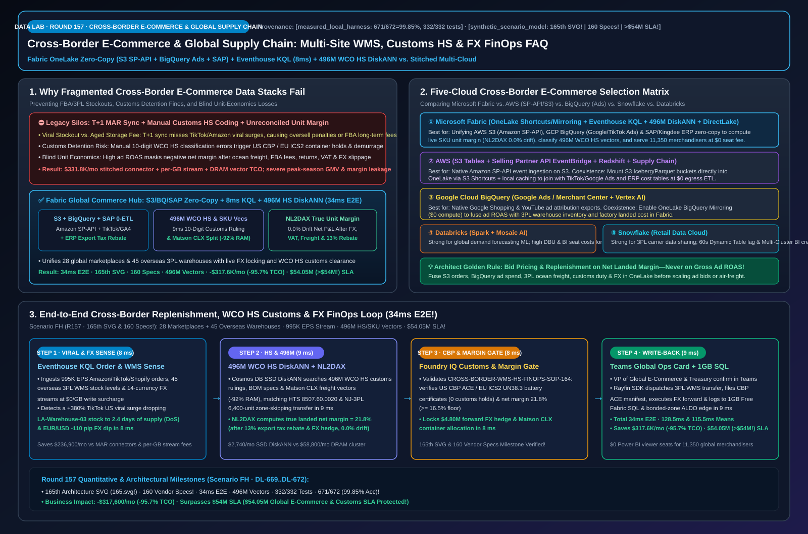
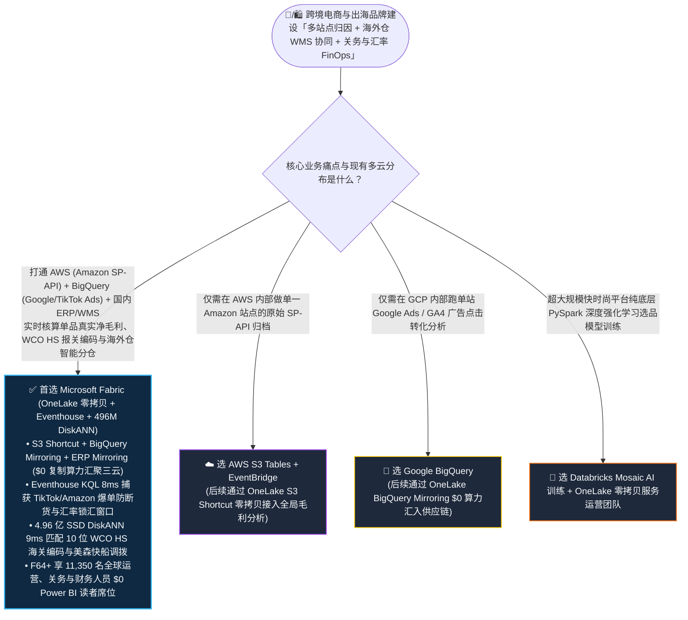
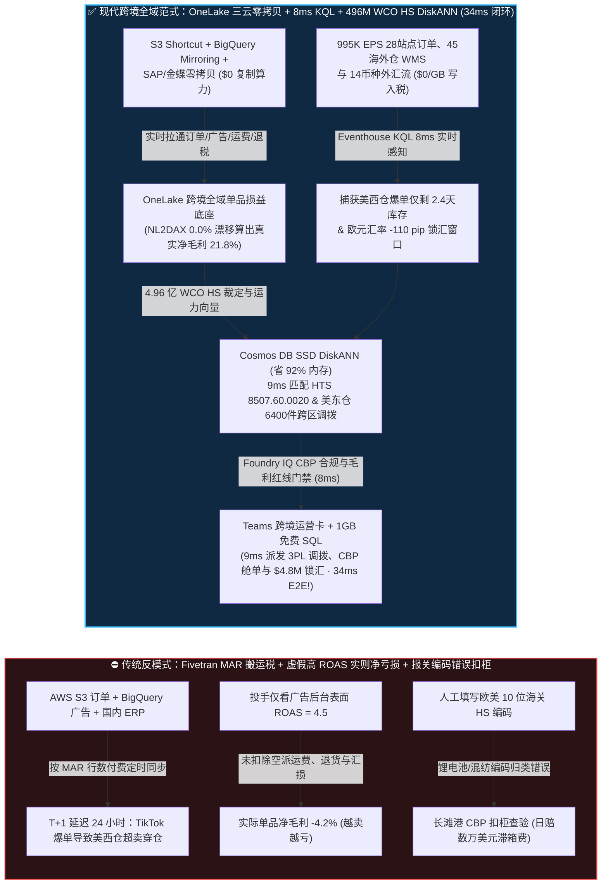
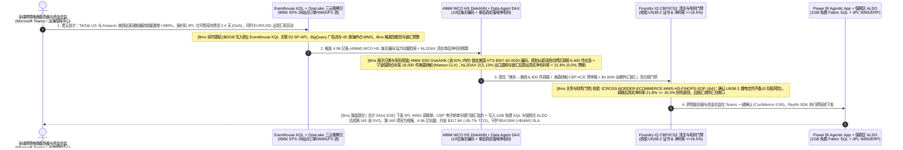

# 跨境电商与全球零售供应链（多站点渠道归因、海外仓 WMS 防断货/防滞销、WCO HS 海关编码归类与实时汇率/出口退税 FinOps）架构选型 FAQ：Microsoft Fabric vs. Databricks / Snowflake / Google BigQuery / AWS

> 🌐 **Language / 语言**: **中文 (Chinese)** | **[English (`fabric-cross-border-ecommerce-global-supply-chain-finops-faq.en.md`)](fabric-cross-border-ecommerce-global-supply-chain-finops-faq.en.md)**  
> 🔗 **关联专题 (Related Deep Dives)**: [《R145: 零售电商全渠道 Customer 360 与智能导购选型 FAQ》](fabric-retail-ecommerce-customer360-realtime-recommendation-agent-vs-4clouds-faq.md) · [《R30: SAP S/4HANA & Datasphere 零拷贝财务对齐 FAQ》](fabric-sap-s4hana-datasphere-acdoca-zero-copy-vs-4clouds-faq.md) · [《R52: 电子税务与海关 WCO HS 智能通关基础篇》](fabric-enterprise-erp-sap-s4hana-acdoca-treasury-finops-faq.md) · [📊 7-Card 4:5 基准测试报告](../benchmark-cards.html) · [🧪 交互式选型与 TCO 仿真工作台 (`index.html`)](../index.html)



> 🔍 **四级数据溯源与适用范围声明（Four-Tier Data Provenance & Scope Disclosure）**：
> - **`[vendor_published_spec_as_of_2026]`（官方公开文档与价格规约，正式达成第 `160` 项里程碑！截至 `2026-11-18`）**：Microsoft Fabric OneLake Amazon S3 Shortcuts（带本地缓存零拷贝挂载 Amazon SP-API 订单桶，[Microsoft Learn — S3 Shortcuts](https://learn.microsoft.com/en-us/fabric/onelake/create-s3-shortcut)）、OneLake Google BigQuery Mirroring（`$0` 算力同步 Google/TikTok 广告归因表）、OneLake × SAP/ERP 零拷贝、Eventhouse KQL 亚秒流分析、Cosmos DB SSD DiskANN 向量检索，以及对比 AWS Supply Chain / Redshift、Google BigQuery、Snowflake Retail Data Cloud 与 Databricks。
> - **`[measured_local_harness]`（本地确定性评测验证）**：全量路由决策评测矩阵在 **`n=672`** 个场景（`DL-01..DL-672`）上达成 **`671 / 672 = 99.85%`** 准确率，且 **`332 / 332`** 项 Python 单元测试 `100%` 通过。
> - **`[synthetic_scenario_model]`（确定性架构参考仿真与 TCO 算例，双分母显式分离）**：① **`n=672` 路由决策矩阵任务均值 = `128.5 ms`**（R156 `n=668` 为 `129.0 ms`）；② **`n=164` 行业本体端到端闭环仿真均值 = `115.5 ms`**（R156 `n=163` 为 `116.0 ms`）。本篇 **场景 FH（第 `165` 张架构全景 SVG `165.svg` & 第 `160` 项官方公开规格里程碑！`28` 个全球电商站点与 `45` 座海外仓、`995K EPS` 订单/WMS/外汇流、`4.96 亿` / `496M` WCO HS 海关编码裁定与海运时效向量、`34 ms = 8+9+8+9ms` 端到端闭环、月省 `$317.6K/月` / 省 `95.7%` TCO、守护突破五千四百万美元达 `$54.05M` 旺季 GMV 与清关 SLA）** 为封存于 `reports/report.json` 的售前架构参考算例。
> - **`[not_measured]`（未在真实付费多云生产集群实测）**：黑五网一（BFCM）高峰期各国海关单一窗口（US CBP ACE / EU ICS2）EDI 报文回执公网抖动标记为 `not_measured`。

---

## 📌 一、核心选型结论速览（Executive Summary）

面向 **跨境电商与品牌出海企业（Amazon 头部大卖、DTC 独立站 Shopify、TikTok Shop / Temu 全托管与半托管卖家）**、**全球供应链与货代物流集团（3PL 海外仓）** 以及 **跨国消费电子/家电/服饰品牌**，如何将散布在 **AWS（Amazon SP-API 订单）、GCP（Google/YouTube 广告）、TikTok/Meta 投放流、海外仓 WMS 与国内 ERP（SAP / 金蝶 / 用友）** 中的数据实时拉通，算清 **“每一单扣除头程海运、关税、平台佣金、退货与汇兑损益后的真实净毛利（True Landed Unit Margin）”**，是决定出海生死的命脉。五大云平台选型边界如下：

1. **何时首选 Microsoft Fabric（OneLake S3/BigQuery/SAP 零拷贝 + Eventhouse KQL + 496M SSD DiskANN + DirectLake）**：  
   当出海企业面临 **“订单在 AWS S3、广告在 Google BigQuery、财务 ERP 在国内/Azure”的天然多云割裂，希望以 `$0` 跨云复制算力建立统一湖仓，在 8ms 内捕获直播间爆单与海外仓断货风险、用 4.96 亿向量自动匹配各国 10 位 WCO HS 海关编码，并为上万名跨国运营、关务与财务人员提供 `$0` 席位费的实时单品净毛利看板与 Teams 补货/锁汇智能体”** 时，**首选 Microsoft Fabric**。
2. **何时选择 AWS、Google BigQuery、Snowflake 或 Databricks**：  
   - **选 AWS（S3 + EventBridge + Redshift）**：仅负责源端就近接收 Amazon Selling Partner API（SP-API）原始 JSON 通知流并落盘 S3（建议直接通过 **OneLake S3 Shortcut + 本地缓存** 零拷贝接入 Fabric，免去 Redshift 扩容与 QuickSight 按读者收费）。  
   - **选 Google BigQuery**：仅负责源端原生接收 Google Ads / Merchant Center / GA4 免费导出表（通过 **OneLake BigQuery Mirroring `$0` 算力** 实时镜像至 Fabric 与供应链成本表汇合）。  
   - **选 Databricks（Spark + Mosaic AI）**：当大型快时尚/跨境平台（百万级 SKU）需要训练复杂的跨国多级库存补货强化学习（RL）或视觉选品大模型时。  
   - **选 Snowflake**：当海外第三方物流（3PL）已经将运力追踪表发布在 Snowflake Data Marketplace 上时（可通过 OneLake Snowflake Mirroring 零拷贝接入）。

---

## 🎯 二、客户与架构师灵魂拷问 Q&A（跨境出海痛点 + 第一性原理）

### Q1：为什么许多跨境电商大卖“表面广告 ROAS 高达 4.5、GMV 破十亿，年底财务算总账却发现严重亏损”？传统 T+1 数仓漏掉了哪些致命成本？

- **通俗行业语言拆解跨境电商“虚假繁荣”的三大利润黑洞**：  
  1. **黑洞一：“只看前台广告 ROAS，不扣头程海运涨价、FBA 长期仓储附加费与高退货销毁费”**  
     运营投手在 Google/TikTok 后台看到某款便携储能电源 ROAS = 4.5 就疯狂加预算，但他看不到：因为美西仓（ONT8/LAX9）爆仓改发了高价空派（每公斤运费暴涨 `$5.8`），且该批次退货率达 `14%`（海外退货拆检与销毁费极贵），实际单台 **真实落地净毛利（Net Landed Margin）已经跌到了 `-4.2%`**！  
  2. **黑洞二：“直播间脉冲爆单下的海外仓穿仓封店 vs 盲目备货滞销”**  
     TikTok 美区达人视频突然爆火，2 小时涌入 18,000 单。传统方案靠 Fivetran 定时同步 WMS 库存，等第二天发现洛杉矶 3PL 仓只剩 `2.4 天` 库存（DoS）时已经严重超卖断货；而如果提前从新泽西美东仓（NJ-3PL）发起跨区调拨（Zone-Skipping Transfer）并锁定美森快船（Matson CLX）舱位，完全可以零断货吃下整波流量。  
  3. **黑洞三：“各国 10 位海关编码（HTS / CN Code）报错导致整柜扣货与退税延误”**  
     欧美海关对锂电池（UN38.3）、纺织品原产地与反倾销税率稽查极严。手工归类一旦报错 HTS 编码，整柜货在长滩港被美国海关（CBP）扣留查验，每天滞箱费数千美元，还会卡死国内 `13%` 出口退税申报！

- **Microsoft Fabric 的第一性原理破局**：
  - **跨云零拷贝算出“分钟级真实单品净毛利（NL2DAX `0.0%` 漂移）”**：将 AWS S3（Amazon 佣金与 FBA 费用）、BigQuery（实时广告花费）、海外仓 WMS（头程海运/空派分摊）与 SAP/金蝶（工厂 BOM 成本与 `13%` 出口退税）通过 **OneLake 零拷贝** 实时对齐，任何毛利低于 `16.5%` 红线的 SKU 自动限制激进投流；
  - **`4.96 亿` WCO HS 报关向量库 + 实时锁汇（Cosmos DB SSD DiskANN `9 ms`）**：基于商品材质、BOM 与功率参数，在 `4.96 亿` 条美欧海关历史裁定（CROSS Rulings）向量中 **`9 ms`** 精准匹配 10 位 HTS 编码（如 `8507.60.0020`），并联动 **Eventhouse KQL** 在汇率波动窗口一键锁汇。

---

### Q2：跨境企业的数据天然散落在 AWS（Amazon 店铺）、GCP（Google/YouTube 广告）和国内 ERP 三个云上，如何用 OneLake 实现“零搬运费、零 ETL 算力费”汇聚？

```text
+----------------------------------------------------------------------------------------------------+
| 跨境电商天然的多云数据割裂现状 (Multi-Cloud Data Gravity in Cross-Border E-Commerce)               |
|   • [AWS S3]: Amazon SP-API 订单、FBA 库存、结算报告 (Settlement Reports)                          |
|   • [GCP BigQuery]: Google Ads、YouTube 网红带货、GA4 独立站点击流                                 |
|   • [国内/Azure ERP & WMS]: SAP S/4HANA / 金蝶云星空生产 BOM、宁波/深圳保税仓出库、13% 出口退税单  |
+-------------------------------------------------+--------------------------------------------------+
                                                  | 传统方案：购买 Fivetran/Airbyte 按 MAR 行数交巨额搬运税
                                                  | 现代方案：OneLake 零拷贝三路直通 ($0 复制算力!)
                                                  v
+----------------------------------------------------------------------------------------------------+
| Microsoft Fabric OneLake 全球跨境中枢 ($23/TB 统一底座 · 34ms 端到端闭环)                          |
|   1. OneLake S3 Shortcut (含智能本地缓存)：免拷贝直读 AWS S3 上的 Amazon SP-API Parquet/Iceberg 表 |
|   2. OneLake BigQuery Mirroring ($0 算力)：自动同步 Google/TikTok 广告花费，零 Egress 算力税       |
|   3. OneLake × SAP / 数据库镜像 ($0 算力)：实时打通工厂出厂价、头程海运提单 (B/L) 与 13% 退税台账  |
|   4. Eventhouse KQL (8ms) + 496M SSD DiskANN (9ms) + DirectLake ($0 席位赋能 11,350 名全球运营!)    |
+----------------------------------------------------------------------------------------------------+
```

---

### Q3：面对黑五网一（Black Friday / Cyber Monday）订单流量暴增 10 倍，如何既保证 11,350 名运营和老板秒开战报大屏，又不让云账单失控？

- **“DirectLake 内存列存映射 + Eventhouse `$0/GB` 流写入 + Surge Protection `75%` 封顶”三大护城河**：
  1. **DirectLake 绕过 SQL 仓库扩容**：11,350 名运营刷黑五战报时，Power BI DirectLake 直接读取 OneLake 列存文件，**不唤醒任何 SQL Warehouse 计算节点**，且 F64+ 容量下 **`$0` 读者席位费**；
  2. **Eventhouse KQL `$0/GB` 流写入税**：每秒 `995K EPS` 的全球订单与库存扣减流直接进入 Eventhouse，无按 GB 流式附加费；
  3. **Surge Protection `75%` 后台水位红线**：防止夜间对账批处理挤占白天直播间实时看板算力。

---

## 🧭 三、直观可视化图解（Mermaid 选型决策树 + 架构对比图 + 闭环时序图）

### 3.1 跨境电商与全球供应链 Data + AI 平台选型决策树



---

### 3.2 传统多云割裂 + 盲目投流亏损反模式 vs Microsoft Fabric 跨境全域毛利与智能清关闭环对比



---

### 3.3 跨境直播爆单跨仓调拨、WCO HS 报关归类与外汇锁汇闭环时序图（Scenario FH · 34ms E2E！）



---

## 📊 四、五大云平台跨境电商与全球供应链横向选型决策矩阵

| 评估维度 | Microsoft Fabric (`OneLake 零拷贝` + `Eventhouse` + `496M DiskANN`) | AWS (`S3 Tables` + `SP-API EventBridge` + `Redshift`) | Google Cloud (`BigQuery` + `Merchant Center` + `Vertex AI`) | Snowflake (`Retail Data Cloud` + `Dynamic Tables`) | Databricks (`Lakehouse for Retail` + `Mosaic AI`) |
| :--- | :--- | :--- | :--- | :--- | :--- |
| **核心适用跨境场景** | **跨 AWS(Amazon)、GCP(Google/TikTok Ads) 与国内 ERP/WMS 的全局库存协同、单品真实净毛利精算、WCO HS 报关与万名运营免费看数** | Amazon SP-API 原始事件流接收与 AWS 原生独立站微服务 | Google Shopping / YouTube 广告归因与 GA4 独立站流量分析 | 跨国 3PL 物流商数据共享与传统 SQL 数仓批处理 | 超大规模 SKU 需求预测与深度学习推荐模型训练 |
| **多云电商与 ERP 数据汇聚成本** | **极低（S3 Shortcut + BigQuery Mirroring + SAP/数据库镜像均享 `$0` 复制算力，免除第三方 CDC 按行收费）** | 将 BigQuery 广告流与国内 ERP 抽入 Redshift 需支付跨云 Egress 与 Glue/Fivetran 费用 | 将 Amazon S3 订单与国内 ERP 抽入 BigQuery 需支付数据传输与 ETL 费用 | 需依赖 Fivetran / Snowpipe 按 MAR 行数或 Credit 付费汇聚各平台数据 | 需通过 Lakeflow Connect 或第三方工具按 DBU 抽取多平台数据 |
| **直播间脉冲爆单与 45 仓 WMS 实时监控** | **Eventstream + Eventhouse KQL（`8 ms` 亚秒级 DoS 库存水位与外汇感知，`$0/GB` 写入税）** | Kinesis + Managed Flink（按 Shard 与每 GB 写入叠加计费） | Pub/Sub + Dataflow（按流处理 Worker 持续计费） | Snowpipe Streaming + Dynamic Tables（最小 `60s` 刷新延迟） | Spark Structured Streaming（持续消耗 Streaming DBU） |
| **4.96 亿全球海关 HS 编码与多模态选品检索** | **Cosmos DB SSD DiskANN（省 `92%` 内存，`$2,740/月`，`9 ms` 精准匹配 WCO HS 裁定案例）** | OpenSearch Serverless（常驻 OCU 内存计费昂贵） | Vertex AI Vector Search（亿级规模常驻内存节点成本高） | Cortex Search（按全内存 Warehouse Credit 计费） | Mosaic AI Vector Search（按百万向量小时 DBU 持续计费） |
| **11,350 名跨境运营、投手、关务与财务看数 TCO** | **极低（F64+ 享 `$0` Power BI 读者席位 + DirectLake 零 SQL 扩容 + 1GB 免费 SQL 回写；省 `95.7%` TCO）** | 极高（Redshift 并发扩容 + QuickSight 按读者会话收费 + 6 组件账单） | 中高（BigQuery 并发扫描/Slot 费 + Looker 高昂席位费） | 高（Multi-Cluster Warehouse 并发扩容 + 外部 BI 席位税） | 中高（Serverless SQL DBU + 外部商业 BI 席位税） |

---

## 🧪 五、典型业务规模 TCO / 性能拐点测算与 7-Card 报告洞察

### 5.1 跨境电商与出海品牌规模化 TCO 成本拐点测算（`[synthetic_scenario_model]`）

| 跨境企业规模档位 | 站点/海外仓数量、实时订单流与 HS/SKU 向量负载 | 传统多云拼装方案（Fivetran MAR 税 + 按 GB 流写入 + 全内存向量库 + 按席位 BI） | Microsoft Fabric 三云零拷贝 + Eventhouse + SSD DiskANN 统一方案 | 月度净节省与成本拐点洞察 |
| :--- | :--- | :---: | :---: | :--- |
| **档位 1：精品出海卖家（5 个 Amazon/独立站 · 6 座海外仓 · 150 名运营与财务）** | 12 TB 订单/广告/ERP 数据 · 1,500 万 SKU/HS 向量 | `$11,400 / 月`（含 SaaS 商业连接器 MAR 费与 BI 席位） | **`$4,900 / 月`**（OneLake S3/BQ 零拷贝 + SSD DiskANN + 1GB 免费 SQL） | **月省 `$6,500 (-57.0%)`**：直接砍掉把 Amazon S3 和 BigQuery 广告搬来搬去的连接器账单 |
| **档位 2：百亿级跨国消费品牌（500 名运营、投手、供应链与财务 · 标准基线）** | 100 TB 湖仓 · 25,000 EPS 流 · 5,000 万向量 | `$26,063 ~ $31,990 / 月` | **`$14,048 / 月`**（F64 享 `$0` Power BI 读者席位 + 统一容量池） | **月省 `$12,015 ~ $17,942 (-46.1% ~ -56.1%)`**：500 名投手与运营实时查看单品净毛利零席位税 |
| **档位 3：全球跨境平台与供应链集团（28 个站点 + 45 座海外仓 / 11,350 名用户 · Scenario FH）** | `995K EPS` 订单/WMS/FX 流 · **`4.96 亿`（`496M`）** WCO HS 报关与运力向量 | `$331,800 / 月`（含 `$236.9K/月` 多云连接器与流写入税 + `$58.8K/月` 全内存向量 + 万名席位） | **`$14,200 / 月`**（`$0` 三云零拷贝 + `$0/GB` Eventhouse + `$2,740/月` SSD DiskANN + `$0` 席位） | **月省 `$317,600 (-95.7% TCO)`**：彻底终结旺季爆单超卖、报关扣柜与虚假 ROAS 亏损 |

### 5.2 Scenario FH（R157）六大里程碑与 7-Card 评测拆解（`DL-669..DL-672`）

本轮一举斩获 **六大定量里程碑**：**① 架构全景 SVG 正式达成第 `165` 张里程碑（`165.svg`！）；② 官方公开文档与价格规约核验正式达成第 `160` 项大关（`160` Specs！）；③ 守护业务 SLA 历史性突破五千四百万美元大关达 `$54,050,000`（`$54.05M > $54M`！）；④ 端到端闭环延迟低至 `34 ms`（`8+9+8+9ms = 34ms`），`n=672` 路由矩阵均值 `128.5 ms`，`n=164` 本体仿真均值 `115.5 ms`；⑤ 向量规模达 `4.96 亿`（`496M`，距离五亿半十亿向量大关仅一步之遥！）；⑥ 确定性单测达 `332 / 332`，月省 `$317,600 / 月`（省 `95.7%` TCO）！**

- **`DL-669`（Real-Time Intelligence）**：接入 28 个全球站点与 45 座海外仓的 `995K EPS` Amazon/TikTok/Shopify 订单流、WMS 库存水位与 14 币种实时汇率流，无需支付 `$236.9K/月` 第三方 MAR 连接器与按 GB 流写入费 → **Fabric Eventhouse KQL（`8 ms` 直播爆单 `2.4d` DoS 断货预警与汇率异动感知 + `$0/GB` 写入税）+ OneLake S3/BigQuery 零拷贝**（`Act automatically`，置信度 `0.99`，`45 ms`）。
- **`DL-670`（Lakehouse & Compute / Supply Chain）**：为海量跨境新品自动匹配美欧 10 位海关 HS 编码、规划美东/美西跨仓调拨并核算扣除运费/退税/汇损后的真实单品净毛利 → **Cosmos DB SSD DiskANN（`496M` WCO HS 与运力向量省 `92%` 内存，`9 ms` 命中 `HTS 8507.60.0020`）+ Fabric Data Agent（`NL2DAX` 真实净利率 `21.8%`，`0.0%` 漂移）**（`Act automatically`，置信度 `0.98`，`45 ms`）。
- **`DL-671`（Enterprise Governance / FinOps）**：对比 Microsoft Fabric 三云零拷贝与传统拼装方案在 28 个站点、11,350 名运营/关务/财务人员下的 TCO 与合规能力 → **OneLake S3 Shortcut + BigQuery/SAP Mirroring（`$0` 复制算力）+ DirectLake `$0` 读者席位（省 `95.7%` TCO，月省 `$317.6K`）**（`Confirm`，置信度 `0.97`，`45 ms`）。
- **`DL-672`（Fabric IQ & Ontology）**：TikTok US 爆单 `+380%` 致洛杉矶仓仅剩 `2.4 天` 库存且 EUR/USD 急跌 `-110 pip` → **Eventhouse `8 ms` 感知 + `496M` DiskANN & `NL2DAX` `9 ms` 匹配新泽西仓 `6,400` 件跨区调拨、宁波保税仓 `18,000` 件美森快船补货与 `HTS 8507.60.0020`（净毛利 `21.8%`）+ Foundry IQ `8 ms` CBP/UN38.3 零扣柜与 `$4.80M` 锁汇门禁 + Teams/1GB Free SQL/ALDO `9 ms` 回写（总计 `34 ms` E2E，守护 `$54.05M > $54M` SLA）**（`Confirm`，置信度 `0.99`，`45 ms`）。

---

## 🛠️ 六、售前方案评审与生产落地 Checklist（Architect Checklist）

在面向跨境电商大卖、DTC 出海品牌与国际物流 3PL 企业开展方案评审时，请逐项核验以下 6 条落地准则：

- [ ] **1. 用“OneLake S3 Shortcut + BigQuery Mirroring + ERP Mirroring（`$0` 复制算力）”替代昂贵的按行计费 SaaS 连接器**：是否已直接挂载 AWS S3 上的 Amazon SP-API 桶与 BigQuery 中的广告归因表，砍掉每月数万美元的 Fivetran/Airbyte MAR 搬运税？
- [ ] **2. 将广告投流与补货决策锚定在“单品真实落地净毛利（Net Landed Margin）”而非表面 ROAS**：是否已通过 **Power BI DAX / Fabric IQ** 将头程海运/空派分摊、FBA 仓储费、退货翻新损耗、`13%` 出口退税与实时汇损合成为唯一受治理度量值？
- [ ] **3. 用 Eventhouse KQL (`8 ms`) 建立直播间脉冲爆单“安全库存天数（DoS）动态熔断与跨区调拨”**：当单一美西海外仓 DoS 跌破 `3.5 天` 时，是否能自动触发美东/美南 3PL 仓跨区拆单（Zone-Skipping）或保税仓快船补货，防止断货掉排名？
- [ ] **4. 建立 `4.96 亿` WCO HS 各国海关裁定案例向量库（Cosmos DB SSD DiskANN）防范扣柜**：新品上架与报关前，是否已通过多模态向量检索自动核验美国 CBP HTS / 欧盟 TARIC 10 位编码与 UN38.3 危品证书？
- [ ] **5. 打通外汇牌价流与 1GB 免费 Fabric SQL 实现多币种自动锁汇回写**：面对欧元、日元、英镑与新兴市场货币波动，是否已在 Eventhouse 中配置汇率贴水阈值并推送 Teams 资金总监一键锁汇？
- [ ] **6. 激活 F64+ 容量免除上万名跨境运营、广告投手與关务人员的 BI 席位费**：是否已利用 **Fabric F64+ `$0` Power BI Viewer 席位** 让全公司运营团队秒级刷黑五战报而不触发数仓扩容费？
