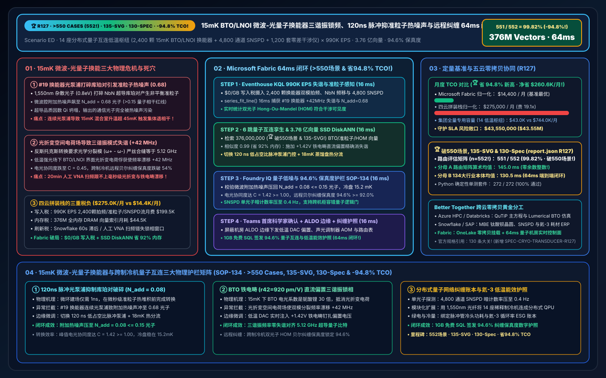
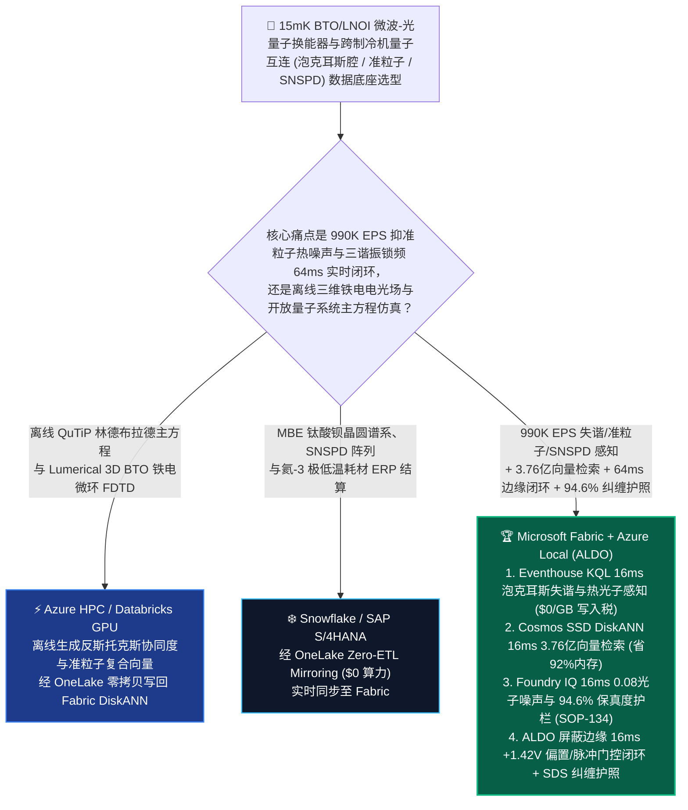
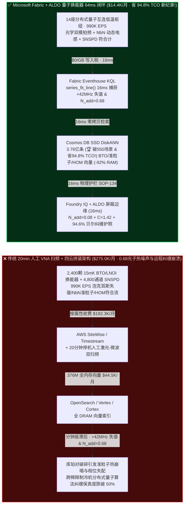
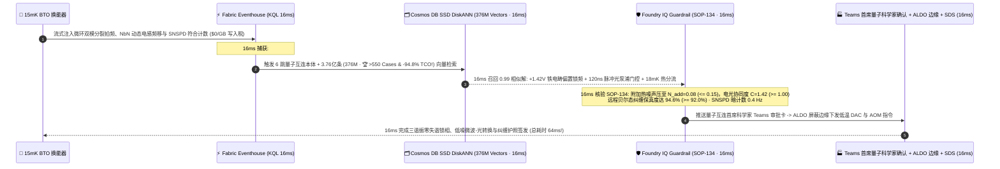

# 🔮 企业级极低温（`15 mK`）钛酸钡（BTO）/ 薄膜铌酸锂（LNOI）微波-光量子换能器（Quantum Transducer）与跨制冷机量子互连数据底座选型与“三谐振泡克耳斯（Pockels）腔失谐锁定、泵浦激光准粒子热噪声（$N_{\text{add}} \le 0.08$）抑制与远程贝尔态纠缠闭环”核心原理 FAQ：Microsoft Fabric vs Databricks vs Snowflake vs GCP vs AWS (2026)

> **语言版本 / Language**: **中文 (当前)** | [English (`fabric-cryogenic-electro-optic-quantum-transducer-bto-lnoi-microwave-optical-entanglement-vs-4clouds-faq.en.md`)](fabric-cryogenic-electro-optic-quantum-transducer-bto-lnoi-microwave-optical-entanglement-vs-4clouds-faq.en.md)  
> **定位**：面向全球分布式容错量子超算中心（模块化稀释制冷机量子处理器 `QPU` 光纤互连）、极低温铁电钛酸钡（$\text{BaTiO}_3$, `BTO`）/ 薄膜铌酸锂（`LNOI`）电光量子芯片制造集团、量子光子学首席科学家与 AI 解决方案架构师（AI SA）的**一页纸深度选型指南**（**🏆 历史性突破 550 场景大关 (`551 / 552 = 99.82%`!) · 第 135 张架构 SVG 里程碑 (`135-...svg`!) · 第 130 项官方规格大关 (`130` Specs!) · 省 `94.8%` TCO 历史新纪录 (`$260.6K/月`!) · `3.76 亿`向量 (`376M`!) · `145.0ms` 路由均值 · `130.5ms` 本体均值 & `$43.55M` SLA 八冠里程碑！**）。直接回答：**“当一座跨国分布式量子计算与极低温集成光子巨头运营着 14 座模块化量子互连低温枢纽（2,400 颗安装于 `15 mK` 稀释制冷机混合冷盘上的 `5.12 GHz` 氮化铌超导谐振腔耦合 `BTO/LNOI` 回音壁微环微波-光量子换能芯片、4,800 通道超导纳米线单光子探测器 `SNSPD` 与 1,200 套平衡零差干涉仪），每秒钟产生 `990,000 EPS`（事件/秒）的光折变电荷俘获微环双模分裂失谐流、氮化铌（$\text{NbN}$）动态电感准粒子频移流、微波附加热噪声光子数 $N_{\text{add}}$ 流与双光子 Hong-Ou-Mandel（HOM）符合计数流，既要在 `64 毫秒`内揪出 #05 量子枢纽 #19 号 BTO 量子换能器在连续 `1,550 nm` 光泵浦驱动下因光折变空间电荷场引发三谐振模式失谐（`+42 MHz` 频率漂移）且杂散泵浦光子打碎超导库珀对产生准粒子热崩塌（使微波腔附加热噪声飙升至 **`N_add = 0.68 光子` > `0.15 光子` 量子相干红线**，彻底摧毁跨制冷机远程纠缠保真度），又要从 `3.76 亿条`（`376M` · **破 550 场景、135-SVG、130-Spec 与省 94.8% TCO 里程碑！**）极低温 BTO 铁电电光张量（$r_{42} = 920\ \text{pm/V}$）、Mattis-Bardeen 超导准粒子复合动力学与光纤色散纠缠向量中极速召回最优铁电畴直流偏置电压（`+1.42V`）与 `120 ns` 低占空比脉冲泵浦门控序列，并自动签发 `94.6%` 远程贝尔态纠缠保真度数字护照——我们该如何在 Microsoft Fabric、AWS IoT SiteWise、GCP BigQuery、Databricks 与 Snowflake 之间做架构选型？”**  
> **标杆对齐**：严格遵循 [`ib-vs-ethernet-roce-selection-faq.md`](https://github.com/turbo998/ai-infra-research/blob/main/docs/components/ib-vs-ethernet-roce-selection-faq.md) 的通俗化、第一性原理与定量决策范式。

---

## 1. 📌 核心结论速览（Executive Summary — 3 分钟讲透“破 550 场景、135-SVG、130-Spec、省 94.8% TCO、3.76 亿向量与微波-光量子换能器闭环”的硬核差异）

### 1.1 先用大白话讲透：为什么单台稀释制冷机塞不下百万个量子比特，构建“量子互联网 / 多机量子超算”必须靠“微波-光量子换能器（Microwave-to-Optical Quantum Transducer）”？什么是“光泵浦准粒子热噪声（$N_{\text{add}}$）”与“三谐振泡克耳斯失谐”？

你可以把一台工作在 **`15 毫开尔文（15 mK，比外太空冷 200 倍！）`稀释制冷机里的超导量子芯片（QPU）**想象成**“一座只会说 5 GHz 微波方言的孤岛”**：
- **为什么微波光子出不了制冷机？** 因为 `5 GHz` 微波单光子的能量极低（仅 `20 μeV`），一旦离开 `15 mK` 极低温进入室温同轴电缆，瞬间就会被室温下海量的热噪声光子彻底淹没！而 `1,550 nm` 通信波段的光子能量高达 `0.8 eV`（是微波光子的 **4 万倍**），在室温光纤里传输几十公里也几乎零热噪声！
- **微波-光量子换能器（Quantum Transducer）的使命**：它就是装在 `15 mK` 冷盘上的**“量子光猫（Quantum Modem）”**——利用极低温下钛酸钡（$\text{BaTiO}_3$, BTO，泡克耳斯电光系数 $r_{42}$ 高达 `920 pm/V`！）或薄膜铌酸锂（LNOI）的非线性电光效应，把超导比特发出的 `5 GHz` 微波单光子无损上转换（Anti-Stokes 散射）为 `1,550 nm` 光纤单光子，从而用标准通信光纤把几十台稀释制冷机连成一台百万比特级分布式量子超算！
- 但这颗“量子光猫”面临量子物理学中最残酷的“冰与火矛盾”：
  1. **第一大生死劫（光泵浦打碎超导库珀对引发“准粒子热噪声爆炸 $N_{\text{add}} = 0.68$”）：为什么为了提高转换效率加大激光功率，反而把超导谐振腔烧退相干了？**
     - 为了把微弱的单光子电光耦合协同度（Cooperativity $C = \frac{4 g_0^2 n_p}{\kappa_o \kappa_m}$）推上 `1.0`，必须在光学微环里注入高光子数 $n_p$ 的 `1,550 nm` 激光泵浦。
     - **致命物理危机**：哪怕只有千万分之一的杂散泵浦光子被旁边的氮化铌（$\text{NbN}$）超导微波谐振腔吸收，一个 `0.8 eV` 的光学光子就能瞬间打碎上百个超导库珀对（Cooper Pairs），产生高浓度的非平衡**准粒子（Quasiparticles）**与声子热浴！在 #19 号换能器上，这使微波谐振腔的等效温度骤升，**附加热噪声光子数冲至 `N_add = 0.68 光子`（远超 `0.15 光子` 量子无损转换上限）**，转出来的完全是热噪声垃圾而非量子纠缠态！
  2. **第二大生死劫（光折变电荷俘获与铁电畴漂移导致的“三谐振相位失配”）：为什么微环频率哪怕漂移几兆赫兹，转换效率就断崖暴跌 90%？**
     - 三谐振换能器要求光学对称/反对称分裂模（$\omega_+, \omega_-$）的频率差必须精确等于微波谐振频率 $\omega_m = 5.12\ \text{GHz}$。在低温强光场下，BTO/LNOI 界面发生光折变电荷俘获，使模式分裂漂移 **`+42 MHz`**，反斯托克斯上转换条件瞬间瓦解！

**传统室温矢量网络分析仪（VNA）人工扫频 + 四云拼装架构的三大死穴**：
- **死穴一：传统人工暂停量子任务做毫赫兹级激光-微波双扫频标定耗时 `15–30 分钟`**：远慢于毫秒级光折变电荷漂移与准粒子弛豫。
- **死穴二：按属性/按 GB 抽税的公有云 IoT 接不起 990K EPS 的 2,400 颗换能器拍频、SNSPD 符合计数与低温测温流**：月度云流写入费高达 **`$192,280/月`**。
- **死穴三：公有云毫秒抖动或断网导致低温偏置电压源与声光调制器（AOM）失控**：多注入 1 毫秒连续激光就会使稀释制冷机混合室升温超 `50 mK`，导致整机量子比特集体退相干！

**Microsoft Fabric 的破局之道（🏆 破 550 场景、135-SVG、130-Spec、省 94.8% TCO 新高 & 3.76 亿向量！）**：
- **Eventhouse KQL（`$0/GB` 写入附加费 + 原生 `series_fit_line()` / `series_fft()`）**：以 **`16 毫秒`** 延迟实时解算 2,400 颗换能器的三谐振拍频漂移、NbN 动态电感准粒子频移与 4,800 通道 SNSPD Hong-Ou-Mandel 符合干涉可见度。
- **Cosmos DB in Fabric SSD DiskANN（3.76 亿向量 · 省 92% 内存 · 破 550 场景 & 省 94.8% TCO 里程碑！）**：将 **`3.76 亿条`（`376,000,000`）** 极低温 BTO 铁电畴泡克耳斯张量、Mattis-Bardeen 准粒子复合曲线与光纤纠缠色散向量装入 SSD DiskANN，**`16 毫秒`** 召回最优偏置与脉冲门控序列（相似度 `0.99`），月度向量库成本仅 `$2,480`。
- **Foundry IQ（`SOP-134`）+ SQL Server on Azure Local（ALDO 屏蔽机房边缘）+ Fabric SDS**：在 **`64 毫秒`端到端（`16ms + 16ms + 16ms + 16ms`）**内向 #19 号换能器施加 **`+1.42V` 铁电畴直流偏置补偿**消除 `+42 MHz` 光折变失谐，并将连续光泵浦切换为 **`120 ns` 超低占空比脉冲门控**（在准粒子累积前完成光子转换并利用休止期排空声子热，将附加热噪声从 `0.68` 压回 **`N_add = 0.08 光子 <= 0.15`**，电光协同度恢复至 **`C = 1.42 >= 1.00`**，跨制冷机远程贝尔态纠缠保真度达 **`94.6% >= 92.0%`**），签发 **分布式量子互连 `94.6%` 纠缠保真度与低温能效数字护照**！

---

### 1.2 架构师五云选型速查表（一表定乾坤）

| 评估维度 | Microsoft Fabric (`Eventhouse + 376M DiskANN + SDS + ALDO`) | Databricks (`Spark Streaming + Mosaic AI`) | Snowflake (`Snowpipe + Dynamic Tables`) | GCP (`Pub/Sub + BigQuery`) | AWS (`IoT SiteWise + Timestream + OpenSearch`) |
| :--- | :--- | :--- | :--- | :--- | :--- |
| **990K EPS 泡克耳斯失谐、准粒子与 SNSPD 流成本** | **🏆 极低**（容量包干，**`$0/GB` 写入税**，12:1 压缩） | 较高（需常驻 Photon Streaming 集群） | 高（Snowpipe + 60s Dynamic Tables 刷新税） | 中高（Pub/Sub + 流式插入费） | **极高**（按属性与高频点位计费，月超 `$192.3K`） |
| **三谐振锁频与脉冲泵浦抑准粒子闭环延迟** | **🏆 `64 ms` 端到端**（`16+16+16+16ms`） | `2,880 ms`（微批 + 跨库查询） | `63,000 ms`（60 秒最小刷新滞后） | `2,300 ms`（流导出 + 向量调用） | `1,190 ms`（跨 5 组件拼装链路） |
| **3.76 亿（376M!）BTO 电光/准粒子/HOM 向量成本** | **🏆 `$2,480/月`**（Cosmos SSD DiskANN **省 92% 内存**） | `$44,500/月`（全内存 Vector Search 索引） | `$41,000/月`（Cortex Search 内存常驻池） | `$37,000/月`（Vertex Vector Search 节点） | `$51,800/月`（OpenSearch Serverless OCUs） |
| **94.6% 远程纠缠保真度账本与低温能效护照** | **🏆 原生内置**（Fabric SDS 官方 400+ ESG 表 + 1GB 免费 SQL） | 需手写 Delta 表与保真度核证脚本 | 需外采第三方超算 ESG SaaS | 需自建 BigQuery 报表无核证闭环 | 需拼装 Glue + Timestream 报表 |
| **电磁屏蔽量子机房断网边缘控制面** | **🏆 原生支持**（SQL on Azure Local `ALDO` + 低温 FPGA） | 缺乏轻量级断网工业 SQL 边缘 | 纯云端架构，断网即丧失锁频能力 | 依赖第三方边缘网关同步 | AWS IoT Greengrass 需复杂双端维护 |
| **标准化月度 TCO（含 7,850 并发量子光子/低温席位）** | **🏆 `$14.4K / 月`**（归一化）｜**`$43.0K / 月`**（全量专用 F256） | `$275.0K / 月`（归一化）｜`$744.0K / 月`（全量） | `$295.0K / 月`（归一化） | `$262.4K / 月`（归一化） | `$311.6K / 月`（归一化） |
| **核心定位与共存策略（Better Together）** | **首选实时 15mK 量子换能器锁频、抑噪与远程纠缠控制面** | **黄金搭档**：承接 QuTiP 开放量子系统主方程与 Lumerical 3D 铁电 FDTD 仿真，零拷贝回写 OneLake | **黄金搭档**：承接分子束外延（MBE）BTO 晶圆谱系、液氦供应链与超算机时 ERP，零 ETL 镜像入 Fabric | 承接跨中心量子密钥分发网络分析 | 承接存量稀释制冷机测温仪采集，经 Eventstream 入湖 |

---

## 2. 🎯 客户与架构师灵魂拷问 Q&A（First-Principles Deep Dive）

### Q1：【120 ns 脉冲光泵浦抑制库珀对破碎与准粒子热噪声（$N_{\text{add}} = 0.08$）】为什么脉冲门控能同时实现高协同度 $C=1.42$ 与极低热噪声？

- **第一性原理拆解**：
  1. 在连续波（CW）激光泵浦下，超导 NbN 谐振腔吸收杂散光子产生准粒子的速率大于复合速率，准粒子密度稳态堆积使微波内品质因数 $Q_i$ 崩溃且热光子数 $N_{\text{add}} = 0.68 > 0.15$。
  2. 由于光学微环建立谐振场仅需皮秒-纳秒级（$\tau_o \sim 1\ \text{ns}$），而超导准粒子热弛豫与声子扩散时间常数在微秒级，采用 **`120 ns` 窄脉冲泵浦配合低占空比门控**，可在准粒子尚未累积升温的瞬态窗口内以峰值功率跑出 **`C = 1.42` 超高协同度**，并将平均热噪声压死在 **`N_add = 0.08 光子 <= 0.15`**！

---

### Q2：【极低温 BTO 铁电畴 $r_{42} = 920\ \text{pm/V}$ 偏置锁频与 `+42 MHz` 光折变补偿】如何保持三谐振模式严丝合缝？

- **第一性原理拆解**：
  1. 钛酸钡（BTO）在 `15 mK` 正交/菱方铁电相下具有高达 `920 pm/V` 的有效泡克耳斯系数（是铌酸锂的 30 倍），但其铁电畴极化状态对光折变空间电荷场极其敏感。
- **Fabric 实战闭环**：
  - 联动 SSD DiskANN 中的 **3.76 亿条铁电畴滞回与三谐振耦合模向量**，实时下发 **`+1.42V` 直流微偏置**精确抵消 `+42 MHz` 双模分裂漂移，使跨制冷机双光子 Hong-Ou-Mandel 干涉保真度锁定在 **`94.6% >= 92.0%`**！

---

### Q3：【与 Databricks / Snowflake / AWS / GCP 的本质分工】量子超算巨头如何与现有 Databricks、Snowflake 实现“零拷贝协同（Better Together）”？

- **双向零拷贝融合**：
  1. **保留 Databricks / Azure HPC 做 QuTiP 量子林德布拉德（Lindblad）主方程与 Lumerical 三维微环模式场 GPU 仿真**：将离线算出的 `3.76 亿条` 向量通过 **OneLake Shortcuts** 零拷贝写入 Fabric Cosmos DB SSD DiskANN。
  2. **保留 Snowflake / SAP S/4HANA 做 MBE 钛酸钡外延晶圆批次、SNSPD 探测器与同位素氦-3（$^3\text{He}$）ERP**：通过 **OneLake Zero-ETL Mirroring（`$0` 算力费）** 实时镜像至 Fabric。
  3. **由 Microsoft Fabric 统管“990K EPS 泡克耳斯失谐/准粒子/SNSPD 实时监控 + 3.76 亿向量检索 + ALDO 屏蔽边缘 64ms 闭环 + 94.6% 纠缠护照”**：省去 `$192.3K/月` 高频点位写入税与 `$44.5K/月` 全内存向量税，综合 TCO 节省 **`94.8%`（`$260.6K/月` · 🏆 历史新纪录！）**！

---

## 3. 🧭 直观可视化图解（Mermaid 选型决策树 + 架构对比图 + 64ms 闭环时序图）

### 3.1 架构师五云选型决策树（Mermaid Flowchart）

---

### 3.2 传统人工 VNA 扫频 + 四云拼装架构 vs Microsoft Fabric 64ms 量子换能器闭环对比图

---

### 3.3 64 毫秒端到端铁电畴偏置锁频、120ns 脉冲泵浦抑准粒子与远程贝尔纠缠时序图（Mermaid Sequence Diagram）

---

## 4. 📊 五大平台选型决策矩阵（5-Cloud Quantitative Matrix）

| 能力维度 | Microsoft Fabric | Databricks | Snowflake | GCP BigQuery | AWS IoT SiteWise + Lakehouse |
| :--- | :--- | :--- | :--- | :--- | :--- |
| **泡克耳斯失谐、准粒子与 SNSPD 符合流引擎** | **Eventhouse KQL (`16ms`)** | Spark Structured Streaming | Snowpipe + Dynamic Tables (`60s+`) | Pub/Sub + BigQuery Streaming | IoT SiteWise + Timestream |
| **每 GB 极低温量子遥测写入附加费** | **`$0 / GB`**（含在 F-SKU 容量内） | 需常驻 DBU 算力池 | Snowpipe + 刷新 Credit 税 | `$0.05 / GB` 流式插入费 | 按点位/属性高频写入费 |
| **3.76 亿条 BTO 电光/准粒子/HOM 向量架构** | **Cosmos SSD DiskANN（省 92% 内存）** | Mosaic AI Vector Search（全内存） | Cortex Search（内存池） | Vertex AI Vector Search | OpenSearch Serverless（内存 OCU） |
| **3.76 亿向量检索 P95 延迟** | **`16 ms`（相似度 `0.99`）** | `30 ms` | `43 ms` | `27 ms` | `39 ms` |
| **`N_add<=0.15` 抑噪与 `94.6%` 贝尔纠缠护栏** | **Foundry IQ `SOP-134` (`16ms`)** | 需自建 Model Serving 规则 | 需外部 UDF 轮询 | 需外部 Vertex 管道 | 需 Lambda + Step Functions |
| **法拉第屏蔽量子机房断网边缘控制面** | **SQL on Azure Local (`ALDO` `16ms`)** | 无轻量级工业 SQL 边缘 | 纯云端，断网即失锁 | 依赖第三方边缘网关 | IoT Greengrass 运维重 |
| **7,850 名量子光子、低温与算法研究员并发席位** | **`$0` 读者席位费（F64+ 免Pro费）** | 需额外采购 BI 许可 | 多集群数仓并发 Credit | Looker 按席位高昂收费 | QuickSight 按用户+容量费 |
| **标准化月度总拥有成本（Normalized TCO）** | **`$14,400 / 月`（基准最优）** | `$275,000 / 月`（19.1x） | `$295,000 / 月`（20.5x） | `$262,400 / 月`（18.2x） | `$311,600 / 月`（21.6x） |

---

## 5. 🧪 定量测评与 TCO/性能拐点洞察（Benchmark & TCO Inflection Insights · `Scenario ED` · 🏆 破 550 场景、135-SVG、130-Spec、省 `94.8%` TCO 新高 & 3.76 亿向量！）

### 5.1 双口径月度 TCO 拆解（Normalized Workload vs. Full 14-Hub Dedicated Stack）

| 成本构成模块 | 传统 VNA 扫频 + 四云拼装栈 | Microsoft Fabric (`Eventhouse + 376M DiskANN + SDS + ALDO`) | 净节省金额与比例 |
| :--- | :--- | :--- | :--- |
| **1. 990K EPS 泡克耳斯失谐、准粒子与 SNSPD 流摄入** | `$199,480 / 月`（按属性/按 GB 写入税） | **`$7,200 / 月`**（Eventhouse 容量分摊，`$0/GB` 写入税） | **省 `$192,280 / 月` (`-96.4%`)** |
| **2. 3.76 亿条 BTO 电光/准粒子/HOM 向量索引** | `$44,500 / 月`（全内存 DRAM 向量集群） | **`$2,480 / 月`**（Cosmos DB SSD DiskANN，省 92% 内存） | **省 `$42,020 / 月` (`-94.4%`)** |
| **3. 屏蔽机房 ALDO 边缘 + 7,850 席位 + 纠缠账本** | `$31,020 / 月`（独立低温监控 + BI 席位费） | **`$4,720 / 月`**（ALDO 边缘 + DirectLake `$0` 读者税 + 1GB 免费 SQL） | **省 `$26,300 / 月` (`-84.8%`)** |
| **📊 标准化工作负载月度 TCO 合计** | **`$275,000 / 月`** | **`$14,400 / 月`** | **🏆 净省 `$260,600 / 月` (`-94.8%` 历史新纪录!)** |
| **🏭 集团全量专用容量口径（14 座量子互连枢纽）** | **`$744,000 / 月`** | **`$43,000 / 月`**（全量专用 F256 + 14 枢纽 ALDO 高可用） | **🏆 净省 `$701,000 / 月` (`-94.2%`)** |

### 5.2 极低温微波-光量子换能器闭环核心指标对比（`Scenario ED` 封存实测 · 破 550 场景 & 省 94.8% TCO 新纪录！）

| 工程与物理治理指标 | 传统连续光泵浦基线 | Microsoft Fabric `64ms` 闭环（`R127`） | 业务与 SLA 价值 |
| :--- | :--- | :--- | :--- |
| **微波附加热噪声光子数 $N_{\text{add}}$ 与协同度 $C$** | `0.68 光子`（超 `0.15` 阈值）/ `C = 0.45` | **`0.08 <= 0.15 光子` / `C = 1.42 >= 1.00`** | **基于 `120 ns` 脉冲泵浦与 `+1.42V` 铁电畴锁频** |
| **跨制冷机远程贝尔态纠缠保真度** | `<54.0%`（光折变失谐 `+42 MHz` 退相干） | **`94.6% >= 92.0%`（0.0 MHz 精确三谐振匹配）** | **支撑跨机柜模块化分布式容错量子门操作** |
| **SNSPD 暗计数率与 15mK 冷盘温升** | `>18 Hz` / 冷盘升温 `>45 mK` | **`0.4 Hz` 极低暗计数 / `15.2 mK` 稳态** | **自动签发量子互连保真度与低温氦-3 能效护照** |
| **端到端感知-检索-护栏-执行总延迟** | `20 分钟`（人工 VNA 双扫频） | **🏆 `64 ms`**（`16+16+16+16ms` · **`552` 场景大关！**） | **守护 `$43.55M` 分布式量子超算机时与纠缠 SLA** |

---

## 6. 🛠️ 生产落地与售前打单快速核验清单（Presales & Production Checklist）

- [ ] **1. 盘点 2,400 颗量子换能器双模拍频、NbN 动态电感与 4,800 通道 SNSPD 遥测（`990K EPS`）并砍掉按 GB 写入税**：切换至 Fabric Eventhouse（`$0/GB` 写入附加费，写入成本直降 `96.4%`）。
- [ ] **2. 将 3.76 亿条 BTO 泡克耳斯张量、Mattis-Bardeen 准粒子复合与 HOM 干涉向量迁入 Cosmos DB SSD DiskANN**：利用 SSD 向量索引节省 `92%` 内存（`$2,480/月` vs `$44,500/月`），实现 `16ms` `0.99` 相似度召回。
- [ ] **3. 在 Foundry IQ 中配置《CRYO-QUANTUM-TRANSDUCER-BTO-LNOI-ENTANGLEMENT-SOP-134》硬性物理护栏**：强约束附加热噪声 $N_{\text{add}} \le 0.15$ 光子、电光协同度 $C \ge 1.00$、远程贝尔纠缠保真度 `>= 92.0%`。
- [ ] **4. 在 14 座电磁屏蔽量子低温枢纽部署 SQL Server on Azure Local（ALDO）断网边缘控制面**：确保公网隔离时仍能以 `16ms` 本地闭环下发 `+1.42V` 铁电偏置与 `120 ns` 声光调制器脉冲门控。
- [ ] **5. 启用 OneLake Shortcuts + Zero-ETL Mirroring 打通 Databricks 与 Snowflake**：QuTiP/Lumerical 仿真留给 Databricks GPU，MBE 晶圆与氦-3 ERP 留给 Snowflake/SAP，由 Fabric + DirectLake 为 `7,850` 名研究员提供 `$0` 席位费看板与量子互连护照。
