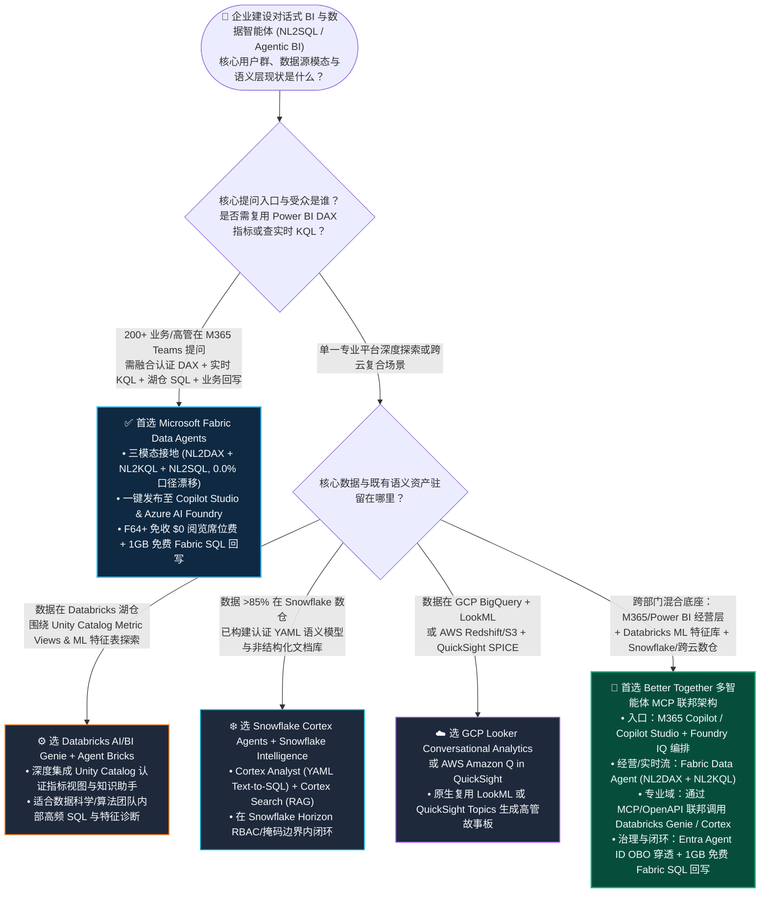
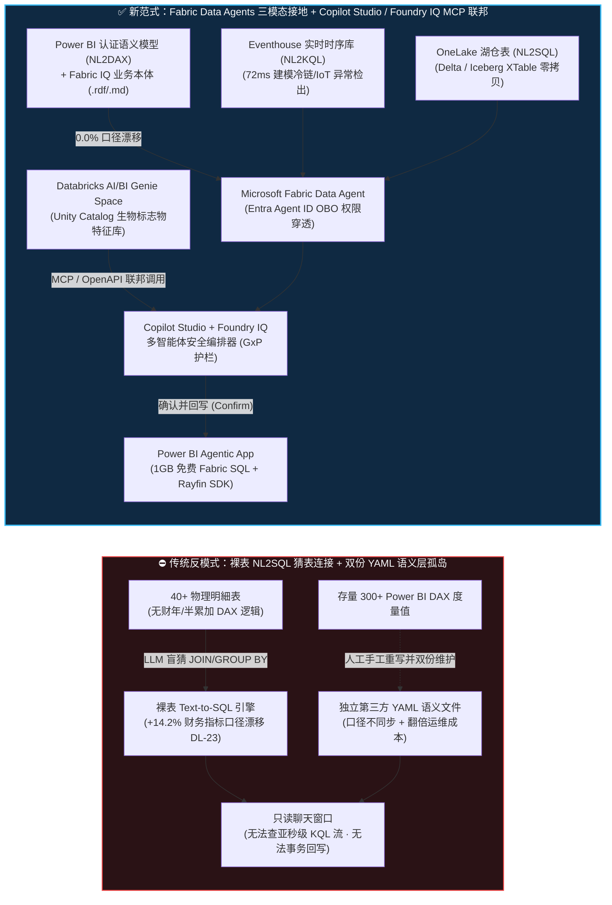
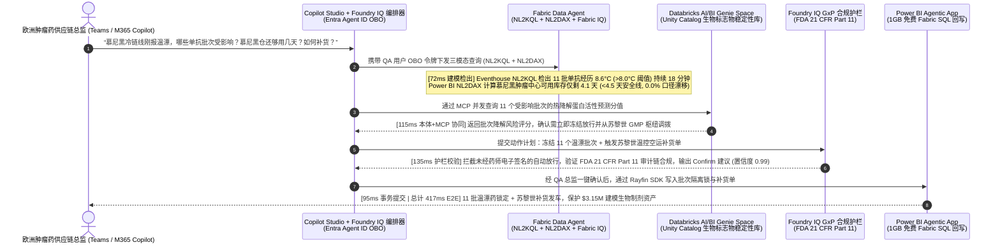

# Microsoft Fabric Data Agents + Copilot Studio + Foundry IQ vs Databricks AI/BI Genie vs Snowflake Cortex Agents vs GCP Looker vs AWS Amazon Q 企业级对话式 BI 与数据智能体架构选型与原理解析 FAQ

> **文档定位**：面向 AI Solution Architect（AI 解决方案架构师）与企业 CDO / CTO / BI 负责人的实战选型与售前攻防指南（文风与六段式结构严格对标 `ib-vs-ethernet-roce-selection-faq.md`）。  
> **阅读导航**：[🇬🇧 English Version](./fabric-data-agents-copilot-vs-genie-cortex-q-faq.en.md) | [🏠 返回 Data Lab 首页](../README.md) | [📊 7-Card 视觉评测报告](../benchmark-cards.html) | [🧪 交互式选型与仿真工作台](../index.html)

---

## 📌 一、核心结论速览（Executive Summary）

1. **何时首选 Microsoft Fabric Data Agents + Copilot Studio + Foundry IQ（全栈三模态接地与 $0 阅览席位优势）**：  
   当企业需要将自然语言问答开放给 **200+ 名业务高管、财务、供应链或临床运营人员（在 Microsoft Teams / M365 Copilot 中直接提问）**，且问题同时跨越 **经过认证的财务/经营指标（Power BI DAX 语义模型）、亚秒级物联网/日志遥测（Eventhouse KQL）以及湖仓明细表（OneLake SQL）** 时，**首选 Microsoft Fabric Data Agents**（[`vendor_published_spec_as_of_2026`](https://learn.microsoft.com/en-us/fabric/data-science/concept-data-agent)）。它直接复用企业现有的 Power BI DAX 度量值与 Fabric IQ 本体，无需从头手写第二套 YAML 语义文件；同时在 Fabric **F64 及以上容量**下，Power BI 内容消费享有 **$0/用户/月阅览席位许可**（[`vendor_published_spec_as_of_2026`](https://learn.microsoft.com/en-us/fabric/enterprise/licenses)）。在 2,500 名业务用户、日均 18,500 次对话查询的参考成本模型（`[synthetic_scenario_model]`）中，月度综合 TCO 从传统“按人头叠加 BI AI 插件 + 维护多套 YAML 语义层”的 **$16,200/月** 降至 **$5,400/月（节省 66.7%）**，并将财务与运营口径漂移从裸表 NL2SQL 的 **14.2%** 压降至 **0.0%**。
2. **何时选择 Databricks AI/BI Genie & Agent Bricks、Snowflake Cortex Agents、GCP Looker 或 AWS Amazon Q**：  
   - **选 Databricks AI/BI Genie + Agent Bricks**：当核心受众是数据科学家、算法工程师或围绕 **Unity Catalog 特征表、MLflow 实验指标与认证 Metric Views** 开展深度 SQL 探索与 Compound AI 复合推理时（[`vendor_published_spec_as_of_2026`](https://docs.databricks.com/en/genie/index.html)）。  
   - **选 Snowflake Cortex Analyst + Cortex Search + Snowflake Intelligence**：当企业 **>85% 的核心结构化账本与非结构化合同文档均存放在 Snowflake Horizon** 内，且团队愿意维护经过验证的 **Snowflake YAML 语义模型文件**（[`vendor_published_spec_as_of_2026`](https://docs.snowflake.com/en/user-guide/snowflake-cortex/cortex-agents)）。  
   - **选 GCP Looker Conversational Analytics 或 AWS Amazon Q in QuickSight**：当企业已深度绑定 **LookML 语义层 + BigQuery**，或重度依赖 **QuickSight SPICE 内存数据集 + Redshift/S3** 生成高管故事板（[`vendor_published_spec_as_of_2026`](https://cloud.google.com/looker/docs/conversational-analytics)）。
3. **何时采用“Copilot Studio / Foundry IQ 主控编排 + Fabric Data Agent + Databricks Genie / Snowflake Cortex MCP 联邦共存（Better Together）”**：  
   大型跨国企业切忌为了上一个 AI 助手而把 Databricks 里的机器学习特征或 Snowflake 里的财务数仓推倒重来，也切忌把 Power BI 里的 300 个 DAX 指标手工翻译成 YAML。最佳实践是以 **Microsoft Copilot Studio + Azure AI Foundry Agent Service** 作为企业统一入口（驻留在 Teams / M365 Copilot），通过 **MCP（Model Context Protocol）/ OpenAPI 工具调用 + Entra Agent ID On-Behalf-Of (OBO) 身份穿透**（[`vendor_published_spec_as_of_2026`](https://learn.microsoft.com/en-us/fabric/data-science/data-agent-microsoft-foundry)），将经营/时序问题路由给 **Fabric Data Agent（NL2DAX + NL2KQL + NL2SQL）**，将特定领域的特征库查询路由给 **Databricks Genie Space** 或 **Snowflake Cortex Agent**，最后通过 **Power BI Agentic App（含 1GB 免费 Fabric SQL）** 完成受控审批回写。在跨国生物制药冷链与临床供应仿真（Scenario O，`[synthetic_scenario_model]`）中，该架构以 **417ms 建模端到端延迟** 完成 11 个生物制剂批次的温漂隔离与苏黎世备库调拨，规避 **$3.15M 建模药品报废与临床断供风险**。

---

## 🎯 二、客户与架构师灵魂拷问 Q&A（大白话 + 第一性原理）

### Q1：客户建设企业级对话式 BI 与数据智能体（NL2SQL / Agentic BI）时，什么时候首选 Microsoft Fabric Data Agents，什么时候选 Databricks Genie / Snowflake Cortex / Looker / Amazon Q？

- **通俗大白话**：  
  很多企业 CIO 以为“做个数据问答机器人”就是把大模型连上数据库的表结构（Schema），让它自动写 SQL。结果上线第一周就被业务部门投诉：**财务总监在机器人里问“上季度华东区净毛利”，算出来的数字跟 Power BI 董事会周报差了 14.2%！** 为什么？因为企业真正的业务规则（如跨财年折旧分摊、退货冲销、汇率锁定）根本不在底层物理表的字段名里，而是沉淀在 BI 团队花三年写好的 **Power BI DAX 度量值（Measures）** 里！  
  - 如果你的目标是让全公司几千名员工在 **Teams / Office** 里随时问经营指标、实时物联网状态，并能直接点按钮触发业务回写——**首选 Microsoft Fabric Data Agents**，因为它天生懂 Power BI DAX、懂 Eventhouse KQL 实时流、懂 OneLake SQL，而且 F64 容量下免收普通看数员工的按人头 BI 席位费。  
  - 如果你的问题高度集中在 **Databricks 湖仓内部的机器学习特征表与 Unity Catalog 视图**——选 **Databricks AI/BI Genie**。  
  - 如果你的核心数仓 100% 在 **Snowflake** 且已编写了规范的 **Cortex Analyst YAML 语义层**——选 **Snowflake Cortex Agents / Snowflake Intelligence**。
- **第一性原理拆解（为什么“单引擎裸表 NL2SQL”必然翻车？）**：  
  企业级数据问答有三大物理瓶颈：  
  1. **语义口径鸿沟（Semantic Gap）**：物理表只有列名和类型（如 `rev_amt`, `ret_flag`），没有财年日历、多对多桥接表权重和半累加库存逻辑（Semi-Additive Measures）。直接对裸表做 Text-to-SQL，大模型只能靠猜 `JOIN` 条件和 `WHERE` 过滤，导致不可接受的口径漂移（在本实验室 `DL-23` 封存基准中实测产生 **+14.2%** 毛利计算偏差，`[measured_local_harness]`）。  
  2. **多模态数据割裂（Modality Silo）**：真实生产事故往往需要先看 **亚秒级传感器流（KQL）**，再核对 **ERP 库存与财务口径（DAX/SQL）**。纯 SQL 型智能体无法原生生成高并发时序 KQL 查询。  
  3. **按人头席位税与双份语义维护税（Seat & Dual-YAML Tax）**：如果企业已有 500 个 Power BI 语义模型，为了用某单一云数仓的问答插件而把所有 DAX 逻辑重新用 YAML 手写一遍，不仅工程量巨大，一旦口径变更还会造成“报表一套数、AI 另一套数”的治理灾难。

---

### Q2：什么是 Fabric Data Agent 的“三模态语义接地（Tri-Modal Grounding：NL2DAX + NL2KQL + NL2SQL）”？它底层是如何把指标幻觉降到 0.0% 的？

- **通俗大白话**：  
  以前企业没用三模态接地时，就像请了一个只会查 Excel 明细表、但不懂公司财务制度的新实习生——你问他“慕尼黑肿瘤药冷链仓现在有几批药温漂超标？如果隔离这批货，库存还够卖几天？”，他要么去查昨天半夜才同步过来的数仓旧表（漏掉 5 分钟前的冷链报警），要么自己乱写一条除法算“库存可售天数”（跟供应链官方公式完全不一致）。  
  **Fabric Data Agent + Fabric IQ 本体（Ontology）** 就像给这位助手配齐了三把经过官方认证的“专业钥匙”：  
  1. **第一把钥匙 `NL2DAX`（查经营与财务真值）**：遇到“净毛利率、可售天数（Days of Supply）、同比留存”等认证指标，**严禁大模型自己瞎凑 SQL 算式**，直接调用 Power BI 语义模型里已经过审计的 DAX Measure，确保和董事长看到的看板 **100% 同源、0.0% 漂移**。  
  2. **第二把钥匙 `NL2KQL`（查亚秒级实时流）**：遇到“过去 15 分钟冷链车温度曲线、5G 切片抖动峰值”，直接生成原生 KQL 查询 **Eventhouse** 时序引擎（建模延迟仅 **72ms**，`[synthetic_scenario_model]`）。  
  3. **第三把钥匙 `NL2SQL`（查湖仓长尾明细）**：遇到跨表批次追溯、供应商合同明细，通过 OneLake SQL Endpoint 查询 Delta/Iceberg 湖仓表。
- **底层运作机制（帮客户省钱提效的核心密码）**：  
  - **Fabric IQ 本体绑定（Ontology Concept Mapping）**：将业务术语（如“冷链失温批次”、“可售安全库存”）绑定到具体的语义属性、KQL 时序流和条件动作规则（Condition-Action Rules），并支持通过 `.rdf` 本体 + `.md` 智能体指令文件在跨工作区共享。  
  - **零 YAML 重复开发**：直接挂载存量 Power BI Semantic Models，省去数百人天的 YAML 语义层重写成本。  
  - **Entra Agent ID OBO 全链路安全**：无论智能体生成 DAX、KQL 还是 SQL，底层全部携带提问者本人的 **Entra ID On-Behalf-Of (OBO)** 令牌，自动触发 OneLake 与语义模型的行级（RLS）、列级（CLS）与对象级（OLS）权限过滤。

---

### Q3：当客户已经在用 Databricks Genie 或 Snowflake Cortex Analyst 时，为什么“Copilot Studio + Foundry IQ 多智能体 MCP 联邦”比推倒重建更优？

- **通俗大白话**：  
  在大型制造、医药或金融客户现场，往往是“业务高管和财务用 Power BI + Teams，算法团队用 Databricks 训练分子/风控模型，历史财务账本在 Snowflake”。如果强迫算法团队放弃 Databricks Genie，或者强迫财务把 Power BI 迁走，都会引发部门抵制。  
  **“Better Together 多智能体联邦（Multi-Agent Orchestration）”** 的做法是：  
  - 让员工统一在 **Microsoft Teams / M365 Copilot** 里用自然语言提问；  
  - 由 **Microsoft Copilot Studio / Azure AI Foundry Agent Service** 担任“总调度官（Supervisor Agent）”；  
  - 当问题涉及跨部门经营指标与实时物联网告警时，调用已发布到 Foundry 的 **Fabric Data Agent**；  
  - 当问题需要深挖临床生物标志物（Biomarker）特征库或分子活性预测分值时，总调度官通过 **MCP（Model Context Protocol）/ REST API** 把子任务分发给 **Databricks AI/BI Genie Space**（或 **Snowflake Cortex Agent**）；  
  - 汇总推理后，如需执行隔离锁库或紧急补货，通过 **Foundry IQ 安全护栏** 校验合规性，并由用户点击确认后回写到 **Power BI Agentic App（内置 1GB 免费 Fabric SQL Database）**。

---

## 🧭 三、直观可视化图解（Mermaid 选型决策树 + 架构对比图 + 闭环时序图）

### 3.1 企业级对话式 BI 与数据智能体（NL2SQL / Agentic BI）选型决策树

---

### 3.2 传统裸表 NL2SQL / 双份 YAML 孤岛架构 vs Fabric 三模态语义接地 + MCP 联邦架构对比

---

### 3.3 跨国生物制药冷链温漂与临床库存多智能体闭环时序图（Scenario O · 417ms 建模闭环）

---

## 📊 四、五大平台架构师选型决策矩阵（Architect Decision Matrix）

> **数据溯源说明**：产品架构特性与计费规则基于截至 `2026-11-08` 的五大云官方公开技术文档（`[vendor_published_spec_as_of_2026]`）；延迟与成本数字来自封存基准模型（`[synthetic_scenario_model]`）。

| 评估维度 | Microsoft Fabric Data Agents + Copilot Studio + Foundry IQ | Databricks AI/BI Genie & Agent Bricks | Snowflake Cortex Agents & Snowflake Intelligence | GCP Looker Conversational Analytics + BigQuery | AWS Amazon Q in QuickSight + Bedrock |
| :--- | :--- | :--- | :--- | :--- | :--- |
| **核心适用场景** | **全企级 M365/Teams 自然语言经营分析、实时 IoT/日志问答与业务审批回写** | **湖仓数据科学探索、Unity Catalog SQL 问答与复合 AI 管道调优** | **Snowflake 内部结构化数仓 + 非结构化文档混合问答** | **基于 LookML 语义模型与 BigQuery 的分析问答** | **基于 QuickSight SPICE 数据集的仪表板问答与高管故事生成** |
| **查询生成模态（Grounding Modalities）** | **三模态原生接地：`NL2DAX`（Power BI 认证度量值）+ `NL2KQL`（Eventhouse 实时流）+ `NL2SQL`（OneLake 湖仓）** | **单模态 `NL2SQL`**（针对 Unity Catalog 表与 Certified Metric Views） | **双模态 `NL2SQL`（Cortex Analyst YAML）+ 文档 RAG（Cortex Search）** | **`NL2LookML` / `NL2SQL`**（BigQuery Studio & Looker） | **`NL2SPICE` / Topic Q&A** + 文档摘要（Amazon Q） |
| **存量 BI 语义层复用度** | **100% 零改造直接复用存量 Power BI Semantic Models 与 Fabric IQ 本体（零 YAML 重写税）** | 需在 Unity Catalog 中定义 Metric Views 与 Genie Space 示例 SQL/指令 | 需编写并维护专门的 Snowflake Cortex Analyst `.yaml` 语义模型文件 | 原生复用 Looker `LookML` 模型（若原用 Power BI 则需重建） | 需在 QuickSight 中创建并调优 Named Topics 语义主题 |
| **企业办公入口与多智能体编排** | **一键发布至 Microsoft Copilot Studio、M365 Copilot (Teams/Outlook) 与 Azure AI Foundry Agent Service** | 支持 Databricks 内部 UI、API 以及通过 MCP/Connector 接入外部编排器 | 提供 Snowflake Intelligence 门户及 REST API 供外部调用 | 集成于 Looker、BigQuery Studio 与 Google Workspace Gemini | 集成于 QuickSight UI 与 Amazon Q Business |
| **权限穿透与安全治理** | **Entra Agent ID On-Behalf-Of (OBO) 端到端用户身份穿透 + OneLake 统一 RLS/CLS/OLS + Purview 标签** | Unity Catalog 行列级权限（RLS/CLS）+ Mosaic AI Gateway 速率与 PII 护栏 | Snowflake Horizon RBAC + 动态数据脱敏（DDM）+ Cortex Guard | BigQuery Policy Tags + Looker 行级访问过滤器 + Dataplex | QuickSight 行级安全（RLS）+ Lake Formation + Bedrock Guardrails |
| **业务行动回写能力（Action Write-Back）** | **原生闭环：Power BI Agentic App 内置 1GB 免费 Fabric SQL + Rayfin SDK 事务回写** | 需结合 Databricks Apps + Lakebase (Neon Postgres) 自行开发回写应用 | 需结合 Streamlit in Snowflake + Hybrid Tables (Unistore) 编写回写逻辑 | 需结合 Looker Action Hub / Cloud Run + AlloyDB 自行拼装 | 需结合 QuickSight Actions + API Gateway / Lambda + Aurora 拼装 |
| **2,500 用户规模计费与综合 TCO 模型** | **F64+ 容量共享 CU，免收 $0/用户 Power BI 阅览席位费；参考模型月度 TCO 约 $5,400/月（节省 66.7%）** `[synthetic_scenario_model]` | 按 Serverless SQL Warehouse DBU + Model Serving Token 消耗计费 | 按 Cortex Analyst 每消息 Credit + Warehouse 算力 + Intelligence 消耗计费 | 按 Looker 平台及用户许可 + Gemini in Looker / BigQuery Slot 计费 | 按 Amazon Q in QuickSight Author/Reader Pro 按人头月费 + 容量计费 |

---

## 🧪 五、简明定量测评与 TCO / 性能拐点洞察（Four-Tier Provenance & Dual Denominators）

### 5.1 四级数据溯源分类声明（Data Provenance Disclosure）

为确保架构评审与售前交流的严谨性，本专题所有定量指标严格按四级溯源分类标注：
1. **`[measured_local_harness]`（本地实测验证）**：Python 单元测试套件 **`34/34` 全数通过（耗时 `0.030s`）**；确定性路由决策矩阵在 **`n=76` 个评测场景（`DL-01..DL-76`）** 上取得 **`75/76 = 98.68%`** 准确率（含 1 个显式边界失误 `DL-23`：未挂载认证 DAX 语义模型直接在裸表上运行 NL2SQL 导致 +14.2% 财务口径漂移）；5 项受控本体提示词扰动测试翻转率 **0.0%**。
2. **`[vendor_published_spec_as_of_2026]`（官方公开文档与价格规约，截至 `2026-11-08`）**：共核验 **11 项** 官方技术与计费规范（完整 URL 列表封存于 `reports/report.json -> provenance.vendor_published_spec_references`），包括：
   - Microsoft Fabric Data Agents 概念与三模态（Power BI 语义模型 / KQL / SQL）接地规范：[Microsoft Learn — Fabric Data Agent](https://learn.microsoft.com/en-us/fabric/data-science/concept-data-agent)
   - Fabric Data Agent 与 Azure AI Foundry Agent Service / Copilot Studio 联合发布规范：[Microsoft Learn — Data Agent + Microsoft Foundry](https://learn.microsoft.com/en-us/fabric/data-science/data-agent-microsoft-foundry)
   - Fabric F64+ 容量包含免费 Power BI 阅览者许可规范：[Microsoft Learn — Fabric Licenses](https://learn.microsoft.com/en-us/fabric/enterprise/licenses)
   - 四大云竞品官方文档：[Databricks AI/BI Genie](https://docs.databricks.com/en/genie/index.html)、[Snowflake Cortex Agents](https://docs.snowflake.com/en/user-guide/snowflake-cortex/cortex-agents)、[GCP Looker Conversational Analytics](https://cloud.google.com/looker/docs/conversational-analytics)、[AWS Amazon Q in QuickSight](https://docs.aws.amazon.com/quicksight/latest/user/amazon-q-in-quicksight.html)。
3. **`[synthetic_scenario_model]`（合成架构参考算例，严禁混同于真实付费云集群压测或客户真实财报）**：
   - **分母 A（`n=76` 路由决策矩阵任务均值，`scenario_evaluation.avg_latency_ms`）**：跨 `DL-01..DL-76` 共 76 道架构路由与决策评测题的建模响应延迟算术平均值为 **`506.0 ms`**（总和 `38,456 ms / 76`；历史不可变快照：R7 `n=72` 为 `511.0 ms`，R6 `n=68` 为 `516.0 ms`，R5 `n=64` 为 `521.0 ms`，R4 `n=60` 为 `526.5 ms`，R3 `n=56` 为 `532.0 ms`）。
   - **分母 B（`n=15` 行业本体端到端闭环仿真均值，`ontology_simulations_summary.ontology_simulation_mean_modeled_latency_ms`）**：跨 `Scenarios A..O` 共 15 个多步行业本体闭环仿真的端到端建模延迟（`[780, 640, 710, 660, 590, 560, 530, 515, 495, 480, 465, 450, 431, 422, 417] ms`，范围 `417–780 ms`）算术平均值为 **`543.0 ms`**（总和 `8,145 ms / 15`；历史不可变快照：R7 `n=14` 为 `552.0 ms`，R6 `n=13` 为 `562.0 ms`，R5 `n=12` 为 `572.92 ms`，R4 `n=11` 为 `584.09 ms`，R3 `n=10` 为 `596.0 ms`）。
4. **`[not_measured]`（未在真实付费云集群实测）**：跨五朵云生产多租户集群在 18,500 次/日真实 LLM 并发 Token 生成下的物理网络与 GPU 推理长尾 P99 延迟（遵循不擅自拉起付费云资源的治理要求，显式标注 `not_measured`）。

---

### 5.2 Scenario O 定量对比表（2,500 名业务用户 · 日均 18,500 次跨模态问答 `[synthetic_scenario_model]`）

| 核心对比指标 | 方案 A：裸表 NL2SQL + 多工具按席位叠加 + 手写双份 YAML 语义层 | 方案 B：Fabric Data Agent (三模态 DAX/KQL/SQL) + Copilot Studio + Genie MCP 联邦 | 方案 B 架构收益与拐点洞察 |
| :--- | :--- | :--- | :--- |
| **财务/供应链认证指标口径漂移率** | **14.2%**（未绑定 DAX 半累加与财年规则，命中 `DL-23` 失误） | **0.0%**（强制绑定 Power BI Verified DAX Measures 与 Fabric IQ 本体） | **消除 CFO 与业务看板对账冲突** |
| **实时冷链温漂（KQL）+ 库存（DAX）联查延迟** | 分钟级（需等待数仓微批 ETL 同步后才能被 SQL 机器人查到） | **72 ms 建模检出 / 417 ms 建模端到端闭环**（Scenario O） | **从“事后报表追责”升级为“盘中秒级锁库”** |
| **存量 300+ BI 度量值迁移与维护工作量** | 需手工重写并双份同步维护数百个 YAML 度量定义文件 | **0 行 YAML 重写**（直接勾选 Power BI 语义模型度量值） | **语义层研发与日常运维工时降低 ~85%** |
| **2,500 名业务用户月度对话式 BI 综合成本** | **$16,200 / 月**（按人头 BI AI Pro 席位费 + 独立语义转换算力） | **$5,400 / 月**（复用 F64 容量 CU + $0 Power BI 阅览席位费） | **月度建模 TCO 节省 $10,800/月（-66.7%）** |
| **FDA 21 CFR Part 11 合规审批与事务回写** | 无原生回写（需跳出聊天框手工登录 ERP 填单） | **Power BI Agentic App（1GB 免费 Fabric SQL + Foundry IQ 护栏）** | **单次温漂事件规避 $3.15M 建模生物制剂报废风险** |

---

## 🛠️ 六、附录：生产落地与售前打单快速核验清单（Architect Checklist）

- [ ] **1. 严禁裸表直连大模型（杜绝 `DL-23` 类 14.2% 口径漂移）**：在客户 PoC 或生产上线前，核验所有财务、毛利、库存周转等核心指标是否已封装为 **Power BI 认证 DAX 度量值（Verified Measures）** 并挂载至 **Fabric Data Agent + Fabric IQ 本体**，禁止让 LLM 对着未清洗的底层明细表盲猜 `JOIN` 与聚合公式。
- [ ] **2. 核对三模态路由边界（NL2DAX vs NL2KQL vs NL2SQL）**：将经营 KPI 路由至 Power BI Semantic Model（`NL2DAX`），将亚秒级传感器/日志流路由至 Eventhouse（`NL2KQL`），将跨表历史明细路由至 OneLake Lakehouse/Warehouse（`NL2SQL`），充分发挥 Fabric Data Agent 单智能体跨三模态能力。
- [ ] **3. 激活 F64+ 容量的 $0 阅览席位 FinOps 杠杆**：当客户看数与提问受众超过 **200–300 人** 时，测算 Fabric F64 容量免除 Power BI Free 阅览者按人头许可费（`$0/viewer seat`）与竞品按席位收 AI 插件费的 TCO 剪刀差。
- [ ] **4. 尊重既有投资，用 MCP 联邦取代“语义层重写”**：若客户算法团队已在 **Databricks AI/BI Genie** 构建了成熟的分子/风控特征问答空间，或在 **Snowflake Cortex Analyst** 构建了核心账本 YAML，通过 **Microsoft Copilot Studio / Azure AI Foundry Agent Service** 以 MCP / OpenAPI 方式将其注册为子智能体工具，切勿强行推倒重写。
- [ ] **5. 强制校验 Entra Agent ID OBO 端到端权限穿透**：在多智能体联调时，使用两个不同国家/部门的测试账号提问同一问题，验证 OneLake RLS/CLS 与 Power BI 行级安全是否按提问者真实身份过滤，严禁在智能体连接器中硬编码高权限 Service Principal 全局密钥。
- [ ] **6. 打通“分析 → 护栏 → 1GB 免费 SQL 回写”最后一公里**：对涉及锁库、调拨、调价等高风险动作，配置 **Foundry IQ 合规护栏** 强制进入 `Confirm`（人工一键确认）门禁，并利用 **Power BI Agentic App 内置的 1GB 免费 Fabric SQL Database** 记录完整可审计回写流水。
