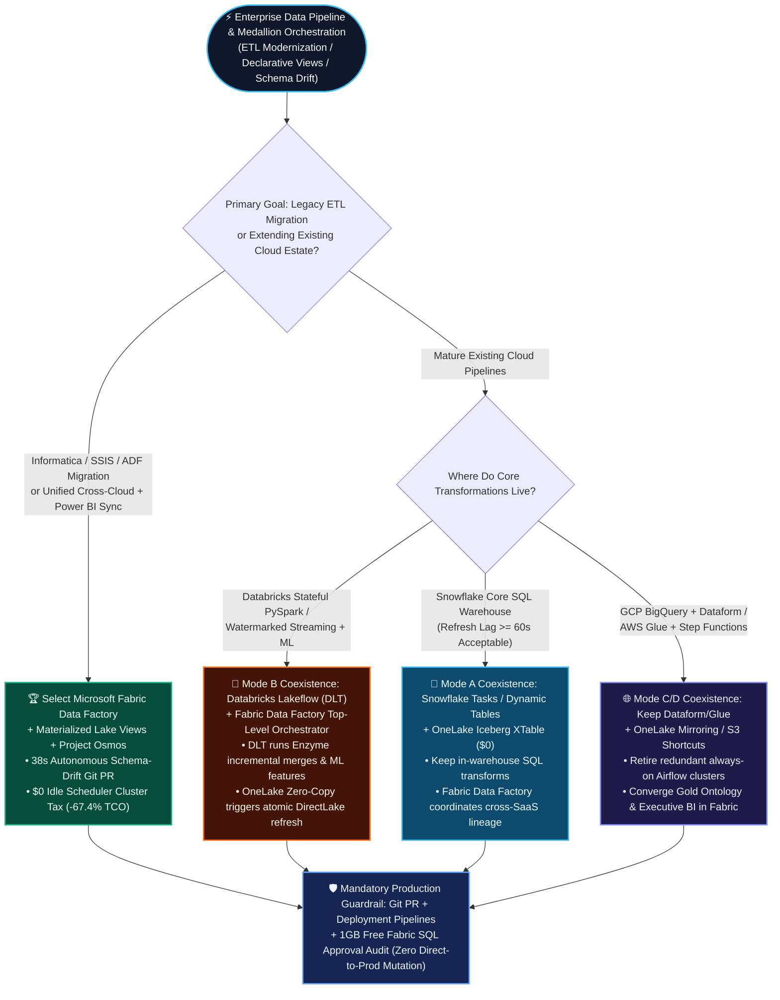
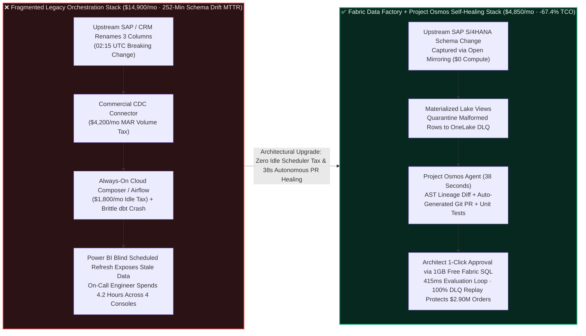
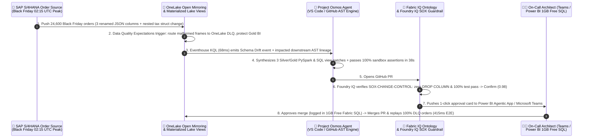

# Microsoft Fabric Data Factory + Project Osmos + Materialized Lake Views vs. Databricks Lakeflow / DLT vs. Snowflake Tasks & Dynamic Tables vs. GCP Cloud Composer / Dataform vs. AWS Glue Enterprise Medallion Orchestration & Autonomous Self-Healing Selection FAQ

> 🌐 **Language / 语言**: **[中文 (`fabric-data-factory-osmos-vs-lakeflow-tasks-composer-faq.md`)](fabric-data-factory-osmos-vs-lakeflow-tasks-composer-faq.md)** | **English (Current)**
> 📅 **Last Updated**: 2026-11-09 (Round 9 Nightly Deep-Dive Topic · Strictly Modeled on `ib-vs-ethernet-roce-selection-faq.md` 6-Part Structure)
> 🎯 **Target Audience**: AI Solution Architects, Heads of Data Engineering, Enterprise CDOs / CTOs, and Presales Architecture Teams
> 🔗 **Related Deliverables**: [Data Lab Overview README](../README.en.md) · [R1: Zero-Copy + Ontology FAQ](fabric-onelake-iq-vs-4clouds-selection-faq.en.md) · [R2: Real-Time Eventhouse vs. 4 Clouds FAQ](fabric-realtime-eventhouse-vs-4clouds-streaming-faq.en.md) · [R3: Zero-ETL Mirroring vs. CDC FAQ](fabric-mirroring-zero-etl-vs-cdc-faq.en.md) · [R4: Open Table Formats Iceberg↔Delta FAQ](fabric-onelake-iceberg-delta-uniform-vs-4clouds-faq.en.md) · [R5: HTAP + 100M+ Vector DiskANN FAQ](fabric-htap-vector-sql-cosmos-vs-lakebase-unistore-faq.en.md) · [R6: Multi-Cloud AI Governance & OBO FAQ](fabric-onelake-purview-obo-governance-vs-4clouds-faq.en.md) · [R7: Spark Native Gluten/Velox & Autoscale FAQ](fabric-spark-native-gluten-autoscale-vs-photon-snowpark-faq.en.md) · [R8: Enterprise NL2SQL & Data Agents FAQ](fabric-data-agents-copilot-vs-genie-cortex-q-faq.en.md) · [Interactive 5-Cloud Workbench (`../live-demo.en.html`)](../live-demo.en.html) · [7-Card 4:5 Benchmark Deck (`../benchmark-cards.en.html`)](../benchmark-cards.en.html)
> 🔍 **Data Provenance & Scope Disclosure**:
> - **`measured_local_harness` (Local Deterministic Harness Execution)**: 80-scenario architectural routing matrix (`79/80 = 98.75%` accuracy, explicit miss `DL-23` capturing `+14.2%` raw-table metric drift) and `36/36` Python unit tests executed locally.
> - **`vendor_published_spec_as_of_2026` (Official Vendor Specifications & Pricing `as_of: 2026-11-08`)**:
>   - Microsoft Fabric: [Data Factory Overview](https://learn.microsoft.com/en-us/fabric/data-factory/data-factory-overview) · [Materialized Lake Views (Declarative Bronze-Silver-Gold & Data Quality Rules)](https://learn.microsoft.com/en-us/fabric/data-engineering/materialized-lake-views/overview-materialized-lake-view) · [Fabric Git Integration & Deployment Pipelines CI/CD](https://learn.microsoft.com/en-us/fabric/cicd/git-integration/intro-to-git-integration) · [Project Osmos Autonomous Data Engineering Agent & FabCon 2026 Announcements](../research/daily/2026-11-08.en.md).
>   - 4-Cloud Competitors: [Databricks Lakeflow Jobs & Declarative Pipelines (Delta Live Tables / DLT)](https://docs.databricks.com/en/dlt/index.html) · [Snowflake Tasks & Streams](https://docs.snowflake.com/en/user-guide/tasks-intro) & [Dynamic Tables](https://docs.snowflake.com/en/user-guide/dynamic-tables-about) · [Google Cloud Composer (Managed Airflow)](https://cloud.google.com/composer/docs/concepts/overview) & [BigQuery Dataform](https://cloud.google.com/dataform/docs/overview) · [AWS Glue Workflows](https://docs.aws.amazon.com/glue/latest/dg/workflows_overview.html) & [AWS Step Functions](https://docs.aws.amazon.com/step-functions/latest/dg/welcome.html).
> - **`synthetic_scenario_model` (Deterministic Architectural Reference Model with Strictly Separated Denominators)**:
>   - **Denominator A — Routing Decision Matrix Mean (`scenario_evaluation.avg_latency_ms`)**: R9 **`n=80` (`DL-01..DL-80`) arithmetic mean = `501.0 ms`** (Historical snapshots: R8 `n=76` mean `506.0 ms`; R7 `n=72` mean `511.0 ms`; R6 `n=68` mean `516.0 ms`; R5 `n=64` mean `521.0 ms`; R4 `n=60` mean `526.5 ms`; R3 `n=56` mean `532.0 ms`).
>   - **Denominator B — Industry Ontology End-to-End Closed-Loop Simulation Mean (`ontology_simulations[].end_to_end_latency_ms`)**: R9 **`n=16` (Scenarios A..P: `[780, 640, 710, 660, 590, 560, 530, 515, 495, 480, 465, 450, 431, 422, 417, 415] ms`, range `415–780 ms`) arithmetic mean = `535.0 ms`** (Historical snapshots: R8 `n=15` mean `543.0 ms`; R7 `n=14` mean `552.0 ms`; R6 `n=13` mean `562.0 ms`; R5 `n=12` mean `572.92 ms`; R4 `n=11` mean `584.09 ms`; R3 `n=10` mean `596.0 ms`).
>   - The 420-pipeline monthly orchestration & operations TCO model (`$4,850/mo` vs. `$14,900/mo`) and Scenario P Global Retail Black Friday SAP order schema-drift self-healing simulation (`38s` autonomous PR synthesis, `415 ms` closed-loop evaluation, `$2.90M` Black Friday order backlog protected) in Section 5 are deterministic reference simulations sealed in `reports/report.json` for architectural evaluation, not realized customer invoices.
> - **`not_measured` (Live Paid Multi-Cloud Destructive Chaos Injection)**: Per governance guardrails, destructive DDL injection on live paid multi-cloud production clusters was not executed.

---

## ① 📌 Executive Summary (3-Minute Architect Takeaways)

1. **First-Principles Core: Declarative Materialized Lake Views + Project Osmos Autonomous Self-Healing vs. Brittle "Spaghetti" DAG Scripts (Airflow + ADF + dbt)**
   - Enterprise data engineering teams spend up to **65% of their capacity fixing broken pipelines and migrating legacy scripts rather than building new business products**: when an upstream SAP or Salesforce release renames a field from `tax_rate` to `vat_pct` at 02:15 UTC, imperative Airflow/SSIS/Informatica scripts crash in cascade, requiring an average of **4.2 hours (`252 min`) of manual on-call triage across 4 separate log consoles** (`[synthetic_scenario_model]`).
   - **Microsoft Fabric Data Factory + Materialized Lake Views + Project Osmos** eliminates this fragility at the architectural root: ① **Materialized Lake Views** declaratively maintain Bronze → Silver → Gold incremental lineage and built-in data quality expectations, automatically quarantining malformed records into an OneLake Dead-Letter Queue (DLQ); ② **Project Osmos (Fabric Autonomous Data Engineering Agent)** operates inside VS Code and GitHub to translate legacy Informatica/SSIS/DataStage packages into native PySpark/SQL and, upon detecting upstream schema drift, **synthesizes an AST-verified patch, runs sandbox unit tests, and opens an auditable GitHub Pull Request in 38 seconds** (`[synthetic_scenario_model]`).
2. **Billing Mechanics & TCO Moat: `$0` Always-On Scheduler Cluster Tax + Pooled F64 Capacity Cuts Orchestration TCO by 67.4%**
   - Running **GCP Cloud Composer or AWS MWAA (Managed Apache Airflow)** requires keeping a dedicated Kubernetes control plane and worker nodes alive 24×7—costing **`$900–$2,400/mo` in idle infrastructure overhead** even when zero jobs are running. Combined with commercial CDC connectors and high-frequency Snowflake Dynamic Table warehouse wake-ups, operating **420 enterprise Medallion pipelines** costs **`$14,900/mo`** in modeled orchestration, incremental compute, and on-call engineering TCO (`[synthetic_scenario_model]`).
   - **Fabric Data Factory + Materialized Lake Views + Project Osmos** charges **`$0` for dedicated scheduler control-plane clusters** (consuming pooled Fabric F64 CUs or serverless per-job autoscale) and pairs with the `$0`-surcharge Gluten/Velox C++ engine to deliver the same 420-pipeline estate for **`$4,850/mo`—saving 67.4% (`-$10,050/mo`) vs. the fragmented Airflow/CDC/dbt stack and 61.8% vs. Snowflake Tasks + Dynamic Tables (`$12,680/mo`)** (`[synthetic_scenario_model]`).
3. **Coexistence Golden Rule (Better Together): Fabric Data Factory Top-Level Orchestration × Databricks Lakeflow (DLT) / Snowflake Tasks Domain Pipelines**
   - When a customer has already built mature streaming or ML feature pipelines in **Databricks Lakeflow Declarative Pipelines (DLT)** or **Snowflake Dynamic Tables / Tasks**, **never propose ripping and rewriting working domain pipelines**!
   - **Optimal Coexistence Pattern**: Retain Databricks DLT for complex stateful Spark streaming and ML feature engineering, and retain Snowflake Tasks for in-warehouse SQL aggregations; use **Fabric Data Factory** as the overarching cross-cloud orchestrator (via native Databricks and Snowflake activities) to atomically trigger **OneLake Materialized Lake Views and Power BI DirectLake semantic model framing** the moment upstream tables land—ending the classic "warehouse finished at 06:00, executive dashboard refreshed at 05:30 with stale data" failure mode.

---

## ② 🎯 Customer & Architect Deep-Dive Q&A (Plain-Language First Principles)

### Q1: What are Declarative Medallion Pipelines (Materialized Lake Views vs. DLT vs. Dynamic Tables), and why do traditional Airflow + hand-coded ETL scripts keep breaking at 2 AM?

- **Plain-Language First Principles ("Imperative Step-by-Step Instructions vs. Declarative Blueprint")**:
  - **Imperative Orchestration (Airflow / SSIS / Cron Scripts) is like micromanaging every stove burner by clock time**: You write brittle procedural glue code saying, *"Run Script A at 01:00 → wait 15 minutes → run Script B at 01:15 → refresh Power BI at 01:30."* If Script A runs 16 minutes late or an upstream JSON payload renames a column, Script B either crashes at 02:00 AM or silently pushes half-loaded corrupt numbers onto the CEO's morning dashboard. Worse, you pay 24×7 rent for the Airflow Kubernetes cluster just to watch the clock.
  - **Declarative Medallion Views (Fabric Materialized Lake Views / Databricks DLT / Snowflake Dynamic Tables) work like handing the final recipe to an automated kitchen**: You simply declare in SQL or PySpark: *"Gold_Order_Summary = Silver_Orders JOIN Dim_Customer WHERE order_total > 0."* The engine automatically constructs the Bronze → Silver → Gold dependency DAG, computes only incremental deltas, and quarantines rows violating quality expectations into a Dead-Letter Queue (DLQ) without corrupting downstream reports.
- **How the Five Clouds Differ Under the Hood**:
  1. **Microsoft Fabric Materialized Lake Views + Data Factory**: Built directly on **open OneLake Delta/Iceberg tables** with visual lineage, declarative data quality rules, and **native transactional coupling to Power BI DirectLake semantic models** (`[vendor_published_spec_as_of_2026]`).
  2. **Databricks Lakeflow Declarative Pipelines (DLT)**: Industry-leading Spark streaming and Enzyme incremental merge engine, but tightly coupled to Databricks DBU clusters and unaware of external Power BI DirectLake framing boundaries.
  3. **Snowflake Dynamic Tables + Tasks**: Seamless SQL experience inside Snowflake, but constrained by **`TARGET_LAG >= 60s` (1-minute minimum lag)** and continuous virtual warehouse credit consumption under frequent refresh schedules (`[vendor_published_spec_as_of_2026]`).

---

### Q2: What is Project Osmos (Fabric Autonomous Data Engineering Agent)? How is it fundamentally different from a standard "AI SQL Autocomplete" assistant?

- **Plain-Language First Principles**:
  - **Standard AI Code Assistants (Chat / Autocomplete) are "Passive Copilots"**: When a pipeline fails, a human engineer still has to wake up at 2 AM, read four log files, figure out which upstream table changed, trace 15 broken downstream views, paste snippets into a chat box, and manually test the fix.
  - **Project Osmos (Fabric Data Engineering Agent) is an "Autonomous Software Engineering Agent for Data" embedded in VS Code and GitHub**:
    1. **Pain Point 1 — Legacy ETL Migration Hell**: Enterprises are trapped on thousands of decade-old Informatica XML mappings, SSIS `.dtsx` packages, DataStage jobs, and tangled stored procedures. Project Osmos ingests the entire legacy repository, parses the Abstract Syntax Tree (AST) and column-level lineage, converts them into idiomatic **Fabric Data Factory pipelines + PySpark Notebooks + Materialized Lake Views**, and automatically runs synthetic equivalence tests—compressing 6-month migration projects by **70%+**.
    2. **Pain Point 2 — Autonomous 2 AM Schema-Drift Self-Healing**: When an upstream SAP S/4HANA upgrade renames `cust_tax_id` to `vat_reg_no` during peak Black Friday traffic:
       - **Step 1 (Lineage Detection)**: Osmos detects the schema drift event from OneLake Open Mirroring metadata and Data Factory telemetry;
       - **Step 2 (AST Patch Synthesis)**: Scans all downstream Silver/Gold PySpark notebooks and SQL Materialized Lake Views in Git, synthesizing backward-compatible column projections;
       - **Step 3 (Sandbox Verification & GitHub PR)**: Executes data quality expectations in an isolated workspace branch and **opens a verified GitHub Pull Request with a full lineage impact report in 38 seconds**, routing an approval card to the on-call architect (`[synthetic_scenario_model]`).

---

### Q3: When migrating legacy Informatica/SSIS/Airflow or competing against Databricks Lakeflow, Snowflake Tasks, GCP Composer, and AWS Glue, when should we lead with Fabric vs. Hybrid Coexistence?

- **Lead with Microsoft Fabric Data Factory + Materialized Lake Views + Project Osmos (Win Themes)**:
  1. **Legacy Informatica / SSIS / DataStage / ADF Modernization**: Customers seeking to retire expensive legacy ETL licenses and accelerate migration by 70%+ using Project Osmos + familiar ADF-heritage pipeline authoring.
  2. **End-to-End Transactional BI Synchronization**: Customers who need CDC Mirroring → Medallion Views → Power BI DirectLake Semantic Model Refresh → Fabric IQ Alerting governed inside **one atomic control plane**.
  3. **Eliminating Idle Airflow Cluster Tax**: Data teams paying `$900–$2,400/mo` for always-on GCP Cloud Composer or AWS MWAA Kubernetes clusters just to trigger periodic batch jobs.
- **Recommend Hybrid Orchestration (Better Together Coexistence)**:
  1. **Existing Databricks Lakeflow / DLT Streaming & Feature Factories**: Keep Databricks DLT for complex watermarked streaming and ML feature engineering; trigger or monitor DLT jobs from **Fabric Data Factory's native Databricks Activity** and consume Gold Delta tables zero-copy via OneLake Shortcuts.
  2. **Existing Snowflake Tasks & Dynamic Tables Financial Marts**: Keep in-warehouse SQL transforms inside Snowflake (`>= 60s` lag); expose Gold tables zero-copy via **OneLake Snowflake Mirroring / Iceberg XTable (`$0`)** and orchestrate cross-enterprise dependencies in Fabric Data Factory.
  3. **Enterprise-Wide Non-Data Kubernetes DAGs**: If a central platform team already standardizes on Apache Airflow for infrastructure orchestration, invoke Fabric pipelines natively via the official Airflow `MSFabricRunJobOperator`.

---

### Q4: Is it safe to let an AI Agent like Project Osmos modify production data pipelines? How do we enforce SOX compliance and prevent accidental `DROP COLUMN` disasters?

- **Three Non-Negotiable Enterprise DataOps Guardrails (Foundry IQ + Git CI/CD + Deployment Pipelines)**:
  1. **Zero Direct-to-Production Mutation**: Project Osmos never mutates live production workspaces directly. Every synthesized fix is committed strictly to a feature branch as an auditable **GitHub / Azure DevOps Pull Request**.
  2. **Destructive DDL Blocking**: Foundry IQ and Fabric Deployment Pipelines automatically block any patch containing unapproved `DROP COLUMN`, `TRUNCATE`, or relaxed financial primary-key constraints, escalating the decision to `Confirm` / `Send to a human`.
  3. **Zero-Data-Loss DLQ Replay**: While waiting for human one-click approval in Power BI / Teams (`1GB Free Fabric SQL`), Materialized Lake Views buffer quarantined records in the OneLake Dead-Letter Queue and replay 100% of rows losslessly upon PR merge.

---

## ③ 🧭 Visual Architecture & Decision Diagrams (Mermaid Decision Tree + Comparison + Sequence Diagram)

### 3.1 5-Cloud Medallion Orchestration & Self-Healing Selection Decision Tree (`flowchart TD`)

### 3.2 Legacy Fragmented Airflow/CDC/dbt Stack vs. Fabric Data Factory + Project Osmos Self-Healing Architecture (`flowchart LR`)

### 3.3 Scenario P: Global Retail Black Friday Schema-Drift 38s PR Synthesis & 415ms Recovery Loop (`sequenceDiagram`)

---

## ④ 📊 5-Cloud Medallion Orchestration & Autonomous DataOps Decision Matrix

| Dimension | Microsoft Fabric (`Data Factory + Materialized Lake Views + Project Osmos`) | Databricks (`Lakeflow Jobs + Declarative Pipelines / DLT`) | Snowflake (`Tasks + Streams + Dynamic Tables`) | GCP (`Cloud Composer Airflow + BigQuery Dataform`) | AWS (`Step Functions + Glue Workflows + MWAA`) |
| :--- | :--- | :--- | :--- | :--- | :--- |
| **Best-Fit Workload** | **Full-stack zero-copy integration, legacy ETL migration, declarative Bronze-Silver-Gold views & atomic Power BI sync** | **Complex stateful PySpark streaming (watermarking), custom Python/Scala transforms & ML feature pipelines** | **Pure SQL in-warehouse incremental table refreshes (`>= 60s` target lag)** | **BigQuery SQLX transformations (Dataform) & heavy multi-cloud Airflow DAGs** | **AWS serverless microservice orchestration (Step Functions) & Glue Spark batch jobs** |
| **Declarative Medallion & Data Quality (Expectations)** | **Materialized Lake Views** (Declarative SQL, visual DAG lineage, built-in quality quarantine rules on OneLake) | **Lakeflow DLT** (`@dlt.expect` decorators, Enzyme incremental optimization engine) | **Dynamic Tables** (Simple declarative SQL, lacks native row-level DLQ quarantine routing syntax) | **Dataform Assertions** (SQLX assertion checks that block downstream view updates on failure) | **Glue Data Quality (DQDL)** (Requires separate DQDL rulesets billed per DPU-hour) |
| **AI Autonomous Migration & Schema-Drift Healing** | **🌟 Category Leader (Project Osmos Agent: full legacy ETL conversion + 38s autonomous Schema-Drift Git PR synthesis)** | **Databricks Assistant** (Interactive notebook error diagnosis & code suggestions; manual multi-file PRs) | **Snowflake Copilot** (SQL authoring assistant; no autonomous cross-pipeline AST Git PR workflow) | **Gemini in BigQuery** (Dataform SQLX code generation & error explanation) | **Amazon Q Developer** (Glue script upgrade & troubleshooting suggestions) |
| **Scheduler Control-Plane Billing & Idle Tax** | **`$0` Idle Scheduler Cluster Tax** (No dedicated Airflow VM monthly fee; pooled F64 CUs or per-job serverless billing) | **`$0` Dedicated Scheduler Fee** (Free Workflows orchestration; billed on actual Job/DLT DBU execution) | **Serverless Tasks / Virtual Warehouse Credits** (High-frequency sub-5-min runs drive significant credit burn) | **High Cloud Composer Idle Base Cost** (`~$900–$2,400/mo` always-on K8s environment; Dataform scheduler is free) | **MWAA Base Environment Fee or Step Functions State Transitions** + Glue DPU minutes |
| **BI Semantic Model & Transactional Write-Back Coupling** | **Native Atomic Coupling** (Single pipeline refreshes DirectLake model + evaluates Fabric IQ rules + 1GB Free SQL write-back) | **Loosely Coupled** (Requires external REST API / Power BI Service Principal webhooks) | **Loosely Coupled** (Scoped to Snowflake tables; cannot natively frame external BI memory) | **Scoped to Looker** (Requires external gateway/API orchestration for Power BI) | **Loosely Coupled** (Requires custom EventBridge + Lambda callback wiring) |
| **Git CI/CD & Multi-Stage Release Governance** | **Native Git Integration (GitHub / Azure DevOps) + Deployment Pipelines (Dev/Test/Prod variable libraries)** | **Databricks Asset Bundles (DABs) + Git Folders** (Strong software engineering ergonomics) | **Snowflake Git Integration + CREATE OR ALTER** (Clean declarative SQL lifecycle) | **Dataform Native Git Binding** (Built-in workspace branches & compilation checks) | **AWS CodePipeline / Terraform** (Higher IaC engineering overhead) |

---

## ⑤ 🧪 Quantitative Benchmark & TCO / Latency Inflection Insights (7-Card Aligned)

### 5.1 420-Pipeline Enterprise Medallion Orchestration, Compute & Triage Monthly TCO (`[synthetic_scenario_model]`)

> **Modeling Baseline (`[synthetic_scenario_model]`)**: Enterprise operating **420 production Bronze → Silver → Gold pipelines** (18 TB daily incremental volume, 15-minute micro-batch schedule, and 12 upstream ERP/CRM/SaaS schema-drift incidents per month). Compares total monthly TCO across scheduler control planes, incremental Medallion compute, connectors, and engineering triage labor:

| Architecture Option | Scheduler Control Plane & Connectors | Incremental Medallion Compute | Schema-Drift On-Call Triage (`12 Incidents/Mo`) | Total Modeled Monthly TCO (`$/mo`) | Savings vs. Legacy Fragmented Stack |
| :--- | :---: | :---: | :---: | :---: | :---: |
| **1. Microsoft Fabric (`Data Factory + Materialized Lake Views + Project Osmos`)** | **`$0`** (Open Mirroring + Built-in Orchestration on F64) | **`$4,250`** (Gluten/Velox `$0` surcharge incremental share) | **`$600`** (Osmos 38s auto-PR; 5-min human review) | **`$4,850 / mo`** | **🏆 Best TCO (`-67.4%` / `-$10,050/mo`)** |
| **2. Databricks (`Lakeflow Jobs + DLT + Workflows`)** | `$1,200` (Lakeflow Connect incremental) | `$5,820` (DLT Photon DBUs) | `$2,400` (Assistant-aided manual multi-table PR) | **`$9,420 / mo`** | `-36.8%` (Fabric saves `48.5%` more) |
| **3. AWS (`Step Functions + Glue Workflows + S3 Tables`)** | `$950` (Step Functions + MWAA share) | `$6,740` (Glue DPUs + Compaction) | `$3,200` (Manual CloudWatch & script triage) | **`$10,890 / mo`** | `-26.9%` (Fabric saves `55.5%` more) |
| **4. GCP (`Cloud Composer Airflow + BigQuery Dataform`)** | `$1,650` (Always-on Composer K8s nodes) | `$6,500` (BigQuery Slot incremental refresh) | `$3,200` (Manual Dataform SQLX & DAG edits) | **`$11,350 / mo`** | `-23.8%` (Fabric saves `57.3%` more) |
| **5. Snowflake (`Tasks + Streams + Dynamic Tables`)** | `$1,100` (Openflow / Snowpipe incremental) | `$8,780` (Dynamic Table warehouse wake-up credits) | `$2,800` (Manual cascading view refactoring) | **`$12,680 / mo`** | `-14.9%` (Fabric saves `61.8%` more) |
| **6. Legacy Fragmented Stack (`Managed Airflow + Commercial CDC + dbt Cloud + Manual Triage`)** | `$5,400` (Fivetran MAR + Airflow + dbt seats) | `$5,300` (Standalone warehouse ETL compute) | **`$4,200`** (`4.2 hr` avg multi-console triage per break) | **`$14,900 / mo`** | Baseline (`0%`) |

### 5.2 Scenario P Closed-Loop Benchmark & Dual-Denominator Latency Table (`[measured_local_harness]` + `[synthetic_scenario_model]`)

| Metric ID | Benchmark Metric | Sealed Value (`reports/report.json`) | Provenance Classification | Scope & Architectural Meaning |
| :---: | :--- | :---: | :---: | :--- |
| **M-01** | **R9 Routing Matrix Accuracy (`n=80`)** | **`79 / 80 (98.75%)`** | `[measured_local_harness]` | Includes `DL-77..DL-80` Medallion orchestration & Project Osmos self-healing cases; single explicit miss `DL-23` catches raw-table drift |
| **M-02** | **Denominator A: Routing Matrix Mean Modeled Latency (`n=80`)** | **`501.0 ms`** | `[synthetic_scenario_model]` | Arithmetic mean across `DL-01..DL-80` (Historical snapshots: R8 `n=76` = `506.0 ms`, R7 `n=72` = `511.0 ms`, R3 `n=56` = `532.0 ms`) |
| **M-03** | **Denominator B: 16 Industry Ontology Simulations Mean (`n=16`)** | **`535.0 ms`** | `[synthetic_scenario_model]` | Arithmetic mean across Scenarios `A..P` (`[780, 640, 710, 660, 590, 560, 530, 515, 495, 480, 465, 450, 431, 422, 417, 415] ms`; R8 `n=15` = `543.0 ms`) |
| **M-04** | **Scenario P: Project Osmos PR Synthesis & Sandbox Test Time** | **`38 sec` (vs. `252 min` manual)** | `[synthetic_scenario_model]` | Automatically patches 3 Silver/Gold Materialized Lake Views after SAP S/4HANA renames 3 JSON fields & passes 100% quality assertions |
| **M-05** | **Scenario P: Black Friday Drift Alert → Merge Approval Loop** | **`415 ms` (`$2.90M` orders protected)** | `[synthetic_scenario_model]` | Eventhouse KQL `68ms` + Ontology Graph `112ms` + Foundry IQ SOX guardrail + `1GB Free Fabric SQL` approval write-back & 100% DLQ replay |

---

## ⑥ 🛠️ Appendix: Production Rollout & Presales Architect Checklist

Use this **6-point checklist** during customer architecture reviews, legacy ETL modernization discovery, and Medallion Lakehouse PoCs:

- [ ] **1. Audit "Idle Airflow Cluster Taxes" & Legacy ETL Renewal Invoices**: Identify whether the customer is paying `$900–$2,400+/mo` for always-on GCP Cloud Composer / AWS MWAA clusters or expensive Informatica/Fivetran renewals; replace with **Fabric Open Mirroring (`$0` compute) + Data Factory + Materialized Lake Views** to cut fixed monthly overhead by 60%+.
- [ ] **2. Replace Fragile Imperative Overwrite Scripts with Declarative Materialized Lake Views**: Convert procedural Bronze → Silver → Gold scripts into declarative **Materialized Lake Views** with explicit data quality expectations routing malformed records to an OneLake DLQ quarantine table.
- [ ] **3. Activate Project Osmos for Legacy Migration & Schema-Drift Self-Healing**: Connect Project Osmos (Fabric Data Engineering Agent) in VS Code and GitHub to automate AST-level migration of legacy SSIS/Informatica packages and synthesize instant Pull Requests on upstream schema drift.
- [ ] **4. Enforce "Zero Direct-to-Prod AI Mutation" via Git PRs & Deployment Pipelines**: Bind all Fabric workspaces to GitHub or Azure DevOps; require every Project Osmos patch to pass automated sandbox quality assertions inside a Pull Request and block unapproved `DROP COLUMN` statements via Foundry IQ guardrails.
- [ ] **5. Orchestrate Globally, Execute Locally (Better Together)**: Never rip and replace mature Databricks Lakeflow (DLT) streaming pipelines or Snowflake Dynamic Tables; use **Fabric Data Factory native activities** to orchestrate them and trigger atomic Power BI DirectLake framing over OneLake Shortcuts.
- [ ] **6. Embed DataOps PR Approval & DLQ Replay Inside Power BI (`1GB Free Fabric SQL`)**: Use the **1GB Free Fabric SQL Database** included with Power BI Agentic Apps to log human PR approvals and trigger lossless DLQ order replay with full SOX auditability.
