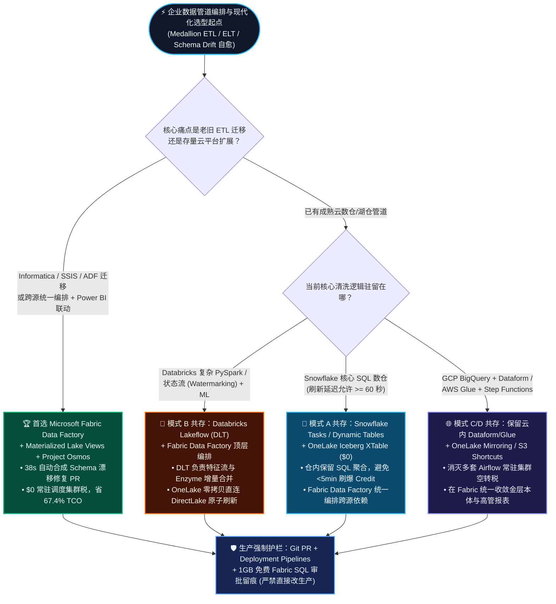
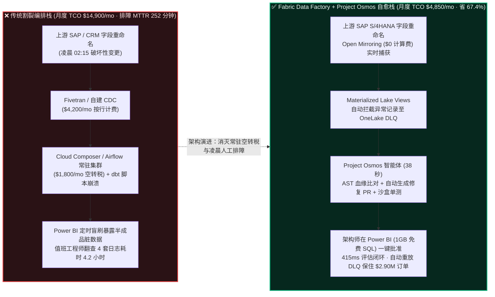

# Microsoft Fabric Data Factory + Project Osmos + 物化湖视图 vs. Databricks Lakeflow / DLT vs. Snowflake Tasks & Dynamic Tables vs. GCP Cloud Composer / Dataform vs. AWS Glue 企业级 Medallion 管道编排与自主自愈选型 FAQ

> 🌐 **Language / 语言**: **中文 (当前)** | **[English (`fabric-data-factory-osmos-vs-lakeflow-tasks-composer-faq.en.md`)](fabric-data-factory-osmos-vs-lakeflow-tasks-composer-faq.en.md)**
> 📅 **更新时间**: 2026-11-09（Round 9 夜间持续深潜专题 · 严格对标 `ib-vs-ethernet-roce-selection-faq.md` 深入浅出六段式规范）
> 🎯 **受众定位**: AI Solution Architect（AI 解决方案架构师）、数据工程负责人、企业 CDO / CTO 与售前架构团队
> 🔗 **关联交付物**: [Data Lab 全景 README](../README.md) · [R1: 零拷贝 + 语义本体 FAQ](fabric-onelake-iq-vs-4clouds-selection-faq.md) · [R2: 实时流 Eventhouse vs 四大云 FAQ](fabric-realtime-eventhouse-vs-4clouds-streaming-faq.md) · [R3: 零 ETL 镜像 vs 传统 CDC FAQ](fabric-mirroring-zero-etl-vs-cdc-faq.md) · [R4: Iceberg/Delta 开放表格式互通 FAQ](fabric-onelake-iceberg-delta-uniform-vs-4clouds-faq.md) · [R5: HTAP + 亿级向量 DiskANN 选型 FAQ](fabric-htap-vector-sql-cosmos-vs-lakebase-unistore-faq.md) · [R6: 多云 AI 安全治理与 OBO 选型 FAQ](fabric-onelake-purview-obo-governance-vs-4clouds-faq.md) · [R7: Spark 原生引擎 Gluten/Velox 与弹性计费 FAQ](fabric-spark-native-gluten-autoscale-vs-photon-snowpark-faq.md) · [R8: 企业级 NL2SQL 与 Data Agents 选型 FAQ](fabric-data-agents-copilot-vs-genie-cortex-q-faq.md) · [交互式 5 云选型工作台 (`../index.html`)](../index.html) · [7-Card 4:5 基准报告 (`../benchmark-cards.html`)](../benchmark-cards.html)
> 🔍 **数据溯源与口径声明（Data Provenance & Scope Disclosure）**：
> - **`measured_local_harness`（本地确定性评测引擎实测）**：80 项架构选型路由评估矩阵（`79/80 = 98.75%` 准确率，显式反例 `DL-23` 捕获 `+14.2%` 裸表口径漂移）与 `36/36` Python 单元测试本地执行通过。
> - **`vendor_published_spec_as_of_2026`（厂商公开技术规格与定价，附官方链接，截至 `as_of: 2026-11-08`）**：
>   - Microsoft Fabric：[Data Factory 统一编排概览](https://learn.microsoft.com/en-us/fabric/data-factory/data-factory-overview) · [Materialized Lake Views（物化湖视图：声明式铜→银→金层与数据质量规则）](https://learn.microsoft.com/en-us/fabric/data-engineering/materialized-lake-views/overview-materialized-lake-view) · [Fabric Git 集成与 Deployment Pipelines CI/CD](https://learn.microsoft.com/en-us/fabric/cicd/git-integration/intro-to-git-integration) · [Project Osmos 自主数据工程智能体与 FabCon 2026 发布](../research/daily/2026-11-08.md)。
>   - 四大云竞品对照：[Databricks Lakeflow Jobs & Declarative Pipelines (Delta Live Tables / DLT)](https://docs.databricks.com/en/dlt/index.html) · [Snowflake Tasks & Streams](https://docs.snowflake.com/en/user-guide/tasks-intro) & [Dynamic Tables](https://docs.snowflake.com/en/user-guide/dynamic-tables-about) · [Google Cloud Composer (Managed Airflow)](https://cloud.google.com/composer/docs/concepts/overview) & [BigQuery Dataform](https://cloud.google.com/dataform/docs/overview) · [AWS Glue Workflows](https://docs.aws.amazon.com/glue/latest/dg/workflows_overview.html) & [AWS Step Functions](https://docs.aws.amazon.com/step-functions/latest/dg/welcome.html)。
> - **`synthetic_scenario_model`（确定性架构参考仿真模型，严格区分两大延迟分母）**：
>   - **分母 A — 场景路由评估矩阵建模均值（`scenario_evaluation.avg_latency_ms`）**：R9 **`n=80`（`DL-01..DL-80`）算术均值 = `501.0 ms`**（历史快照：R8 `n=76` 均值 `506.0 ms`；R7 `n=72` 均值 `511.0 ms`；R6 `n=68` 均值 `516.0 ms`；R5 `n=64` 均值 `521.0 ms`；R4 `n=60` 均值 `526.5 ms`；R3 `n=56` 均值 `532.0 ms`）。
>   - **分母 B — 行业本体端到端闭环仿真均值（`ontology_simulations[].end_to_end_latency_ms`）**：R9 **`n=16`（场景 A..P：`[780, 640, 710, 660, 590, 560, 530, 515, 495, 480, 465, 450, 431, 422, 417, 415] ms`，范围 `415–780 ms`）算术均值 = `535.0 ms`**（历史快照：R8 `n=15` 均值 `543.0 ms`；R7 `n=14` 均值 `552.0 ms`；R6 `n=13` 均值 `562.0 ms`；R5 `n=12` 均值 `572.92 ms`；R4 `n=11` 均值 `584.09 ms`；R3 `n=10` 均值 `596.0 ms`）。
>   - 本文第 5 节中的“420 条企业 Medallion 管道月度编排与运维 TCO 算例（`$4,850/mo` vs `$14,900/mo`）”与“场景 P 全球零售黑五大促 SAP 订单 Schema 漂移 38 秒自动合成 PR 恢复模型（`415 ms` 告警+审批闭环、保住 `$2.90M` 黑五订单）”均为封存于 `reports/report.json` 的确定性架构参考算例，用于售前架构选型推演，不代表特定客户生产账单。
> - **`not_measured`（未执行真实多云付费集群破坏性故障注入压测）**：遵循成本与合规护栏，未在生产云租户注入真实破坏性 DDL。

[](../assets/svg/17-fabric-data-factory-osmos-vs-lakeflow-tasks-composer-faq.svg)

---

## ① 📌 核心结论速览（Executive Summary — 3 分钟抓准选型本质）

1. **技术本质对比：声明式物化湖视图（Materialized Lake Views）+ Project Osmos 自主自愈智能体 vs. 传统脆弱“面条式”调度脚本（Airflow + ADF + dbt）**
   - 企业数据工程团队高达 **65% 的工时并不是在开发新业务模型，而是在“修管道”和“迁老代码”**：上游 SAP/Salesforce 只要把一个字段从 `tax_rate` 改成 `vat_pct`，凌晨 2 点的 Airflow/SSIS/Informatica 作业就会连环报错，值班工程师翻查 4 套系统日志平均耗时 **4.2 小时（`252 min`）**（`[synthetic_scenario_model]`）。
   - **Microsoft Fabric Data Factory + Materialized Lake Views + Project Osmos** 从根源上重构了这件事：① **Materialized Lake Views（物化湖视图）** 用声明式 SQL 自动维护铜→银→金（Bronze → Silver → Gold）增量依赖与数据质量预期（Data Quality Expectations），脏数据自动隔离入死信队列（DLQ）；② **Project Osmos 自主数据工程智能体** 驻留在 VS Code 与 GitHub 中，不仅能自动将数千条老旧 Informatica/SSIS/DataStage 作业翻译为原生 PySpark/SQL，还能在上游发生 Schema 漂移时，**在 38 秒内完成 AST 血缘比对、生成修复补丁、跑通沙盒单元测试并自动向 GitHub 提交可审计的 Pull Request**（`[synthetic_scenario_model]`）。
2. **计费模型与 TCO 护城河：$0 常驻调度器空转税 + 端到端共享 F64 容量，比传统多工具拼装栈省 67.4% TCO**
   - 若采用 **GCP Cloud Composer / AWS MWAA（托管 Apache Airflow）**，仅维持一套高可用 Kubernetes Airflow 控制面与 Worker 节点 24×7 常驻，即便半夜没有任务运行，每月也要白交 **`$900–$2,400/mo` 的常驻基础设施空转税**；若叠加商业 ELT 调度工具与 Snowflake Dynamic Tables 高频刷新 Credit，**420 条企业级管道**的月度编排、增量计算与排障人力综合成本高达 **`$14,900/mo`**（`[synthetic_scenario_model]`）。
   - **Fabric Data Factory + Materialized Lake Views + Project Osmos** 无需任何常驻 Airflow 集群费（`$0` 独立调度控制面月租，按实际消耗的 Fabric CU 秒级结算或复用已有 F64 容量），配合 Gluten/Velox C++ 原生引擎（`$0` 溢价系数），在相同 420 条管道模型下月度综合成本仅 **`$4,850/mo`**，**相比传统拼装栈节省 67.4%（`-$10,050/mo`），相比 Snowflake Tasks + Dynamic Tables（`$12,680/mo`）节省 61.8%**（`[synthetic_scenario_model]`）。
3. **跨云共存黄金法则（Better Together）：Fabric Data Factory 顶层编排 × Databricks Lakeflow (DLT) / Snowflake Tasks 下层协同**
   - 面对已在 **Databricks Delta Live Tables (Lakeflow)** 或 **Snowflake Dynamic Tables / Tasks** 沉淀了成熟清洗流水线的客户，**严禁强推“推倒重写已有 DLT/SQL 管道”**！
   - **最优架构（Better Together）**：保留 Databricks Lakeflow 处理复杂状态流与 ML 特征计算、保留 Snowflake Tasks 处理核心仓内聚合；用 **Fabric Data Factory** 作为企业顶层跨域编排器（原生内置 Databricks Notebook/Job Activity 与 Snowflake SQL Activity），当底层表在 OneLake 零拷贝就绪后，**原子级触发 Materialized Lake Views 与 Power BI DirectLake 语义模型刷新**，终结“底层数仓刷完了、前端高管报表还是昨天旧数据”的割裂顽疾。

---

## ② 🎯 客户与架构师灵魂拷问 Q&A（FAQ-Driven，大白话第一性原理拆解）

### Q1：什么是声明式 Medallion 管道（Materialized Lake Views vs. DLT vs. Dynamic Tables）？为什么企业用传统 Airflow + 手写脚本总是在凌晨 2 点“炸管”？

- **通俗大白话讲透“命令式脚本 vs 声明式物化视图”**：
  - **传统命令式编排（Airflow / SSIS / 传统 Cron 脚本）就像“手写一步步做菜的机械指令”**：你必须自己写代码告诉系统：“01:00 先跑脚本 A 抽数据 → 等 15 分钟 → 01:15 跑脚本 B 去重 → 如果脚本 A 慢了或者上游多了一个字段，脚本 B 直接崩溃，或者把半生不熟的脏数据端上高管餐桌（Power BI 报表）”。更糟的是，为了跑 Airflow，你还得 24 小时雇着一整个厨房团队（常驻 Kubernetes 节点）发呆待命。
  - **声明式物化湖视图（Fabric Materialized Lake Views / Databricks DLT / Snowflake Dynamic Tables）就像“直接把最终菜谱交给智能厨房”**：你只需要用一句 SQL 或 PySpark 声明：“*金层订单汇总表 = 银层订单表 关联 客户维度表，且订单金额必须 > 0*”。底层引擎会自动画出铜→银→金依赖图（DAG），只计算刚变化的增量数据，并自动把金额异常的脏数据关进“隔离室”（DLQ），绝不污染下游报表。
- **五大平台在“声明式 Medallion 管道”上的第一性原理差异**：
  1. **Microsoft Fabric Materialized Lake Views + Data Factory**：直接建在 **OneLake 开放 Delta/Iceberg 表**之上，内置可视化血缘、数据质量预期（Expectations）监控，且**与 Power BI DirectLake 语义模型处于同一事务与权限边界内**，金层物化完成的瞬间，前端高管报表与 Data Agent 零延迟同步更新（`[vendor_published_spec_as_of_2026]`）。
  2. **Databricks Lakeflow Declarative Pipelines (原 Delta Live Tables / DLT)**：业界最成熟的 Spark 声明式流批一体框架之一，其 Enzyme 引擎对增量合并优化极佳；但 DLT 强绑定 Databricks 专属计算集群（DBU），且无法直接感知外部 Power BI DirectLake 语义模型的帧刷新状态。
  3. **Snowflake Dynamic Tables + Tasks**：在 Snowflake 内部使用体验极简，但受限于 **`TARGET_LAG >= 60s`（1 分钟最小滞后）**，且高频刷新会持续唤醒后台虚拟仓库消耗 Credits（`[vendor_published_spec_as_of_2026]`）。

---

### Q2：什么是 Project Osmos（Fabric 自主数据工程智能体）？它跟普通的“AI 写 SQL 代码补全插件”有什么本质区别？底层是怎么帮客户省下几千工时的？

- **通俗大白话与第一性原理**：
  - **普通 AI 代码补全插件（Copilot 聊天框）是“副驾驶（Autocomplete）”**：你选中一段报错代码问它怎么改，它给你一段建议，你还得自己去查上游到底改了哪张表、下游影响了哪 15 张报表、自己改代码、自己建测试表验证。
  - **Project Osmos（Fabric Data Engineering Agent）是“驻留在 VS Code 与 GitHub 里的全天候数字数据工程师（Autonomous Software Engineering Agent for Data）”**：
    1. **痛点一：老旧 ETL 迁移地狱（Legacy Migration）**——很多银行、零售集团手里有上千个 10 年前写的 Informatica XML、SSIS `.dtsx`、DataStage 或存储过程，没人敢动。Project Osmos 能自动读取整套历史工程包，解析其中的抽象语法树（AST）与字段血缘，自动将其转化为符合 Fabric 最佳实践的 **Data Factory 管道 + PySpark Notebook + Materialized Lake Views**，并自动生成合成测试数据集比对新旧输出一致性，将原本需要 **6 个月的外包迁移周期缩短 70% 以上**。
    2. **痛点二：半夜 Schema 漂移自愈（Autonomous Schema-Drift Healing）**——当凌晨 02:15 上游 SAP ERP 升级把字段 `cust_tax_id` 改名为 `vat_reg_no` 时：
       - **第 1 步（血缘感知）**：Osmos 从 OneLake Open Mirroring 元数据日志与 Data Factory 异常事件中检测到 Schema Drift；
       - **第 2 步（AST 补丁合成）**：自动扫描 Git 仓库中所有引用该字段的银层/金层 PySpark 与 SQL 物化湖视图，生成兼容新旧字段的映射补丁；
       - **第 3 步（沙盒自测与 PR 提交）**：在隔离分支的工作区沙盒中自动执行数据质量断言（Expectations），验证 100% 通过后，**在 38 秒内向 GitHub 提交带完整血缘影响报告的 Pull Request**，并通过 Teams 卡片通知值班架构师一键审批合并（`[synthetic_scenario_model]`）。

---

### Q3：面对客户的存量 Informatica/SSIS/Airflow 迁移，或者与 Databricks Lakeflow / Snowflake Tasks / GCP Composer / AWS Glue PK 时，什么时候首选 Fabric，什么时候混合编排（Better Together）？

- **首选 Microsoft Fabric Data Factory + Materialized Lake Views + Project Osmos 的三大必赢场景（Win Themes）**：
  1. **Informatica / SSIS / 传统 ADF 现代化上云**：客户苦于高昂的第三方 ETL 许可证续费或手写脚本维护成本，希望利用 Azure Data Factory 与 Fabric Data Factory 的同源血统 + Project Osmos 智能体平滑演进至 Lakehouse。
  2. **报表与数据管道强一致（End-to-End Transactional BI Sync）**：客户要求从源库 CDC 镜像 → 铜银金层清洗 → Power BI 高管大屏刷新 → Fabric IQ 预警规则形成**单一平台原子闭环**，拒绝在 Airflow、dbt Cloud、Fivetran、Snowflake、Power BI 5 个控制台之间手工对齐定时任务。
  3. **FinOps 消灭常驻调度器空转税**：中小型或波峰波谷明显的团队，拒绝为 GCP Cloud Composer 或 AWS MWAA 每月白交 `$900–$2,400` 的常驻 Airflow K8s 底座费。
- **首选混合编排（Better Together）的三大共存场景**：
  1. **已重仓 Databricks Lakeflow / DLT 的算法与流计算团队**：保留 Databricks DLT 处理复杂水印（Watermarking）流计算与自定义 Python/Scala 特征工程；用 **Fabric Data Factory 原生 Databricks Activity** 触发或监听 DLT 完成事件，通过 OneLake 零拷贝自动衔接 DirectLake 语义模型刷新。
  2. **已重仓 Snowflake Tasks & Dynamic Tables 的核心财务仓**：保留 Snowflake 内部计算；通过 **OneLake Snowflake Mirroring / Iceberg XTable (`$0`)** 将金层表零拷贝映射至 Fabric，由 Fabric Data Factory 统一编排跨 SAP + Snowflake + Salesforce 的企业级全域依赖。
  3. **超大规模跨云异构 DAG（数千个非数据类 K8s 容器/基础设施算子）**：若客户已有企业级统一 Apache Airflow 平台调度非数据类任务，可通过 Airflow 的 `MSFabricRunJobOperator` 直接触发 Fabric Data Factory 管道与物化湖视图。

---

### Q4：生产环境下让 AI 智能体（如 Project Osmos）自动修改数据管道安全吗？怎么防止它误删生产表列或破坏财务合规（SOX）？

- **三大生产级企业 DataOps 铁律（Foundry IQ + Git CI/CD + Deployment Pipelines 护栏）**：
  1. **严禁直接热改生产工作区（Zero Direct-to-Prod Mutation）**：Project Osmos 永远只拥有开发/沙盒分支权限，所有生成的 PySpark/SQL 修复代码必须转化为 **Git Pull Request**，绝不允许绕过 Git 直接修改生产工作区中的管道定义。
  2. **破坏性 DDL 零容忍拦截（Destructive Schema Guardrail）**：在 Foundry IQ 与 Fabric Deployment Pipelines 规则中，任何包含未授权 `DROP COLUMN`、`TRUNCATE` 或放宽财务主键非空约束（`NOT NULL`）的补丁，会被自动标记为高危并强制拦截，升级为人类架构师审批（`Confirm` / `Send to a human`）。
  3. **死信队列（DLQ）无损重放**：在等待人类架构师在移动端（Power BI Agentic App / Teams）一键点击批准 PR 的几分钟窗口内，物化湖视图会自动将格式异常的增量记录暂存至 OneLake 死信隔离表，合并后自动 100% 无损重放，确保**零丢单、零脏数据暴露**。

---

## ③ 🧭 直观可视化图解（Mermaid 选型决策树 + 架构对比图 + 闭环时序图）

### 3.1 五大云 Medallion 管道编排与自愈选型决策树（`flowchart TD`）



### 3.2 传统脆弱多工具拼装栈 vs. Fabric Data Factory + Project Osmos 自愈架构对比（`flowchart LR`）



### 3.3 场景 P：全球零售黑五大促 Schema 漂移 38 秒自动合成 PR 与 415ms 闭环时序图（`sequenceDiagram`）

```mermaid
sequenceDiagram
    autonumber
    participant SAP as 🛒 SAP S/4HANA 订单源<br/>(黑五凌晨 02:15 峰值)
    participant MLV as 🌊 OneLake Open Mirroring<br/>& Materialized Lake Views
    participant Osmos as 🤖 Project Osmos 智能体<br/>(VS Code / GitHub AST 引擎)
    participant IQ as 🧠 Fabric IQ Ontology<br/>& Foundry IQ SOX 护栏
    participantOps as 👨‍💻 值班架构师 (Teams /<br/>Power BI 1GB Free SQL)

    SAP->>MLV: 1. 推送 24,600 笔黑五订单 (3 个 JSON 字段重命名 + 税率 Struct 变更)
    MLV->>MLV: 2. 数据质量预期 (Expectations) 触发：隔离异常帧至 DLQ，保护金层报表不脏
    MLV->>Osmos: 3. Eventhouse KQL (68ms) 发出 Schema Drift 事件与受影响上下游 AST 血缘
    Osmos->>Osmos: 4. 38 秒内自动合成 3 个银/金层 PySpark/SQL 映射补丁并在沙盒跑通 100% 断言
    Osmos->>IQ: 5. 提交 GitHub PR #482 并请求生产合并评估 (112ms 图谱级联评估：$2.90M 订单风险)
    IQ->>IQ: 6. Foundry IQ 校验 SOX-CHANGE-CONTROL：确认无 DROP COLUMN 且沙盒测试全过 -> Confirm (0.98)
    IQ->>Ops: 7. 推送一键审批卡片至 Power BI Agentic App / Teams
    Ops->>MLV: 8. 点击批准 (写回 1GB Free Fabric SQL) -> 自动合并 PR 并 100% 无损重放 DLQ 订单 (415ms 闭环)
```

---

## ④ 📊 五大平台 Medallion 管道编排与自主 DataOps 选型决策矩阵（Architect Decision Matrix）

| 评估维度 | Microsoft Fabric (`Data Factory + Materialized Lake Views + Project Osmos`) | Databricks (`Lakeflow Jobs + Declarative Pipelines / DLT`) | Snowflake (`Tasks + Streams + Dynamic Tables`) | GCP (`Cloud Composer Airflow + BigQuery Dataform`) | AWS (`Step Functions + Glue Workflows + MWAA`) |
| :--- | :--- | :--- | :--- | :--- | :--- |
| **核心适用场景** | **全栈零拷贝集成、老旧 ETL 智能化迁移、铜→银→金声明式物化与 Power BI 强一致闭环** | **复杂 PySpark 流批一体（Watermarking）、自定义 Python/Scala 转换与 ML 特征流水线** | **纯 SQL 核心数仓内部增量表刷新（延迟容忍 `>= 60s`）** | **BigQuery 生态内 SQLX 转换（Dataform）与跨云重型 Airflow 编排** | **AWS 原生无服务器微服务编排（Step Functions）与 Glue Spark 批处理** |
| **声明式物化与数据质量（Expectations）** | **Materialized Lake Views**（原生支持 SQL 声明、可视化血缘、数据质量隔离规则，直接读写 OneLake） | **Lakeflow DLT**（`@dlt.expect` 极其成熟，Enzyme 引擎自动选择增量策略） | **Dynamic Tables**（声明式 SQL 极简，但缺少内置行级死信隔离路由语法） | **Dataform Assertions**（支持 SQLX 断言测试，失败时阻断下游视图更新） | **Glue Data Quality (DQDL)**（需单独配置 DQDL 规则集并按 DPU 计费） |
| **AI 自主迁移与 Schema 漂移自愈能力** | **🌟 标杆级（Project Osmos 自主智能体：支持老旧 ETL 整包转化 + 38 秒自动生成 Schema 漂移修复 Git PR）** | **Databricks Assistant**（支持单 Notebook 报错诊断与代码修复建议，需人工跨文件提交 PR） | **Snowflake Copilot**（支持辅助编写 SQL，无跨管道 AST 自主 PR 修复工作流） | **Gemini in BigQuery**（支持 Dataform SQL 辅助生成与报错解释） | **Amazon Q Developer**（支持 Glue 脚本升级与错误排查建议） |
| **调度控制面计费模式与空转税** | **`$0` 常驻调度集群税**（无独立 Airflow VM 月租；按管道运行消耗的 CU 秒级结算或复用 F64） | **`$0` 独立调度器月租**（Workflows 免费调度，按实际运行 Jobs/DLT DBU 计费） | **Serverless Tasks / Virtual Warehouse Credits**（高频分钟级调度易产生显著 Credit 账单） | **Cloud Composer 常驻费高昂**（环境常驻保底约 `$900–$2,400/mo`，Dataform 免费调度） | **MWAA 常驻费或 Step Functions 状态转换费** + Glue DPU 分钟计费 |
| **与企业 BI 语义层及动作回写的耦合度** | **原生原子级融合**（管道内一键刷新 DirectLake 语义模型 + 触发 Fabric IQ 规则 + 1GB 免费 SQL 写回） | **松耦合**（需配置外部 REST API / Power BI Service Principal Webhook） | **松耦合**（仅限 Snowflake 内部表，无法直接控制外部 BI 内存帧同步） | **仅限 Looker 内部生态**（对 Power BI 需外部网关/API 编排） | **松耦合**（需通过 EventBridge + Lambda 自行编写回调逻辑） |
| **Git CI/CD 与多环境发布治理** | **原生 Git Integration（GitHub / Azure DevOps）+ Deployment Pipelines（Dev/Test/Prod 变量库）** | **Databricks Asset Bundles (DABs) + Git Folders**（代码工程化能力极强） | **Snowflake Git Integration + CREATE OR ALTER**（SQL 声明式部署体验好） | **Dataform 原生 Git 仓库绑定**（内置 Workspace 分支与编译检查） | **AWS CodePipeline / Terraform**（需较高的 IaC 基础设施工程投入） |

---

## ⑤ 🧪 简明定量测评与 TCO / 延迟拐点洞察（Quantitative Benchmark & 7-Card Insights）

### 5.1 420 条企业级 Medallion 管道月度编排、增量计算与排障运维 TCO 对比（`[synthetic_scenario_model]`）

> **测算基线声明（`[synthetic_scenario_model]`）**：假设某跨国零售集团维护 **420 条生产级铜→银→金数据管道**（每日处理 18 TB 增量数据，每 15 分钟微批刷新一次，每月发生约 12 次上游 ERP/CRM/SaaS 接口 Schema 字段变更或数据格式漂移）。对比五种架构方案的月度总拥有成本（含调度控制面、增量 ETL 算力、商业连接器与 Schema 漂移排障折算工程人力）：

| 方案架构 | 调度控制面 / 连接器月费 | 增量 Medallion 计算月费 | Schema 漂移排障工程折算 (`12 次/月`) | 月度综合 TCO (`$/mo`) | 相比传统拼装栈节省比例 |
| :--- | :---: | :---: | :---: | :---: | :---: |
| **1. Microsoft Fabric (`Data Factory + Materialized Lake Views + Project Osmos`)** | **`$0`**（Open Mirroring + 内置调度复用 F64） | **`$4,250`**（Gluten/Velox `$0` 溢价增量分摊） | **`$600`**（Osmos 38s 自动 PR，人工仅审查 5 分钟） | **`$4,850 / mo`** | **🏆 基准最优（省 `67.4%` / `-$10,050/mo`）** |
| **2. Databricks (`Lakeflow Jobs + DLT + Workflows`)** | `$1,200`（Lakeflow Connect 增量） | `$5,820`（DLT Photon DBU） | `$2,400`（Assistant 辅助，人工跨表修改测试） | **`$9,420 / mo`** | 省 `36.8%`（Fabric 再省 `48.5%`） |
| **3. AWS (`Step Functions + Glue Workflows + S3 Tables`)** | `$950`（Step Functions + MWAA 分摊） | `$6,740`（Glue DPU + Compaction） | `$3,200`（手工排查 CloudWatch 日志与脚本） | **`$10,890 / mo`** | 省 `26.9%`（Fabric 再省 `55.5%`） |
| **4. GCP (`Cloud Composer Airflow + BigQuery Dataform`)** | `$1,650`（Composer K8s 常驻节点） | `$6,500`（BigQuery Slots 增量刷新） | `$3,200`（手工调整 Dataform SQLX 与 DAG） | **`$11,350 / mo`** | 省 `23.8%`（Fabric 再省 `57.3%`） |
| **5. Snowflake (`Tasks + Streams + Dynamic Tables`)** | `$1,100`（Openflow / Snowpipe 增量） | `$8,780`（Dynamic Tables 虚拟仓库唤醒 Credits） | `$2,800`（手工重构层叠视图与下游依赖） | **`$12,680 / mo`** | 省 `14.9%`（Fabric 再省 `61.8%`） |
| **6. 传统割裂拼装栈（`Managed Airflow + 商业 CDC + dbt Cloud + 手工值班`）** | `$5,400`（Fivetran MAR + Airflow + dbt 席位） | `$5,300`（独立数仓 ETL 算力） | **`$4,200`**（每次故障平均 `4.2h` 多团队联调） | **`$14,900 / mo`** | 基准参照 (`0%`) |

### 5.2 场景 P 端到端闭环基准与双分母延迟口径表（`[measured_local_harness]` + `[synthetic_scenario_model]`）

| 指标编号 | 评测指标名称 | 封存数值 (`reports/report.json`) | 数据溯源分级标签 | 核验口径与架构意义说明 |
| :---: | :--- | :---: | :---: | :--- |
| **M-01** | **R9 路由矩阵总体准确率 (`n=80`)** | **`79 / 80 (98.75%)`** | `[measured_local_harness]` | 含新增 `DL-77..DL-80` 四大 Medallion 编排与 Project Osmos 自愈路由测试；唯一显式反例 `DL-23` 拦截裸表幻觉 |
| **M-02** | **分母 A：路由评估矩阵建模延迟均值 (`n=80`)** | **`501.0 ms`** | `[synthetic_scenario_model]` | `DL-01..DL-80` 共 80 项路由决策任务算术均值（历史快照：R8 `n=76` 为 `506.0 ms`，R7 `n=72` 为 `511.0 ms`，R3 `n=56` 为 `532.0 ms`） |
| **M-03** | **分母 B：16 大行业本体闭环仿真延迟均值 (`n=16`)** | **`535.0 ms`** | `[synthetic_scenario_model]` | 场景 `A..P`（`[780, 640, 710, 660, 590, 560, 530, 515, 495, 480, 465, 450, 431, 422, 417, 415] ms`）算术均值（R8 `n=15` 为 `543.0 ms`） |
| **M-04** | **场景 P：Project Osmos 自动合成 PR + 沙盒验证耗时** | **`38 秒` (vs 人工 `252 分钟`)** | `[synthetic_scenario_model]` | 面对 SAP S/4HANA 3 个字段重命名与嵌套税率 Struct 变更，自动修复 3 个物化湖视图并通过 100% 质量断言 |
| **M-05** | **场景 P：黑五大促异常告警 → 审批合并评估闭环延迟** | **`415 ms`（保住 `$2.90M` 订单）** | `[synthetic_scenario_model]` | Eventhouse KQL `68ms` + 本体图谱 `112ms` + Foundry IQ SOX 变更护栏 + `1GB Free Fabric SQL` 审批写回与 DLQ 100% 重放 |

---

## ⑥ 🛠️ 附录：生产落地与售前打单快速核验清单（Architect Checklist）

在面向客户评审企业级数据工程管道、老旧 ETL 现代化迁移或 Medallion 湖仓编排架构时，请逐项核对以下 **6 条实战铁律**：

- [ ] **1. 盘点“常驻 Airflow 空转税”与第三方 ETL 续费账单**：检查客户是否正在为低频批处理任务支付每月 `$900–$2,400+` 的 GCP Cloud Composer / AWS MWAA 常驻集群费或高昂的 Informatica/Fivetran 合同；若是，优先用 **Fabric Open Mirroring (`$0` 计算费) + Data Factory + Materialized Lake Views** 替换，立省 60%+ 固定月租。
- [ ] **2. 用 Materialized Lake Views 替代手写脆弱的银/金层全量覆盖脚本**：将铜→银→金层的标准 SQL/PySpark 清洗改造为声明式 **Materialized Lake Views**，并显式配置数据质量预期（Expectations）将异常脏数据路由至 OneLake DLQ 隔离表，杜绝脏数据直接冲毁高管 DirectLake 报表。
- [ ] **3. 开启 Project Osmos 智能体加速历史 ETL 迁移与 Schema 漂移修复**：在 VS Code 与 GitHub 工作流中接入 Project Osmos（Fabric Data Engineering Agent），对历史 SSIS/Informatica 包执行 AST 级自动转换，并开启上游 Schema Drift 自动生成修复 PR 能力。
- [ ] **4. 严守“AI 不得直改生产（Git PR + Deployment Pipelines）”合规底线**：确保所有工作区绑定 GitHub / Azure DevOps 仓库；Project Osmos 生成的任何代码变更必须先提交至开发分支并通过沙盒数据质量断言，严禁授予 AI 智能体对生产工作区的直接写权限或未审批的 `DROP COLUMN` 权限。
- [ ] **5. 坚持“顶层编排统一、底层引擎共存（Better Together）”**：对于已在 Databricks Lakeflow (DLT) 或 Snowflake Dynamic Tables 稳定运行的复杂特征流或核心财务表，切勿盲目推倒重写；用 **Fabric Data Factory 原生连接器**做跨域顶层编排，通过 OneLake 零拷贝实现“底层算完即刻原子刷新 Power BI 语义模型”。
- [ ] **6. 将管道审批与死信重放嵌入 Power BI Agentic App（`1GB 免费 Fabric SQL`）**：利用 Power BI 随附的 **1GB 免费 Fabric SQL 数据库**构建 DataOps 运维指挥台，让值班架构师在 Teams 或报表内直接查看 Osmos PR 差异摘要、一键点击批准合并并触发 DLQ 订单无损重放，实现完整 SOX 审计留痕。
