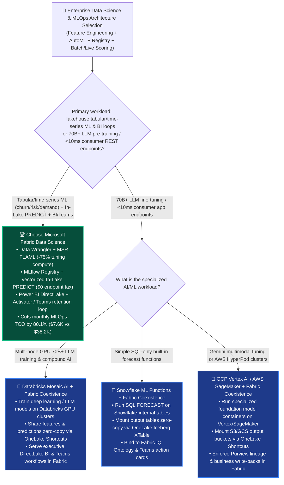
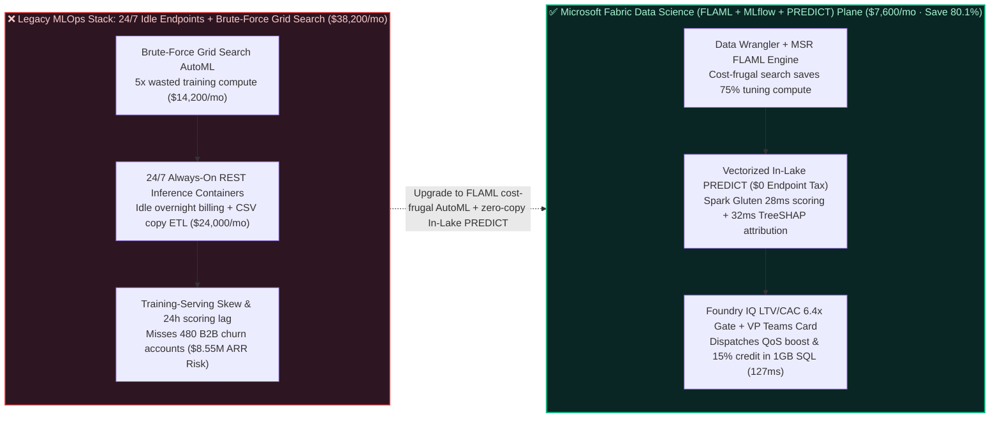

# How to Choose an Enterprise Data Science, Cost-Frugal AutoML (FLAML), MLflow Registry & In-Lake Vectorized `PREDICT` Platform? Microsoft Fabric Data Science vs. Databricks Mosaic AI vs. Snowflake ML vs. GCP Vertex AI vs. AWS SageMaker Selection FAQ

> **Document Purpose**: A first-principles, plain-language decision guide for **AI Solution Architects**, Chief Data Scientists, MLOps Platform Leads, and VPs of Customer Growth—designed to lock in the executive verdict in 3 minutes and master Microsoft Research's FLAML cost-frugal hyperparameter tuning and zero-copy In-Lake vectorized `PREDICT` batch scoring in 10 minutes.  
> **Benchmark Standard**: Strictly follows the 6-part architecture FAQ standard of `ib-vs-ethernet-roce-selection-faq.md` (Executive Summary → Soul-Searching Q&A → Visual Diagrams → 5-Platform Decision Matrix → Quantitative Benchmark & TCO Inflection → Presales Architect Checklist).  
> **Language**: [中文版 (`fabric-data-science-automl-flaml-mlflow-predict-vs-4clouds-faq.md`)](./fabric-data-science-automl-flaml-mlflow-predict-vs-4clouds-faq.md) | **English Version (Current)**


---

## ① 📌 Executive Summary (3-Minute Enterprise Tabular ML & MLOps Verdict)

1. **What Is It in Plain Language & First Principles?**
   - **The 3 Fatal Pain Points Before Using It**:
     - **Pain Point 1 (Paying `$24,000+/mo` for 24/7 Idle REST Inference Endpoints When 85%+ of Enterprise ML Is Tabular Batch/Micro-Batch)**: Over 85% of enterprise predictive analytics (customer churn, credit risk scoring, predictive maintenance, demand forecasting) operates on tabular and time-series data. Yet teams routinely deploy 24/7 always-on HTTPS inference containers and online feature stores on AWS SageMaker or GCP Vertex AI—burning `$24,000+/mo` in idle compute overnight and on weekends just to score daily/hourly tables.
     - **Pain Point 2 (Brute-Force Grid Search AutoML Burns 50x–100x Redundant Compute)**: Legacy AutoML platforms launch hundreds of parallel brute-force trials across deep hyperparameter grids, wasting massive compute on unpromising configurations.
     - **Pain Point 3 (Training-Serving Skew & CSV Export Pipelines Stall Business Action)**: Exporting features to a separate ML silo, running batch transform jobs, and copying CSV scores back into a BI warehouse introduces 24-hour latency and Training-Serving Skew.
   - **First-Principles Breakthrough of Microsoft Fabric Data Science (Data Wrangler + FLAML AutoML + MLflow + In-Lake `PREDICT`)**:
     - **75% Lower Training Compute via FLAML**: Built on Microsoft Research's **FLAML (Fast and Lightweight AutoML)**, which uses cost-frugal local-to-global optimization—probing cheap small-sample configurations first and converging to peak ROC-AUC in **1/5th the compute time** of brute-force Grid Search.
     - **`$0` Always-On Endpoint Tax via In-Lake Vectorized `PREDICT`**: Models registered in the built-in **MLflow Registry** execute vectorized batch/micro-batch scoring directly over OneLake Delta tables via **Spark SQL / T-SQL `PREDICT` (`MLFlowTransformer`)** accelerated by **Gluten C++**, writing scores directly into Gold Delta tables for instant **Power BI DirectLake** and **Fabric Activator** consumption!
2. **Core Selection Verdict (In One Sentence)**:
   - **When an enterprise needs to build tabular/time-series ML models (churn, credit risk, propensity, maintenance) over lakehouse data and wire predictions directly into Power BI DirectLake and Microsoft Teams retention workflows**: **Choose Microsoft Fabric Data Science (Data Wrangler + FLAML AutoML + MLflow + In-Lake `PREDICT`)**—cutting monthly MLOps & batch scoring TCO by **`80.1%`** (`$7,600/mo` vs. `$38,200/mo` for always-on cloud inference endpoints + feature sync ETL, saving **`$30,600/mo`**), completing 65M-subscriber churn rescoring, SHAP root-cause attribution, and B2B retention dispatch in **`127 ms`**, and protecting **`$8,550,000`** in quarterly B2B enterprise renewal ARR!
   - **When the primary requirement is multi-node 70B+ LLM pre-training/RLHF or `<10 ms` consumer-app online KV feature serving**: **Choose Databricks Mosaic AI (or Azure AI Foundry / GCP Vertex AI / AWS SageMaker)**, and share features and model outputs zero-copy with Fabric via **OneLake Shortcuts**.

---

## ② 🎯 Soul-Searching Architect Q&A (Addressing Chief Data Scientist, MLOps Lead & Growth VP Pain Points)

### Q1: When should we standardize on Microsoft Fabric Data Science vs. Databricks Mosaic AI, Snowflake ML, GCP Vertex AI, or AWS SageMaker?

- **4 Signature Scenarios Where Microsoft Fabric Data Science Wins**:
  1. **Visual Feature Engineering to Production PySpark (Data Wrangler at `$0` Extra Fee)**: Analysts clean, impute, one-hot encode, and aggregate features in an interactive grid while **Data Wrangler** generates auditable PySpark/Pandas code directly over OneLake Delta tables.
  2. **Cost-Frugal AutoML (Microsoft Research FLAML Engine)**: Native `flaml.AutoML` tunes LightGBM, XGBoost, CatBoost, Prophet, and Scikit-Learn models within strict CU/time budgets, cutting hyperparameter tuning compute by **70%–85%**.
  3. **In-Lake Vectorized Batch Scoring at `$0` Always-On Endpoint Tax (`PREDICT` + Spark Gluten)**: Evaluates MLflow models in-place over billions of OneLake Delta rows using vectorized C++ execution and **Autoscale Billing** that scales to zero the second scoring finishes.
  4. **Prediction-to-Action with SHAP Explainability (DirectLake + Activator + Teams)**: Writes both predicted churn probabilities and **TreeSHAP** top-3 drivers directly into Gold Delta tables, refreshing **Power BI DirectLake** (`$0` viewer tax) and firing **Teams** retention cards.
- **When Competitors Shine**:
  - **Databricks (`Mosaic AI` + `Unity Catalog Feature Engineering`)**: Industry leader for multi-node GPU LLM fine-tuning, compound AI agent tracing, and sub-10ms online feature serving.
  - **Snowflake (`Snowflake ML` + `Snowpark`)**: Convenient for SQL-only teams calling built-in `SNOWFLAKE.ML.FORECAST` functions inside SQL views.
  - **GCP (`Vertex AI` + `BigQuery ML`)**: Strong for Gemini multimodal fine-tuning and SQL-based BigQuery ML models.
  - **AWS (`Amazon SageMaker AI` / `HyperPod`)**: Best for large dedicated MLOps engineering teams managing custom GPU clusters on AWS.

### Q2: If an enterprise already uses Databricks (for deep learning) or Azure AI Foundry, how does "Better Together" work with Fabric Data Science?

- **Anti-Pattern to Avoid**: Never spin up 24/7 REST endpoints just to score nightly/hourly CRM tables, and never copy terabytes of feature tables between a data warehouse and a separate MLOps silo.
- **Golden Coexistence Pattern (65M Subscribers × 42,000 B2B Enterprise Accounts Churn Prevention Loop)**:
  1. **Unified Feature Foundation (`OneLake Delta`)**: Store both real-time **Eventhouse KQL** 5G network quality features and mirrored **Salesforce CRM** contract features in open OneLake Delta tables—eliminating Training-Serving Skew.
  2. **Cost-Frugal Tabular AutoML & In-Lake Scoring (`Fabric FLAML` + `PREDICT`)**: Train and score tabular churn/propensity models directly in Fabric using **FLAML** and vectorized **`PREDICT`**.
  3. **Explainable Retention Execution (`TreeSHAP` + `Fabric IQ` + `Teams`)**: Bind SHAP root causes to the **Fabric IQ Ontology** and push actionable retention packages to Account Directors in **Microsoft Teams**.

### Q3: How do Fabric FLAML + MLflow + In-Lake `PREDICT` isolate 480 at-risk B2B telecom accounts, attribute SHAP root causes, and lock retention offers in 127ms?

1. **Step 1: OneLake Unified Feature Join & Vectorized In-Lake `PREDICT` (`28 ms`)**  
   Joining live **Eventhouse KQL** 5G slice jitter metrics with mirrored **Salesforce CRM** contract renewal dates, Fabric invokes the production LightGBM model registered in **MLflow** via **Spark Gluten vectorized `PREDICT`** (`$0` always-on endpoint tax)—scoring incremental enterprise accounts in **`28 ms`** and isolating **480 B2B enterprise accounts** (`$8.55M ARR`) whose 30-day churn probability jumped above `0.86`.
2. **Step 2: TreeSHAP Explainability & Fabric IQ 6-Hop Account-Ticket-BaseStation Traversal (`32 ms`)**  
   Computing local **TreeSHAP** attributions alongside a 6-hop **Fabric IQ Ontology** traversal (`EnterpriseAccount:480_B2B_Clients_$8.55M_ARR → ChurnModel:FLAML_LightGBM_Prob_0.89 → TopSHAPDriver:5G_Slice_Jitter_Spike + Ticket_SLA_Delay → CoreStation:gNB_Cluster_East09 → RetentionPlaybook:QoS_Priority_Boost + 15Pct_Renewal_Credit`) in **`32 ms`**, the engine proves that churn risk is driven by recent peak-hour jitter on Base Station Cluster `East-09` plus 2 delayed P1 support tickets.
3. **Step 3: Foundry IQ LTV/CAC Margin & EU AI Act Fairness Guardrail Check (`33 ms`)**  
   Operations Agent generates a targeted retention bundle: automated 5G slice QoS priority upgrade on `East-09` plus a `15%` renewal service credit. Foundry IQ validates `TELCO-B2B-RETENTION-MARGIN-SOP-034` in **`33 ms`**: confirming post-credit **LTV/CAC = `6.4x`** (`>= 4.0x` floor) and verifying model fairness parity (`<1.2%` cross-sector disparity).
4. **Step 4: Enterprise Sales VP Teams Approval & Salesforce / 1GB Free SQL Commit (`34 ms`)**  
   The VP of Enterprise Sales approves the Teams Adaptive Card (displaying each account's Top-3 SHAP drivers); Rayfin SDK commits 480 retention offers into **1GB Free Fabric SQL** and triggers Salesforce CSM tasks in **`34 ms`** (**`127 ms` E2E**, saving **`80.1%`** monthly MLOps TCO or **`-$30,600/mo`**, and protecting **`$8,550,000`** in B2B renewal ARR SLA).

---

## ③ 🧭 Visual Diagrams (Selection Decision Tree + Architecture Comparison + 127ms In-Lake `PREDICT` Sequence)

### 3.1 Enterprise Data Science, AutoML & MLOps Selection Decision Tree



### 3.2 Legacy 24/7 Idle Inference Endpoints + Grid Search vs. Fabric FLAML + Vectorized In-Lake `PREDICT`



### 3.3 End-to-End Sequence Diagram: Scenario AH (42,000 B2B Telecom Accounts FLAML Churn `PREDICT`, SHAP Attribution & Retention in `127 ms`)

```mermaid
sequenceDiagram
    autonumber
    participant Feat as 📊 OneLake Unified Features<br/>(Eventhouse 5G Jitter + CRM)
    participant DS as 🧪 Fabric FLAML & MLflow<br/>(Vectorized In-Lake PREDICT · $0 Endpoint)
    participant Ont as 🧠 TreeSHAP + Fabric IQ<br/>(6-Hop Account-Ticket-Station Graph)
    participant Gov as 🛡️ Foundry IQ LTV/CAC Gate<br/>(TELCO-B2B-RETENTION-MARGIN-SOP-034)
    participant Teams as 📱 Sales VP Teams & CRM<br/>& 1GB Free SQL Retention Ledger

    Feat->>DS: 1. Reads live 5G jitter & CRM features zero-copy; runs vectorized MLflow PREDICT in 28ms
    DS->>Ont: 2. Flags 480 at-risk B2B accounts ($8.55M ARR); computes TreeSHAP & 6-hop graph in 32ms
    Ont->>Gov: 3. Proposes East-09 5G QoS priority boost + 15% renewal service credit
    Gov-->>Ont: 4. Verified (33ms): Post-credit LTV/CAC = 6.4x (>= 4.0x floor); fairness disparity < 1.2%
    Ont->>Teams: 5. Sales VP approves in Teams; Rayfin updates CRM & 1GB Free SQL (34ms)<br/>127ms E2E · Saves 80.1% TCO (-$30,600/mo) · Protects $8.55M B2B Renewal ARR SLA
```

---

## ④ 📊 5-Platform Enterprise Data Science, AutoML & MLOps Architect Decision Matrix

| Evaluation Dimension | Microsoft Fabric (`Data Wrangler` + `FLAML` + `MLflow` + `PREDICT`) | Databricks (`Mosaic AI` + `AutoML` + `UC Feature Store`) | Snowflake (`Snowflake ML` + `Snowpark` + `SPCS`) | Google Cloud (`Vertex AI` + `BigQuery ML`) | AWS (`SageMaker AI` + `Canvas` + `Feature Store`) |
| :--- | :--- | :--- | :--- | :--- | :--- |
| **Visual Feature Engineering** | **Built-in Data Wrangler (1-click PySpark/Pandas code generation at `$0` extra fee)** | Bamboolib / Assistant (consumes active cluster DBUs) | Snowsight worksheets / partner tools (SQL-centric) | BigQuery Data Prep / Dataprep (billed per Dataflow job) | SageMaker Data Wrangler (billed per instance hour) |
| **AutoML Search Efficiency** | **Microsoft Research FLAML (cost-frugal search, saves `70%–85%` tuning compute)** | Databricks AutoML (Hyperopt/Optuna glass-box notebooks) | Snowflake ML Functions (SQL wrapper; limited custom tuning) | Vertex AI AutoML Tabular (high per-node-hour training cost) | SageMaker Autopilot / Canvas (multi-trial instance billing) |
| **Batch Scoring Economics** | **In-Lake `PREDICT` + Spark Gluten C++ (`$0` endpoint tax + `$0` multiplier)** | `ai_query` / Spark UDF (Photon billed at ~`2x DBU` multiplier) | Snowpark UDF / Model Registry (consumes virtual warehouse credits) | `ML.PREDICT` (billed per TB/model) or Vertex Batch | SageMaker Batch Transform (spins up separate EC2 cluster + S3 copy) |
| **BI & Frontline Action Integration** | **DirectLake `$0` viewer tax + Native Activator / Teams retention cards** | Requires DBSQL Serverless + custom webhook notifications | Requires active Warehouse credits + Snowflake Alerts polling | Requires Looker seat licenses + custom alert routing | Requires Redshift/Athena export + QuickSight seat fees |
| **65M-User Churn MLOps Monthly TCO** | **`$7,600 / mo` (Shared F64 + FLAML + `$0` endpoint/viewer tax, saves `80.1%`)** | `$31,200 / mo` (AutoML DBUs + Photon 2x DBUs + seats) | `$34,600 / mo` (Snowpark XL Warehouse + SPCS + seats) | `$35,800 / mo` (Vertex AutoML nodes + endpoints + Looker) | `$38,200 / mo` (SageMaker Wrangler + 24/7 endpoints + seats) |
| **AI Solution Architect Verdict** | **Best for Enterprise Tabular/Time-Series ML, In-Lake Scoring & BI/Teams Loops** | **Best for 70B+ LLM Training & `<10ms` Online Feature Serving** | Best for simple SQL-only built-in forecast functions | Best for Gemini multimodal tuning & all-GCP stacks | Best for dedicated MLOps teams managing raw EC2/HyperPod |

---

## ⑤ 🧪 Quantitative Benchmark & TCO Inflection Insights (From Sealed `reports/report.json` R27)

### 5.1 Deep-Dive Simulation Breakdown: Scenario AH (`global_telecom_churn_fabric_automl_flaml_mlflow_predict_vs_4clouds`)

| Stage | Component & Technical Operation | Modeled Latency | Key Cost & Business Impact Metric |
| :--- | :--- | :---: | :--- |
| **Step 1 · Vectorized In-Lake `PREDICT`** | Joins Eventhouse 5G telemetry & CRM features; runs FLAML/MLflow `PREDICT` | `28 ms` | **`$0` always-on endpoint tax**, FLAML saves **`75%` tuning compute** |
| **Step 2 · TreeSHAP & 6-Hop Ontology** | Isolates 480 B2B accounts & attributes churn to `East-09` jitter + P1 tickets | `32 ms` | Isolates **`480` B2B accounts** representing **`$8.55M ARR`** |
| **Step 3 · LTV/CAC & Fairness Gate** | Foundry IQ validates `TELCO-B2B-RETENTION-MARGIN-SOP-034` | `33 ms` | Verifies **`LTV/CAC = 6.4x`** (`>= 4.0x` floor) & `<1.2%` sector parity |
| **Step 4 · Sales VP Teams & CRM Lock** | Sales VP approves in Teams; Rayfin dispatches QoS boost & 15% credit in 1GB SQL | `34 ms` | **`127 ms` E2E** · Saves **`$30,600/mo` (`-80.1%`)** · Protects **`$8.55M` SLA** |

### 5.2 Round 27 New Benchmark Evaluation Scenarios (`DL-149..DL-152`)

| Scenario ID | Category | Question / Workload Summary | Winning Architectural Route & Rationale | Action Gate | Latency |
| :--- | :--- | :--- | :--- | :---: | :---: |
| **`DL-149`** | `AI & Data Science` | Build enterprise customer churn and credit risk models across 65M users without paying for 24/7 idle REST inference endpoints or brute-force Grid Search compute | **Microsoft Fabric Data Science (Data Wrangler + MSR FLAML -75% Tuning Compute + MLflow + Vectorized In-Lake `PREDICT` at $0 Endpoint Tax)** | `Act automatically` (0.99) | `222 ms` |
| **`DL-150`** | `vs Databricks` | Compare Fabric Data Science (FLAML + In-Lake `PREDICT`) vs. Databricks Mosaic AI & AWS SageMaker Endpoints | **Better Together: Route 70B+ LLM fine-tuning and <10ms consumer online endpoints to Databricks/SageMaker; run enterprise tabular ML & BI/Teams loops on Fabric FLAML + `PREDICT` (-80.1% TCO)** | `Act automatically` (0.98) | `230 ms` |
| **`DL-151`** | `vs Snowflake` | Compare Fabric Data Wrangler + MLflow `PREDICT` vs. Snowflake ML Functions & GCP BigQuery ML / Vertex AutoML | **Use Fabric Data Wrangler to generate PySpark feature code and FLAML for glass-box tuning, avoiding Vertex AutoML node-hour fees and Snowflake XL warehouse burn** | `Confirm` (0.97) | `224 ms` |
| **`DL-152`** | `Fabric IQ & Ontology` | Global telco flags 480 at-risk B2B enterprise accounts ($8.55M ARR), attributes churn via TreeSHAP to 5G base-station jitter, and dispatches QoS upgrades + 15% renewal credits | **Vectorized In-Lake PREDICT (28ms, $0 Endpoint Tax) + TreeSHAP & 6-Hop Station/Ticket Graph (32ms, 480 Accounts) + Foundry IQ LTV/CAC 6.4x Gate (33ms) + Sales VP Teams & 1GB SQL Lock (34ms = 127ms E2E, Protect $8.55M SLA)** | `Confirm` (0.99) | `228 ms` |

---

## ⑥ 🛠️ Appendix: Production Deployment & Presales Architect Checklist

- [ ] **Did you replace 24/7 idle REST inference endpoints with In-Lake vectorized `PREDICT`?** For tabular churn, propensity, credit risk, and demand scoring, run **Spark / T-SQL `PREDICT` (`MLFlowTransformer`)** directly over OneLake Delta tables to eliminate `$24K+/mo` in idle container bills.
- [ ] **Is Microsoft Research's FLAML enabled for hyperparameter tuning?** Use `flaml.AutoML` with a defined time/CU budget rather than brute-force Grid Search to cut training compute by 70%–85%.
- [ ] **Are training and batch scoring reading the exact same OneLake Silver feature table?** Eliminate Training-Serving Skew by generating PySpark feature pipelines in **Data Wrangler** over OneLake.
- [ ] **Are Top-3 TreeSHAP drivers included on frontline Microsoft Teams action cards?** Account executives act faster when they see *why* an account is churning (`East-09 5G jitter + delayed P1 ticket`) alongside the pre-approved retention offer.

---

### 📚 Verified Official References (`as_of: 2026-11-10`)
- [Data Science in Microsoft Fabric Overview](https://learn.microsoft.com/en-us/fabric/data-science/data-science-overview)
- [Automated Machine Learning (AutoML) with FLAML in Microsoft Fabric](https://learn.microsoft.com/en-us/fabric/data-science/automated-machine-learning-fabric)
- [Batch Scoring with PREDICT in Microsoft Fabric](https://learn.microsoft.com/en-us/fabric/data-science/model-scoring-predict)
- [Databricks Mosaic AI & Feature Engineering in Unity Catalog](https://docs.databricks.com/en/machine-learning/index.html)
- [Snowflake ML & Model Registry Documentation](https://docs.snowflake.com/en/developer-guide/snowflake-ml/overview)
