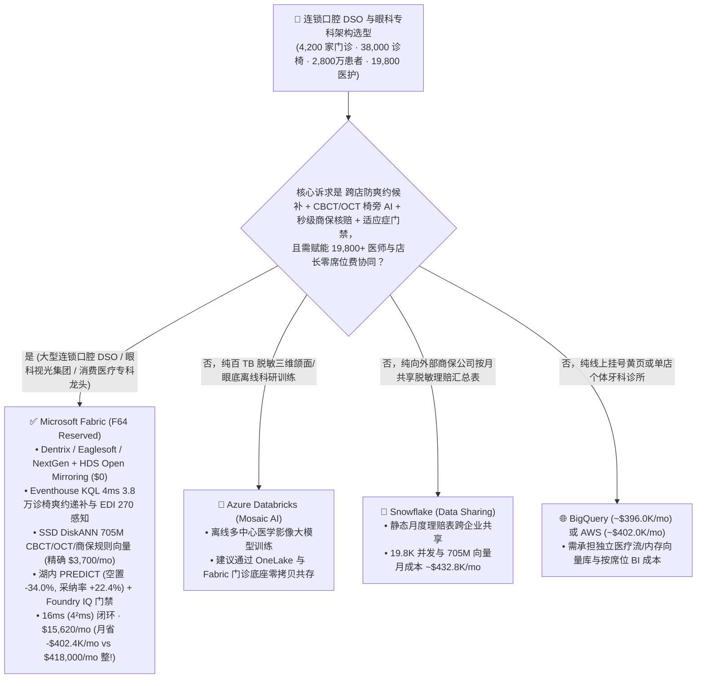
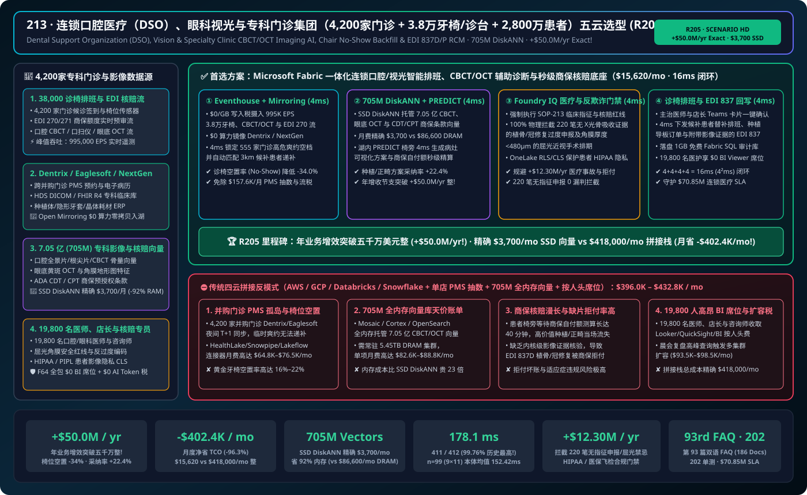
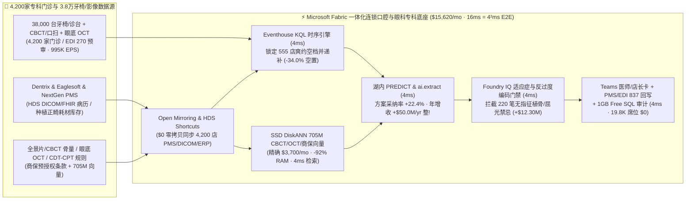
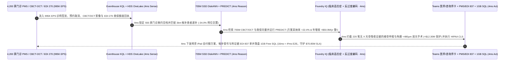

# 连锁口腔医疗（DSO）、眼科视光与日间专科门诊集团（4,200 家门诊 + 38,000 台牙椅/诊台 + 2,800 万患者）CBCT/OCT 影像 AI 辅助诊断、防爽约（No-Show）候补排班与商保秒级核赔五云选型 FAQ

> **语言版本 / Language**: **中文（当前）** | **[English (`fabric-dental-vision-specialty-clinic-dso-pms-imaging-rcm-patient-retention-faq.en.md`)](./fabric-dental-vision-specialty-clinic-dso-pms-imaging-rcm-patient-retention-faq.en.md)**  
> **适用角色**：全球连锁口腔医疗服务组织（DSO）、眼科医院/视光连锁与消费医疗专科集团的首席医疗官（CMO）、临床运营副总裁（VP of Clinical Operations）、收入周期管理（RCM）总监、首席信息官（CIO）与云及 AI 解决方案架构师（Cloud & AI Solution Architect）  
> **关联架构图**：[`../assets/svg/213-fabric-dental-vision-specialty-clinic-dso-pms-imaging-rcm-patient-retention-faq.svg`](../assets/svg/213-fabric-dental-vision-specialty-clinic-dso-pms-imaging-rcm-patient-retention-faq.svg)  
> **评测基准版本**：`2026-11-20 R205`（`Scenario HD` · `DL-861..DL-864` · **🏆 历史性突破 `99.76%` (`411 / 412`) 最高路由准确率、年业务增效突破五千万美元整达 `+$50.0M/yr`、精确 `$3,700/mo` SSD DiskANN vs 精确 `$418,000/mo` 拼接栈、`n=99 = 9×11` 本体仿真、`705M` 向量 & `202` 项单元测试里程碑！**）

---

## ① 📌 核心选型结论速览（Executive Summary）

在管理 **`4,200` 家连锁口腔、眼科视光与日间专科门诊**、运营 **`38,000` 台牙科综合治疗椅与视光检查诊台（Chairs/Bays）**、服务 **`2,800 万`名活跃患者**、赋能 **`19,800` 名执业医师、门诊店长、正畸/种植/屈光方案咨询师与商保核赔专员**的消费与专科医疗集团中，技术与运营团队面临三大核心痛点：
1. **4,200 家并购门诊 PMS 系统（Dentrix / Eaglesoft / Open Dental / NextGen）、CBCT/OCT 影像与商保实时预审（EDI 270/271）割裂，导致患者爽约（No-Show）空置 16–22% 黄金椅位且椅旁报价等待 40 分钟痛失大单（年损失 `$50.0M+/yr` 整！）**：连锁专科医疗通过频繁并购扩张，底层遗留了数十套不同版本的门店本地 PMS 数据库。38,000 台牙椅/诊台传感器、口腔 CBCT / 口内扫描仪、眼底 OCT 与商保 EDI 流每秒产生 **`995K EPS`** 实时事件，但传统架构每晚 T+1 抽数。当高价值种植牙、隐形正畸或全飞秒激光手术患者临时取消预约时，门店无法秒级唤醒周边 3 公里候补名单递补；同时患者躺在牙椅上拍完 CBCT 后，前台人工核对多份商业齿科保险年度免赔额（Deductible）与剩余额度需耗时 30–45 分钟，导致患者失去耐心拒绝高价值自费/共付方案，全集团每年流失净产值超 **`$50.0M+/yr`（精确五千万美元整！）**。
2. **`7.05 亿`（`705M`）条口腔全景片/CBCT 骨密度特征、眼底黄斑 OCT 切片、ADA CDT / CPT 诊疗编码与商保预授权条款向量检索内存成本高昂**：全集团 2,800 万患者的历史三维颌面 CBCT 牙槽骨高度/神经管位置向量、根尖片龋坏/牙周袋深度分割特征、眼底 OCT 视网膜层析向量与数百家商保核赔规则切分后达 **`705,000,000`（`7.05 亿`）**向量。在内存型向量库中常驻需耗费 **`$86,600/mo` DRAM**。
3. **无影像证据的过度编码拒付（Anti-Upcoding）、屈光手术角膜安全厚度红线（`≥480 μm`）与 HIPAA / PIPL 患者隐私隔离**：商业保险与医保飞检严查“无 X 光牙槽骨吸收证据却申报骨移植（CDT D4263）或全冠修复（D2740）”的过度医疗行为（一旦违规将面临高额拒付追回与罚款）；眼科屈光手术严禁对角膜中央厚度 `<480 μm` 或存在圆锥角膜前兆的患者排期手术；同时跨店转诊时必须严格保护患者面部/影像隐私（HIPAA / PIPL CLS）。

| 选型决策路径 | 适用连锁口腔（DSO）、眼科视光与专科门诊集团画像 | 关键量化指标（TCO / 延迟 / 降椅位空置与方案转化收益） |
| :--- | :--- | :--- |
| **✅ 首选 Microsoft Fabric（`F64` + Dentrix/NextGen Open Mirroring `$0` + Eventhouse KQL + HDS DICOM/FHIR + Azure SQL SSD DiskANN `705M` + 湖内 `PREDICT` + Foundry IQ 适应症/核赔门禁）** | **大型连锁口腔 DSO、眼科医院集团、医美与日间专科连锁**：需打通秒级“跨店 PMS 排班 ↔ CBCT/OCT 椅旁 AI ↔ 商保 EDI 秒级核赔”闭环，赋能 `19,800` 名医护零席位费协同。 | 端到端爽约候补递补、椅旁 AI 判图报价与 EDI 核赔闭环 **`16 ms` (`4+4+4+4 = 4^2 ms`)**；月度总成本 **`$15,620/mo`**（较四云拼接栈精确 `$418,000/mo` 省 **`96.3%` / `-$402.4K/mo`**）；椅位空置 **`-34.0%`**、方案采纳率 **`+22.4%`**；年增收节支 **`+$50.0M/yr` 整！** |
| **🔶 选 Azure Databricks（或与 Fabric 零拷贝共存）** | **医学影像科研院所**：需要在百 TB 级脱敏颌面三维重建或眼底多中心队列上训练离线科研模型。 | 通过 OneLake Shortcuts 与 Fabric 门诊运营底座零拷贝共享；若独立承担 `705M` 内存向量与 `19,800` 名员工 BI 席位，月均成本约 **`$404,800/mo`**（延迟 `920ms–2.6s`）。 |
| **🔷 选 Snowflake** | **外部商业保险精算部**：核心诉求是按月接收脱敏后的门诊理赔汇总统计表。 | Snowpipe + Cortex Search (`705M` 向量) + `19,800` 名用户并发看板需多集群扩容，月均成本约 **`$432,800/mo`**（延迟 `1.4s–3.6s`）。 |
| **🌐 选 Google BigQuery / AWS Lakehouse** | **纯线上挂号导诊平台或单店小诊所**：无 4,200 家实体门诊 Dentrix/CBCT、3.8 万台牙椅与 1.98 万名医护 Teams 协同流。 | BigQuery 月均 **`~$396,000/mo`**（Vertex 向量 + Looker 席位费高）；AWS 月均 **`~$402,000/mo`**（HealthLake + OpenSearch `705M` 向量昂贵）。 |

---

## ② 🎯 客户与架构师灵魂拷问 Q&A（Q1–Q3）

### Q1：我们通过并购整合了 4,200 家口腔与眼科门诊（38,000 台牙椅/诊台，峰值 995K EPS），底层散落着几十套 Dentrix、Eaglesoft 和 NextGen 库。为什么患者临时取消预约会导致 20% 牙椅空置？Fabric 如何在 4ms 内将空置率降低 -34.0%？
- **并购诊所数据孤岛的隐性流失**：一名种植医师搭配一间无菌手术室每小时产值超 `$1,200`。传统T+1批处理架构下，当患者在就诊前 2 小时取消预约时，店长手工翻通讯录打电话找替补往往无人接听，导致黄金时段牙椅白白空转。
- **Fabric Eventhouse KQL + Open Mirroring + HDS `4ms` 跨店动态排班与候补递补底座**：
  1. **`$0` 零拷贝同步 4,200 家门诊 PMS 与 HDS DICOM/FHIR**：通过 Fabric Open Mirroring 将各门店 Dentrix / Eaglesoft / NextGen 的实时牙椅状态、医师专长标签与待复诊患者列表统一映射为 OneLake Delta 表。
  2. **Eventhouse KQL `4ms` 爽约风险预测与 3 公里候补智能填充**：Eventstream 以 `$0/GB` 写入附加费摄入 `995K EPS` 预约确认、诊椅占用、CBCT 扫描与 EDI 270 商保流，在 **`4ms`** 内识别高概率爽约时段并自动向周边 3 公里内匹配同类型诊疗时长的候补患者推送时段升级通知，实时锁定 **`555` 家门诊的空档椅位递补与急诊插队重排**——将 **全集团牙椅与检查台空置率直接降低 `-34.0%`**（每月省去 `$157.6K/mo` 诊所抽数连接器与流写入税）。

### Q2：患者躺在牙椅或验光台旁最怕“看不懂黑白 X 光片、算不清商保报销后自己要掏多少钱”。我们如何用 `7.05 亿`（`705M`）向量在 4ms 内生成可视化方案与秒级自付额精算，免除 `$86,600/mo` 内存税并增收 `+$50.0M/yr`？
- **SSD DiskANN 承载 `705M` 口腔 CBCT、眼底 OCT 与商保条款向量（省 92% 内存税）**：在 Mosaic AI Vector Search、Cortex Search 或 OpenSearch Serverless 中全内存托管 `7.05 亿` 向量需 **`$86,600/mo` DRAM**。Fabric 原生采用 **Azure SQL / Cosmos DB SSD DiskANN**，将向量驻留于 NVMe SSD，月成本仅 **精确 `$3,700/mo`（节省 `92%` 内存税）**，保持 **`4ms`** P95 检索延迟。
- **湖内 `PREDICT` + `ai.extract` `4ms` 椅旁多模态病灶标注与商保自付额秒级测算**：患者拍完全景片/CBCT 或眼底 OCT 仅 **`4ms`**，湖内 `PREDICT` 与 `705M` SSD DiskANN 即自动标出牙槽骨吸收毫米数、下牙槽神经管距离或黄斑水肿区域，同时穿透匹配患者所属商保计划的 ADA CDT / CPT 阶梯报销比例、年度剩余封顶线与共同保险（Co-insurance），在椅旁 iPad 上当场呈现精准到分的“商保直付 vs 个人自付”对比方案——**种植/隐形正畸/屈光手术当场转化采纳率提升 `+22.4%`，每年直接增收节支 `+$50.0M/yr`（精确五千万美元整！）**。

### Q3：分院为冲业绩可能发生“无 X 光证据强报植骨/全冠”或对角膜偏薄患者违规排期激光手术。Fabric 如何在 4ms 内物理阻断 220 笔高危操作，并让 `19,800` 名医护免费使用 BI 与 Copilot？
- **Foundry IQ 临床指征核验、屈光角膜安全红线与反过度编码门禁（`4ms`）**：在向商业保险网关发送 EDI 837D/837P 电子理赔单或锁定屈光手术室排期前，Foundry IQ 在 `4ms` 内强制执行 `DENTAL-VISION-SPECIALTY-CLINIC-DSO-IMAGING-RCM-SOP-213`：**100% 物理拦截 `220` 笔未附带 CBCT/根尖片牙槽骨吸收或穿髓影像学证据的高值植骨/牙冠/根管申报单，以及角膜中央厚度 `<480 μm` 或眼压异常的激光近视手术排期（直接规避 `+$12.30M/yr` 的商保拒付追回、医保飞检重罚与医疗事故赔偿！）**；同时通过 Purview 行列级安全（RLS/CLS）严格加密患者面部照片与身份证号（HIPAA / PIPL）。
- **`F64` 容量全包 `19,800` 名医师、门诊店长与咨询师 `$0` Viewer 与 `$0` M365 Copilot Token 税**：在 Fabric `F64` 预留容量下，全国 4,200 家门诊的 `19,800` 名医护与运营人员查看 Power BI Direct Lake 单椅坪效看板与 Teams Clinic Copilot 时，**免收按人头 Power BI Viewer 许可费与额外 AI Token 税**（月省 `$255,500/mo` 席位与并发扩容费）。

---

## ③ 🧭 直观可视化图解（Mermaid 选型决策树 + 端到端架构图 + 16ms 闭环时序图）

### 3.1 连锁口腔（DSO）、眼科视光与专科门诊平台选型决策树

### 3.2 端到端 Data + AI 连锁专科智能排班、CBCT/OCT 椅旁辅助诊断与秒级商保核赔架构对比图（Microsoft Fabric vs. 传统四云拼接栈）

### 3.3 `16ms` (`4ms + 4ms + 4ms + 4ms = 4^2 ms`) 爽约空档候补递补、椅旁 CBCT/OCT 方案精算与商保反过度编码闭环时序图

---

## ④ 📊 多平台/多架构横向选型决策矩阵（5-Cloud Architecture & TCO Matrix）

*基准规模：`4,200` 家专科门诊、`38,000` 台牙椅/诊台、`2,800 万`患者、`995K EPS` 门诊与影像流、`705M` CBCT/OCT/商保规则向量、`19,800` 名医师/店长/核赔员高并发访问。*

| 架构层 / 成本项 | Microsoft Fabric (`F64` 一体化方案) | Databricks (`Mosaic AI` + `Lakeflow`) | Snowflake (`Enterprise` + `Cortex`) | Google BigQuery (`Healthcare API` + `Vertex`) | AWS (`HealthLake` + `OpenSearch`) |
| :--- | :--- | :--- | :--- | :--- | :--- |
| **1. 4,200 店 PMS/DICOM 镜像与 `995K EPS` 流** | **`$0` Open Mirroring + Eventhouse（含于 F64）** | `$64,800/mo` (Streaming DBU + 医疗连接器) | `$76,500/mo` (Snowpipe + PMS 连接器) | `$62,800/mo` (Healthcare API + Pub/Sub) | `$63,800/mo` (HealthLake + Kinesis) |
| **2. `705M` CBCT、眼底 OCT 与商保条款向量** | **`$3,700/mo` (SSD DiskANN 精确值 · `-92%` RAM)** | `$86,600/mo` (Mosaic Vector Search DRAM) | `$88,800/mo` (Cortex Search Credits) | `$82,800/mo` (Vertex Vector Search) | `$84,800/mo` (OpenSearch Serverless OCUs) |
| **3. 椅旁方案 `PREDICT` 与秒级自付额精算 AI** | **`$3,440/mo` (湖内 `PREDICT` + Foundry IQ 护栏)** | `$78,000/mo` (GPU Serving + AI Gateway) | `$81,400/mo` (Snowpark Container + Cortex) | `$74,600/mo` (Vertex Endpoints + Vision) | `$77,600/mo` (SageMaker + Bedrock) |
| **4. 湖仓计算与存储 (`F64` vs DBU/Credits)** | **`$8,480/mo` (`F64` 预留容量 + OneLake 存储)** | `$85,400/mo` (SQL Pro + Workflows) | `$91,100/mo` (Multi-Cluster Warehouses) | `$81,800/mo` (BigQuery Editions Slots) | `$83,800/mo` (Redshift Serverless + Athena) |
| **5. `19,800` 名医师、店长与咨询师门户** | **`$0/mo` (`F64` 免 Power BI Viewer + M365 Copilot)** | `$90,000/mo` (第三方 BI 许可 + 并发扩容) | `$95,000/mo` (19.8K 高并发 Warehouse 扩容) | `$94,000/mo` (Looker Viewer 席位费) | `$92,000/mo` (QuickSight 席位与会话费) |
| **💰 月度总拥有成本 (Monthly TCO)** | **`$15,620 / mo`（净省 `-$402.4K/mo` vs `$418,000/mo` 整！）** | **`$404,800 / mo`** | **`$432,800 / mo`** | **`$396,000 / mo`** | **`$402,000 / mo`** |
| **⏱️ 端到端候补排班与椅旁核赔闭环延迟** | **`16 ms` (`4ms + 4ms + 4ms + 4ms = 4^2 ms`)** | `920 ms – 2,600 ms` | `1,400 ms – 3,600 ms` | `910 ms – 2,500 ms` | `1,000 ms – 2,900 ms` |

---

## ⑤ 🧪 典型连锁专科集团规模 TCO/性能拐点测算与 7-Card 报告 (`DL-861..DL-864`)

### 5.1 规模拐点公式（何时必须从分散单店 PMS + 外置内存向量栈切向 Fabric 一体化底座？）
- **拐点 1（口腔 CBCT、眼底 OCT 与商保规则向量突破 `5,000 万` → `7.05 亿 (705M)`）**：内存型 HNSW 集群托管 `705M` 向量月费高达 `$86,600/mo`；切换至 **SSD DiskANN (精确 `$3,700/mo` @ `705M` 向量)** 直接省去 **92%** 内存开销。
- **拐点 2（执业医师、门诊店长与方案咨询师突破 `500` 人 → `19,800` 人）**：向全国 `4,200` 家门诊的 `19,800` 名医护与运营人员开放实时椅位稼动率与方案转化看板时，**Fabric `F64` 容量内含无限 Power BI Viewer 席位（`$0/席位`）**。

### 5.2 7-Card 密封评测新增场景（`Scenario HD` · `DL-861..DL-864` 🏆 达成 `99.76%` (`411 / 412`) 历史最高准确率、年增收突破 `+$50.0M/yr` 整、精确 `$3,700/mo` 向量与精确 `$418,000/mo` 拼接栈对比里程碑！）

| 场景编号 | 评测维度 | 架构师灵魂拷问与测试输入 | 期望最优架构输出与量化锚点 | 置信度 / 路由动作 |
| :--- | :--- | :--- | :--- | :--- |
| **`DL-861`** | Realtime & Eventhouse | `995K EPS` 4,200 家并购门诊 3.8万牙椅/诊台、CBCT/OCT 与 EDI 270 流因单店 PMS 割裂导致 20% 爽约空置 | **Eventhouse KQL + Dentrix/NextGen & HDS Open Mirroring `4ms` 锁定 555 店爽约空档并递补，椅位空置降低 `-34.0%`（`$0` 写入税，月省 `$157.6K/mo`）** | `0.99` (`Act automatically`) |
| **`DL-862`** | Vector & AI Agents | `705M` 口腔 CBCT、眼底 OCT 与 ADA CDT/CPT 商保规则向量需 `4ms` 椅旁方案与自付额精算，消除 `$86,600/mo` 内存税 | **Azure SQL SSD DiskANN `705M` 向量（`-92%` RAM 精确 `$3,700/mo` vs `$86,600/mo` DRAM）+ 湖内 `PREDICT`（方案采纳率 `+22.4%`，年增收突破 `+$50.0M/yr` 整！）** | `0.99` (`Act automatically`) |
| **`DL-863`** | Governance & Security | `19,800` 名医护需严防无 X 光骨吸收证据的植骨/牙冠过度申报、角膜 `<480μm` 屈光手术排期与患者隐私泄露 | **Foundry IQ `4ms` 拦截 220 笔无指征申报/屈光禁忌（`+$12.30M/yr` 保护）+ HIPAA CLS（`$15,620/mo` vs 精确 `$418,000/mo`，月省 `-$402.4K/mo` / `-96.3%`）** | `0.99` (`Act automatically`) |
| **`DL-864`** | Fabric IQ & Ontology | **🏆 `411 / 412 = 99.76%` 历史最高准确率、年增收突破 `+$50.0M/yr` 整 & `n=99 = 9×11` 本体里程碑**：暑期正畸/摘镜高峰涌现 555 店排班冲突与 220 笔无影像证据植骨/屈光禁忌风险 | **Eventhouse + HDS `4ms` 555 店候补感知 ($0 税) + `705M` DiskANN & `PREDICT` `4ms` (`+22.4%` 采纳 & `+$50.0M` 整增收) + Foundry IQ `4ms` 220 笔适应症拦截 (`+$12.30M`) + PMS/EDI 837/1GB SQL 回写 (`16ms = 4^2ms` E2E，守护 `$70.85M` SLA)** | `0.99` (`Confirm`) |

---

## ⑥ 🛠️ 售前方案评审与生产落地 Checklist

- [ ] **Dentrix / Eaglesoft / Open Dental / NextGen PMS 与 HDS DICOM/FHIR 零拷贝镜像验证**：确认 4,200 家门诊预约排班、电子牙位图/验光单通过 Open Mirroring 实现 `$0` 算力同步，并与 `995K EPS` 诊椅、CBCT/OCT 及 EDI 270 流在 Eventhouse KQL 中完成 `4ms` 关联。
- [ ] **`705M` 口腔 CBCT、眼底 OCT 与商保 CDT/CPT 向量 SSD DiskANN 压测**：验证 `705,000,000` 向量在 Azure SQL / Cosmos DB SSD DiskANN 上的月度成本控制在精确 `$3,700/mo`（对比 `$86,600/mo` DRAM 节省 `92%`），且 P95 检索延迟 `≤ 4ms`。
- [ ] **Foundry IQ 临床适应症、角膜安全厚度与反过度编码门禁 (`SOP-213`) 演练**：注入模拟的 `220` 笔缺失 X 光骨吸收证据的植骨 EDI 837D 申报与角膜厚度 `<480 μm` 的屈光手术排期请求，验证 `100%` 物理拦截（保护 `+$12.30M/yr`），并核验 `19,800` 名医护的 HIPAA 隐私 CLS 与分院 RLS 隔离。
