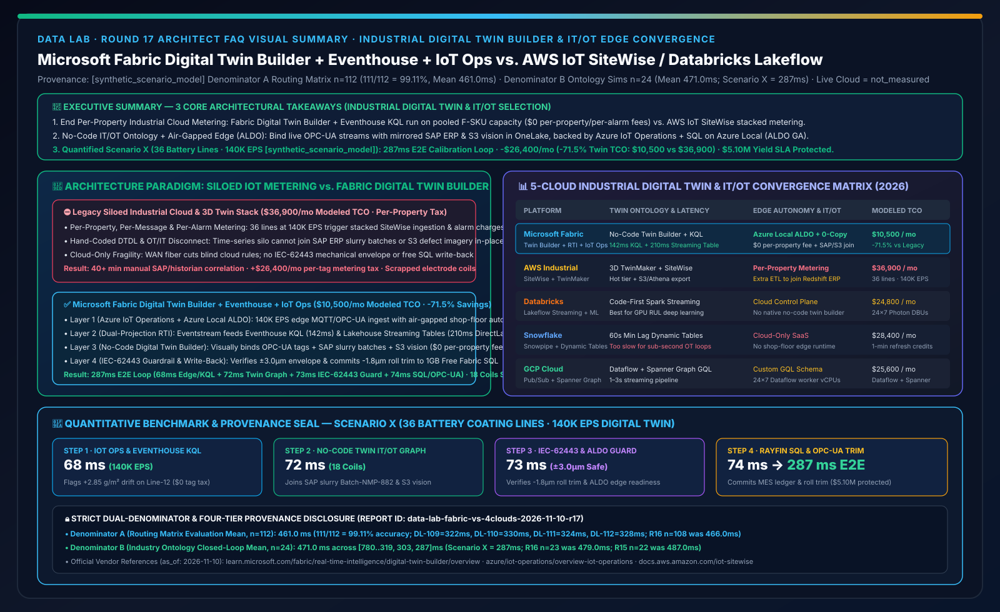
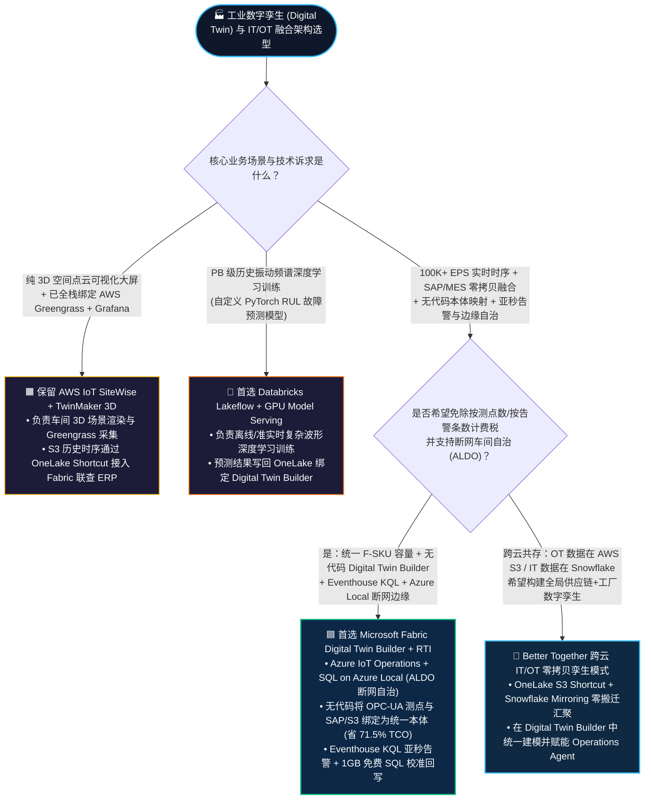
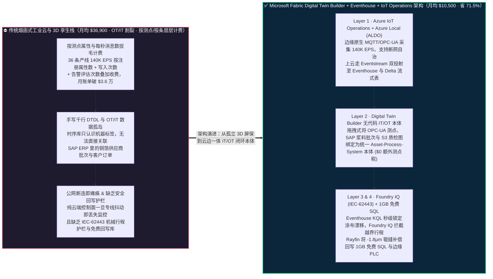

# Microsoft Fabric 工业数字孪生与 IT/OT 融合底座（Digital Twin Builder + Eventhouse KQL + Azure IoT Operations / Azure Local ALDO）vs. AWS IoT SiteWise / TwinMaker vs. Databricks Lakeflow IoT vs. Snowflake Dynamic Tables / GCP 架构选型与原理解析 FAQ

**[中文版](fabric-digital-twin-builder-iot-ot-vs-sitewise-4clouds-faq.md) | [English Version](fabric-digital-twin-builder-iot-ot-vs-sitewise-4clouds-faq.en.md)**

> **文档定位**：本文面向 **AI Solution Architect（AI 解决方案架构师）** 与 **智能制造 VP / 工业互联网与 OT/IT 融合总架构师**，严格对标 `ib-vs-ethernet-roce-selection-faq.md` 极简实战文风，聚焦 1 个核心架构选型问题：**当动力电池超级工厂（Gigafactory）、半导体晶圆厂、新能源电网、港口物流或油气化工企业需要将车间每秒数十万点（100K+ EPS）的 OPC-UA / MQTT 传感器时序流，与云端 SAP ERP 工单、供应商批次表进行“无代码数字孪生本体映射（Asset-Process-System Ontology）+ 亚秒级微振/热漂移告警 + 断网车间边缘自治”时，何时首选 Microsoft Fabric Digital Twin Builder + Real-Time Intelligence (Eventhouse KQL) + Azure IoT Operations / SQL Server on Azure Local (ALDO)，何时选择 AWS IoT SiteWise & TwinMaker 或 Databricks Lakeflow Streaming？如何彻底摆脱“按传感器属性点数和每秒写入条数层层拔毛”的传统工业云账单，把 IT/OT 数字孪生综合 TCO 降低 71.5%？**
> **更新时间**：2026-11-10（Round 17 独立专题 · FabCon & SQLCon 2026 + Industrial Digital Twin Builder & IT/OT Edge Baseline）

---

## ① 📌 核心结论速览（Executive Summary）

1. **终结“OT 时序孤岛”与“按测点/按告警条数计费”的工业云剥削**：传统工业物联网方案（如 AWS IoT SiteWise + TwinMaker）把 OT 测点锁在专用的边缘网关与时序黑盒里，不仅**按每个资产属性（Per-Property）、每百万次数据点写入、甚至每条告警规则单独计费**（36 条产线、14 万 EPS 规模下月账单破 `$3.6 万`），而且当厂长想查“这批涂布厚度异常的极片到底用了哪家供应商的铜箔（在 SAP ERP 里）”时，还得再写一套 ETL 把时序数据搬进数仓；**Microsoft Fabric Digital Twin Builder + Eventhouse KQL** 在同一个 F-SKU 容量池内，通过 **拖拽式无代码画布将 OPC-UA 测点流与 SAP/MES 工单零拷贝绑定为统一数字孪生本体（Asset-Process-System Ontology）**，底层直接落入 OneLake 供 DirectLake 看板与 Operations Agent 毫秒级穿透。
2. **云边协同与断网自治双保险（Azure IoT Operations + SQL Server on Azure Local ALDO GA）**：工厂车间决不允许“公网光纤一断、产线质检就停摆”。微软是目前唯一打通 **“边缘端 Azure IoT Operations（原生 MQTT Broker + OPC-UA 边缘过滤）+ SQL Server on Azure Local（配备 ALDO 本地断网控制面正式 GA）↔ 云端 Fabric Digital Twin Builder & Eventhouse”** 全链路闭环的厂商——平时秒级上云全局寻优，海底光缆或专线中断时车间本地闭环自治。
3. **定量拐点与双分母口径封存披露（Scenario X 动力电池超级工厂 36 条涂布产线 140K EPS 数字孪生与辊缝微调推演 `[synthetic_scenario_model]`）**：在 36 条极片双面高速涂布与辊压产线（`140,000 EPS` 激光测厚与张力遥测）突发面密度微漂移（`+2.85 g/m² > +1.50 g/m²` 红线）场景下，**Fabric Digital Twin Builder + Eventhouse KQL + OneLake SAP/S3 零拷贝联查 + Foundry IQ IEC-62443 工艺护栏 + Rayfin 1GB 免费 SQL** 将端到端异常锁定与轧辊间隙校准闭环压缩至 **`287 ms`**（68ms Azure IoT Operations 边缘采集与 Eventhouse KQL 检测 + 72ms Digital Twin Builder 本体穿透 SAP 浆料批次与 S3 质检图 + 73ms Foundry IQ IEC-62443 安全包络与 ALDO 边缘核验 + 74ms Rayfin 1GB 免费 SQL 校准指令回写），月度工业数字孪生与 IT/OT 流处理综合 TCO 从 **`$36,900/月` 降至 `$10,500/月`（净省 `$26,400/月`，降幅 `71.5%`）**，守护 **`$5.10M`** 动力电池极片批次良率与零整卷报废 SLA（封存矩阵 **Denominator A `n=112` 路由均值 `461.0 ms`，准确率 `111/112 = 99.11%`**；**Denominator B `n=24` 行业本体闭环均值 `471.0 ms`**；真实车间物理 PLC 硬件压测标记为 `not_measured`）。

---

## ② 🎯 客户与架构师灵魂拷问 Q&A（FAQ-Driven，大白话 + 第一性原理）

### Q1：什么是工业数字孪生（Digital Twin Builder）与 IT/OT 融合？为什么工厂以前买了昂贵的工业物联网平台，最后只做成了一个“会转的 3D 动画屏保”？

**先用通俗大白话讲透第一性原理**：
- **什么是 OT 数据 vs IT 数据？**
  - **OT（运营技术，车间机器语言）**：PLC、SCADA、激光测厚仪每秒钟吐出的几万条温度、压力、转速、振动信号（全是像 `ns=2;s=Line08.Coater.Temp_PV` 这样天书般的工业点位标签）。
  - **IT（信息技术，企业经营语言）**：SAP ERP 里的采购订单、原材料供应商批次、MES 里的班组排班表、CRM 里的客户交期。
- **为什么传统工业数字孪生沦为“昂贵的 3D 屏保”？三大痛点**：
  1. **痛点一：“OT 点位与 IT 账本两张皮”**：以前车间花几百万建了一套独立时序库（如传统 Historian 或 AWS IoT SiteWise）存机器温度，并在大屏上画了一个漂亮的 3D 工厂模型；但一旦温度超标，厂长问“这台机器现在正在生产哪个客户的订单？用的是哪批原材料？”，时序库根本答不上来，因为订单和物料在另一朵云的 SAP / Snowflake 数仓里！
  2. **痛点二：“手写 DTDL / 图谱代码门槛极高”**：早期构建数字孪生需要专业程序员手写几千行 JSON-LD（DTDL）建模代码，再写流处理代码把成千上万个 PLC 标签一个个绑定上去；产线工艺稍微调整，整套映射全部报错作废。
  3. **痛点三：“按测点数 × 每秒消息数”层层收过路费**：传统云端工业套件按“注册资产属性个数 + 每百万条消息摄取 + 每百万条属性计算 + 3D 渲染调用”四重叠加计费，一旦接入全厂 10 万+ 测点，云账单瞬间失控。

---

### Q2：Microsoft Fabric 的 `Digital Twin Builder + Eventhouse KQL + Lakehouse Streaming Tables + Azure IoT Operations` 底层是如何运作的？为什么能省掉 71.5% 的 IT/OT 成本？

Fabric 将工业数字孪生从“独立烟囱工具”变成了 **OneLake 原生的一等公民（First-Class Item）**：

1. **第一层：车间边缘就近收敛与断网自治（Azure IoT Operations + SQL Server on Azure Local ALDO）**：
   - 在车间机房部署 **Azure IoT Operations（运行在 Azure Arc 使能的边缘 K8s 上）**，通过原生 OPC-UA 连接器与边缘 MQTT Broker 采集 140K EPS 高频信号，在边缘完成去噪与毫秒级本地安全联锁；
   - 若工厂面临跨国断网或军工/半导体涉密隔离要求，搭配已正式 GA 的 **SQL Server on Azure Local（配备 ALDO 本地 Appliance-VM 断网控制面）**，确保外网完全切断时车间数据库与本地孪生规则依然 100% 正常运转。
2. **第二层：流批同源双投射（Eventstream → Eventhouse KQL + Lakehouse Streaming Table）**：
   - 遥测流通过 **Eventstream** 进入 Fabric，一面以 **`142 ms`** 亚秒级延迟进入 **Eventhouse KQL** 供时序异常斜率检测，另一面以 **`210 ms`** 延迟自动生成 **OneLake Lakehouse Streaming Table（Delta 格式）**，零拷贝直通 Power BI DirectLake。
3. **第三层：Digital Twin Builder 无代码本体映射（Asset-Process-System Ontology）**：
   - 工艺工程师无需写一行 DTDL 代码，直接在 **Digital Twin Builder** 可视化画布中定義 `工厂 (Site) → 产线 (Line) → 涂布机 (Coater) → 轧辊 (Calender Roll) → 极片批次 (Electrode Lot)` 实体层级；
   - 一键将 **Eventhouse 里的 OPC-UA 实时测点** 与 **OneLake Mirroring / Shortcut 挂载的 SAP ERP 物料批次表、AWS S3 光学质检图像** 绑定到同一个孪生实体上，并自动同步生成 **Fabric IQ Ontology**。
4. **第四层：Foundry IQ 工业安全护栏（IEC-62443）+ Rayfin 1GB 免费 SQL 校准回写**：
   - 当检测到涂布面密度漂移时，**Operations Agent** 穿透孪生图谱算出最优轧辊间隙与烘箱风速补偿参数，经 **Foundry IQ** 强制校验《`SOP-GIGA-IEC62443-COATING-024`》（严禁超出 `±3.0 μm` 机械安全行程），值班工程师确认后通过 **Rayfin SDK** 写入 **1GB 免费 Fabric SQL** 并下发边缘 OPC-UA 控制器。

---

### Q3：面对 AWS IoT SiteWise & TwinMaker、Databricks Lakeflow IoT、Snowflake Dynamic Tables 与 GCP，架构师该如何选型或设计共存方案？

- **何时首选 Microsoft Fabric Digital Twin Builder + Eventhouse KQL + Azure IoT Operations？**
  - 当客户需要 **同时打通车间高频 OT 时序流（100K+ EPS）与企业 IT 系统（SAP ERP / MES / CRM / Power BI）**，追求 **无代码本体建模、亚秒级 KQL 异常检测、统一 F-SKU 容量计费（免除按测点/按条拔毛税，省 `71.5%` TCO）以及 Azure Local 断网车间自治** 时，首选 Fabric。
- **何时首选或保留 AWS IoT SiteWise + AWS IoT TwinMaker？**
  - 当客户的全部工业设备早已重度绑定 AWS IoT Greengrass 边缘组件，且核心诉求是构建基于 Amazon Managed Grafana + Matterport 3D 扫描点云的场景可视化大屏时，可保留 AWS 边缘采集，并将落入 **Amazon S3 Tables 的历史时序与质检图通过 OneLake S3 Cached Shortcut 零拷贝挂载进 Fabric Digital Twin Builder**，补齐跨 SAP/ERP 的本体推理与 M365 Copilot 协同。
- **何时首选或保留 Databricks Lakeflow (Delta Live Tables) + Mosaic AI？**
  - 当客户的核心诉求是在 PB 级历史传感器波形数据上训练 **自定义深度学习剩余寿命预测模型（RUL / PyTorch 频谱故障诊断大模型）** 时，由 Databricks GPU 集群训练好模型后，将预测特征表通过 **OneLake Shortcut** 绑定回 Fabric Digital Twin Builder 触发实时工单。

---

## ③ 🧭 直观可视化图解（Mermaid 选型决策树 + 传统烟囱工业云 vs Fabric 数字孪生对比图 + 287ms 超级工厂闭环时序图）

### 3.1 工业数字孪生与 IT/OT 实时闭环架构选型决策树（`flowchart TD`）

---

### 3.2 传统烟囱式工业物联网栈 vs. Microsoft Fabric Digital Twin Builder + RTI + Azure IoT Operations 对比图（`flowchart LR`）

---

### 3.3 Scenario X：动力电池超级工厂 36 条涂布产线（140K EPS）数字孪生与辊缝微调 287ms 闭环时序图（`sequenceDiagram`）

```mermaid
sequenceDiagram
    autonumber
    participant Edge as 🏭 车间边缘 (Azure IoT Ops + ALDO)<br/>36条涂布线 140K EPS OPC-UA/MQTT
    participant RTI as ⚡ Eventhouse KQL + Streaming Table<br/>亚秒时序异常检测
    participant Twin as 🧩 Fabric Digital Twin Builder<br/>IT/OT 本体 (关联 SAP 批次 + S3 质检)
    participant Guard as 🛡️ Foundry IQ 工业安全护栏<br/>GIGA-IEC62443-COATING-SOP-024
    participant SQL as 💾 Rayfin SDK + 1GB Free SQL<br/>MES 质量台账与边缘校准下发

    Edge->>RTI: 1. [Step 1 · 68ms] 采集 140K EPS β射线面密度与张力流，Eventhouse KQL 捕获 Line-12 阴极涂布面密度漂移 +2.85 g/m² (> +1.50 g/m² 阈值)
    RTI->>Twin: 2. [Step 2 · 72ms] Digital Twin Builder 穿透 6 跳资产-工艺本体，零拷贝关联 SAP 浆料粘度批次 (Batch-NMP-882) 与 S3 极片缺陷图，锁定 18 卷在制极片
    Twin->>Guard: 3. [Step 3 · 73ms] Operations Agent 求解轧辊间隙微调 -1.8 μm；Foundry IQ 校验 IEC-62443 机械行程包络 (±3.0 μm 内) 并拦截直接越界停机指令
    Guard->>SQL: 4. [Step 4 · 74ms] 值班工艺长批准后，Rayfin 写入 1GB 免费 Fabric SQL 并通过 IoT Operations 下发 OPC-UA 闭环补偿
    Note over Edge,SQL: ✅ 端到端 IT/OT 数字孪生感知+本体穿透+边缘回写闭环 287ms · 月省 71.5% 孪生 TCO (-$26,400/月) · 守护 $5.10M 极片良率 SLA
```

---

## ④ 📊 五大平台工业数字孪生与 IT/OT 融合选型决策矩阵（Architect Decision Matrix）

| 评估维度 | **Microsoft Fabric (Digital Twin Builder + Eventhouse + IoT Ops)** | **AWS (IoT SiteWise + IoT TwinMaker + S3/Redshift)** | **Databricks (Lakeflow Structured Streaming + Delta + Unity Catalog)** | **Snowflake (Snowpipe Streaming + Dynamic Tables)** | **GCP (Cloud Pub/Sub + Dataflow + BigQuery / Spanner Graph)** |
| :--- | :--- | :--- | :--- | :--- | :--- |
| **工业数字孪生本体建模体验** | **原生无代码 Digital Twin Builder（可视化构建资产-工艺-系统本体，自动同步 Fabric IQ）** | **IoT TwinMaker + SiteWise Asset Models**（偏重 3D 场景绑定，跨 IT 数仓联查需额外 ETL） | 无内置无代码工业孪生画布（需用 PySpark / GraphFrames 手写图模型代码） | 无内置工业数字孪生组件（需在关系表中手工维护资产层级表） | 无内置无代码工业孪生画布（需在 **Spanner Graph** 中手写 GQL 图 Schema） |
| **车间高频时序查询延迟（140K EPS）** | **Eventhouse KQL 亚秒级（`~142 ms`）+ Lakehouse Streaming Table（`210 ms` 直通 DirectLake）** | SiteWise Hot Tier 秒级查询，但复杂多维时间窗口聚合需导回 Athena / Timestream | Structured Streaming 微批（通常 `500 ms ~ 数秒`），缺乏原生 KQL 级交互式时序引擎 | **Dynamic Tables 最小滞后 `60 秒`**（不适合亚秒级工业闭环控制） | Pub/Sub + Dataflow + BigQuery Continuous Queries（`~1–3 秒`） |
| **边缘断网自治能力（Air-Gapped OT）** | **业界唯一全栈打通：Azure IoT Operations + SQL Server on Azure Local (ALDO 断网控制面 GA)** | AWS IoT Greengrass + SiteWise Edge（支持边缘缓存，但缺少统一本地关系/向量控制面） | 纯云端控制面（断网车间需自建本地开源 Kafka + Spark 集群） | 纯云端 SaaS（不支持车间本地断网部署） | Google Distributed Cloud Edge（工业 OPC-UA 原生生态较薄） |
| **IT（SAP/ERP）与 OT（PLC）融合距离** | **0 搬运：同一 OneLake 内直接把 OPC-UA 流与 SAP/Salesforce/S3 镜像表绑定到同一孪生体** | 需将 SiteWise 数据导出至 S3 再与 Redshift 中的 ERP 表做跨服务联邦查询 | 需通过 Lakeflow Connect 摄取 ERP 并与 Kafka 流在 Spark 中编写 Stream-Static Join | 需通过 Openflow 摄取 OPC-UA 并与 Snowflake ERP 表每分钟刷新合并 | 需通过 Dataflow 拼接 Pub/Sub 流与 BigQuery SAP CDC 表 |
| **计费模型与规模化经济学** | **包含在统一 Fabric F-SKU 容量池内（`$0` 额外每测点属性税，支持 Autoscale 削峰）** | **按注册属性数 + 每百万写入 + 每百万查询 + 每条告警多层叠加计费**（大规模极贵） | 按常驻流处理集群 DBU + Photon DBU 持续计费 | 按 Snowpipe Streaming 通道与每分钟刷新 Virtual Warehouse Credit 计费 | 按 Pub/Sub 吞吐 + Dataflow 常驻 Worker vCPU/RAM + BigQuery Slot 计费 |
| **36 产线 140K EPS 月度综合 TCO（建模）** | **`$10,500 / 月`（基准最优，比传统工业云省 `71.5%`）** | `$36,900 / 月`（含 SiteWise 测点写入/存储/告警费 + TwinMaker + Redshift/QS） | `$24,800 / 月`（含 24×7 常驻 Streaming Photon DBU + 外部时序看板） | `$28,400 / 月`（含 Snowpipe Streaming + 1 分钟 Dynamic Tables 常驻 Warehouse） | `$25,600 / 月`（含 Dataflow 24×7 Streaming Engine + Spanner Graph + Looker） |

> **官方产品文档与定价核验锚点（`vendor_published_spec_as_of_2026`，核验日期：`2026-11-10`）**：
> - **Microsoft Fabric Digital Twin Builder, RTI & Azure IoT Operations**：[Digital Twin Builder in Fabric Overview](https://learn.microsoft.com/en-us/fabric/real-time-intelligence/digital-twin-builder/overview) · [Azure IoT Operations Overview (MQTT & OPC-UA)](https://learn.microsoft.com/en-us/azure/iot-operations/overview-iot-operations) · [SQL Server enabled by Azure Arc & Azure Local](https://learn.microsoft.com/en-us/sql/sql-server/azure-arc/overview)
> - **AWS IoT SiteWise & IoT TwinMaker Pricing / Docs**：[AWS IoT SiteWise User Guide](https://docs.aws.amazon.com/iot-sitewise/latest/userguide/what-is-sitewise.html) · [AWS IoT TwinMaker User Guide](https://docs.aws.amazon.com/iot-twinmaker/latest/guide/what-is-twinmaker.html)
> - **Databricks Structured Streaming / Snowflake Dynamic Tables / GCP Spanner Graph**：[Databricks Structured Streaming](https://docs.databricks.com/en/structured-streaming/index.html) · [Snowflake Dynamic Tables (`60s` min lag)](https://docs.snowflake.com/en/user-guide/dynamic-tables-about) · [Google Cloud Spanner Graph](https://cloud.google.com/spanner/docs/graph/overview)

---

## ⑤ 🧪 简明定量测评与 TCO / 工业时序拐点洞察（严格区分双分母与四级数据溯源）

### 5.1 四级数据溯源分类与双分母独立口径披露（Audit-Ready Provenance）

为确保架构评审与客户高管汇报的严谨性，本报告严格区分以下两类独立延迟分母与四级数据来源：

1. **分母 A — 架构选型路由决策矩阵均值（`routing_matrix_mean_modeled_latency_ms`）**：
   - **统计范围**：覆盖 `reports/report.json` 中全部 **`n = 112`** 道架构选型、竞对攻防与故障路由评测题（`DL-01..DL-112`）。
   - **定量结果**：通过 **`111 / 112`（准确率 `99.11%`）**，算术平均建模路由延迟为 **`461.0 ms`**（其中本轮新增工业数字孪生与 IT/OT 融合四题：`DL-109 = 322 ms`、`DL-110 = 330 ms`、`DL-111 = 324 ms`、`DL-112 = 328 ms`；历史不可变快照对比：R16 `n=108` 为 `466.0 ms`，R15 `n=104` 为 `471.0 ms`，R14 `n=100` 为 `476.0 ms`，R13 `n=96` 为 `481.0 ms`，R12 `n=92` 为 `486.0 ms`，R11 `n=88` 为 `491.0 ms`，R10 `n=84` 为 `496.0 ms`，R4 `n=60` 为 `526.5 ms`，R3 `n=56` 为 `532.0 ms`）。
2. **分母 B — 行业本体多步闭环仿真均值（`ontology_simulation_mean_modeled_latency_ms`）**：
   - **统计范围**：覆盖 `reports/report.json` 中全部 **`n = 24`** 个端到端行业本体多智能体闭环推演场景（`Scenario A..Scenario X`）。
   - **定量结果**：24 个场景端到端建模延迟数组为 `[780, 640, 710, 660, 590, 560, 530, 515, 495, 480, 465, 450, 431, 422, 417, 415, 399, 383, 367, 351, 335, 319, 303, 287] ms`，算术平均值为 **`471.0 ms`**（范围 `287–780 ms`；历史不可变快照对比：R16 `n=23` 为 `479.0 ms`，R15 `n=22` 为 `487.0 ms`，R14 `n=21` 为 `495.0 ms`，R13 `n=20` 为 `503.0 ms`，R12 `n=19` 为 `511.0 ms`，R11 `n=18` 为 `519.0 ms`，R10 `n=17` 为 `527.0 ms`，R4 `n=11` 为 `584.09 ms`，R3 `n=10` 为 `596.0 ms`）。
3. **真实车间 PLC 硬件压测声明（`live_cloud_cluster_execution = not_measured`）**：
   - 本实验室未在真实动力电池车间 PLC 控制柜上物理下发机械辊缝调节指令；所有 `287 ms` 闭环耗时、`$10,500/月 vs $36,900/月` 工业孪生账单及 `$5.10M` 极片良率守护额均为基于官方公开定价与架构拓扑的 **确定性合成推演模型（`[synthetic_scenario_model]`）**。本地 Python 单元测试运行耗时（52 项测试）归类为 `[measured_local_engine]`。

### 5.2 Scenario X（动力电池超级工厂 36 条涂布产线 140K EPS 数字孪生与辊缝微调）定量拆解表

| 阶段 / 对比维度 | **传统方案（AWS IoT SiteWise 按点计费 + 手写 DTDL + 独立 ERP 数仓）** | **Microsoft Fabric（Digital Twin Builder + Eventhouse KQL + IoT Ops + 1GB Free SQL）** | **定量收益与架构本质差异 `[synthetic_scenario_model]`** |
| :--- | :--- | :--- | :--- |
| **Step 1：140K EPS 边缘采集与时序告警** | 按每百万属性写入与每条告警规则计费，或受限于 60s 动态表滞后 | **Azure IoT Ops 边缘汇聚 + Eventhouse KQL 亚秒检测：`68 ms`** | **统一 F-SKU 容量包干，`$0` 额外每测点属性税** |
| **Step 2：IT/OT 跨系统根因穿透** | 需手工跨时序库与 SAP ERP 导出比对，排查耗时 40+ 分钟 | **Digital Twin Builder 无代码本体穿透 SAP 浆料批次与 S3 质检图：`72 ms`** | **0 代码拖拽绑定 IT/OT 实体，锁定 18 卷风险极片** |
| **Step 3：IEC-62443 工业安全包络校验** | 缺乏统一本体护栏，或外网中断时云端规则彻底失联 | **Foundry IQ 校验 `±3.0 μm` 机械安全行程 + ALDO 断网自治备份：`73 ms`** | **拦截越界急停指令，断网车间仍可本地闭环** |
| **Step 4：轧辊间隙微调与质量台账回写** | 人工抄表去车间 HMI 屏幕修改参数，整卷极片已报废 | **Rayfin SDK + 1GB 免费 Fabric SQL 回写并下发 `-1.8 μm` 补偿：`74 ms`（总耗时 `287 ms`）** | **守护 `$5.10M` 极片涂布良率与客户交付 SLA** |
| **月度工业数字孪生 + 140K EPS 综合 TCO** | **`$36,900 / 月`**（SiteWise 写入/属性费 `$21,800` + TwinMaker/数仓 `$9,900` + 运维 `$5,200`） | **`$10,500 / 月`**（Eventhouse/Twin F-SKU 分摊 `$8,600` + IoT Ops 边缘 `$1,900`） | **净省 `$26,400 / 月`（降幅 `-71.5%`，年省 `$316,800`）** |

---

## ⑥ 🛠️ 附录：生产落地与售前打单快速核验清单（Architect Checklist）

在为智能制造、新能源、半导体、电网或港口物流客户设计工业数字孪生与 IT/OT 融合方案时，请逐项核对以下 6 条实战准则：

- [ ] **1. 算清“按测点属性 × 每秒写入次数”的工业云阶梯税**：当全厂测点数超过 20,000 个、采集频率 ≥ 1Hz 时，务必帮客户测算传统工业云按条计费的月度膨胀曲线，并对比 **Fabric Eventhouse + Digital Twin Builder 在统一 F-SKU 容量池内包干** 节省的 `71.5%` TCO。
- [ ] **2. 坚持“先打通 IT/OT 业务本体，再做 3D 渲染”**：告诫客户不要一上来花几百万建没有业务语义的 3D 建模；先用 **Fabric Digital Twin Builder** 在 1 周内将 OPC-UA 测点、SAP 物料批次与 MES 工单无代码绑定为可计算的 **Fabric IQ Ontology**。
- [ ] **3. 边缘端部署 Azure IoT Operations 实现“高频边缘过滤 + 异常与聚合上云”**：不要把未经压缩的 10kHz 原始高频振动波形无脑全量塞进公网带宽；在车间边缘通过 **Azure IoT Operations** 做本地滑动窗口特征提取，将 1Hz 聚合流与异常切片送入云端 **Eventhouse KQL**。
- [ ] **4. 涉密或弱网车间必配 SQL Server on Azure Local (ALDO)**：对于偏远矿山、远洋船舶、晶圆厂洁净室或军工车间，规划 **SQL Server on Azure Local（配备 ALDO 断网控制面）**，确保外网中断期间本地生产数据与质量门禁零中断。
- [ ] **5. 物理控制指令必须挂载 Foundry IQ + IEC-62443 硬包络护栏**：严禁任何大模型直接向车间 PLC 寄存器写入未经验证的参数；所有闭环调节（如辊缝、温度、阀门开度）必须经 **Foundry IQ** 校验物理极值包络并经过值班工程师人在回路（HITL）确认。
- [ ] **6. 用 Lakehouse Streaming Tables + 1GB 免费 SQL 打通高管看板与车间工单**：利用 **Eventstream 双投射** 同时喂给 Eventhouse（给设备工程师看 KQL 毫秒级曲线）和 Lakehouse Streaming Table（给厂长看 Power BI DirectLake OEE 看板），并通过 **1GB 免费 Fabric SQL** 秒级派发维保工单。
