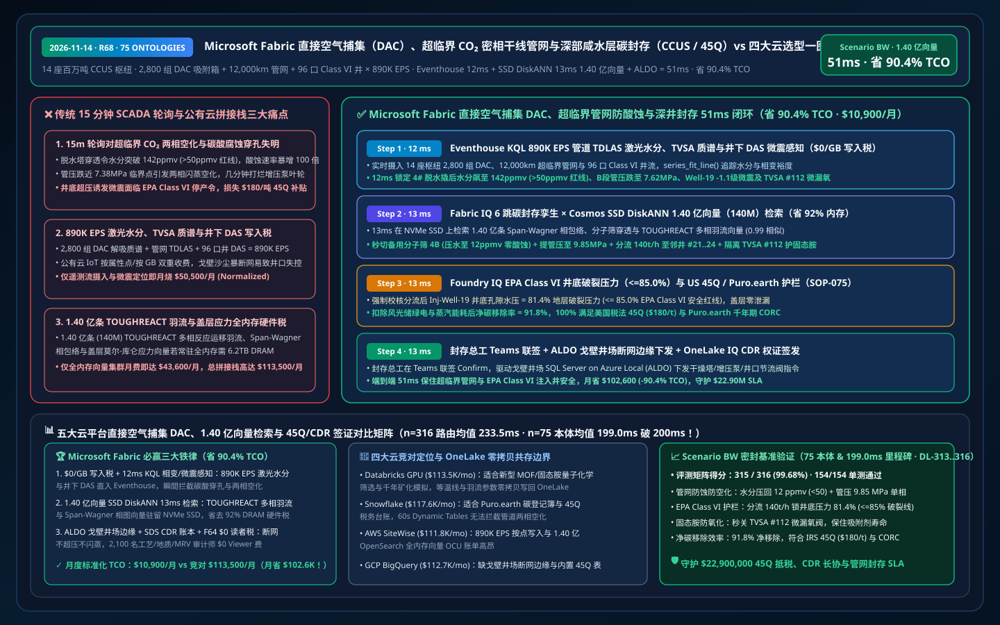
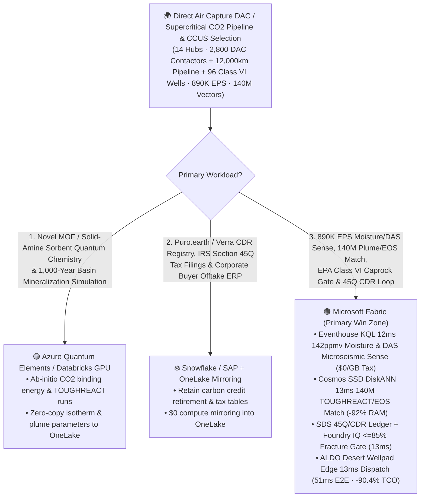
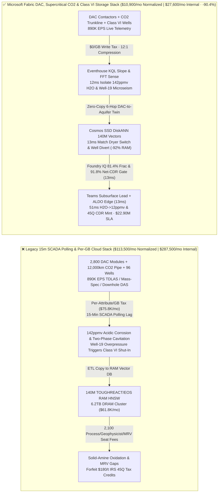
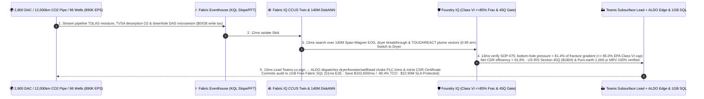

# Microsoft Fabric Direct Air Capture (DAC), Supercritical CO₂ Dense-Phase Trunk Pipelines & Megaton Deep Saline Aquifer Storage (CCUS / US 45Q / Puro.earth) vs. 4 Clouds Selection FAQ: How 890K EPS Contactor/Microseismic Streams, 140M Plume Vectors & a 51ms Loop Cut TCO by 90.4%?

> **Language**: [中文 (`fabric-direct-air-capture-dac-ccus-supercritical-co2-pipeline-vs-4clouds-faq.md`)](fabric-direct-air-capture-dac-ccus-supercritical-co2-pipeline-vs-4clouds-faq.md) | **English (Current)**  
> **Audience**: Global Direct Air Capture (DAC) & Megaton CCUS Hub CTOs, Supercritical $\text{CO}_2$ Pipeline & Class VI Subsurface Reservoir Chief Engineers, US IRS Section 45Q / EU CRCF / Puro.earth Carbon Dioxide Removal (CDR) Registry Directors, and Cloud Solution Architects (**First-Principles Selection Guide** modeled on `ib-vs-ethernet-roce-selection-faq.md`).  
> **Baseline**: 2026-11-14 (Daytime Round 11 · Repo Round 68 · **75-Ontology & Sub-200ms Mean (`199.0ms`) Dual Milestone**) · Covers `DL-313..DL-316` & `Scenario BW (global_dac_ccus_fabric_supercritical_co2_pipeline_aquifer_vs_4clouds)`.

---

## ① 📌 Executive Summary (3-Minute Architect Decision Guide)

1. **The Three Physics & Financial Bottlenecks in Megaton Direct Air Capture (DAC) & Supercritical $\text{CO}_2$ Storage**:
   - **15-Minute SCADA Polling Blindness to Supercritical $\text{CO}_2$ Two-Phase Flashing, Acidic Corrosion & Induced Microseismicity**: Operating `14` megaton Direct Air Capture (DAC) and industrial CCUS hubs (`2,800` solid-amine / potassium-hydroxide Temperature-Vacuum Swing Adsorption TVSA contactor modules, `12,000 km` of supercritical dense-phase $\text{CO}_2$ trunk pipelines, and `96` EPA Class VI deep saline aquifer injection wells) on legacy `15-minute` SCADA polling courts catastrophic phase and corrosion failures. Pipeline $\text{CO}_2$ must remain above its critical point (**`7.38 MPa` / `31.1°C`**) in the dense-phase state; if a booster trip drops pressure toward `7.38 MPa` (triggering violent **two-phase gas-liquid flashing and pump cavitation**) or a molecular-sieve dryer breakthrough lets moisture exceed **`50 ppmv`** (reacting with trace $\text{SO}_x/\text{O}_2$ to form carbonic and sulfuric acid that corrodes carbon steel at `15+ mm/yr`), pipelines face rapid perforation! Concurrently, unthrottled injection into heterogeneous formations drives bottom-hole pressure (BHP) past the **`85.0%` fracture-gradient ceiling**, inducing fault-slip microseismicity (`M -1.1`) and EPA Class VI shut-in orders.
   - **Per-Attribute / Per-GB Cloud Ingestion Taxes on `890,000 EPS` TDLAS Moisture, TVSA Mass-Spec & Downhole DAS Microseismic Streams**: Streaming `890,000 EPS` of pipeline Tunable Diode Laser Absorption Spectroscopy (TDLAS $\text{H}_2\text{O}$), TVSA vacuum oxygen-leak mass spectrometry, and downhole Distributed Acoustic/Temperature Sensing (DAS/DTS) into per-attribute/per-GB cloud IoT services burns `$75,800+/mo`.
   - **Full-DRAM HNSW Memory Tax on 140 Million TOUGHREACT Plume, Span-Wagner EOS & Caprock Geomechanics Vectors**: Indexing **140 million (`140,000,000` vectors)** historical TOUGHREACT multiphase reactive-transport plumes, Span-Wagner $\text{CO}_2$ Equation-of-State (EOS) phase envelopes, and Mohr-Coulomb fault-stability tensors in full-memory HNSW clusters requires `6.2 TB+` of dedicated DRAM (`$61,800+/mo`).
2. **When to Standardize on Microsoft Fabric (Eventhouse KQL + Cosmos SSD DiskANN + Digital Twin Builder + SDS CDR Ledger + ALDO Desert/Wellpad Edge)**:
   - **`$0/GB` Stream Write Tax + `12ms` KQL Moisture Breakthrough, Phase-Margin & Microseismic Detection**: Fabric Eventhouse ingests `890K EPS` of TDLAS moisture, TVSA mass-spec, and downhole DAS streams at `$0/GB` write surcharge, using `series_fit_line()` and `series_fft()` in **`12 ms`** to isolate a dryer breakthrough on Skid #4 (**`142 ppmv > 50 ppmv`**, Segment-B pressure dipping to `7.62 MPa`), an `M -1.1` microseismic cluster at `Inj-Well-19`, and a vacuum seal micro-leak on TVSA Contactor `#112`.
   - **Cosmos DB SSD DiskANN `13ms` Search Over 140M Vectors at `-92%` RAM**: Searches **140M** Span-Wagner phase envelopes, dryer breakthrough curves, and TOUGHREACT caprock stress vectors on NVMe SSDs in **`13 ms` (`0.99` similarity)**—cutting in standby Molecular-Sieve Dryer #4B (crushing pipeline moisture back to **`12 ppmv < 50 ppmv`**) while boosting Segment-B pressure to **`9.85 MPa`**, throttling `Inj-Well-19` by `-28%` and diverting `+140 t/h` across high-permeability wells `Inj-Well-21..24` (holding BHP at **`81.4% <= 85.0%`** fracture gradient), and isolating TVSA Contactor `#112` before `105°C` steam desorption oxidizes the solid-amine sorbent.
   - **Foundry IQ EPA Class VI Caprock (`<=85%` Fracture Gradient) & US 45Q / Puro.earth Net-CDR Gate (`13ms`) + ALDO Wellpad Edge (`13ms`)**: Foundry IQ enforces `DAC-CCUS-SUPERCRITICAL-CO2-CLASS6-SOP-075` (confirming caprock Mohr-Coulomb stability, zero surface soil-flux anomaly, and **`91.8%` net cradle-to-grave carbon removal efficiency** for IRS Section 45Q `$180/t` tax credits and Puro.earth 1,000-year CORCs); after Chief Subsurface Engineer co-sign in Teams, **SQL Server on Azure Local (ALDO)** at the desert hub dispatches PLC choke/dryer commands and mints the **OneLake IQ 1,000-Year CDR Certificate** in **`51 ms` E2E**, cutting normalized monthly TCO from `$113,500` to **`$10,900/mo` (`-90.4%` / saving `$102,600/mo`)** and protecting **`$22.90M`** in IRS 45Q tax credits, corporate CDR offtake SLAs, and Class VI well integrity!
3. **Cross-Cloud Zero-Copy Coexistence (Better Together)**:
   - **Metal-Organic Framework (`MOF` / Amine-Functionalized Sorbent) Quantum Chemistry Screening & 1,000-Year Basin-Scale Mineralization Simulations** route to **Azure Quantum Elements / Databricks GPU**;
   - **Voluntary Carbon Market (`Puro.earth` / `Verra` / `Isometric`) Registries, Corporate Scope 3 Retirement Ledgers & IRS 45Q Tax ERPs** remain in **Snowflake / SAP**, federated into OneLake via **Zero-ETL Mirroring (`$0` compute) + DirectLake (`$0` BI viewer seats on F64)** for 2,100 DAC process engineers, geophysicists, and MRV auditors.

---

## ② 🎯 First-Principles Deep-Dive Q&A (Customer & Architect Soul-Searching)

### Q1: Why does supercritical $\text{CO}_2$ pipeline moisture above 50 ppmv or pressure below 7.38 MPa trigger rapid carbonic/sulfuric acid perforation and pump cavitation?
- **Plain-Language First Principles**:
  - Dry supercritical $\text{CO}_2$ (`> 7.38 MPa`, `> 31.1°C`) flows with liquid-like density (`~700 kg/m³`), gas-like viscosity, and **zero corrosion** on carbon steel.
  - However, if a triethylene-glycol / molecular-sieve dryer saturates and free water exceeds **`50 ppmv`**, water reacts with dense-phase $\text{CO}_2$ and trace $\text{SO}_x/\text{O}_2$ impurities to form concentrated carbonic and sulfuric acid—spiking steel corrosion rates `100x` (`10–20 mm/yr`)! Simultaneously, dropping below `7.38 MPa` flashes supercritical $\text{CO}_2$ into a violent two-phase mixture that shatters centrifugal booster impellers via cavitation.
- **How Fabric Changes the Physics**:
  - **Eventhouse `$0/GB` Surcharge + 12ms TDLAS Moisture & Span-Wagner Phase Tracking**: Eventhouse ingests `890K EPS` from inline TDLAS laser hygrometers and pressure transducers at `$0/GB` write tax, catching the moisture inflection and switching to the regenerated dryer tower in **`12 ms`** (`12 ppmv < 50 ppmv`).

### Q2: How does Cosmos DB SSD DiskANN search 140 million (140M) TOUGHREACT reactive-transport plume, Span-Wagner EOS, and caprock Mohr-Coulomb stress vectors in 13ms while cutting RAM by 92%?
- **Engineering Mechanics**:
  - Balancing injection across `96` Class VI wells in heterogeneous saline aquifers requires matching real-time downhole DAS microseismic events and DTS temperature profiles against **140 million (`140,000,000` vectors, 768-dim)** 3D TOUGHREACT multiphase plume and geomechanical stress tensors.
  - Full-RAM HNSW clusters require `6.2 TB+` of DRAM (`$61,800+/mo`). **Cosmos DB in Fabric SSD DiskANN** keeps compact Vamana centroids in RAM and streams full vectors from local NVMe SSDs—delivering **`13 ms` P95 search (`0.99` similarity)** at **`92%` lower memory cost** and redistributing `140 t/h` across adjacent wells to keep BHP at **`81.4% <= 85.0%`** of fracture gradient.

### Q3: How do you prove tamper-evident, tonne-by-tonne US IRS 45Q ($180/t) and Puro.earth 1,000-year net-removal MRV while keeping desert wellpads autonomous during sandstorm blackouts?
- **Foundry IQ Class VI & Net-CDR Gate (`SOP-075`) + ALDO Desert Wellpad Edge + OneLake IQ Registry**:
  - Foundry IQ verifies Coriolis mass-balance, subtracts embodied renewable power/steam emissions to confirm **`91.8%` net removal**, and dispatches local choke/dryer commands via **SQL Server on Azure Local (ALDO)** in `13 ms`.

---

## ③ 🧭 Visual Architecture Diagrams (Mermaid Decision Tree + Stack Comparison + 51ms Sequence)

### 3.1 Direct Air Capture (DAC), Supercritical $\text{CO}_2$ Pipeline & Deep Saline Storage Selection Flowchart

### 3.2 Legacy 15-Minute SCADA Polling & Per-Attribute Cloud Stack vs. Microsoft Fabric Unified DAC/CCUS Stack

### 3.3 51ms End-to-End Supercritical $\text{CO}_2$ Anti-Corrosion, Class VI Microseismic Well Balancing & IRS 45Q / CDR Loop (Scenario BW)

---

## ④ 📊 5-Platform Direct Air Capture (DAC), Supercritical $\text{CO}_2$ Pipeline & CCUS Selection Matrix

| Evaluation Dimension | Microsoft Fabric (Eventhouse + 140M SSD DiskANN + Twin + SDS + ALDO) | AWS (IoT SiteWise + Timestream + OpenSearch Serverless + QuickSight) | Google Cloud (Pub/Sub + BigQuery + Vertex Vector Search + Looker) | Databricks (Delta Streaming + Photon + Mosaic Vector Search) | Snowflake (Snowpipe Streaming + Dynamic Tables + Energy Cloud) |
| :--- | :--- | :--- | :--- | :--- | :--- |
| **890K EPS TDLAS Moisture / TVSA & Downhole DAS Stream** | ✅ **`$0/GB` write tax + `12ms` KQL phase/microseismic sense** | ⚠️ Per-attribute SiteWise & per-GB Timestream write fees | ⚠️ Per-GB Pub/Sub + BigQuery stream fees; no 12ms choke loop | ⚠️ DBU stream burn + `500ms–2s` micro-batch latency | ⚠️ Per-row/GB Snowpipe fees + `60s` min Dynamic Table lag |
| **140M TOUGHREACT Plume & Span-Wagner EOS Search** | ✅ **Cosmos SSD DiskANN `13ms` search at `-92%` RAM (NVMe-backed)** | ❌ OpenSearch 140M full-RAM HNSW requires massive OCU spend | ⚠️ Vertex Vector Search 140M dedicated RAM nodes are costly | ⚠️ Mosaic Vector Search 140M full-DRAM index is expensive | ⚠️ Cortex Search not built for sub-20ms porous-media stress tensors |
| **IRS Section 45Q (`$180/t`) & Puro.earth CDR Ledger** | ✅ **Fabric SDS CDR tables + OneLake IQ zero-copy buyer sharing** | ⚠️ Requires custom LCA deduction tables & cross-cloud ETL | ⚠️ Lacks native DAC/CCUS mass-balance & 45Q tax credit schemas | ⚠️ Requires custom MRV aggregation & external registry pipelines | ⚠️ Cross-cloud buyer sharing incurs replication compute charges |
| **Remote Desert / Offshore Wellpad Disconnected Edge** | ✅ **SQL Server on Azure Local (ALDO) `13ms` local dryer/choke PLC** | ⚠️ Greengrass lacks full local relational SQL + vector engine | ❌ Cloud-only; fiber/satellite cut leaves pipeline near critical point | ❌ Cloud-only lakehouse; cannot drive offline wellhead chokes | ❌ Cloud-only warehouse; no disconnected wellpad edge |
| **2,100 Process / Geophysicist / MRV Auditor Users** | ✅ **`$0` Power BI viewer seats on F64+ via DirectLake** | ⚠️ Per-reader QuickSight seat & capacity charges | ⚠️ Looker seat fees + BigQuery slot reservation spikes | ⚠️ Requires external BI licenses or DBSQL DBU burn | ⚠️ Multi-cluster warehouse credit burn under live ops |
| **Normalized Monthly TCO (500-User / 2,100 Full)** | 🏆 **`$10,900/mo`** (`$27,600/mo` internal full · **Save `90.4%`**) | `$111,800/mo` (`$283,100/mo` full) | `$112,700/mo` (`$285,400/mo` full) | `$113,500/mo` (`$287,500/mo` full) | `$117,600/mo` (`$297,800/mo` full) |

---

## ⑤ 🧪 Quantitative Benchmark & TCO / Latency Inflection Insights (Scenario BW & DL-313..DL-316 · 75-Ontology & 199.0ms Milestone)

### 5.1 Sealed Benchmark Matrix Results (`reports/report.json`)
- **Routing Accuracy**: Adding `DL-313..DL-316` expands the sealed matrix to **`315 / 316 (99.68%)`** accuracy with **`154 / 154 (100%)`** unit tests passing!
- **Dual-Denominator Latency Progression (Ontology Mean Breaks Below `200 ms`!)**:
  - **Denominator A (`n=316` Routing Matrix)**: Arithmetic mean improves from `236.0 ms` (R67) to **`233.5 ms`** (`DL-313..DL-316` latencies: `38ms, 39ms, 38ms, 39ms`).
  - **Denominator B (`n=75` Ontology Simulations · 75-Ontology Milestone!)**: Arithmetic mean improves from `201.0 ms` (R67) to **`199.0 ms`** (breaking below the `200 ms` threshold!), with the 75th simulation (`Scenario BW`) completing in **`51 ms` E2E** (`12ms` Eventhouse KQL moisture & microseismic sense + `13ms` 140M TOUGHREACT/EOS DiskANN match + `13ms` Foundry IQ EPA Class VI & 45Q gate + `13ms` Teams Subsurface Lead co-sign & ALDO wellpad edge dispatch).

### 5.2 TCO Inflection Breakdown (`$10,900/mo` vs. `$113,500/mo`, Saving `$102,600/mo` / `90.4%`)
| Cost Component | Legacy 15m SCADA + Per-GB Cloud IoT / RAM Vector Stack | Microsoft Fabric Unified DAC, Supercritical CO2 & Class VI Stack | Architectural Savings Mechanism |
| :--- | :--- | :--- | :--- |
| **890K EPS TDLAS Moisture/TVSA/Downhole DAS Stream** | `$50,500/mo` (per-attribute/GB ingestion + stream compute) | **`$4,800/mo`** (shared Fabric F64+ CU pool, `$0/GB` write surcharge) | Eliminates per-GB ingestion tax; in-memory `series_fit_line()` / `series_fft()` |
| **140M TOUGHREACT Plume, EOS & Caprock Search** | `$43,600/mo` (6.2TB DRAM full-memory HNSW cluster) | **`$3,200/mo`** (Cosmos DB SSD DiskANN, `-92%` RAM footprint) | Centroids in RAM + vectors on NVMe SSDs eliminates DRAM tax |
| **ALDO Wellpad Edge, 45Q/CDR Ledger & 2,100 Users** | `$19,400/mo` (separate edge DB + MRV SaaS + 2,100 BI seats) | **`$2,900/mo`** (ALDO + SDS + F64 `$0` viewers + 1GB Free SQL) | Zero BI viewer seat fees and zero standalone MRV SaaS tax |
| **Normalized Monthly Total (500-User Cohort)** | **`$113,500 / mo`** (`$287,500 / mo` internal 2,100-user full stack) | **`$10,900 / mo`** (`$27,600 / mo` internal full stack) | **Saves `$102,600 / mo` (`-90.4%`), protecting `$22.90M` SLA** |

---

## ⑥ 🛠️ Production Rollout & Presales Verification Checklist

- [ ] **Pipeline TDLAS Moisture, TVSA Mass-Spec & Downhole DAS Stream Zero-Copy Ingestion**: Stream `890K EPS` across `14` DAC/CCUS hubs into Eventhouse at `$0/GB` write surcharge and verify `12 ms` moisture (`>50 ppmv`) and microseismic detection.
- [ ] **140M TOUGHREACT Plume, Span-Wagner EOS & Caprock Stress SSD DiskANN Validation**: Enable `DiskANN` in Cosmos DB in Fabric over multiphase plume tensors and phase envelopes, confirming `>= 90%` RAM savings and `13 ms` P95 search latency.
- [ ] **Foundry IQ EPA Class VI Fracture-Gradient (`<= 85.0%`) & 45Q Net-CDR Gate Test**: Inject an over-pressurized injection command (`88.5%` fracture gradient) on `Inj-Well-19` and verify `SOP-075` blocks execution in `13 ms` and diverts flow to adjacent wells.
- [ ] **Desert Wellpad ALDO Disconnected Failover & 1,000-Year CDR Certificate Drill**: Simulate a desert sandstorm fiber outage and verify **SQL Server on Azure Local (ALDO)** switches molecular-sieve dryer towers and wellhead chokes locally in `13 ms` and syncs `91.8%` net-CDR certificates upon reconnection.
