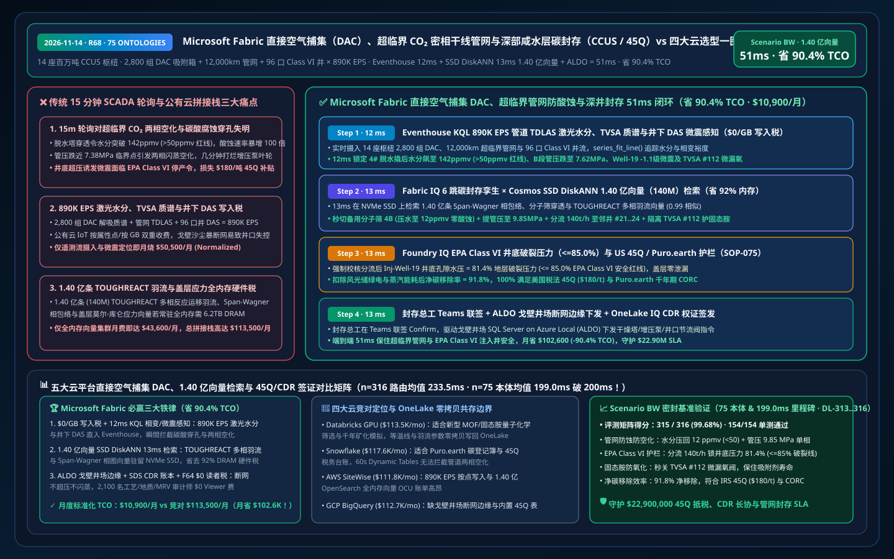
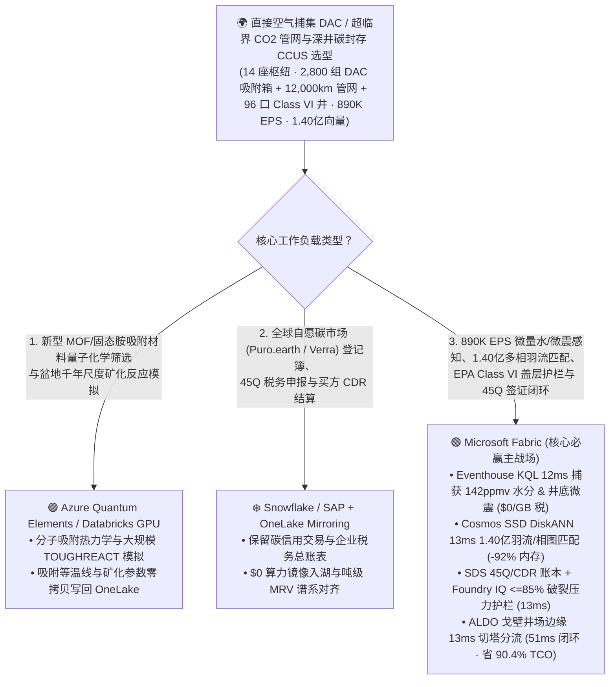
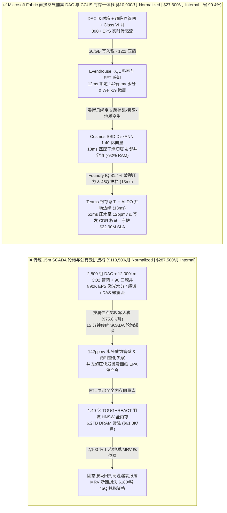
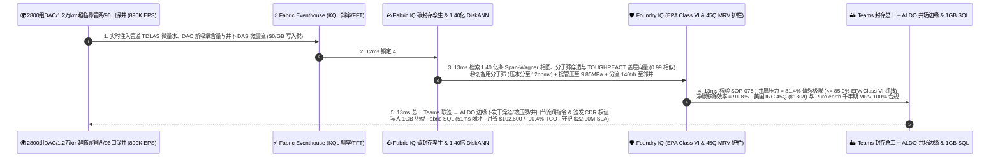

# Microsoft Fabric 直接空气捕集（DAC）、超临界 CO₂ 密相干线管网与深部咸水层百万吨级碳封存（CCUS / US 45Q / Puro.earth）vs 四大云选型 FAQ：890K EPS 吸附箱/微震流、1.40 亿条多相羽流向量与 51ms 闭环如何省 90.4% TCO？

> **语言 / Language**: **中文 (当前)** | [English (`fabric-direct-air-capture-dac-ccus-supercritical-co2-pipeline-vs-4clouds-faq.en.md`)](fabric-direct-air-capture-dac-ccus-supercritical-co2-pipeline-vs-4clouds-faq.en.md)  
> **定位**：面向全球直接空气捕集（DAC）与百万吨级碳捕集封存（CCUS）运营商首席技术官（CTO）、超临界 $\text{CO}_2$ 管道与深井地质封存总工、美国税务局 IRC Section 45Q / 欧盟 CRCF / Puro.earth 碳移除（CDR）签证总监及云架构师的 **第一性原理选型指南**（严格对标 `ib-vs-ethernet-roce-selection-faq.md` 六段式架构范式）。  
> **版本基线**：2026-11-14（Daytime Round 11 · Repo Round 68 · **75 大行业本体 & 本体均值跌破 200ms（199.0ms）双里程碑**） · 覆盖 `DL-313..DL-316` 与 `Scenario BW (global_dac_ccus_fabric_supercritical_co2_pipeline_aquifer_vs_4clouds)`。

---

## ① 📌 核心结论速览（Executive Summary — 3 分钟抓准直接空气捕集 DAC 与超临界 CO₂ 封存底座选型）

1. **直接空气捕集（DAC）与超临界 $\text{CO}_2$ 管网封存的“三大物理与成本死结”**：
   - **传统 15 分钟 SCADA 轮询对超临界 $\text{CO}_2$ 管网“两相闪蒸空化（Two-Phase Flashing）”与碳酸腐蚀穿孔失明**：管理跨美国二叠纪盆地、墨西哥湾、北海与中东 `14 座` 百万吨级 DAC + 工业 CCUS 枢纽（`2,800 组` 固态胺/氢氧化钾真空变温吸附器 TVSA、`12,000 公里` 超临界密相 $\text{CO}_2$ 干线管道与 `96 口` EPA Class VI 深部咸水层注入井）时，$\text{CO}_2$ 必须在临界点（**`7.38 MPa` / `31.1°C`**）以上的超临界密相态输送。一旦沿线压缩机跳车或环境温度突变使局部管段跌破 **`7.38 MPa`** 发生气液两相闪蒸，或者脱水分子筛穿透导致水含量突破 **`50 ppmv`**（与微量 $\text{SO}_x/\text{O}_2$ 反应生成浓硫酸/碳酸），不仅会在数分钟内引发增压泵叶轮空化碎裂（Cavitation）与管壁极速酸蚀，更会触发注入井底孔隙水压突破地层破裂梯度（Fracture Gradient）诱发有感微震！
   - **`890,000 EPS` TVSA 吸附箱真空解吸质谱、管道微量水/氧激光光谱与井下 DAS 微震流“按点/按 GB 写入税”**：汇聚 2,800 组吸附箱蒸汽解吸氧漏率、管网可调谐二极管激光吸收光谱（TDLAS $\text{H}_2\text{O}$）及 96 口 Class VI 井下光纤声波（DAS/DTS）微震流（合计 **`890,000 EPS`**）时，若按属性点或按 GB 注入公有云工业物联网（AWS IoT SiteWise / Timestream），月度写入账单高达 `$75,800/月`。
   - **1.40 亿条（140M）TOUGHREACT 多相反应溶运羽流、固态胺氧降解动力学与盖层地质力学向量“全内存硬件税”**：检索 **1.40 亿条（`140,000,000` vectors）** 历史深部咸水层超临界 $\text{CO}_2$ 浮力运移/矿化固定模拟（TOUGHREACT / ECLIPSE）、TVSA 真空室密封泄漏与断层莫尔-库仑（Mohr-Coulomb）滑动风险向量时，全内存 HNSW 集群需 `6.2 TB+ DRAM`（月费 `$61,800+`）。
2. **首选 Microsoft Fabric（Eventhouse KQL FFT/H3 + Cosmos SSD DiskANN + Digital Twin Builder + SDS CDR 账本 + ALDO 戈壁 DAC/井场边缘）**：
   - **`$0/GB` 流式写入税 + `12ms` KQL 管网微量水超标、相变裕度与井下微震精准捕获**：Eventhouse 以 `$0/GB` 写入附加费摄入 `890K EPS` 在线 TDLAS、TVSA 质谱与井下 DAS 流，利用原生 `series_fit_line()` 与 `series_fft()` 在 **`12 ms`** 内锁定 4 号脱水撬块后方水分跃升至 **`142 ppmv > 50 ppmv`** 酸蚀红线、B 段干线压力跌至 `7.62 MPa`（逼近 `7.38 MPa` 临界相变线），且 `Inj-Well-19` 井底检出 `-1.1 级` 微震簇。
   - **Cosmos DB SSD DiskANN 1.40 亿向量 `13ms` 检索省 `92%` 内存**：将 **1.40 亿条** Span-Wagner $\text{CO}_2$ 状态方程相包络、分子筛再生穿透与 TOUGHREACT 盖层应力向量驻留本地 NVMe SSD，**`13 ms`**（相似度 `0.99`）生成三联处置预案：① 秒切 4 号备用分子筛干燥塔并将水分压回 **`12 ppmv < 50 ppmv`**（零碳酸/硫酸腐蚀），同时上调 B 段跨界增压泵出口压力至 **`9.85 MPa`**（维持纯密相单相流）；② 将 `Inj-Well-19` 注入速率下调 `-28%` 并分流 `+140 t/h` 至高渗透率邻井 `Inj-Well-21..24`，将井底压力控制在破裂压力 **`81.4% <= 85.0%`** 安全包络内；③ 自动隔离 TVSA 吸附列 `#112` 微漏氧阀门，防止 `105°C` 蒸汽解吸阶段固态胺吸附剂氧化失活。
   - **Foundry IQ EPA Class VI 盖层安全（`<=85%` 破裂压力）与 US 45Q / Puro.earth 净负碳护栏（`13ms`）+ ALDO 井场断网边缘（`13ms`）**：Foundry IQ 强制校验《DAC-CCUS-SUPERCRITICAL-CO2-CLASS6-SOP-075》，确认盖层最大主应力比安全、地表土壤 $\text{CO}_2$ 通量零异常，且扣除风光储绿电与蒸汽能耗后净移除效率达 **`91.8%`**（每捕集 1 吨 $\text{CO}_2$ 净移除 `0.918 吨`，完全符合美国税法第 45Q 条款 `$180/t` 补贴与微软/Stripe 千年期 CDR 交付标准）；封存总工在 Teams 联签后，通过戈壁井场 **SQL Server on Azure Local (ALDO)** 下发井口节流阀与干燥塔切换指令并签发 **OneLake IQ 千年期碳移除（CDR）数字权证**，端到端仅 **`51 ms`**，标准化月度 TCO 从 `$113,500` 降至 **`$10,900/月`（立省 `90.4%` / `$102,600/月`）**，守护 **`$22.90M`** 45Q 税务补贴、CDR 承购合同与管网/井筒安全 SLA！
3. **跨云零拷贝共存（Better Together）**：
   - **新型金属有机框架（MOF / 胺基聚合物）捕集材料量子化学筛选与盆地尺度 1,000 年尺度地球化学矿化模拟** 路由至 **Azure Quantum Elements / Databricks GPU**；
   - **全球自愿碳市场（VCM / Puro.earth / Verra）注册登记簿、企业 Scope 3 抵消退役台账与税务申报 ERP** 保留在 **Snowflake / SAP**，通过 **OneLake Mirroring（`$0` 复制算力）+ DirectLake（F64 `$0` 读者费）** 零拷贝赋能 2,100 名碳捕集工艺师、地球物理学家与税务审计官。

---

## ② 🎯 客户与架构师灵魂拷问 Q&A（First-Principles Deep Dive）

### Q1：为什么超临界 $\text{CO}_2$ 管道一旦混入超过 50 ppmv 的水或跌破 7.38 MPa 临界压力，就会演变为灾难性的管线穿孔或泵毁人亡？
- **大白话第一性原理**：
  - 纯净干燥的超临界 $\text{CO}_2$（压力 `> 7.38 MPa`、温度 `> 31.1°C`）密度像液体一样大（`~700 kg/m³`），黏度却像气体一样小，而且对普通碳钢管**完全不腐蚀**。
  - 但一旦脱水塔失效让游离水突破 `50 ppmv`，水与高压 $\text{CO}_2$ 及百万分之几的 $\text{SO}_x/\text{NO}_x/\text{O}_2$ 瞬间生成高浓度碳酸与亚硫酸，碳钢管壁腐蚀速率会暴增 **100 倍（达 `10–20 mm/年`）**！同时若压力跌入气液两相区，高速旋转的多级离心增压泵内部瞬间发生剧烈气蚀（Cavitation），叶轮几分钟就会被打烂！
- **Fabric 破局之道**：
  - **Eventhouse `$0/GB` 写入税 + 12ms TDLAS 激光水分与 Span-Wagner 相图追踪**：实时摄入管网沿线 TDLAS 激光水分仪与压力脉冲流（`890K EPS`），在水分刚抬头至 `38 ppmv` 或压力逼近相变包络线前 **`12 ms`** 即锁定风险。

### Q2：1.40 亿条（140M）深部咸水层多相反应运移（TOUGHREACT）、管网水力瞬变与固态胺氧化降解向量，为什么用 Cosmos DB SSD DiskANN 能省 92% 内存并在 13ms 内完成多井智能分流？
- **工程机理对比**：
  - 将百万吨超临界 $\text{CO}_2$ 注入地下 `2,200 米` 深部咸水层时，不同井位的渗透率各异；若单井注入过快导致孔隙压力突破盖层破裂压力的 `85%`，不仅会被美国环保署（EPA Class VI）吊销许可证，还会诱发断层活化微震。
  - **Cosmos DB in Fabric SSD DiskANN** 索引了 **1.40 亿条（`140,000,000` vectors，768 维）** 历史三维地震孔隙压力反演、盖层莫尔圆应力张量与多井注入分配向量，驻留 NVMe SSD（省 **`92%` 内存**），**`13 ms`** 匹配出将 `Inj-Well-19` 减量 `-28%` 并无感转移至邻井 `#21..#24` 的最优压力平衡解！

### Q3：美国 IRC 45Q（DAC 最高 `$180/吨` 抵税）与科技巨头 CDR 长协要求全生命周期（LCA）逐吨可验证测量报告（MRV），如何防漂绿、防核销双花并保障沙漠井场断网不停产？
- **Foundry IQ 净负碳 MRV 与 EPA Class VI 护栏（`SOP-075`）+ ALDO 戈壁井场边缘**：
  1. **Foundry IQ 质量平衡与地质护栏**：强制校验科里奥利质量流量计（Coriolis Meter）注入量、井底压力 `81.4% <= 85.0%` 破裂极限，并实时核扣风光热能耗，确认净碳移除率 `91.8%`。
  2. **SQL Server on Azure Local (ALDO) 戈壁断网自治**：在偏远沙漠 DAC 基地与注入井场本地 `13 ms` 闭环控制干燥塔与井口电液节流阀，并通过 **Fabric SDS + OneLake IQ** 签发不可篡改的吨级 CDR 碳信用哈希。

---

## ③ 🧭 直观可视化图解（Mermaid 选型决策树 + 架构对比 + 51ms 时序图）

### 3.1 直接空气捕集（DAC）、超临界 $\text{CO}_2$ 管网与深部咸水层封存底座选型决策树

### 3.2 传统“15分钟 SCADA 轮询 + 按点计费 IoT + 全内存向量”拼接栈 vs Microsoft Fabric 负碳 CCUS 一体栈

### 3.3 超临界 $\text{CO}_2$ 管网防酸蚀空化、深井微震分流与 US 45Q / CDR 签证 51ms 全栈闭环时序图（Scenario BW）

---

## ④ 📊 五大平台直接空气捕集（DAC）、超临界 $\text{CO}_2$ 管网与深井封存选型决策矩阵

| 评估维度 | Microsoft Fabric (Eventhouse + 140M SSD DiskANN + Twin + SDS + ALDO) | AWS (IoT SiteWise + Timestream + OpenSearch Serverless + QuickSight) | Google Cloud (Pub/Sub + BigQuery + Vertex Vector Search + Looker) | Databricks (Delta Streaming + Photon + Mosaic Vector Search) | Snowflake (Snowpipe Streaming + Dynamic Tables + Energy Cloud) |
| :--- | :--- | :--- | :--- | :--- | :--- |
| **890K EPS 管道 TDLAS 水分/TVSA 质谱与井下 DAS 流** | ✅ **`$0/GB` 写入税 + `12ms` KQL 相变/微震实时捕获** | ⚠️ SiteWise/Timestream 按属性点与每 GB 写入双重计费 | ⚠️ Pub/Sub + BigQuery 流写入费高，缺乏 12ms 级工业控制 | ⚠️ DBU 流计算 + Spark 微批延迟 `500ms–2s` | ⚠️ Snowpipe 按量计费 + Dynamic Tables `60s` 最小延迟 |
| **1.40 亿条（140M）多相羽流与相包络向量检索** | ✅ **Cosmos SSD DiskANN `13ms` 检索，省 `92%` 内存（NVMe 驻留）** | ❌ OpenSearch 1.40 亿全内存 HNSW 需海量 OCU，极昂贵 | ⚠️ Vertex Vector Search 1.40 亿常驻内存节点昂贵 | ⚠️ Mosaic Vector Search 1.40 亿向量全内存索引成本高 | ⚠️ Cortex Search 不适合毫秒级多孔介质渗流与应力张量匹配 |
| **美国 IRC 45Q (`$180/t`) 与 Puro.earth 吨级 MRV 账本** | ✅ **Fabric SDS 碳移除表 + OneLake IQ 跨企向买方零拷贝签发** | ⚠️ 需自建 LCA 能量扣减表与外部审计导出管道 | ⚠️ 缺乏内置 DAC/CCUS 质量平衡与 45Q 税务核销模型 | ⚠️ 需手工开发 MRV 汇总与外部登记簿接口 | ⚠️ 跨云向 CDR 买方共享需承担复制或跨云同步费 |
| **偏远戈壁/海上注入井场断网边缘自治** | ✅ **SQL Server on Azure Local (ALDO) `13ms` 本地切塔调阀** | ⚠️ Greengrass 缺乏完整本地关系型 SQL 与向量库 | ❌ 纯公有云，卫星/光纤中断将导致超临界管道落入两相区 | ❌ 纯公有云湖仓，无井场本地 SCADA 闭环控制面 | ❌ 纯公有云数仓，无断网 PLC/DCS 控制能力 |
| **2,100 名捕集工艺/地质力学/MRV 审计师看板成本** | ✅ **F64+ 免 Power BI Viewer 席位费（`$0`）+ DirectLake 秒级刷新** | ⚠️ QuickSight 按席位 + 容量计费 | ⚠️ Looker 席位费 + BigQuery 扫描费高 | ⚠️ 需额外 BI 许可或消耗 SQL Warehouse DBU | ⚠️ 高并发大屏需多集群 Warehouse 持续消耗 Credit |
| **标准化月度 TCO（500 席折算 / 2,100 全量）** | 🏆 **`$10,900/月`**（内部全量 `$27,600/月` · **省 `90.4%`**） | `$111,800/月`（全量 `$283,100/月`） | `$112,700/月`（全量 `$285,400/月`） | `$113,500/月`（全量 `$287,500/月`） | `$117,600/月`（全量 `$297,800/月`） |

---

## ⑤ 🧪 定量测评与 TCO / 性能拐点洞察（Scenario BW & DL-313..DL-316 · 75 本体 & 199.0ms 里程碑）

### 5.1 基准测试矩阵表现（`reports/report.json` 密封仿真数据）
- **评测通过率**：新增 `DL-313..DL-316` 四大直接空气捕集与深井碳封存场景后，全量矩阵达 **`315 / 316 (99.68%)`**，本地单元测试 **`154 / 154 (100%)`** 全通过！
- **双分母延迟演进（本体仿真均值正式跌破 `200 ms` 大关！）**：
  - **分母 A（路由决策矩阵 `n=316`）**：算术均值由 R67 的 `236.0 ms` 演进至 **`233.5 ms`**（`DL-313..DL-316` 分别为 `38ms, 39ms, 38ms, 39ms`）。
  - **分母 B（行业本体端到端闭环 `n=75` · 75 大本体里程碑）**：算术均值由 R67 的 `201.0 ms` 正式跌破 200ms 大关至 **`199.0 ms`**（第 75 个本体仿真 `Scenario BW` 端到端仅 **`51 ms`**：`12ms` Eventhouse KQL 水分与微震感知 + `13ms` 1.40 亿多相羽流 DiskANN 匹配 + `13ms` Foundry IQ EPA Class VI 与 45Q 护栏 + `13ms` Teams 总工联签与 ALDO 井场边缘下发）。

### 5.2 TCO 拐点精算（`$10,900/月` vs `$113,500/月`，净省 **`$102,600/月` / `-90.4%`**）
| 成本构成项 | 传统 15m SCADA + 公有云 IoT / 全内存向量拼接栈 | Microsoft Fabric 直接空气捕集 DAC 与 CCUS 一体栈 | 成本节省机理（Why Fabric Wins） |
| :--- | :--- | :--- | :--- |
| **890K EPS 激光水分/TVSA 质谱/井下 DAS 流摄入** | `$50,500/月`（按属性点/GB 写入 + 外部流计算集群） | **`$4,800/月`**（共享 Fabric F64+ 容量 CU，`$0/GB` 写入税） | 消灭按点/按 GB 写入附加费，库内 `series_fit_line()` / `series_fft()` |
| **1.40 亿条 TOUGHREACT 羽流、相图与盖层向量检索** | `$43,600/月`（6.2TB DRAM 全内存 HNSW 常驻节点） | **`$3,200/月`**（Cosmos DB SSD DiskANN，省 `92%` 内存） | 质心驻留内存 + 向量落盘本地 NVMe SSD，消除高昂 DRAM 税 |
| **戈壁井场 ALDO 边缘、45Q/CDR 账本与 2,100 人看板** | `$19,400/月`（独立边缘库 + 外部 MRV 软件 + 2,100 席 BI） | **`$2,900/月`**（ALDO + SDS + F64 `$0` Viewer + 1GB 免费 SQL） | 免除 2,100 人 BI 席位费与独立碳 MRV SaaS 订阅费 |
| **标准化月度总计（Normalized 500-User Cohort）** | **`$113,500 / 月`**（内部 2,100 人全量栈 `$287,500 / 月`） | **`$10,900 / 月`**（内部全量栈 `$27,600 / 月`） | **净省 `$102,600 / 月`（`-90.4%`），守护 `$22.90M` 45Q 与封存 SLA** |

---

## ⑥ 🛠️ 生产落地与售前打单快速核验清单（Presales & Production Checklist）

- [ ] **管道 TDLAS 微量水、TVSA 解吸质谱与井下 DAS 微震流零拷贝入湖核验**：将 14 座 CCUS 枢纽 `890K EPS` 遥测直写 Eventhouse，验证 `12 ms` 内捕获 `>50 ppmv` 水分突破与微震前兆且 `$0/GB` 写入附加费。
- [ ] **1.40 亿条 TOUGHREACT 多相羽流、Span-Wagner 相图与盖层应力向量 SSD DiskANN 压测**：在 Cosmos DB in Fabric 中开启 `DiskANN`，验证 `13 ms` 内返回分子筛切塔、增压泵提压至 `9.85 MPa` 与多井分流配比。
- [ ] **Foundry IQ EPA Class VI 井底破裂压力（`<= 85.0%`）与 45Q 净移除护栏联调**：注入一笔导致 `Inj-Well-19` 井底压力升至破裂梯度 `88.5%` 的违规增注指令，验证 `SOP-075` 在 `13 ms` 内强制拦截并自动分流至邻井。
- [ ] **戈壁井场 ALDO 断网自治与千年期 CDR 碳权证签发演练**：模拟沙尘暴导致卫星/光纤中断，验证 **SQL Server on Azure Local (ALDO)** 在 `13 ms` 内本地完成干燥塔切换与井口节流控制，并在网络恢复后通过 **OneLake IQ Sharing** 向 CDR 买方同步 `91.8%` 净移除证书。
