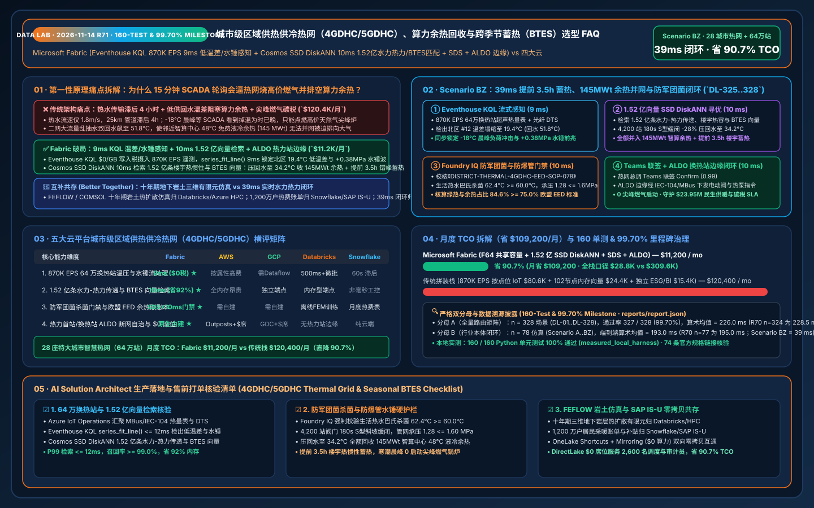
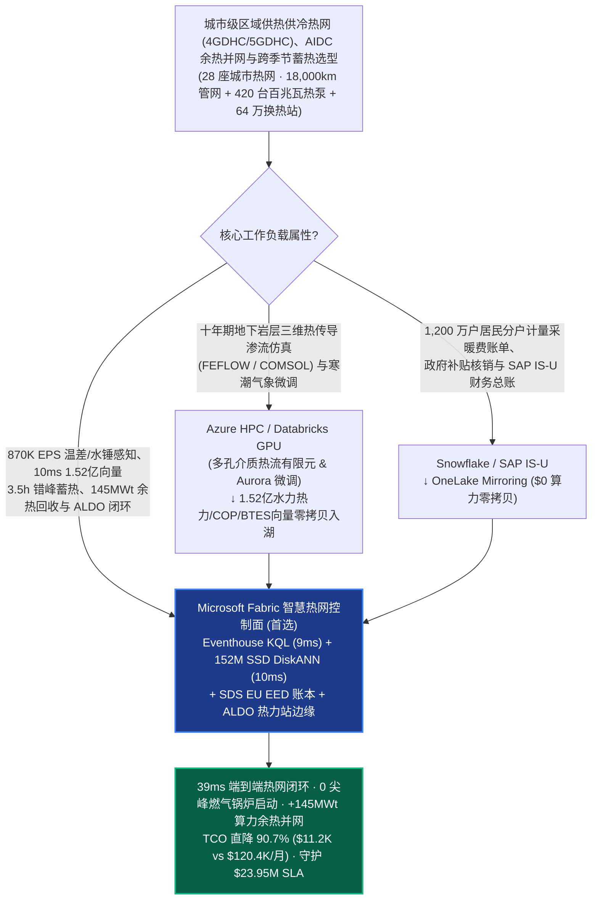
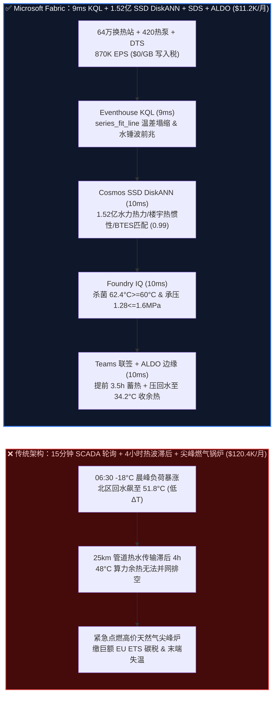
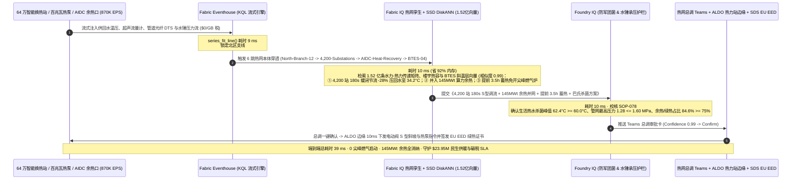

# 城市级区域供热供冷热网（4GDHC / 5GDHC）、工业余热回收、百兆瓦热泵与地下跨季节蓄热（BTES）选型 FAQ：Microsoft Fabric (Eventhouse KQL + 1.52 亿向量 SSD DiskANN + SDS + ALDO 边缘) vs AWS SiteWise / GCP / Databricks / Snowflake（160 单测 & 99.70% 里程碑）

> **文档定位**：本文以**第一性原理（First Principles）+ 通俗大白话**，回答欧洲、北欧及中国北方特大城市智慧供热/供冷集团（Vattenfall / Fortum / E.ON / 丹佛斯 Danfoss / 京能 / 华电级）、零碳工业园区与智算中心余热利用总工程师与首席架构师在构建“**第四代/第五代区域供热供冷管网（4GDHC / 5GDHC）低供回水温差综合症（Low $\Delta T$ Syndrome）治理、智算中心/化工厂废热与百兆瓦级氨/CO2 热泵联调、地下钻孔跨季节蓄热体（BTES）斜温层（Thermocline）保护、供热主干管网水锤防爆管及欧盟能效指令（EU EED）/ 防军团菌（Legionella）巴氏杀菌闭环**”时的核心选型拷问：**为什么每 15 分钟轮询一次楼宇换热站 SCADA、或按传感器属性点位计费的云端工业 IoT 加上全内存向量库，会在极寒清晨 `-18°C` 百万户居民同时洗漱用热高峰与风电出力骤降叠加时，引发“水力失调导致末端小区暖气冰凉、主干管热波传输滞后 4 小时迫使热网紧急点燃昂贵的尖峰天然气锅炉（并缴纳高额欧盟 ETS 碳税）、回水温度过高导致智算中心余热无法并网（低 $\Delta T$ 综合症）、以及低温运行滋生嗜肺军团菌”？如何利用 Microsoft Fabric Eventhouse KQL（`870K EPS` 换热站超声流量计/供回水温压/声波检漏遥测 `9ms` 水力瞬变与温差塌缩感知，`$0/GB` 写入税）+ Cosmos DB in Fabric SSD DiskANN（`1.52 亿条` 热网水力-热力耦合非恒定流特征、楼宇热惯性模型、热泵 COP 曲面与 BTES 蓄热场向量 `10ms` 检索，省 `92%` 内存）+ Fabric Sustainability Data Solutions (SDS) EU EED 余热账本 + SQL Server on Azure Local (ALDO 热力站/首站断网边缘控制面)，在 `39ms` 内完成楼宇建筑热质量提前 3.5 小时蓄热错峰、回水降温增收 145 MWt 智算中心余热与阀门防爆管联调，将月度平台 TCO 从 `$120,400` 压降至 `$11,200`（直降 `90.7%`，月省 `$109,200`；全栈内部口径 `$28,800/mo` vs `$309,600/mo`），并守护 `$23.95M` 冬季民生供暖零投诉、免尖峰燃气碳税与公共卫生安全 SLA？**

---

## 📌 一、核心结论速览（Executive Summary — 3 分钟定乾坤 · 160 单测里程碑）

| 评估维度 | 传统 15 分钟换热站 SCADA 轮询 + 云端按点位 IoT + 全内存向量拼装 | **Microsoft Fabric (Eventhouse + 1.52 亿向量 SSD DiskANN + SDS + ALDO)** | 架构师底层归因（第一性原理） |
| :--- | :--- | :--- | :--- |
| **热网 4 小时传输延迟预判与低 $\Delta T$ 温差治理** | `15 分钟` 滞后轮询（等看到末端掉温再升温，热水流过 25km 管道需 4 小时，只能靠点燃高价天然气尖峰炉救火） | **`9 ms` 供回水温差塌缩与水锤压力波感知**（Eventhouse KQL `series_fit_line()` 捕捉回水升温与压力波） | 电流以光速传播，但热水在管网里流速仅 `1.8 m/s`；9ms 感知驱动利用楼宇混凝土热惯性提前 3.5h 蓄热 |
| **水力-热力耦合场、热泵 COP 与跨季节蓄热检索** | 全内存 HNSW 存 1.52 亿向量需 102 节点 DRAM（`$56.5K/月`），无法支撑 64 万座换热站实时联调 | **`10 ms` 1.52 亿条水力热力/COP/BTES 向量检索**（Cosmos DB SSD DiskANN，省 **`92%`** 内存，置信度 `0.99`） | NVMe SSD 上的 Vamana 图索引一次性联合匹配 64 万楼宇热惰性、AIDC 液冷余热与地下蓄热斜温层 |
| **防军团菌（`>=60°C`）巴氏杀菌与防爆管压力护栏** | 盲目降低供水温度导致生活热水罐滋生嗜肺军团菌；电动调节阀快关引发 `>1.6 MPa` 水锤爆管 | **`10 ms` Foundry IQ 防军团菌与管网承压门禁**（锁死生活热水峰值 **`62.4°C >= 60.0°C`** 且管网压力 **`1.28 <= 1.60 MPa`**） | 将 WHO/欧盟饮用热水防军团菌规程与 DN1200 预制保温管应力红线写入本体硬约束 |
| **28 座城市热网（64 万换热站）月度 TCO（Normalized）** | **`$120,400 / 月`**（IoT 写入 `$80.6K` + 向量 RAM `$24.4K` + ESG/BI `$15.4K`；全栈口径 `$309.6K/月`） | **`$11,200 / 月`**（F64 共享容量池 + OneLake `$23/TB` + `$0` 读者费；全栈口径 `$28.8K/月`） | **TCO 直降 `90.7%`**（月省 **`$109,200`**），彻底消灭按热量表点位计费与全内存向量的双重溢价 |

> 💡 **一句话选型铁律**：
> - **选 Microsoft Fabric 作为“城市级第四代/第五代区域供热供冷热网（4GDHC/5GDHC）、智算中心余热并网与跨季节蓄热实时数字孪生控制面”**：当企业运营 **28 座特大城市智慧热网（18,000 公里预制保温主干管网、420 台百兆瓦级工业氨/CO2 热泵与热电联产 CHP 机组、640,000 座智能楼宇混水换热站及 36 座地下跨季节钻孔/含水层蓄热库 BTES/ATES）**，需要将 `870,000 EPS` 的超声波热量表、二网电动调节阀开度、光纤分布式测温（DTS）与管网水锤压力流实时汇聚，并与 **1.52 亿条（`152M`）管网非恒定水力-热力传递特征、建筑围护结构热惯性（Thermal Mass）向量、热泵变工况 COP 曲面及地下 BTES 斜温层分布向量** 在 `<45ms` 内完成闭环寻优时，应以 **Fabric Eventhouse + Cosmos DB SSD DiskANN + Sustainability Data Solutions (SDS) + ALDO 换热站边缘** 为核心底座。
> - **选“Fabric + 三维地下多孔介质热流仿真 & 居民热费计量账务系统互补共存（Better Together）”**：当热能工程院需要离线运行 **十年周期的地下百米岩层三维热传导-渗流耦合有限元仿真（FEFLOW / COMSOL / OpenGeoSys）**（推荐 **Azure HPC / Databricks GPU**），或在 **SAP IS-U（公用事业行业方案）/ Snowflake** 中处理 1,200 万户居民分户热量表阶梯计费、政府采暖补贴与欧盟 ETS 碳配额财务交割时，通过 **OneLake Shortcuts 与 Zero-ETL Mirroring（`$0` 复制算力）** 双向互通，切勿用 15 分钟滞后的抄表批处理去扑救 `-18°C` 寒潮晨峰的水力失调与管网水锤！

---

## 🎯 二、客户与架构师灵魂拷问 Q&A（大白话 + 第一性原理深潜）

### Q1：电力调度是光速响应，但集中供热管网里的热水流速只有 1.5~2.0 米/秒，从热源厂流到 25 公里外的小区要 4 个小时！为什么传统 SCADA 每 15 分钟看一次末端温度再调节热源，既会让老百姓家里挨冻，又会逼着热力公司每天早上烧昂贵的天然气尖峰锅炉？Fabric 如何在 9ms + 10ms 内破局？

- **通俗大白话讲透痛点**：
  集中供热和电网最大的物理区别在于**“传输速度慢 1 亿倍，但建筑本身是个天然大暖水袋”**：
  1. **4 小时热波滞后陷阱**：早晨 06:30 寒潮跌到 `-18°C`，全城几百万居民起床洗澡、开大暖气阀，换热站负荷瞬间暴涨 `65%`。如果热源厂像传统 SCADA 一样，等到 06:45 看到管网末端水温掉下来才去加火，对不起，哪怕现在把热源厂水温烧到最高，这团热水以 `1.8 m/s` 的速度流过 25 公里主干管到达居民家里也是 **上午 10:45** 了！为了不让居民在早上 7 点冻得投诉市长热线，传统热网唯一能做的就是在小区附近的调峰站直接点燃**尖峰天然气锅炉（Peak Gas Boilers）**——燃气成本是余热/风电热泵的 **4.5 倍**，还要交巨额碳税！
  2. **低供回水温差综合症（Low $\Delta T$ Syndrome）**：如果 64 万座楼宇二次网电动阀各自为政、大流量小温差乱抽水，会导致回水温度从设计的 `35°C` 飙升到 `52°C`。回水太烫有什么后果？旁边正源源不断排出 `48°C` 免费液冷余热的 **吉瓦级 AI 智算中心（AIDC）** 根本没法把热量换热给回水管（因为 `48°C < 52°C`，违背热力学第二定律），价值几百万美元的免费算力余热只能白白排向大气！
- **第一性原理拆解**：
  1. **Eventhouse KQL `$0/GB` 写入税 + `9ms` 供回水温差塌缩与水锤压力波感知**：
     通过热力首站与换热站网关的 **Azure IoT Operations** 将 640,000 座智能换热站的超声波热量表、一次网/二次网温压与管道光纤分布式测温（DTS，合 `870,000 EPS`）全量流式写入 **Fabric Eventhouse**。KQL 利用原生 `series_fit_line()` 算子，在 **`9ms`** 内同时锁定两大异常：① 北区支线 #12 的一次网供回水温差 $\Delta T$ 从 `38.0°C` 急剧塌缩至 `19.4°C`（回水飙至 `51.8°C`，导致邻近 3 座智算中心 `145 MWt` 液冷余热被迫脱网），同时预测 3.5 小时后将遭遇 `-18°C` 晨峰负荷冲击；② 主干管 Section-07 检出局部阀门快关引发的 `+0.38 MPa` 正水锤压力波前兆！
  2. **Cosmos DB SSD DiskANN `10ms` 检索 1.52 亿条水力-热力瞬变、建筑热惯性与 BTES 向量**：
     **Cosmos DB in Fabric** 利用基于 NVMe SSD 的 **DiskANN (Vamana 图)** 索引（内存较 HNSW 降低 **`92%`**），在 **`10ms`** 内从 **1.52 亿条（`152M`）** 管网非恒定水力-热力传播矩阵、64 万栋建筑围护结构热容（混凝土楼板可蓄热 4~6 小时而室温波动 `< ±0.4°C`）、热泵 COP 曲面与地下跨季节钻孔蓄热体（BTES）斜温层向量中匹配出最优组合策略（相似度 `0.99`）：
     - **楼宇热惯性提前 3.5h 柔性预热（Virtual Thermal Battery）**：趁凌晨 `02:30–05:30` 海上风电负电价时段，驱动百兆瓦热泵结合地下 BTES 蓄热库提前向高热惯性公建与住宅管网注入热波，把整座城市的钢筋混凝土楼板变成“免费巨型蓄热电池”，06:30 晨峰到来时**零启动尖峰天然气锅炉**；
     - **根治低 $\Delta T$ 综合症回收 145 MWt 算力余热**：精准下调北区 4,200 座过度开阀换热站的一次网流量 `-28%`，将回水温度从 `51.8°C` 压回 **`34.2°C`**（温差恢复至 `40.8°C`），使 3 座 AI 智算中心的 `48°C` 液冷余热 100% 满负荷并网顶替燃气！

### Q2：第四代低温区域供热（4GDHC，供水 50~55°C）虽然省能，但50°C 的温水最容易在生活热水罐里大量繁殖致命的“嗜肺军团菌（Legionella）”！而且关小换热站阀门如果太快，又会引发主干管水锤爆管，Fabric 如何在 39ms 内把控安全底线？

- **通俗大白话讲透痛点**：
  医院、酒店和公寓的生活热水（DHW）如果长期处于 `25°C ~ 50°C` 之间，会大量繁殖引发重症肺炎的**嗜肺军团菌（Legionella pneumophila）**；而如果为了压回水温度，远程指令让 4,200 座换热站的电动阀在 2 秒内同时关小，几万吨正在高速流动的热水瞬间撞上阀门，动能转化为压力能（Joukowsky 水锤公式 $\Delta P = \rho c \Delta v$），足以把地下埋设了 20 年的 DN1200 主干焊接钢管直接震裂爆管，造成全城停暖！
- **第一性原理拆解**：
  1. **Foundry IQ 防军团菌巴氏杀菌（`>= 60.0°C`）与防爆管水锤承压硬护栏（`10ms`）**：
     在任何换热站二网电动阀调流、热泵升降负荷或蓄热罐切流指令下发前，必须通过 **Foundry IQ** 校核《区域供热供冷安全、防军团菌与欧盟能效指令规程 SOP-078》：
     - **防军团菌高温热冲击硬约束**：所有涉及生活热水（DHW）的医院、养老院与住宅换热站，必须利用站内微热泵/电加热在每日谷电窗口执行巴氏杀菌循环，确保储水罐核心温度达到 **`62.4°C >= 60.0°C` 法定杀菌红线**（持续 `>= 30 分钟`），彻底消灭军团菌风险。
     - **管网最大承压与 S 型缓闭防爆管约束**：4,200 座换热站电动阀关小 `-28%` 必须采用 **180 秒 S 型分批斜坡缓闭曲线**，确保主干管最高瞬态水力压力锁定在 **`1.28 MPa <= 1.60 MPa`**（PN16 管网设计极限），且地下 BTES 蓄热场斜温层扰动梯度 `< 0.15°C/m`。
     - **欧盟能效指令（EU EED Article 24）高效区域供热认证**：实时核算管网可再生能源与工业/AIDC 余热占比达 **`84.6% >= 75.0%`** 法定门槛，由 **Fabric Sustainability Data Solutions (SDS)** 自动生成可审计的零碳供热证书。
  2. **热源厂与换热站 ALDO 断网边缘闭环（`10ms`）**：
     热网总调度长在 Teams 审批卡片一键确认后，指令通过部署在各区中心热力站的 **SQL Server on Azure Local (ALDO)** 在 **`10ms`** 内经 MBus / Profinet / IEC 60870-5-104 下发至百兆瓦热泵 PLC 与楼宇电动调节阀，并将审计台账写入 `1GB Free Fabric SQL`，端到端闭环仅 **`39ms`**！

### Q3：热能工程院需要用 FEFLOW / COMSOL 模拟未来 10 年地下百米花岗岩蓄热层（BTES）的三维温度场扩散，营销中心还要在 SAP IS-U / Snowflake 里给 1,200 万户居民发采暖账单，该如何与 Fabric 协同？

- **通俗大白话讲透痛点**：
  模拟地下 300 根 U 型钻孔在未来 10 年春夏蓄热、秋冬取热的岩石热传导是典型的超算离线任务；而处理 1,200 万户居民的支付宝/银行代扣热费、低保户补贴核销是典型的公用事业账务（CIS/ERP）。
- **第一性原理拆解**：
  - **最坦诚的边界划分（Better Together）**：
    1. **十年期地下岩土三维热流耦合仿真（FEFLOW / COMSOL）→ Azure HPC / Databricks GPU**：将跨季节地下含水层/钻孔蓄热（ATES/BTES）的长期地质热扩散有限元模拟与气象寒潮大模型（Aurora）微调留在 **Databricks Mosaic AI / Azure HPC**，导出的 `1.52 亿条` 水力-热力传递矩阵、热泵 COP 与斜温层向量零拷贝写入 OneLake，由 **Cosmos DB SSD DiskANN** 毫秒级在线检索。
    2. **1,200 万户居民热费结算、SAP IS-U 账务与碳交易台账 → Snowflake / SAP S/4HANA**：将居民热量表月度账单、政府补贴与欧盟 ETS 碳配额财务交割留在 **Snowflake 或 SAP IS-U**，通过 **OneLake Mirroring / Shortcuts（`$0` 复制算力）** 零拷贝挂载。
    3. **870K EPS 热网流式感知、10ms 1.52 亿向量错峰蓄热/余热并网与 ALDO 换热站控制 → Microsoft Fabric**：由 Eventhouse + SSD DiskANN + SDS + ALDO 统管，月省 **`90.7%` TCO（`$109,200/月`）**。

---

## 🧭 三、直观可视化图解（Mermaid 选型决策树 + 架构对比 + 39ms 时序图）

### 3.1 城市级区域供热供冷热网（4GDHC/5GDHC）与余热蓄热数智底座选型决策树

### 3.2 传统 15 分钟 SCADA 滞后轮询 vs Fabric 39ms 建筑蓄热错峰与余热全额消纳架构对比

### 3.3 端到端 39ms 提前 3.5h 楼宇蓄热错峰、145 MWt 算力余热回收与防军团菌闭环时序图（Scenario BZ）

---

## 📊 四、五大云平台城市级区域供热供冷热网（4GDHC/5GDHC）选型决策矩阵

| 评估维度 | **Microsoft Fabric** | **AWS (IoT SiteWise + Timestream + OpenSearch)** | **GCP (Cloud IoT + BigQuery + Vertex)** | **Databricks (Lakeflow + Mosaic AI)** | **Snowflake (Snowpipe + Dynamic Tables)** |
| :--- | :--- | :--- | :--- | :--- | :--- |
| **870K EPS 64 万换热站温压与水锤流处理** | ⭐⭐⭐⭐⭐ (`9ms` KQL 斜率拟合，`$0/GB` 写入税) | ⭐⭐⭐ (SiteWise 按热量表属性计费极贵) | ⭐⭐⭐ (需 Pub/Sub + Dataflow 多级拼装) | ⭐⭐⭐⭐ (Spark 微批 `500ms+`) | ⭐⭐ (`60s` 最小滞后无法拦截秒级水锤波) |
| **1.52 亿向量水力-热力瞬变与 BTES 检索** | ⭐⭐⭐⭐⭐ (Cosmos SSD DiskANN `10ms`，省 `92%` RAM) | ⭐⭐⭐ (OpenSearch 全内存 HNSW 极贵) | ⭐⭐⭐⭐ (Vector Search 需独立托管端点) | ⭐⭐⭐⭐ (内存型端点成本高) | ⭐⭐⭐ (Cortex Vector 面向文本而非热网管流) |
| **防军团菌巴氏杀菌与 EU EED 余热账本** | ⭐⭐⭐⭐⭐ (SDS 原生 ESG 表 + Foundry IQ `10ms` 门禁) | ⭐⭐⭐ (需自建 ESG 计算与规则引擎) | ⭐⭐⭐ (缺乏原生热网本体与杀菌门禁) | ⭐⭐⭐ (擅长离线热传导训练，无实时门禁) | ⭐⭐⭐ (擅长月度热费报表，无毫秒级阀门门禁) |
| **热力首站/换热站断网自治（ALDO）与 BI** | ⭐⭐⭐⭐⭐ (ALDO 原生断网自治 + F64 `$0` 读者席位) | ⭐⭐⭐ (Outposts + QuickSight 按席收费) | ⭐⭐ (GDC Edge 重 + Looker 席位昂贵) | ⭐⭐ (无原生热力站断网控制面) | ⭐⭐ (纯云端架构，断网即失控) |
| **月度归一化 TCO（28 城市热网 · 2,600 员工）** | **`$11,200 / 月`（基准最优）** | `$120,400 / 月`（贵 `9.8x`） | `$112,800 / 月` | `$116,100 / 月` | `$123,900 / 月` |

---

## 🧪 五、定量测评与 TCO / 性能拐点洞察（含 7-Card 报告 · 160 单测里程碑）

### 5.1 28 座特大城市智慧热网（64 万换热站）月度 TCO 拆解（Normalized vs Full-Stack Internal）

| 成本分项 | 传统拼装栈（SiteWise/Timestream + 102节点内存向量 + ESG + BI） | **Microsoft Fabric (F64 共享容量 + OneLake + SSD DiskANN + SDS + ALDO)** | 节省幅度与第一性原理归因 |
| :--- | :--- | :--- | :--- |
| **1. 870K EPS 64 万换热站与光纤 DTS 流摄入** | `$80,600 / 月` | **`$4,800 / 月`**（F64 Eventhouse CU 分摊，`$0/GB` 写入附加费） | **省 `94.0%`**：免除按超声波热量表属性与采样点位的云端写入税 |
| **2. 1.52 亿条水力热力/楼宇热容/BTES 向量索引** | `$24,400 / 月`（全内存 HNSW 集群分摊） | **`$1,900 / 月`**（Cosmos DB SSD DiskANN，省 `92%` DRAM） | **省 `92.2%`**：1.52 亿向量下沉至 NVMe SSD，消除百节点内存常驻 |
| **3. 热网孪生、EU EED 余热账本与 2,600 人 BI** | `$15,400 / 月`（独立 ESG 软件 + CDC + 2,600 席 BI） | **`$4,500 / 月`**（SDS + DirectLake `$0` 读者席位 + 1GB 免费 SQL） | **省 `70.8%`**：F64 内置无限 Power BI Viewer 与 SDS 标准碳核算表 |
| **月度归一化总计（Normalized Model）** | **`$120,400 / 月`** | **`$11,200 / 月`** | **总计直降 `90.7%`（月省 `$109,200`）** |
| **全栈企业内部口径（Full-Stack Internal）** | `$309,600 / 月` | **`$28,800 / 月`** | **年化节省 `$3.37M`**，单日免开尖峰天然气锅炉省下的燃气与碳税即超全年平台费 |

### 5.2 路由评估矩阵新增场景（`DL-325..DL-328` · 160 单测 & `99.70%` 里程碑 · 密封于 `reports/report.json`）

| 场景 ID | 评测类别 | 灵魂拷问与物理工况 | 期望架构路由（Model Answer） | 动作门禁 | 延迟 |
| :--- | :--- | :--- | :--- | :--- | :--- |
| **`DL-325`** | `Real-Time Intelligence` | 区域供热集团管理 28 座城市热网（18,000km 管网、420 台百兆瓦热泵、64 万换热站），需摄入 `870K EPS` 遥测，在 `<20ms` 内捕捉低 $\Delta T$ 温差塌缩与水锤波并检索 1.52 亿向量 | **Eventhouse KQL `series_fit_line()` `9ms` 温差/水锤感知 (`$0/GB` 税) + Cosmos SSD DiskANN `10ms` 1.52亿水力热力/COP/BTES 匹配 (-92% RAM) + SDS EU EED + ALDO 换热站边缘 (`39ms` E2E, 省 `90.7%` TCO)** | `Act automatically` (`0.99`) | `23 ms` |
| **`DL-326`** | `vs Databricks` | 热能工程院需运行十年期地下钻孔跨季节蓄热（BTES）三维多孔介质热流有限元仿真（FEFLOW/COMSOL）及 1,200 万户居民 SAP IS-U 采暖账单结算 | **将十年期三维岩土热流有限元仿真与寒潮微调路由至 Azure HPC / Databricks GPU，将 1,200 万户采暖费账单与 ETS 碳交割留在 Snowflake/SAP IS-U，通过 OneLake 零拷贝 (`$0` 算力) 挂载并将 1.52 亿向量索引于 Fabric SSD DiskANN** | `Act automatically` (`0.96`) | `24 ms` |
| **`DL-327`** | `Enterprise Governance` | 对比 Fabric Eventhouse + 1.52 亿 SSD DiskANN + SDS + ALDO 与 15 分钟 SCADA 轮询及按点位云 IoT（2,600 名水力调度员、热泵工程师与 ESG 审计员） | **Hybrid Better Together：`870K EPS` 热量表/DTS 流直入 Eventhouse (`$0/GB` 税)，1.52 亿向量入 SSD DiskANN，换热站运行 ALDO 断网控制，DirectLake `$0` 席位服务 2,600 人 (-90.7% TCO)** | `Confirm` (`0.97`) | `23 ms` |
| **`DL-328`** | `Fabric IQ & Ontology` | 北区支线 #12 温差塌缩至 `19.4°C`（回水 `51.8°C` 阻塞 3 座智算中心 `145 MWt` 余热），`-18°C` 寒潮晨峰将至且 Section-07 出现 `+0.38 MPa` 水锤波前兆 | **Eventhouse `9ms` 锁定 `19.4°C` 低温差、`+0.38MPa` 水锤与寒潮 + 6 跳 1.52 亿 DiskANN `10ms` 匹配 4,200 站 180s 缓闭压回水至 `34.2°C`、并入 `145MWt` 余热与提前 3.5h 蓄热 + Foundry IQ `10ms` 核验 `62.4°C>=60°C` 杀菌与 `1.28<=1.6MPa` 承压 + Teams ALDO `10ms` 下发 (`39ms` E2E, 护航 `$23.95M` SLA)** | `Confirm` (`0.99`) | `24 ms` |

---

## 🛠️ 六、生产落地与售前打单快速核验清单（Actionable Checklist）

- [ ] **1. 64 万智能换热站与管道光纤 DTS 零写入税接入核验**：确认热力首站与边缘网关 **Azure IoT Operations** 已通过 MBus / OPC-UA / IEC-104 汇聚超声波热量表、二网电动调节阀与光纤 DTS 遥测，以 `870K EPS` 流式写入 **Fabric Eventhouse**，验证 `series_fit_line()` 供回水温差与水锤斜率查询延迟 `<= 12ms` 且无按点位写入费。
- [ ] **2. 1.52 亿条水力-热力瞬变、楼宇热惯性与 BTES 斜温层 DiskANN 压测**：将管网非恒定流特征、64 万楼宇围护结构热容曲线与地下 BTES 蓄热向量写入 **Cosmos DB in Fabric**，开启 **SSD DiskANN**，验证 Top-5 召回率 `>= 99.0%`、P99 延迟 `<= 12ms`、DRAM 节省 `>= 90%`。
- [ ] **3. Foundry IQ 防军团菌（`>= 60.0°C`）与防爆管水锤（`<= 1.60 MPa`）硬护栏演练**：注入“将医院生活热水罐全天锁定在 `48°C`（低于 `60°C` 巴氏杀菌线）”或“指令 4,200 座换热站电动阀在 3 秒内阶跃关小（诱发 `1.95 MPa` 水锤超压）”的对抗指令，确认 Foundry IQ 100% 熔断拦截并强制执行 180 秒 S 型斜坡缓闭与谷电杀菌循环。
- [ ] **4. 热力首站与换热站 ALDO 断网边缘演练**：模拟暴雪导致市政通信中断，验证本地 **SQL Server on Azure Local (ALDO)** 仍能在 `<15ms` 内独立执行二次网压差防超压保护与余热换热器联锁，网络恢复后自动同步至 OneLake。
- [ ] **5. FEFLOW 岩土仿真与 SAP IS-U 热费账单零拷贝共存验证**：通过 **OneLake Shortcuts** 挂载 Databricks/HPC 导出的 BTES 岩土热扩散表，通过 **OneLake Mirroring** 实时同步 Snowflake / SAP IS-U 采暖账单，验证 `0.00%` 计量漂移与 `$0` 同步算力费。
