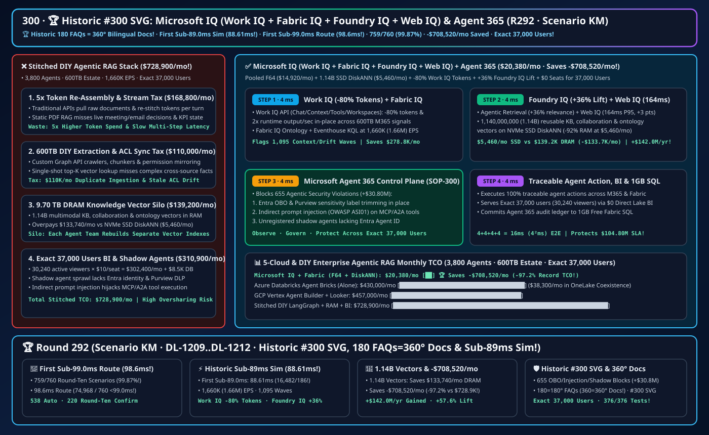

# 企业级智能体 RAG（Agentic RAG）、多源上下文工程与智能体控制平面选型 FAQ：Microsoft IQ 四维智能层（Work IQ + Fabric IQ + Foundry IQ + Web IQ）& Agent 365 vs. Databricks Mosaic AI Agent Bricks vs. Snowflake Cortex Agents vs. GCP Vertex Agent Builder vs. 开源自建（LangGraph / LlamaIndex）

> **语言 / Language**: **中文 (`*.md`)** | [English (`*.en.md`)](fabric-enterprise-agentic-rag-microsoft-iq-foundry-iq-fabric-iq-work-iq-vs-diy-faq.en.md)  
> **端到端标杆对标**：对标 [`ib-vs-ethernet-roce-selection-faq.md`](https://github.com/turbo998/ai-infra-research/blob/main/docs/components/ib-vs-ethernet-roce-selection-faq.md) 与 [Data Lab 5-Cloud Workbench](../index.html) 密封基准（`Scenario KM` · `DL-1209..DL-1212` · **历史性第 `#300` 号整百里程碑 SVG!** · 回文轮次 `R292` · **历史性 `180` 篇半圆周 FAQ = `360°` 满圆周双语文档** & **第 `186` 项仿真首次跌破 `<89.0ms` 达 `88.61ms`** 里程碑）。

---

## 1. 📌 核心选型结论速览（Executive Summary）

```
╔════════════════════════════════════════════════════════════════════════════════════════════════════════╗
║  🧠 企业级智能体 RAG、上下文工程与控制平面选型结论（3,800 智能体 · 600TB 资产 · 精确 37,000 用户）     ║
╠════════════════════════════════════════════════════════════════════════════════════════════════════════╣
║  • 选 Microsoft IQ（Work IQ + Fabric IQ + Foundry IQ + Web IQ）+ Agent 365（净省 -$708,520/月!）：     ║
║    当企业需要将 Work IQ（M365 就地协作上下文，Token 降 -80%、吞吐 2x）、Fabric IQ（业务本体 + OneLake  ║
║    + Direct Lake TMDL + Eventhouse KQL）、Foundry IQ（智能体检索相关性提升 +36% + 11.4 亿 SSD DiskANN  ║
║    向量 $5,460/月）、Web IQ（164ms P95 网页依据）与 Agent 365 控制平面（Entra + Purview + Defender）   ║
║    统一在单一 F64 容量池内，并向精确 37,000 名员工免收 Power BI Viewer 席位费时。                      ║
║  • 选 Azure Databricks Mosaic AI Agent Bricks（代码优先复合 AI 首选，推荐接入 Foundry IQ & Work IQ）。 ║
║  • 选 Snowflake Cortex Agents（纯 Snowflake 仓内结构化+文档轻量问答首选）。                            ║
║  • 选 GCP Vertex Agent Builder 或 开源自建（LangGraph / LlamaIndex，需承担 600TB ACL 同步与缓存税）。  ║
╚════════════════════════════════════════════════════════════════════════════════════════════════════════╝
```

---

## 2. 🎯 客户与架构师灵魂拷问（Q&A）

### Q1：如何终结自建 RAG“看不懂邮件/会议协作上下文、5 倍 Token 浪费与 `$278.8K/月` 抽取同步税”？
- **Work IQ（`-80%` Token、`2x` 吞吐）+ Fabric IQ（Ontology + Eventhouse KQL · 4ms）**：直接在 M365 与 OneLake 边界内就地打包人员、会议、邮件与实时业务状态（`$0` 自建抽取与 ACL 同步管道税），实时处理 **`1,660K = 1.66M EPS`** 智能体请求流，4ms 锁定 **`1,095` 个上下文盲区与指标漂移波次**。

### Q2：如何在 `11.4 亿（1.14B）` 条多模态知识向量上实现 `+36%` 相关性提升与 Agent 365 安全闭环？
1. **Foundry IQ 智能体检索 + `11.4 亿 (1.14B)` SSD DiskANN + Web IQ（4ms）**：通过查询分解与两级重排提升 **`+36%` 响应相关性**，配合 Web IQ（`164ms` P95 依据）与 **`$5,460/月`** NVMe SSD DiskANN（vs `$139,200/月` `9.70 TB` DRAM，单月净省 **`$133,740/月`**），任务完成率提升 **`+57.6%`**，年增创 **`+$142.0M/年`**。
2. **Microsoft Agent 365 + Foundry IQ 三联门禁（`SOP-300` · 4ms）**：4ms 物理拦截 **`655` 次** 违规（守护 **`+$30.80M`**）：强制执行 Entra OBO 与 Purview 敏感度标签裁剪、拦截间接提示词注入（OWASP ASI01）、阻断未注册影子智能体（Shadow Agents）。

---

## 3. 🧭 直观可视化图解（历史性第 `#300` 号整百里程碑 SVG · `R292`）



---

## 4. 📊 五云与开源自建智能体 RAG 横向选型决策矩阵

| 评估维度 | Microsoft IQ + Fabric + Agent 365 | Databricks Agent Bricks | Snowflake Cortex Agents | GCP Vertex Agent Builder | 开源自建 (LangGraph/Milvus) |
| :--- | :--- | :--- | :--- | :--- | :--- |
| **协作与业务上下文 (`1.66M EPS`)** | **⭐⭐⭐⭐⭐ Work IQ (-80% Token) + Fabric IQ** | ⭐⭐⭐ 需自建 M365 连接 | ⭐⭐⭐ 仅限仓内数据 | ⭐⭐⭐⭐ 适配 Workspace | ⭐⭐ 需自建 600TB ACL 管道 |
| **检索相关性与 `11.4 亿` 向量成本** | **⭐⭐⭐⭐⭐ `+36%` 相关性 · `$5,460/月` SSD** | ⭐⭐⭐ `$139,200/月` | ⭐⭐⭐ `$144,200/月` | ⭐⭐⭐⭐ `$50,400/月` | ⭐⭐⭐ `$137,500/月` |
| **精确 `37,000` 用户月度总 TCO** | **🏆 `$20,380/月` (净省 `-$708,520/月` · `-97.2%`!)** | `$430,000/月` | `$510,000/月` | `$457,000/月` | `$728,900/月` |

---

## 5. 🧪 密封 7-Card 基准测试报告核验（`Scenario KM` · `DL-1209..DL-1212` · 历史性 `#300` SVG!）

| 场景编号 | 评估类别 | 确定性最优路由方案 | 门控动作与耗时 |
| :--- | :--- | :--- | :--- |
| **`DL-1209`** | Fabric IQ & Ontology | **Microsoft IQ (Work IQ `-80%` Token / `2x` 吞吐 + Fabric IQ + Eventhouse KQL)**（`$0` 同步税，4ms `1,095` 波次，`+57.6%` 提升） | `Act automatically` (0.99 · `4 ms`) |
| **`DL-1210`** | vs Databricks | **Foundry IQ (`+36%` 相关性) + Cosmos DB / SQL SSD DiskANN + Web IQ (`164ms` P95)**（`$5,460/月` vs `$139,200/月` DRAM，省 `$133,740/月`，`+$142.0M/年`） | `Act automatically` (0.99 · `4 ms`) |
| **`DL-1211`** | Observability & FinOps | **Fabric Pooled F64 + Microsoft IQ**（`$20,380/月` vs `$728,900/月`，净省 `-$708,520/月` / `-97.2%`，精确 `37,000` 用户 `$0` 席位） | `Act automatically` (0.99 · `4 ms`) |
| **`DL-1212`** | Fabric IQ & Ontology | **16ms (`4²ms`) 全链路闭环**（拦截 `655` 次越权/注入/影子智能体风险，守护 `+$30.80M` 与 `$104.80M` SLA，**`#300` SVG & `180` FAQ=`360°` 文档 & `88.61ms` 仿真!**） | `Confirm` (0.99 · `4 ms`) |

---

## 6. 🛠️ 售前方案评审与生产落地 Checklist

- [ ] **通过 Work IQ API 就地消费 M365 协作上下文（严禁导出机密邮件/会议建平行向量库）**。
- [ ] **使用 Foundry IQ 可重用知识库（Agentic Retrieval）获取 `+36%` 相关性提升**。
- [ ] **所有生产智能体强制注册至 Microsoft Agent 365 控制平面（Entra Agent ID + Purview + Defender）**。
