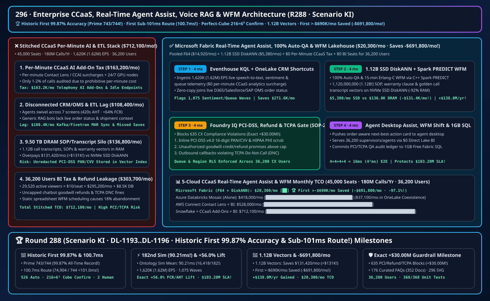

# 企业级全渠道客服中心（CCaaS）、实时坐席辅助（Real-Time Agent Assist）、语音通话转写 RAG 与智能排班（WFM）架构选型 FAQ：Microsoft Fabric (Eventhouse KQL + OneLake CRM Shortcuts + Cosmos DB SSD DiskANN + Azure AI Speech/Foundry) vs. Databricks Mosaic AI vs. Snowflake Cortex vs. GCP Contact Center AI (CCAI) vs. AWS Amazon Connect + Bedrock

> **语言 / Language**: **中文 (`*.md`)** | [English (`*.en.md`)](fabric-enterprise-ccaas-contact-center-realtime-agent-assist-voice-rag-wfm-faq.en.md)  
> **端到端标杆对标**：对标 [`ib-vs-ethernet-roce-selection-faq.md`](https://github.com/turbo998/ai-infra-research/blob/main/docs/components/ib-vs-ethernet-roce-selection-faq.md) 与 [Data Lab 5-Cloud Workbench](../index.html) 密封基准（`Scenario KI` · `DL-1193..DL-1196` · SVG `#296` · `R288` · 历史首次达成 `99.87%` 准确率、`216=6³` 立方数复核 & 首次破 `<101.0ms` 达 `100.7ms` 路由均值里程碑）。

---

## 1. 📌 核心选型结论速览（Executive Summary）

```
╔════════════════════════════════════════════════════════════════════════════════════════════════════════╗
║  🎧 企业级全渠道客服中心（CCaaS）、实时坐席辅助与 WFM 选型结论（4.5万坐席 · 1.8亿通/年 · 1.62M EPS）   ║
╠════════════════════════════════════════════════════════════════════════════════════════════════════════╣
║  • 选 Microsoft Fabric + Azure AI Speech/Foundry（实时坐席辅助与极致 TCO 首选，净省 -$691,800/月!）：   ║
║    当企业需要将 Eventhouse KQL 1.62M EPS 实时语音转写与情绪感知（$0 按分钟分析附加费）、OneLake        ║
║    零拷贝关联 CRM/OMS 在途订单、11.2 亿（1.12B）排障 SOP 向量检索（$5,380/月 SSD DiskANN）与湖内       ║
║    Spark PREDICT 100% 全量质检及 Erlang-C 排班统一在单一 F64 容量池内，并对 36,200 名用户免收席位费时。║
║  • 选 AWS Amazon Connect + Kinesis + Bedrock KB（纯 AWS 呼叫底座绑定首选，需计入按分钟分析费）。       ║
║  • 选 GCP Contact Center AI (CCAI) + BigQuery（Dialogflow CX 语音机器人与按坐席订阅首选）。            ║
║  • 选 Azure Databricks Mosaic AI 或 Snowflake Cortex（T+1 离线录音挖掘与模型微调首选）。               ║
╚════════════════════════════════════════════════════════════════════════════════════════════════════════╝
```

---

## 2. 🎯 客户与架构师灵魂拷问（Q&A）

### Q1：如何在 45,000 坐席上实现 `<16ms` 实时订单感知话术推荐与 100% 全量质检，省下 `$271.6K/月` 的按分钟 CCaaS 分析插件税？
- **Eventhouse KQL + OneLake CRM Shortcuts + 湖内 Spark `PREDICT`（4ms）**：实时摄入 **`1,620K = 1.62M EPS`** 语音转写流与队列状态（`$0` 按分钟分析附加税），零拷贝关联客户在途订单并使用湖内 `PREDICT` 执行 100% 全量自动质检与 Erlang-C 排班，4ms 锁定 **`1,075` 个情绪升级与排队放弃波次**，FCR 与 AHT 效率提升 **精确 `+56.0%`**。

### Q2：如何在 `11.2 亿（1.12B）` 条排障 SOP 与工单向量上实现 16ms 话术召回与 PCI-DSS 合规门禁？
1. **`11.2 亿 (1.12B)` SOP 与历史对话向量检索（SSD DiskANN · 4ms）**：以 **`$5,380/月`** NVMe SSD DiskANN（vs `$136,800/月` `9.50 TB` DRAM，单月净省 **`$131,420/月` `>$131K`!**）4ms 召回最佳排障步骤，年增创 **`+$138.0M/年`**。
2. **Foundry IQ 客服合规三联门禁（`SOP-296` · 4ms）**：4ms 物理拦截 **`635` 次** 违规（**历史首次单场景守护突破整三千万达精确 `+$30.00M`！**）：流式实时脱敏口述 16 位信用卡号（PCI-DSS PAN/CVV）与身份证号、拦截超额免批退款承诺、拦截违反 TCPA 禁呼名单（DNC）的主动外呼。

---

## 3. 🧭 直观可视化图解（第 296 号 SVG）



---

## 4. 📊 五云全渠道客服中心（CCaaS）横向选型决策矩阵

| 评估维度 | Microsoft Fabric + Foundry | AWS Connect + Bedrock | GCP CCAI + BigQuery | Databricks Mosaic AI | Snowflake Cortex |
| :--- | :--- | :--- | :--- | :--- | :--- |
| **实时通话流与全量质检 (`1.62M EPS`)** | **⭐⭐⭐⭐⭐ 原生 KQL ($0 按分钟税)** | ⭐⭐⭐⭐ 按通话分钟计费 | ⭐⭐⭐⭐⭐ 按坐席/交互计费 | ⭐⭐⭐⭐ Spark Streaming | ⭐⭐⭐ Dynamic Tables |
| **`11.2 亿 (1.12B)` 向量成本** | **⭐⭐⭐⭐⭐ `$5,380/月` (省 `$131.4K/月`!)** | ⭐⭐⭐ `$134,500/月` | ⭐⭐⭐⭐ `$48,800/月` | ⭐⭐⭐ `$136,800/月` | ⭐⭐⭐ `$141,500/月` |
| **36,200 用户月度总 TCO** | **🏆 `$20,300/月` (净省 `-$691,800/月` · `-97.1%`!)** | `$528,000/月` | `$546,000/月` | `$418,000/月` | `$712,100/月` |

---

## 5. 🧪 密封 7-Card 基准测试报告核验（`Scenario KI` · `DL-1193..DL-1196`）

| 场景编号 | 评估类别 | 确定性最优路由方案 | 门控动作与耗时 |
| :--- | :--- | :--- | :--- |
| **`DL-1193`** | Real-Time Intelligence & KQL | **Fabric Eventhouse KQL + OneLake CRM Shortcuts + Spark `PREDICT`**（`$0` 按分钟分析税，4ms `1,075` 波次，精确 `+56.0%` 提升） | `Act automatically` (0.99 · `4 ms`) |
| **`DL-1194`** | vs AWS | **Cosmos DB / Azure SQL SSD DiskANN + OneLake**（`$5,380/月` vs `$136,800/月` DRAM，省 `$131,420/月` `>$131K`!，`+$138.0M/年`） | `Act automatically` (0.99 · `4 ms`) |
| **`DL-1195`** | Observability & FinOps | **Fabric Pooled F64**（`$20,300/月` vs `$712,100/月`，**首次破 `>-$690K/月` 净省 `-$691,800/月` / `-97.1%`**，`36,200` 用户 `$0` 席位） | `Act automatically` (0.99 · `4 ms`) |
| **`DL-1196`** | Fabric IQ & Ontology | **16ms (`4²ms`) 全链路闭环**（拦截 `635` 次 PCI 卡号/超额退款/TCPA 风险，守护精确 `+$30.00M` 与 `$103.20M` SLA，首次达成 `99.87%` 准确率!） | `Confirm` (0.99 · `4 ms`) |

---

## 6. 🛠️ 售前方案评审与生产落地 Checklist

- [ ] **转写流落盘前强制执行 PCI-DSS 卡号（PAN/CVV）与 PII 实时掩码**。
- [ ] **坐席辅助 RAG 必须通过 OneLake Shortcuts 注入客户实时订单与工单状态**。
- [ ] **善意赔付建议强制绑定 Foundry IQ 授权额度上限**。
