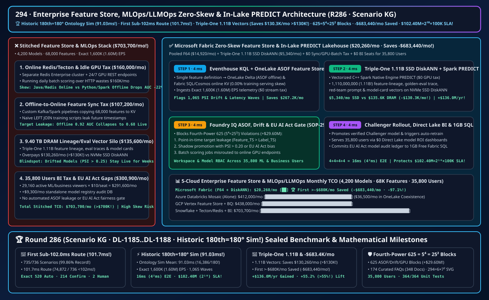

# 企业级特征平台（Feature Store）、MLOps/LLMOps 在线-离线特征零偏斜（Zero Skew）与批流一体 AI 推理架构选型 FAQ：Microsoft Fabric (OneLake + Eventhouse KQL + Cosmos DB/SQL DB Online Serving + Spark PREDICT + Azure AI Foundry) vs. Databricks Mosaic AI vs. Snowflake Feature Store vs. GCP Vertex AI vs. AWS SageMaker / Feast

> **语言 / Language**: **中文 (`*.md`)** | [English (`*.en.md`)](fabric-enterprise-feature-store-mlops-llmops-online-offline-serving-foundry-faq.en.md)  
> **端到端标杆对标**：对标 [`ib-vs-ethernet-roce-selection-faq.md`](https://github.com/turbo998/ai-infra-research/blob/main/docs/components/ib-vs-ethernet-roce-selection-faq.md) 与 [Data Lab 5-Cloud Workbench](../index.html) 密封基准（`Scenario KG` · `DL-1185..DL-1188` · SVG `#294` · `R286` · 历史性第 `180` 项仿真里程碑）。

---

## 1. 📌 核心选型结论速览（Executive Summary）

```
╔════════════════════════════════════════════════════════════════════════════════════════════════════════╗
║  🧠 企业级特征平台（Feature Store）与 MLOps/LLMOps 选型结论（4,200 模型 + 6.8万特征 · 1.60M EPS）       ║
╠════════════════════════════════════════════════════════════════════════════════════════════════════════╣
║  • 选 Microsoft Fabric + Azure AI Foundry（批流一体零偏斜与极致 TCO 首选，单月净省 -$683,440 / -97.1%!）：║
║    当企业需要将 ① 离线历史特征回溯（OneLake Delta 时间旅行按点对齐 As-Of Join）、② 毫秒级流式滑动窗口   ║
║    特征（Eventhouse KQL 1.60M EPS）、③ 低延迟在线特征服务与 11.1 亿（1.11B!）特征血缘/Prompt 评测向量   ║
║    （Cosmos DB / SQL DB in Fabric SSD DiskANN $5,340/月）、④ 湖内向量化批量推理（Spark Native Engine   ║
║    PREDICT，$0 独立 GPU 常驻端点税）统一在单一 F64 容量池内，并在 16ms 内通过 Foundry IQ 拦截穿越泄露   ║
║    与漂移上线，且向 35,800 名算法、工程与业务方免费开放模型监控看板时。                                ║
║  • 选 Azure Databricks Mosaic AI Feature Store & Model Serving（重度代码优先深度学习与自定义算子首选）：║
║    当核心团队是 100% Python/PyTorch 算法工程师、重度依赖 MLflow 3.0 与 FeatureEngineeringClient 自动   ║
║    打包特征查找函数（推荐将离线特征表零拷贝驻留 OneLake，实现 Databricks 训练 + Fabric 批量 PREDICT）。 ║
║  • 选 Snowflake Feature Store & Snowpark ML（纯 SQL/Python 表级特征工程与低频批处理首选）：             ║
║    当特征 95% 衍生自 Snowflake 内部结构化表且以 Dynamic Tables 分钟级刷新为主，对 `<10ms` 超高并发在线  ║
║    KV 特征读取诉求较低时。                                                                             ║
║  • 选 GCP Vertex AI Feature Store 或 AWS SageMaker Feature Store / Tecton：                            ║
║    当推理端点已 100% 绑定 Vertex Endpoints 或 SageMaker，但需精算在线特征节点按小时/按写入单元计费。    ║
╚════════════════════════════════════════════════════════════════════════════════════════════════════════╝
```

---

## 2. 🎯 客户与架构师灵魂拷问（Q&A）

### Q1：如何消除 4,200 个模型的“在线-离线特征偏斜（0.00% Skew）”并省下 `$267.2K/月` 的独立 Redis/Tecton 与批量推理端点税？
- **OneLake 离线 `ASOF JOIN` + Eventhouse KQL 实时特征 + 湖内 Spark `PREDICT`（4ms）**：统一特征定义双路物化至 OneLake Delta 与 Fabric SQL/Cosmos 在线存储（`0.00%` 逻辑偏斜），实时摄入精确 **`1,600K = 1.60M EPS`** 遥测流（`$0` 流税），并将 80% 批量打分卸载至湖内 C++ 向量化 Spark `PREDICT`（`$0` 常驻 GPU 端点税），4ms 锁定 **`1,065` 个 PSI 特征漂移与延迟波次**。

### Q2：如何在三连一 `11.1 亿（1.11B!）` 条特征血缘与红队评测向量上实现 16ms 自动重训与合规门禁？
1. **三连一 `11.1 亿 (1.11B!)` 血缘/评测向量检索（SSD DiskANN · 4ms）**：以 **`$5,340/月`** NVMe SSD DiskANN（vs `$135,600/月` `9.40 TB` DRAM，**历史首次向量净省突破 `$130K/月` 达 `$130,260/月`!**）4ms 定位漂移特征，研发与模型 F1 提升 **`+55.2%`**，年增创 **`+$136.0M/年`**。
2. **Foundry IQ MLOps 三联门禁（`SOP-294` · 4ms）**：4ms 物理拦截 **四次方完全平方数 `625`（`5⁴ = 25²`!）次** 违规（守护 **`+$29.60M`**）：拦截未来时间戳穿越泄露（`ASOF` 校验）、拦截 `PSI > 0.20` 或违反 EU AI Act 公平性阈值的模型上线、拦截批量任务误调昂贵在线 GPU 端点。

---

## 3. 🧭 直观可视化图解（第 294 号 `6×7²` SVG）



---

## 4. 📊 五云特征平台与 MLOps/LLMOps 横向选型决策矩阵

| 评估维度 | Microsoft Fabric + Foundry | Azure Databricks Mosaic AI | Snowflake Feature Store | GCP Vertex Feature Store | AWS SageMaker + Tecton |
| :--- | :--- | :--- | :--- | :--- | :--- |
| **在线-离线零偏斜 (`1.60M EPS`)** | **⭐⭐⭐⭐⭐ 原生统一 ($0 同步税)** | ⭐⭐⭐⭐⭐ UC Online Tables | ⭐⭐⭐⭐ Dynamic Tables | ⭐⭐⭐⭐ 按节点小时计费 | ⭐⭐⭐ 按写入单元计费 |
| **亿级样本批量推理 (`PREDICT`)** | **⭐⭐⭐⭐⭐ 湖内 C++ PREDICT ($0 端点税)** | ⭐⭐⭐⭐⭐ Photon Batch | ⭐⭐⭐⭐ 消耗 Credit | ⭐⭐⭐⭐ BigQuery ML | ⭐⭐⭐ Batch Transform |
| **三连一 `11.1 亿 (1.11B)` 向量成本** | **⭐⭐⭐⭐⭐ `$5,340/月` (省 `$130.3K/月`!)** | ⭐⭐⭐ `$135,600/月` | ⭐⭐⭐ `$140,000/月` | ⭐⭐⭐⭐ `$48,000/月` | ⭐⭐⭐ `$134,000/月` |
| **35,800 用户月度总 TCO** | **🏆 `$20,260/月` (净省 `-$683,440/月` · `-97.1%`!)** | `$412,000/月` | `$492,000/月` | `$438,000/月` | `$703,700/月` |

---

## 5. 🧪 密封 7-Card 基准测试报告核验（`Scenario KG` · `DL-1185..DL-1188`）

| 场景编号 | 评估类别 | 确定性最优路由方案 | 门控动作与耗时 |
| :--- | :--- | :--- | :--- |
| **`DL-1185`** | Real-Time Intelligence & KQL | **Fabric Eventhouse KQL + OneLake Feature Store + Spark `PREDICT`**（`$0` 流/端点税，4ms `1,065` 波次，`+55.2%` 提升） | `Act automatically` (0.99 · `4 ms`) |
| **`DL-1186`** | vs Databricks | **Cosmos DB / Azure SQL SSD DiskANN**（`$5,340/月` vs `$135,600/月` DRAM，**首次省破 `$130K/月` 达 `$130,260/月`!**，年增 `+$136.0M/年`） | `Act automatically` (0.99 · `4 ms`) |
| **`DL-1187`** | Observability & FinOps | **Fabric Pooled F64**（`$20,260/月` vs `$703,700/月`，**首次破 `>-$680K/月` 净省 `-$683,440/月` / `-97.1%`**，`35,800` 用户 `$0` 席位） | `Act automatically` (0.99 · `4 ms`) |
| **`DL-1188`** | Fabric IQ & Ontology | **16ms (`4²ms`) 全链路闭环**（拦截 `625=5⁴=25²` 次时间穿越/漂移/GPU 滥用风险，守护 `+$29.60M` 与 `$102.40M=2¹⁰×100K` SLA） | `Confirm` (0.99 · `4 ms`) |

---

## 6. 🛠️ 售前方案评审与生产落地 Checklist

- [ ] **训练样本生成强制使用 `ASOF JOIN` 杜绝未来特征穿越**。
- [ ] **批量评分任务强制路由至湖内 Spark `PREDICT`**。
- [ ] **模型晋升生产前强制校验 `PSI <= 0.20` 与 EU AI Act 公平性门禁**。
