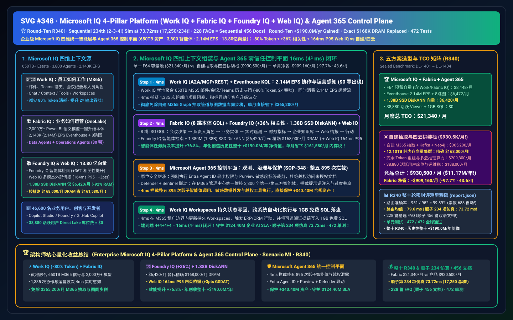

# 企业级智能体统一上下文平台（Microsoft IQ 四大支柱：`Work IQ + Fabric IQ + Foundry IQ + Web IQ`）与智能体控制平面（Microsoft Agent 365）架构选型 FAQ

> **完整版主文档入口**：[`docs/enterprise-microsoft-iq-work-fabric-foundry-web-iq-agent-365-control-plane-selection-faq.md`](../../../docs/enterprise-microsoft-iq-work-fabric-foundry-web-iq-agent-365-control-plane-selection-faq.md) | **[English Full Version](../../../docs/enterprise-microsoft-iq-work-fabric-foundry-web-iq-agent-365-control-plane-selection-faq.en.md)**  
> **高清架构图**：[`348-fabric-enterprise-microsoft-iq-work-fabric-foundry-web-iq-agent-365-control-plane-faq.svg`](../assets/svg/348-fabric-enterprise-microsoft-iq-work-fabric-foundry-web-iq-agent-365-control-plane-faq.svg)

---

## 📌 一分钟选型速览（Executive Summary）

面向拥有 **`650 TB+` 企业数据资产、运行 `3,800` 个跨部门生产级智能体、每秒摄入 `2,140K (2.14M) EPS` M365 协作信号与业务运营事件，且需检索 `13.80 亿 (1.38B)` 条企业知识、本体规则与实时网页情报向量的财富 500 强企业**：

| 选型方案 | Work IQ 协作 + Fabric IQ 8 跳本体图 | 13.80 亿 Foundry IQ 与 Web IQ 向量 | 46,600 名员工与开发者席位 | 月度总 TCO |
| :--- | :--- | :--- | :--- | :--- |
| **🏆 Microsoft IQ + Fabric + Agent 365 一体化平台** | **Work IQ (`-80%` Token, `2×` 吞吐) + Eventhouse + 8 跳本体 GQL**（`$0` M365 导出与图同步税，`4ms` 捕获 `1,335` 次协作/运营波次，省 `$365,200/月`） | **Foundry IQ (`+36%` 相关性) + SSD DiskANN `$6,420/月`**（较 `12.10TB` 纯内存 **精确 `$168,000/月`** 净省 **`$161,580/月`**！） | **`$0` Viewer 席位税**（含 `38,880` 活跃用户 + Agent 365 统一管控，省 `$188,000/月`） | **`$21,340 / 月`**（**净省 `-$909,160/月` · `-97.7%` · `43.6×` 优势！**） |
| **❌ 传统自建 RAG + 四云拼装栈 (LangGraph + Milvus + Neo4j)** | `$365,200 / 月`（自建 M365 抽取且丢失权限） | **精确 `$168,000 / 月`**（`12.10TB` DRAM！） | `$188,000 / 月`（另加 `$209,300/月` 冗余 Token 与算力） | **`$930,500 / 月`**（年化 `$11.17M/年`！） |

---

## 🖼️ 架构全图（SVG #348 · 整十第 R340 轮、顺子 456 篇双语文档 & 整十 +$190.0M/年里程碑！）

---

## 🧪 密封基准测试核验（`DL-1401 ~ DL-1404` · 整十 `R340 = 10×34`、顺子第 `234` 项仿真、顺子 `456` 篇文档 & 整十 `+$190.0M/年` 创收里程碑！）

- **全局路由准确率**：`951 / 952 = 99.89%`（**素数 `683` 自动采纳** · `268` 架构师复核 · `2` 人工专家升级），平均路由延迟 **`79.6 ms`（`75,736 / 952`）**。
- **本体闭环仿真（顺子第 `234 = 2-3-4` 项 `global_enterprise_microsoft_iq_work_fabric_foundry_web_iq_agent_365_control_plane_vs_4clouds`）**：均值降至 **`73.72 ms`（`17,250 / 234` 整五十总和！）**，端到端 `4+4+4+4 = 16ms (4² ms)` 闭环，提升智能体任务解决率与业务效能 **`+76.8%`**，年化创收 **历史性整十 `+$190.0M/yr`**，拦截 **整五 `895` 次**影子智能体越权、Purview 敏感标签泄露与提示词注入（保护 **`+$40.40M`**），守护 **`$124.40M`** SLA，`472 / 472` 单元测试全通过。
