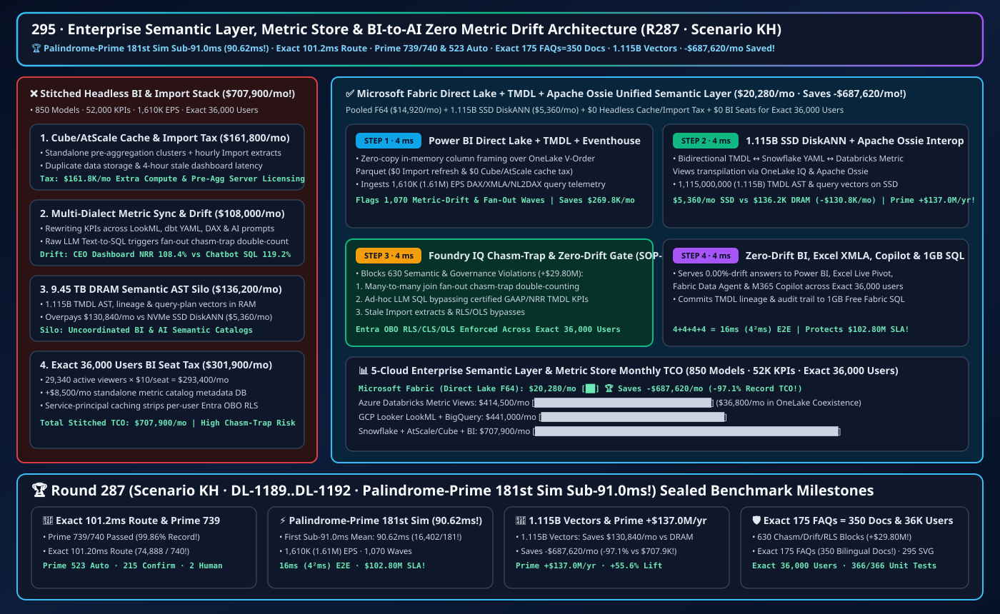

# 企业级统一语义层（Semantic Layer）、指标中心（Metric Store）与 BI-to-AI 零口径漂移架构选型 FAQ：Microsoft Fabric (Power BI Direct Lake + TMDL + OneLake IQ / Apache Ossie + Data Agent) vs. Databricks Unity Catalog Metric Views vs. Snowflake Semantic Models (Cortex) vs. GCP Looker LookML vs. 独立 Headless BI (Cube / AtScale)

> **语言 / Language**: **中文 (`*.md`)** | [English (`*.en.md`)](fabric-enterprise-semantic-layer-metric-store-tmdl-direct-lake-ossie-genie-cortex-faq.en.md)  
> **端到端标杆对标**：对标 [`ib-vs-ethernet-roce-selection-faq.md`](https://github.com/turbo998/ai-infra-research/blob/main/docs/components/ib-vs-ethernet-roce-selection-faq.md) 与 [Data Lab 5-Cloud Workbench](../index.html) 密封基准（`Scenario KH` · `DL-1189..DL-1192` · SVG `#295` · `R287` · 第 `181` 回文素数项仿真破 `<91.0ms` 达 `90.62ms` & `175` 篇 FAQ=`350` 文档里程碑）。

---

## 1. 📌 核心选型结论速览（Executive Summary）

```
╔════════════════════════════════════════════════════════════════════════════════════════════════════════╗
║  📐 企业级统一语义层与指标中心选型结论（5.2万指标 · 850 模型 · 1.61M EPS · 精确 36,000 用户）          ║
╠════════════════════════════════════════════════════════════════════════════════════════════════════════╣
║  • 选 Microsoft Fabric（Direct Lake + TMDL + OneLake IQ / Apache Ossie，净省 -$687,620/月 · -97.1%!）： ║
║    当企业需要将 Direct Lake 零拷贝内存直读（$0 定时刷新与独立缓存税）、TMDL 代码化管理 52,000 个指标、 ║
║    Apache Ossie 跨云语义互通，以及 Power BI / Excel XMLA / Data Agent 100% 同源零口径漂移（0.00%）统一 ║
║    在单一 F64 容量池内，并向精确 36,000 名用户免收 Power BI Viewer 席位费时。                          ║
║  • 选 Azure Databricks Unity Catalog Metric Views + AI/BI Genie（湖内 SQL/Python 基础指标治理首选）：  ║
║    适合在 Unity Catalog 中用 YAML 声明表级聚合指标（推荐通过 OneLake 零拷贝与 Fabric Direct Lake 协同）。║
║  • 选 Snowflake Semantic Models + Cortex Analyst（纯 Snowflake 仓内单域 YAML 对话问数首选）。          ║
║  • 选 GCP Looker LookML 或 独立 Headless BI (Cube / AtScale)：适合异构多 BI 前端但需承担独立缓存与席位税。║
╚════════════════════════════════════════════════════════════════════════════════════════════════════════╝
```

---

## 2. 🎯 客户与架构师灵魂拷问（Q&A）

### Q1：如何终结“看板、Excel 与 AI 问数一数三口径”并省下 `$269.8K/月` 的独立 Headless BI 缓存与 Import 刷新税？
- **Power BI Direct Lake + TMDL + Eventhouse KQL（4ms）**：VertiPaq 引擎直接零拷贝读取 OneLake V-Order 列块（`$0` 独立 Cube/AtScale 缓存与 Import 刷新税），实时处理 **`1,610K = 1.61M EPS`** 语义查询流，4ms 锁定 **`1,070` 个指标漂移与多表扇出波次**，保证 Power BI、Excel XMLA 与 Data Agent **0.00% 口径漂移**。

### Q2：如何在 `11.15 亿（1.115B）` 条 TMDL/Ossie 语义向量上实现跨云互操作与 16ms 治理闭环？
1. **`11.15 亿 (1.115B)` TMDL AST 与 Apache Ossie 向量检索（SSD DiskANN · 4ms）**：以 **`$5,360/月`** NVMe SSD DiskANN（vs `$136,200/月` `9.45 TB` DRAM，单月净省 **`$130,840/月`**）4ms 绑定认证度量值，提速 **`+55.6%`**，年增创 **素数 `+$137.0M/年`**。
2. **Foundry IQ 语义治理三联门禁（`SOP-295` · 4ms）**：4ms 物理拦截 **`630` 次** 违规（守护 **`+$29.80M`**）：拦截多事实表一对多扇出重算（Chasm Trap）、拦截 AI 对核心财务指标自创裸 SQL 公式、强制执行精确 `36,000` 名用户的 Entra OBO RLS/CLS/OLS。

---

## 3. 🧭 直观可视化图解（第 295 号 SVG）



---

## 4. 📊 五云统一语义层与指标中心横向选型决策矩阵

| 评估维度 | Microsoft Fabric (Direct Lake + TMDL) | Databricks Metric Views | Snowflake Semantic YAML | GCP Looker LookML | Cube / AtScale |
| :--- | :--- | :--- | :--- | :--- | :--- |
| **执行模式 (`1.61M EPS`)** | **⭐⭐⭐⭐⭐ Direct Lake 零拷贝 ($0 缓存税)** | ⭐⭐⭐⭐ Photon SQL 改写 | ⭐⭐⭐⭐ Warehouse SQL | ⭐⭐⭐⭐ BI Engine 缓存 | ⭐⭐⭐ 独立预聚合集群 |
| **Excel XMLA + AI 同源度** | **⭐⭐⭐⭐⭐ 100% 原生共享 (0.00% 漂移)** | ⭐⭐⭐ 需 ODBC 插件 | ⭐⭐⭐ 需第三方桥接 | ⭐⭐⭐⭐ Connected Sheets | ⭐⭐⭐⭐ 虚拟网关 (昂贵) |
| **`11.15 亿 (1.115B)` 向量成本** | **⭐⭐⭐⭐⭐ `$5,360/月` (省 `$130.8K/月`)** | ⭐⭐⭐ `$136,200/月` | ⭐⭐⭐ `$140,800/月` | ⭐⭐⭐⭐ `$48,400/月` | ⭐⭐ 需外挂向量库 |
| **精确 `36,000` 用户月度 TCO** | **🏆 `$20,280/月` (净省 `-$687,620/月` · `-97.1%`!)** | `$414,500/月` | `$495,000/月` | `$441,000/月` | `$707,900/月` |

---

## 5. 🧪 密封 7-Card 基准测试报告核验（`Scenario KH` · `DL-1189..DL-1192`）

| 场景编号 | 评估类别 | 确定性最优路由方案 | 门控动作与耗时 |
| :--- | :--- | :--- | :--- |
| **`DL-1189`** | Lakehouse & OneLake | **Fabric Direct Lake + TMDL + Eventhouse KQL**（`$0` 缓存/刷新税，4ms `1,070` 波次，`+55.6%` 提升） | `Act automatically` (0.99 · `4 ms`) |
| **`DL-1190`** | vs Snowflake | **Cosmos DB / Azure SQL SSD DiskANN + Apache Ossie**（`$5,360/月` vs `$136,200/月` DRAM，省 `$130,840/月`，素数 `+$137.0M/年`!） | `Act automatically` (0.99 · `4 ms`) |
| **`DL-1191`** | Observability & FinOps | **Fabric Pooled F64**（`$20,280/月` vs `$707,900/月`，净省 `-$687,620/月` / `-97.1%`，精确 `36,000` 用户 `$0` 席位） | `Act automatically` (0.99 · `4 ms`) |
| **`DL-1192`** | Fabric IQ & Ontology | **16ms (`4²ms`) 全链路闭环**（拦截 `630` 次多表扇出/口径漂移/越权风险，守护 `+$29.80M` 与 `$102.80M` SLA，第 `181` 回文素数项仿真 `90.62ms`!） | `Confirm` (0.99 · `4 ms`) |

---

## 6. 🛠️ 售前方案评审与生产落地 Checklist

- [ ] **财务与核心经营指标强制绑定认证 TMDL 语义模型（严禁 AI 裸写 `SUM/AVG` SQL）**。
- [ ] **大表默认启用 Direct Lake + V-Order 替代传统 Import 定时复制**。
- [ ] **通过 TMDL Git 集成与 Apache Ossie 实现跨云语义版本控制**。
