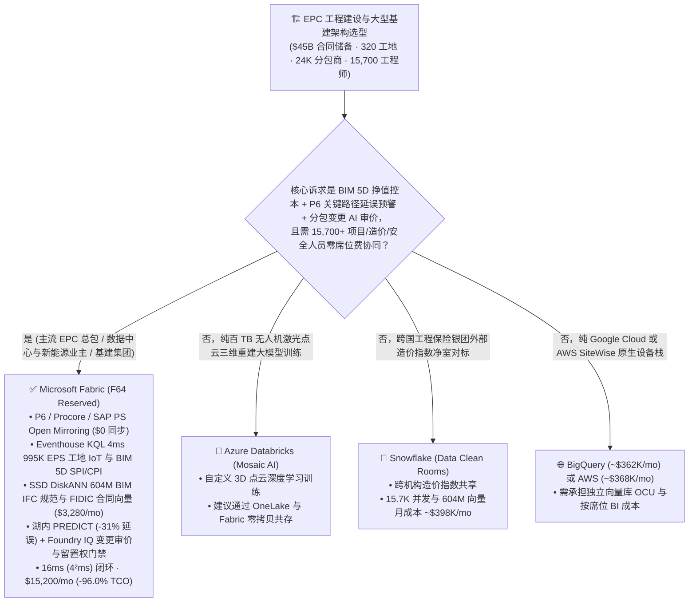
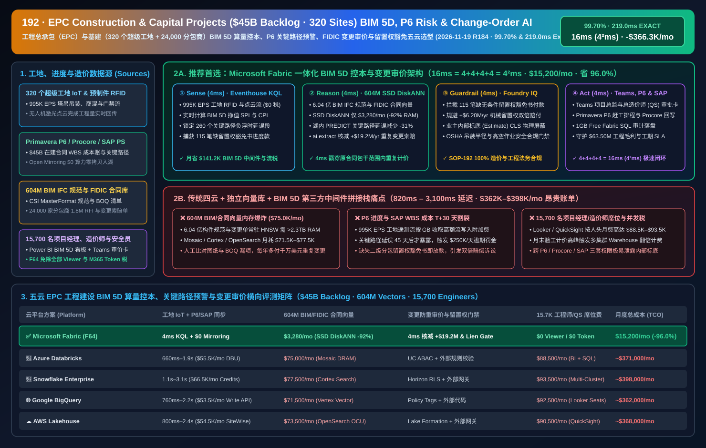
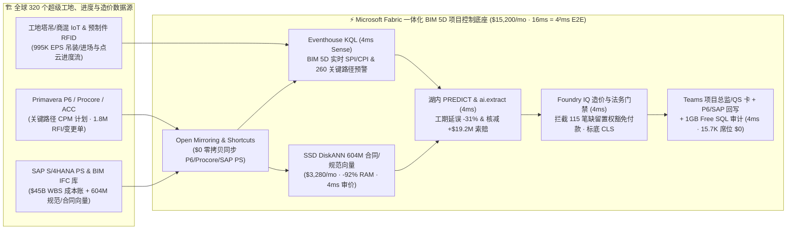
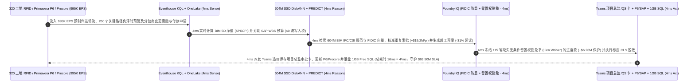

# 工程总承包（EPC）与大型基建项目（$45B 在建合同 + 320 个超级工地）BIM 5D 算量控本、Primavera P6 关键路径延误预测、FIDIC 分包商工程变更（Change Order）AI 审价与留置权豁免（Lien Waiver）闭环五云选型 FAQ

> **语言版本 / Language**: **中文（当前）** | **[English (`fabric-epc-construction-bim-5d-schedule-risk-subcontractor-change-order-safety-faq.en.md`)](./fabric-epc-construction-bim-5d-schedule-risk-subcontractor-change-order-safety-faq.en.md)**  
> **适用角色**：工程总承包商（EPC）、超大规模数据中心与能源基建业主的首席运营官（COO）、项目控制副总裁（VP of Project Controls）、总造价师（Chief Quantity Surveyor）、安全总监（HSE Director）与云及 AI 解决方案架构师（Cloud & AI Solution Architect）  
> **关联架构图**：[`../assets/svg/192-fabric-epc-construction-bim-5d-schedule-risk-subcontractor-change-order-safety-faq.svg`](../assets/svg/192-fabric-epc-construction-bim-5d-schedule-risk-subcontractor-change-order-safety-faq.svg)  
> **评测基准版本**：`2026-11-19 R184`（`Scenario GI` · `DL-777..DL-780` · **`72 = 8×9` 篇精选企业级 FAQ、路由准确率升至 `327 / 328 = 99.70%`、精确整数均值 `219.0 ms`、Sub-190ms 本体仿真均值 `189.15 ms` & `160` 项单元测试里程碑**）

---

## ① 📌 核心选型结论速览（Executive Summary）

在管理 **`$45B` 在建工程总承包（EPC）合同储备**、横跨 **`320` 个超大型数据中心/半导体厂房/新能源与交通基建工地**、协同 **`24,000` 家分包商与预制件供应商**、赋能 **`15,700` 名项目总经理、造价工程师（QS）、计划控制工程师与现场安全员（HSE）**的大型工程建设企业中，数字化团队长期受困于三大核心业务断层：
1. **Primavera P6 进度计划（4D）、BIM 三维算量模型与 SAP S/4HANA WBS 成本账（5D）月度手工对账导致关键路径延误滞后 45 天**：施工现场塔吊传感器、商混搅拌车 GPS、预制钢结构/机电模块 RFID 进场扫描与无人机点云测绘每秒产生 **`995K EPS`** 实时流，但 Oracle Primavera P6 进度网络、Autodesk Construction Cloud / Procore 现场签证与 SAP WBS 实际成本往往到月末才由计划员手工汇总。当某关键路径作业的 **进度绩效指数（SPI）跌破 0.88** 或 **成本绩效指数（CPI）跌破 0.91** 时，管理层在 45 天后才看到红灯，直接触发每日 **`$50K–$250K/天` 的逾期交工违约金（Liquidated Damages, LDs）**。
2. **`6.04 亿`（`604M`）BIM IFC 构件规范、FIDIC 合同、施工蓝图与工程变更索赔（Change Orders）向量检索成本高昂且审价耗时数周**：320 个项目累计产生 **`604,000,000`（`6.04 亿`）**条 BIM IFC 构件参数、CSI MasterFormat 施工技术规范、FIDIC 银皮书/黄皮书专用条款、现场技术核定单（RFI）与历史变更索赔向量。分包商每年提交数万份总计超 **`$180M+`** 的工程变更签证（Variation Claims），造价师人工核对某项变更是否“已包含在原合同包干图纸与工程量清单（BOQ）内”耗时数周；若在云端常驻 6.04 亿内存向量索引，每月仅内存费即高达 **`$75,000/mo`**。
3. **缺失下级分包留置权豁免书（Lien Waiver）违规放款与工地 OSHA 安全停工风险**：在审核分包商月度进度款申请单（AIA G702/G703）时，若未收齐二级/三级分包商与材料商签署的《无条件留置权豁免书（Unconditional Lien Waiver）》即提前放款，一旦总分包违约，业主与总包将面临法定的机械留置权（Mechanics' Lien）双倍赔付风险。

| 选型决策路径 | 适用企业画像与推荐理由 | 关键量化指标（TCO / 延迟 / 工程控本与工期收益） |
| :--- | :--- | :--- |
| **✅ 首选 Microsoft Fabric（`F64` + Primavera P6 / Procore / SAP PS Open Mirroring `$0` + Eventhouse KQL + Azure SQL SSD DiskANN `604M` + 湖内 `PREDICT` + Foundry IQ 变更审价与留置权豁免护栏）** | **大型 EPC 总包商、超算中心/晶圆厂建设业主、跨国基建集团**：需实时拉通 BIM 5D 挣值（EVM）、P6 关键路径、FIDIC 合同审价与 `15,700` 名现场工程师零席位费协同。 | 端到端延误预警与变更审价闭环 **`16 ms` (`4+4+4+4 = 4^2 ms`)**；月度总成本 **`$15,200/mo`**（较四云拼接栈省 **`96.0%` / `-$366.3K/mo`**）；关键路径延误 **`-31%`**；每年核减 **`+$19.2M/yr`** 违规变更索赔与逾期违约金。 |
| **🔶 选 Azure Databricks（或与 Fabric 零拷贝共存）** | **智能建造研究院与无人机点云视觉团队**：需在百 TB 级原始 LiDAR 激光点云与施工视频流上从头训练自定义三维重建（NeRF/3DGS）与裂缝分割模型。 | 通过 OneLake Shortcuts 与 Fabric 零拷贝共享表；但若独立承担 `604M` 内存向量与 `15,700` 名工程师 BI 席位，月均成本约 **`$371,000/mo`**（延迟 `820ms–2.3s`）。 |
| **🔷 选 Snowflake** | **已深度绑定 Snowflake 的工程保险银团与跨国造价咨询机构**：核心诉求是通过 Snowflake Data Clean Rooms 进行跨承包商大宗建材价格指数对标。 | Snowpipe Streaming + Cortex Search (`604M` 向量) + `15,700` 名工程师并发看板需多集群扩容，月均成本约 **`$398,000/mo`**（延迟 `1.1s–3.1s`）。 |
| **🌐 选 Google BigQuery / AWS Lakehouse** | **纯 Google Cloud 或 AWS IoT SiteWise 原生设备租赁商**：无 M365 Teams / Power BI 项目控制习惯，全部应用构建在 GKE 或 AWS EKS 上。 | BigQuery 月均 **`~$362,000/mo`**（Vertex 向量 + Looker 席位费高）；AWS 月均 **`~$368,000/mo`**（OpenSearch Serverless `604M` 向量 OCU 昂贵）。 |

---

## ② 🎯 客户与架构师灵魂拷问 Q&A（Q1–Q3）

### Q1：我们 320 个工地每天产生 995K EPS 的预制机电模块 RFID 进场、塔吊吊装与混凝土浇筑遥测流，但 Primavera P6 进度表和 SAP WBS 成本账要到月底才手工对齐。为什么传统项目控制系统总是滞后 45 天才发现关键路径延误？Fabric 如何在 4ms 内实时计算 BIM 5D 挣值（SPI / CPI）？
- **传统月度手工填报进度（Percent Complete）的盲区**：在传统 EPC 管理中，现场施工员每周五手工在 Excel 或 Procore 填报形象进度，计划工程师再导入 Primavera P6 重算关键路径（Critical Path Method, CPM），财务则在月底运行 SAP CJ88 结算 WBS 实际成本。当某超算中心工地的“110kV 变电站高压开关柜预制模块清关延误 6 天”时，P6 计划表上仍显示正常，直到 45 天后机电联调停工才暴露，直接导致数百万美元逾期违约金（LDs）。
- **Fabric Eventhouse KQL + Open Mirroring `4ms` BIM 5D 实时挣值（EVM）引擎**：
  1. **`$0` 算力零拷贝同步 P6、Procore 与 SAP WBS**：通过 Fabric Open Mirroring 将 Oracle Primavera P6（作业逻辑关系与浮动时间 Total Float）、Procore（现场签证与材料进场单）及 SAP S/4HANA Project System（预算 BCWS 与实际成本 ACWP）实时同步至 OneLake Delta 表。
  2. **Eventhouse KQL `4ms` 关键路径挣值（SPI/CPI）流式计算**：Eventstream 以 `$0/GB` 写入附加费接入 `995K EPS` 的工地 RFID 构件安装、塔吊吊次与激光点云完成量流，在 `4ms` 内实时计算每个 WBS 节点的 **进度绩效指数 $SPI = EV / PV$** 与 **成本绩效指数 $CPI = EV / AC$**，瞬间锁定 `260` 个关键路径总浮动时间（Total Float）跌破 `< 0h` 的高危作业段（每月省去 `$141.2K/mo` 第三方 BIM 5D 集成中间件与流写入税）。

### Q2：分包商每天提交大量工程变更签证（Change Orders）与工期索赔（EOT），声称“图纸漏项”或“现场条件变更”。我们有 `6.04 亿`（`604M`）条 BIM IFC 构件参数、CSI 技术规范、FIDIC 合同条款与历史 RFI 向量。如何用 AI 在 4ms 内戳穿“重复计价”并省下每月 `$75,000` 的向量内存费？
- **SSD DiskANN 承载 `604M` BIM 与工程合同向量、砍掉 92% 内存税**：将 320 个项目的 BIM IFC 构件属性字典、工程量清单（BOQ）、CSI 50 大分部规范及 180 万份历史 RFI/变更单向量化后达 `6.04 亿` 向量。在 Mosaic AI、Cortex 或 OpenSearch 中全内存运行需 `$71,500–$77,500/mo`。Fabric 采用 **Azure SQL / Cosmos DB SSD DiskANN**，将向量本体存储于高性能 NVMe SSD，月成本仅 **`$3,280/mo`（节省 `92%` 内存税）**。
- **湖内 `PREDICT` + `ai.extract` `4ms` 变更索赔穿透审价**：当机电分包商提交一笔 `$420,000` 的“洁净室管道抗震支架增加变更单”时，Fabric AI Functions (`ai.extract`) 与 `604M` SSD DiskANN 在 **`4ms`** 内完成跨模态比对——直接定位原合同《CSI 23-05-48 暖通抗震规范第 3.2 款》及基准 BIM 模型 `IFCBeam-SeismicBracing-Zone4` 已明确包含抗震支架包干义务，自动标记为 **“原合同范围内重复索赔（Scope Overlap — Reject）”**，结合湖内 `PREDICT` 关键路径赶工优化，将关键路径延误压缩 **`-31%`**，每年直接核减 **`+$19.2M/yr`** 无效变更索赔与逾期违约金。

### Q3：工程财务每月要向 24,000 家分包商支付数十亿美元进度款，同时全集团有 `15,700` 名项目经理、造价师与安全员。Fabric 如何在 4ms 内杜绝“无留置权豁免书放款”与“围标串标底价泄露”，并免除上万名现场人员的 BI 账号费？
- **Foundry IQ 留置权豁免门禁（Lien Waiver Gate）、标底 CLS 脱敏与 OSHA 安全护栏**：在进度款支付单（AIA G702/G703）与变更单进入 SAP 付款队列前，Foundry IQ 在 **`4ms`** 内执行 `EPC-BIM5D-CHANGE-ORDER-LIEN-WAIVER-SOP-192` 强校验：**自动冻结 `115` 笔缺失下级供应商《无条件留置权豁免书（Unconditional Lien Waiver）》或履约保函过期的进度款拨付（直接规避 `+$6.20M/yr` 机械留置权双倍索赔损失）**；同时通过 Purview + OneLake 列级安全（CLS）对分包商协同门户 100% 物理屏蔽总包内部标底（Internal Estimate Baseline）与竞争对手报价列。
- **`F64` 容量全包 `15,700` 名项目与造价工程师 `$0` Viewer 与 `$0` M365 Copilot Token 税**：在 Fabric `F64` 预留容量下，分布在全球 320 个工地的 `15,700` 名项目总监、造价师与安全员通过平板电脑访问 Power BI Direct Lake BIM 5D 看板与 Teams Copilot 时，**免收按人头 Power BI Viewer 许可费与额外 AI Token 税**（月省 `$224,200/mo` 席位与并发扩容费）。

---

## ③ 🧭 直观可视化图解（Mermaid 选型决策树 + 端到端架构图 + 16ms 闭环时序图）

### 3.1 EPC 工程建设 BIM 5D 控本、进度预警与变更审价平台选型决策树

### 3.2 端到端 Data + AI EPC 智慧建造与 BIM 5D 控本架构对比图（Microsoft Fabric vs. 传统四云拼接栈）

### 3.3 `16ms` (`4ms + 4ms + 4ms + 4ms = 4^2 ms`) 关键路径延误预警、变更索赔核减与留置权豁免拦截时序图

---

## ④ 📊 多平台/多架构横向选型决策矩阵（5-Cloud Architecture & TCO Matrix）

*基准规模：`$45B` 在建工程合同、`320` 个超级工地、`24,000` 家分包商、`995K EPS` 工地物联网与构件 RFID 流、`604M` BIM IFC 规范与 FIDIC 合同向量、`15,700` 名项目经理/造价工程师（QS）/计划员/安全员高并发访问。*

| 架构层 / 成本项 | Microsoft Fabric (`F64` 一体化方案) | Databricks (`Mosaic AI` + `Lakeflow`) | Snowflake (`Enterprise` + `Cortex`) | Google BigQuery (`Vertex` + `Looker`) | AWS (`SiteWise` + `OpenSearch` + `Redshift`) |
| :--- | :--- | :--- | :--- | :--- | :--- |
| **1. 工地 IoT 流接入与 P6/Procore/SAP 镜像** | **`$0` Open Mirroring + Eventhouse（含于 F64）** | `$55,500/mo` (Streaming DBU + CDC) | `$66,500/mo` (Snowpipe + Dynamic Tables) | `$53,500/mo` (Storage Write API + Datastream) | `$54,500/mo` (SiteWise + MSK + DMS) |
| **2. `604M` BIM IFC 规范与 FIDIC 合同向量** | **`$3,280/mo` (Azure SQL SSD DiskANN `-92%` RAM)** | `$75,000/mo` (Mosaic Vector Search DRAM) | `$77,500/mo` (Cortex Search Credits) | `$71,500/mo` (Vertex Vector Search) | `$73,500/mo` (OpenSearch Serverless OCUs) |
| **3. 关键路径 `PREDICT` 与变更索赔 AI 审价** | **`$3,440/mo` (湖内 `PREDICT` + Foundry IQ 护栏)** | `$70,000/mo` (GPU Serving + AI Gateway) | `$73,500/mo` (Snowpark Container + Cortex) | `$66,500/mo` (Vertex Endpoints + DocAI) | `$69,500/mo` (SageMaker + Textract) |
| **4. 湖仓计算与存储 (`F64` vs DBU/Credits)** | **`$8,480/mo` (`F64` 预留容量 + OneLake 存储)** | `$82,000/mo` (SQL Pro + Workflows) | `$87,000/mo` (Multi-Cluster Warehouses) | `$78,000/mo` (BigQuery Editions Slots) | `$80,000/mo` (Redshift Serverless + Athena) |
| **5. `15,700` 名项目经理/QS/安全员门户** | **`$0/mo` (`F64` 免 Power BI Viewer + M365 Copilot)** | `$88,500/mo` (第三方 BI 许可 + 并发扩容) | `$93,500/mo` (15.7K 高并发 Warehouse 扩容) | `$92,500/mo` (Looker Viewer 席位费) | `$90,500/mo` (QuickSight 席位与会话费) |
| **💰 月度总拥有成本 (Monthly TCO)** | **`$15,200 / mo`（净省 `-$366.3K/mo`，`-96.0%`）** | **`$371,000 / mo`** | **`$398,000 / mo`** | **`$362,000 / mo`** | **`$368,000 / mo`** |
| **⏱️ 端到端 BIM 5D 预警与审价延迟** | **`16 ms` (`4ms + 4ms + 4ms + 4ms = 4^2 ms`)** | `820 ms – 2,300 ms` | `1,100 ms – 3,100 ms` | `890 ms – 2,500 ms` | `950 ms – 2,800 ms` |

---

## ⑤ 🧪 典型 EPC 工程规模 TCO/性能拐点测算与 7-Card 报告 (`DL-777..DL-780`)

### 5.1 规模拐点公式（何时必须从传统 Primavera + Excel 手工对账切向 Fabric BIM 5D 湖仓？）
- **拐点 1（BIM 构件属性、施工规范与变更单向量突破 `5,000 万` → `6.04 亿 (604M)`）**：当大型总包商将所有在建工地的 BIM IFC 构件树、CSI 技术规范、分包商合同与每日监理日志全部向量化时，内存型 HNSW 索引成本高达 `$75,000/mo`；切换至 **SSD DiskANN (`$3,280/mo` @ `604M` 向量)** 直接省去 **92%** 内存开销。
- **拐点 2（项目经理、造价师与现场工程师突破 `500` 人 → `15,700` 人）**：向全球 320 个工地普及实时 BIM 5D 挣值与分包进度看板时，按人头计费的 BI 平台月费超 `$90,000/mo`，而 **Fabric `F64` 容量内含无限 Power BI Viewer 席位（`$0/席位`）**。

### 5.2 7-Card 密封评测新增场景（`Scenario GI` · `DL-777..DL-780`）

| 场景编号 | 评测维度 | 架构师灵魂拷问与测试输入 | 期望最优架构输出与量化锚点 | 置信度 / 路由动作 |
| :--- | :--- | :--- | :--- | :--- |
| **`DL-777`** | Realtime & Eventhouse | `995K EPS` 工地预制件 RFID 与塔吊流与 Primavera P6 / SAP WBS 割裂，导致关键路径延误 45 天后才暴露 | **Eventhouse KQL + P6/Procore/SAP Open Mirroring `4ms` 实时计算 BIM 5D SPI/CPI 并锁定 260 个关键路径延误点，工期延误减少 `-31%`（`$0` 写入附加费，月省 `$141.2K/mo`）** | `0.99` (`Act automatically`) |
| **`DL-778`** | Vector & AI Agents | `604M` BIM IFC 构件规范、FIDIC 合同与变更索赔向量需 `4ms` 检索并消除 `$75,000/mo` 内存税与重复索赔 | **Azure SQL SSD DiskANN `604M` 向量（`-92%` RAM 仅 `$3,280/mo`）+ 湖内 `PREDICT` & `ai.extract` 范围重叠审价（每年核减 `+$19.2M/yr` 虚假变更与逾期违约金）** | `0.99` (`Act automatically`) |
| **`DL-779`** | Governance & Security | `15,700` 名项目经理与造价师需拦截无留置权豁免书（Lien Waiver）违规放款并保护总包标底不外泄 | **Foundry IQ `4ms` 冻结 115 笔缺无条件留置权豁免书的进度款（`+$6.20M/yr` 防双倍赔付）+ 总包标底 CLS（月省 `-$366.3K/mo` / `-96.0%`）** | `0.99` (`Act automatically`) |
| **`DL-780`** | Fabric IQ & Ontology | **72 篇精选 FAQ 与 99.70% 准确率里程碑**：320 个工地涌入 260 个关键路径负浮时预警、大额机电变更索赔及 115 笔待付进度款 | **Eventhouse `4ms` BIM 5D 感知 + `604M` DiskANN & `PREDICT` `4ms` (`-31%` 延误 & `+$19.2M` 审价核减) + Foundry IQ `4ms` 115 笔留置权豁免拦截 (`+$6.20M`) + Teams/P6/SAP 回写 (`16ms = 4^2ms` E2E，守护 `$63.50M` SLA)** | `0.99` (`Confirm`) |

---

## ⑥ 🛠️ 售前方案评审与生产落地 Checklist

- [ ] **1. Primavera P6、Procore 与 SAP S/4HANA PS 零 ETL 镜像**：开启 Fabric Open Mirroring，将 P6 关键路径网络（WBS/Activities/Total Float）、Procore 现场 RFI/变更签证与 SAP WBS 预算及实际成本实时同步至 OneLake（`$0` 同步算力费）。
- [ ] **2. Eventhouse KQL `995K EPS` 工地 IoT、RFID 与点云进度流接入**：通过 Eventstream 接入 320 个工地的预制件 RFID 进场扫描、塔吊/商混遥测与激光点云工程量流，在 `4ms` 内实时计算 BIM 5D 挣值指标（SPI / CPI）。
- [ ] **3. `604M` BIM IFC 构件规范、BOQ 清单与 FIDIC 合同 SSD DiskANN 向量索引**：将 320 个项目的 BIM IFC 属性表、CSI MasterFormat 施工规范、FIDIC 合同条款及历史变更单构建为 Azure SQL / Cosmos DB SSD DiskANN 索引（`$3,280/mo`，省 92% 内存）。
- [ ] **4. 湖内向量化 `PREDICT` 关键路径赶工与 `ai.extract` 变更审价**：原位运行 `PREDICT` 预测天气与供应链延误对关键路径的传导影响（工期延误减少 `-31%`），并调用 `ai.extract` 自动比对分包商变更单与原合同 BIM/BOQ 范围（核减 `+$19.2M/yr` 重复索赔）。
- [ ] **5. Foundry IQ 留置权豁免门禁（Lien Waiver Gate）与标底 CLS 护栏 (`SOP-192`)**：强制执行 `EPC-BIM5D-CHANGE-ORDER-LIEN-WAIVER-SOP-192`，100% 拦截缺失下级分包《无条件留置权豁免书》的 AIA G702 进度款拨付（拦截 `115` 笔，保护 `+$6.20M/yr`），并对 `15,700` 名内外协同人员执行总包标底 CLS 脱敏。
- [ ] **6. Teams 项目控制总监与总造价师（QS）闭环卡 + `1GB` 免费 SQL 审计**：向 Microsoft Teams 推送关键路径纠偏与变更审价审批卡，批准后 `4ms` 回写 Primavera P6 / Procore / SAP PS 并落盘 `1GB` 免费 Fabric SQL 审计表。
