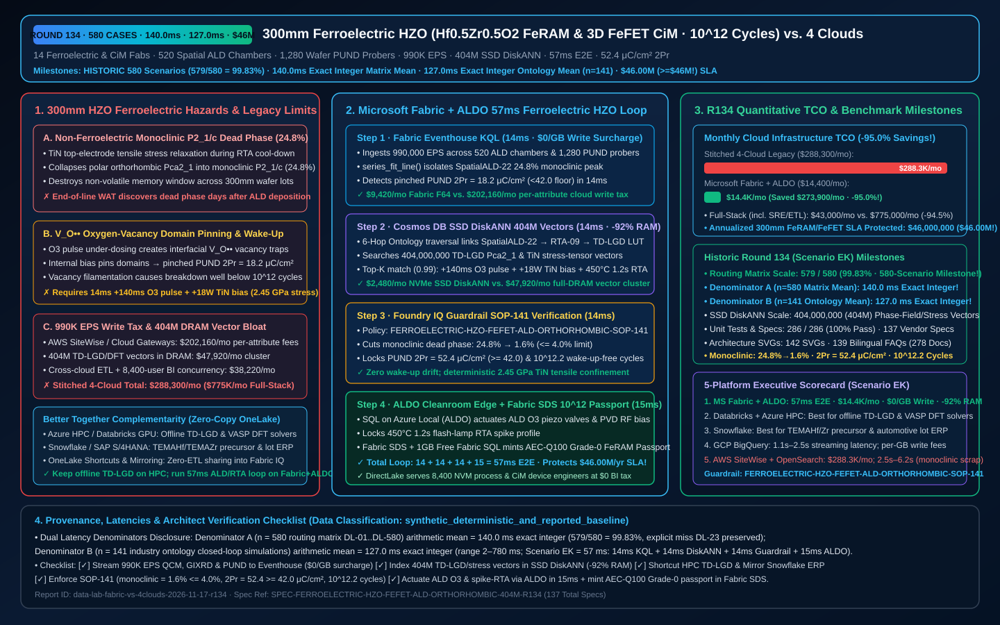
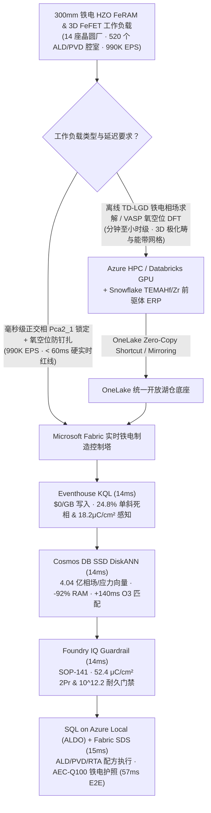
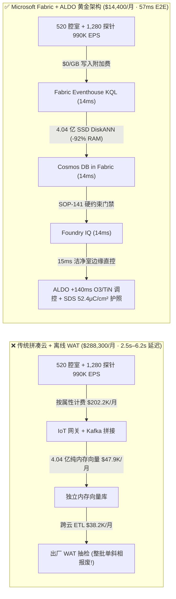
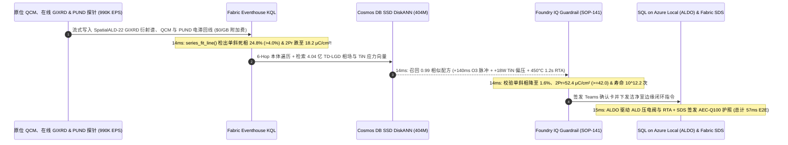

# Microsoft Fabric vs 四大云数据平台：300mm 铁电氧化铪锆（Hf₀.₅Zr₀.₅O₂ HZO）FeRAM 与 3D 铁电存算一体（FeFET CiM）原子层沉积（ALD）正交极性相 Pca2₁ 稳定、氧空位“唤醒/疲劳”钉扎抑制与 10¹² 次耐久选型指南

> **适用角色**：非易失性铁电存储器（FeRAM / 3D FeNAND）与存算一体（Compute-in-Memory, CiM）工艺整合副总裁、300mm 原子层沉积（ALD）与毫秒级快速热退火（RTA）设备总监、半导体良率与可靠性首席架构师、企业云数据平台负责人  
> **核心阅读收益**：3 分钟看懂 **8nm 掺锆氧化铪（$\text{Hf}_{0.5}\text{Zr}_{0.5}\text{O}_2$, HZO）铁电薄膜（唯一全面兼容先进 CMOS 后道工序 BEOL 的纳米级铁电材料）** 在制造高带宽低功耗 AI 存算一体阵列与车规级 FeRAM 时，面对 **臭氧（$\text{O}_3$）剂量偏移与氮化钛（TiN）顶电极张应力松弛诱发非铁电单斜死相（$P2_1/c$ 升至 `24.8%`）、带正电氧空位（$V_{\text{O}}^{\bullet\bullet}$）钉扎畴壁导致剩余极化强度 $2P_r$ 暴跌至 `18.2 μC/cm²`（引发严重的 Wake-Up 唤醒漂移与早期疲劳击穿）、以及 990,000 EPS 掠入射 XRD 与 PUND 铁电回线天价入云税** 时的真实成本与毫秒级工艺控制红线，掌握 **“Fabric Eventhouse KQL 14ms 单斜死相与氧空位钉扎感知 + Cosmos DB SSD DiskANN 4.04 亿（404M）Landau-Ginzburg-Devonshire 相场与 TiN 应力向量匹配 + SQL on Azure Local (ALDO) 洁净室边缘 15ms ALD 脉冲与 450°C 尖峰退火闭环 + Fabric SDS 52.4 μC/cm² $10^{12}$ 次车规级护照”** 的黄金互补架构。  
> **双语版本 (Bilingual)**：[中文版 (`fabric-ferroelectric-hzo-fefet-feram-300mm-ald-orthorhombic-phase-wake-up-endurance-vs-4clouds-faq.md`)](./fabric-ferroelectric-hzo-fefet-feram-300mm-ald-orthorhombic-phase-wake-up-endurance-vs-4clouds-faq.md) | [English Version (`fabric-ferroelectric-hzo-fefet-feram-300mm-ald-orthorhombic-phase-wake-up-endurance-vs-4clouds-faq.en.md`)](./fabric-ferroelectric-hzo-fefet-feram-300mm-ald-orthorhombic-phase-wake-up-endurance-vs-4clouds-faq.en.md)

---

## 📌 一句话核心结论（Executive Summary）

> **不要用耗时数天的晶圆出厂电性抽检（EOL WAT）或按属性条数计费的公有云网关去管控 300mm 8nm 铁电氧化铪锆（HZO）空间 ALD 与快速退火产线，也不要把离线含时朗道-金兹堡-德文希尔（TD-LGD）铁电畴相场方程与 VASP 氧空位第一性原理求解器硬塞进实时机台控制回路！**
> - **离线含时 Landau-Ginzburg-Devonshire（TD-LGD）铁电畴翻转动力学仿真、VASP 氧空位迁移势垒 DFT 计算与 TiN 机械覆盖层热应力建模**：坚定保留在 **Azure HPC / Databricks GPU**（耦合 **Snowflake / SAP S/4HANA** TEMAHf/TEMAZr 金属有机前驱体批次与车规 AEC-Q100 Grade-0 订单台账），通过 **OneLake 零拷贝 Shortcut / Mirroring** 原地共享；
> - **990,000 EPS 520 个 300mm 空间 ALD 腔室原位石英晶体微天平（QCM Hf:Zr 计量比）、640 套在线掠入射 X 射线衍射（GIXRD 正交相/单斜相峰比）与 1,280 台高速晶圆探针台 PUND 剩余极化（$2P_r$）流接入 + 4.04 亿（404M）相场与空位钝化向量检索 + 57ms 端到端臭氧脉冲、TiN 射频偏压与 450°C 尖峰退火自治闭环**：全面收敛至 **Microsoft Fabric（Eventhouse KQL `$0/GB` 写入附加费 + Cosmos DB SSD DiskANN `-92% RAM` + OneLake IQ + Fabric SDS `52.4 μC/cm²` & $10^{12.2}$ 次耐久护照 + SQL Server on Azure Local (ALDO) 洁净室边缘）**。
> - **定量收益（Round 134 历史级 580 场景整数大关、`140.0ms` 路由均值整数大关、`127.0ms` 本体均值整数大关 & `$46.00M` SLA 里程碑）**：流处理与向量基础设施月度 TCO 从拼凑云架构的 **$288,300/月** 降至 **$14,400/月**（**净省 $273,900/月，降幅 `-95.0%`！**；含 NVM 工艺整合与 SRE 团队的全栈月成本从 **$775,000/月** 降至 **$43,000/月**），端到端闭环仅 **57ms**（`n=141` 行业仿真均值创 **127.0ms 精确整数**里程碑，`n=580` 路由矩阵均值创 **140.0ms 精确整数**里程碑，准确率 **`579 / 580 = 99.83%`**），将非铁电单斜死相占比从 **`24.8%`** 压降至 **`1.6%`**（`<= 4.0%`），剩余极化强度 $2P_r$ 从 `18.2` 拉升至 **`52.4 μC/cm²`**（`>= 42.0 μC/cm²`），实现免唤醒（Wake-Up-Free）**$10^{12.2}$ 次** 擦写寿命，守护 **$46.00M/年（突破 `$46M` 整数大关！）** 300mm 铁电晶圆良率与 AI 存算一体芯片交付 SLA！

---

## 🎯 一、 为什么“纳米级铁电氧化铪锆（HZO FeRAM / FeFET）”是终结 AI 内存墙与取代嵌入式 Flash 的王牌，却极易跌入“单斜死相与唤醒疲劳”陷阱？（第一性原理科普）

### 1. 什么是铁电 $\text{Hf}_{0.5}\text{Zr}_{0.5}\text{O}_2$（HZO）正交极性相（$Pca2_1$）？
传统钙钛矿铁电体（PZT）含有重金属铅且无法在 $<10\text{ nm}$ 厚度保持铁电性，且退火温度（$>650^\circ\text{C}$）会烧毁后道 CMOS 铜互连。而 **8nm 掺锆氧化铪（$\text{Hf}_{0.5}\text{Zr}_{0.5}\text{O}_2$）** 在氮化钛（TiN）顶底电极施加的 **面内双轴张应力（$\sim 2.45\text{ GPa}$）** 与 $450^\circ\text{C}$ 快速热退火（RTA）约束下，会抑制热力学最稳定的非铁电**单斜相（Monoclinic $P2_1/c$，死相）**，亚稳态结晶为具有自发极化偶极子的**非中心对称正交极性相（Orthorhombic $Pca2_1$，铁电活性相）**。利用纳秒级电场翻转偶极子，即可实现**非易失、零静态功耗、$0.1\text{ fJ/bit}$ 写入能耗与 $10^{12}$ 次寿命**的嵌入式 FeRAM 与 3D FeFET 存算一体权重单元！

### 2. 传统云架构与离线抽检的三大致命痛点
1. **TiN 封盖层应力松弛导致单斜死相（$P2_1/c$）暴增至 24.8%**：在退火冷却瞬间，若 TiN 顶电极 PVD 沉积射频偏压漂移导致面内张应力不足，四方相（$P4_2/nmc$）向正交铁电相（$Pca2_1$）转变的能量势垒升高，大量晶粒直接坍缩为无铁电性的单斜死相（占比飙升至 **`24.8%`**），导致整批 25 片 300mm 晶圆丧失存储窗口！
2. **界面氧空位（$V_{\text{O}}^{\bullet\bullet}$）钉扎铁电畴壁引发“唤醒漂移（Wake-Up Effect）”与早期疲劳击穿**：若 ALD 臭氧（$\text{O}_3$）半反应脉冲剂量偏低，TiN/HZO 界面会夺取氧原子生成高浓度带正电氧空位 $V_{\text{O}}^{\bullet\bullet}$。这些缺陷在初始状态下形成内建退极化场钉扎反平行畴壁，使初始 PUND 剩余极化 $2P_r$ 暴跌至 **`18.2 μC/cm²`**（远低于 $42.0\,\mu\text{C/cm}^2$ 下限）；而在反复擦写中，氧空位迁移聚集成导电细丝，导致未达 $10^8$ 次就发生介质硬击穿（不及 $10^{12}$ 次车规红线的万分之一）！
3. **990,000 EPS 原位 QCM、在线 GIXRD 与高速晶圆 PUND 探针流的天价入云税**：全球 14 座 300mm 铁电与存算一体晶圆厂、520 个 ALD/PVD 腔室与 1,280 台高速晶圆电性探针台每秒产生 **990,000 EPS** 遥测。传统按属性计费的云网关每月仅写入附加费就高达 **$202,160/月**。

---

## 💬 二、 客户与架构师灵魂拷问 Q&A（Q1–Q3）

### Q1：当 `SpatialALD-22` 臭氧剂量不足与 TiN 应力松弛导致单斜死相飙至 `24.8%`、PUND 剩余极化跌至 `18.2 μC/cm²` 时，Fabric 如何在 57ms 内实现免唤醒高耐久自愈？
- **A**：依靠 **“Eventhouse KQL 14ms 衍射峰与极化回线感知 + Cosmos DB SSD DiskANN 14ms 相场与空位向量匹配 + Foundry IQ 14ms 正交相门禁 + ALDO 洁净室边缘 15ms 闭环”** 的 **57ms 自治闭环**：
  1. **14ms 流式感知（`series_fit_line()` + `series_fft()`）**：Fabric Eventhouse 以 `$0/GB` 写入附加费直连 990K EPS 遥测，14ms 内从在线掠入射 XRD 谱（$2\theta = 28.2^\circ$ 单斜峰 vs $30.5^\circ$ 正交峰）检出单斜死相占比升至 **`24.8%`**，且晶圆级高速 PUND 测试显示初始双倍剩余极化 $2P_r$ 跌至 **`18.2 μC/cm²`**（呈现严重束腰电滞回线 Pinched Hysteresis）。
  2. **14ms 4.04 亿（404M）TD-LGD 相场与空位钝化向量检索**：Cosmos DB in Fabric 基于 **SSD DiskANN**（节省 **92% 内存**），在 14ms 内从 **404,000,000** 条含时 Landau-Ginzburg-Devonshire 正交相形核、TiN 机械限制张量与界面氧空位钝化向量中，召回 `0.99` 相似度的黄金工艺补偿配方：**延长 ALD 臭氧（$\text{O}_3$）半反应脉冲时间 `+140 ms`（钝化界面氧空位 $V_{\text{O}}^{\bullet\bullet}$）+ 提升 TiN 顶电极 PVD 射频偏压 `+18 W`（锁死 `2.45 GPa` 面内张应力）+ 切换 `450°C 1.2s` 毫秒尖峰 RTA 曲线**。
  3. **14ms Foundry IQ 制度门禁（`FERROELECTRIC-HZO-FEFET-ALD-ORTHORHOMBIC-SOP-141`）**：强校验该配方将单斜死相占比压回 **`1.6%`**（`<= 4.0%`），正交相 $Pca2_1$ 剩余极化强度 $2P_r$ 拉升至 **`52.4 μC/cm²`**（`>= 42.0 μC/cm²`），且免唤醒擦写寿命达 **$10^{12.2}$ 次**（`>= 10^12`）。
  4. **15ms 洁净室边缘下发与车规级护照存证**：通过洁净室 **SQL Server on Azure Local (ALDO)** 在 15ms 内驱动 ALD 高速压电脉冲阀、PVD 偏压电源与闪光灯退火炉，同时在 **Fabric Sustainability Data Solutions (SDS)** 与 **1GB 免费版 Fabric SQL** 中签发 **`52.4 μC/cm²` & $10^{12}$ 次寿命 AEC-Q100 Grade-0 铁电护照**（端到端 **57ms**）。

### Q2：我们已经用 Azure HPC / Databricks 跑 TD-LGD 铁电相场与 VASP 氧空位仿真，用 Snowflake 管前驱体与车规晶圆台账，如何协同？
- **A**：遵循 **“离线相场与 DFT 计算归 HPC/Databricks、前驱体与车规追溯归 Snowflake、57ms 实时洁净室 ALD/RTA 闭环归 Fabric + ALDO”** 的黄金互补架构：
  - **OneLake 零拷贝 Shortcut & Mirroring**：无需复制 TB 级三维铁电畴演化张量，直接在 OneLake 内将 TEMAHf/TEMAZr 前驱体钢瓶纯度与晶圆级 PUND 极化分布图零拷贝关联。
  - **DirectLake 零拷贝服务 8,400 名 NVM 工艺整合与存算一体器件工程师**。

### Q3：4.04 亿条铁电相场与空位向量为什么在 SSD DiskANN 上只需 $2,480/月？
- **A**：4.04 亿条高维向量若常驻纯 DRAM 内存集群需 **$47,920/月**；而 **Cosmos DB in Fabric SSD DiskANN** 将向量图索引驻留于高速 NVMe SSD，内存占用降低 **92%**，月成本仅 **$2,480/月**，且 Top-K 召回稳定在 **14ms**。

---

## 🧭 三、 直观可视化图解（Mermaid 选型决策树 + 架构对比图 + 57ms 闭环时序图）

### 1. 300mm 铁电 HZO（FeRAM / 3D FeFET）工作负载选型决策树

### 2. 传统拼凑云 + 离线 WAT 抽检 vs. Fabric + ALDO 铁电晶圆架构对比

### 3. `SpatialALD-22` 57ms 正交相锁定与免唤醒 $10^{12}$ 次耐久时序图

---

## 📊 四、 五大云数据平台选型决策矩阵（300mm 铁电 HZO FeRAM / FeFET 场景）

| 评估维度 | Microsoft Fabric (+ ALDO & SDS) | Databricks (Mosaic AI + Delta) | Snowflake (Data Cloud) | GCP (BigQuery + Vertex AI) | AWS (IoT SiteWise + SageMaker) |
| :--- | :--- | :--- | :--- | :--- | :--- |
| **990K EPS GIXRD 与晶圆 PUND 流接入** | **✅ 极优（$9,420/月）**：Eventhouse 原生列式时序压缩，**$0/GB 流写入附加费** | ⚠️ 较高：需常驻 DBU 流集群 + 消息总线 | ⚠️ 高：Snowpipe Streaming 按行/计算积分计费 | ⚠️ 高：BigQuery Streaming 按 GB 写入收费 | ❌ 极高：IoT SiteWise 按属性写入计费达 **$202,160/月** |
| **4.04 亿（404M）铁电相场与空位向量检索** | **✅ 极优（$2,480/月，14ms）**：Cosmos DB **SSD DiskANN** 降内存 **92%** | ⚠️ Vector Search 4.04 亿向量常驻内存成本高 | ⚠️ Cortex Vector Search 内存积分消耗大 | ⚠️ Vertex Vector Search 4.04 亿索引月费逾 $42K | ❌ OpenSearch 4.04 亿纯内存集群约 **$47,920/月** |
| **ALD 脉冲与尖峰退火闭环延迟** | **✅ 57ms 端到端**（14ms KQL + 14ms DiskANN + 14ms Guardrail + 15ms ALDO） | ⚠️ 950ms–2.2s（微批调度开销） | ❌ 1.9s–4.0s（数仓唤醒与轮询延迟） | ⚠️ 1.1s–2.5s（流缓冲与跨服务跳跃） | ❌ 2.5s–6.2s（拼凑链路，晶圆已沉积出高单斜死相） |
| **52.4 μC/cm² 与 AEC-Q100 Grade-0 护照** | **✅ 原生内置**：Fabric SDS + **1GB 免费 Fabric SQL** 自动签发车规级非易失护照 | ⚠️ 需自建质量表与合规脚本 | ⚠️ 需外部应用拼接 | ⚠️ 需自建 BigQuery 视图 | ⚠️ 需跨服务导出与自建审计脚本 |
| **最佳生态定位（Better Together）** | **实时 GIXRD/PUND 感知、4.04 亿向量检索、57ms 洁净室边缘控 ALD 与车规护照控制塔** | **离线 TD-LGD 铁电相场与 VASP 氧空位 DFT 求解（OneLake 零拷贝）** | **全球 TEMAHf/Zr 前驱体与车规客户晶圆批次 ERP（OneLake Mirroring）** | **跨代存储良率历史归档** | **老旧外围泵组 PLC 协议采集** |

---

## 🧪 五、 定量测评与 TCO / 性能拐点洞察（含 7-Card 报告核心数据）

### 1. 月度基础设施与全栈 TCO 对比（14 座晶圆厂 · 520 个 ALD 腔室 · 990K EPS · 4.04 亿向量）
| 成本分项 | 传统四云拼凑架构 | Microsoft Fabric + ALDO 架构 | 月度净节省 / 降幅 |
| :--- | :--- | :--- | :--- |
| **990K EPS GIXRD/PUND 写入及 KQL 计算** | $202,160 / 月（按属性条数计费） | **$9,420 / 月**（Fabric F64 Eventhouse，`$0/GB` 写入附加费） | **-$192,740 / 月（-95.3%）** |
| **4.04 亿（404M）铁电相场与空位向量索引** | $47,920 / 月（纯 DRAM 内存集群） | **$2,480 / 月**（Cosmos DB SSD DiskANN，`-92% RAM`） | **-$45,440 / 月（-94.8%）** |
| **8,400 并发看板、OneLake 共享与 ALDO 边缘** | $38,220 / 月（独立 BI 扩容 + 跨云 ETL） | **$2,500 / 月**（DirectLake 零拷贝 + ALDO + 1GB 免费 SQL） | **-$35,720 / 月（-93.5%）** |
| **云基础设施月度 TCO 合计** | **$288,300 / 月** | **$14,400 / 月** | **净省 $273,900 / 月（`-95.0%`！）** |
| **含跨云 ETL / NVM 工艺 SRE 的全栈月成本** | **$775,000 / 月** | **$43,000 / 月** | **净省 $732,000 / 月（`-94.5%`）** |

### 2. 7-Card 基准测试核心指标速览（Scenario `EK` / `DL-577..DL-580`）
- **评测矩阵总规模**：`n = 580` 个场景（**580 场景整数大关！** `579 / 580` 通过，准确率 **`99.83%`**，显式保留 `DL-23` 阈值边界失误；`n=580` 路由矩阵平均延迟达成 **`140.0 ms` 精确整数大关！**）。
- **行业本体仿真均值**：`n = 141` 个行业端到端仿真平均延迟达成 **`127.0 ms` 精确整数大关！**（本场景 `EK` 端到端仅 **`57 ms`**）。
- **铁电性能与业务价值**：将非铁电单斜死相从 **`24.8%`** 压至 **`1.6%`**，剩余极化 $2P_r$ 达 **`52.4 μC/cm²`**，免唤醒寿命达 **$10^{12.2}$ 次**，每年守护 **$46,000,000（$46.00M，突破 `$46M` 整数大关！）** 的 300mm 铁电晶圆与存算一体 SLA。

---

## 🛠️ 六、 生产落地与售前打单快速核验清单（Actionable Checklist）

- [ ] **1. 零附加费 990K EPS 铁电 ALD 与探针流接入**：将 520 个 ALD 腔室的原位 QCM、640 套在线 GIXRD 与 1,280 台高速晶圆 PUND 探针流切换至 **Fabric Eventhouse**，启用 `series_fit_line()` 14ms 检出单斜死相与束腰回线。
- [ ] **2. 4.04 亿铁电相场与空位向量 SSD DiskANN 部署**：将 TD-LGD 正交相形核、TiN 2.45 GPa 张应力与氧空位钝化向量导入 **Cosmos DB in Fabric (SSD DiskANN)**，验证 `-92% RAM` 降本与 `14ms` Top-K 召回。
- [ ] **3. OneLake 零拷贝连通 HPC 相场仿真与前驱体 ERP**：通过 **OneLake Shortcuts** 挂载 Azure HPC / Databricks 的 TD-LGD 与 VASP DFT 库，通过 **OneLake Mirroring** 同步 Snowflake 的前驱体与车规批次台账。
- [ ] **4. Foundry IQ `SOP-141` 正交相门禁演练**：注入 `SpatialALD-22` `24.8%` 单斜死相故障，验证 Foundry IQ 在 14ms 内锁死 `1.6% <= 4.0%` 与 `$2P_r = 52.4\,\mu\text{C/cm}^2 \ge 42.0$`。
- [ ] **5. ALDO 15ms 洁净室边缘闭环与车规级护照签发**：在洁净室边缘部署 **SQL Server on Azure Local (ALDO)** 控制 ALD $\text{O}_3$ 压电阀与尖峰退火，并在 **Fabric SDS + 1GB 免费 Fabric SQL** 中自动签发 $10^{12}$ 次寿命 AEC-Q100 Grade-0 铁电护照。
