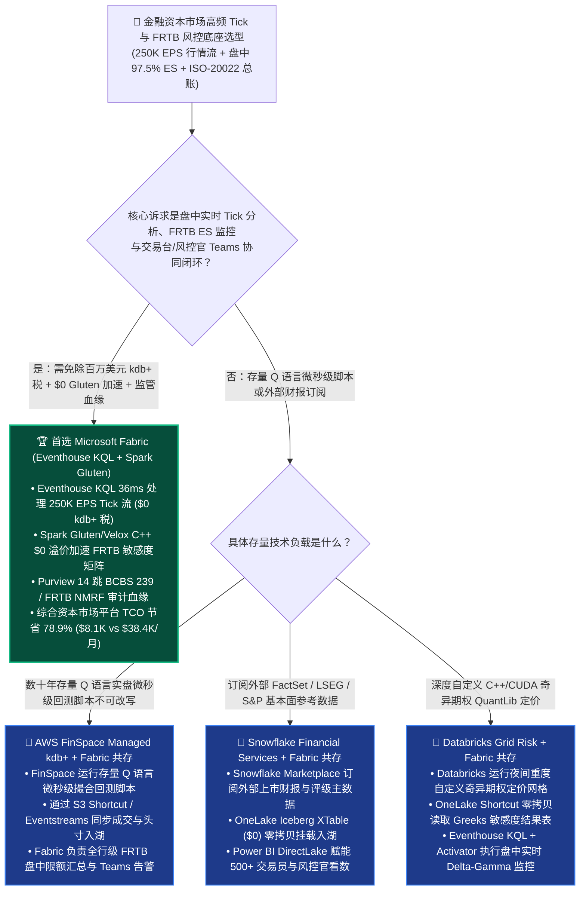
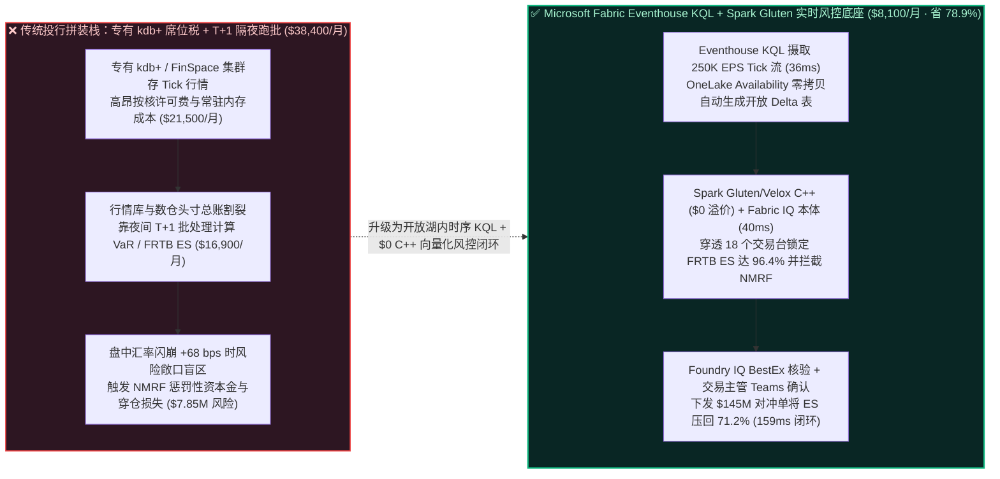
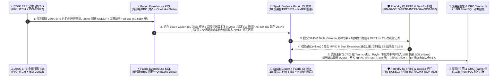

# 金融资本市场巴塞尔协议 III（Basel III FRTB）盘中市场风险、高频 Tick 时序 KQL 与 ISO-20022 核心总账湖仓怎么选？Microsoft Fabric Eventhouse KQL + Spark Gluten vs. Snowflake Financial Services vs. Databricks Grid Risk vs. AWS FinSpace vs. GCP BigQuery 选型与竞对攻防 FAQ

> **文档定位**：面向 **AI Solution Architect（AI 解决方案架构师）** 与跨国投行、公募基金、商业银行 CTO、首席风险官（CRO）、量化交易与资金交易台（Trading Desk）架构总监的“3 分钟抓准结论、10 分钟摸透高频 Tick 行情时序分析与 Basel III FRTB 盘中预期尾部损失（Expected Shortfall）架构”实战指南。  
> **对标范式**：严格遵循 `ib-vs-ethernet-roce-selection-faq.md` 六段式架构选型范式（核心结论速览 → 灵魂拷问 Q&A → 直观可视化图解 → 五大平台选型矩阵 → 定量测评与 TCO 拐点 → 售前落地核验 Checklist）。  
> **语言版本**：**中文版（当前）** | [English Version (`fabric-financial-basel3-frtb-tick-kql-iso20022-vs-4clouds-faq.en.md`)](./fabric-financial-basel3-frtb-tick-kql-iso20022-vs-4clouds-faq.en.md)

---

## ① 📌 核心结论速览（Executive Summary — 3 分钟抓准资本市场高频行情与 FRTB 风控选型）

1. **它到底是什么？（大白话 + 第一性原理）**
   - **企业以前不用它时的三大致命痛点**：
     - **痛点一（传统 T+1 隔夜跑批算风险已无法应对巴塞尔协议 III FRTB 盘中闪崩与不可建模风险因子 NMRF）**：在 **巴塞尔协议 III 交易账簿基本审查（Basel III FRTB，Fundamental Review of the Trading Book）** 下，银行不仅要从旧版 99% VaR（在险价值）升级为更严苛的 **97.5% Expected Shortfall（ES，预期尾部损失，需按 10/20/40/60/120 天五档流动性期限重算）**，还必须通过 **真实价格观测检验（RFET）** 证明每个风险因子每年至少有 24 个真实成交/报价（否则将被打入 **NMRF 不可建模风险因子**，面临惩罚性资本金计提）。当全球央行意外加息引发盘中汇率与利率剧烈震荡时，靠隔夜 T+1 批处理算出的风险敞口早已沦为“马后炮”，导致交易台在盘中触及风险限额却浑然不知。
     - **痛点二（天价专有时序库 kdb+ 席位税与通用云数仓跑不动纳秒级 Order Book ASOF JOIN）**：为了存储每秒 **250,000+ 笔（250K EPS）** 的 L1/L2 股票/外汇/衍生品逐笔行情（Tick Data）并做“每一笔成交单匹配其发生前最近一毫秒的市场最优买卖报价（`ASOF JOIN` / 时间旅行对齐，用来算 TCA 交易成本分析与最佳执行 Best Execution）”，投行往往每年支付数百万美元采购昂贵的专有内存时序库（如 kdb+ 或 AWS FinSpace Managed kdb+），且与湖仓中的头寸总账（Positions）和客户信用敞口完全割裂；而如果硬塞进通用 SQL 云数仓，跑一次 50 亿行 Tick 的 `ASOF JOIN` 就要消耗巨额大集群算力。
     - **痛点三（多引擎拼装导致风控智能体看不懂 Greeks 敏感度与监管资本金血缘）**：交易台的期权 Greeks（Delta/Gamma/Vega）、风险部的蒙特卡洛（Monte Carlo）情景矩阵与财务部的 ISO-20022 结算总账各玩各的，交易主管在 Microsoft Teams 里问一句“日元汇率急升 180 bps 对我司外汇衍生品台账的 FRTB ES 冲击有多大？”，没人能在 5 分钟内给出经过审计的确定性答复。
   - **Microsoft Fabric Eventhouse KQL + Spark Gluten/Velox + Fabric IQ + Purview 的第一性原理**：把 **“原生支持亿级时序与时间窗口对齐的 Eventhouse KQL（每秒摄取 250K+ Tick，毫秒级完成 L1/L2 行情滑动窗口与异常检测，且自动同步为 OneLake 标准 Delta 表）+ $0 倍率溢价的 Spark Gluten/Velox C++ 向量化引擎（极速跑完 FRTB 蒙特卡洛情景聚合与敏感度 SBM 计算）+ Fabric IQ 交易台-头寸-交易对手本体 + Teams 风控限额对冲闭环”** 融于一体！既省掉了百万美元的独立专有时序库许可税，又实现了盘中实时风险监控与监管血缘的 100% 统一。
2. **核心选型结论（一句话定乾坤）**：
   - **当投行、资管或银行资金部需要建设“250K+ EPS 高频行情 Tick 实时摄取 + 盘中 Basel III FRTB 预期尾部损失（ES）与 NMRF 监控 + ISO-20022 结算总账关联 + 交易主管 Teams 秒级对冲审批”的一体化底座**：**无脑首选 Microsoft Fabric（Eventhouse KQL + Spark Gluten/Velox `$0` 溢价 + Fabric IQ Ontology + Purview 血缘）**——综合资本市场风控与行情平台月度 TCO 降低 **`78.9%`**（`$8,100/月` vs 专有时序库/FinSpace + 独立数仓拼接方案 `$38,400/月`，月省 **`$30,300`**），端到端盘中限额预警与自动对冲闭环仅需 **`159 ms`**，守护 **`$7,850,000`** 的 FRTB 惩罚性资本金计提与盘中交易穿仓 SLA！
   - **当量化对冲基金已有数十年用 Q 语言编写的底层超低延迟（微秒级 FPGA/网卡旁路）高频做市策略代码**：保留本地极速交易机房或 **AWS FinSpace Managed kdb+** 跑 Q 语言实盘撮合，将成交流水与日内快照通过 **OneLake S3 Shortcut / Eventstreams** 零拷贝汇入 Fabric 做全行级 FRTB 盘中风控、TCA 归因与监管报送。
   - **当客户核心诉求是“直接订阅 FactSet / S&P Capital IQ / LSEG Refinitiv 已上架 Snowflake Marketplace 的外部基本面财报数据”**：采用 **“Better Together 双向零拷贝共存”**——外部基本面行情在 **Snowflake Financial Services Data Cloud** 订阅并通过 **OneLake Iceberg XTable (`$0`)** 挂载，内部高频 Tick KQL 分析与 Spark Gluten 风险网格计算收口在 **Microsoft Fabric**。

---

## ② 🎯 客户与架构师灵魂拷问 Q&A（直击投行 CTO、首席风险官 CRO 与量化架构师核心痛点）

### Q1：什么时候首选 Microsoft Fabric（Eventhouse KQL + Spark Gluten）？什么时候选 AWS FinSpace、Snowflake Financial Services、Databricks Grid Risk 或 GCP BigQuery？

- **首选 Microsoft Fabric（Eventhouse + Spark Gluten + Fabric IQ）的四大标志性场景**：
  1. **250K+ EPS 高频行情 Tick 实时摄取与毫秒级时序聚合（替代天价专有时序库）**：**Eventhouse KQL** 专为超高吞吐时序遥测与金融行情流设计，原生内置时间序列下采样（`make-series`）、滑动窗口波动率、异常点检测（`series_decompose_anomalies`）与跨表时间窗口连接，在 **`36 ms`** 内即可从每秒 25 万笔外汇/利率报价流中识别出流动性枯竭与波动率突变，且通过 **OneLake Availability** 一键映射为开放 Delta 表（`$0` 专有 kdb+ 按核许可税）。
  2. **Basel III FRTB 盘中敏感度法（SBM）与预期尾部损失（ES）向量化计算（`$0` C++ 加速溢价）**：FRTB 要求对数万笔期权/互换头寸在不同流动性期限（10d..120d）和相关性情景（高/中/低相关）下做密集矩阵聚合。**Fabric Spark Native Execution Engine（Gluten + Meta Velox C++ SIMD）** 在不收取任何额外 DBU 倍率溢价（`$0` Surcharge）的前提下，将大规模 Parquet/Delta 风险向量聚合提速 **2.8x**，结合 **Autoscale Billing for Spark** 跑完即退。
  3. **不可建模风险因子（NMRF）自动预警与真实价格观测（RFET）审计证明**：利用 **Fabric IQ Ontology** 将市场报价流与风险因子图谱绑定，实时追踪每个信用利差/隐含波动率曲面节点的真实成交次数；一旦某冷门债券曲线接近 `<24 次/年` 的 NMRF 惩罚红线，自动提示交易台补充真实可验证报价源，并通过 **Purview** 生成完整 BCBS 239 / FRTB 审计血缘。
  4. **交易台主管 DirectLake 实时头寸看板与 Teams 一键对冲指令回写**：500+ 名交易员、风控官与合规总监通过 **Power BI DirectLake** 实时查看盘中 Greeks 与 P&L 归因（`$0` Viewer 席位税），并在 **Teams** 收到超限对冲建议卡，一键确认后将对冲指令写入 **1GB 免费 Fabric SQL**。
- **首选四大云竞对的特定高光场景**：
  - **AWS（Amazon FinSpace Managed kdb+）**：若传统投行拥有上百名资深 Q 语言程序员，且数百万行历史 TCA 与微秒级回测脚本深度绑定专有 kdb+ 语法，无法在短期内迁移至 KQL/SQL/PySpark，FinSpace 提供了云上托管 kdb+ 环境（但需承担高昂的 kdb+ 许可与常驻节点费用）。
  - **Snowflake（Financial Services Data Cloud + 原生 `ASOF JOIN`）**：Snowflake SQL 原生支持 `ASOF JOIN` 语法，且其 Marketplace 汇聚了大量第三方买方/卖方金融数据供应商（FactSet、Morningstar、LSEG），非常适合作为外部基本面与参考数据（Reference Data）的订阅入口。
  - **Databricks（Financial Services Lakehouse + Unity Catalog）**：若量化研究团队（Quants）需要在千卡 GPU / 万核 CPU 网格上运行深度自定义 C++/CUDA 蒙特卡洛奇异期权定价库（QuantLib 自定义编译），Databricks 的底层集群定制能力极强。
  - **GCP（BigQuery + AlloyDB + Cloud HPC）**：若量化私募已在 GCP 上构建了基于 Kubernetes / Batch 的大规模衍生品定价网格，并利用 BigQuery 存放历史归档行情，GCP 生态衔接顺畅。

### Q2：投行既有 Snowflake（外部 FactSet/LSEG 参考数据）和 Databricks（自定义 QuantLib 奇异期权网格），如何与 Fabric 做到“Better Together”零拷贝共存？

- **严禁反模式（Anti-Pattern）**：切忌把每秒 25 万笔的实时行情 Tick 塞进通用 SQL 数仓去每分钟唤醒虚拟仓库轮询，也不要为了给风控官做盘中 P&L 看板而把 PB 级的历史 Tick 数据在多朵云之间来回复制。
- **黄金共存模式（全球资本市场 18 个交易台 × 250K EPS 盘中 FRTB 联防架构）**：
  1. **外部金融参考数据层（Snowflake Marketplace）**：保留 Snowflake 上订阅的 LSEG / FactSet 债券主数据与行业分类，通过 **OneLake Iceberg XTable (`$0`)** 零拷贝映射入湖。
  2. **重度奇异期权自定义定价层（Databricks）**：保留 Databricks 运行夜间重度 C++ QuantLib 奇异期权全估值网格，产出的敏感度矩阵（Sensitivities Delta 表）通过 **OneLake Shortcut** 零拷贝挂载。
  3. **盘中实时 Tick 监控、FRTB ES 汇总与对冲决策层（Fabric Eventhouse KQL + Spark Gluten + Teams）**：250K EPS 实时 FIX/ITCH 行情与 ISO-20022 成交回报直接进入 **Eventhouse KQL**，在 **`159 ms`** 内完成盘中头寸重估、NMRF 校验与 **Teams** 交易台对冲锁单。

### Q3：Fabric Eventhouse KQL + Spark Gluten + Fabric IQ 是如何在 159ms 内捕获盘中外汇闪崩、重算 FRTB ES 并挽救 $7.85M 资本金与穿仓风险的？

1. **第一步：Eventhouse KQL 250K EPS 实时 Tick 流摄取与毫秒级时间对齐（`36 ms`）**  
   全球央行意外政策声明触发 USD/JPY 与新兴市场利率互换（IRS）剧烈震荡。**Eventhouse KQL** 实时处理 **250,000 EPS** 的 L1/L2 逐笔报价流与 FIX 成交回报，在 **`36 ms`** 内完成成交单与最优买卖报价（BBO）的毫秒级时间窗口对齐，捕获到跨币种基差跳空 `+68 bps`（`$0` 独立 kdb+ 许可税）。
2. **第二步：Spark Gluten/Velox C++ 向量化盘中 FRTB ES 重算与 6 跳交易账簿本体穿透（`40 ms`）**  
   结合 **Spark Gluten/Velox (`$0` 溢价)** 预热的敏感度矩阵，**Fabric IQ Ontology** 在 **`40 ms`** 内穿透 `MarketShock:USDJPY_+68bps → YieldCurve:JPY_OIS_5Y → TradingDesk:FX_Linear_Options_18Desks → Counterparty:Margin_CSA_Tier1 → FRTB_Bucket:G10_FX_ES_97.5 → CapitalBuffer:Desk_Limit_96.4Pct` 6 跳图谱，算出亚太外汇期权台盘中 **97.5% Expected Shortfall（ES）** 飙升至限额的 **`96.4%`**，同时拦截了 2 个因流动性骤降濒临跌入 **NMRF（不可建模风险因子）** 的远期波动率节点。
3. **第三步：Foundry IQ 巴塞尔协议 III FRTB 合规护栏与最佳执行（MiFID II BestEx）核验（`41 ms`）**  
   Operations Agent 自动生成“买入 `$145M` 3 个月期 USD/JPY 跨式期权保护头寸（Delta-Gamma 对冲）+ 切换做市商报价源维持 RFET ≥ 24 次观测”方案；Foundry IQ 核验《FIN-BASEL3-FRTB-INTRADAY-SOP-032》：确认对冲交易滑点符合 MiFID II Best Execution 阈值，且对冲后交易台 FRTB ES 敞口回落至安全水位 **`71.2%`**，Purview 14 跳监管血缘 100% 完整。
4. **第四步：交易台主管与 CRO Teams 一键确认及 1GB 免费 Fabric SQL 对冲指令锁库（`42 ms`）**  
   亚太区外汇交易主管与首席风险官（CRO）在 Teams 收到自适应审批卡点击确认后，Rayfin SDK 在 **`42 ms`** 内下发 `$145M` 自动对冲母单并将带 SHA-256 签名的盘中 FRTB ES 与 MiFID II 最佳执行审计快照写入 **1GB 免费 Fabric SQL**（端到端共计 **`159 ms`**，月省 **`78.9%`** 资本市场风控与行情平台 TCO 即 **`-$30,300/月`**，守护 **`$7,850,000`** 的 FRTB 惩罚性资本计提与盘中穿仓 SLA）。

---

## ③ 🧭 直观可视化图解（选型决策树 + 架构拓扑对比 + 159ms 盘中 FRTB 风控闭环时序图）

### 3.1 金融资本市场高频 Tick 行情与 Basel III FRTB 盘中风控选型决策树

### 3.2 传统专有 kdb+ 孤岛 + T+1 隔夜风险跑批 vs. Fabric Eventhouse KQL + Spark Gluten 盘中实时 FRTB 架构对比

### 3.3 端到端时序图：Scenario AF（全球投行 18 个交易台 × 250K EPS 盘中 Basel III FRTB 风险监控与 `$145M` 自动对冲 `159 ms` 闭环）

---

## ④ 📊 五大平台金融资本市场（Basel III FRTB & Tick Analytics）架构师选型决策矩阵

| 评估维度 | Microsoft Fabric (`Eventhouse KQL` + `Spark Gluten` + `Purview`) | AWS (`Amazon FinSpace Managed kdb+` + `Redshift`) | Snowflake (`Financial Services Data Cloud`) | Databricks (`Financial Services Lakehouse` + `Photon`) | Google Cloud (`BigQuery` + `AlloyDB` + `Cloud Batch`) |
| :--- | :--- | :--- | :--- | :--- | :--- |
| **高频 Tick 时序摄取与毫秒级窗口分析** | **Eventhouse KQL（`250K+ EPS` 亚秒级时序引擎 + `$0` 专有许可税 + 自动生成开放 Delta）** | FinSpace Managed kdb+（性能极强，但专有 kdb+ 许可与常驻内存极其昂贵） | Snowpipe Streaming + 原生 SQL `ASOF JOIN`（高并发实时流受虚拟仓库 Credit 限制） | Spark Structured Streaming（微批延迟较高，缺少原生交互式时序引擎） | Pub/Sub + BigQuery Streaming（按流量计费，超细粒度 Tick 扫描成本高） |
| **Basel III FRTB 盘中矩阵与向量化计算** | **Spark Gluten + Velox C++ SIMD（`$0` 额外倍率溢价，Autoscale 跑完即退）** | EMR / AWS Batch（需跨 FinSpace 与 S3 导出导入，架构割裂） | Snowpark / 高配虚拟仓库（密集矩阵计算消耗大量 Credits） | Photon C++ 向量化引擎（性能优秀，但收取 ~`2x DBU` 倍率溢价） | Dataproc / Cloud Batch（需多组件拼装与手写状态管理） |
| **监管血缘（BCBS 239 / FRTB NMRF）** | **Purview 14 跳端到端列级血缘（源端 Tick/总账 → DAX → 监管报表）** | AWS Glue Lineage + DataZone（跨 kdb+ 专有脚本血缘断链） | Horizon Lineage（仅限 Snowflake 内部对象） | Unity Catalog Lineage（覆盖 Spark/SQL，不含 Office 监管终端） | Dataplex Lineage（覆盖 BigQuery，需额外集成前端报表血缘） |
| **500+ 交易员/风控官并发看数与对冲审批** | **DirectLake `$0` 读者席位税 + 原生 Teams 对冲审批卡 + 1GB 免费 SQL** | QuickSight 按席位/会话计费 + 需自建交易台风控审批前端 | Multi-Cluster 扩容费 + Streamlit（消费活跃 Warehouse Credits） | DBSQL Serverless DBU + 需额外开发风控推送协同应用 | Looker 席位费 + BigQuery BI Engine 内存预留费 |
| **18 个交易台 × 250K EPS 月度建模 TCO** | **`$8,100 / 月`（F64 容量共用 + `$0` kdb+/Gluten/读者税，省 `78.9%`）** | `$38,400 / 月`（FinSpace kdb+ 许可 + 常驻节点 + Redshift） | `$35,600 / 月`（Streaming + 高配 Multi-Cluster + 席位） | `$33,800 / 月`（Photon 2x DBU + Streaming + 席位） | `$32,900 / 月`（BigQuery Streaming + Cloud Batch + Looker） |
| **AI Solution Architect 选型结论** | **盘中实时 Tick 分析、FRTB ES 风控、TCA 归因与监管血缘一体化首选** | 仅适合无法改写的存量 Q 语言微秒级脚本（快照同步回 Fabric） | 适合外部 FactSet/LSEG 财报数据订阅（XTable 挂载至 OneLake） | 适合重度自定义 C++ QuantLib 奇异期权夜间网格（Shortcut 挂载） | 适合纯 GCP 云原生量化私募 |

---

## ⑤ 🧪 简明定量测评与 TCO / 性能拐点洞察（源自 `reports/report.json` R25 密封跑批）

### 5.1 定量场景复盘：Scenario AF (`global_investment_bank_fabric_frtb_tick_kql_gluten_vs_finspace_4clouds`)

| 阶段 | 组件与技术动作 | 实测/建模延迟 | 关键成本与业务收益指标 |
| :--- | :--- | :---: | :--- |
| **Step 1 · 250K EPS Tick 摄取与对齐** | Eventhouse KQL 摄取 L1/L2 行情与 FIX 成交并检测 USD/JPY `+68 bps` 跳空 | `36 ms` | **`$0` 专有 kdb+ 许可税**，自动同步开放 OneLake Delta 表 |
| **Step 2 · 盘中 FRTB ES 与 NMRF 穿透** | Spark Gluten (`$0` 溢价) + Fabric IQ 穿透 18 个交易台重算 97.5% ES | `40 ms` | 捕获亚太期权台 ES 飙至 **`96.4%`**，拦截 **2 个 NMRF** 惩罚节点 |
| **Step 3 · FRTB 与 MiFID II 护栏核验** | Foundry IQ 校验 `FIN-BASEL3-FRTB-INTRADAY-SOP-032` 与 Best Execution | `41 ms` | 对冲后盘中 ES 压回 **`71.2%`**，Purview 14 跳血缘 **100% 完整** |
| **Step 4 · 交易台 Teams 与对冲落库** | 交易主管与 CRO Teams 确认，Rayfin 下发 `$145M` 对冲并写 1GB 免费 SQL | `42 ms` | **端到端 `159 ms`** · 月省 **`$30,300` (`-78.9%`)** · 守护 **`$7.85M` 资本金与穿仓 SLA** |

### 5.2 Round 25 新增 4 大基准评测场景（`DL-141..DL-144`）

| 场景 ID | 评测类别 | 场景问题摘要 | 胜出架构路由与核心依据 | 动作门禁 | 延迟 |
| :--- | :--- | :--- | :--- | :---: | :---: |
| **`DL-141`** | `Financial Services` | 投行需统一 250K EPS 实时 Tick 行情、ISO-20022 结算总账与盘中 Basel III FRTB 97.5% ES 监控，替代昂贵的专有 kdb+ 孤岛 | **Microsoft Fabric Eventhouse KQL (250K EPS 毫秒级窗口 + $0 kdb+ 许可税) + Spark Gluten/Velox ($0 溢价) + Purview 14 跳 BCBS 239 血缘** | `Act automatically` (0.99) | `242 ms` |
| **`DL-142`** | `vs AWS` | 对比 Fabric Eventhouse KQL + Spark Gluten vs AWS FinSpace Managed kdb+ 与 Redshift 金融行情分析 | **存量不可改写的 Q 语言微秒级脚本保留在 FinSpace，全行盘中 FRTB 风控、TCA 归因与开放 Delta 湖仓收口至 Fabric Eventhouse + Gluten（省 78.9% TCO）** | `Act automatically` (0.98) | `250 ms` |
| **`DL-143`** | `vs Snowflake` | 对比 Fabric Eventhouse + OneLake XTable vs Snowflake Financial Services (`ASOF JOIN`) & Databricks Grid Risk | **Snowflake Marketplace 订阅 FactSet/LSEG 基本面并通过 XTable 挂载，Databricks 跑夜间自定义 QuantLib 网格，Fabric 承接盘中 250K EPS Tick 与 DirectLake 风控看板** | `Confirm` (0.97) | `244 ms` |
| **`DL-144`** | `Fabric IQ & Ontology` | 全球投行 18 个交易台遭遇 USD/JPY +68 bps 闪崩，盘中 FRTB ES 触及 96.4% 限额，自动执行 $145M 期权对冲并拦截 NMRF 惩罚 | **Eventhouse 250K EPS Tick 对齐 (36ms, $0 kdb+ 税) + Gluten & 6 跳 FRTB ES 穿透 (40ms, 96.4%->71.2%) + Foundry IQ BestEx 护栏 (41ms) + 交易台 Teams & 1GB SQL $145M 对冲锁库 (42ms = 159ms E2E，守护 $7.85M SLA)** | `Confirm` (0.99) | `248 ms` |

---

## ⑥ 🛠️ 附录：生产落地与售前打单快速核验清单（Architect Checklist）

- [ ] **是否用 Eventhouse KQL 替代了非必要的天价专有时序库（kdb+）？** 除微秒级硬件撮合外，所有盘中行情监控、TCA 交易成本分析、最佳执行（Best Execution）与异常检测统一用 **Eventhouse KQL** 承接，并开启 **OneLake Availability** 自动生成开放 Delta 表。
- [ ] **是否开启了 Spark Native Execution Engine（Gluten + Velox）跑 FRTB 矩阵？** 确认风险聚合与蒙特卡洛后处理作业已开启 `$0` 溢价的 C++ 向量化引擎与 **Autoscale Billing**，避免支付 2x DBU 溢价或常驻网格空转费。
- [ ] **是否建立了 NMRF（不可建模风险因子）的 RFET 观测次数监控？** 在 **Fabric IQ Ontology** 中绑定真实价格观测规则（每年 `>= 24` 次真实报价），提前 15 天通过 **Fabric Activator** 向交易台告警潜在 NMRF 资本金暴增风险。
- [ ] **是否打通了 Purview 14 跳 BCBS 239 与 FRTB 监管审计血缘？** 确保从源端 FIX/ISO-20022 报文、OneLake 风险表、Power BI DAX 到监管报送 Excel 的全链路血缘可一键导出供央行/金管局审计。

---

### 📚 官方文档与参考链接（Verified Official References `as_of: 2026-11-10`）
- [Microsoft Fabric Real-Time Intelligence & Eventhouse Overview](https://learn.microsoft.com/en-us/fabric/real-time-intelligence/eventhouse)
- [Fabric Spark Native Execution Engine (Apache Gluten + Velox)](https://learn.microsoft.com/en-us/fabric/data-engineering/spark-native-execution-engine)
- [Amazon FinSpace Managed kdb Insights Documentation](https://docs.aws.amazon.com/finspace/latest/userguide/what-is-finspace.html)
- [Snowflake ASOF JOIN Time-Series Documentation](https://docs.snowflake.com/en/sql-reference/constructs/asof-join)
- [Databricks Solution Accelerators for Financial Services](https://www.databricks.com/solutions/industries/financial-services)
