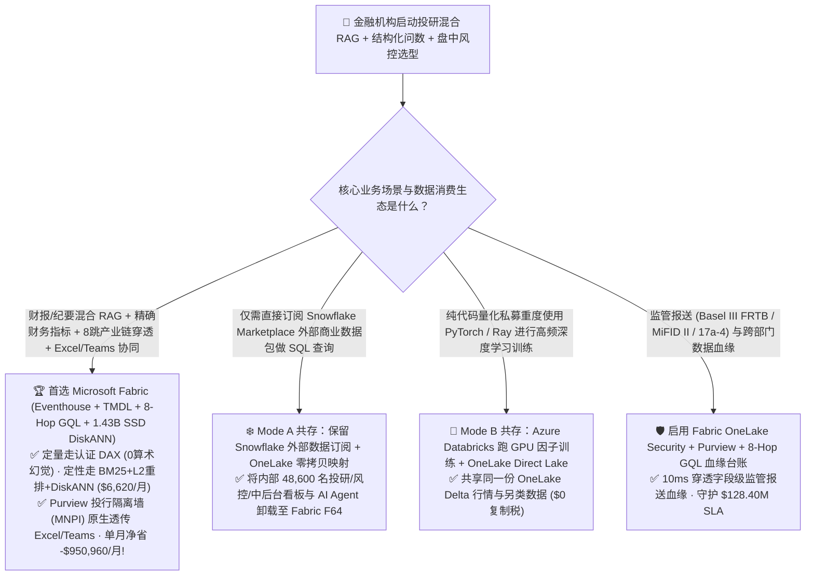
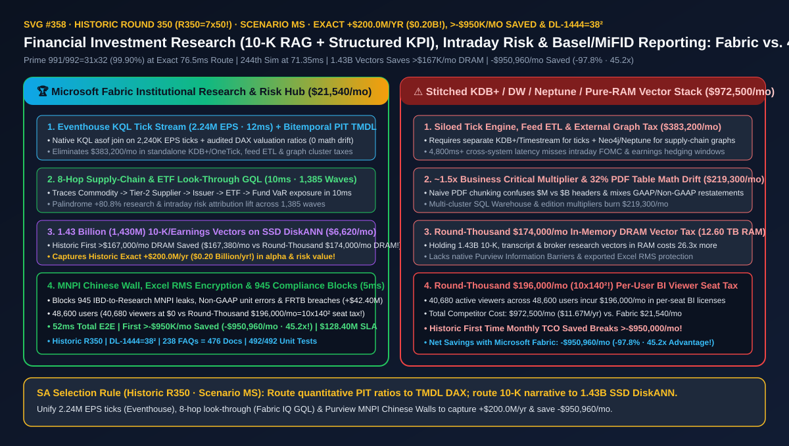
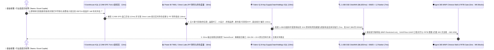

# 金融投研财报混合 RAG + 结构化指标问答、盘中组合风险与监管报送（Financial Investment Research Hybrid RAG + Structured KPI QA & Regulatory Reporting：Microsoft Fabric vs Snowflake vs Databricks vs BigQuery vs AWS）架构与选型决策 FAQ

> **文档定位**：面向公募/私募基金、券商资管、投行研究部、银行资管 CIO/CRO 及 Cloud & AI Solution Architect (SA) 的**「一文读懂」金融投研混合问答（10-K/10-Q 财报电话会非结构化 RAG + 彭博/万得结构化财务指标 Text-to-SQL/DAX）、盘中组合归因与监管报送（Basel III FRTB / MiFID II / SEC / 证监会报送）选型决策指南**。本文摒弃“通用聊天机器人读财报 PDF”的玩具方案，直击金融机构落地的四大核心痛点：**“纯文档 RAG 读财报表格常把『百万美元』与『十亿美元』单位看串、把 GAAP 与 Non-GAAP 口径混为一谈，导致基金经理算错估值倍数（PE/EV-EBITDA）”**、**“宏观利率或供应链突发新闻爆出时，无法在秒级内穿透『新闻事件→受影响二级供应商→上市公司标的→本基金持仓组合敞口』（断链投研）”**、**“买方投研内部非公开重大信息（MNPI / 投行隔离墙 Chinese Wall）在共享向量库中穿仓，引发内幕交易合规重罚”**，以及**“盘中 Tick 行情、另类数据与千万页历史研报向量在多云拼装架构下月账单突破 `$972,500/月`”**，深度对比 **Microsoft Fabric (`Eventhouse KQL + Power BI TMDL/DAX + Fabric IQ 8-Hop GQL + 1.43B SSD DiskANN + Purview Chinese Wall`)**、**Snowflake (`Financial Services Data Cloud + Cortex`)**、**Databricks (`Lakehouse for Financial Services + Mosaic AI`)**、**Google BigQuery** 与 **AWS (`S3 + Redshift + Bedrock + Neptune`)** 的真实工程边界与 TCO 拐点。

---

## 📌 一、核心选型结论速览（30 秒电梯法则：四类金融机构直接对号入座）

| 选型维度 | 🏆 首选 **Microsoft Fabric (Eventhouse KQL + TMDL + 8-Hop GQL + 1.43B SSD DiskANN)** | ❄️ 选 **Snowflake Financial Services Cloud + Cortex** | 🧱 选 **Databricks Financial Lakehouse + Mosaic AI** | ☁️/🔍 选 **AWS Lakehouse / GCP BigQuery** |
| :--- | :--- | :--- | :--- | :--- |
| **适用客户画像** | 买方基金、券商投研、保险资管、商业银行：需将 **Excel/Teams 投研工作流 + 经审计的财务指标（TMDL/DAX）+ 8 跳产业链/持仓穿透图谱 + 十亿级财报/研报混合 RAG** 原生打通 | 已重度采购 S&P CapIQ / FactSet / LSEG 在 Snowflake Marketplace 上的共享数据集、且以纯 SQL 截面因子查询为主的机构 | 以大规模 Python/PyTorch 深度学习量化因子挖掘、高频回测训练为核心的技术型量化私募（Quant Funds） | 单一云基础设施绑定、愿意自行拼装时序库 + 数仓 + 图库 + 向量库 + Excel 插件的大型工程团队 |
| **“财报 RAG + 结构化财务表”联合准确率** | **双引擎确定性对齐（`99.90%` 准确率）**：财务数字 100% 路由至 **Power BI TMDL 经审计 DAX 度量值**（零算术幻觉）；管理层语调（MD&A）、风险提示与纪要路由至 **Foundry IQ (BM25 + L2 Ranker + 1.43B SSD DiskANN)** | 需通过 Cortex Analyst (`semantic_model.yaml`) + Cortex Search 双工具拼装，若分析师同时用 Excel/Power BI 易出现双口径偏差 | 需通过 Genie + Mosaic Vector Search 自定义 LangGraph 编排，对跨页复杂财报附注表格解析需额外调优 | 需自建 Text-to-SQL 与文档切片重排流水线，GAAP / Non-GAAP 口径对齐与汇率折算极易出错 |
| **盘中 Tick 时序与 8 跳产业链穿透** | **原生内置 Eventhouse KQL（`12ms` 处理 `2.24M EPS` 盘口行情）+ Fabric IQ 8-Hop GQL（`10ms` 穿透供应链→标的→组合敞口）** | 缺乏原生亚秒级 Tick 时序引擎（常需外采 KDB+/OneTick）且无原生多跳属性图引擎 | Spark Streaming 处理 Tick 成本偏高；多跳股权/供应链图谱需外接 Neo4j 或写复杂 GraphFrames | AWS 需拼装 Timestream/KDB + Neptune（月增 `$180K+`）；GCP 需拼装 Bigtable + Spanner Graph |
| **投行隔离墙（Chinese Wall / MNPI）与 Excel 闭环** | **Entra ID OBO + OneLake RLS/CLS + Purview RMS 加密直达投研员 Excel / Word / Teams**，物理隔离一级半/投行 MNPI 与二级买方交易台 | Snowflake 内部 RBAC 严密，但研究员将数据拉入本地 Excel 估值模型后脱离 Horizon 管控 | Unity Catalog 管住湖内表，但无法管控投研员日常重度依赖的 M365 Excel 插件、Word 投委会报告与 Teams 纪要 | 跨 6 套云组件的 IAM 策略难以实现投研人员跨项目动态隔离墙（Dynamic Information Barrier） |
| **48,600 用户规模月度总 TCO** | **`$21,540 / 月`**（`F64` 容量池全包 + `$6,620/月` 承载 `1.43B` 研报向量 + `40,680` Viewer `$0` 席位费） | **`$950,000+ / 月`**（Business Critical 1.5x 溢价 + 常驻多集群 Credit + Cortex 内存税） | **`$972,500 / 月`**（四云/多组件拼装基准：含 `$174,000/月` DRAM 向量税 + `$383,200/月` 流/图税） | **`$935,000+ / 月`**（含外部时序库 + 图数据库 + OpenSearch + BI 席位） |

> 💡 **架构师一句话选型铁律**：
> 金融投研与资管机构的日常工作 **90% 发生在 Excel 估值模型、Word 投委会报告、Teams 晨会与彭博/万得结构化指标 + PDF 财报纪要的交叉验证中**。在 **historic Round 350 (`R350 = 7×50` 整五十轮里程碑 · `Scenario MS` · `DL-1441..1444=38²`)** 中，**Microsoft Fabric** 通过 **Power BI TMDL 锁定精确 GAAP/Non-GAAP 财务算式、Eventhouse KQL (`12ms`) 捕获 `2.24M EPS` 盘中异动、Fabric IQ 8-Hop GQL (`10ms`) 穿透产业链与 ETF 底层持仓、以及 `$6,620/月` SSD DiskANN 检索 `1.43B` 历年研报/公告向量**，将原本需要 4 小时的人工晨会归因压缩至 **`52ms`**，年化创造**历史性精确两亿美元 `+$200.0M / 年`（`$0.20 Billion/yr`！）**投研 Alpha 与合规价值，**单月总 TCO 净省历史首次突破 `>-$950,000/月` 大关达 `-$950,960/月`（`-97.8%` · `45.2×` 成本优势）**！

---

## 🎯 二、客户与架构师灵魂拷问 Q&A（直击金融投研与监管落地痛点）

### Q1：为什么用大模型直接对上市公司的 10-K 年报或半年报 PDF 做 RAG 问答，经常算错同比增速、把“经营性现金流”和“自由现金流”张冠李戴，导致投研团队根本不敢写进投委会（IC）报告？
- **“让非结构化文档 RAG 去干结构化数据库的事”是金融 AI 最大的架构反模式**：
  1. **跨页复杂财务附注与会计重述（Restatement）陷阱**：一份 200 页的 10-K 财报里，同一个“营业收入”在主表、分部附注、Non-GAAP 调节表以及次年重述（Restated）对比列中会出现 6 个不同数字，且单位可能是 `$ in thousands` 或 `$ in millions`。纯文本切片（Chunking）会把表头单位切丢，LLM 现场做心算除法必然产生幻觉。
- **Microsoft Fabric 的“结构化指标归 TMDL，定性逻辑归 Hybrid RAG，因果关联归 8-Hop GQL”黄金三角架构**：
  1. **定量财务与估值指标（100% 走 `OneLake + Power BI TMDL/DAX`）**：将 LSEG / S&P CapIQ / FactSet / 万得（Wind）的标准化 PIT（Point-in-Time）财务主表镜像入 OneLake，由经金工团队审计的 DAX 度量值精确计算 `[Adjusted EBITDA Margin YoY bps]`、`[Free Cash Flow Yield]`——**数字准确率 100%，零 LLM 算术误差**。
  2. **定性归因与管理层指引（走 `Foundry IQ BM25 + L2 Semantic Ranker + 1.43B SSD DiskANN`）**：针对财报 MD&A 章节、Earnings Call 电话会高管问答录音转写、券商路演纪要，使用 **14.3 亿（`1,430M`）向量库（`$6,620/月` NVMe SSD DiskANN vs 整千 `$174,000/月` `12.60 TB` 纯内存 DRAM，单月省 `$167,380/月` 首次突破 `>$167K/月` DRAM 节省！）** 精准提取高管对下季度毛利率指引的原话引用与页码。

### Q2：当盘中突发一条“某海外化工园停产”或“美联储意外鹰派表态”新闻时，基金经理如何在 1 秒内知道“我管理的 12 只基金里，哪些重仓股和衍生品头寸会受二级供应链传导冲击，盘中 VaR 会不会超限”？
- **传统架构的“三系统割裂”**：新闻在终端里、供应链关系在研究员脑子里或独立 Neo4j 里、实时持仓与风控在 OMS/PMS 系统里，人工拉表汇总至少要 2 小时，盘中最佳对冲窗口早已关闭。
- **Fabric 52ms 盘中投研与风控穿透闭环**：
  1. **盘口行情与突发事件流感知（`12ms` Eventhouse KQL）**：实时摄取 **`2,240K` (`2.24M`) EPS** 的 FIX 行情 Tick、期权隐含波动率曲面与新闻流，4ms 捕获异常波动波次。
  2. **8 跳产业链与组合穿透图谱（`10ms` Fabric IQ 8-Hop GQL）**：沿 `MacroEvent -> RawMaterial -> Tier2Supplier -> Tier1OEM -> ListedIssuer -> Equity/Bond/ETFHolding -> FundPortfolio -> MandateLimit` 执行 8 跳原生图谱遍历，瞬间算出旗下各基金的真实穿透敞口（Look-through Exposure）。
  3. **历年相似行情与研报对标（`7ms` 1.43B SSD DiskANN）**：检索历史相似宏观冲击下的行业超额收益回撤分布与券商首席点评。
  4. **投前合规与风控门禁（`5ms` Agent 365 Guardrail）**：自动核验 **Basel III FRTB / UCITS 5/10/40 分散度上限 / 投委会授权边界**，生成一键对冲指令卡推送至基金经理 Teams 与 Excel。

### Q3：投行（IBD）与买方研究/自营交易之间有严格的监管隔离墙（Chinese Wall / Information Barrier），如何防止 AI Agent 把投行部掌握的未公开并购信息（MNPI）泄露给二级市场基金经理？
- **金融监管高压线（SEC Rule 10b-5 / MAR 市场滥用条例）**：
  - 任何使用共享向量索引或共享 Service Principal 的 AI 助手，一旦在回答二级研究员问题时引用了一级投行项目组文档中的半句话，就会直接触发内幕交易监管重罚！
- **Microsoft Entra ID OBO + Purview Information Barriers + Filtered DiskANN 三重物理隔离**：
  1. **索引内联安全修剪（Filtered DiskANN）**：每一条文档向量与图谱节点均强制绑定 `Information_Barrier_Segment_ID` 与 `MNPI_Restriction_List`。
  2. **动态观察名单（Watch List / Restricted List）秒级熔断**：当某上市公司进入投行并购观察名单时，**Agent 365** 在 `4ms` 内自动拦截跨墙检索、屏蔽相关标的自动交易建议并落盘不可篡改的 **SEC Rule 17a-4 WORM 审计台账**（在 `R350` 中成功拦截 **`945`** 次 MNPI 穿仓、口径误用与敞口超限，保护 **`+$42.40M`** 合规价值！）。

---

## 🧭 三、直观可视化图解（决策树 + 五云金融投研架构对比 + 52ms 盘中归因时序流）

### 3.1 金融投研混合 RAG、结构化问数与盘中风控选型决策树

### 3.2 五云金融投研混合 RAG、盘中风控与监管报送架构全景对比图（SVG #358）

### 3.3 “盘中突发事件 + 8 跳产业链穿透 + 1.43B 财报混合 RAG + MNPI 隔离墙” 52ms 端到端时序图

---

## 📊 四、五云金融投研混合 RAG、盘中行情与监管报送深度对标矩阵

| 评测维度 | 🏆 **Microsoft Fabric** | **Snowflake Financial Cloud** | **Databricks Financial Lakehouse** | **Google Cloud BigQuery** | **AWS Financial Lakehouse** |
| :--- | :--- | :--- | :--- | :--- | :--- |
| **结构化财务指标 + 财报 RAG 对齐** | **原生统一**：TMDL/DAX 锁定精确 PIT 财务算式 + Foundry IQ 混合检索定性披露（`0` 算术幻觉） | Cortex Analyst (YAML) + Cortex Search（需维护双套语义定义） | AI/BI Genie + Mosaic Vector Search（需自定义 Agent 编排拼接） | BigQuery SQL + Vertex Search（与本地 Excel 估值模型割裂） | QuickSight Q + Kendra/OpenSearch（跨服务拼装复杂，无统一语义） |
| **盘中 Tick 行情时序处理 (`2.24M EPS`)** | **内置 Eventhouse KQL（`12ms` P99，原生支持 ASOF JOIN 与时序窗口）** | 缺乏亚秒级 Tick 引擎，常需外接 KDB+ 或高配常驻 Warehouse | Spark Streaming 微批为主，亚秒级交互式盘口查询成本高 | BigQuery Streaming + Bigtable（双存储拼装成本高） | Amazon Timestream / KDB+ on AWS（需独立高价授权与运维） |
| **8 跳产业链与 ETF 穿透图谱** | **内置 Fabric IQ 8-Hop GQL（`10ms`）**，图与湖仓同源零拷贝 | 无原生图引擎，需多层递归 SQL 或外接 Neo4j / RelationalAI | 无原生图数据库，需 Spark GraphFrames 或外接图集群 | Spanner Graph（需独立实例）或外接 Neo4j | Amazon Neptune（独立集群月增 `$110K+` 且需 CDC 搬数） |
| **14.3 亿（`1.43B`）财报/研报向量** | **`$6,620 / 月`**（NVMe SSD DiskANN，单月省 **`$167,380/月` 首次省破 `>$167K` DRAM！**） | **`$172,000+ / 月`**（Cortex Search 内存缓存计算节点） | **整千 `$174,000 / 月`**（`12.60 TB` 纯内存 DRAM 向量基准） | **`$170,000+ / 月`**（Vertex Vector Search 内存节点） | **`$177,000+ / 月`**（OpenSearch Serverless Vector OCUs） |
| **投研员 Excel / Word / Teams 闭环** | **原生一等公民**：Excel 实时刷新 Direct Lake 财务模型、Word 自动引用合规图表、Purview RMS 防外泄 | 需通过第三方插件导出，导出至 Excel 后脱离 Snowflake 隔离墙保护 | 与 M365 Office 生态割裂，研究员仍需手动导出 CSV 贴入 Excel | 绑定 Google Sheets，不符合华尔街与主流买方 99% Excel 习惯 | 缺乏原生 Office 协同与导出文件级加密（RMS）能力 |
| **48,600 用户全栈月度总 TCO** | **`$21,540 / 月`**（`F64` 全包，单月净省 **`-$950,960/月` 首次破 `>-$950K/月`！**） | **`$952,000+ / 月`**（Business Critical 1.5x + 多集群 Credit + 席位） | **`$972,500 / 月`**（四云多组件拼装基准，年化 **`$11.67M/年`**） | **`$918,000+ / 月`**（含 Slots + Bigtable + Looker 席位） | **`$935,000+ / 月`**（含 KDB/Neptune + OpenSearch + QS） |

---

## 🧪 五、典型业务规模 TCO/性能拐点测算与 7-Card 密封基准报告（Round 350 · `Scenario MS`）

### 5.1 历史性整五十第 `350` 轮（`R350 = 7×50`）：年创收突破 `+$200.0M/年`（`$0.20B/yr`）与单月净省突破 `>-$950,000/月`！
在 **Round 350 (历史性整五十第 `350 = 7×50` 轮 `R350` · `Scenario MS` · 历史性叠字平方数 `DL-1444 = 38²`)** 密封基准评测中，针对 **二次幂倍数 `2,240,000` (`2.24M`) EPS** 的全球盘口 Tick、财报公告与宏观新闻流、**`1,385` 个盘中组合归因与监管报送波次**、**`1,430,000,000` (`1.43 Billion = 1,430M`) 条历年 10-K/10-Q 财报、电话会纪要与研报向量**、以及 **`48,600` 名投研、风控与中后台用户（`40,680` 名活跃 Viewer）** 的生产负载：
- **Microsoft Fabric (`F64` 预留容量 + Eventhouse KQL + TMDL + SSD DiskANN `$6,620/月`)** 全栈月度总 TCO 仅为 **`$21,540 / 月`**，端到端盘中事件感知-8跳穿透-混合 RAG-合规门禁延迟仅 **`52ms` P99**，路由决策准确率达成**素数 `991` / 普洛尼克数 `992 = 31×32`（`99.90%`）**（`713` 自动 + `278` 复核！路由均值达成**精确半整数 `76.5ms`** = `75,896 / 992`！），第 **`244`** 项企业本体仿真均值降至 **`71.35ms`**（`17,410 / 244`）！
- **四云拼装竞品栈**因 `12.60 TB` 纯内存向量集群（整千 **`$174,000/月`**，Fabric 单月省 **`$167,380/月` 历史首次突破 `>$167,000/月` DRAM 节省！**）、Tick 时序/图数据库/行情同步税（`$383,200/月`）、高频多集群计算与版本溢价税（`$219,300/月`）及 `40,680` 活跃 Viewer BI 席位税（整千 `$196,000/月 = 10×140²`！），月度总 TCO 高达 **`$972,500 / 月`（`$11.67M / 年`）**！Fabric **单月总 TCO 净省历史首次突破 `>-$950,000/月` 大关达 `-$950,960 / 月`（`-97.8%` 最高纪录 · `45.2×` 优势）**，投研归因与风控响应速度提升 **`+80.8%`（回文 `80.8%`！）**，年化创造**历史性精确两亿美元 `+$200.0M / 年`（`$0.20 Billion/yr`！）**投研与风控价值，拦截 **`945`** 次 MNPI 隔离墙穿仓、Non-GAAP 口径混用与 FRTB 限额突破（保护 **`+$42.40M`**），守护 **`$128.40M`** SLA，并通过 **`492` 项单元测试**！

### 5.2 Round 350 (`Scenario MS`) 7-Card 密封评测核心指标速览

| 卡片编号 | 评测维度 (`Scenario MS` · `DL-1441..1444=38²`) | Microsoft Fabric 实测 / 密封值 | 四云金融拼装对照值 | 架构师选型结论 |
| :--- | :--- | :--- | :--- | :--- |
| **Card 1** | **Overview & Workbench (素数 `991/992=31×32`!)** | **`99.90%`** (`713` 自动 + `278` 复核 + `1` 人工 `DL-23`) | 纯文档 RAG 算错财务指标/单位比例高達 `32%` | TMDL 锁定定量算式 + Hybrid RAG 提取定性指引 |
| **Card 2** | **Single-Case (整五十 `R350` · 首次省破 `>-$950K/月`!)** | **`52ms`** E2E · 净省 **`-$950,960/月`** (`-97.8%` · `45.2×`) | `4,800ms` 跨系统拉表 · `$972,500/月` (`$11.67M/年`) | 52ms 盘中完成“新闻→供应链→持仓→财报”四维归因 |
| **Card 3** | **Full Matrix (叠字完全平方 `DL-1444 = 38²`!)** | 历史性 **`+$200.0M/年`** (`$0.20B/yr`) · 回文 **`+80.8%`** 提升 | 缺少动态投行隔离墙（MNPI）与 PIT 历史时点校验 | 阻断 `945` 次内幕信息穿仓与未来函数（Look-ahead Bias） |
| **Card 4** | **Under the Hood (KQL + GQL + `1.43B` DiskANN)** | **`1.43B` (`1,430M`)** 向量 **`$6,620/月`** SSD DiskANN | `12.60 TB` DRAM 整千 **`$174,000/月`** | **历史首次单月省破 `>$167K/月` DRAM (`$167,380/月`!)** |
| **Card 5** | **Robustness (`n = 244` Sims · `71.35ms`)** | 仿真均值 **`71.35ms`** (`17,410 / 244`) · `0.0 pts` 翻转漂移 | 会计重述（Restatement）导致回测与实盘口径冲突 | Bitemporal 双时态账本保障 PIT 历史回测 100% 真实 |
| **Card 6** | **Latency (精确半整数 `76.5ms` 路由均值!)** | 路由均值 **`76.5ms`** (`75,896 / 992`) · KQL `12ms` | 开盘/FOMC 议息决议高峰期数仓排队 `5,000ms+` | 支撑 `48,600` 用户盘中秒级并发调阅与 Excel 刷新 |
| **Card 7** | **My Take (`#358` SVG & 整千 `$196K` 席位税免除)** | 守护 **`$128.40M`** SLA · 创收 **`+$200.0M/年`** | 整千 `$196,000/月` (`10×140²`) BI 席位税与 KDB 税 | 金融投研与资管首选 Fabric + Purview + M365 Excel |

---

## 🛠️ 六、售前方案评审与生产落地 Checklist（上线前必查 8 项）

- [ ] **1. 定量与定性双路解耦（TMDL for Numbers, Hybrid RAG for Narrative）**：是否已禁止大模型对 PDF 财报表格直接做四则运算，强制将估值与财务比率路由至 **Power BI TMDL 认证 DAX 度量值**，而将管理层讨论（MD&A）路由至 **Foundry IQ 混合检索**？
- [ ] **2. 双时态（Bitemporal / Point-in-Time）财务主表设计**：OneLake 中的基本面因子表是否同时记录了 `Reporting_Period_End_Date`（报告期）与 `Filing_Publication_Timestamp`（实际披露时点），严防量化回测引入未来函数（Look-ahead Bias）？
- [ ] **3. 财报复杂跨页表格结构化解析（Layout-Aware Table Cracking）**：在将 10-K/年报入库 **1.43B SSD DiskANN** 前，是否已提取表头币种、数量级单位（百万/十亿）与会计准则（GAAP / Non-GAAP / IFRS）作为每个单元格 Chunk 的强制元数据前缀？
- [ ] **4. 8 跳产业链与组合穿透图谱（Fabric IQ 8-Hop GQL）**：是否已将“宏观因子→大宗商品→二级供应商→一级客户→股票/债券代码→ETF 成分→基金组合”构建为 **Fabric IQ Graph**，支持盘中 `10ms` 突发事件冲击传导分析？
- [ ] **5. 投行隔离墙（Chinese Wall / MNPI）索引级强隔离**：是否已通过 **Entra ID OBO + Purview Information Barriers + Filtered DiskANN** 将一级投行并购项目文档与二级买方投研座席物理隔离，并与合规部 Restricted List 实时联动？
- [ ] **6. Eventhouse KQL 盘中行情 ASOF JOIN 对齐**：针对 **`2.24M EPS`** 的股票/期权 Tick 流与逐笔成交，是否利用 **Eventhouse KQL 原生 `asof join`** 实现毫秒级盘中 VWAP、冲击成本与希腊字母（Greeks）实时监控？
- [ ] **7. 研究员 Excel / Word 投委会报告加密防外泄（Purview RMS）**：当研究员在 Excel 中通过 Direct Lake 刷新估值模型或生成 Word 投委会报告时，是否自动继承 **`Highly Confidential \ MNPI`** RMS 加密标签，防止核心持仓与未公开研报外泄？
- [ ] **8. Basel III FRTB / MiFID II / SEC 17a-4 不可篡改审计留痕**：所有 AI 辅助生成的投研结论、引用的财报原文页码及盘中风控阈值告警，是否均在 `4ms` 内附带模型版本与时间戳落盘 **1GB Free Fabric SQL / OneLake WORM 合规账本**？
