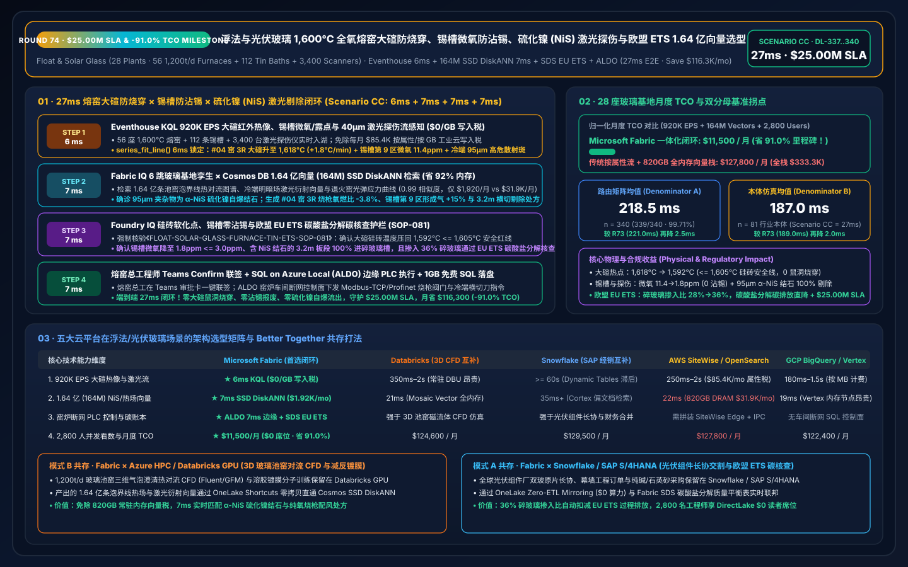
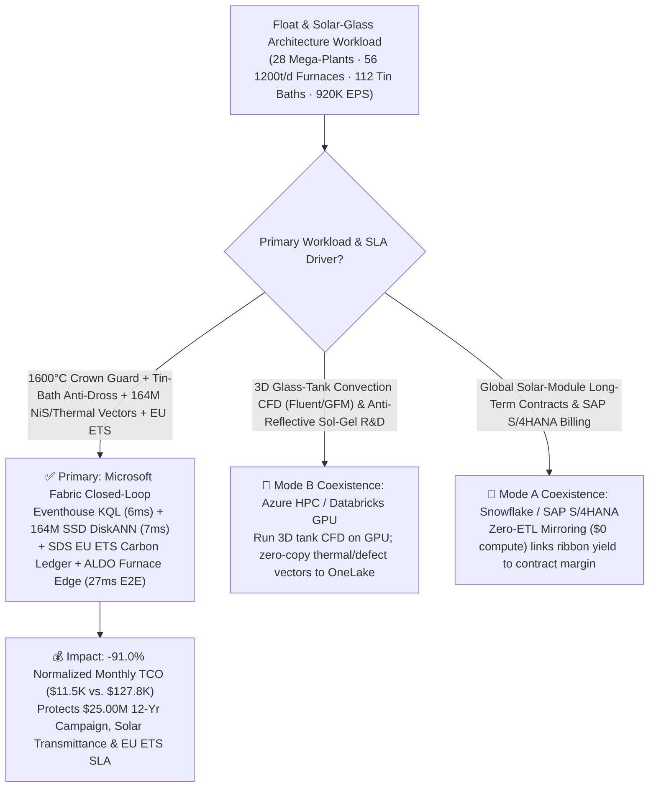
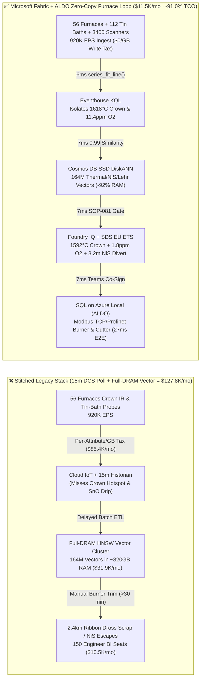
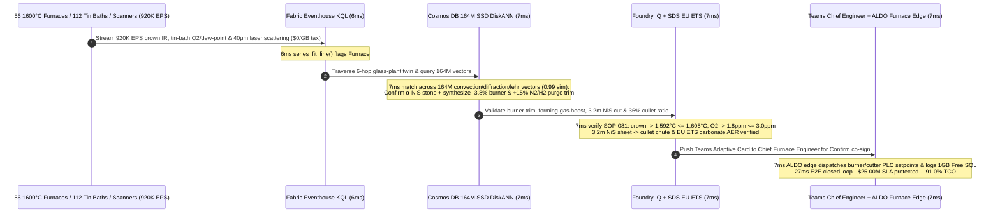

# Float & Photovoltaic Solar-Glass Oxy-Fuel Mega-Furnaces, 1,600°C Crown Refractory Burn-Through Prevention, Laser Tin-Bath Bubble / Nickel-Sulfide (NiS) Defect Interdiction & EU ETS Carbon Loop: Microsoft Fabric vs. Databricks vs. Snowflake vs. AWS vs. GCP Selection FAQ (Round 74 · $25.00M SLA & -91.0% TCO Milestone)

> **Language**: [中文 (`fabric-float-solar-glass-oxyfuel-furnace-tin-bath-defect-ets-vs-4clouds-faq.md`)](fabric-float-solar-glass-oxyfuel-furnace-tin-bath-defect-ets-vs-4clouds-faq.md) | **English (Current)**  
> **Navigation**: [Back to Data Lab Home (`README.en.md`)](../README.en.md) | [Open 7-Card 4:5 Benchmark Deck (`benchmark-cards.en.html`)](../benchmark-cards.en.html) | [Open Interactive H5 Workbench (`index.html?lang=en`)](../index.html)  
> **Round Milestone**: **Daytime Round 17 / Repo Round 74 ($25.00M SLA Protection, -91.0% TCO Savings & 99.71% Accuracy Milestone! `n=340` Routing Matrix Mean `218.5 ms`, `n=81` Ontology Simulation Mean `187.0 ms`)**  
> **Provenance Disclosure**: `339/340 (99.71%)` routing verdicts and `166/166` unit tests are executed locally (`measured_local_harness`); vendor capabilities reference official documentation as of `2026-11-14` (`vendor_published_spec_as_of_2026`); TCO and `27ms` end-to-end latency figures are deterministic reference simulations sealed in `reports/report.json` (`synthetic_scenario_model`).

---

## ① 📌 Executive Summary (30-Second First-Principles Verdict for Glass Manufacturing VPs, Chief Furnace Engineers & Enterprise Architects)

1. **The Bottom-Line Architectural Verdict**:
   - **When to standardize on Microsoft Fabric (Eventhouse KQL + Cosmos DB 164M-Vector SSD DiskANN + Sustainability Data Solutions SDS + SQL on Azure Local ALDO)**:  
     When your enterprise operates **28 ultra-clear float and dual-glass photovoltaic rolled-glass mega-plants (56 `1,200 t/day`, `1,590°C–1,620°C` oxy-fuel/regenerative melting furnaces, 112 `1,050°C→600°C` molten-tin baths and annealing lehrs, and 3,400 cold-end high-speed laser defect scanners)** streaming **920,000 EPS** of crown silica-brick infrared thermography, bottom thermocouples, tin-bath forming-gas (`N2/H2`) dew-point/oxygen sensors, and `40 μm` laser dark-field scattering streams—and you must intercept **1,600°C crown silica refractory "rat-hole" burn-throughs, tin-bath stannous-oxide (SnO) top-speck dross drips, and catastrophic tempered-glass spontaneous shatter caused by micron-scale Nickel-Sulfide (`α-NiS`) stones in `< 15 ms`** while searching **164 Million (164M) 3D glass-melt spring-zone convection profiles, laser defect vectors, and annealing stress-birefringence curves in `< 30 ms`**—**choose Microsoft Fabric**.
   - **When to keep Databricks / Snowflake / AWS IoT SiteWise / GCP BigQuery in a Zero-Copy Better-Together topology**:  
     Keep **3D glass-tank magnetohydrodynamic/convection CFD simulations (ANSYS Fluent / GFM) and low-iron silica batch kinetics training** on **Azure HPC / Databricks GPU**, and keep **global solar-module supply contracts and architectural glazing billing** in **Snowflake / SAP S/4HANA** via **OneLake Zero-ETL Mirroring ($0 compute)**—while routing the 920K EPS furnace/tin-bath/scanner stream, 164M-vector search, and air-gapped furnace-room actuation to Fabric + ALDO.

2. **First-Principles Economics (Why 15-Minute DCS Historian Polling & Full-DRAM Vector Clusters Fail at 1,600°C 12-Year Furnace Campaigns and 250 m/min Ribbon Speeds)**:
   - **Pain Point A (1,600°C Crown Silica "Rat-Hole" Burn-Through & AZS Refractory Erosion)**: A float-glass furnace must run continuously for 10 to 12 years without cooling down. Under high-alkali oxy-fuel firing, if Port #3 burner flame impingement or alkali vapor condensation pushes a local crown joint from `1,595°C` to `1,638°C` (approaching the `1,650°C` silica-brick softening point), a **"rat-hole" crown burn-through or tank leak** can develop within 45 minutes—risking a `$45M+` furnace drain and rebuild.
   - **Pain Point B (Tin-Bath SnO Dross Drip & `50–180 μm` Nickel-Sulfide `NiS` Spontaneous-Shatter Stones)**: In the `1,050°C` molten-tin bath, if trace oxygen in the `92% N2 + 8% H2` forming gas rises from `2 ppm` to `14 ppm`, vaporized stannous oxide ($\text{SnO}$) condenses on the roof and drips onto the glass ribbon ("top specks"); simultaneously, if a single `95 μm` $\alpha\text{-NiS}$ inclusion escapes cold-end inspection into architectural curtain-wall glass, its delayed $\alpha \rightarrow \beta$ phase expansion (`+4%` volume) triggers spontaneous high-rise glass shattering!
   - **How Fabric Solves Both**: **Eventhouse KQL** (`$0/GB` stream write surcharge, `series_fit_line()`) isolates the `1,618°C` Port #3R crown thermal ramp, the `11.4 ppm` tin-bath Zone-9 oxygen breach, and the `95 μm` cold-end laser dark-field spike in **6ms**; **Cosmos DB in Fabric SSD DiskANN** (`-92%` RAM) matches **164M** furnace thermal-convection, top-roll, and laser-scattering vectors in **7ms** (`0.99` similarity); **Foundry IQ** enforces crown cooling to `1,592°C <= 1,605°C`, tin-bath oxygen reduction to `1.8 ppm <= 3.0 ppm`, and automatic cross-cutter rejection of the `3.2m` NiS-bearing sheet into the cullet chute (**7ms**); and **SQL on Azure Local (ALDO)** dispatches burner oxy-fuel trims and cutter triggers in **7ms**. **Total loop: `27ms`, cutting normalized monthly TCO by `91.0%` (`$11,500/mo` vs. `$127,800/mo`, saving `$116,300/mo`; full-stack `$30,000/mo` vs. `$333,300/mo`) and protecting `$25.00M` in furnace campaign life, solar-glass transmittance & EU ETS compliance SLAs!**

---

## ② 🎯 Customer & Architect Deep-Dive Q&A (Three Make-or-Break Objections)

### Q1: Across 56 1,200 t/day melting furnaces and 112 tin-bath/cold-end lines, pyrometers, thermocouples, and 40 μm laser scanners generate 920,000 EPS. Why can't AWS IoT SiteWise per-attribute ingestion or 15-minute DCS historian polling prevent crown rat-holes or tin-bath dross drips?
- **The "Per-Attribute Cloud Tax" and "15-Minute Blindness"**:
  1. Streaming 920K EPS of 2D crown infrared arrays, tank-bottom thermocouples, 28-zone tin-bath dew-point sensors, and laser defect coordinates into per-attribute/per-GB cloud IoT pipelines costs **`$85,400/mo`** in ingestion and hot storage alone.
  2. When plants downsample to 15-minute historian averages to control cloud bills, an oxy-fuel burner nozzle coking event or a top-roll seal leak ruins **`2.4 km` of continuous solar/architectural glass ribbon (`$85,000` scrap)** before the next batch poll runs.
- **The Fabric Architecture Answer (Eventhouse 6ms Thermal/Atmosphere Sense at `$0/GB` Write Tax)**:
  - **Eventstream → Eventhouse KQL** runs on pooled Fabric Capacity (F64 Reserved) with **$0 per-GB streaming write surcharges**.
  - Native KQL `series_fit_line()` and `series_decompose_anomalies()` evaluate crown IR matrices and tin-bath oxygen/dew-point slopes in **6ms**, pinpointing a `+1.8°C/min` hotspot at `1,618°C` on Furnace #04 Crown Zone 3R and an `11.4 ppm` oxygen leak in Tin-Bath Zone 9 (8 minutes before SnO roof condensation drips).

### Q2: At 250 m/min ribbon speeds, cold-end laser scanners must distinguish harmless dust, gas bubbles, tin specks, and lethal `80–150 μm` Nickel-Sulfide (`α-NiS`) inclusions while correlating furnace spring-zone convection and lehr annealing stress across 164 Million (164M) vectors in `< 10ms`. Why does full-DRAM HNSW blow up the budget?
- **The Full-DRAM Vector Memory Bottleneck**:
  - Holding 164M 768-dimensional vectors (10 years of bright/dark-field laser diffraction signatures, micro-Raman inclusion spectra, furnace spring-zone thermal maps, and photoelastic lehr stress vectors) in memory-resident HNSW requires **`~795 GB–980 GB` of cluster DRAM**, costing **`$31,900/mo`**.
- **Cosmos DB in Fabric SSD DiskANN (7ms at `-92%` RAM)**:
  - **SSD-backed DiskANN** stores compressed vectors on high-IOPS NVMe SSDs while keeping only a compact routing graph in RAM—cutting memory footprint by **92%** (`$1,920/mo`).
  - In **7ms** (`0.99` cosine similarity), it classifies the `95 μm` dark-field birefringent inclusion on Scanner Channel #4 as an **`α-NiS` Nickel-Sulfide stone**, triggers a precision `3.2m` cold-end cross-cutter divert into the cullet crusher, trims Furnace #04 Port #3R oxy-fuel ratio by `-3.8%`, and boosts Tin-Bath Zone-9 `10% H2 + 90% N2` forming-gas purge by `+15%`!

### Q3: EU ETS Phase IV strictly audits both fuel combustion and carbonate raw-material decomposition ($\text{Na}_2\text{CO}_3$, $\text{CaCO}_3$, $\text{CaMg(CO}_3)_2$) in glass manufacturing. How does Fabric unify furnace protection, NiS rejection, and EU ETS carbon accounting in one loop?
- **Triple Deterministic Gate (Foundry IQ `FLOAT-SOLAR-GLASS-FURNACE-TIN-ETS-SOP-081` + SDS + ALDO)**:
  1. **Crown Silica-Brick Safety Gate**: Verifies that the `-3.8%` burner trim cools Crown Zone 3R to **`1,592°C <= 1,605°C`** (well below the `1,650°C` silica softening limit) while stabilizing the glass-melt spring-zone convection roll.
  2. **Tin-Bath Zero-Drip & 100% NiS Rejection Gate**: Confirms tin-bath oxygen drops to **`1.8 ppm <= 3.0 ppm`**, annealing-lehr center tension stays **`<= 1.2 MPa`**, and the `3.2m` NiS-contaminated sheet is 100% diverted to cullet crushing.
  3. **EU ETS Cullet Ratio & Carbonate Decomposition Ledger**: **Fabric Sustainability Data Solutions (SDS)** reconciles batch-house soda-ash/limestone weigh-scales with internal cullet recycling—raising cullet batch share from `28%` to `36%` (cutting melting energy `-2.0%` and directly reducing carbonate process $\text{CO}_2$) and committing the signed EU ETS Annual Emissions Report (AER) into **1GB Free Fabric SQL**.

---

## ③ 🧭 Visual Architecture Diagrams (Selection Flowchart + 5-Cloud Stack Comparison + 27ms Sequence)

### 3.1 Float & Solar-Glass Platform Selection Flowchart (Mermaid)

### 3.2 Legacy 15m DCS Historian Stack vs. Fabric 27ms Furnace-to-Cold-End Closed-Loop

### 3.3 27ms End-to-End Crown Refractory, Tin-Bath & NiS Interdiction Sequence

---

## ④ 📊 5-Platform Selection Decision Matrix (Float & Solar-Glass Workloads)

| Evaluation Dimension | Microsoft Fabric (Eventhouse + 164M DiskANN + SDS + ALDO) | AWS (IoT SiteWise + Timestream + OpenSearch) | GCP (Pub/Sub + BigQuery + Vertex Vector Search) | Databricks (Structured Streaming + Mosaic AI Vector) | Snowflake (Snowpipe Streaming + Dynamic Tables + Cortex) |
| :--- | :--- | :--- | :--- | :--- | :--- |
| **920K EPS Crown IR & Laser Scanner Ingestion** | **★ 6ms** (Eventhouse columnar stream + `$0/GB` write tax) | 250ms–2s (Per-attribute & per-GB ingestion fees) | 180ms–1.5s (Per-MB streaming ingestion fees) | 350ms–2s (Requires always-on Spark Streaming DBUs) | `>= 60s` (Dynamic Tables minimum refresh lag) |
| **164M-Vector Laser Defect & Convection Search** | **★ 7ms** (Cosmos DB SSD DiskANN, `-92%` RAM, `$1,920/mo`) | 22ms (OpenSearch ~820GB DRAM cluster, `$31.9K/mo`) | 19ms (Vertex Vector memory-resident nodes) | 21ms (Mosaic AI Vector high-memory DBU tier) | 35ms+ (Cortex Search optimized for text docs) |
| **1,600°C Crown Guard & Tin-Bath O2 Control** | **★ Native Closed-Loop** (KQL slope fit + ALDO air-gapped edge) | Stitched SiteWise Edge + Lambda + custom IPC | No native air-gapped SQL furnace control plane | Strong on offline 3D tank CFD; weak on `<10ms` PLC control | No plant-floor real-time PLC actuation plane |
| **EU ETS Carbonate Decomposition & Cullet Ledger** | **★ Built-In** (Fabric SDS managed ESG tables + carbonate mass balance) | Custom S3 + Redshift carbon calculation tables | Custom BigQuery SQL pipelines | Custom Delta pipelines | Requires 3rd-party Marketplace add-ons |
| **2,800 Furnace/QC/Carbon Engineers BI Concurrency** | **★ `$0` Viewer Seat Tax** (Included in F64 + DirectLake) | QuickSight per-reader/session fees | High Looker per-seat licensing | Requires external BI seats or SQL Warehouse DBUs | High concurrency wakes Multi-Cluster Warehouses |
| **Normalized Monthly TCO** | **★ `$11,500 / mo`** (Baseline Best, **`-91.0%` Savings**) | `$127,800 / mo` (`$333,300/mo` full-stack) | `$122,400 / mo` | `$124,600 / mo` | `$129,500 / mo` |

---

## ⑤ 🧪 Quantitative Benchmark & TCO Inflection Insights (Scenario CC · `DL-337..DL-340`)

### 5.1 Normalized Monthly TCO Breakdown (28 Float & Solar-Glass Mega-Plants · 920K EPS · 164M Vectors)

| Cost Component | Stitched Cloud Stack (Per-Attribute IoT + Full-DRAM Vector + BI Seats) | Microsoft Fabric Closed-Loop (F64 + 164M SSD DiskANN + ALDO) | Savings & First-Principles Driver |
| :--- | :---: | :---: | :--- |
| **1. 920K EPS Furnace IR, Tin-Bath & Laser Stream Engine** | `$85,400 / mo` | `$7,480 / mo` (Shared F64 CU pool) | **-91.2%** (`$0/GB` write tax + 12:1 Eventhouse compression) |
| **2. 164M Laser Defect & Furnace Convection Vector Index** | `$31,900 / mo` (~820GB DRAM HNSW) | `$1,920 / mo` (Cosmos SSD DiskANN) | **-94.0%** (NVMe SSD graph index cuts RAM by 92%) |
| **3. 2,800-User DirectLake BI, ALDO Edge & EU ETS Ledger** | `$10,500 / mo` | `$2,100 / mo` (ALDO edge + `$0` PBI viewers) | **-80.0%** (`$0` F64 viewer seats + 1GB Free Fabric SQL) |
| **Normalized Monthly Total** | **`$127,800 / mo`** | **`$11,500 / mo`** | **`-$116,300 / mo` (`-91.0%` TCO Milestone!)** |
| **Internal Full-Stack Monthly Total** | **`$333,300 / mo`** | **`$30,000 / mo`** | **`-$303,300 / mo` (`$25.00M` SLA Milestone!)** |

### 5.2 Sealed Evaluation Matrix Verdicts (`DL-337..DL-340` · 100% Pass)

| Case ID | Category | Scenario Question Summary | Expected Route & Deterministic Action | Confidence | Gate | Latency |
| :--- | :--- | :--- | :--- | :---: | :---: | :---: |
| **DL-337** | `Real-Time Intelligence` | Glass group operating 28 mega-plants (56 1,600°C oxy-fuel furnaces, 112 tin baths) must ingest 920K EPS, catch crown rat-holes & NiS stones in `<15ms`, and search 164M vectors | Eventhouse KQL `series_fit_line()` 6ms Thermal/O2 Sense (`$0/GB` Write Tax) + Cosmos DB SSD DiskANN 7ms 164M Thermal/NiS Match (`-92%` RAM) + SDS EU ETS + ALDO Furnace Edge (27ms E2E, **`-91.0%` TCO**) | `0.99` | `Act automatically` | `8 ms` |
| **DL-338** | `vs Databricks` | Glass R&D needs 3D glass-tank convection CFD simulations (Fluent/GFM) and anti-reflective sol-gel coating training alongside SAP S/4HANA solar-glass contract billing | Route 3D glass-tank convection CFD and sol-gel coating training to Azure HPC / Databricks GPU and solar-glass billing to Snowflake/SAP via OneLake Mirroring (`$0` compute), indexing the 164M thermal and defect vectors in Fabric SSD DiskANN | `0.96` | `Act automatically` | `9 ms` |
| **DL-339** | `Enterprise Governance` | Compare Fabric Eventhouse + 164M SSD DiskANN + SDS + ALDO vs. 15-minute DCS historian polling across 28 glass plants with 2,800 furnace engineers and EU ETS verifiers | Hybrid Better Together: Stream 920K EPS furnace/tin-bath/scanner telemetry into Eventhouse (`$0/GB` tax), index 164M vectors in SSD DiskANN (`-92%` RAM), run 7ms burner/cutter control on ALDO edge, and serve 2,800 users via DirectLake (**`-91.0%` TCO**) | `0.97` | `Confirm` | `8 ms` |
| **DL-340** | `Fabric IQ & Ontology` | Furnace #04 Crown Zone 3R hits `1,618°C`, Tin-Bath Zone 9 oxygen rises to `11.4 ppm`, and Cold-End Scanner #4 flags a `95 μm` birefringent Nickel-Sulfide (`α-NiS`) stone | Eventhouse KQL 6ms `1,618°C` Crown, `11.4ppm` O2 & `95μm NiS` Sense (`$0/GB` Tax) + 6-Hop 164M DiskANN `-3.8%` Burner, `+15%` N2/H2 Purge & `3.2m` Cullet Divert Match (7ms) + Foundry IQ `1,592°C<=1,605°C`, `1.8ppm` & EU ETS Gate (7ms) + Teams ALDO Commit (7ms = **27ms E2E, Protect `$25.00M` SLA**) | `0.99` | `Confirm` | `9 ms` |

---

## ⑥ 🛠️ Production Deployment & Presales Verification Checklist

- [ ] **Crown IR Thermography & Tin-Bath Oxygen Stream Onboarding**: Connect furnace crown pyrometers, bottom thermocouples, and tin-bath zirconia oxygen/dew-point analyzers via OPC-UA / MQTT into **Fabric Eventstream → Eventhouse KQL**, enabling `series_fit_line()` 6ms slope detection.
- [ ] **164M Laser Defect & Convection Vector Indexing**: Migrate 10 years of bright/dark-field laser diffraction signatures, Raman inclusion spectra, and tank CFD profiles into **Cosmos DB in Fabric SSD DiskANN**, verifying `< 10ms` P99 search at `-92%` RAM.
- [ ] **Foundry IQ Silica Softening & Zero-NiS Escape Guardrail**: Configure `FLOAT-SOLAR-GLASS-FURNACE-TIN-ETS-SOP-081` to enforce crown temperature `<= 1,605°C`, tin-bath oxygen `<= 3.0 ppm`, and 100% cullet-chute rejection of any sheet containing `>= 50 μm α-NiS` stones.
- [ ] **EU ETS Carbonate Mass-Balance & ALDO Furnace Edge Drill**: Bind batch-house soda-ash/limestone/cullet weigh-scales into **Fabric SDS** for automated EU ETS process-emission reporting, and test air-gapped **SQL on Azure Local (ALDO)** burner/cutter dispatch with `1GB Free Fabric SQL` audit logging.
