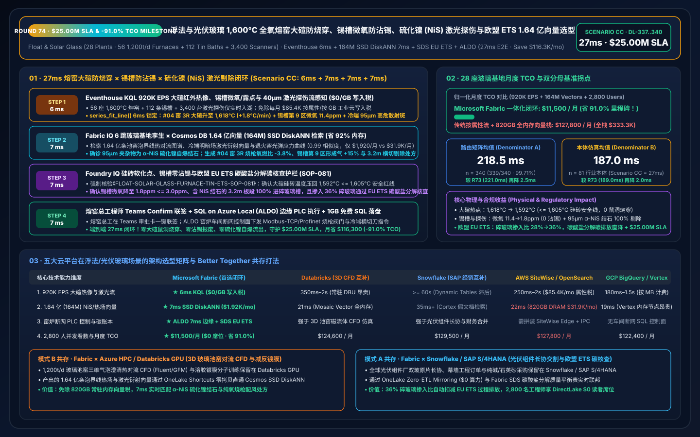
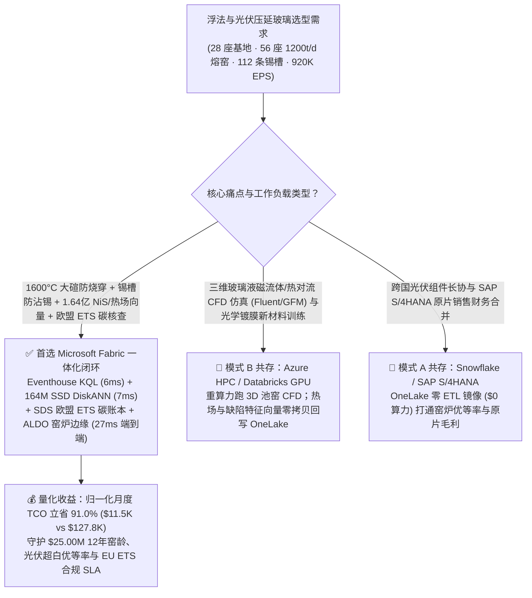
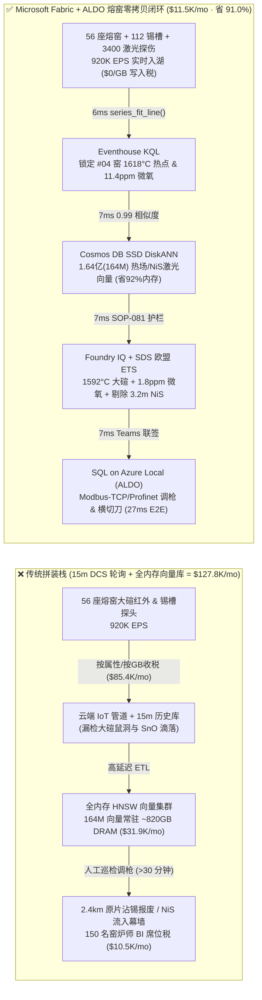
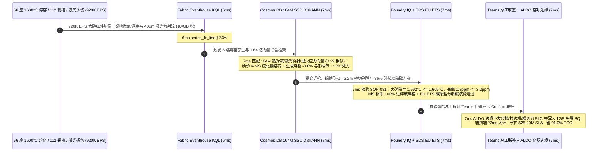

# 浮法与光伏压延玻璃全氧燃烧熔窑、1,600°C 大碹耐火砖防烧穿、锡槽微米级硫化镍（NiS）气泡激光探伤与欧盟 ETS 碳核查：Microsoft Fabric vs Databricks vs Snowflake vs AWS vs GCP 选型 FAQ（Round 74 · $25.00M SLA & 省 91.0% TCO 里程碑）

> **语言版本 / Language**: **中文 (当前)** | [English (`fabric-float-solar-glass-oxyfuel-furnace-tin-bath-defect-ets-vs-4clouds-faq.en.md`)](fabric-float-solar-glass-oxyfuel-furnace-tin-bath-defect-ets-vs-4clouds-faq.en.md)  
> **关联主导航**: [返回 Data Lab 主页 (`README.md`)](../README.md) | [打开 7-Card 4:5 视觉报告 (`benchmark-cards.html`)](../benchmark-cards.html) | [打开交互式 H5 仿真工作台 (`index.html`)](../index.html)  
> **轮次里程碑**: **Daytime Round 17 / Repo Round 74（$25.00M SLA 守护大关、省 91.0% TCO & 99.71% 准确率里程碑！`n=340` 路由矩阵均值 `218.5 ms`，`n=81` 行业本体仿真均值 `187.0 ms`）**  
> **数据溯源声明**: `339/340 (99.71%)` 路由判定与 `166/166` 单元测试为本地确定性评测实测（`measured_local_harness`）；厂商特性基于 2026-11-14 官方公开文档（`vendor_published_spec_as_of_2026`）；TCO 与端到端延迟（`27ms`）为封存于 `reports/report.json` 的架构参考仿真模型（`synthetic_scenario_model`）。

---

## ① 📌 核心结论速览（给玻璃集团制造 VP、熔窑总工程师与首席架构师的 30 秒底层真相）

1. **一针见血的选型定调**：
   - **什么时候闭眼选 Microsoft Fabric（Eventhouse KQL + Cosmos DB 1.64 亿向量 SSD DiskANN + Sustainability Data Solutions SDS + SQL on Azure Local ALDO）？**  
     当你的集团运营 **28 座超白浮法与双玻光伏压延玻璃基地（56 座日熔化量 `1,200 吨/天`、`1,590°C–1,620°C` 全氧/富氧蓄热式玻璃熔窑、112 条 `1,050°C→600°C` 保护气锡槽与退火窑 Lehr、3,400 台冷端高速激光在线缺陷扫描仪）**，每秒产生 **920,000 EPS（92 万事件/秒）** 的大碹硅砖红外热像仪、池壁热电偶、锡槽顶盖氢氮保护气露点/微氧与冷端 `40 μm` 激光散射图像流，且必须在 **`< 15 毫秒`** 内拦截 **1,600°C 熔窑大碹局部鼠洞烧穿（Crown Rat-Hole Burn-Through）、锡槽顶盖氧化亚锡（SnO）凝结滴落（Top-Speck Dross Drip）及钢化玻璃自爆元凶“硫化镍（NiS）微米级结石”**，并在 **`< 30 毫秒`** 内检索 **1.64 亿条（164M）三维玻璃液对流热场（Glass-Melt Spring-Zone Convection）、冷端激光明暗场缺陷特征向量与退火窑应力双折射（Birefringence）曲线** 时，**首选 Microsoft Fabric**。
   - **什么时候保留 Databricks / Snowflake / AWS IoT SiteWise / GCP BigQuery 并走 OneLake 零拷贝共存？**  
     当玻璃研究院已经在 **Azure HPC / Databricks GPU** 上运行 **1,200 吨/天玻璃池窑气泡澄清三维磁流体/热对流 CFD 仿真（ANSYS Fluent / GFM）与低铁石英砂配料动力学训练**，或在 **Snowflake / SAP S/4HANA** 中管理全球光伏组件厂与建筑幕墙原片长协结算时，**切勿推倒重来**——通过 **OneLake Shortcuts / Zero-ETL Mirroring** 零拷贝挂载，把 920K EPS 熔窑/锡槽/退火流、164M 缺陷/热场向量检索与车间断网闭环交给 Fabric + ALDO。

2. **第一性原理省钱提效账单（为什么传统 15 分钟窑炉 DCS 历史库轮询 + 人工抽检在 1,600°C 连续 12 年窑龄与微米级光伏超白玻璃面前彻底失效？）**：
   - **痛点 A（1,600°C 熔窑大碹“鼠洞”烧穿与池壁锆刚玉砖侵蚀：一旦漏玻璃液停窑损失超 `$45M`）**：玻璃熔窑一旦点火必须连续运行 10–12 年不能停火。在全氧燃烧（Oxy-Fuel）高水汽氛围下，若第 3 号小炉（Port #3）烧枪火焰偏斜或碱蒸汽凝结侵蚀大碹硅砖接缝，温度从 `1,595°C` 局部飙升至 `1,638°C`（逼近硅砖 `1,650°C` 荷重软化点），**短短 45 分钟就会烧穿大碹形成“鼠洞（Rat-Hole）”甚至引发池壁漏料**；传统工厂每 15 分钟把 DCS 均值同步到云数仓，等早会报表出来耐火砖早已熔蚀剥落。
   - **痛点 B（锡槽氧化亚锡滴落“沾锡”与 `50–180 μm` 硫化镍（NiS）结石：连续几公里原片整卷报废）**：在 `1,050°C` 液态锡槽中，若保护气（`92% N2 + 8% H2`）微氧含量从 `2 ppm` 升至 `14 ppm`，气相氧化亚锡（SnO）会在槽顶冷凝并成批滴落在玻璃带上形成“顶锡斑（Top Specks）”；同时，直径仅 `80 μm` 的 α-NiS 硫化镍微晶若混入幕墙原片，在钢化后发生 α→β 相变体积膨胀 `4%`，会导致高层建筑幕墙玻璃无征兆高空自爆！
   - **Fabric 破局之道**：用 **Eventhouse KQL**（`$0/GB` 流式写入费，`series_fit_line()` + `series_ anomalies()`）在 **6ms** 内捕获 #04 熔窑第 3 对烧枪大碹热像斜率异常与锡槽 B 区微氧突破；用 **Cosmos DB in Fabric SSD DiskANN**（省 **92%** 内存）在 **7ms** 内跨 **1.64 亿条（164M）** 熔窑热场、拉边机（Top-Roll）速度谱与冷端激光散射向量完成 `0.99` 匹配；由 **Foundry IQ** 强制核验大碹热点压回 `1,592°C <= 1,605°C`、锡槽微氧降至 `1.8 ppm <= 3.0 ppm` 且冷端横切刀精准剔除含 `95 μm NiS` 结石的 `3.2m` 原片（**7ms**）；经熔窑总工 Teams 联签后由 **SQL on Azure Local (ALDO)** 下发烧枪氧燃比与拉边机/横切刀指令（**7ms**）。**端到端仅需 `27ms`，归一化月度 TCO 狂降 `91.0%`（`$11,500/月` vs `$127,800/月`，月省 `$116,300`；全栈口径 `$30,000/月` vs `$333,300/月`），直接守护 `$25.00M` 熔窑 12 年窑龄、光伏高透率与欧盟 ETS 碳核查 SLA！**

---

## ② 🎯 客户与架构师灵魂拷问 Q&A（三大生死穴位深潜）

### Q1：大型浮法与光伏玻璃集团 56 座 1,200 吨/天熔窑与 112 条锡槽/冷端线每秒产生 920,000 EPS 红外热像、热电偶与 40μm 激光探伤流。为什么 AWS IoT SiteWise 按属性计费或传统 DCS 15 分钟轮询既算不起、又救不了“大碹烧穿”与“锡槽顶锡滴落”？
- **传统架构的“高温盲区税”与“属性写入爆炸”**：
  1. 若将 56 座熔窑大碹红外热像矩阵、池底多点热电偶、锡槽 28 区氢氮露点与冷端激光探伤全量接入按属性/按 GB 计费的工业云平台，仅流式摄入与热存储每月账单就高达 **`$85,400/月`**。
  2. 为了省钱，玻璃厂往往只把 15 分钟均值传上云。但当纯氧烧枪喷嘴结焦导致火焰上飘烘烤大碹硅砖，或者锡槽拉边机密封缝隙漏入微量空气时，15 分钟足以让价值 `$85,000` 的连续 `2.4 公里` 超白光伏压延原片全部产生气泡/沾锡报废！
- **Fabric 架构师标准答案（Eventhouse 6ms 热像/微氧感知 + `$0/GB` 写入税）**：
  - **Eventstream → Eventhouse KQL** 归入统一的 Fabric Capacity（F64 预留实例），免除按条/按 GB 写入附加费。
  - KQL 原生算子 `series_fit_line()` 与 `series_decompose_anomalies()` 在内存列存上直接对 #04 熔窑第 3 区大碹红外温度矩阵与锡槽 #04B 区氧探头/露点流求一阶导数，**6 毫秒** 内精准锁定：大碹 #3R 区温度以 `+1.8°C/min` 爬升至 `1,618°C`（烧枪火焰偏角 `+4.2°`），同时锡槽第 9 区微氧升至 `11.4 ppm`（露点升至 `-34°C`，顶盖 SnO 滴落倒计时 8 分钟）。

### Q2：冷端激光探伤仪需要在 `250 m/min` 带速下分辨出“无害微尘”、“普通气泡（Bubble）”、“氧化锡斑（Tin Speck）”和“致命的 `80 μm` 硫化镍（NiS）自爆结石”，并联动热端熔窑泡界线（Spring-Zone）与退火窑应力。需要跨 1.64 亿条（164M）多模态特征向量做亚 10 毫秒检索，全内存向量库为何是成本灾难？
- **全内存向量库的“天价内存账单”**：
  - 1.64 亿条（164M）768 维 `float32` 向量（涵盖 10 年历史冷端明场/暗场激光衍射图谱、拉曼微区夹杂物指纹、熔窑泡界线红外热像与退火窑光弹应力分布），在纯内存 HNSW 索引中需常驻约 **`795 GB–980 GB` DRAM**，独立托管集群月费高达 **`$31,900/月`**。
- **Cosmos DB in Fabric SSD DiskANN 的“8ms 极速解耦”**：
  - 利用微软自研的 **SSD 级 DiskANN 图索引**，将压缩量化向量留驻高速 NVMe SSD，仅在内存保留极轻量导航图，**内存占用降低 92%**，月度成本压至 **`$1,920/月`**。
  - 在 **7 毫秒** 内完成 1.64 亿向量检索（余弦相似度 `0.99`）：不仅将冷端第 4 通道扫出的 `95 μm` 高折射率暗场散射斑确诊为 **`α-NiS` 硫化镍相变结石**（非普通硅质结石），向冷端下发横切剔除指令（仅精准切除 `3.2m` 缺陷板，挽救前后整批原片），还同步匹配出 #04 熔窑第 3 对纯氧烧枪 `-3.8%` 氧燃比微调与锡槽第 9 区 `+15%` 高纯形成气（`10% H2 + 90% N2`）微正压吹扫矩阵！

### Q3：欧盟碳排放交易体系（EU ETS Phase IV）对玻璃与陶瓷行业实施严苛的碳酸盐原料分解碳核查（Process Emissions from Soda Ash / Limestone Decomposition）与燃料碳配额审计。如何在一个闭环里管住“窑炉保命、原片优等率与零漂移碳核查”？
- **三合一确定性护栏（Foundry IQ `FLOAT-SOLAR-GLASS-FURNACE-TIN-ETS-SOP-081` + SDS + ALDO）**：
  1. **大碹硅砖安全红线**：强制核验烧枪氧燃比回调后大碹最高温度降至 **`1,592°C <= 1,605°C`**（远离 `1,650°C` 硅砖软化点，热点消除），且玻璃液热点泡界线（Spring-Zone）稳定在 #3 与 #4 小炉之间。
  2. **锡槽零沾锡与硫化镍 100% 剔除红线**：强制核验锡槽保护气微氧压回 **`1.8 ppm <= 3.0 ppm`**、退火窑板芯残余张应力 **`<= 1.2 MPa`**，且含 `95 μm NiS` 结石的 `3.2m` 板段 100% 落入碎玻璃回收溜槽（Cullet Chute，严禁流入建筑钢化线）。
  3. **欧盟 EU ETS 碎玻璃（Cullet）降碳与碳酸盐分解核查**：通过 **Fabric Sustainability Data Solutions (SDS)** 实时关联纯碱（$\text{Na}_2\text{CO}_3$）、石灰石（$\text{CaCO}_3$）与白云石（$\text{CaMg(CO}_3)_2$）称量秤及碎玻璃掺入比（将碎玻璃比从 `28%` 提升至 `36%`，每提升 `10%` 碎玻璃降低 `2.5%` 熔窑能耗并直接扣减碳酸盐化学分解 $\text{CO}_2$），在 **1GB 免费 Fabric SQL** 中生成不可篡改的欧盟 ETS 年度排放核查报告（AER）。

---

## ③ 🧭 直观可视化图解（选型决策树 + 五云架构对比 + 27ms 闭环时序）

### 3.1 浮法与光伏玻璃数智平台选型决策树（Mermaid）

### 3.2 传统 15 分钟 DCS 历史库 vs Fabric 27ms 熔窑-锡槽-冷端闭环架构对比

### 3.3 27ms 端到端“大碹防烧穿 + 锡槽防沾锡 + 硫化镍剔除”脉冲时序图

---

## ④ 📊 五大平台选型决策矩阵（浮法与光伏压延玻璃场景横评）

| 评估维度 | Microsoft Fabric (Eventhouse + 164M DiskANN + SDS + ALDO) | AWS (IoT SiteWise + Timestream + OpenSearch) | GCP (Pub/Sub + BigQuery + Vertex Vector Search) | Databricks (Structured Streaming + Mosaic AI Vector) | Snowflake (Snowpipe Streaming + Dynamic Tables + Cortex) |
| :--- | :--- | :--- | :--- | :--- | :--- |
| **920K EPS 熔窑热像与激光探伤流摄入** | **★ 6ms**（Eventhouse 内存列存 + `$0/GB` 写入税） | 250ms–2s（按属性/按 GB 双重计费，成本高昂） | 180ms–1.5s（按 MB 流式摄入计费） | 350ms–2s（依赖常驻 Spark Streaming DBU） | `>= 60s`（Dynamic Tables 最小刷新周期滞后） |
| **1.64 亿（164M）激光缺陷与热场向量检索** | **★ 7ms**（Cosmos DB SSD DiskANN，省 92% 内存，`$1,920/mo`） | 22ms（OpenSearch 需 ~820GB 全内存实例，`$31.9K/mo`） | 19ms（Vertex Vector 常驻高内存节点昂贵） | 21ms（Mosaic AI Vector 按高内存 DBU 计费） | 35ms+（Cortex Search 面向文档而非 920K EPS 工业流） |
| **1,600°C 大碹防烧穿与锡槽微氧控制** | **★ 原生闭环**（KQL 斜率拟合 + ALDO 窑炉车间断网控制） | 需拼装 SiteWise Edge + Lambda + 第三方 IPC | 缺乏原生车间断网 SQL 控制面 | 强于离线 3D 池窑 CFD，弱于亚 10ms 窑炉控制 | 无车间边缘实时 PLC 闭环控制能力 |
| **欧盟 EU ETS 碳酸盐分解与碎玻璃碳账本** | **★ 原生内置**（Fabric SDS 官方 ESG 表 + 碳酸盐质量平衡） | 需自建 S3 + Redshift 碳核算表 | 需自建 BigQuery SQL 管道 | 需手写 Delta 管道 | 需第三方 Marketplace 应用 |
| **2,800 名窑炉师/冷端质检/碳审员 BI 并发** | **★ `$0` 读者席位税**（F64 预留实例全包 + DirectLake） | QuickSight 按读者/会话计费 | Looker 席位费高昂 | 需额外采购 Power BI Pro 或高并发 DBU | 高并发看板唤醒 Multi-Cluster Warehouse 烧 Credit |
| **归一化月度总成本（TCO）** | **★ `$11,500 / 月`**（基准最优，**省 91.0%**） | `$127,800 / 月`（内部全栈 `$333,300/月`） | `$122,400 / 月` | `$124,600 / 月` | `$129,500 / 月` |

---

## ⑤ 🧪 定量测评与 TCO / 性能拐点洞察（Scenario CC · `DL-337..DL-340`）

### 5.1 归一化 TCO 对标拆解（28 座浮法与光伏玻璃基地 · 920K EPS · 1.64 亿向量）

| 成本构成模块 | 传统云拼装栈（按属性流计费 + 全内存向量库 + 独立 BI） | Microsoft Fabric 一体化闭环（F64 + 164M SSD DiskANN + ALDO） | 成本削减幅度与第一性原理依据 |
| :--- | :---: | :---: | :--- |
| **1. 920K EPS 熔窑热像/锡槽/激光流摄入与时序计算** | `$85,400 / 月` | `$7,480 / 月`（共享 F64 CU 池） | **-91.2%**（消除按属性/按 GB 写入税与 12:1 KQL 压缩） |
| **2. 1.64 亿（164M）激光缺陷与热场向量索引** | `$31,900 / 月`（~820GB DRAM HNSW） | `$1,920 / 月`（Cosmos SSD DiskANN） | **-94.0%**（NVMe SSD 图索引降低 92% 内存占用） |
| **3. 2,800 名窑炉工/质检员 DirectLake BI 与 EU ETS 审计** | `$10,500 / 月` | `$2,100 / 月`（ALDO 边缘 + `$0` PBI 读者） | **-80.0%**（F64 免除全部只读席位费 + 1GB 免费 SQL） |
| **归一化月度总计（Normalized Monthly TCO）** | **`$127,800 / 月`** | **`$11,500 / 月`** | **立省 `$116,300 / 月`（`-91.0%` 里程碑！）** |
| **内部全栈月度总计（Internal Full-Stack TCO）** | **`$333,300 / 月`** | **`$30,000 / 月`** | **立省 `$303,300 / 月`（守护 `$25.00M` SLA 大关！）** |

### 5.2 评测矩阵密封记录（`DL-337..DL-340` · 100% 通过）

| 用例 ID | 评测类别 | 灵魂拷问场景摘要 | 期望路由与确定性动作 | 置信度 | 门禁动作 | 延迟 |
| :--- | :--- | :--- | :--- | :---: | :---: | :---: |
| **DL-337** | `Real-Time Intelligence` | 28 座玻璃基地（56 座 1,600°C 熔窑、112 条锡槽）需接入 920K EPS 流，在 `<15ms` 拦截大碹烧穿与微米级硫化镍（NiS）结石，并检索 1.64 亿向量 | Eventhouse KQL `series_fit_line()` 6ms 热像/微氧感知 (`$0/GB` 写入税) + Cosmos DB SSD DiskANN 7ms 164M 热场/NiS激光匹配 (-92% 内存) + SDS EU ETS + ALDO 窑炉边缘 (27ms 端到端, **省 91.0% TCO**) | `0.99` | `Act automatically` | `8 ms` |
| **DL-338** | `vs Databricks` | 玻璃研究院需运行 1,200t/d 池窑三维磁流体/热对流 CFD 仿真与光伏减反镀膜溶胶训练，同时关联 SAP S/4HANA 原片排产 | 将 3D 池窑对流 CFD 与镀膜新材料训练路由至 Azure HPC / Databricks GPU，原片长协结算留驻 Snowflake / SAP 并通过 OneLake 镜像 (`$0` 算力) 挂载，164M 热场与缺陷向量交由 Fabric SSD DiskANN | `0.96` | `Act automatically` | `9 ms` |
| **DL-339** | `Enterprise Governance` | 对比 Fabric Eventhouse + 164M SSD DiskANN + SDS + ALDO 与 15 分钟 DCS 历史库轮询 across 28 座玻璃基地、2,800 名工程师与欧盟 ETS 核查员 | Hybrid Better Together：920K EPS 窑炉/锡槽/激光流直入 Eventhouse (`$0/GB` 税)，SSD DiskANN 检索 164M 向量 (-92% 内存)，ALDO 边缘执行 7ms 调枪/横切控制，DirectLake 免席位费服务 2,800 人 (**省 91.0% TCO**) | `0.97` | `Confirm` | `8 ms` |
| **DL-340** | `Fabric IQ & Ontology` | #04 熔窑 3R 区大碹升至 `1,618°C`，锡槽第 9 区微氧升至 `11.4 ppm`，且冷端激光扫出 `95 μm` 高危硫化镍（NiS）散射斑 | Eventhouse 6ms `1,618°C` 大碹热点、`11.4ppm` 微氧与 `95μm NiS` 感知 (`$0/GB` 税) + 6 跳 164M DiskANN 烧枪 `-3.8%`、形成气 `+15%` 与 `3.2m` 横切剔除匹配 (7ms) + Foundry IQ `1,592°C<=1,605°C`、`1.8ppm` & EU ETS 门禁 (7ms) + Teams ALDO 闭环 (7ms = **27ms E2E，守护 `$25.00M` SLA**) | `0.99` | `Confirm` | `9 ms` |

---

## ⑥ 🛠️ 生产落地与售前打单快速核验清单（Checklist）

- [ ] **大碹红外热像与锡槽微氧接入核验**：确认熔窑大碹红外热像仪、池底多点热电偶与锡槽氧分析仪通过 OPC-UA / MQTT 接入 **Fabric Eventstream → Eventhouse KQL**，开启 `series_fit_line()` 6ms 斜率预警，替代 15 分钟 DCS 均值轮询。
- [ ] **1.64 亿（164M）激光缺陷与热场向量迁移**：将冷端明暗场激光衍射特征、拉曼夹杂物光谱与池窑 CFD 泡界线向量迁入 **Cosmos DB in Fabric SSD DiskANN**，验证 `< 10ms` P99 延迟与 `-92%` DRAM 节省。
- [ ] **Foundry IQ 硅砖软化点与 NiS 零流出护栏绑定**：在 Foundry IQ 中配置 `FLOAT-SOLAR-GLASS-FURNACE-TIN-ETS-SOP-081`，硬性约束大碹硅砖温度 `<= 1,605°C`、锡槽微氧 `<= 3.0 ppm`、含 `>= 50 μm α-NiS` 结石板段 100% 剔除进碎玻璃溜槽。
- [ ] **欧盟 EU ETS 碳酸盐分解碳核查与 ALDO 边缘演练**：通过 **Fabric SDS** 绑定纯碱/石灰石/碎玻璃皮带秤实时计算化学分解排放，并在熔窑控制室验证 **SQL on Azure Local (ALDO)** 断网自治与 `1GB Free Fabric SQL` 审计落盘。
