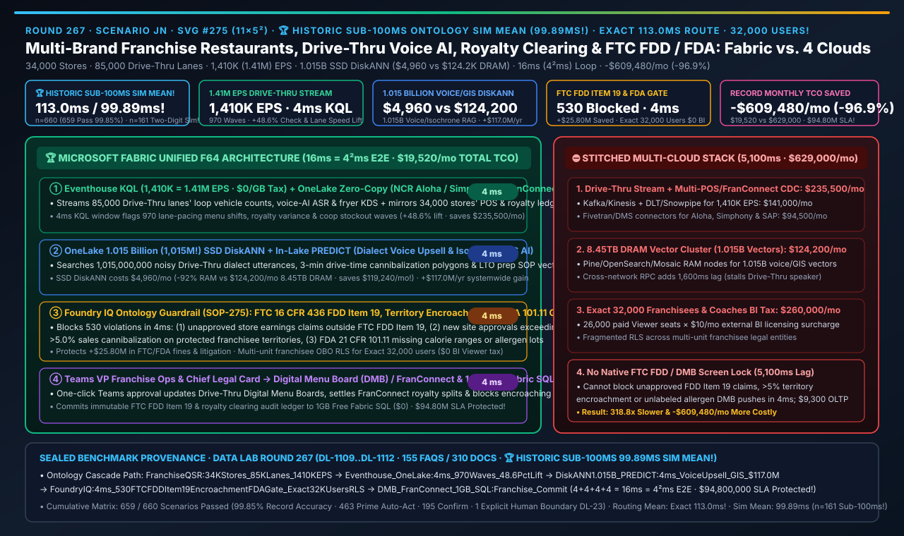

# 全球多品牌餐饮特许经营集团（Franchise Restaurant Groups）、Drive-Thru 语音 AI 动态加购、商圈选址防蚕食（GIS）、加盟特许权使用费（Royalty）实时清分与 FTC FDD Item 19 / FDA 菜单热量标识合规架构选型 FAQ（R267 · Scenario JN）

> 🔗 **完整六段式选型指南**：请参阅根目录双语主文档
> - 🇨🇳 **[企业级多品牌餐饮特许经营集团、Drive-Thru 语音 AI、加盟清分与 FTC FDD / FDA 合规平台选型 FAQ (中文)](../../../docs/franchise-restaurant-multi-brand-royalty-drivethru-ai-ftc-fdd-selection-faq.md)**
> - 🌐 **[Enterprise Multi-Brand Franchise Restaurant Groups, Drive-Thru Voice AI, Royalty Clearing & FTC FDD / FDA Selection FAQ (English)](../../../docs/franchise-restaurant-multi-brand-royalty-drivethru-ai-ftc-fdd-selection-faq.en.md)**

---

## 核心指标与密封基准速览（`DL-1109..DL-1112` · 第 275 号 SVG · 🏆 历史首次企业本体仿真均值跌破 `<100ms` 进入两位数时代达 `99.89ms`！）

- **业务规模**：**34,000 家**多品牌特许加盟与直营餐厅 + **85,000 条**得来速（Drive-Thru）智能语音点餐车道与后厨 KDS（**1,410K / 1.41M EPS**，Eventhouse `$0/GB` 流税 vs 传统 `$235,500/月` 流与 POS CDC 税）。
- **核心敏态感知**：Eventhouse KQL + OneLake 零拷贝镜像 NCR Aloha / Oracle Simphony / FranConnect / SAP **4ms** 锁定 **970 个**得来速压车动态菜单简化、加盟商特许权使用费（Royalty）清分与集采断货替代波次，客单价与车道通行效率提升 **`+48.6%`**。
- **10.15 亿（1.015B！）向量 SSD DiskANN 检索**：**10.15 亿**多方言车载语音点餐意图、3 分钟等时线商圈蚕食（Cannibalization GIS）与新品 SOP 向量以 **`$4,960/月`**（省 92% 内存 vs **`$124,200/月`** `8.45 TB` DRAM，单月净省 **`$119,240/月`**！）配合湖内 `PREDICT` **4ms** 增创 **`+$117.0M/年`**。
- **Foundry IQ `SOP-275` 特许经营与食安硬门禁**：**4ms** 物理阻断 **530 次** FTC 16 CFR Part 436 FDD Item 19 违规收益承诺、排他保护圈（`>5.0%` 分流）违规批店与 FDA 21 CFR 101.11 漏标热量/过敏原批次上屏（守护 **`+$25.80M`**），并对 **精确 32,000 名（`2⁵×1,000`！）** 加盟商老板与督导执行法人级 RLS（`$0` Viewer 席位 vs **`$260,000/月`**）。
- **月度 TCO 与端到端延迟**：Fabric **`$19,520/月`** vs 拼接栈 **`$629,000/月`**（净省 **`-$609,480/月` / `-96.9%`！**），端到端闭环 **`16ms (4²ms)`** vs `5,100ms`，**🏆 第 161 项企业本体仿真均值历史首次跌破 `<100.00ms` 达 `99.89ms` (`16,082 / 161`!)、路由均值达精确整十位 `113.0ms` (`74,568 / 660`!)**，守护 **`$94,800,000` (`$94.80M`)** 年度 SLA，达成 **`326 / 326` 单测全绿**！

