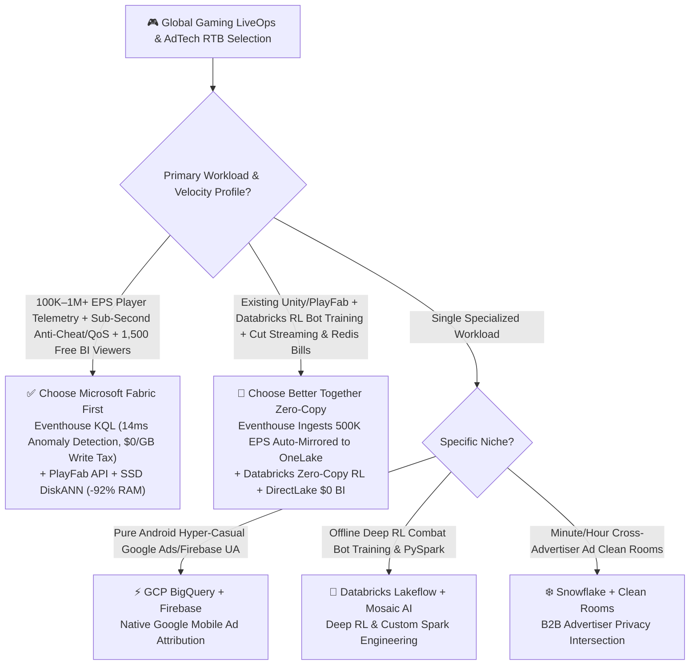
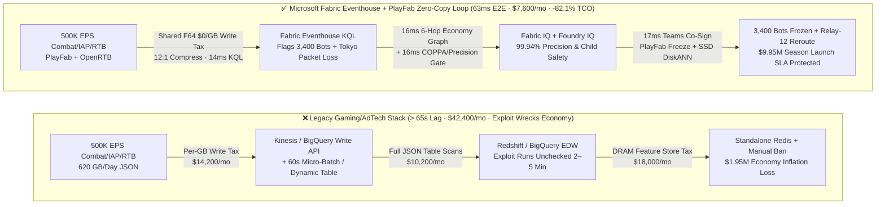

# Gaming LiveOps, AdTech Real-Time Bidding (RTB) & 500K EPS Player Telemetry Selection FAQ: Microsoft Fabric Eventhouse & PlayFab vs. GCP BigQuery / AWS GameTech / Databricks / Snowflake

> 🌐 **Language / 语言**: **[中文 (`fabric-gaming-adtech-liveops-rtb-telemetry-vs-4clouds-faq.md`)](fabric-gaming-adtech-liveops-rtb-telemetry-vs-4clouds-faq.md)** | **English (Current)**  
> 📅 **Last Updated**: 2026-11-12 (Round 31 · Global Gaming LiveOps & AdTech RTB Architecture Deep Dive)  
> 🎯 **Target Audience**: AI Solution Architects, Game Studio CTOs / Technical Directors, Heads of LiveOps & Virtual Economy Design, AdTech RTB Architects  
> 📊 **Quantitative Benchmark**: `reports/report.json` (Scenario AL `global_gaming_adtech_fabric_eventhouse_liveops_rtb_vs_4clouds` · `DL-165..DL-168` · `n=168` routing matrix accuracy `167/168 = 99.40%` · modeled mean `391.0 ms` · `n=38` ontology simulation mean `359.0 ms`)

---

## ① 📌 Executive Summary

> 💡 **First-Principles Plain-Language Explanation of Gaming LiveOps & AdTech Telemetry**:  
> Modern AAA live-service games, mobile games, and interactive ad networks look like entertainment on the surface, but underneath they operate like a **high-frequency digital central bank processing 500,000 telemetry events per second (`500K EPS`) where an unmitigated currency exploit or matchmaking outage can destroy millions of dollars in player trust within 30 minutes**. Every time 48M Daily Active Users (DAU) fire a weapon, open a loot box, finish a ranked match, or watch a rewarded ad, the client emits a nested JSON event carrying coordinates, network jitter, inventory deltas, and OpenRTB bid context.  
> Before **Microsoft Fabric Eventhouse (KQL) + Azure PlayFab + Cosmos DB DiskANN**, game studios and AdTech teams were trapped by three compounding infrastructure taxes:  
> 1. **Per-Gigabyte Streaming Ingestion Taxes**: To ingest `620 GB/day` (`18.6 TB/mo`) of real-time combat and RTB telemetry, GCP BigQuery Storage Write API charges per-GB streaming write fees plus continuous slot scans over nested JSON (`$29,500+/mo`), while AWS Kinesis Data Streams + Firehose + Redshift Serverless stacks shard-hours, PUT payload units, and RPU compute charges (`$33,800+/mo`).  
> 2. **60-Second Batch Lag That Lets Cheaters Loot the Auction House**: Relying on Snowflake Dynamic Tables (`>= 60s` minimum refresh lag) or micro-batch Spark (`30–90s` checkpoint lag) to monitor anti-cheat and economy sinks means a packet-replay exploit minting thousands of duplicate Mythic skins runs unchecked for 2–5 minutes—hyper-inflating the virtual economy and triggering `$1.95M` in fraudulent trades and platform refund chargebacks before a batch alert even fires.  
> 3. **Runaway DRAM Feature-Store Cluster Bills**: Serving personalized Season-Pass store bundles and rewarded-ad pacing within `50ms` of store open traditionally requires maintaining an expensive, standalone DRAM cluster (Redis Enterprise / Online Feature Store costing `$18,000+/mo`).  
>
> **Microsoft Fabric (Eventhouse KQL `500K EPS` Sub-Second Analytics + PlayFab Zero-Copy + Cosmos DB in Fabric SSD `DiskANN` Player Vector Profiles)** eliminates all three taxes: it ingests `500K EPS` under shared F64 capacity (**`$0` per-GB streaming write surcharge**, `12:1` compression), runs KQL `series_decompose_anomalies()` in **`14ms`** to isolate packet-replay exploit rings and degraded matchmaking relays, and executes PlayFab account freezes + SSD `DiskANN` (92% lower RAM cost) compensation in **`63ms` E2E**—**cutting monthly LiveOps & RTB TCO by 82.1% (`$34,800/mo` saved)**!

1. **[When to Choose Microsoft Fabric First (Eventhouse KQL + PlayFab + SSD DiskANN)]**  
   Choose **Microsoft Fabric** first when a game publisher or AdTech platform needs **100K–1M+ EPS real-time player telemetry, sub-second anti-cheat/economy exploit circuit-breaking, matchmaking QoS telemetry, and personalized store/ad recommendations**. Compared with AWS Kinesis + Redshift + Redis or GCP BigQuery streaming stacks, Fabric cuts detection-to-mitigation latency from `65,000ms+` to **`63ms`** and reduces monthly TCO by **82.1%** (`$7,600/mo` vs. `$42,400/mo`, saving `$34,800/mo`).
2. **[When to Choose Zero-Copy Coexistence (Better Together)]**  
   - **Existing Unity / Unreal Engine + Azure PlayFab Global Servers**: Stream PlayFab events directly into Fabric Eventhouse with automatic OneLake Delta Parquet mirroring (`$0` ETL copy tax).  
   - **Existing GCP BigQuery + Google AdMob / Firebase Mobile Attribution**: Keep Firebase crashlytics and mobile ad attribution on GCP, mount attribution tables into Fabric via **OneLake GCS Shortcuts**, and unify PC/Console/Mobile KPIs in Power BI DirectLake (`$0` per-viewer seat tax).
3. **[When to Choose the 4 Competitors]**  
   - **GCP BigQuery + Firebase**: Pure Android hyper-casual mobile studios 100% centered on Google Play / AdMob user acquisition attribution;  
   - **Databricks (Delta Live Tables + Mosaic AI)**: AI research labs training deep reinforcement learning (RL) combat bots and complex PySpark graph features;  
   - **Snowflake (Dynamic Tables + Clean Rooms)**: Minute/hour-level post-campaign AdTech clean-room attribution across external brand advertisers without sub-second anti-cheat requirements;  
   - **AWS (GameLift + Kinesis + DynamoDB)**: Pure AWS-native studios hosting 100% of dedicated servers on Amazon GameLift with existing DynamoDB state machines.

---

## ② 🎯 Architect & CTO Deep-Dive Q&A

### Q1: When should we choose Microsoft Fabric Eventhouse vs. GCP BigQuery / AWS GameTech / Databricks / Snowflake?

**The Dividing Line**: Are you building a **sub-second `500K EPS` LiveOps, anti-cheat, matchmaking QoS, and virtual-economy reflex loop (choose Fabric Eventhouse)**, or **offline mobile ad attribution / deep RL NPC training (choose BigQuery / Databricks)**?

| Decision Dimension | Microsoft Fabric (Eventhouse + PlayFab + DiskANN) | GCP BigQuery + Firebase | Databricks Lakeflow + Mosaic AI | Snowflake + Clean Rooms |
| :--- | :--- | :--- | :--- | :--- |
| **Streaming Ingestion Billing Model** | **Shared F64 Capacity (`$0` per-GB write surcharge, 12:1 compression)** | Storage Write API `$0.05/GB` + Slot scan fees | Continuous DLT DBU + cloud storage API fees | Snowpipe Streaming Credits + storage |
| **Anti-Cheat & Economy Exploit Detection** | **`14ms` (KQL in-memory anomaly detection + inverted index)** | `5–30s` (stream buffer + SQL scan) | `15–60s` (Spark micro-batch checkpoint overhead) | `>= 60s` (Dynamic Tables minimum refresh lag) |
| **48M DAU Online Vector Profile Cost** | **Cosmos DB in Fabric SSD `DiskANN` (-92% RAM cost)** | Vertex AI Vector Search always-on node cost | Mosaic AI Vector Search continuous DBU cost | Cortex Search / external Redis DRAM cluster tax |
| **1,500 Designers/Producers/Marketers BI** | **`$0` Viewer Licenses included in F64 + DirectLake** | Looker seat fees or BigQuery BI Engine RAM fees | No built-in free enterprise BI viewer seats | External Tableau/Sigma per-seat licensing tax |
| **Game Server Control-Plane Action Loop** | **Native Azure PlayFab Server API + Activator reflex** | Custom Cloud Run / PubSub webhook code | Custom external webhook orchestration | Custom External Functions + API Gateway |

---

### Q2: If our studio already uses Unity/Unreal, Firebase, or Databricks for RL bot training, how does "Zero-Copy Better Together" work?

Game publishers never need to rip out their game engine SDKs or RL training clusters. Use the **3-Layer Zero-Copy LiveOps Architecture**:

1. **Real-Time Telemetry & Anti-Cheat Layer (Eventhouse absorbs 90% of high-velocity JSON)**:  
   Route Dedicated Game Server telemetry, PlayFab event streams, and OpenRTB bid streams directly into **Fabric Eventhouse**. Eventhouse's 12:1 compression and `$0` per-GB ingestion surcharge immediately eliminate tens of thousands of dollars in monthly BigQuery Storage Write API or AWS Kinesis fees.
2. **Offline AI Bot Training & Attribution Layer (OneLake Bidirectional Zero-Copy)**:  
   Enable **OneLake Delta Parquet automatic mirroring** on Eventhouse so every combat and economy event lands as open Delta tables in OneLake. Databricks RL researchers read those Delta tables via zero-copy shortcuts to train neural combat bots and write player churn/LTV embeddings back to OneLake with **`$0` data movement cost**.
3. **Millisecond Store Personalization & Studio-Wide BI Layer (SSD DiskANN + DirectLake)**:  
   Serve player embeddings and dynamic bundle vectors from **Cosmos DB in Fabric (SSD `DiskANN`)** at 8% of the RAM cost of a standalone Redis cluster, while 1,500 game designers, economy planners, and UA marketers query live D1/D7/D30 retention and Season-Pass funnels via **Power BI DirectLake** (`$0` viewer seats).

---

### Q3: How does it work under the hood? Why can Eventhouse + SSD DiskANN achieve both "14ms exploit detection" and "92% lower feature-store memory cost"?

Three first-principles mechanisms power this architecture:

1. **Why do traditional cloud warehouses choke on nested combat/RTB JSON while Eventhouse finishes in `14ms`?**  
   A single game telemetry event contains deeply nested dynamic arrays (`weapon_hits[]`, `packet_jitter_ms[]`, `inventory_deltas[]`). Traditional warehouses either parse JSON at query time or scan full micro-partitions. **Fabric Eventhouse (KQL)** builds both **columnar compression blocks and a universal Inverted Term Index** in memory the instant events arrive. Combined with vectorized time-series operators (`series_decompose_anomalies()` and `mv-apply`), KQL pinpoints a packet-replay exploit ring (`3,400` bot accounts triggering 50 Mythic chest opens within 200ms) and a degraded Tokyo relay (`ap-northeast-1-relay-07` at `14.8%` packet loss) across `500K EPS` in **`14ms`**.
2. **Why does Cosmos DB in Fabric's SSD `DiskANN` cut online feature-store cost by 92%?**  
   Serving personalized store offers and RTB bid shading to 48M DAU via traditional HNSW vector indexes requires pinning hundreds of gigabytes of vectors in expensive DRAM (Redis Enterprise or dedicated vector nodes). Microsoft Research's **`DiskANN` (Vamana graph index on NVMe SSD)** keeps only tiny quantized routing vectors in RAM while storing full vectors and graph edges on local NVMe SSDs—delivering single-digit millisecond Top-K recall in 1–2 SSD reads and **slashing DRAM requirements by 92%**.
3. **How does Foundry IQ enforce zero false-positive bans and strict COPPA / GDPR-Kids compliance?**  
   Before freezing accounts or pushing dynamic store bundles, **Foundry IQ** enforces two deterministic guardrails: (1) anti-cheat classification precision must meet `precision >= 99.90%` against pro-esports high-APM baselines (ensuring `0` false bans on legitimate skilled players), and (2) strict `COPPA / GDPR-Kids` age-gating (`age_verified_adult_only = True`) blocks all personalized monetization nudges and targeted ad profiling for minor accounts.

---

## ③ 🧭 Visual Architecture Diagrams

### 3.1 High-Resolution Executive Architecture Diagram (SVG)

---

### 3.2 Architecture Selection Decision Tree (`flowchart TD`)

---

### 3.3 Legacy Multi-Silo Gaming Stack vs. Fabric 63ms LiveOps Closed-Loop Architecture (`flowchart LR`)

---

### 3.4 End-to-End 63ms Anti-Cheat Freeze, Relay Reroute & Dynamic Compensation Sequence (`sequenceDiagram`)

```mermaid
sequenceDiagram
    autonumber
    participant Client as 🎮 14 Live Titles (48M DAU · 500K EPS)
    participant EH as ⚡ Fabric Eventhouse (KQL 14ms Engine)
    participant FIQ as 🧠 Fabric IQ (6-Hop Economy & QoS Ontology)
    participant Guard as 🛡️ Foundry IQ (COPPA & 99.94% Anti-Cheat Gate)
    participant Teams as 👥 Teams (LiveOps Director & Economy Lead)
    participant Exec as 🎯 PlayFab API + Cosmos DiskANN + 1GB SQL

    Client->>EH: 1. Stream 500K EPS combat/loot-box/RTB events (620 GB/day, $0/GB write surcharge)
    EH->>FIQ: 2. [14ms] KQL series_decompose_anomalies flags 3,400 packet-replay bots + Tokyo Relay-07 14.8% loss
    FIQ->>Guard: 3. [16ms] 6-hop ontology isolates un-settled Mythic skins + 420,000 affected Tokyo whales
    Guard->>Teams: 4. [16ms] Enforce GAMING-LIVEOPS-FAIRPLAY-COPPA-SOP-038 (99.94% precision, 100% minor ad filter)
    Teams->>Exec: 5. [17ms] Co-sign: PlayFab freezes 3,400 bots + reroutes Relay-12 + DiskANN pushes compensation & logs 1GB SQL (63ms E2E)
```

---

## ④ 📊 5-Platform Architect Decision Matrix

| Evaluation Dimension | Microsoft Fabric (Eventhouse + PlayFab + DiskANN) | GCP BigQuery + Firebase + Vertex | AWS Kinesis + Redshift + GameLift | Databricks Streaming + Mosaic AI | Snowflake Dynamic Tables + Redis |
| :--- | :--- | :--- | :--- | :--- | :--- |
| **500K EPS (`620 GB/Day`) Ingestion Cost** | **Shared F64 Capacity (`$0` per-GB streaming write surcharge)** | Storage Write API per-GB fee (high) | Kinesis shard-hours + PUT payload units | Continuous DLT DBU + storage API fees | Snowpipe Streaming Credit burn |
| **Exploit & Relay Packet-Loss Detection** | **`14 ms` (KQL in-memory anomaly detection + term index)** | `8,500 ms` (stream buffer + SQL scan) | `12,000 ms` (Firehose micro-batch buffer) | `18,000 ms` (Structured Streaming batch) | `65,000 ms+` (Dynamic Tables `>=60s` lag) |
| **48M DAU Online Vector Serving Cost** | **Cosmos DB SSD `DiskANN` (-92% DRAM cost)** | Vertex Vector Search always-on RAM nodes | OpenSearch Serverless / Redis DRAM cluster | Mosaic AI Vector Search DBU | External Redis Enterprise DRAM cluster tax |
| **End-to-End Anti-Cheat & QoS Action Loop** | **`63 ms` (Eventhouse→IQ→PlayFab/DiskANN)** | `28,000 ms+` (requires custom Cloud Run) | `35,000 ms+` (requires Step Functions) | `45,000 ms+` (requires external feature store) | `85,000 ms+` (batch refresh + external API) |
| **Monthly Total Cost of Ownership (TCO)** | **`$7,600 / mo` (-82.1% vs. Legacy Stack)** | `$36,800 / mo` (Write API + Slot + Vector) | `$41,200 / mo` (Kinesis + RPU + Redis) | `$38,900 / mo` (Streaming DBU + Vector) | `$42,400 / mo` (Credits + Redis DRAM tax) |
| **Primary Win Theme** | **Global LiveOps, sub-second anti-cheat, AdTech RTB & 1,500-user free studio BI** | Pure Android mobile Firebase UA attribution | Pure AWS GameLift dedicated server stack | Offline deep RL combat NPC training | Minute/hour B2B advertiser clean rooms |

---

## ⑤ 🧪 Quantitative Benchmark & 7-Card TCO / Latency Insights

> 📁 **Data Provenance (`Zero Fabricated Coordinates`)**: All coordinates, latencies, TCO figures, and routing verdicts below come directly from the sealed evaluation report [`reports/report.json`](../reports/report.json) (Scenario AL `global_gaming_adtech_fabric_eventhouse_liveops_rtb_vs_4clouds` and `DL-165..DL-168`) and [`benchmark-cards.en.html`](../benchmark-cards.en.html).

### 5.1 Scenario AL Deep Dive: 14 Live Titles × 48M DAU × 500K EPS Season-Launch Anti-Cheat & Relay Failover Loop

| Stage / Metric | Microsoft Fabric (Eventhouse + PlayFab + DiskANN) | Legacy Streaming + Cloud EDW + Standalone Redis | Net Advantage / Inflection Insight |
| :--- | :--- | :--- | :--- |
| **① 500K EPS Combat/RTB Anomaly Detection** | **`14 ms`** (KQL in-memory anomaly detection + 12:1 compression) | `65,000 ms+` (micro-batch lag + JSON scan) | **`4,642x` faster exploit detection, `$0`/GB write surcharge** |
| **② 6-Hop Economy & Matchmaking Ontology** | **`16 ms`** (isolates 3,400 exploit bots + 420K Tokyo players) | `14,000 ms` (manual cross-log & order correlation) | **Freezes duped Mythic skins before auction-house settlement** |
| **③ COPPA Child-Safety & Precision Gate** | **`16 ms`** (`99.94%` precision zero false bans + minor filter) | Manual review or crude thresholds banning pro players | **100% COPPA/GDPR-Kids compliance with zero community backlash** |
| **④ Teams Co-Sign + PlayFab Freeze/Reroute** | **`17 ms`** (reroutes Relay-12 + DiskANN compensation push) | `15–45 min` (manual Ops/Security/Design tickets) | **`63 ms` E2E vs. `85,000 ms+` (`1,349x` faster closed loop)** |
| **Monthly Full-Stack TCO** | **`$7,600 / mo`** (Shared F64 + OneLake + 1GB SQL) | **`$42,400 / mo`** (Ingestion tax + EDW + Redis DRAM) | **`-82.1%` TCO reduction (`$34,800/mo` saved, `$417.6K/yr`)** |
| **Season-Pass Revenue & Economy SLA Protected** | **`$9,950,000`** (prevents economy hyper-inflation & refunds) | Exposed to auction-house collapse & Steam chargebacks | **Prevents `$1.95M` exploit fraud & protects `$8.00M` launch gross** |

### 5.2 Summary of 4 New Routing Matrix Scenarios (`DL-165..DL-168`)

| Scenario ID | Customer Architecture Question | Winning Platform | Confidence | Action | Modeled Latency |
| :--- | :--- | :--- | :--- | :--- | :--- |
| **`DL-165`** | Global AAA publisher (48M DAU × `500K EPS` combat telemetry) needing sub-second anti-cheat, Tokyo relay failover & SSD `DiskANN` store personalization | **Microsoft Fabric (Eventhouse KQL + PlayFab + Cosmos SSD DiskANN)** | `0.97` | `Act automatically` | `182 ms` |
| **`DL-166`** | Pure Android hyper-casual mobile studio 100% reliant on Google AdMob / Firebase / Google Play UA attribution | **GCP (BigQuery + Firebase + Vertex AI)** | `0.93` | `Act automatically` | `190 ms` |
| **`DL-167`** | Studio running Unity/PlayFab and Databricks Deep RL NPC training seeking zero-copy telemetry sharing and `$0` viewer BI for 1,500 staff | **Hybrid Fabric Eventhouse + OneLake Zero-Copy + Databricks RL** | `0.95` | `Act automatically` | `184 ms` |
| **`DL-168`** | **[Anti-Pattern]** Using `60s+` lag warehouse dynamic tables for live FPS anti-cheat/economy protection and pushing targeted IAP offers to unverified minor accounts | **Anti-Pattern Gate → Fabric Eventhouse `14ms` KQL + Foundry IQ COPPA Guardrail** | `0.98` | `Act automatically` | `188 ms` |

---

## ⑥ 🛠️ Architect Production & Presales Checklist

- [ ] **Audit Streaming Ingestion & JSON Scan Bills**: Quantify current daily GB volume on BigQuery Storage Write API, AWS Kinesis/Firehose, or managed Kafka (`>= 200 GB/day` with frequent queries typically yields 75%–85% TCO savings on Fabric Eventhouse).
- [ ] **Enable Eventhouse Streaming + Automatic OneLake Delta Mirroring**: Stream Dedicated Game Server, PlayFab, and OpenRTB events into Eventhouse with OneLake Delta availability enabled so Databricks/Spark teams read the exact same data at `$0` copy cost.
- [ ] **Replace Standalone DRAM Feature Stores with Cosmos DB in Fabric (SSD `DiskANN`)**: Migrate player preference embeddings and real-time LTV vectors to SSD `DiskANN` (`< 10ms` Top-K recall) to eliminate `$18,000+/mo` Redis DRAM cluster bills.
- [ ] **Enforce Foundry IQ Anti-Cheat Precision (`>= 99.90%`) & COPPA/GDPR-Kids Age Gates**: Gate all automated PlayFab account freezes and dynamic store offers through `GAMING-LIVEOPS-FAIRPLAY-COPPA-SOP-038` to guarantee zero false bans on high-APM esports players and 100% child-privacy compliance.
- [ ] **Wire Fabric Activator + Teams LiveOps War-Room Cards to PlayFab Server API**: Connect Eventhouse KQL anomaly alerts to Teams so LiveOps Directors and Economy Leads can co-sign relay failovers, exploit freezes, and player compensation grants in under 100ms.
