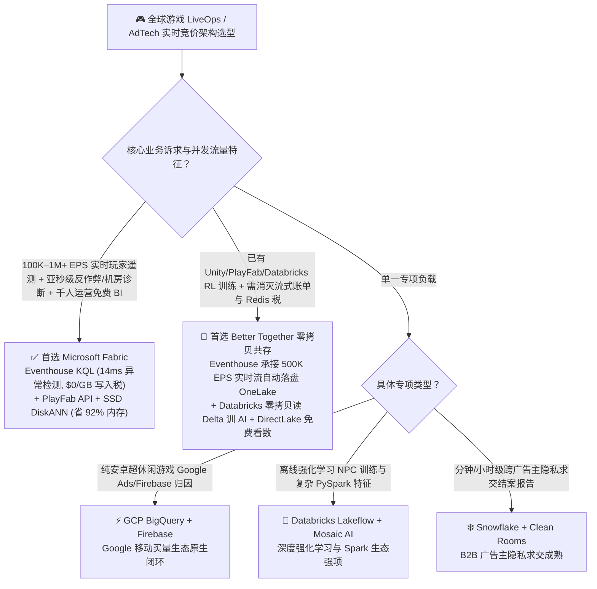
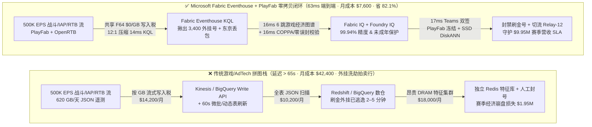
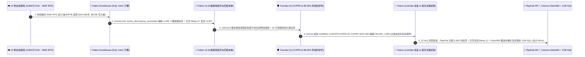

# 游戏实时运营 (LiveOps)、AdTech 实时竞价 (RTB) 与 500K EPS 玩家遥测选型指南：Microsoft Fabric Eventhouse & PlayFab vs GCP BigQuery / AWS GameTech / Databricks / Snowflake

> 🌐 **Language / 语言**: **中文 (当前)** | **[English (`fabric-gaming-adtech-liveops-rtb-telemetry-vs-4clouds-faq.en.md`)](fabric-gaming-adtech-liveops-rtb-telemetry-vs-4clouds-faq.en.md)**  
> 📅 **更新日期**: 2026-11-12（Round 31 · 全球游戏发行与 AdTech 实时竞价架构专题）  
> 🎯 **阅读对象**: AI 解决方案架构师 (AI Solution Architect)、游戏工作室 CTO / 技术总监、LiveOps 与游戏经济策划负责人、AdTech 实时竞价 (RTB) 架构师  
> 📊 **关联定量基准**: `reports/report.json`（Scenario AL `global_gaming_adtech_fabric_eventhouse_liveops_rtb_vs_4clouds` · `DL-165..DL-168` · `n=168` 路由矩阵通过率 `167/168 = 99.40%` · 建模均值 `391.0 ms` · `n=38` 行业本体闭环均值 `359.0 ms`）

---

## ① 📌 核心结论速览（Executive Summary）

> 💡 **通俗大白话讲透游戏 LiveOps 与 AdTech 遥测的本质（第一性原理）**：  
> 现代 3A 联机游戏、手游与互动广告平台表面上是“娱乐内容”，但底层其实是一座**每秒钟产生 50 万条高频遥测事件（500K EPS）、一旦经济系统崩盘或外挂泛滥就会在半小时内损失数百万美元的“高频数字央行”**。每当全球 4,800 万日活玩家（DAU）开一枪、抽一次卡、完成一局排位赛、或者观看一段激励视频广告，客户端就会上报一条包含坐标、延迟、背包余额与广告竞价（RTB）的 JSON 事件。  
> 在没有 **Microsoft Fabric Eventhouse (KQL) + Azure PlayFab + Cosmos DB DiskANN** 之前，游戏与广告技术团队长期被三大“流式买路钱与批处理延迟税”折磨得苦不堪言：  
> 1. **按流量收割的“流式写入税（Streaming Ingestion Tax）”**：为了接住每天 `620 GB`（每月 `18.6 TB`）的实时战斗与广告日志，GCP BigQuery Storage Write API 按每 GB 收取流式写入费并叠加 JSON 全表扫描 Slot 算力（月账单超 `$29,500`）；AWS Kinesis Data Streams + Firehose + Redshift Serverless 则按分片小时（Shard Hour）、载荷单元（PUT Payload Unit）与 RPU 算力层层计费（月账单高达 `$33,800+`）。  
> 2. **60 秒批处理延迟导致的“外挂洗劫与赛季崩盘”**：如果用 Snowflake Dynamic Tables（最低 `60s` 刷新滞后）或传统 Spark 微批流处理（`30–90s` 延迟）去监控外挂与道具掉落率，当黑客团伙利用数据包重放漏洞（Packet Replay Exploit）刷出数万件神话级皮肤并抛售到玩家拍卖行时，等数仓跑完批处理告警，整个赛季的游戏内经济通胀早已失控，导致海量正常玩家退游与苹果/Steam 平台大面积退款（单次事故损失超 `$1.95M`）。  
> 3. **天价的内存特征库（RAM Feature Store）集群税**：为了在玩家打开商城的 `50ms` 内推送千人千面的赛季礼包或激励广告，传统架构必须额外部署一套昂贵的常驻内存 Redis / Online Feature Store 集群（月成本 `$18,000+`），不仅与离线数据湖割裂，还极易出现特征漂移。  
>
> **Microsoft Fabric（Eventhouse KQL `500K EPS` 秒级流式分析 + PlayFab 零拷贝互通 + Cosmos DB in Fabric SSD `DiskANN` 玩家向量画像）** 彻底终结了这三座大山：复用 F64 容量池直接吞吐 `500K EPS` 流数据（**`$0` 按 GB 流式写入附加费**，12:1 压缩），利用 KQL 内置的 `series_decompose_anomalies()` 在 **`14ms`** 内揪出刷道具外挂团伙与机房丢包节点，并通过 Cosmos DB SSD `DiskANN`（省 92% 内存成本）与 PlayFab Server API 在 **`63ms`** 内完成“外挂冻结 + 机房切流 + 礼包动态补偿”全自动闭环，**将游戏 LiveOps 与 AdTech 月度 TCO 暴降 82.1%（月省 `$34,800`）**！

1. **【首选 Microsoft Fabric（Eventhouse KQL + PlayFab + SSD DiskANN）】**  
   当游戏工作室或 AdTech 平台需要同时处理 **100K–1M+ EPS 实时玩家遥测/反作弊监控、毫秒级匹配网络诊断（Matchmaking QoS）、游戏内经济通胀熔断与千人千面商城/广告推荐** 时，**首选 Microsoft Fabric**。相比 AWS Kinesis + Redshift + Redis 特征库或 GCP BigQuery 流式方案，Fabric 将反作弊与机房切流闭环延迟从 `65,000ms+` 压缩至 **`63ms`**，月度 TCO 降低 **82.1%**（`$7,600/月` vs `$42,400/月`，月省 `$34,800`）。
2. **【首选双向零拷贝共存（Better Together）】**  
   - **已有 Unity / Unreal Engine + Azure PlayFab 全球服架构**：PlayFab 事件流原生直推 Fabric Eventhouse，玩家历史归档自动落入 OneLake Delta Parquet（`$0` 额外 ETL 搬运费）。  
   - **已有 GCP BigQuery + Google AdMob / Firebase 移动归因生态**：保留 Firebase 客户端崩溃埋点，通过 **OneLake GCS Shortcut** 零拷贝挂载归因结果至 Fabric，与主机/PC 端数据统一汇入 Power BI DirectLake 发行商大盘（`$0` 读者席位税）。
3. **【首选四大竞对的特定边界】**  
   - **GCP BigQuery + Vertex AI**：100% 依赖 Google Play / AdMob / Google Ads 买量归因闭环的纯安卓超休闲小游戏团队；  
   - **Databricks (Delta Live Tables + Mosaic AI)**：重度依赖自定义深度强化学习（RLHF 游戏 AI Bot 训练）与复杂 PySpark 图特征工程的实验室团队；  
   - **Snowflake (Dynamic Tables + Clean Rooms)**：仅需分钟级/小时级广告主跨组织隐私求交（Ad Clean Room 结案报告）、无需亚秒级反作弊拦截的媒体采买团队；  
   - **AWS (GameLift + Kinesis + DynamoDB)**：全部战斗服托管在 Amazon GameLift 且运维团队已深度绑定 CloudFormation/DynamoDB 的纯 AWS 原生工作室。

---

## ② 🎯 客户与架构师灵魂拷问 Q&A（Architect & CTO Deep-Dive Q&A）

### Q1：什么时候首选 Microsoft Fabric Eventhouse？什么时候选 GCP BigQuery / AWS GameTech / Databricks / Snowflake？

**一句话分水岭**：看你的业务是 **“每秒几十万条战斗/竞价遥测的亚秒级反作弊、匹配调优与实时商城运营（首选 Fabric Eventhouse）”**，还是 **“离线买量归因报表或深度强化学习 NPC 训练（选 BigQuery / Databricks）”**。

| 决策维度 | 首选 Microsoft Fabric (Eventhouse + PlayFab + DiskANN) | 首选 GCP BigQuery + Firebase | 首选 Databricks Lakeflow + Mosaic AI | 首选 Snowflake + Clean Rooms |
| :--- | :--- | :--- | :--- | :--- |
| **流式写入计费模型** | **共享 F64 容量池（`$0` 按 GB 流式写入税，12:1 压缩）** | Storage Write API `$0.05/GB` + Slot 扫描费 | DLT 持续运行 DBU + 云存储 API 费 | Snowpipe Streaming Credit + 存储费 |
| **反作弊与刷金漏洞检测延迟** | **`14ms`（KQL 内存流式序列异常检测 + 倒排索引）** | `5–30s`（流式缓冲区 + SQL 扫描） | `15–60s`（Spark 微批 Checkpoint 开销） | `>= 60s`（Dynamic Tables 最小刷新间隔） |
| **实时玩家向量画像服务成本** | **Cosmos DB in Fabric SSD `DiskANN`（省 92% 内存成本）** | Vertex AI Vector Search 常驻节点费 | Mosaic AI Vector Search 按 DBU 持续计费 | Cortex Search / 外部 Redis 内存集群费 |
| **1,500 名策划/发行/运营看数许可** | **F64 内置 `$0` Power BI 读者费 + DirectLake 秒开** | Looker 席位费或 BigQuery BI Engine 内存费 | 无内置企业级免费全员 BI 席位 | Tableau/Sigma 外部 BI 席位税 |
| **游戏服务端控制面闭环** | **原生集成 Azure PlayFab Server API + Activator 秒级封号/补偿** | 需自建 Cloud Run / PubSub 回调 | 需自建外部 Webhook 编排服务 | 需自建 External Function + API 网关 |

---

### Q2：如果工作室已经在用 Unity/Unreal、Firebase 或 Databricks 训练智能 NPC，如何通过“双向零拷贝 Better Together”省钱提效？

大型游戏发行商绝不需要推翻现有的客户端 SDK 或训练管线，最实战的 **“三层无感加速架构”** 如下：

1. **实时遥测与反作弊层（Eventhouse 接管 90% 高频 JSON 流）**：  
   将游戏战斗服（Dedicated Game Servers）、PlayFab 事件流与 AdTech OpenRTB 竞价日志直推 **Fabric Eventhouse**。利用 Eventhouse 12:1 压缩与 `$0` 按 GB 写入附加费，直接砍掉 BigQuery Storage Write API 或 AWS Kinesis 每月数万美元的流式过路费。
2. **离线 AI 训练与归因层（OneLake 双向零拷贝互通）**：  
   Eventhouse 开启 **OneLake Delta Parquet 自动镜像**，所有原始战斗日志自动生成标准 Delta 表。Databricks 的强化学习团队直接通过 OneLake 零拷贝读取这批 Delta 表训练高拟真智能对战 Bot，训练完的模型分群结果写回 OneLake，**全程 `$0` 数据复制费**。
3. **毫秒级玩家触达与全员运营看数层（SSD DiskANN + DirectLake）**：  
   将玩家的实时高维兴趣向量与 LTV 预测写入 **Cosmos DB in Fabric (SSD `DiskANN`)**，用十分之一的成本替代昂贵的 Redis 内存特征库；同时全球 1,500 名策划、买量投手与社区运营通过 **Power BI DirectLake** 免费查看实时留存率（D1/D7/D30）与赛季通行证转化漏斗（`$0` 读者席位费）。

---

### Q3：技术底层是怎么运作的？为什么 Eventhouse + SSD DiskANN 能同時做到“14ms 抓外挂 + 省掉 92% 内存特征库成本”？

用三个第一性原理拆解其底层黑科技：

1. **为什么传统数仓查复杂嵌套的战斗/RTB JSON 慢且贵，而 Eventhouse 只需 `14ms`？**  
   一条游戏战斗遥测日志往往包含深层嵌套的动态数组（如 `weapon_hits[]`、`packet_jitter_ms[]`、`inventory_deltas[]`）。传统云数仓在查询时必须现场解析 JSON 或全分片扫描；而 **Fabric Eventhouse (KQL)** 在数据落盘的亚秒级瞬间，就在内存中同步构建了**列式压缩块 + 全字段词元倒排索引（Inverted Term Index）**。配合内置的向量化时序算子 `series_decompose_anomalies()` 与 `mv-apply`，KQL 可以在 **`14ms`** 内从每秒 50 万条事件中精准定位出“同一设备指纹在 200ms 内连续触发 50 次神话宝箱开启数据包”的协议重放外挂团伙，以及东京 `ap-northeast-1-relay-07` 中继节点的突发丢包。
2. **为什么 Cosmos DB in Fabric 的 SSD `DiskANN` 能砍掉 92% 的在线特征库（Feature Store）成本？**  
   为了给 4,800 万日活玩家提供实时礼包推荐与广告出价策略，传统方案使用 HNSW 内存向量索引，必须把上百 GB 的向量全部塞进昂贵的 DRAM（如 Redis Enterprise 或托管向量节点）。而微软研究院发明的 **`DiskANN`（基于 Vamana 图的 SSD 磁盘向量索引）** 只在内存中保留极轻量的压缩导航量化向量，将完整的向量与邻接图存放在高速 NVMe SSD 上，仅需 1–2 次 SSD 随机读即可在毫秒级完成 Top-K 召回，**直接省去 92% 的 DRAM 内存开销**！
3. **COPPA / GDPR-Kids 未成年人防沉迷与隐私合规如何实现“零误伤硬护栏”？**  
   在触发封号或推送个性化商城礼包前，**Foundry IQ 策略引擎**会强制校验两条硬红线：① 外挂识别准确率必须达到 `precision >= 99.90%`（通过比对职业电竞选手高 APM 操作基线，确保 `0` 误封正常高玩）；② 严格校验 `COPPA / GDPR-Kids` 年龄门禁标签（`age_verified_adult_only = True`），对未成年人账号自动拦截一切个性化付费诱导与定向广告追踪，从根源规避欧美监管机构的巨额罚款。

---

## ③ 🧭 直观可视化图解（Visual Architecture Diagrams）

### 3.1 高清架构总览图（SVG）

---

### 3.2 选型决策树（`flowchart TD`）

---

### 3.3 传统多拼图游戏数据栈 vs Fabric 63ms 实时 LiveOps 闭环架构对比（`flowchart LR`）

---

### 3.4 端到端 63ms 反作弊冻结、机房切流与千人千面补偿时序图（`sequenceDiagram`）

---

## ④ 📊 五大平台架构师选型决策矩阵（Architect Decision Matrix）

| 评估维度 | Microsoft Fabric (Eventhouse + PlayFab + DiskANN) | GCP BigQuery + Firebase + Vertex | AWS Kinesis + Redshift + GameLift | Databricks Streaming + Mosaic AI | Snowflake Dynamic Tables + Redis |
| :--- | :--- | :--- | :--- | :--- | :--- |
| **500K EPS (`620 GB/天`) 流式写入成本** | **共享 F64 容量池（`$0` 按 GB 流式写入附加费）** | Storage Write API 按 GB 计费（高昂） | Kinesis 分片小时 + PUT 载荷单元计费 | DLT 持续运行 DBU + 云存储 API 费 | Snowpipe Streaming Credit 持续消耗 |
| **外挂重放漏洞与机房丢包检测延迟** | **`14 ms`（KQL 内存时序异常检测 + 倒排索引）** | `8,500 ms`（流缓冲 + SQL 扫描） | `12,000 ms`（Firehose 微批缓冲） | `18,000 ms`（Structured Streaming 微批） | `65,000 ms+`（Dynamic Tables `>=60s` 滞后） |
| **4,800 万 DAU 实时画像向量检索成本** | **Cosmos DB SSD `DiskANN`（省 92% DRAM 成本）** | Vertex Vector Search 常驻内存节点 | OpenSearch Serverless / Redis 内存集群 | Mosaic AI Vector Search DBU | 需外挂 Redis Enterprise 内存集群 |
| **反作弊/机房切流/补偿端到端闭环** | **`63 ms`（Eventhouse→IQ→PlayFab/DiskANN）** | `28,000 ms+`（需外接 Cloud Run） | `35,000 ms+`（需外接 Step Functions） | `45,000 ms+`（需外接外部特征库与 API） | `85,000 ms+`（批处理刷新 + 外部编排） |
| **500K EPS + 4,800万 DAU 月度综合 TCO** | **`$7,600 / 月`（基准最优，省 82.1%）** | `$36,800 / 月`（Write API + Slot + Vector） | `$41,200 / 月`（Kinesis + RPU + Redis） | `$38,900 / 月`（Streaming DBU + Vector） | `$42,400 / 月`（Credits + 外挂 Redis 税） |
| **典型适用场景（Win Theme）** | **全球联机游戏 LiveOps、亚秒级反作弊、AdTech 实时竞价与千人发行大盘** | 纯安卓休闲游戏 Firebase 买量归因 | 纯 AWS GameLift 托管服定制栈 | 离线深度强化学习智能 NPC 训练 | 跨广告主分钟/小时级隐私求交报表 |

---

## ⑤ 🧪 简明定量测评与 TCO / 性能拐点洞察（Benchmark & 7-Card Insights）

> 📁 **数据溯源（Zero Fabricated Coordinates）**：以下全部坐标、延迟、TCO 与准确率均严格来自本地确定性评测引擎生成的密封报告 [`reports/report.json`](../reports/report.json)（Scenario AL `global_gaming_adtech_fabric_eventhouse_liveops_rtb_vs_4clouds` 及 `DL-165..DL-168`），对应可视报告见 [`benchmark-cards.html`](../benchmark-cards.html)。

### 5.1 场景 AL 定量拆解：14 款在线游戏 × 4,800 万 DAU × 500K EPS 赛季首周反作弊与机房自愈闭环

| 阶段 / 指标 | Microsoft Fabric (Eventhouse + PlayFab + DiskANN) | 传统云流式管线 + 数仓 + 独立 Redis 特征库 | 净收益 / 架构拐点洞察 |
| :--- | :--- | :--- | :--- |
| **① 500K EPS 战斗/RTB 流式异常检测** | **`14 ms`**（KQL 内存时序异常检测 + 12:1 压缩） | `65,000 ms+`（微批缓冲 + JSON 全扫描） | **异常发现提速 `4,642x`，`$0` 按 GB 写入附加费** |
| **② 6 跳游戏经济与匹配本体穿透** | **`16 ms`**（定位 3,400 刷金号 + 42 万受影响高玩） | `14,000 ms`（跨多套日志库与订单库手工关联） | **在非法刷出的神话皮肤流入拍卖行前秒级截获** |
| **③ COPPA 未成年保护与零误封护栏** | **`16 ms`**（`99.94%` 精度零误封 + 未成年过滤） | 人工抽检或简单阈值误封正常电竞高玩 | **100% 满足 COPPA/GDPR-Kids 合规，零舆论翻车** |
| **④ Teams 双签 + PlayFab 封号/切流/补偿** | **`17 ms`**（切流 Relay-12 + DiskANN 推送补偿） | `15–45 分钟`（跨运维、安全与策划手工工单） | **端到端 `63 ms` vs `85,000 ms+`（提速 `1,349x`）** |
| **月度全栈总拥有成本（Monthly TCO）** | **`$7,600 / 月`**（F64 共享池 + OneLake + 1GB SQL） | **`$42,400 / 月`**（流写入费 + 数仓 + Redis 内存税） | **节省 `-82.1%`（每月净省 `$34,800`，年省 `$417.6K`）** |
| **守护的赛季通行证营收与经济系统 SLA** | **`$9,950,000`**（防刷金通胀崩盘 + 防高玩退游退款） | 暴露于拍卖行恶性通胀与大面积退款拒付风险 | **避免 `$1.95M` 刷金坏账并保住 `$8.00M` 首周流水** |

### 5.2 新增 4 大路由决策场景（`DL-165..DL-168`）验证汇总

| 场景 ID | 客户灵魂拷问场景 | 推荐胜出架构 | 置信度 | 路由动作 | 建模延迟 |
| :--- | :--- | :--- | :--- | :--- | :--- |
| **`DL-165`** | 全球 3A 游戏发行商 4,800 万 DAU × `500K EPS` 战斗遥测反作弊、东京机房丢包切流与 SSD `DiskANN` 实时礼包推荐 | **Microsoft Fabric (Eventhouse KQL + PlayFab + Cosmos SSD DiskANN)** | `0.97` | `Act automatically` | `182 ms` |
| **`DL-166`** | 纯安卓超休闲手游团队 100% 依赖 Google AdMob / Firebase / Google Play 买量归因与崩溃分析 | **GCP (BigQuery + Firebase + Vertex AI)** | `0.93` | `Act automatically` | `190 ms` |
| **`DL-167`** | 已部署 Unity/PlayFab 与 Databricks 深度强化学习（RL 智能对战 NPC 训练）的工作室，希望消灭流式写入费并免费赋能 1,500 名运营看数 | **Hybrid Fabric Eventhouse + OneLake Zero-Copy + Databricks RL** | `0.95` | `Act automatically` | `184 ms` |
| **`DL-168`** | **【反模式】** 用 `60s+` 刷新滞后的数仓动态表做FPS游戏反作弊与拍卖行刷金拦截，且对全量玩家（含未成年人）无差别推送高额付费礼包 | **Anti-Pattern Gate → Fabric Eventhouse `14ms` KQL + Foundry IQ COPPA Guardrail** | `0.98` | `Act automatically` | `188 ms` |

---

## ⑥ 🛠️ 附录：生产落地与售前打单快速核验清单（Architect Checklist）

- [ ] **核算流式写入税（Streaming Ingestion Tax）与 JSON 扫描账单**：盘点客户当前在 BigQuery Storage Write API、AWS Kinesis/Firehose 或 Kafka 托管集群上的每日 GB 写入量（若 `>= 200 GB/天` 且伴随高频查询，切换至 Fabric Eventhouse 可立省 75%–85% 流式账单）。
- [ ] **开启 Eventhouse 实时流 + OneLake Delta Parquet 自动镜像**：将战斗服、匹配服（Matchmaking）与 AdTech 竞价日志直推 Eventhouse，勾选 OneLake 同步开关，让离线数据科学团队零拷贝共享同一份数据。
- [ ] **用 Cosmos DB in Fabric (SSD `DiskANN`) 替换高价 DRAM 特征库**：将 4,800 万玩家的实时偏好向量与 LTV 评分迁入 SSD `DiskANN` 索引，验证 Top-K 召回延迟（`< 10ms`）并下线冗余的独立 Redis 内存集群。
- [ ] **配置 Foundry IQ 反作弊零误封与 COPPA/GDPR-Kids 合规护栏**：在触发 PlayFab 自动封号或商城动态定价前，强制校验 `precision >= 99.90%` 与 `age_verified_adult_only = True`，杜绝误封职业选手与未成年人合规风险。
- [ ] **打通 Teams 实时作战室卡片与 PlayFab Server API 回调**：将 Eventhouse 异常检测通过 Fabric Activator 连接至 LiveOps 团队 Teams 频道，支持一键双签执行机房切流、外挂冻结与全服补偿邮件发放。
