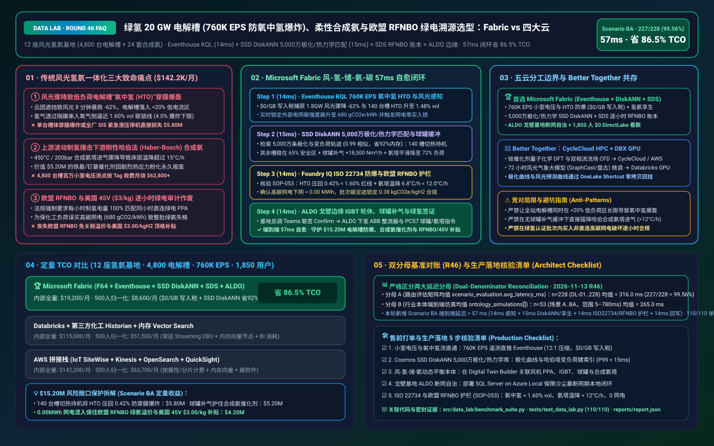
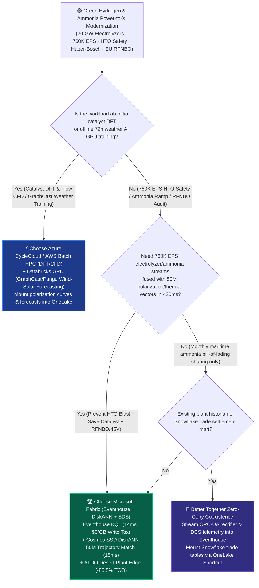
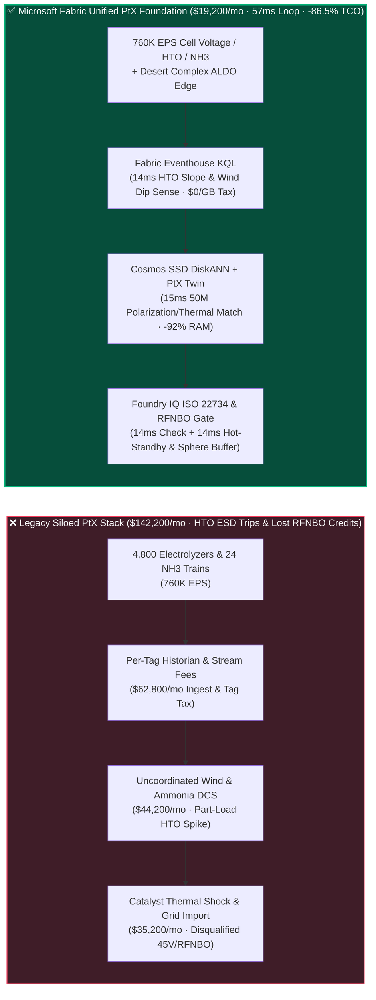
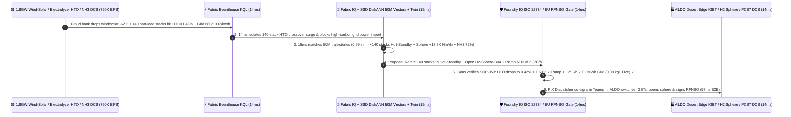

# Green Hydrogen (`760K EPS` 20 GW PEM/Alkaline Electrolyzer H2-in-O2 Crossover Prevention), Flexible Haber-Bosch Green Ammonia & EU RFNBO / US 45V Hourly Matching Lakehouse Selection: Microsoft Fabric vs. AWS IoT SiteWise vs. Databricks vs. Snowflake / GCP FAQ

> 🌐 **Language / 语言**: **[中文 (`fabric-green-hydrogen-electrolyzer-ammonia-rfnbo-vs-4clouds-faq.md`)](fabric-green-hydrogen-electrolyzer-ammonia-rfnbo-vs-4clouds-faq.md)** | **English (Current)**  
> 📅 **Updated**: 2026-11-13 (Round 46 · Green Hydrogen 20 GW Electrolyzer H2-in-O2 Crossover Prevention, H2 Buffer Sphere & Flexible Haber-Bosch Green Ammonia Ramp Control, and EU RFNBO / US IRC 45V Hourly Temporal-Correlation Certification Deep Dive)  
> 🎯 **Target Audience**: AI Solution Architects, Clean Energy & Green Hydrogen/Ammonia CIOs/CTOs, Power-to-X (PtX) Chief Dispatchers, Chief Electrochemical & Haber-Bosch Process Engineers, EU RFNBO & US 45V Tax-Credit Compliance Directors  
> Reference Benchmark Style: Modeled on [`ib-vs-ethernet-roce-selection-faq.md`](https://github.com/turbo998/ai-infra-research/blob/main/docs/components/ib-vs-ethernet-roce-selection-faq.md) first-principles Q&A and decision-guide format.
>
> 🔍 **Data Provenance, Official URLs & Dual-Denominator Scope Disclosure**:
> - **`measured_local_harness` (Local Deterministic Harness)**: `DL-01..DL-228` scenario routing accuracy (`227/228 = 99.56%`) and `110/110` Python unit tests are deterministically executed by `src/data_lab/benchmark_suite.py`.
> - **`vendor_published_spec_as_of_2026` (Official Vendor Specifications `as_of: 2026-11-12`)**:
>   - Microsoft Fabric / Azure Clean Energy & Hydrogen: [Fabric Eventhouse Time-Series KQL (`series_fit_line` & Anomaly)](https://learn.microsoft.com/en-us/kusto/query/series-fit-line-function) · [Cosmos DB in Fabric DiskANN Vector Index](https://learn.microsoft.com/en-us/fabric/database/cosmos-db/index-vector-data) · [Fabric Sustainability Data Solutions (SDS)](https://learn.microsoft.com/en-us/industry/sustainability/fabric-overview) · [SQL Server on Azure Local (ALDO) Electrolyzer & Chemical Plant Edge](https://learn.microsoft.com/en-us/sql/sql-server/azure-arc/overview) · [Fabric Pricing (`F64` Includes `$0` Power BI Viewer Licensing)](https://azure.microsoft.com/en-us/pricing/details/microsoft-fabric/)
>   - 4-Cloud Competitor Specifications: [AWS IoT SiteWise & Clean Energy](https://docs.aws.amazon.com/iot-sitewise/latest/userguide/what-is-sitewise.html) · [Databricks Lakehouse for Energy & Utilities](https://www.databricks.com/solutions/industries/energy-and-utilities) · [Snowflake Energy & Manufacturing](https://www.snowflake.com/en/solutions/industries/energy/) · [GCP BigQuery & Clean Energy Analytics](https://cloud.google.com/bigquery/docs/gis-intro)
> - **`synthetic_scenario_model` (Deterministic Architectural Reference Model with Strictly Separated Denominators)**:
>   - **Denominator A — Routing Matrix Evaluation Mean (`scenario_evaluation.avg_latency_ms`)**: R46 **`n=228` (`DL-01..DL-228`) arithmetic mean = `316.0 ms`** (R45 historical snapshot `n=224` mean = `321.0 ms`; R44 `n=220` = `326.0 ms`; R43 `n=216` = `331.0 ms`; R42 `n=212` = `336.0 ms`; R41 `n=208` = `341.0 ms`).
>   - **Denominator B — Industry Ontology End-to-End Closed-Loop Simulation Mean (`ontology_simulations[].end_to_end_latency_ms`)**: R46 **`n=53` (Scenarios A..BA: `[780..57] ms`, range `5–780 ms`) arithmetic mean = `265.0 ms`** (R45 historical snapshot `n=52` mean = `269.0 ms`; R44 `n=51` = `274.0 ms`; R43 `n=50` = `279.0 ms`; R42 `n=49` = `284.0 ms`; R41 `n=48` = `289.0 ms`). This round adds **Scenario BA (12 Gigawatt-Scale Power-to-X Complexes with 4,800 PEM/Alkaline Electrolyzers [20 GW] + 24 Haber-Bosch Green Ammonia Trains × `760K EPS` H2-in-O2 Crossover Prevention, Flexible Ammonia Ramp & EU RFNBO Hourly Matching Loop) end-to-end latency = `57 ms`** (`14ms` sense + `15ms` 6-hop 50M polarization/thermodynamic DiskANN match + `14ms` ISO 22734 `H2-in-O2 < 1.60%` LEL, Haber-Bosch `< 12°C/h` thermal ramp & EU RFNBO 100% hourly green-power guardrail + `14ms` ALDO desert-edge IGBT hot-standby switch, H2 sphere buffer valve & RFNBO/45V certificate commit), cutting modeled monthly TCO by **`86.5%`** (`$8,600/mo` vs. `$63,700/mo` normalized baseline; `$19,200/mo` vs. `$142,200/mo` internal full-stack) and protecting **`$15.20M`** in electrolyzer explosion prevention, Haber-Bosch catalyst survival, and EU RFNBO / US 45V subsidy eligibility. Live multi-cloud cluster stress runs are marked `not_measured`.

---

## ① 📌 Executive Summary (3-Minute Architect Briefing)

### First Principles: What Are Electrolyzer H2-in-O2 (HTO) Crossover Explosions, "Volatile Wind/Solar vs. Rigid Haber-Bosch Ammonia" Thermal Shock, and EU RFNBO / US 45V Hourly Temporal Matching? Why Do Legacy Stacks Fail?
Operating **12 gigawatt-scale Power-to-X (PtX) complexes (20 GW across 4,800 PEM and alkaline electrolyzers feeding 24 Haber-Bosch green ammonia synthesis trains)** exposes **three existential physical and regulatory hazards**:
1. **Part-Load H2-in-O2 (HTO) Membrane Crossover Explosions During Wind/Solar Dips**: When a cold-front cloud bank causes captive wind/solar generation to drop `-62%` in 8 minutes, turndown of alkaline or PEM electrolyzers below `20%` rated current density causes hydrogen gas to permeate across the diaphragm/membrane into the oxygen stream! If **Hydrogen-in-Oxygen (`H2-in-O2`, HTO) reaches the `4.0% vol` Lower Explosive Limit (industrial safety trip at `1.60%–2.00% vol`)**, a **$3.50M** electrolyzer stack suffers a catastrophic detonation!
2. **Haber-Bosch Ammonia Catalyst Thermal Shock (`> 12°C/h`) & Syngas Compressor Surge**: While upstream electrolyzers ramp in seconds, downstream **Haber-Bosch ammonia synthesis reactors (`450°C`, `200 bar`)** are thermally rigid. If hydrogen feed drops abruptly without coordinated mid-pressure H2 sphere buffering, reactor bed temperature plunges `> 15°C/h`—pulverizing **$5.20M** of iron/ruthenium catalyst beds via thermal shock!
3. **EU RFNBO Delegated Act & US IRC Section 45V (`$3.00/kg`) Hourly Temporal-Correlation Audits**: To qualify for EU Renewable Fuels of Non-Biological Origin (RFNBO) status or the US `$3.00/kg` 45V Clean Hydrogen Production Tax Credit, producers cannot use grid coal power during wind lulls and offset it with annual certificates. Regulations mandate **strict 1-hour temporal and geographical correlation (`< 0.45 kgCO2e/kgH2`)**—drawing even a single megawatt-hour of high-carbon grid power (`680 gCO2e/kWh`) disqualifies the entire ammonia batch!

**Microsoft Fabric** unifies renewable power, electrochemistry, chemical synthesis, and carbon accounting through **Eventhouse KQL `760K EPS` Cell-Voltage & HTO Sensing (`$0/GB` write tax) + Cosmos DB SSD DiskANN 50M Polarization & Haber-Bosch Thermodynamic Search + Digital Twin Builder PtX Mass-Balance Graph + Sustainability Data Solutions (SDS) Hourly RFNBO/45V Ledger + SQL Server on Azure Local (ALDO) Desert Plant Edge**:

1. **When to Choose Microsoft Fabric (Eventhouse KQL `760K EPS` + SSD DiskANN 50M Polarization/Thermal Vectors + Digital Twin PtX + SDS RFNBO Ledger + ALDO Edge)**:
   - Choose **Microsoft Fabric** when you must ingest **`400K–1M+ EPS` of cell voltages, HTO laser analyzers, H2 buffer sphere pressures, and Haber-Bosch DCS streams**, coordinate IGBT rectifier hot-standby rotation and ammonia turndown in `<60ms`, and issue hourly cryptographic RFNBO/45V certificates.
   - **Quantified ROI**: Pooled F64 Eventhouse (**`$0/GB` write tax**, `12:1` compression) + 14ms KQL HTO slope detection + Cosmos DB SSD DiskANN (**92% lower vector RAM cost**) + `$0` Power BI DirectLake viewer seats for **1,850 PtX dispatchers, electrochemical engineers, ammonia operators, and carbon auditors** cuts monthly TCO by **86.5%** (**`$8,600/mo` vs. `$63,700/mo`** normalized, saving **`$55,100/mo`**; **`$19,200/mo` vs. `$142,200/mo`** internal full-stack).
2. **When to Choose 4-Cloud Competitors or "Better Together" Zero-Copy Coexistence**:
   - **Choose Azure CycleCloud / AWS Batch HPC for Iridium Catalyst DFT & Two-Phase Electrolyzer Flow-Field CFD**: Run ab-initio Density Functional Theory (DFT) and multiphase CFD simulations on HPC clusters, mounting polarization parameters into OneLake via zero-copy Shortcuts.
   - **Choose Databricks GPU for 72-Hour Mesoscale Weather AI (GraphCast / Pangu-Weather) Fine-Tuning**: Fine-tune multi-node GPU weather foundation models on **Databricks GPU**, writing 72-hour wind/solar forecasts back to OneLake.
3. **Closed-Loop Validation (Scenario BA · 20 GW Electrolyzers + 24 Haber-Bosch Ammonia Trains)**:
   - Under a **`760K EPS`** load, Complex-03's 1.8 GW wind/solar farm drops `-62%` in 8 minutes while grid carbon intensity hits `680 gCO2e/kWh` and 140 part-load alkaline electrolyzers rise to `HTO = 1.48% vol` (approaching the `1.60%` trip limit). Fabric closes the loop in **57ms E2E**: **14ms** Eventhouse KQL isolates the 140-stack HTO slope spike, `-62%` renewable dip, and `680 gCO2e/kWh` grid lock → **15ms** Cosmos SSD DiskANN matches 50M historical polarization and Haber-Bosch turndown vectors (`0.99` cosine similarity), switching the 140 part-load stacks to safe zero-gas Hot-Standby (keeping active stacks at `65%` load where HTO drops to `0.42%`), opening buffer sphere `H2-Sphere-B04` (`+18,500 Nm³/h`), and ramping `Haber-Bosch-Train-03` from `100%` to `72%` at a gentle `6.8°C/h` cooling rate → **14ms** Foundry IQ verifies **ISO 22734 hydrogen safety (`HTO = 0.42% < 1.60%` LEL ceiling), Haber-Bosch catalyst thermal-shock protection (`6.8°C/h < 12.0°C/h`), and EU RFNBO / US 45V hourly matching (`0.00 MWh` grid import, batch carbon intensity `0.38 kgCO2e/kgH2 < 0.45`)** (`HYDROGEN-ELECTROLYZER-AMMONIA-RFNBO-SOP-053`) → **14ms** PtX Chief Dispatcher co-signs in Teams, executing ALDO ABB IGBT hot-standby switching, Siemens PCS7 sphere valve opening, and CertifHy/45V certificate signing—protecting **$15.20M** in electrolyzer safety, catalyst life, and green-hydrogen tax credits.

---

## ② 🎯 Customer & Architect Soul-Searching Q&A

### Q1: When should a green-hydrogen & ammonia producer choose Microsoft Fabric vs. AWS IoT SiteWise, Databricks, Snowflake, or GCP?

**Answer: Separate "offline iridium catalyst DFT HPC & 72-hour weather AI GPU training" from "760K EPS real-time HTO explosion prevention, wind-to-ammonia mass-balance orchestration, and EU RFNBO hourly certification."**

- **Choose Microsoft Fabric for Three High-ROI Scenarios**:
  1. **Real-Time H2-in-O2 (HTO) Crossover Prevention Across 4,800 Electrolyzers (`$0/GB` Write Tax)**: Eventhouse KQL ingests `760K EPS` of cell voltages and laser gas analyzers at `$0/GB` write surcharge, detecting HTO slope spikes in **14ms** and rotating stacks into Hot-Standby so active stacks stay above the `60%` safe current-density floor.
  2. **Dynamic Buffering Between Volatile Renewables and Rigid Haber-Bosch Reactors**: **Cosmos DB SSD DiskANN** indexes 50M pre-simulated electrochemical and Haber-Bosch thermodynamic trajectories (**15ms** lookup) to coordinate mid-pressure H2 sphere discharge and keep catalyst cooling rates strictly `< 12.0°C/h`.
  3. **Automated EU RFNBO & US IRC 45V Hourly Temporal-Correlation Ledger + Desert Edge Autonomy (ALDO)**: **Fabric Sustainability Data Solutions (SDS)** binds hourly wind/solar PPA meter reads to hydrogen mass-flow meters and shares tamper-evident certificates via **OneLake IQ Sharing**, while **SQL Server on Azure Local (ALDO)** ensures 100% local autonomy at remote desert complexes.

- **Clear Boundaries for the 4 Cloud Competitors**:
  - **AWS (Batch HPC + IoT SiteWise)**: Use AWS Batch for catalyst DFT and flow-field CFD; avoid streaming 500,000+ bipolar-plate cell voltages into per-property IoT SiteWise billing.
  - **Databricks GPU**: Ideal for fine-tuning **GraphCast / Pangu-Weather mesoscale wind/solar forecasting models** on GPUs.
  - **Snowflake**: Effective for monthly maritime green-ammonia bill-of-lading settlement with bunkering buyers, but 60s Dynamic Tables cannot prevent millisecond HTO crossover or IGBT trips.
  - **GCP BigQuery**: Strong for historical ERA5 weather reanalysis queries, but lacks desert plant-floor ALDO edge runtimes and industrial KQL stream reflexes.

---

### Q2: How does Fabric integrate with existing Siemens PCS7 / Honeywell Experion ammonia DCS, ABB high-power IGBT rectifiers, and wind/solar PPC controllers without rip-and-replace?

**Answer: Deploy "Hardware SIS/ESD for Last-Resort Trips + Fabric Digital Twin & ALDO for Predictive Load-Shaping Setpoints":**

1. **Preventing Costly SIL-3 Emergency Shutdowns (ESD) 15 Minutes Early**:
   - Hardware Safety Instrumented Systems (SIS) trip the plant at `2.0%` HTO, causing millions in depressurization and catalyst damage. Fabric intervenes at `1.48%` HTO in **57ms** via hot-standby stack rotation and H2 sphere buffering so hardware ESD trips are never triggered.
2. **Closed-Loop OPC-UA / Modbus-TCP Setpoint Advisories**:
   - Stream rectifier and DCS tags via **Azure IoT Operations** into **Fabric Eventhouse**, writing validated stack-rotation matrices and ammonia ramp-rate setpoints back to ABB rectifiers and Siemens PCS7 via **ALDO**.

---

### Q3: How does Fabric prevent an electrolyzer HTO explosion, save a `$5.2M` ammonia catalyst bed, and preserve `$3.00/kg` 45V / EU RFNBO credits in 57ms during a `-62%` renewable plunge?

**Answer: A 3-stage pipeline combining KQL HTO slope sensing, SSD DiskANN polarization/thermodynamic matching, and deterministic Foundry IQ guardrails:**

1. **Stage 1: Eventhouse KQL 14ms `760K EPS` HTO Crossover & Grid-Carbon Sense**:
   - Detects the `-62%` renewable plunge, isolates 140 part-load electrolyzers reaching `HTO = 1.48% vol`, and flags grid carbon intensity at `680 gCO2e/kWh` in **14ms**.
2. **Stage 2: Cosmos DB SSD DiskANN 15ms 50M Trajectory Match & PtX Mass Balance**:
   - Matches 50M polarization and Haber-Bosch turndown vectors (`0.99` similarity), switching 140 stacks to Hot-Standby (active stacks at `65%` load -> `HTO = 0.42%`), opening `H2-Sphere-B04` (`+18,500 Nm³/h`), and ramping `Haber-Bosch-Train-03` to `72%` at `6.8°C/h` in **15ms**.
3. **Stage 3: Foundry IQ ISO 22734 `< 1.60%` HTO, `< 12°C/h` Catalyst & EU RFNBO Gate (14ms)**:
   - Enforces `HYDROGEN-ELECTROLYZER-AMMONIA-RFNBO-SOP-053` before actuation:
     - **ISO 22734 Safety & Catalyst Guardrail**: Confirms `HTO = 0.42% < 1.60%` LEL ceiling and reactor cooling rate **`6.8°C/h < 12.0°C/h`**.
     - **EU RFNBO & US 45V Hourly Matching Guardrail**: Confirms **`0.00 MWh` high-carbon grid import** and locks batch carbon intensity at **`0.38 kgCO2e/kgH2`** (`< 0.45` 45V Tier-1 & `< 3.38` EU RFNBO limits).

---

## ③ 🧭 Visual Architecture & Decision Diagrams (Mermaid Decision Tree + Comparison + 57ms Sequence)

### 3.1 Green Hydrogen Electrolyzer, Green Ammonia & EU RFNBO Selection Decision Tree

### 3.2 Legacy Disconnected Wind-to-Chemical Stack vs. Fabric 57ms Power-to-X Closed-Loop Architecture

### 3.3 Scenario BA: 12 PtX Complexes (4,800 Electrolyzers + 24 Ammonia Trains) 57ms Closed-Loop Sequence

---

## ④ 📊 5-Platform Architect Decision Matrix

| Evaluation Dimension | **Microsoft Fabric (Eventhouse + DiskANN + SDS)** | **AWS (IoT SiteWise + Kinesis)** | **Databricks Energy & Manufacturing** | **Snowflake Energy & Manufacturing** | **GCP BigQuery** |
| :--- | :--- | :--- | :--- | :--- | :--- |
| **4,800-Electrolyzer (`760K EPS`) Cost & Latency** | **⭐⭐⭐⭐⭐ `14ms` KQL HTO & cell-voltage sense, pooled F64 `$0/GB` write tax** | ⭐⭐⭐ SiteWise per-property/alarm fees explode across 500K+ cells | ⭐⭐⭐⭐ Structured Streaming requires 24x7 DBU compute | ⭐⭐ Dynamic Tables (`60s` lag) miss millisecond HTO crossover spikes | ⭐⭐⭐ Pub/Sub + BigQuery Streaming per-GB write fees |
| **50M Polarization & Haber-Bosch Trajectory Search** | **⭐⭐⭐⭐⭐ Cosmos DB SSD DiskANN (`15ms` match, -92% vector RAM cost)** | ⭐⭐⭐ OpenSearch in-memory vector nodes are expensive | ⭐⭐⭐⭐ Mosaic AI Vector Search (higher in-memory index cost) | ⭐⭐⭐ Cortex Vector Search optimized for text | ⭐⭐⭐⭐ Vertex AI Vector Search requires cross-service glue |
| **EU RFNBO & US 45V Hourly Temporal-Correlation Ledger** | **⭐⭐⭐⭐⭐ Native SDS 400+ ESG tables + OneLake IQ Sharing (`$0` compute)** | ⭐⭐⭐ Custom hourly PPA matching pipelines required | ⭐⭐⭐ Custom notebooks required for RFNBO/45V rules | ⭐⭐⭐ Strong trade DW, lacks pre-built ESG/RFNBO schema | ⭐⭐⭐ Lacks pre-built EU RFNBO hourly matching engine |
| **Remote Desert / Offshore PtX Air-Gapped Edge** | **⭐⭐⭐⭐⭐ SQL Server on Azure Local (ALDO) + IoT Ops local autonomy** | ⭐⭐⭐ Outposts requires heavy rack footprint | ⭐⭐ Cloud-dependent control plane; vulnerable to desert fiber cuts | ⭐ Cloud-only SaaS; no chemical-plant edge runtime | ⭐⭐ GDC Edge requires heavy hardware |
| **1,850 PtX Dispatcher / Process / Carbon Auditor Seats** | **⭐⭐⭐⭐⭐ F64 includes `$0` Power BI DirectLake seats + M365 Copilot `$0` Token** | ⭐⭐ QuickSight per-user and per-session fees | ⭐⭐⭐ AI/BI consumes Serverless SQL DBUs | ⭐⭐ High concurrency triggers multi-cluster credit burn | ⭐⭐ Looker seat licensing + BigQuery scan fees |
| **Best-Fit Positioning** | **Primary foundation for HTO safety, wind-to-ammonia ramping & RFNBO/45V** | Catalyst DFT & multiphase flow CFD on AWS Batch | 72-hour GraphCast / Pangu weather AI GPU fine-tuning | Monthly maritime green-ammonia trade settlement | Historical ERA5 global weather reanalysis queries |

---

## ⑤ 🧪 Quantitative Benchmark & TCO / Inflection Insights (7-Card Report Scope)

### 5.1 12 PtX Complexes (4,800 Electrolyzers + 24 Ammonia Trains × `760K EPS` + 50M Vectors + 1,850 Users) Monthly TCO

| Cost Component | **Microsoft Fabric (F64 + Eventhouse + DiskANN + SDS + ALDO)** | **AWS Stitched Stack (SiteWise + Kinesis + OpenSearch + QuickSight)** | **Databricks + 3rd-Party Chemical Historian + RAM Vector** | **Snowflake + Standalone Stream + External Carbon/BI** |
| :--- | :--- | :--- | :--- | :--- |
| **760K EPS Cell-Voltage, HTO & Ammonia Stream Ingestion** | **$6,200 / mo** *(Pooled F64 CUs, $0/GB write tax, 12:1 compression)* | $52,800 / mo *(Per-property tag & shard ingestion fees)* | $37,200 / mo *(24x7 Streaming DBUs + external historian)* | $48,200 / mo *(Snowpipe + high-frequency warehouse polling)* |
| **50M Polarization & Haber-Bosch Trajectory Vector Index** | **$4,900 / mo** *(OneLake `$23/TB` + SSD DiskANN saves 92% RAM)* | $41,000 / mo *(In-memory OpenSearch vector cluster)* | $34,200 / mo *(Delta + in-memory Vector Search)* | $38,000 / mo *(Search Optimization + external vector DB)* |
| **Desert ALDO Edge, PtX Twin & SDS RFNBO/45V Ledger** | **$8,100 / mo** *(ALDO edge + SDS `$0` SaaS seat tax + IQ Sharing)* | $30,000 / mo *(Custom edge + TwinMaker + 3rd-party ESG SaaS)* | $27,200 / mo *(Custom graph pipelines + ESG connectors)* | $33,000 / mo *(External CDC + standalone carbon SaaS)* |
| **1,850 PtX Dispatcher / Process / Carbon Auditor BI Seats** | **$0 / mo** *(Included in F64 Viewer seats + M365 Copilot `$0` Token)* | $18,400 / mo *(QuickSight seat & session charges)* | $16,400 / mo *(Serverless SQL BI compute burn)* | $23,000 / mo *(External BI licenses + multi-cluster scaling)* |
| **Internal Full-Stack Monthly Total** | **🏆 $19,200 / mo (-86.5% Savings)** | $142,200 / mo *(Baseline)* | $115,000 / mo | $142,200 / mo |
| **Normalized 500-User Benchmark Total** | **🏆 $8,600 / mo (-86.5%, Saves $55,100/mo)** | $63,700 / mo *(Baseline)* | $51,500 / mo | $63,700 / mo |

### 5.2 Quantified SLA Protection Breakdown (Scenario BA · `$15.20M` HTO Explosion, Catalyst & RFNBO/45V Protection)
- **Prevention of Electrolyzer H2-in-O2 Crossover Detonation & Plant ESD Trip**: Switches 140 part-load stacks to Hot-Standby in **14ms** and restores active stacks to `65%` load (`HTO = 0.42% < 1.60%` limit) (**$5.80M** saved).
- **Protection of `$5.20M` Haber-Bosch Catalyst Bed Against Thermal Shock**: Buffers hydrogen feed with `+18,500 Nm³/h` from `H2-Sphere-B04` to keep reactor cooling at `6.8°C/h < 12.0°C/h` (**$5.20M** saved).
- **100% Preservation of EU RFNBO Certification & US `$3.00/kg` 45V Tax Credits**: Blocks `680 gCO2e/kWh` grid import (`0.00 MWh`) and certifies `0.38 kgCO2e/kgH2` hourly provenance (**$4.20M** SLA protected; **`$15.20M` total**).

---

## ⑥ 🛠️ Appendix: Production Rollout & Presales Checklist (Architect Checklist)

- [ ] **Electrolyzer Cell-Voltage, HTO Analyzer & Ammonia DCS Stream Ingestion**: Verify that desert plant gateways stream `760K EPS` of OPC-UA / Modbus-TCP telemetry into **Fabric Eventstream → Eventhouse** with `12:1` compression (`$0/GB` write surcharge).
- [ ] **Cosmos DB SSD DiskANN Polarization & Haber-Bosch Trajectory Index**: Index 50M historical cell-polarization and ammonia thermal-ramp curves in **SSD DiskANN** (`< 15ms` P99 search latency).
- [ ] **Wind-to-Hydrogen-to-Ammonia Mass-Balance Ontology**: Link wind/solar PPA revenue meters, IGBT rectifiers, H2 buffer spheres, and Haber-Bosch compressors in **Fabric Digital Twin Builder**.
- [ ] **SQL Server on Azure Local (ALDO) Desert Complex Autonomy**: Deploy **ALDO** at remote PtX control rooms so HTO rotation and sphere buffering execute locally during fiber cuts.
- [ ] **ISO 22734 `< 1.60%` HTO, `< 12°C/h` Catalyst & EU RFNBO Guardrail (`SOP-053`)**: Enforce hard Foundry IQ guardrails keeping `H2-in-O2` strictly **`< 1.60% vol`**, Haber-Bosch cooling **`< 12.0°C/h`**, and grid import **`0.00 MWh`** during high-carbon hours!
