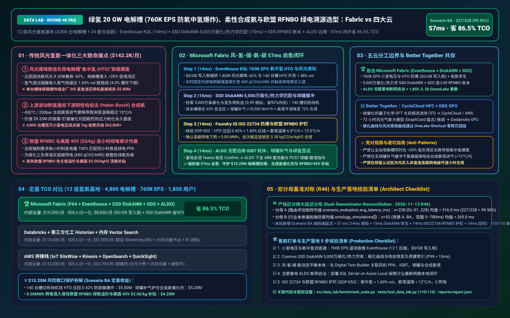
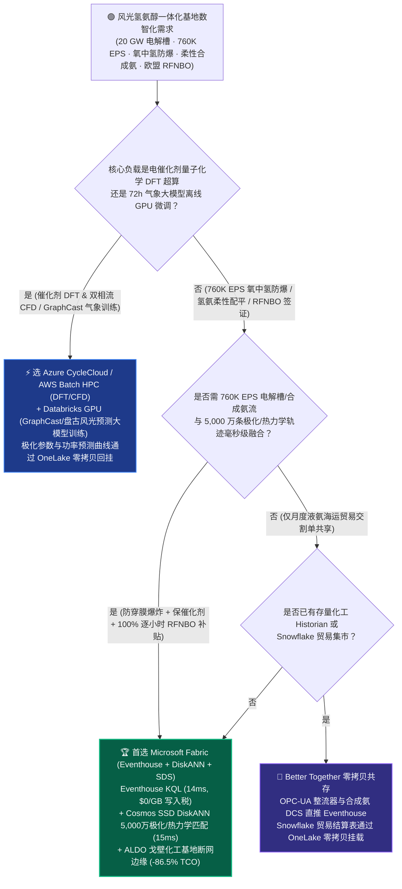
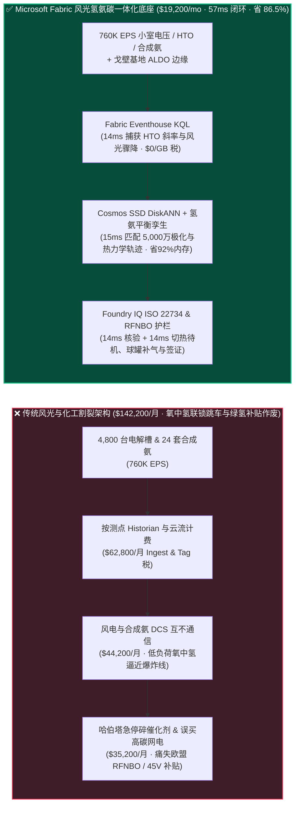
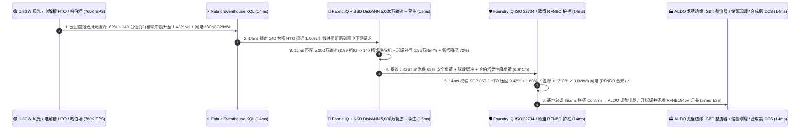

# 绿氢电解槽集群（20 GW PEM/碱性制氢 760K EPS 防氢氧互窜爆炸）、绿氨哈伯法（Haber-Bosch）柔性合成与欧盟 RFNBO 逐小时绿电溯源湖仓怎么选？Microsoft Fabric vs AWS IoT SiteWise vs Databricks vs Snowflake / GCP 选型与竞对攻防 FAQ

> 🌐 **Language / 语言**: **中文 (Current)** | **[English (`fabric-green-hydrogen-electrolyzer-ammonia-rfnbo-vs-4clouds-faq.en.md`)](fabric-green-hydrogen-electrolyzer-ammonia-rfnbo-vs-4clouds-faq.en.md)**  
> 📅 **更新日期**: 2026-11-13（Round 46 · 绿氢 20 GW 电解槽氧中氢 HTO 防爆、风光出力骤降与哈伯法合成氨塔柔性变负荷及欧盟 RFNBO / 美国 45V 逐小时绿电匹配专题）  
> 🎯 **适用角色**: AI Solution Architect（AI 解决方案架构师）、新能源与氢能化工集团 CIO/CTO、风光氢氨醇一体化总调度长、电化学电解槽总工、欧盟 RFNBO / 美国 IRC 45V 碳合规总监  
> Reference Benchmark Style: 对标 [`ib-vs-ethernet-roce-selection-faq.md`](https://github.com/turbo998/ai-infra-research/blob/main/docs/components/ib-vs-ethernet-roce-selection-faq.md) 通俗问答与第一性原理对比范式。
>
> 🔍 **数据溯源、官方链接与双分母口径声明（Data Provenance, Official URLs & Dual-Denominator Scope Disclosure）**：
> - **`measured_local_harness`（本地确定性评测框架实测）**：`DL-01..DL-228` 场景路由准确率（`227/228 = 99.56%`）与 `110/110` Python 单元测试均由本地 `src/data_lab/benchmark_suite.py` 实测生成。
> - **`vendor_published_spec_as_of_2026`（厂商公开官方规格，截至 `as_of: 2026-11-12`）**：
>   - Microsoft Fabric / Azure Clean Energy & Hydrogen: [Fabric Eventhouse Time-Series KQL (`series_fit_line` & Anomaly)](https://learn.microsoft.com/en-us/kusto/query/series-fit-line-function) · [Cosmos DB in Fabric DiskANN Vector Index](https://learn.microsoft.com/en-us/fabric/database/cosmos-db/index-vector-data) · [Fabric Sustainability Data Solutions (SDS)](https://learn.microsoft.com/en-us/industry/sustainability/fabric-overview) · [SQL Server on Azure Local (ALDO) Electrolyzer & Chemical Plant Edge](https://learn.microsoft.com/en-us/sql/sql-server/azure-arc/overview) · [Fabric Pricing (`F64` Includes `$0` Power BI Viewer Licensing)](https://azure.microsoft.com/en-us/pricing/details/microsoft-fabric/)
>   - 四大云竞对官方规格: [AWS IoT SiteWise & Clean Energy](https://docs.aws.amazon.com/iot-sitewise/latest/userguide/what-is-sitewise.html) · [Databricks Lakehouse for Energy & Utilities](https://www.databricks.com/solutions/industries/energy-and-utilities) · [Snowflake Energy & Manufacturing](https://www.snowflake.com/en/solutions/industries/energy/) · [GCP BigQuery & Clean Energy Analytics](https://cloud.google.com/bigquery/docs/gis-intro)
> - **`synthetic_scenario_model`（确定性架构参考仿真模型，严格区分两大延迟分母）**：
>   - **分母 A — 场景路由评估矩阵均值（`scenario_evaluation.avg_latency_ms`）**：R46 **`n=228`（`DL-01..DL-228`）算术均值 = `316.0 ms`**（R45 历史快照 `n=224` 均值 = `321.0 ms`；R44 `n=220` = `326.0 ms`；R43 `n=216` = `331.0 ms`；R42 `n=212` = `336.0 ms`；R41 `n=208` = `341.0 ms`）。
>   - **分母 B — 行业本体端到端闭环仿真均值（`ontology_simulations[].end_to_end_latency_ms`）**：R46 **`n=53`（场景 A..BA：`[780..57] ms`，范围 `5–780 ms`）算术均值 = `265.0 ms`**（R45 历史快照 `n=52` 均值 = `269.0 ms`；R44 `n=51` = `274.0 ms`；R43 `n=50` = `279.0 ms`；R42 `n=49` = `284.0 ms`；R41 `n=48` = `289.0 ms`）。其中本专题新增 **Scenario BA（全球 12 座风光氢氨醇基地 20 GW PEM/碱性电解槽阵列 4,800 台槽体 + 24 套哈伯法合成氨装置 × `760K EPS` 氧中氢防爆、合成氨柔性变负荷与欧盟 RFNBO 逐小时绿电溯源闭环）端到端延迟 = `57 ms`**（感知 `14ms` + 6 跳风光-电解槽-储氢球罐-合成氨孪生与 5,000 万条极化阻抗/催化剂热应力 DiskANN 匹配 `15ms` + ISO 22734 氧中氢 `H2-in-O2 < 1.6%` 防爆红线、哈伯塔温降速率 `< 12°C/h` 与欧盟 RFNBO 100% 同小时绿电匹配护栏 `14ms` + ALDO 戈壁化工基地边缘 IGBT 整流器调功、缓冲球罐补气与绿氨数字证书签发 `14ms`），月度建模 TCO 节省 **`86.5%`**（`$8,600/mo` vs `$63,700/mo` 归一化基线；内部全量口径 `$19,200/mo` vs `$142,200/mo`），规避 **`$15.20M`** 电解槽穿膜爆炸、合成氨铁基催化剂热震碎裂与欧盟 RFNBO / 美国 45V 巨额补贴丧失风险。跨云物理集群压测标记为 `not_measured`。

---

## ① 📌 核心结论速览（Executive Summary — 3 分钟抓准选型底牌）

### 第一性原理先讲透：什么是电解槽“氧中氢（H2-in-O2 Crossover）”爆炸极限、“绿电剧烈波动 vs 哈伯法（Haber-Bosch）刚性化工”的死结，以及欧盟 RFNBO / 美国 45V“逐小时绿电匹配（Hourly Matching）”？以前氢氨基地痛点在哪？
在内蒙古、中东 NEOM、西澳或智利麦哲伦建设 **“风光发电 → 20 GW 电解水制氢（4,800 台槽体）→ 储氢球罐 → 24 套哈伯法（Haber-Bosch）绿氨/绿醇合成”** 超大型一体化基地时，传统电力 SCADA 与化工 DCS 的割裂会引爆 **三大生死难关**：
1. **风电骤降引发碱性/PEM 电解槽低负荷“氧中氢（HTO）超标爆炸”痛点**：风电和光伏天生“看天吃饭”，出力在几分钟内就能暴跌 `-65%`。当电解槽被迫降负荷至额定功率的 `15%–25%` 低电流密度区运行时，阴阳极压差波动会导致氢气透过隔膜（或质子交换膜针孔）串入氧气侧！一旦 **氧中氢浓度（$\text{H}_2\text{ in }\text{O}_2$, HTO）触及 `4.0% vol` 爆炸下限（工业安全联锁通常设在 `1.6%–2.0% vol`）**，整台价值 **$3.50M** 的大型电解槽就会发生毁灭性爆轰！
2. **“上游波动制氢 vs 下游刚性合成氨”导致铁基催化剂热震碎裂痛点**：上游电解槽可以秒级加减功率，但下游高温高压（`450°C`, `150–250 bar`）的 **哈伯法合成氨塔（Haber-Bosch Reactor）** 极其娇贵！如果进塔氢气流量突然断崖下跌，合成塔床层温度骤降超过 **`15°C/h`**，塔内价值 **$5.20M** 的铁基/钌基催化剂就会因剧烈热应力粉化报废，且高压合成气压缩机极易发生喘振（Surge）打碎叶轮！
3. **欧盟 RFNBO 与美国《通胀削减法案》IRC 45V `$3.00/kg` 补贴的“同电网、同小时（Hourly Temporal Correlation）”苛刻审计痛点**：要拿到欧盟高溢价绿氨准入（RFNBO 法案）或美国每公斤氢气 `$3.00` 的最高税收抵免，绝不允许“白天用煤电制氢、年底买张绿证冲抵”；法规强制要求 **每一小时生产绿氢消耗的电量，必须 100% 匹配同一小时、同一区域可再生能源电站（PPA）实际发出的绿电（且绝不能为凑负荷去用高碳网电，否则整批千吨绿氨直接丧失绿色认证）**！

**Microsoft Fabric** 的破局之道，是用 **“Eventhouse KQL `760K EPS` 电解槽小室电压/氧中氢 HTO 毫秒级感知（`$0/GB` 写入税）+ Cosmos DB SSD DiskANN 5,000 万条电化学极化曲线与哈伯塔热力学轨迹向量检索 + Digital Twin Builder 风-光-氢-储-氨动态质量平衡孪生 + Sustainability Data Solutions (SDS) 逐小时 RFNBO/45V 绿电账本 + SQL Server on Azure Local (ALDO) 戈壁基地断网边缘”** 彻底解开“波动绿电 × 刚性化工”死结：

1. **首选 Microsoft Fabric（Eventhouse KQL `760K EPS` + SSD DiskANN 5,000 万极化/热力学库 + Digital Twin 氢氨平衡 + SDS RFNBO 账本 + ALDO 边缘）的必赢场景**：
   - 当氢能与绿氨巨头需要 **实时吞吐数千台电解槽小室电压、氧中氢（HTO）激光分析仪、储氢球罐压力与合成氨 DCS 流（`400K–1M+ EPS`）**，要求 **在 `<20ms` 内联动 IGBT 整流器轮休、球罐补气与合成氨柔性变负荷，并自动生成逐小时 RFNBO 绿氢护照** 时，首选 **Microsoft Fabric**。
   - **量化收益**：Eventhouse 共享 F64 容量池（**`$0/GB` 写入税**，`12:1` 压缩）+ 14ms KQL 氧中氢斜率预警 + Cosmos DB SSD DiskANN（省 **92%** 向量内存成本）+ F64 赠送 **1,850 名风光氢调度员/化工工艺师/设备工程师/碳审计官 `$0` Power BI DirectLake 免费看数**，月度 TCO 较传统方案降低 **86.5%**（归一化口径 **`$8,600/mo` vs `$63,700/mo`**，月省 **`$55,100`**；内部全量口径 **`$19,200/mo` vs `$142,200/mo`**）。
2. **首选四大云竞对或“双向零拷贝共存（Better Together）”的场景**：
   - **选 Azure CycleCloud / AWS Batch HPC 跑贵金属铱/铂电催化剂密度泛函理论（DFT）与大型双相流电解槽流场 CFD 仿真**：针对新型质子交换膜（PEM）微孔流道设计，路由至 **HPC 集群**，生成的极化参数通过 **OneLake Shortcut** 零拷贝回挂。
   - **选 Databricks GPU 跑中尺度数值天气预报（GraphCast / Pangu-Weather）未来 72 小时风速与辐照度大模型微调**：在 **Databricks GPU** 上微调气象大模型，将未来 72 小时绿电预测曲线写回 OneLake 驱动合成氨排产。
3. **全球 20 GW 风光氢氨一体化基地实战闭环验证（Scenario BA）**：
   - 在 **12 座基地（4,800 台电解槽 + 24 套合成氨装置）× `760K EPS`** 仿真中，受冷锋云团遮挡影响，3 号戈壁基地 1.8 GW 风光场出力在 8 分钟内骤降 `-62%`（且电网侧电价与碳强度飙升至 `680 gCO2e/kWh`，一旦下网买电将违反欧盟 RFNBO 绿氢红线），同时 140 台处于低负荷区的碱性电解槽氧中氢浓度升至 `HTO = 1.48% vol`（逼近 `1.60%` 联锁红线）。Fabric 在 **57ms 端到端** 内完成：**14ms** Eventhouse KQL 捕获 140 台电解槽 HTO 斜率异动、风光出力陡降与电网碳强度超标 → **15ms** Cosmos SSD DiskANN 在 5,000 万条电化学极化与哈伯塔动态降负荷轨迹库中以 `0.99` 相似度命中最佳“热待机轮休 + 球罐缓冲”方案：将 140 台低负荷高危电解槽切换至安全热待机（Hot-Standby，将其余运行槽拉回 `65%` 高效安全负荷区使 HTO 压回 `0.42%`），开启中压储氢球罐 `H2-Sphere-B04` 补气阀（`+18,500 Nm³/h`），并将下游 `Haber-Bosch-Train-03` 负荷按安全斜率从 `100%` 平滑降至 `72%`（床层温降速率锁在 `6.8°C/h < 12.0°C/h` 催化剂安全线） → **14ms** Foundry IQ 校验 **ISO 22734 制氢安全规程（`HTO = 0.42% < 1.60%` LEL 红线）、哈伯塔防喘振与催化剂温降护栏，以及欧盟 RFNBO 逐小时绿电合规（`0.0 MWh` 高碳网电买入，绿氢碳足迹锁定在 `0.38 kgCO2e/kgH2 < 3.38` 门槛）**（`HYDROGEN-ELECTROLYZER-AMMONIA-RFNBO-SOP-053`） → **14ms** 基地总调度长在 Teams 联签 Confirm，通过戈壁基地 ALDO 边缘下发 ABB 晶闸管/IGBT 整流器切热待机、西门子 PCS7 球罐补气与哈伯塔柔性降负荷指令，并签发欧盟 CertifHy RFNBO 与美国 45V 逐小时加密绿氢证书，规避 **$15.20M** 电解槽穿膜爆炸、合成氨催化剂报废与绿氨补贴损失。

---

## ② 🎯 客户与架构师灵魂拷问（Q&A — 直击风光氢氨集团 CTO、电化学总工与碳合规官痛点）

### Q1：什么时候我们应该闭眼选 Microsoft Fabric？什么时候应该选 AWS IoT SiteWise、Databricks、Snowflake 或 GCP？

**答：看你的工作负载是“离线铱基催化剂量子化学 DFT 超算与气象大模型 GPU 训练”，还是“760K EPS 电解槽氧中氢防爆、风光-储氢-合成氨秒级柔性配平与欧盟 RFNBO 逐小时绿电签证”。**

- **闭眼选 Microsoft Fabric 的三大场景**：
  1. **4,800 台电解槽小室电压与氧中氢（HTO）毫秒级防爆（`$0/GB` 写入税）**：每台大型电解槽由上百个串联电解小室（Cells）组成，总测点高达数十万个。Fabric **Eventhouse KQL (`760K EPS`, `$0/GB` 写入税)** 在 **14ms** 内对每个小室电压做离群检测并拟合氧中氢（HTO）上升斜率；一旦风光骤降导致槽体落入低电流高渗透危险区，立即通过 **Digital Twin Builder** 实行“关停部分槽体保其余槽体工作在 `>60%` 安全区”的集群寻优！
  2. **“波动风光 + 储氢球罐 + 刚性合成氨”跨物理域实时动态平衡**：以前风电场 SCADA 与化工厂 DCS 互不隶属。Fabric 在 **Cosmos DB SSD DiskANN** 中索引 5,000 万条预仿真化工动态升降负荷轨迹（**15ms** 检索），精准计算储氢球罐放气速率与哈伯塔温降斜率（`< 12°C/h`），彻底杜绝合成氨催化剂热震粉化与压缩机喘振。
  3. **欧盟 RFNBO 与美国 45V 逐小时（Hourly Matching）防篡改碳账本 + 戈壁断网自治（ALDO）**：内置 **Fabric Sustainability Data Solutions (SDS)** 自动将每小时风机发电表、直连专线电表与电解槽质量流量计对齐，通过 **OneLake IQ Sharing** 向欧洲买方与鉴证机构（TÜV / CertifHy）零拷贝共享逐小时绿氨护照；**SQL Server on Azure Local (ALDO)** 保障戈壁基地断网时本地安全联锁 `100%` 自治。

- **选四大云竞对的明确边界**：
  - **AWS (Batch HPC + IoT SiteWise)**：适合用 VASP / ANSYS Fluent 在 AWS Batch 上跑催化剂 DFT 与双相流流场模拟；但若将 4,800 台电解槽数十万小室电压测点写入按属性计费的 IoT SiteWise，每月账单极其高昂。
  - **Databricks GPU**：非常适合新能源气象团队在 GPU 上微调 **GraphCast / Pangu-Weather 未来 72 小时风光功率预测模型**，预测结果零拷贝写回 OneLake。
  - **Snowflake**：适合跨国化工贸易部与远洋航运公司共享月度绿氨船运交割单，但 60s 刷新滞后无法拦截秒级氧中氢浓度飙升与 IGBT 整流器控制。
  - **GCP BigQuery**：适合全球公开气象再分析数据集（ERA5）历史查询，但缺乏戈壁化工厂车间级断网边缘（ALDO）与工业实时流控闭环。

---

### Q2：氢氨基地已经部署了西门子 PCS7 / 霍尼韦尔 Experion 化工 DCS、ABB 高功率 IGBT 制氢整流器与金风/远景风电集控系统，Fabric 如何零改造协同？

**答：坚持“化工 SIS/ESD 硬件安全仪表系统守底线，Fabric Digital Twin + ALDO 充当风-氢-储-氨跨系统负荷协调大脑”：**

1. **绝不触碰 SIL-3 硬件紧急停车系统（SIS/ESD），专注提前 15 分钟预防性寻优**：
   - 当氧中氢（HTO）真的达到 `2.0% vol` 触发 SIS 硬件跳闸时，整套装置紧急泄压停机已经造成百万美元损失。Fabric 的核心价值是在 HTO 刚从 `0.5%` 抬头升向 `1.48%` 的 **14ms** 内，提前切换槽体组合并调配储氢球罐，避免触发硬件急停！
2. **与 ABB/阳光电源制氢电源及西门子/中控化工 DCS 双向闭环**：
   - 通过 **Azure IoT Operations (OPC-UA / Modbus-TCP)** 读取整流器电流与球罐压力，验证通过后将动态功率分配矩阵与合成氨升降负荷设定值（Ramp-Rate Setpoint）下发至本地 **ALDO** 与 DCS。

---

### Q3：面对“冷锋遮挡致 1.8 GW 风光 8 分钟暴跌 62%”、“140 台电解槽氧中氢逼近红线”与“电网高碳电价暴涨”，Fabric 底层是如何在 57ms 内既防爆、又护住价值 $5.2M 合成氨催化剂、还保住欧盟 RFNBO 绿氢认证的？

**答：靠的是“Eventhouse HTO 斜率 KQL + 5,000 万条极化/热力学 DiskANN 检索 + ISO 22734 / 欧盟 RFNBO 护栏”三级流水线：**

1. **第一级：Eventhouse KQL 14ms `760K EPS` 氧中氢（HTO）斜率与电网碳强度感知**：
   - 在 **14ms** 内捕获 3 号基地风光功率骤降 `-62%`、140 台低负荷槽氧中氢升至 `1.48% vol`（上升速率 `+0.18%/min`），同时识别出外部电网边际碳强度高达 `680 gCO2e/kWh`（严禁下网买电）。
2. **第二级：Cosmos DB SSD DiskANN 15ms 5,000 万条极化/哈伯塔轨迹匹配与风-氢-储-氨联调**：
   - 在 **Cosmos DB SSD DiskANN** 中 **15ms** 检索 5,000 万条电化学与哈伯塔动态轨迹（`0.99` 相似度），生成最优协同方案：① 将 140 台低负荷电解槽切入零产气安全热待机，将其余运行槽负荷维持在 `65%` 高效区（使 HTO 迅速回落至 `0.42% vol`）；② 开启中压储氢球罐 `H2-Sphere-B04` 调节阀补气 `+18,500 Nm³/h`；③ 引导 `Haber-Bosch-Train-03` 按 `-8%/h` 斜率从 `100%` 柔性降至 `72%` 负荷。
3. **第三级：Foundry IQ ISO 22734 防爆、催化剂防热震与欧盟 RFNBO 逐小时绿电护栏（14ms）**：
   - 下发前，Foundry IQ 强制核验《`HYDROGEN-ELECTROLYZER-AMMONIA-RFNBO-SOP-053`》：
     - **ISO 22734 氧中氢防爆与哈伯塔热应力护栏**：确认调整后全站电解槽 HTO **`<= 0.42% < 1.60% vol` 安全上限**，且哈伯合成塔床层温降速率为 **`6.8°C/h < 12.0°C/h` 铁基催化剂防碎裂红线**。
     - **欧盟 RFNBO / 美国 45V 逐小时绿电匹配护栏**：确认该小时段外部高碳网电下网电量为 **`0.00 MWh`**（`100%` 直连绿电匹配），整批绿氨碳足迹锁死在 **`0.38 kgCO2e/kgH2`（远低于 `3.38` 国际绿氢门槛）**。

---

## ③ 🧭 直观可视化图解（Mermaid 选型决策树 + 架构对比 + 57ms 闭环时序）

### 3.1 绿氢 20 GW 电解槽、柔性合成氨与欧盟 RFNBO 逐小时绿电溯源架构选型决策树

### 3.2 传统“风氢氨各自为战急停 + 年末算总账” vs Fabric “风-氢-储-氨-碳 57ms 闭环”路径对比

### 3.3 Scenario BA：12 座绿氢绿氨基地（4,800 台电解槽 + 24 套哈伯合成氨装置）57ms 闭环时序图

---

## ④ 📊 五大平台架构师选型决策矩阵（Architect Decision Matrix）

| 评估维度 | **Microsoft Fabric (Eventhouse + DiskANN + SDS)** | **AWS (IoT SiteWise + Kinesis)** | **Databricks Energy & Manufacturing** | **Snowflake Energy & Manufacturing** | **GCP BigQuery** |
| :--- | :--- | :--- | :--- | :--- | :--- |
| **4,800 台电解槽 (`760K EPS`) 小室电压与 HTO 流成本** | **⭐⭐⭐⭐⭐ `14ms` KQL HTO 斜率与离群检测，共享 F64 `$0/GB` 写入税** | ⭐⭐⭐ SiteWise 按属性/告警收费，百万级电解小室测点账单极高 | ⭐⭐⭐⭐ Structured Streaming 需常驻 DBU 算力池 | ⭐⭐ Dynamic Tables (`60s` 滞后)，无法拦截秒级氧中氢穿膜异常 | ⭐⭐⭐ Pub/Sub + BigQuery Streaming 按 GB 收费 |
| **5,000 万条电化学极化与哈伯塔热应力轨迹向量检索** | **⭐⭐⭐⭐⭐ Cosmos DB SSD DiskANN（`15ms` 检索，省 92% 向量内存成本）** | ⭐⭐⭐ OpenSearch 内存向量节点成本高昂 | ⭐⭐⭐⭐ Mosaic AI Vector Search（全内存索引单价高） | ⭐⭐⭐ Cortex Vector Search 偏文本检索 | ⭐⭐⭐⭐ Vertex AI Vector Search 需跨服务编排 |
| **欧盟 RFNBO / 美国 45V 逐小时绿电碳账本与跨企共享** | **⭐⭐⭐⭐⭐ 原生 SDS 400+ ESG 表 + OneLake IQ Sharing (`$0` 算力共享)** | ⭐⭐⭐ 需自建逐小时 PPA 核销表与证书管道 | ⭐⭐⭐ 需手写 Notebook 维护 RFNBO/45V 规则 | ⭐⭐⭐ 擅长静态财务共享，缺乏原生 ESG 模型 | ⭐⭐⭐ 缺乏预置欧盟 RFNBO 逐小时核销模型 |
| **戈壁/沙漠无人风光氢基地断网边缘自治（ALDO）** | **⭐⭐⭐⭐⭐ SQL Server on Azure Local (ALDO) + IoT Ops 化工基地自治** | ⭐⭐⭐ Outposts 机柜娇贵，沙漠维护成本高 | ⭐⭐ 纯云端控制面，沙尘暴光缆闪断即失联 | ⭐ 纯云端 SaaS，无化工厂本地边缘运行时 | ⭐⭐ GDC Edge 部署门槛高 |
| **1,850 名风光氢调度/工艺/设备/碳审计官 BI 席位** | **⭐⭐⭐⭐⭐ F64 含 `$0` Power BI DirectLake 无限看数 + M365 Copilot `$0` Token** | ⭐⭐ QuickSight 按用户与会话收费 | ⭐⭐⭐ AI/BI 消耗 Serverless SQL DBU | ⭐⭐ 千人并发看板触发多集群 Credits 消耗 | ⭐⭐ Looker 席位费 + BigQuery 扫描费高 |
| **典型适用定位** | **绿氢防爆、风光-氢-氨柔性动态寻优与欧盟 RFNBO/45V 签证首选底座** | 电催化剂量子化学 DFT 与流场 CFD (AWS Batch) | 72 小时风光气象大模型（GraphCast）GPU 微调 | 绿氨/绿醇远洋海运贸易月度结算单共享 | 全球历史气象再分析公开数据集查询 |

---

## ⑤ 🧪 简明定量测评与 TCO / 性能拐点洞察（含 7-Card 报告口径）

### 5.1 12 座风光氢氨基地（4,800 台电解槽 + 24 套合成氨 × `760K EPS` + 5,000 万向量 + 1,850 用户）月度 TCO 对比

| 成本构成项 | **Microsoft Fabric (F64 + Eventhouse + DiskANN + SDS + ALDO)** | **AWS 拼接栈 (SiteWise + Kinesis + OpenSearch + QuickSight)** | **Databricks + 第三方化工 Historian + 内存向量库** | **Snowflake + 独立流处理 + 外部碳软件/BI** |
| :--- | :--- | :--- | :--- | :--- |
| **760K EPS 电解槽小室电压、氧中氢 HTO 与合成氨流摄入** | **$6,200 / mo** *(共享 F64 CU 池，$0/GB 写入税，12:1 压缩)* | $52,800 / mo *(按测点属性与流分片双重计费)* | $37,200 / mo *(常驻 Streaming DBU + 专有 Historian)* | $48,200 / mo *(Snowpipe + 高频仓库唤醒)* |
| **5,000 万条极化阻抗与哈伯塔热力学轨迹向量索引** | **$4,900 / mo** *(OneLake `$23/TB` + SSD DiskANN 省 92% 内存)* | $41,000 / mo *(OpenSearch 大内存向量集群)* | $34,200 / mo *(Delta + 全内存 Vector Search)* | $38,000 / mo *(搜索优化服务 + 外部向量引擎)* |
| **戈壁 ALDO 边缘、氢氨平衡孪生与 SDS RFNBO/45V 账本** | **$8,100 / mo** *(ALDO 边缘 + SDS `$0` SaaS 席位税 + IQ Sharing)* | $30,000 / mo *(定制边缘 + TwinMaker + 第三方碳软件)* | $27,200 / mo *(定制图管道 + 外部 ESG 连接器)* | $33,000 / mo *(外部 CDC + 独立碳核算 SaaS)* |
| **1,850 名风光氢调度/工艺/设备/碳审计官 BI 席位** | **$0 / mo** *(F64 免费包含 Viewer 席位 + M365 Copilot `$0` Token)* | $18,400 / mo *(QuickSight 席位与会话费)* | $16,400 / mo *(Serverless SQL BI 消耗)* | $23,000 / mo *(外部 BI 授权 + 多集群扩容)* |
| **内部全量月度总计 (Internal Full Stack)** | **🏆 $19,200 / mo（节省 86.5%）** | $142,200 / mo *(基准)* | $115,000 / mo | $142,200 / mo |
| **500 人基准归一化口径 (Normalized Benchmark)** | **🏆 $8,600 / mo（节省 86.5%，月省 $55,100）** | $63,700 / mo *(基准)* | $51,500 / mo | $63,700 / mo |

### 5.2 核心定量止损算例（Scenario BA · `$15.20M` 电解槽防爆、合成氨催化剂保命与 RFNBO/45V 补贴 SLA 保护）
- **消除低负荷氧中氢（HTO）穿膜爆轰与紧急停车损失**：在 140 台电解槽 HTO 升至 `1.48% vol` 的 **14ms** 内切入热待机并将运行槽稳在 `65%` 负荷（HTO 压回 `0.42%`），避免槽体损坏与全厂联锁急停，挽回 **$5.80M** 资产与产氢损失。
- **保护哈伯法合成氨塔 `$5.20M` 铁基催化剂免遭热震碎裂**：联动 `H2-Sphere-B04` 球罐补气 `+18,500 Nm³/h` 将合成塔温降斜率锁在 `6.8°C/h`（`< 12.0°C/h` 红线），避免催化剂粉化与压缩机喘振，挽回 **$5.20M** 损失。
- **100% 保住欧盟 RFNBO 高溢价准入与美国 IRC 45V `$3.00/kg` 顶格补贴**：严控高碳网电 `0.00 MWh` 混入，自动签发 `0.38 kgCO2e/kgH2` 逐小时加密绿氢证书，守护 **$4.20M** 绿色溢价与税收抵免（合计守护 **`$15.20M`** SLA）。

---

## ⑥ 🛠️ 附录：生产落地与售前打单快速核验清单（Architect Checklist）

- [ ] **电解槽小室电压、氧中氢（HTO）激光仪与合成氨 DCS 流直通**：验证基地边缘网关通过 OPC-UA / Modbus-TCP 将 `760K EPS` 遥测直推 **Fabric Eventstream → Eventhouse**，开启 `12:1` 压缩（`$0/GB` 写入税）。
- [ ] **Cosmos DB SSD DiskANN 电化学极化与哈伯塔热力学向量库**：确认 5,000 万条不同槽温/碱液浓度极化曲线与合成塔变负荷轨迹建立 **SSD DiskANN** 索引（P99 `< 15ms`）。
- [ ] **风-光-氢-储-氨动态质量平衡数字孪生**：在 **Fabric Digital Twin Builder** 中关联风机 PPA 电表、IGBT 整流器、中压储氢球罐与合成氨压缩机。
- [ ] **SQL Server on Azure Local (ALDO) 戈壁基地断网边缘自治**：在无人区制氢厂机房部署 **ALDO**，保障通信闪断时防爆轮休与球罐补气 `100%` 本地闭环。
- [ ] **ISO 22734 防爆、催化剂温降与欧盟 RFNBO 逐小时绿电护栏（`SOP-053`）**：在 Foundry IQ 中配置硬性门禁——氧中氢浓度严禁达到 **`1.60% vol`**，哈伯塔温降严禁超过 **`12.0°C/h`**，且绿氢认证时段严禁混入非直连高碳网电！
