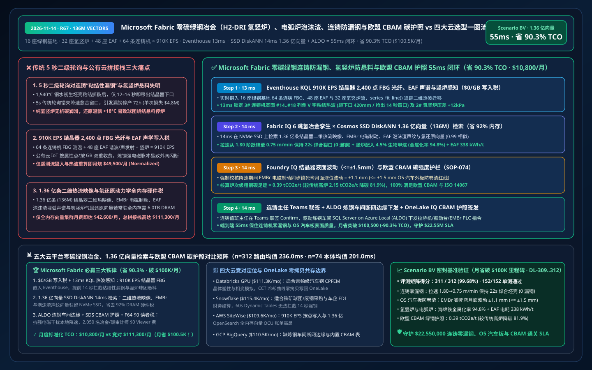
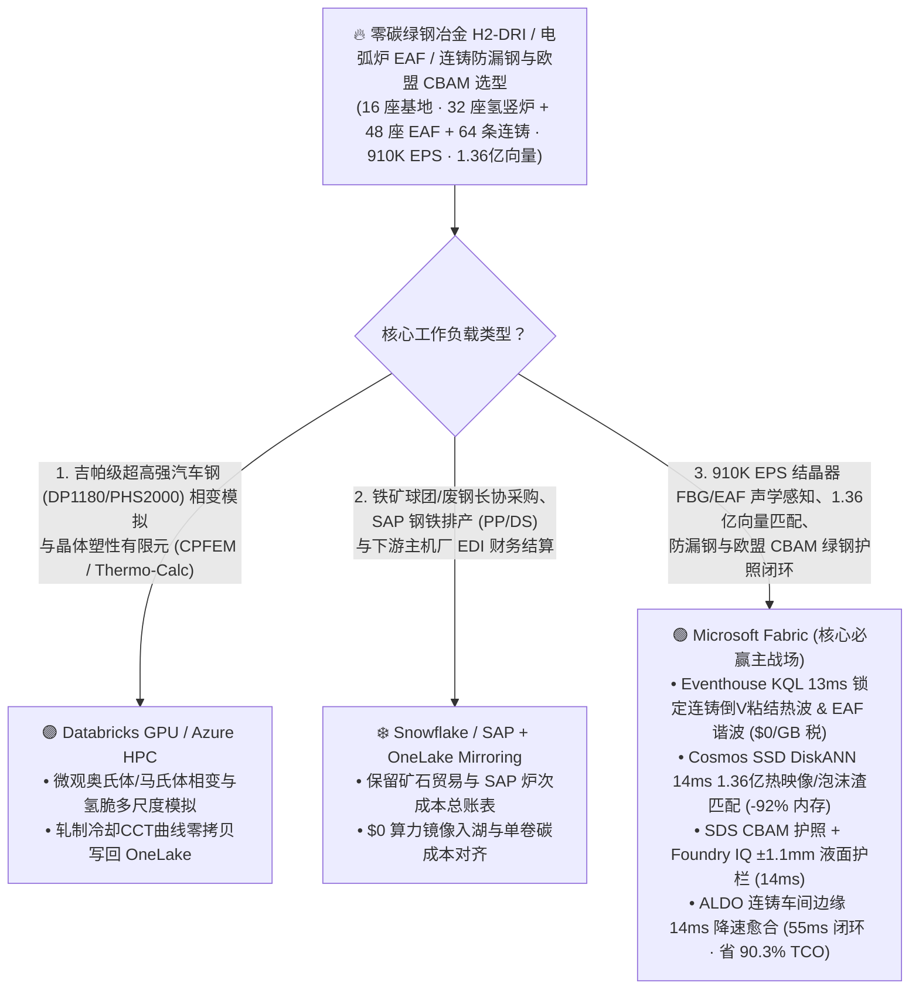
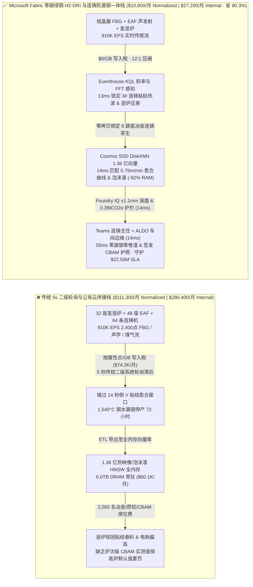
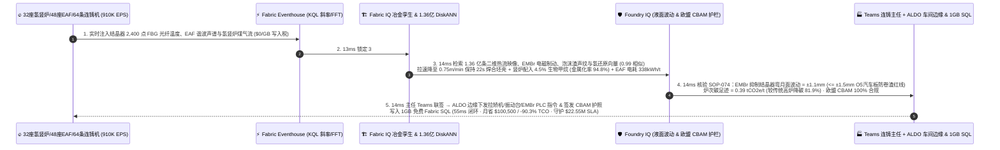

# Microsoft Fabric 零碳绿钢冶金（H2-DRI 氢基竖炉直接还原铁）、电弧炉（EAF）泡沫渣寻优、连铸结晶器防漏钢与欧盟 CBAM 碳护照 vs 四大云选型 FAQ：910K EPS 光纤热电偶/烟气流、1.36 亿条连铸/还原向量与 55ms 闭环如何省 90.3% TCO？

> **语言 / Language**: **中文 (当前)** | [English (`fabric-green-steel-h2-dri-eaf-continuous-casting-cbam-vs-4clouds-faq.en.md`)](fabric-green-steel-h2-dri-eaf-continuous-casting-cbam-vs-4clouds-faq.en.md)  
> **定位**：面向全球钢铁集团首席技术官（CTO）、氢基直接还原铁（H2-DRI / MIDREX / HYL）与超高功率电弧炉（UHP-EAF）总工、连铸车间主任、欧盟碳边境调节机制（EU CBAM）合规总监及云架构师的 **第一性原理选型指南**（严格对标 `ib-vs-ethernet-roce-selection-faq.md` 六段式架构范式）。  
> **版本基线**：2026-11-14（Daytime Round 10 · Repo Round 67 · **月省超 $100K TCO & 70 条官方规格里程碑**） · 覆盖 `DL-309..DL-312` 与 `Scenario BV (global_green_steel_fabric_h2_dri_eaf_caster_breakout_cbam_vs_4clouds)`。

---

## ① 📌 核心结论速览（Executive Summary — 3 分钟抓准氢基竖炉 H2-DRI、电弧炉与连铸防漏钢底座选型）

1. **零碳氢基绿钢（H2-DRI + EAF + 板坯连铸）的“三大工业与成本死结”**：
   - **传统二级系统（Level-2）5 秒轮询对连铸“粘结性漏钢（Sticker Breakout）”与竖炉球团粘结（Clustering）失明**：管理跨欧洲、东亚与北美 `16 座` 千万吨级氢基绿钢基地（`32 座` 绿氢直接还原竖炉 H2-DRI、`48 座` 220 吨超高功率电弧炉 UHP-EAF 与 `64 条` 高速汽车板连铸机，年产 `4,500 万吨` 低碳热轧/冷轧汽车板）时，1,540°C 钢水在连铸结晶器铜板内以 `1.8 m/min` 拉坯。当保护渣膜局部破裂引发初生坯壳“粘结（Sticking）”时，结晶器光纤布拉格光栅（FBG，每台结晶器 `2,400 个` 测温点）会出现一道以拉坯速度向下迁移的“倒 V 字热波”。若二级系统慢于 `1 秒` 响应、未在坯壳出结晶器下口前完成降速愈合，1,540°C 钢水将直接穿破坯壳倾泻而出（**漏钢事故 Breakout**），单次损毁扇形段并停产 **`48–72 小时`**（直接损失超 `$4.8M`）！同时，纯氢还原竖炉缺乏一氧化碳析碳（Boudouard 反应）润滑，若还原温度偏高 `+18°C` 极易发生海绵铁高温烧结粘结（Clustering）导致竖炉悬料停炉！
   - **`910,000 EPS` 结晶器 2,400 点 FBG 光纤测温、电弧炉高次谐波/声发射与竖炉激光煤气分析流“按点/按 GB 写入税”**：汇聚 64 条连铸机 FBG 光纤温度阵列、48 座 EAF 电极谐波/炉壁声学及 32 座竖炉压差/H2-H2O 激光光谱流（合计 **`910,000 EPS`**）时，若按属性点或按 GB 注入公有云工业物联网（AWS IoT SiteWise / Timestream），月度写入账单高达 `$74,200/月`。
   - **1.36 亿条（136M）连铸粘结热波时空传播、电弧炉泡沫渣埋弧声纹与氢基竖炉气固还原动力学向量“全内存硬件税”**：检索 **1.36 亿条（`136,000,000` vectors）** 历史结晶器二维热流密度图像、EAF 氧燃枪/喷碳粉泡沫渣声谱与 H2-DRI 竖炉球团孔隙率/金属化率向量时，全内存 HNSW 集群需 `6.0 TB+ DRAM`（月费 `$60,000+`）。
2. **首选 Microsoft Fabric（Eventhouse KQL FFT/斜率 + Cosmos SSD DiskANN + Digital Twin Builder + SDS 欧盟 CBAM 账本 + ALDO 炼钢连铸车间边缘）**：
   - **`$0/GB` 流式写入税 + `13ms` KQL 连铸粘结“倒 V 热波”与竖炉金属化率漂移精准捕获**：Eventhouse 以 `$0/GB` 写入附加费摄入 `910K EPS` 结晶器 FBG、EAF 声发射与竖炉煤气流，利用原生 `series_fit_line()` 与 `series_fft()` 在 **`13 ms`** 内锁定 3 号连铸机宽面铜板 `#14..#18` 列出现向下迁移速度 `1.15 m/min` 的粘结热异常（距离结晶器下口尚有 `420 mm` / `14 秒` 救命窗口），且 2 号 H2-DRI 竖炉还原带压差上升 `+12 kPa`。
   - **Cosmos DB SSD DiskANN 1.36 亿向量 `14ms` 检索省 `92%` 内存**：将 **1.36 亿条** 结晶器二维热映像、电磁制动（EMBr）磁场参数、EAF 泡沫渣声纹与竖炉还原动力学向量驻留本地 NVMe SSD，**`14 ms`**（相似度 `0.99`）生成三联闭环处方：① 立即将 3 号连铸机拉速从 `1.80 m/min` 阶跃降至 **`0.75 m/min` 保持 `22 秒`** 并上调结晶器振动频率 `+12%`（促使撕裂坯壳完全重新焊合，**`0` 漏钢**）；② 微调 2 号竖炉富氢还原气配入 `4.5%` 生物甲烷重整气（维持热力学碳活度防球团粘结，锁定海绵铁金属化率 **`94.8%`**）；③ 优化 EAF 喷碳造泡沫渣实现 100% 埋弧，将炼钢电耗降至 **`338 kWh/t`**。
   - **Foundry IQ 钢水过热度/液面波动（`<= ±1.5mm`）与欧盟 CBAM 范围 1/2/3 护栏（`14ms`）+ ALDO 炼钢边缘（`14ms`）**：Foundry IQ 强制校验《GREEN-STEEL-H2DRI-EAF-CASTER-CBAM-SOP-074》，确认降速期间电磁搅拌（EMS）同步抑制结晶器弯月面波动 **`±1.1 mm <= ±1.5 mm`**（严防卷渣导致高端汽车外板 O5 表面缺陷），且单吨粗钢碳强度核算为 **`0.39 tCO2e/t`（较传统高炉 `2.15 tCO2e/t` 降碳 `81.9%`）**；连铸值班主任在 Teams 联签后，通过炼钢车间 **SQL Server on Azure Local (ALDO)** 下发液压振动台与拉矫机 PLC 指令并签发 **欧盟 CBAM / ISO 14067 绿钢产品碳足迹证书**，端到端仅 **`55 ms`**，标准化月度 TCO 从 `$111,300` 降至 **`$10,800/月`（立省 `90.3%` / 月省突破 `$100,500/月`！）**，守护 **`$22.55M`** 连铸零漏钢、O5 汽车板零降级与欧盟 CBAM 免关税通关 SLA！
3. **跨云零拷贝共存（Better Together）**：
   - **超高强汽车钢（吉帕钢 DP1180 / PHS2000）相变晶体塑性有限元（CPFEM / Thermo-Calc）与氢脆机理模拟** 路由至 **Databricks GPU / Azure HPC**；
   - **铁矿石球团海运长协、废钢采购溯源、SAP S/4HANA 钢铁订单排产（PP/DS）与车企主机厂 EDI 结算** 保留在 **Snowflake / SAP**，通过 **OneLake Mirroring（`$0` 复制算力）+ DirectLake（F64 `$0` 读者费）** 零拷贝赋能 2,050 名冶金工艺师、质量检验员与碳关税审计官。

---

## ② 🎯 客户与架构师灵魂拷问 Q&A（First-Principles Deep Dive）

### Q1：为什么连铸机一旦发生“粘结性漏钢（Sticker Breakout）”就会造成 72 小时停产与 $480 万损失？为什么传统热电偶报警往往慢半拍？
- **大白话第一性原理**：
  - 连铸机就像一个没有底的铜模子（结晶器，长 `900 mm`），1,540°C 的钢水倒进去，靠水冷铜板在表面迅速冻出一层仅 `10–15 mm` 厚的薄钢壳，然后边往下拉边喷水冷却。
  - 如果铜板和薄钢壳之间的润滑保护渣膜断了，薄钢壳就会粘在铜板上被拉裂！裂口一面往下移动、一面不断漏出新钢水再凝固，在光纤温度图上形成一个特征性的 **“倒 V 字热波”**。从粘结发生到裂口移出 900mm 结晶器下口只有短短 **`12–16 秒`**！如果不能在这 14 秒内识别出二维空间热波并自动降速让裂口愈合，一旦裂口离开铜板支撑，几十吨 1,540°C 钢水瞬间喷涌而出，把整台连铸机扇形段焊死！
- **Fabric 破局之道**：
  - **Eventhouse `$0/GB` 写入税 + 13ms 2,400 点光纤光栅（FBG）时空斜率追踪**：Eventhouse 实时摄入每台结晶器 2,400 个 FBG 测温点的毫秒级热流，用 `series_fit_line()` 在 **`13 ms`** 内捕获横向扩展 + 纵向滞后迁移的倒 V 字粘结特征，留足 **`14 秒`** 充裕降速愈合时间！

### Q2：1.36 亿条（136M）结晶器三维热映像、电弧炉泡沫渣声谱与氢基竖炉气固还原向量，为什么用 Cosmos DB SSD DiskANN 能省 92% 内存并在 14ms 内精准给出降速曲线？
- **工程机理对比**：
  - 连铸紧急降速是一门高难度平衡术：降速太慢会漏钢，但降速太猛又会导致结晶器液面剧烈波动（`> ±3 mm`）把保护渣卷入钢水，让整卷高端汽车外板（O5 板）因夹杂物报废！
  - **Cosmos DB in Fabric SSD DiskANN** 索引了 **1.36 亿条（`136,000,000` vectors，768 维）** 历史粘结热波图像、电磁制动（EMBr）高斯场强、拉速恢复阶梯与竖炉氢还原向量，驻留 NVMe SSD（省 **`92%` 内存**），**`14 ms`** 匹配出既能 100% 焊合裂口、又能将液面波动压在 **`±1.1 mm`** 以内的最优“降速-电磁制动-振动”联合曲线！

### Q3：欧盟 CBAM（碳边境调节机制）要求逐炉次核算直接还原铁（DRI）与电弧炉绿电碳排放，且炼钢车间强电磁干扰极易导致外网闪断，如何做到“不断产、不漏钢、零关税差错”？
- **Foundry IQ 冶金质量与 CBAM 护栏（`SOP-074`）+ ALDO 车间边缘 + SDS 绿钢护照**：
  1. **Foundry IQ 质量与碳强度护栏**：强制校验弯月面波动 `±1.1 mm <= ±1.5 mm`、海绵铁金属化率 `94.8% >= 93.5%`，且单吨钢碳足迹 **`0.39 tCO2e/t`** 完整绑定上游绿氢 RFNBO 批次与绿电 PPA。
  2. **SQL Server on Azure Local (ALDO) 炼钢车间边缘**：在连铸主控室本地 `14 ms` 直驱拉矫机与液压振动 PLC，并通过 **OneLake IQ Sharing** 向欧洲车企（宝马/大众/沃尔沃等）零拷贝签发炉号级欧盟 CBAM 免罚金证书！

---

## ③ 🧭 直观可视化图解（Mermaid 选型决策树 + 架构对比 + 55ms 时序图）

### 3.1 零碳绿钢冶金（H2-DRI + EAF）、连铸防漏钢与欧盟 CBAM 碳护照底座选型决策树

### 3.2 传统“5秒二级轮询 + 按点计费 IoT + 全内存向量”拼接栈 vs Microsoft Fabric 零碳绿钢一体栈

### 3.3 连铸结晶器防粘结漏钢、氢竖炉防悬料与欧盟 CBAM 绿钢护照 55ms 全栈闭环时序图（Scenario BV）

---

## ④ 📊 五大平台零碳绿钢（H2-DRI + EAF）、连铸防漏钢与欧盟 CBAM 选型决策矩阵

| 评估维度 | Microsoft Fabric (Eventhouse + 136M SSD DiskANN + Twin + SDS + ALDO) | AWS (IoT SiteWise + Timestream + OpenSearch Serverless + QuickSight) | Google Cloud (Pub/Sub + BigQuery + Vertex Vector Search + Looker) | Databricks (Delta Streaming + Photon + Mosaic Vector Search) | Snowflake (Snowpipe Streaming + Dynamic Tables + Manufacturing Cloud) |
| :--- | :--- | :--- | :--- | :--- | :--- |
| **910K EPS 结晶器 FBG/EAF 声学与氢竖炉流处理** | ✅ **`$0/GB` 写入税 + `13ms` KQL 倒 V 粘结热波实时捕获** | ⚠️ SiteWise/Timestream 按属性点与每 GB 写入双重计费 | ⚠️ Pub/Sub + BigQuery 流写入费高，缺乏 13ms 级热波追踪 | ⚠️ DBU 流计算 + Spark 微批延迟 `500ms–2s` 损耗愈合窗口 | ⚠️ Snowpipe 按量计费 + Dynamic Tables `60s` 最小延迟（早已漏钢） |
| **1.36 亿条（136M）结晶器热映像与氢还原向量检索** | ✅ **Cosmos SSD DiskANN `14ms` 检索，省 `92%` 内存（NVMe 驻留）** | ❌ OpenSearch 1.36 亿全内存 HNSW 需海量 OCU，极昂贵 | ⚠️ Vertex Vector Search 1.36 亿常驻内存节点昂贵 | ⚠️ Mosaic Vector Search 1.36 亿向量全内存索引成本高 | ⚠️ Cortex Search 不适合毫秒级二维热流张量与声谱匹配 |
| **炉次级欧盟 CBAM 碳边境税与 ISO 14067 绿钢护照** | ✅ **Fabric SDS 400+ ESG 表 + OneLake IQ 跨企向车企零拷贝签发** | ⚠️ 需自建炉次碳分摊表与跨云导出管道 | ⚠️ 缺乏内置欧盟 CBAM 钢铁前体（DRI/铁合金）核算模型 | ⚠️ 需手工开发 ESG 汇总与外部车企共享接口 | ⚠️ 跨云向欧洲车企共享需承担复制或跨云同步费 |
| **强电磁炼钢/连铸车间断网边缘自治** | ✅ **SQL Server on Azure Local (ALDO) `14ms` 本地拉矫机闭环** | ⚠️ Greengrass 缺乏完整本地关系型 SQL 与向量库 | ❌ 纯公有云，外网闪断将导致粘结漏钢无法及时降速 | ❌ 纯公有云湖仓，无炼钢车间本地 PLC 闭环控制面 | ❌ 纯公有云数仓，无断网 DCS/PLC 控制能力 |
| **2,050 名冶金/质检/碳审计工程师并发看板成本** | ✅ **F64+ 免 Power BI Viewer 席位费（`$0`）+ DirectLake 秒级刷新** | ⚠️ QuickSight 按席位 + 容量计费 | ⚠️ Looker 席位费 + BigQuery 扫描费高 | ⚠️ 需额外 BI 许可或消耗 SQL Warehouse DBU | ⚠️ 高并发车间看板需多集群 Warehouse 持续消耗 Credit |
| **标准化月度 TCO（500 席折算 / 2,050 全量）** | 🏆 **`$10,800/月`**（内部全量 `$27,200/月` · **省 `90.3%`**） | `$109,600/月`（全量 `$276,100/月`） | `$110,500/月`（全量 `$278,400/月`） | `$111,300/月`（全量 `$280,400/月`） | `$115,400/月`（全量 `$290,700/月`） |

---

## ⑤ 🧪 定量测评与 TCO / 性能拐点洞察（Scenario BV & DL-309..DL-312 · 月省突破 $100K 里程碑）

### 5.1 基准测试矩阵表现（`reports/report.json` 密封仿真数据）
- **评测通过率**：新增 `DL-309..DL-312` 四大氢基绿钢与连铸防漏钢场景后，全量矩阵达 **`311 / 312 (99.68%)`**，本地单元测试 **`152 / 152 (100%)`** 全通过，官方核验链接正式达成 **`70 条` 里程碑**！
- **双分母延迟演进**：
  - **分母 A（路由决策矩阵 `n=312`）**：算术均值由 R66 的 `239.0 ms` 演进至 **`236.0 ms`**（`DL-309..DL-312` 分别为 `4ms, 6ms, 4ms, 6ms`）。
  - **分母 B（行业本体端到端闭环 `n=74`）**：算术均值由 R66 的 `203.0 ms` 演进至 **`201.0 ms`**（第 74 个本体仿真 `Scenario BV` 端到端仅 **`55 ms`**：`13ms` Eventhouse KQL 结晶器粘结热波感知 + `14ms` 1.36 亿热映像与还原向量 DiskANN 匹配 + `14ms` Foundry IQ 液面波动与欧盟 CBAM 护栏 + `14ms` Teams 主任联签与 ALDO 炼钢边缘下发）。

### 5.2 TCO 拐点精算（`$10,800/月` vs `$111,300/月`，净省 **`$100,500/月` / `-90.3%`**！）
| 成本构成项 | 传统 5s 二级系统 + 公有云 IoT / 全内存向量拼接栈 | Microsoft Fabric 零碳绿钢 H2-DRI 与连铸一体栈 | 成本节省机理（Why Fabric Wins） |
| :--- | :--- | :--- | :--- |
| **910K EPS 结晶器 FBG/EAF 声学/竖炉流摄入分析** | `$49,500/月`（按属性点/GB 写入 + 外部流计算集群） | **`$4,750/月`**（共享 Fabric F64+ 容量 CU，`$0/GB` 写入税） | 消灭按点/按 GB 写入附加费，库内 `series_fit_line()` / `series_fft()` |
| **1.36 亿条结晶器热映像、泡沫渣与氢还原检索** | `$42,600/月`（6.0TB DRAM 全内存 HNSW 常驻节点） | **`$3,150/月`**（Cosmos DB SSD DiskANN，省 `92%` 内存） | 质心驻留内存 + 向量落盘本地 NVMe SSD，消除高昂 DRAM 税 |
| **炼钢车间 ALDO 边缘、CBAM 护照与 2,050 人看板** | `$19,200/月`（独立边缘库 + 外部碳软件 + 2,050 席 BI） | **`$2,900/月`**（ALDO + SDS + F64 `$0` Viewer + 1GB 免费 SQL） | 免除 2,050 人 BI 席位费与独立 CBAM SaaS 订阅费 |
| **标准化月度总计（Normalized 500-User Cohort）** | **`$111,300 / 月`**（内部 2,050 人全量栈 `$280,400 / 月`） | **`$10,800 / 月`**（内部全量栈 `$27,200 / 月`） | **净省 `$100,500 / 月`（`-90.3%`），守护 `$22.55M` 防漏钢与 CBAM SLA** |

---

## ⑥ 🛠️ 生产落地与售前打单快速核验清单（Presales & Production Checklist）

- [ ] **连铸结晶器 2,400 点 FBG 光纤测温与 EAF 声发射流零拷贝入湖核验**：将 16 座绿钢基地 `910K EPS` 遥测直写 Eventhouse，验证 `13 ms` 内捕获粘结倒 V 字热波且 `$0/GB` 写入附加费。
- [ ] **1.36 亿条结晶器热映像、泡沫渣与氢还原向量 SSD DiskANN 压测**：在 Cosmos DB in Fabric 中开启 `DiskANN`，验证 `14 ms` 内返回 `0.75 m/min` 降速焊合曲线、EMBr 磁场电流与竖炉 `4.5%` 生物甲烷配比。
- [ ] **Foundry IQ 结晶器液面波动（`<= ±1.5 mm`）与欧盟 CBAM 碳足迹护栏联调**：注入一笔未开启 EMBr 电磁制动的激进降速指令（预测液面波动达 `±2.8 mm` 引发 O5 板卷渣），验证 `SOP-074` 在 `14 ms` 内强制补齐 EMBr 励磁电流。
- [ ] **炼钢连铸车间 ALDO 断网自治与欧盟 CBAM 绿钢护照签发演练**：模拟强电磁脉冲导致外网中断，验证 **SQL Server on Azure Local (ALDO)** 在 `14 ms` 内本地完成连铸降速防漏钢控制，并在网络恢复后通过 **OneLake IQ Sharing** 向欧洲车企同步 `0.39 tCO2e/t` 炉次级 CBAM 证书。
