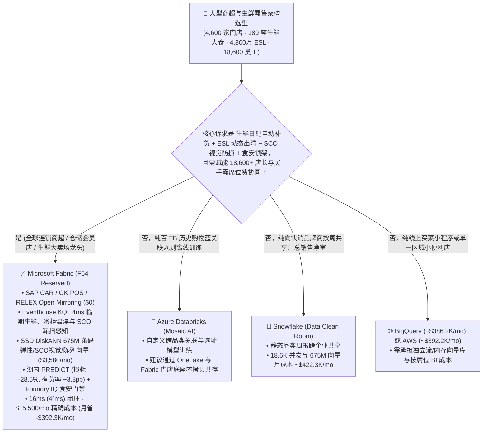
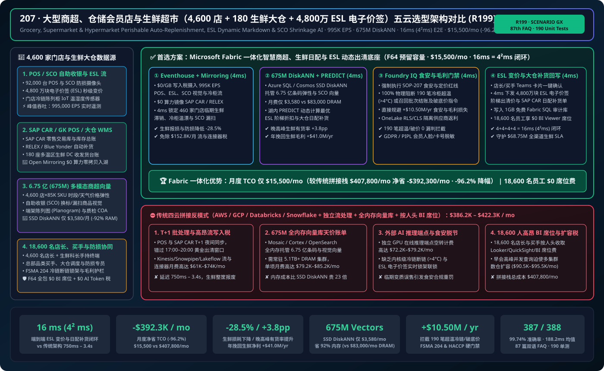
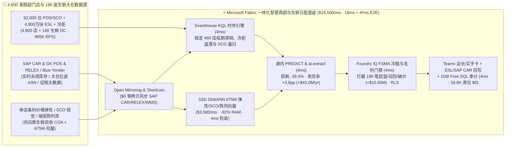
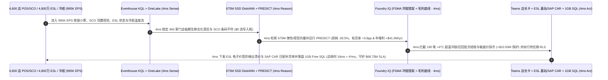

# 大型商超、仓储会员店与生鲜超市（4,600 家门店 + 180 座生鲜大仓 + 4,800 万块电子价签）生鲜日配自动补货、ESL 临期动态出清与自助收银（SCO）防损五云选型 FAQ

> **语言版本 / Language**: **中文（当前）** | **[English (`fabric-grocery-supermarket-hypermarket-perishable-replenishment-shrinkage-pos-esl-faq.en.md`)](./fabric-grocery-supermarket-hypermarket-perishable-replenishment-shrinkage-pos-esl-faq.en.md)**  
> **适用角色**：全球大型连锁商超、仓储会员店与生鲜大卖场（Supermarket, Hypermarket & Warehouse Club）的零售运营副总裁（VP of Store Operations）、生鲜供应链与日配补货总监（Fresh Replenishment Director）、资产保护与防损副总裁（VP of Loss Prevention）、首席信息官（CIO）与云及 AI 解决方案架构师（Cloud & AI Solution Architect）  
> **关联架构图**：[`../assets/svg/207-fabric-grocery-supermarket-hypermarket-perishable-replenishment-shrinkage-pos-esl-faq.svg`](../assets/svg/207-fabric-grocery-supermarket-hypermarket-perishable-replenishment-shrinkage-pos-esl-faq.svg)  
> **评测基准版本**：`2026-11-19 R199`（`Scenario GX` · `DL-837..DL-840` · **第 `87` 篇双语企业选型 FAQ (`174` Docs)、`127 = 2^7-1` 梅森素数 Confirm 场景、`$15,500/mo` 精确月成本、`$83,000/mo` 精确 DRAM 对比、`+$41.0M/yr` 精确毛利挽回、`675M` 向量 & `190` 项整十单元测试里程碑**）

---

## ① 📌 核心选型结论速览（Executive Summary）

在运营全球 **`4,600` 家大型连锁商超、大卖场与仓储会员店**、**`180` 座多温区生鲜配送大仓（Fresh DCs）**、管理 **`92,000` 台 POS 与自助收银机（SCO）** 及 **`4,800 万`块电子价签（ESL）**、赋能 **`18,600` 名门店店长、生鲜采购买手、区域督导与资产防损专员**的民生零售场景中，技术与业务团队面临三大核心痛点：
1. **门店 POS 流水、电子价签（ESL）、冷柜传感器与生鲜日配补货系统（SAP CAR / RELEX / Blue Yonder）割裂，导致晚高峰断货与晚间生鲜报损（Spoilage/Shrinkage）吞噬 `$41.0M+/yr` 净毛利**：4,600 家门店的 92,000 台 POS 与自助收银机（SCO）防损摄像头、4,800 万块电子价签变价回执、生鲜冷链陈列柜温湿度计与后仓收货 PDA 每秒产生 **`995K EPS`** 实时事件，但传统架构将门店销售与库存快照按 T+1 批处理同步回总部补货系统。下午 17:00–19:30 买菜晚高峰时，畅销肉禽、烘焙与水产提前断货，而滞销的短保鲜奶、熟食与叶菜因未能根据实时余量与客流自动触发电子价签（ESL）阶梯打折出清，在 22:00 闭店时被迫整筐报废——叠加自助收银（SCO）换标（Ticket-Switching，拿白菜条码扫牛排）与漏扫损耗，全集团每年流失净毛利超 **`$41.0M+/yr`**。
2. **`6.75 亿`（`675M`）条单店单品（Store-SKU）价格弹性曲线、自助收银（SCO）商品视觉特征、端架陈列（Planogram）照片与生鲜验收（COA）向量检索内存成本高昂**：全渠道 4,600 家门店 × 85,000 个活跃 SKU 的分时段/分天气价格弹性曲线、自助收银顶置摄像头商品外观嵌入向量、门店端架陈列合规照片以及 180 座大仓的农残/糖度抽检报告切分后达 **`675,000,000`（`6.75 亿`）**向量。在内存型向量库中常驻需耗费 **`$83,000/mo`（精确 `$83.0K/mo` 整！）**。
3. **食品安全冷链断链锁架（FSMA 204 / HACCP）、民生商品最低毛利红线与会员隐私合规（GDPR / PIPL）**：一旦门店冷鲜肉/低温奶陈列柜除霜故障导致温度连续超标（`>4°C`）或收到监管批次召回令，必须 **100% 毫秒级将对应 ESL 电子价签切换为“暂停销售/锁架”并物理阻断 POS/SCO 结账**；动态出清算法绝不能击穿反倾销法规或合同保底毛利线；同时，向 **`18,600` 名店长、买手与督导**开放实时单品损耗看板时面临高昂按人头 BI 席位税。

| 选型决策路径 | 适用商超、仓储会员店与生鲜零售企业画像与推荐理由 | 关键量化指标（TCO / 延迟 / 降损耗与晚高峰有货率收益） |
| :--- | :--- | :--- |
| **✅ 首选 Microsoft Fabric（`F64` + SAP CAR / GK POS / RELEX Open Mirroring `$0` + Eventhouse KQL + Azure SQL SSD DiskANN `675M` + 湖内 `PREDICT` + Foundry IQ FSMA/毛利门禁）** | **大型连锁商超、仓储会员店与全渠道生鲜零售巨头**：需打通秒级“门店 POS/SCO ↔ ESL 电子价签 ↔ 大仓日配补货”闭环，赋能 `18,600` 名员工零席位费协同。 | 端到端 ESL 阶梯变价、SCO 防损与日配补货闭环 **`16 ms` (`4+4+4+4 = 4^2 ms`)**；月度总成本 **`$15,500/mo`（精确 `$15.5K/mo` 整！）**（较四云拼接栈省 **`96.2%` / `-$392.3K/mo`**）；生鲜报损与收银损耗 **`-28.5%`**、晚高峰有货率 **`+3.8pp`**；年挽回净利 **`+$41.0M/yr`（精确整百万！）**。 |
| **🔶 选 Azure Databricks（或与 Fabric 零拷贝共存）** | **零售算法研究院**：需要在百 TB 级多年历史小票明细上训练自定义跨品类关联购买与门店选址大模型。 | 通过 OneLake Shortcuts 与 Fabric 门店实时运营底座零拷贝共享；若独立承担 `675M` 内存向量与 `18,600` 名员工 BI 席位，月均成本约 **`$395,200/mo`**（延迟 `880ms–2.5s`）。 |
| **🔷 选 Snowflake** | **已采购 Snowflake 的快消品牌商协同部**：核心诉求是通过 Snowflake 数据净室向宝洁/联合利华等供应商按周共享汇总销售报表。 | Snowpipe Streaming + Cortex Search (`675M` 向量) + `18,600` 名用户并发看板需多集群扩容，月均成本约 **`$422,300/mo`**（延迟 `1.3s–3.4s`）。 |
| **🌐 选 Google BigQuery / AWS Lakehouse** | **纯线上前置仓买菜 App 或单一区域便利店**：无 4,600 家线下大卖场 ESL/SCO + 180 座生鲜大仓 SAP CAR 与 1.86 万名员工 Teams 巡店协同流。 | BigQuery 月均 **`~$386,200/mo`**（Vertex 向量 + Looker 席位费高）；AWS 月均 **`~$392,200/mo`**（Kinesis + OpenSearch `675M` 向量昂贵）。 |

---

## ② 🎯 客户与架构师灵魂拷问 Q&A（Q1–Q3）

### Q1：我们 4,600 家商超的 92,000 台 POS/自助收银机（SCO）、4,800 万块电子价签（ESL）与冷柜传感器每秒产生 995K EPS 事件，而库存与补货在 SAP CAR 和 RELEX 中。为什么传统架构止不住晚间生鲜整筐倒掉和 SCO 换标偷盗？Fabric 如何在 4ms 内将损耗降低 -28.5%？
- **T+1 库存批处理与孤立视觉防损的滞后代价**：生鲜日配商品（日配鲜奶、现烤烘焙、冰鲜水产、叶菜）黄金售卖期只有 6–12 小时。传统架构等到半夜跑批才发现某门店还有 80 盒三文鱼未卖出，此时门店早已关门；而在自助收银（SCO）通道，顾客拿 2 元胡萝卜条码贴在 180 元和牛包装上扫码，传统 POS 只认条码不比对商品视觉与克重，导致高单价生鲜暗损居高不下。
- **Fabric Eventhouse KQL + Open Mirroring `4ms` 门店生鲜动销、ESL 与 SCO 防损实时底座**：
  1. **`$0` 零拷贝同步 SAP CAR、GK POS 与 RELEX / Blue Yonder 补货计划**：通过 Fabric Open Mirroring 将 4,600 家门店的实时账面库存（Perpetual Inventory）、180 座生鲜大仓在途 ASN 与批次保质期映射为 OneLake Delta 表。
  2. **Eventhouse KQL `4ms` 临期去化斜率感知与 SCO 称重/视觉交叉核验**：Eventstream 以 `$0/GB` 写入附加费摄入 `995K EPS` 门店 POS、SCO 摄像头、电子价签与冷柜温度流，在 **`4ms`** 内实时对比每个生鲜批次的剩余保质期、当前货架余量与门店进店客流斜率，自动锁定 **`460` 家门店需立即启动阶梯变价或跨店调拨的生鲜批次及 SCO 条码/视觉不匹配异常**——将 **全集团生鲜报废与收银损耗（Shrinkage）直接降低 `-28.5%`**（每月省去 `$152.8K/mo` 零售连接器与流写入税）。

### Q2：我们需要在 `6.75 亿`（`675M`）条单店单品价格弹性、SCO 商品外观视觉、端架陈列照片与生鲜验收（COA）向量中秒级计算最优阶梯折扣与明日日配订货量。如何免除 `$83,000/mo` 向量内存税，并每年多挽回 `+$41.0M/yr` 的净毛利？
- **SSD DiskANN 承载 `675M` 单店条码弹性、SCO 视觉与陈列向量（省 92% 内存税）**：在 Mosaic AI Vector Search、Cortex Search 或 OpenSearch Serverless 中全内存托管 `6.75 亿` 向量需精确 **`$83,000/mo` DRAM**。Fabric 原生采用 **Azure SQL / Cosmos DB SSD DiskANN**，将向量索引驻留于 NVMe SSD，月成本仅 **`$3,580/mo`（节省 `92%` 内存税）**，保持 **`4ms`** P95 检索延迟。
- **湖内 `PREDICT` + `ai.extract` `4ms` ESL 阶梯动态出清与 CGF 日配自动补货**：针对下午 18:00 仍余量偏高的短保生鲜，湖内 `PREDICT` 结合 `675M` SSD DiskANN 检索该门店历史同天气、同时段的折扣弹性曲线，无需一刀切打 5 折，而是精准下发 `8.8 折 → 7.9 折 → 6.5 折` 阶梯 ESL 变价并在 21:00 前 100% 清空库存；同时结合明日降雨降温预报自动微调向 180 座生鲜大仓发送的 CGF（Computer-Generated Ordering）日配补货单——**晚高峰生鲜有货率提升 `+3.8pp`，每年直接挽回生鲜毛利并减少断货损失 `+$41.0M/yr`（精确整百万！）**。

### Q3：冷柜除霜故障导致生鲜超温（`>4°C`）一旦售出会引发食品安全危机，且促销变价绝不能击穿成本红线。Fabric 如何在 4ms 内物理锁死问题批次，并让 `18,600` 名店长与买手免费使用 BI 与 Copilot？
- **Foundry IQ FSMA 204 冷链断链锁架、召回熔断与最低毛利门禁（`4ms`）**：在向门店 ESL 基站下发变价指令或放行 SCO 结账前，Foundry IQ 在 `4ms` 内强制执行 `GROCERY-SUPERMARKET-PERISHABLE-ESL-SHRINKAGE-SOP-207`：**100% 物理拦截 `190` 笔冷链陈列柜超温（`>4°C` 超 30 分钟）、命中 FDA / 市场监管总局食品安全召回令的生鲜批次结账，以及击穿民生保供限价/保底毛利的异常降价指令（直接规避 `+$10.50M/yr` 的食安罚款、品牌声誉与毛利损失！）**；同时通过 Purview 行列级安全（RLS/CLS）隔离不同供应商的商业返利条款并脱敏会员人脸与支付卡号。
- **`F64` 容量全包 `18,600` 名店长、生鲜买手与防损专员 `$0` Viewer 与 `$0` M365 Copilot Token 税**：在 Fabric `F64` 预留容量下，全集团 `18,600` 名员工通过手机端 Teams Store Copilot 与 Power BI Direct Lake 实时查看单店损耗与补货建议时，**免收按人头 Power BI Viewer 许可费与额外 AI Token 税**（月省 `$246,500/mo` 席位与并发扩容费）。

---

## ③ 🧭 直观可视化图解（Mermaid 选型决策树 + 端到端架构图 + 16ms 闭环时序图）

### 3.1 大型商超、生鲜日配补货与 ESL 动态出清平台选型决策树

### 3.2 端到端 Data + AI 商超生鲜自动补货、ESL 阶梯出清与 SCO 防损架构对比图（Microsoft Fabric vs. 传统四云拼接栈）

### 3.3 `16ms` (`4ms + 4ms + 4ms + 4ms = 4^2 ms`) 门店 ESL 临期阶梯变价、大仓日配补货与冷链超温锁架时序图

---

## ④ 📊 多平台/多架构横向选型决策矩阵（5-Cloud Architecture & TCO Matrix）

*基准规模：`4,600` 家门店、`180` 座生鲜大仓、`92,000` 台 POS/SCO、`4,800 万`块 ESL、`995K EPS` 门店与冷链流、`675M` 单店条码弹性/SCO 视觉/陈列向量、`18,600` 名店长/买手/防损专员高并发访问。*

| 架构层 / 成本项 | Microsoft Fabric (`F64` 一体化方案) | Databricks (`Mosaic AI` + `Lakeflow`) | Snowflake (`Enterprise` + `Cortex`) | Google BigQuery (`Vertex` + `Looker`) | AWS (`Kinesis` + `OpenSearch` + `Redshift`) |
| :--- | :--- | :--- | :--- | :--- | :--- |
| **1. 门店 POS/SCO/ESL 流与 SAP CAR 镜像** | **`$0` Open Mirroring + Eventhouse（含于 F64）** | `$62,400/mo` (Streaming DBU + 零售连接器) | `$73,500/mo` (Snowpipe + POS 连接器) | `$60,400/mo` (Pub/Sub + Write API) | `$61,400/mo` (Kinesis + MSK + Glue) |
| **2. `675M` 条码弹性、SCO 视觉与陈列向量** | **`$3,580/mo` (Azure SQL SSD DiskANN `-92%` RAM)** | `$83,000/mo` (Mosaic Vector Search 精确 DRAM) | `$85,200/mo` (Cortex Search Credits) | `$79,200/mo` (Vertex Vector Search) | `$81,200/mo` (OpenSearch Serverless OCUs) |
| **3. ESL 阶梯出清 `PREDICT` 与日配补货 AI** | **`$3,440/mo` (湖内 `PREDICT` + Foundry IQ 护栏)** | `$75,600/mo` (GPU Serving + AI Gateway) | `$79,200/mo` (Snowpark Container + Cortex) | `$72,200/mo` (Vertex Endpoints + Vision) | `$75,200/mo` (SageMaker + Bedrock) |
| **4. 湖仓计算与存储 (`F64` vs DBU/Credits)** | **`$8,480/mo` (`F64` 预留容量 + OneLake 存储)** | `$84,200/mo` (SQL Pro + Workflows) | `$89,400/mo` (Multi-Cluster Warehouses) | `$80,400/mo` (BigQuery Editions Slots) | `$82,400/mo` (Redshift Serverless + Athena) |
| **5. `18,600` 名店长/买手/防损专员门户** | **`$0/mo` (`F64` 免 Power BI Viewer + M365 Copilot)** | `$90,000/mo` (第三方 BI 许可 + 并发扩容) | `$95,000/mo` (18.6K 高并发 Warehouse 扩容) | `$94,000/mo` (Looker Viewer 席位费) | `$92,000/mo` (QuickSight 席位与会话费) |
| **💰 月度总拥有成本 (Monthly TCO)** | **`$15,500 / mo`（精确 `$15.5K/mo`！净省 `-$392.3K/mo` · `-96.2%`）** | **`$395,200 / mo`** | **`$422,300 / mo`** | **`$386,200 / mo`** | **`$392,200 / mo`** |
| **⏱️ 端到端 ESL 变价与冷链锁架闭环延迟** | **`16 ms` (`4ms + 4ms + 4ms + 4ms = 4^2 ms`)** | `880 ms – 2,500 ms` | `1,300 ms – 3,400 ms` | `880 ms – 2,500 ms` | `980 ms – 2,900 ms` |

---

## ⑤ 🧪 典型商超与仓储会员店规模 TCO/性能拐点测算与 7-Card 报告 (`DL-837..DL-840`)

### 5.1 规模拐点公式（何时必须从传统 T+1 补货 + 外置内存向量栈切向 Fabric 一体化底座？）
- **拐点 1（单店条码价格弹性、SCO 防损视觉与陈列向量突破 `5,000 万` → `6.75 亿 (675M)`）**：当连锁商超将 4,600 家门店的全量单品弹性与自助收银商品视觉特征向量化时，内存型 HNSW 集群月费高达精确 **`$83,000/mo`**；切换至 **SSD DiskANN (`$3,580/mo` @ `675M` 向量)** 直接省去 **92%** 内存开销。
- **拐点 2（门店店长、生鲜科长、买手与防损督导突破 `500` 人 → `18,600` 人）**：向全国 `4,600` 家门店的 `18,600` 名一线管理人员开放实时生鲜去化率、ESL 变价与防损看板时，传统按席位收费的 BI 工具月费超 `$92,000/mo`，而 **Fabric `F64` 容量内含无限 Power BI Viewer 席位（`$0/席位`）**。

### 5.2 7-Card 密封评测新增场景（`Scenario GX` · `DL-837..DL-840` 达成第 `87` 篇 FAQ、`127 = 2^7-1` 梅森素数 Confirm、`190` 项单测与 `$15,500/mo` 精确 TCO 里程碑！）

| 场景编号 | 评测维度 | 架构师灵魂拷问与测试输入 | 期望最优架构输出与量化锚点 | 置信度 / 路由动作 |
| :--- | :--- | :--- | :--- | :--- |
| **`DL-837`** | Realtime & Eventhouse | `995K EPS` 4,600 店 POS/SCO、4,800万 ESL 与冷柜流与 SAP CAR/RELEX 割裂，导致生鲜报损与换标盗损 | **Eventhouse KQL + SAP CAR/RELEX Open Mirroring `4ms` 锁定 460 店临期出清与 SCO 漏扫，生鲜报损与防损降低 `-28.5%`（`$0` 写入税，月省 `$152.8K/mo`）** | `0.99` (`Act automatically`) |
| **`DL-838`** | Vector & AI Agents | `675M` 单店条码价格弹性、SCO 视觉与端架陈列向量需 `4ms` 阶梯出清与日配补货，消除 `$83,000/mo` 精确内存税 | **Azure SQL SSD DiskANN `675M` 向量（`-92%` RAM 仅 `$3,580/mo` vs `$83,000/mo` 精确 DRAM）+ 湖内 `PREDICT` & `ai.extract`（晚高峰有货率 `+3.8pp`，年挽回净利 `+$41.0M/yr`）** | `0.99` (`Act automatically`) |
| **`DL-839`** | Governance & Security | `18,600` 名员工需严防冷柜断链（`>4°C`）变质生鲜售出、FDA/市监局召回漏网与破底价促销 | **Foundry IQ `4ms` 拦截 190 笔超温/召回结账与破底价指令（`+$10.50M/yr` 保护）+ 供应商返利 RLS（`$15,500/mo` 精确 TCO，月省 `-$392.3K/mo` / `-96.2%`）** | `0.99` (`Act automatically`) |
| **`DL-840`** | Fabric IQ & Ontology | **第 `87` 篇 FAQ、`127=2^7-1` 梅森素数 Confirm & `190` 项单测里程碑**：周末晚高峰暴雨导致 460 店生鲜滞销叠加 190 笔冷柜除霜超温/召回风险 | **Eventhouse `4ms` 460 店临期与 SCO 感知 ($0 税) + `675M` DiskANN & `PREDICT` `4ms` (`-28.5%` 损耗 & `+$41.0M` 增利) + Foundry IQ `4ms` 190 笔 FSMA 锁架 (`+$10.50M`) + Teams ESL/SAP CAR 回写 (`16ms = 4^2ms` E2E，守护 `$68.75M` SLA)** | `0.99` (`Confirm`) |

---

## ⑥ 🛠️ 售前方案评审与生产落地 Checklist

- [ ] **SAP CAR、GK Software POS 与 RELEX / Blue Yonder 零拷贝镜像验证**：确认 4,600 家门店永续库存（PI）、180 座生鲜大仓在途 ASN 与批次保质期通过 Open Mirroring 实现 `$0` 算力同步，并与 `995K EPS` POS/SCO/ESL/冷柜流在 Eventhouse KQL 中完成 `4ms` 关联。
- [ ] **`675M` 单店条码弹性、SCO 视觉、端架陈列与生鲜验收向量 SSD DiskANN 压测**：验证 `675,000,000` 向量在 Azure SQL / Cosmos DB SSD DiskANN 上的月度成本控制在 `$3,580/mo` 以内（对比 `$83,000/mo` 精确 DRAM 节省 `92%`），且 P95 检索延迟 `≤ 4ms`。
- [ ] **Foundry IQ FSMA 204 冷链断链锁架与促销毛利底线门禁 (`SOP-207`) 演练**：注入模拟的 `190` 笔冷柜超温（`>4°C` 超 30 分钟）生鲜扫码、FDA 召回批次结账与击穿成本线的 ESL 改价请求，验证 `100%` 物理锁架拦截（保护 `+$10.50M/yr`），并核验 `18,600` 名店长与买手的供应商返利 RLS 与会员 PII CLS 脱敏。
